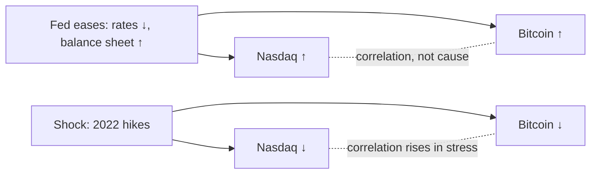

# 01. How to read macro charts

Every later chapter in this course puts a chart in front of you and asks what it means: a yield curve dipping below zero, unemployment turning up from a low, bitcoin sitting under a "fair value" line, a correlation coefficient of 0.44. The same few tricks can make those charts look more convincing than they are. The vertical scale can be stretched, the series can be a level or a rate of change, a few lucky data points can carry the conclusion, or a relationship can quietly stop working. This chapter is the toolkit. Each idea comes with a small worked example in numbers, so you can redo it yourself, and the examples use real figures from the course's [macro lab report](../../tools/macro-lab/REPORT-2026-10-30.md) (FRED data through 29 Oct 2026) and the research behind the course.

**You will learn:**
- why multi-year asset charts belong on a log scale, and what "equal distance" means on each scale;
- the difference between a level, a change in percentage points and a percentage change, and how YoY, MoM and annualised rates relate;
- how moving averages (SMA and EMA) are calculated and why weekly closes matter more than intraday wicks;
- how a log-regression "fair value" line and its bands are built, and how a normalised 0–1 "risk" scale is built in principle;
- how to read a correlation coefficient, a rolling correlation and a lead/lag table;
- the statistics traps that catch most macro arguments: overlapping windows, tiny samples (nine US recessions since 1960), regime change, unfinished windows, revisions and curve-fitting.

---

## Scales: log versus linear

**The idea.** On a linear (arithmetic) axis, equal vertical distances are equal *dollar* changes. On a logarithmic axis, equal vertical distances are equal *percentage* changes.

**Worked example.** Bitcoin goes from $10,000 to $20,000, and later from $60,000 to $70,000. Both moves add $10,000, so on a linear chart they are the same height. The first move is +100%, the second +16.7%. On a log10 axis the positions are:

| Price | log10(price) | Distance from the previous point |
|---|---|---|
| $10,000 | 4.000 | |
| $20,000 | 4.301 | 0.301 (a doubling) |
| $60,000 | 4.778 | |
| $70,000 | 4.845 | 0.067 |

The doubling is 4.5 times taller than the +16.7% move on the log chart, which is how an investor experiences it.

**Rules of thumb.**
- Use a log scale for any asset chart that spans several years or several multiples (bitcoin, the Nasdaq since the 1970s, M2 since 1960). A linear chart of bitcoin since 2013 makes everything before 2020 look flat and exaggerates recent moves.
- Trendlines, regression lines and "bands" on assets only make sense in log space, because growth compounds.
- Use a linear scale for rates and spreads that can be zero or negative (fed funds, the 10y–2y spread, unemployment). You cannot take the log of −0.5.
- A chart with two axes (for example bitcoin on a log axis and the dollar index on a linear axis) can be scaled to make almost any two lines "match". Check both axes before you believe an overlay.

---

## Levels, changes and rates of change

**Percentage points versus percent.** Unemployment rose from 3.4% (April 2023) to 4.5% (November 2025, revised data; first printed as 4.6%). That is a rise of 1.1 **percentage points** (pp), which is also a rise of 32% in the rate itself. Macro writers almost always mean pp. If a headline says "unemployment up 32%", it is technically true and very misleading.

**Basis points.** One basis point (bp) is 0.01 pp. The Fed's September 2026 hike took the upper bound of the target range from 3.75% to 4.00%: +25 bp, or +0.25 pp, or +6.7% in relative terms. Rates people always speak in bp.

**Level versus change.** Many indicators matter through their *change*, not their level. The Sahm rule ([chapter 05](05-THE-LABOR-MARKET.md)) does not care whether unemployment is 4% or 7%; it asks how far the three-month average has risen from its 12-month low. In the lab's table of unemployment lows before recessions, the rise from the low to the recession start was only 0.2–1.0 pp in every case since 1960, from very different levels (3.4% in 1969, 7.2% in 1981).

**Year-over-year (YoY), month-over-month (MoM) and annualised.**
- YoY = this month's index ÷ the same month last year − 1.
- MoM = this month ÷ last month − 1.
- MoM annualised = (1 + MoM)^12 − 1.

Worked example: core CPI rises 0.3% in a month. Annualised, that is 1.003^12 − 1 = **3.66%**. A 0.2% month annualises to **2.43%**. That is why a "0.3" print worries a central bank with a 2% target, while a "0.2" print is close to target. A three-month annualised rate (compound the last three monthly changes, then raise to the fourth power) is a middle ground: faster than YoY, less noisy than a single month.

**Base effects.** YoY compares with a moving starting point, so it can change even when prices stand still. Toy example: a price index sits at 100 in January and February, jumps to 102 in March, then stays flat. YoY inflation reads 2% every month from March until the following February, then drops to 0% in March of the next year, although nothing happened that month. The real 2026 case: energy pushed US CPI up 0.87%, 0.64% and 0.47% MoM in March, April and May 2026 (per the course's Fed and inflation research). When those months roll out of the YoY window in March–May 2027, headline YoY will fall mechanically even if prices stay high. [Chapter 04](04-INFLATION.md) uses this repeatedly.

### Rebased overlays and "ROI" as a price ratio

Analog charts put several periods on one axis by **rebasing**: divide each series by its value on an anchor date and multiply by 100 (or leave it as a ratio). With the July 2026 memo's 1 January anchor of about $89,300, bitcoin at $65,300 in mid-July reads 73 on a chart rebased to 100.

Cowen's written reports use "ROI" in this ratio sense: "current price divided by the stated reference price" ([Bitcoin Cycle Memo, July 2026](https://benjamincowen.com/reports/bitcoin-cycle-memo-july-2026)). So an ROI of **0.520** from the cycle peak means the price is 52% of the peak, a 48% drawdown. A year-to-date ROI of **0.731** means −26.9% since 1 January. An ROI of 4.0 from the cycle bottom means four times the bottom price. Read every Into The Cryptoverse overlay this way: 1.0 is "unchanged", not zero.

His memos apply the same method well beyond bitcoin: the S&P 500, gold and even the 10-year yield rebased to 1 January and laid over 2018 and 2022 (the 10-year was "+27% YTD" in [The Triple Squeeze, 30 Sep 2026](https://benjamincowen.com/reports/the-triple-squeeze-september-2026)), and the dollar index and bitcoin rebased to 100 at each presidential inauguration ([The Balance of Risks, 15 Aug 2026](https://benjamincowen.com/reports/the-balance-of-risks-august-2026)). Three cautions:
- **The anchor date drives the picture.** Rebasing to 1 January, to a cycle low or to an inauguration produces different "matches" from the same data.
- **Rebasing a yield gives a percentage change in the yield, not in a price.** A 10-year yield going from 4% to 5% is "+25%" on a rebased chart but +1 pp in bond terms, and it means a *fall* in bond prices.
- **Analogs are chosen after the fact.** Cowen himself called the inauguration-aligned dollar analog the "lightest evidentiary leg" of his August 2026 memo. With two or three comparison years, a close overlay is a description, not evidence ([chapter 09](09-SEASONALITY-AND-POLITICAL-CYCLES.md)).

---

## Moving averages, closes and oscillators

### Simple and exponential moving averages

**SMA (simple moving average)** over n periods is the plain average of the last n values. **EMA (exponential moving average)** gives recent values more weight: EMA_today = α × value_today + (1 − α) × EMA_yesterday, with α = 2 / (n + 1).

Worked example with five weekly closes: 100, 102, 101, 105, 110.
- 3-week SMA at the last week = (101 + 105 + 110) / 3 = **105.3**.
- 3-week EMA (α = 0.5), started at 100: 101.0 → 101.0 → 103.0 → **106.5**.

The EMA reacts faster to the jump to 110. In an uptrend an EMA sits above the SMA of the same length; in a downtrend it sits below.

**Where you will meet them.** Benjamin Cowen's Bull Market Support Band is the zone between the 20-week SMA and the 21-week EMA of bitcoin's weekly closes. In the lab report (week ending 1 Nov 2026) the band was **$72,965 / $76,677** and the 200-week SMA was **$67,497**. [Chapter 10](10-BITCOIN-CYCLES-AND-VALUATION-MODELS.md) covers what those levels have meant historically.

**A moving average is a moving target.** In July 2026 Cowen wrote that a sustained weekly reclaim of the 50-week SMA (then about $86.5k) would weaken his bearish thesis ([Bitcoin Cycle Memo, July 2026](https://benjamincowen.com/reports/bitcoin-cycle-memo-july-2026)). By late October the 50-week had fallen to about $76k as 2025's high prices dropped out of its window. Price was above it, but crossing a falling average is a weaker event than crossing a rising one. Always note the slope of the average, not only which side price is on.

### Weekly and monthly closes versus wicks

A candle's "wick" is the intraday extreme; the "close" is the last price of the period (for crypto, usually Sunday 00:00 UTC for weekly candles). Cowen's rule is that closes matter more than wicks. Example from the research: bitcoin's first weekly close below the 200-week SMA in 2026 came in the week ending 28 Jun 2026, at $59,517 against a 200-week value of about $62.4k. Intraday dips below the line earlier in June did not count as a "loss" of the level. Different exchanges close at different times, so "the" weekly close can differ by a few hundred dollars between data sources.

### Oscillators: the RSI as an example

An oscillator turns price into a bounded number. The Relative Strength Index (RSI) over n periods is RSI = 100 − 100 / (1 + RS), where RS = average gain ÷ average loss over those n periods.

Worked example: over 14 weeks the average weekly gain is 2% and the average weekly loss is 1%. RS = 2, so RSI = 100 − 100/3 = **66.7**. Readings above 70 are conventionally "overbought" and below 30 "oversold". For bitcoin, the research notes weekly RSI around 25–30 at the ends of the 2015, 2018 and 2022 bear markets. A **bearish divergence** (price makes a higher high while RSI makes a lower high) appeared into the 2021 and 2025 tops, but divergences can persist for months, so they warn rather than time.

---

## Regression lines and bands

### How a log-regression "fair value" line is built

1. Take each daily (or weekly) price P and its age t, measured in days since bitcoin's genesis block (3 Jan 2009).
2. Transform both: y = log10(P), x = log10(t).
3. Fit a straight line y = a + b·x by ordinary least squares. In price terms that is P = 10^a × t^b, a **power law**.
4. The line is the "fair value". The vertical gap between today's log price and the line is the **residual**.
5. Compute the standard deviation σ of all residuals. Bands are drawn at the line ± 1σ, ± 2σ (or at fixed multiples).

**Worked example from the lab.** The lab fitted log10(price) = a + 5.84 × log10(days since 2009-01-03) on FRED's bitcoin data from December 2014. On 29 Oct 2026:
- fair value = **$147,386**; price = $77,939; price ÷ fair = **0.53**;
- residual = log10(0.529) = **−0.277** (in log10 units);
- the lab reports this as **−1.17σ**, which implies σ ≈ 0.277 / 1.17 = **0.236** log10 units. A 1σ step is therefore a factor of 10^0.236 ≈ **1.72**.

From those numbers (our arithmetic, not a forecast): the −1σ band is about $147,386 / 1.72 ≈ **$85.5k**, the −2σ band about **$49.6k**, and the +1σ band about **$254k**. Price sat between −1σ and −2σ.

**Same method, different answer.** The course's crypto research ran its own fit on daily data from August 2010: slope 5.63, σ = 0.301 (a factor of about 2.0), fair value about **$144k**, and price at **−0.88σ**. The two fits differ only in start date and data source, yet one puts price near −0.9σ and the other near −1.2σ. Treat any "fair value" as a property of the fit, not of bitcoin.

**Why symmetric bands fail at tops.** In the research fit, bitcoin's residuals at cycle tops were +3.47σ (2013), +2.72σ (2017), +1.57σ (2021) and **+0.29σ (2025)**, while lows sat in a narrow −0.76σ to −1.15σ zone. A band rule like "tops happen at +2σ" would never have fired in 2021 or 2025. This is diminishing returns showing up as shrinking residuals. Cowen's "fair value logarithmic regression" (fitted only to non-bubble data) and his 2026 asymmetric quantile-regression fan ([report, 29 May 2026](https://benjamincowen.com/reports/asymmetric-tail-curvature-in-bitcoin-price-quantiles)) are attempts to fix this; chapter 10 discusses them.

### Z-scores

A z-score says how many standard deviations a value sits from its mean: z = (value − mean) / σ. The regression residual above is a z-score of the residual. A z-score is only meaningful if the history used for the mean and σ is long and stable. If volatility shrinks over time (as bitcoin's has), an old σ makes today's moves look small. MVRV-Z (chapter 11) is another z-score you will meet.

---

## Normalised 0–1 "risk" scales

Several tools in Cowen's world (his price "risk metric", on-chain risk, social risk, the Into The Cryptoverse macro recession-risk and liquidity-risk dashboards) squeeze an indicator into a number between 0 and 1. The formulas behind his metrics are proprietary. What follows is the generic idea, in our own words, not his formula.

**Step 1: pick a measure of extension.** For example x = ln(price ÷ anchor), where the anchor is a long moving average or a regression fair value.

**Step 2 (optional): correct for diminishing returns.** Because each cycle's top is a smaller multiple, the raw extension at each top shrinks. Builders multiply x by a factor that grows with time, chosen so past tops end up at similar heights.

**Step 3: rescale to 0–1.** The simplest method is min–max: risk = (x − x_min) / (x_max − x_min). A percentile rank (the share of history below today's value) is the other common method.

**Worked example (made-up numbers).** Suppose the time-adjusted extension has ranged from −0.60 at the deepest low to +1.20 at the highest top, and today it is +0.10. Min–max risk = (0.10 + 0.60) / (1.20 + 0.60) = 0.70 / 1.80 = **0.39**. If 45% of all past days had a lower extension, the percentile-rank version reads **0.45**.

**How to read such a scale.**
- It is a position on the asset's own historical ladder, not a probability. The Into The Cryptoverse help text describes it the same way. "Risk 0.39" does not mean a 39% chance of anything.
- **It repaints.** A new all-time extreme changes x_min or x_max, which shifts every past reading. Old screenshots and today's chart can disagree about what "risk was" on the same date.
- **The time-correction is fitted with hindsight.** It is chosen to make old tops line up, so its out-of-sample record is shorter than the chart suggests.
- **Composites average the problems.** Cowen's "total risk" averages price, on-chain and social risk. Each input is 0–1, so the average is too, but the weights are a choice.
- The macro versions work the same way. The ITC liquidity-risk score, per its public help text, takes five monthly inputs (effective fed funds, the 2-year yield, the dollar index, the change in Fed assets and the change in M2), combines them into one factor, smooths it over six months and expresses it as a percentile rank since January 2003. The recession-risk composite read **0.024** in August 2026, "near the floor", per Cowen's [Balance of Risks memo](https://benjamincowen.com/reports/the-balance-of-risks-august-2026). Near zero on that scale means "these data look unlike past recessions", not "recession impossible".

---

## Correlation, causation and lead/lag

### The correlation coefficient

Pearson's r runs from −1 (perfect opposite movement) through 0 (no linear relation) to +1 (perfect co-movement). Squaring it gives the share of variance "explained" in a straight-line sense. An r of 0.44 gives r² = 0.19: about a fifth of the weekly variation is shared and four-fifths is not.

**Correlate changes, not levels.** Two series that both trend upward (bitcoin and M2 since 2010) will show a high correlation of *levels* whether or not one drives the other. That is a spurious correlation. The lab correlates weekly log returns or weekly changes for this reason.

### Rolling correlation: the lab's table

The lab computed the correlation of bitcoin's weekly log return with three other series, for the whole sample and year by year:

| BTC weekly return vs | all weeks | 2017 | 2019 | 2020 | 2022 | 2025 | 2026 |
|---|---|---|---|---|---|---|---|
| Nasdaq weekly return | 0.21 | −0.03 | −0.09 | 0.30 | 0.44 | 0.41 | 0.30 |
| Broad dollar weekly return | −0.08 | 0.19 | −0.01 | −0.28 | −0.23 | −0.09 | −0.11 |
| 10y real yield, weekly change | −0.06 | −0.09 | 0.11 | −0.36 | −0.07 | 0.09 | −0.06 |

Selected years from the [lab report](../../tools/macro-lab/REPORT-2026-10-30.md); the full table runs 2016–2026.

What to take from it:
- **The full-sample number hides the regimes.** "BTC–Nasdaq correlation is 0.21" is true on average, but the yearly values range from −0.09 (2019) to 0.44 (2022). Correlation with stocks was strongest in macro-driven years (2022's hiking cycle).
- **Small numbers are mostly noise.** With about 52 weekly observations a year, a yearly r between roughly −0.27 and +0.27 is hard to tell apart from zero. Most of the dollar and real-yield values sit in that range.
- **Frequency changes the answer.** The course's cross-asset research found a *daily* BTC–S&P correlation of −0.02 for 2025, while the lab's *weekly* figure for 2025 is 0.41. Bitcoin trades around the clock while the stock market closes at 4 pm New York time, so daily pairs are out of sync and daily correlations are biased toward zero. Weekly is more robust; always ask which frequency a quoted correlation uses.

### Correlation is not causation

A correlation can come from a common driver. In 2020–21 Fed easing lifted both bitcoin and the Nasdaq; neither caused the other. It can come from reverse causation, or from coincidence in a short sample.

### Lead/lag tables

To ask "does X lead Y?", shift X forward by k periods and correlate X(t) with Y(t + k) for several k. If the correlation peaks at k = 8 weeks, X has tended to move about 8 weeks before Y in that sample.

The lab's two tests:

| Net liquidity leads BTC by | 0 w | 4 w | 8 w | 12 w | 16 w | 26 w |
|---|---|---|---|---|---|---|
| Correlation (13-week changes) | 0.18 | 0.19 | 0.19 | 0.15 | 0.11 | 0.06 |

| US M2 YoY leads BTC YoY by | 0 m | 2 m | 3 m | 6 m | 9 m | 12 m |
|---|---|---|---|---|---|---|
| Correlation (monthly) | 0.18 | 0.22 | 0.22 | 0.25 | 0.22 | 0.10 |

How to read them honestly:
- The profiles are **flat**: 0.18, 0.19, 0.19 are statistically the same number. A flat profile is what two series with a loose shared trend produce. It is not evidence of a precise "10–12 week lead".
- The peak correlations are low (about 0.2–0.25, so r² of about 4–6%).
- The course's liquidity research found that net liquidity and bitcoin moved closely in levels in 2019–2022 (r = 0.81) and in *opposite* directions in 2023–2026 (r = −0.26). A lag chosen in one regime may fail in the next. [Chapter 07](07-LIQUIDITY-MONEY-AND-THE-DOLLAR.md) has the details.

---

## Statistics traps

### Overlapping windows inflate correlations

A monthly YoY series shares 11 of its 12 months with the next month's value. Ten years of monthly YoY data give 120 numbers but only about **10 independent years**. Correlations between two YoY series look smoother and stronger than the evidence supports, and standard significance tests are far too generous. The lab report says it plainly under its M2 table: "Overlapping YoY windows inflate correlations; treat these as descriptive." The same applies to 13-week changes sampled weekly (the net-liquidity table) and to rolling 365-day correlations.

### Small samples: nine recessions since 1960

The NBER has dated **nine** US recessions since 1960 (the lab lists them from 1960-05 to 2020-03). The daily 10y–3m yield-curve series starts in 1982, so the lab's inversion table can only test four of them (1990, 2001, 2008, 2020), spread over five inversion episodes. Any rule about recessions, such as "the recession comes 9–17 months after inversion", rests on a handful of cases, and one was caused by a pandemic. Crypto is thinner still: bitcoin has had three or four full cycles. Cowen himself flags this. His midterm-year templates rest on 2014, 2018 and 2022, and the research notes that BTC monthly seasonality has 13 observations per calendar month, which is not statistically significant for any single month.

A practical rule: with fewer than about ten cases, describe what happened in each case ("in 1989, 2000, 2006 and 2019 ...") instead of quoting an average as if it were a law.

### False positives and base rates

The lab's Sahm-rule table lists 12 real-time triggers since 1960. Ten came with a recession within 12 months; two (1976 and 2024) did not. "The Sahm rule has a great record" and "the Sahm rule fired falsely in 2024" are both true. Always count the misses alongside the hits, and ask how often the signal fires with *no* recession.

### Unfinished windows (censoring)

The lab's 10y–3m table shows an inversion from 2025-03 to 2025-09, and its recession column reads "none yet (window open to 2028-03)". That label is the honest one: by October 2026 only about 19 months had passed since March 2025, so the 36-month window is not finished. A careless table (or reader) that writes "none within 36 m" here turns "no recession yet" into "no recession within 36 months", which nobody can know until March 2028. The same caution applies to every "this time it failed" claim made while the clock is still running.

### Regime change

Relationships depend on the regime that produced them. Examples from this course's data:
- BTC–Nasdaq weekly correlation went from about 0 (2016–2019) to 0.44 (2022) as institutions arrived and rates became the dominant driver.
- Copper/gold tracked the 10-year yield closely from about 2000 to 2021, then broke from 2022 to 2026 as central banks bought gold and yields rose on inflation and deficits ([chapter 08](08-STOCKS-GOLD-AND-CROSS-ASSET.md)).
- The textbook sequence "curve inverts → Fed cuts → curve un-inverts → recession" held in 1990, 2001, 2008 and 2020, then failed in 2022–2026 ([chapter 03](03-BONDS-AND-THE-YIELD-CURVE.md)).

When a chart shows a beautiful fit over 30 years, ask whether the last five years look like the first 25.

### Survivorship and curve-fitting

**Survivorship:** we remember indicators that worked. Many top signals were promoted after they caught the 2013 and 2017 tops. The Pi Cycle Top crossed within days of the 2013 and 2017 tops, then caught only the April 2021 mid-cycle high and gave no signal at all in 2024–25.

**Curve-fitting:** with enough free parameters any history can be matched. Stock-to-flow fitted two halvings and then projected values several times higher than the prices that followed. Cowen's 2026 study found it overpredicted on about 95% of days from 2019 to 2026, with a geometric-mean error of about **+295%**, against about **+32%** for a simple power law calibrated to 2018 data. Every extra knob (start date, smoothing length, time-decay factor) is another chance to fit noise. Prefer simple models, test them on data they were not fitted to, and distrust any model whose author changed the parameters after a miss.

### Revisions, real-time data and missing data

Macro data are revised, sometimes heavily:
- **Payrolls:** the preliminary benchmark revision for the year to March 2025 was **−911k** (published 9 Sep 2025, the largest on record), finalised at −898k in February 2026.
- **Unemployment:** November 2025 was first printed at 4.6% and now reads 4.5% in revised data.
- **Annual benchmark revisions (data vintages):** the Bureau of Economic Analysis periodically re-measures the national accounts and the PCE price index. In September 2026 Cowen noted that part of the August PCE "surprise" (3.4% headline / 3.0% core against a 3.7% / 3.3% consensus) came from the annual revision: July's figures were revised from 3.7% / 3.3% to 3.4% / 3.0% ([The Triple Squeeze](https://benjamincowen.com/reports/the-triple-squeeze-september-2026)). The economy had not changed; the measurement had. Compare a new print with the *revised* previous month, not the one you remember.
- **Missing months:** the October 2025 household survey was never collected because of the federal shutdown, so FRED has a gap.
- **Real-time versus revised:** FRED's `SAHMREALTIME` uses the data as first published; `SAHMCURRENT` uses today's revised data. When you backtest a signal, use real-time vintages if they exist. Otherwise you are testing against information nobody had at the time.

### Seasonal adjustment

Most US macro series are published seasonally adjusted (SA) to remove regular calendar patterns: holiday hiring, summer auto-plant retooling in jobless claims, January price resets. SA and not-seasonally-adjusted (NSA) YoY numbers can differ by about 0.1 pp for CPI. Seasonal factors are themselves re-estimated (for CPI, five years of factors are revised each February), which is one more source of revision. Asset seasonality, such as "September is weak", is a different topic. It is a statistical pattern in returns, not an adjustment ([chapter 09](09-SEASONALITY-AND-POLITICAL-CYCLES.md)).

### Monthly averages versus daily closes

The lab uses monthly averages for the yield curve, which smooths out spikes. Its deepest monthly 10y–3m reading in the 2022–24 episode is **−1.73 pp**; the deepest *daily* close was **−1.89 pp** (4 May 2023). The lab's 2s10s low is −0.93 pp monthly versus −1.08 pp daily (3 Jul 2023). Dates shift too: an "inversion start" can differ by a month or more depending on whether you use daily data, monthly averages, or merge short gaps. That is why different sources quote slightly different lags for the same episode.

### Recession shading is drawn after the fact

The grey bars on FRED charts are NBER recession dates. NBER announces them months after the fact: about 4 months for the February 2020 peak, 8 months for March 2001 and 12 months for December 2007. In real time, nobody sees the grey bar. When a chart shows an indicator "turning exactly at the start of the recession", remember that the investor living through it did not know the recession had started.

---

## A chart-reading checklist

| Question | What can go wrong | Quick fix |
|---|---|---|
| What is the scale? | Linear scale hides early history; two axes can be stretched to "match" | Use log for multi-year assets; check both axes |
| Level or change? | pp versus %; YoY hides recent momentum | Look at 3-month annualised alongside YoY |
| What frequency and what close? | Daily crypto vs stock closes out of sync; wicks vs closes | Prefer weekly closes for cross-asset work |
| How many independent cases? | Nine recessions since 1960, three or four crypto cycles, overlapping windows | List the cases; do not quote averages as laws |
| Is the window finished? | "No recession within 36 months" with only 19 months elapsed | Check the dates against today |
| Same regime? | Correlations and lags flip between regimes | Compare early and late sub-samples |
| How many parameters were tuned? | Curve-fitting, repainting 0–1 scales | Favour simple models; ask for out-of-sample tests |
| Real-time or revised data? | Backtests use information nobody had | Use real-time vintages (e.g. `SAHMREALTIME`) |
| What is the anchor of a rebased overlay? | "ROI 0.52" misread as +52%; anchor date chosen to fit | Read ROI as price ÷ reference price; try other anchors |

---

## Putting it together

1. **A linear-scale bitcoin chart since 2013 shows a "parabolic" 2024–25 → switch to log scale → the 2025 rise from the 2022 low was about 8x, against about 21x in 2018–21 and 112x in 2015–17 → the picture becomes "diminishing returns", not "acceleration".** The same switch is what makes regression bands possible at all.
2. **CPI YoY falls in spring 2027 → check MoM and 3-month annualised → if the monthly run rate is still hot, the YoY drop is a base effect from March–May 2026 energy months rolling off → the Fed would not treat it as disinflation.** The reverse happens when a soft month rolls off (June 2026's −0.42% month will push YoY *up* in June 2027).
3. **A video shows a correlation of 0.44 between bitcoin and the Nasdaq → ask: which year, which frequency? → 2022 weekly, a hiking year → in 2019 it was −0.09 → the link is a regime feature of tightening years, not a constant.** Exception: in 2025 the daily figure was about zero while the weekly figure was 0.41, purely because of trading hours.
4. **An overlay shows M2 YoY "leading" bitcoin by 6 months → check the lead/lag table → the peak is 0.25 at 6 months but 0.22 at 2, 3 and 9 months → flat profile, overlapping YoY windows → treat as a loose shared regime, not a timing tool.**
5. **A 0–1 risk reading of 0.35 today → ask how it is normalised and whether it repaints → if the next top sets a new extreme, today's 0.35 may later be redrawn lower → use it as a rough position on the ladder, not as a probability or a trigger.**
6. **The 10y–3m curve inverts → history (1989, 2000, 2006, 2019) says a recession followed 9–17 months later → but that is five episodes covering only four recessions on this series, and 2022–24 failed → treat inversion as raising the odds, then wait for confirming data such as claims, unemployment and credit spreads ([chapter 13](13-HOW-IT-ALL-CONNECTS.md)).**

---

## Check yourself

1. Unemployment rises from 4.0% to 4.5%. State the change in percentage points and in percent.
2. Core CPI rises 0.4% in one month. What is the annualised rate, roughly?
3. A price index jumps 3% in April 2026 and is flat afterwards. What does YoY inflation do in April 2027, and why?
4. Compute the 3-period SMA and the 3-period EMA (start the EMA at the first value) for 50, 50, 56.
5. A log-regression fit gives fair value $100,000 and residual σ = 0.25 log10 units. Price is $56,000. Roughly how many σ below fair value is it?
6. Why can a 0–1 risk metric show a different value for 1 March 2024 today than it showed on 1 March 2024 itself?
7. The lab labels the 2025-03 yield-curve inversion "none yet (window open to 2028-03)". Why would it be wrong to call that a failed signal?
8. A study finds a 0.9 correlation between the *levels* of M2 and bitcoin since 2012. Why is that weak evidence?

Answers

1. +0.5 pp, which is +12.5% (0.5 / 4.0).
2. 1.004^12 − 1 ≈ 4.9%.
3. YoY drops by about 3 pp in April 2027, because the April 2026 jump leaves the 12-month window. That is a base effect, not new price behaviour.
4. SMA = (50 + 50 + 56) / 3 = 52. EMA with α = 0.5: 50 → 50 → 53.
5. log10(56,000 / 100,000) = log10(0.56) ≈ −0.25, so about −1σ.
6. Because it is normalised against the full history: a new extreme (or a re-fitted time correction) changes the scale and repaints all past values.
7. The window is unfinished: only about 19 months had passed by October 2026, so "no recession within 36 months" cannot be judged before March 2028.
8. Both series trend upward over time, so their levels correlate whether or not one drives the other (a spurious correlation). Correlate changes instead, and test across regimes.

---

> Educational material, not financial advice. Past relationships between indicators can break.

[← 00 Index](00-INDEX.md) | [Index](00-INDEX.md) | [02 The Fed and interest rates →](02-THE-FED-AND-INTEREST-RATES.md)
