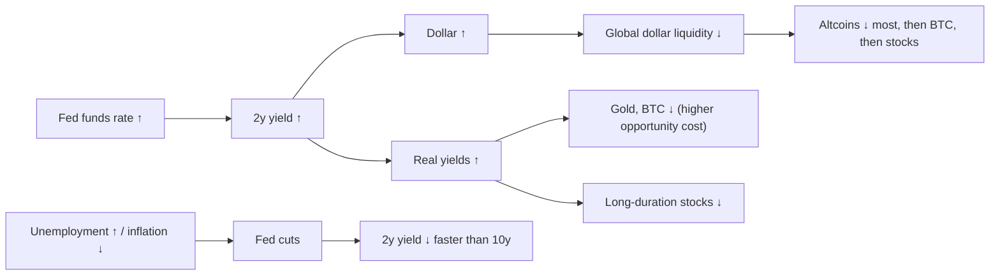

# 02. The Fed and interest rates

The US Federal Reserve sets the price of overnight dollars, and almost every other price in finance is quoted relative to it: Treasury yields, mortgage rates, the dollar's exchange rate, the discount rate applied to company earnings, and the opportunity cost of holding an asset that pays nothing, such as gold or bitcoin. Benjamin Cowen's videos mention the Fed or the FOMC more often than almost any other macro topic, and his core claim is that monetary policy, not the news, drives risk appetite. This chapter explains the machinery (who decides, when, and how the decision reaches markets), the tools for judging whether policy is tight or loose, and the historical record of what happened after the Fed stopped hiking and started cutting. It ends with the unusual 2024–2026 cycle: 175 bp of cuts, a nine-month pause and, in September 2026, a hike into an oil shock.

**You will learn:**
- what the fed funds target range, the FOMC statement, the dot plot and FedWatch each tell you, and where to find them;
- three ways to judge whether policy is restrictive: the neutral rate, the Taylor rule and the real policy rate, each with a worked example;
- what followed every "last hike → first cut" transition since 1984 (the macro lab's table), and why the outcome splits into soft landings and recessions;
- what quantitative easing (QE) and quantitative tightening (QT) are, in brief;
- the 2024–26 cutting cycle, the September 2026 hike and its energy-shock backdrop;
- Cowen's theses "rate cuts are not bullish at first" and "rate hikes are not immediately bearish", with dates and a check against the data.

The arrows show the usual sign of each link. Every link has exceptions, which the sections below document.

---

## The machinery: who decides, and when

The Fed has a **dual mandate** from Congress: maximum employment and stable prices. "Stable prices" is defined as 2% inflation on the headline PCE price index, with core PCE used as the operating guide ([chapter 04](04-INFLATION.md)). When inflation is high and unemployment is low, the two goals point the same way (hike). When both are bad at once, they conflict. Cowen calls that conflict the Fed's "checkmate" (more below).

Rates are set by the **Federal Open Market Committee (FOMC)**: the 7 Governors, the New York Fed president and 4 rotating regional presidents, 12 voters in total. It meets eight times a year. In 2026 the meetings were 27–28 Jan, 17–18 Mar, 28–29 Apr, 16–17 Jun, 28–29 Jul, 15–16 Sep and 27–28 Oct, with 8–9 Dec still to come.

### Fed funds target range and effective rate (DFEDTARU, DFEDTARL, DFF)

**What it is.** The FOMC sets a target range 25 bp wide, for example 3.75–4.00%. The **effective fed funds rate (EFFR)** is the volume-weighted median rate on overnight unsecured loans between banks, published by the New York Fed each morning for the prior day. The Fed steers it inside the range with administered rates: interest on reserve balances (IORB, 3.90% from 17 Sep 2026), the overnight reverse repo rate as a floor (3.75%) and the standing repo facility as a ceiling (4.00%). Before December 2008 there was a single target rate (FRED `DFEDTAR`). Decisions are announced at 2:00 pm New York time and are never revised.

**Where to find it.** FRED `DFEDTARU` (upper bound), `DFEDTARL` (lower bound), `DFF` (daily EFFR), `FEDFUNDS` (monthly average). TradingView `FRED:FEDFUNDS` or `ECONOMICS:USINTR`. Decision dates on FRED are *effective* dates, so a cut announced on 18 Sep 2024 shows on 19 Sep.

**How to read it.** The level alone says little. What matters is the level relative to inflation (the real rate), relative to neutral, and relative to the 2-year yield (market expectations). The *direction* and above all the **turning points** (the last hike and the first cut) move markets. The most common misreading is "rate cuts are bullish". Cuts made because growth is collapsing have not been (see the lab table below). As of 29 Oct 2026 the upper bound was **4.00%**, against 3.75% three months earlier and 4.25% a year earlier ([lab dashboard](../../tools/macro-lab/REPORT-2026-10-30.md)); EFFR was 3.88%.

**How Cowen uses it.** He makes "Pre-FOMC" and "Post-FOMC" videos around nearly every meeting (for example "Bitcoin Pre-FOMC", 9 Dec 2025, and "Bitcoin: Post-FOMC", 29 Oct 2026, per his [YouTube feed](https://www.youtube.com/feeds/videos.xml?channel_id=UCRvqjQPSeaWn-uEx-w0XOIg)). His recurring claims: monetary policy drives risk appetite; bitcoin has historically bottomed near the Fed's *terminal* (peak) rate; and "the real bull market often begins after the last rate cut, not the first" ("Bitcoin and Interest Rates", 24 Jan 2023, per the [Rosetta video index](https://rosetta.to/u/intothecryptoverse), a secondary summary).

**Connections.**
- *What leads it:* the 2-year Treasury yield, by roughly 0–6 months (2019, 2024 and 2026 all fit). Unemployment rising off its low has led the first cut by several months: about 4–6 months in 2007 (from the 4.4% lows of March and May 2007), about 17 in 2024 (from the 3.4% low of April 2023), but barely at all in 2019, when unemployment had moved only from 3.6% to 3.7% before the July cut. Inflation surprises led the hikes of 2022 and September 2026.
- *What it leads:* the dollar and real yields respond within days; the labor market responds with long and variable lags (often a year or more).
- *Check on the terminal-rate claim:* in 2018 the last hike was announced on 19 Dec 2018 (effective 20 Dec) and bitcoin's low was 15 Dec 2018, four days earlier. In 2022–23 bitcoin's low (21 Nov 2022) came eight months *before* the last hike (announced 26 Jul 2023, effective 27 Jul). The idea holds loosely, as "bottoms come late in the hiking cycle", not to the week.

**What it has meant for assets.** Higher policy rates raise the discount rate and the cost of holding zero-yield assets. The usual sign is negative for bitcoin, altcoins and long-duration growth stocks, positive for the dollar, and negative for gold via real yields. The effect is strongest when the move is a *surprise*. A fully priced move (about 90% priced before the 16 Sep 2026 hike) often does little on the day.

**Investor takeaway.** Watch the direction of policy and the reason for it, not the level.

### The FOMC statement and press conference

**What it is.** A short statement at 2:00 pm ET, the Chair's press conference at 2:30 pm ET, and minutes three weeks later. Under Chair Kevin Warsh (since late May 2026) statements became much shorter ("The Committee will deliver price stability"), dropped the familiar risk-balance paragraph and gave no explicit forward guidance. On 28 Oct 2026 Warsh announced that one of the eight 2027 meetings will be a "strategy" meeting with no rate vote, and that 2028 will have two strategy meetings and six policy meetings ([press conference transcript, 28 Oct 2026](https://www.federalreserve.gov/mediacenter/files/FOMCpresconf20261028.pdf)).

**Where to find it.** federalreserve.gov, "Monetary policy" → "FOMC calendars and information".

**How to read it.** Compare the wording with the previous statement line by line, and count the **dissents**: they show where the next move is likely to go. The 2026 sequence is a textbook case. Governor Miran dissented for cuts from January to April. In April three regional presidents (Hammack, Kashkari, Logan) objected to an "easing bias". In July the same three dissented *for a hike*. The hike came in September. In October, Cook and Hammack dissented for another hike. The first hawkish objections (April) came three meetings before the hike, and the first dissents for a hike (July) came one meeting before it. Length and wording are signals too: Cowen's July 2026 memo (15 Jul) noted that the Warsh Fed had cut its statement to about 130 words and removed the easing bias, and his August memo pointed to the 9–3 July vote (three dissents for a hike) as evidence of a hawkish reaction function ([Bitcoin Cycle Memo, July 2026](https://benjamincowen.com/reports/bitcoin-cycle-memo-july-2026); [The Balance of Risks, Aug 2026](https://benjamincowen.com/reports/the-balance-of-risks-august-2026)).

**How Cowen uses it.** FOMC-day videos, including "FOMC: The End of an Era" (29 Apr 2026, [Rosetta summary](https://rosetta.to/u/intothecryptoverse/fomc-the-end-of-an-era)), in which his base case was that "the Fed ends up cutting rates to chase the 2-year yield". The Fed hiked instead.

**Connections and assets.** Volatility in rates, the dollar and crypto peaks between 2:00 and 3:30 pm ET. The direction comes from the surprise against pricing: the 2-year moves first, then the dollar, then crypto.

**Investor takeaway.** Dissents and wording changes carry more information than the decision itself, which is usually priced.

### Summary of Economic Projections and the dot plot

**What it is.** Four times a year (March, June, September, December) each FOMC participant submits projections for growth, unemployment and inflation, plus the fed funds rate they think appropriate at the end of each year: the "dot". The table reports medians and ranges. Under Warsh the Chair does not submit a dot ("I don't submit a dot. I don't plan on submitting a dot", 28 Oct 2026), so the 2026 projections reflect 18 participants. Look past the median to the **tally**: in the June 2026 SEP, 9 participants pencilled in a hike for 2026, 8 a hold and 1 a cut (per Cowen's August 2026 memo). A median that hides a 9–8 split is a much weaker signal than one with a clear majority.

**Where to find it.** federalreserve.gov, `fomcprojtablYYYYMMDD.htm` (for example the [September 2026 table](https://www.federalreserve.gov/monetarypolicy/fomcprojtabl20260916.htm)).

**How to read it.** How the median moved from 2024 to 2026, per the course's Fed research:

| SEP | Fed funds median: this year / next / year after | Longer-run rate | This year's PCE / core PCE | This year's unemployment |
|---|---|---|---|---|
| Sep 2024 | 4.4 / 3.4 / 2.9 | 2.9 | 2.3 / 2.6 | 4.4 |
| Dec 2025 | 3.6 / 3.4 / 3.1 | 3.0 | 2.9 / 3.0 | 4.5 |
| Mar 2026 | 3.4 / 3.1 / 3.1 | 3.1 | 2.7 / 2.7 | 4.4 |
| Jun 2026 | 3.8 / 3.6 / 3.4 | 3.1 | 3.6 / 3.3 | 4.3 |
| Sep 2026 | 4.1 / 4.1 / 3.9 | 3.2 | 3.7 / 3.4 | 4.1 |

(For Dec 2025 "this year" means 2025 for inflation and unemployment, and the three rates are end-2025 / 2026 / 2027; for the 2026 SEPs the rates are end-2026 / 2027 / 2028.)

The dots are *conditional* forecasts, not promises. In September 2024 they implied 2.9% by the end of 2026. The actual rate is about 3.9%, because an energy shock intervened. Read the dots as the Committee's reaction function ("if inflation does X, we do Y"). The longer-run dot is the Committee's estimate of the nominal neutral rate; it drifted up from about 2.5% (2019–2023) to 3.2%.

**How Cowen uses it.** He checks whether the Fed projects a recession or hikes ("Fed Projecting a Mild Recession", 13 Apr 2023, per the [Rosetta index](https://rosetta.to/u/intothecryptoverse)) and contrasts the dots with market pricing and the 2-year.

**Connections and assets.** An upward shift in the dots (June and September 2026) is hawkish: it lifts the 2-year, the dollar and real yields, and weighs on long-duration assets and crypto. The June 2026 shift came during bitcoin's slide to its 30 Jun 2026 low (about $57.7–58.6k, depending on source).

**Investor takeaway.** Markets and dots often diverge, and at turning points markets have more often been right. Use the dots to learn how the Fed thinks, not where rates will be.

### Market-implied path: CME FedWatch, futures and prediction markets

**What it is.** Probabilities of each FOMC outcome derived from 30-day fed funds futures (CME FedWatch); SOFR futures, overnight index swaps and prediction markets such as Polymarket give similar information.

**Where to find it.** cmegroup.com/markets/interest-rates/cme-fedwatch-tool.html (free).

**How to read it.** It shows what is priced, not what will happen. It is reliable within about two weeks of a meeting (the Fed rarely surprises against odds above about 70%) and unreliable six months or more ahead. Before 16 Sep 2026 the market priced about 90% for a hike; after 28 Oct it put about 83% on a December hike (reported figures).

**How Cowen uses it.** He reads what is priced, and argues that a hot data print that "prices out cuts" hurts altcoins most ("Unemployment Rate Drops to 4.1%", 3 Jul 2025, Rosetta summary). In October 2026 he noted the odds of an October hike falling from 64% to 17.7% within a week ([BeInCrypto via Yahoo Finance](https://finance.yahoo.com/markets/crypto/articles/bitcoin-falls-below-80-000-032051576.html), secondary) and titled a video "The Market Doesn't Seem To Think There Will Be A Rate Hike In October" (22 Oct 2026, YouTube feed).

**Connections and assets.** Changes in pricing lead the decision by weeks, move together with the 2-year, and often move markets more than the decision itself.

**Investor takeaway.** Watch *changes* in the probabilities, especially after CPI and jobs reports.

### Fed funds versus the 2-year yield ("the Fed chases the 2-year")

**What it is.** The 2-year Treasury yield is roughly the market's forecast of the average policy rate over the next two years, plus a small premium. Comparing it with fed funds shows which way the market expects policy to go.

**Where to find it.** FRED `DGS2` against `DFEDTARU` or `DFF`; TradingView `TVC:US02Y` against `FRED:FEDFUNDS`.

**How to read it.** If the 2-year sits well **below** fed funds, the market expects cuts, and the Fed has usually followed. If it sits **above**, hikes are in play. On 28 Oct 2026 the 2-year was **4.67%** against EFFR 3.88%, about 80 bp above: the market was pricing more hikes. In February 2026 the 2-year touched 3.38% with fed funds at 3.50–3.75%, pricing cuts that never came, because the oil shock reversed the outlook. The gap is a direction, not a count of hikes: Cowen's September 2026 memo noted a 2-year about 100 bp above effective fed funds, said it "does not map one-for-one" onto hikes, and cited a FedWatch modal path of 4.50–4.75% by March 2027. He also observed that the long end topped before that gap closed in 2018 (about 75 bp) and 2022 (over 100 bp).

**How Cowen uses it.** He uses the gap as a market proxy for "neutral". On the [Bankless podcast (23 Dec 2025)](https://www.bankless.com/podcast/where-is-crypto-going-in-2026-ben-cowen), with fed funds about 3.75% and the 2-year about 3.5%, he said the Fed needed "one more rate cut just to get to the point where you could argue we're at neutral", and that ETH performs best when fed funds is near or below the 2-year. In his [Macro Risk Memo of February 2026](https://benjamincowen.com/reports/macro-risk-memo-feb-2026) he wrote that the policy rate was "above market-implied neutral".

**Connections.** The 2-year leads fed funds by roughly 0–6 months. It is the most Fed-sensitive point on the curve ([chapter 03](03-BONDS-AND-THE-YIELD-CURVE.md)).

**What it has meant for assets.** The ETH claim is hard to separate from everything else. In the lab's year-by-year table, ETH/BTC *rose* 549% in 2017 while the Fed hiked 0.75 pp, and *fell* in 2019 (−53%), 2024 (−28%) and 2025 (−7%) while the Fed cut. Balance-sheet policy and crypto-specific factors seem to matter more ([chapter 12](12-DOMINANCE-ALTCOINS-AND-ROTATION.md)).

**Investor takeaway.** The 2-year tells you about the Fed's next moves before the Fed does.

---

## Is policy tight or loose?

### The neutral rate (r*)

**What it is.** The real (inflation-adjusted) short-term rate that neither speeds up nor slows down the economy. It cannot be observed, only estimated: the New York Fed publishes the Laubach-Williams and Holston-Laubach-Williams model estimates each quarter, and the FOMC's longer-run dot is a nominal estimate (r* plus 2% inflation).

**Where to find it.** newyorkfed.org (search "r-star"); the SEP longer-run median.

**How to read it.** Policy is "restrictive" when the real policy rate sits above r*. The September 2026 longer-run median of 3.2% implies r* of about 1.2%. The error bands around any estimate are about ±1 pp. Warsh, asked about neutral on 16 Sep 2026: "In a word, no ... I've always been interested in a neutral rate as an academic matter" ([press conference](https://www.federalreserve.gov/mediacenter/files/FOMCpresconf20260916.pdf)). He does not steer by it.

**How Cowen uses it.** Through the fed funds versus 2-year gap above, not through model estimates.

**Connections and assets.** If r* has risen (fiscal deficits, AI investment, higher term premium), the same nominal rate is less restrictive than it looks: one candidate explanation for why the 2022–23 tightening did not cause a recession. Indirectly, r* sets how high terminal rates and long yields can stay.

**Investor takeaway.** "Restrictive" is relative to a moving, uncertain target.

### The Taylor rule

**What it is.** A benchmark for where the policy rate "should" be, proposed by John Taylor: i = r* + π + 0.5 × (π − 2) + 0.5 × (output gap), where π is inflation. A labor-market version replaces the output gap with 2 × (natural unemployment − actual unemployment). The Atlanta Fed publishes a "Taylor Rule Utility"; FRED has no official series.

**Worked example (October 2026).** Take r* = 1.2, core PCE inflation π = 3.1, and an unemployment gap of about zero (unemployment 4.2%, the SEP longer-run estimate 4.2%):
- i = 1.2 + 3.1 + 0.5 × (3.1 − 2) + 0 = 1.2 + 3.1 + 0.55 = **4.85%**.
- The actual midpoint is about 3.875%, so the rule says policy is about 1 pp *too loose*.
- With r* = 0.5 the rule gives about 4.15%, close to the September dot of 4.1%. With headline PCE (3.65%) instead of core it gives about 5.7% (1.2 + 3.65 + 0.825).

**How to read it.** It is a sanity check, not a forecast. In 2021–22 the rule implied rates above 7% while the funds rate was near zero, which is the arithmetic behind the phrase "behind the curve".

**How Cowen uses it.** It is not a staple of his content; we found no video built on it.

**Connections and assets.** A large gap with the rule above the actual rate tends to come with hawkish dissents and hikes, as in 2026. No direct asset signal.

**Investor takeaway.** By simple-rule standards, policy in October 2026 was not tight, which is consistent with the hawkish dissents.

### Real policy rate and real interest rates

**What it is.** The nominal policy rate minus inflation (trailing core PCE, headline CPI, or an expectations measure). FRED has no single series; compute EFFR minus core PCE YoY.

**Where to find it.** FRED `DFF` minus the YoY change of `PCEPILFE`. For market real yields see TIPS (`DFII10`) in [chapter 03](03-BONDS-AND-THE-YIELD-CURVE.md).

**How to read it.** Worked example: EFFR 3.88% − core PCE 3.12% (September 2026) = **+0.76 pp**. Against headline PCE (3.65%) it is about +0.2 pp; against Michigan one-year inflation expectations (4.6%) it is about −0.7 pp. In mid-2024 it was about +2.6 pp (5.33 − 2.7), the most restrictive since 2007. Paul Volcker took it to roughly +5 to +8 in 1980–82; Arthur Burns let it go negative in 1974–77, the setup for the second inflation wave ([chapter 04](04-INFLATION.md)).

**How Cowen uses it.** As a supporting argument, almost never a video topic: real yields are "elevated versus prior expansions" and the Fed's hawkish turn "keeps real rates elevated" ([Feb 2026 memo](https://benjamincowen.com/reports/macro-risk-memo-feb-2026); [July 2026 memo](https://benjamincowen.com/reports/bitcoin-cycle-memo-july-2026)).

**Connections.** The real policy rate drives the short end of the real yield curve; the 10-year TIPS yield reached 2.93% at the end of September and 2.95% on 5 Oct 2026, its highest since November 2008, and was 2.67% on 28 Oct 2026.

**What it has meant for assets.** Rising real rates are one of the most consistent macro headwinds for gold, bitcoin and growth stocks. Gold's resilience in 2022–24 (central-bank buying) is the main exception. In the lab's weekly data, though, bitcoin's correlation with changes in the 10-year real yield was weak overall (−0.06), strongest in 2020 (−0.36), and slightly positive in 2025 (+0.09). The relationship works over months and regimes, not week by week.

**Investor takeaway.** Always subtract inflation before deciding whether rates are "high".

---

## Policy cycles: hiking, pausing, cutting

A cycle runs from the first hike to the last hike, then a pause, then the first cut, and later the last cut. A **pivot** is the turn from tightening (or pausing) to easing, or the reverse; Cowen also uses the word for the turn from QT to QE.

There are two kinds of easing cycle:
- **Insurance (mid-cycle) cuts:** 75–175 bp in total, no recession, stocks rise. Examples: 1995, 1998, 2019 (until COVID), and 2024–25 in hindsight.
- **Recession cuts:** usually 500 bp or more, unemployment rises 2–5 pp, stocks fall 20–55% from the first cut. Examples: 1974, 1980, 1989–92, 2001, 2007–08, 2020 (the exception in size: 150 bp in two emergency moves, because the rate started at 1.50–1.75% and hit zero; unemployment jumped about 11 pp).

Investors only learn which kind they are in after the fact. That is why the first cut is such a contested moment.

### The lab's table: from the last hike to the first cut, and what followed

The table below is copied from the course's [macro lab report](../../tools/macro-lab/REPORT-2026-10-30.md) (FRED data, generated 30 Oct 2026). Method notes from the lab: the target rate combines FRED `DFEDTAR` (1982–2008) and the upper bound `DFEDTARU`; only moves of at least 0.25 pp count; dates are FRED effective dates (a cut announced in the evening shows the next day); the equity proxy is the Nasdaq Composite (`NASDAQCOM`, the longest free daily index on FRED); "worst" is the lowest close within 18 months after the first cut versus the close on the cut day; the unemployment peak is searched within 36 months.

| last hike | first cut | months paused | peak target | Nasdaq +3 m | +6 m | +12 m | worst within 18 m | unemployment at cut -> peak (lag) | recession within 24 m | BTC +12 m |
|---|---|---|---|---|---|---|---|---|---|---|
| 1984-08-09 | 1984-09-20 | 1 | 11.50% | -3.4% | 10.2% | 12.3% | -5.9% | 7.3% -> 7.4% (1 m) | no | - |
| 1987-09-04 | 1987-11-04 | 2 | 7.25% | 7.4% | 19.2% | 19.6% | -8.5% | 5.8% -> 6.2% (36 m) | no | - |
| 1989-02-24 | 1989-06-06 | 3 | 9.75% | 5.2% | 2.4% | 3.8% | -27.4% | 5.3% -> 7.8% (36 m) | 1990-08 | - |
| 1995-02-01 | 1995-07-06 | 5 | 6.00% | 6.4% | 8.1% | 21.6% | -0.0% | 5.7% -> 5.7% (0 m) | no | - |
| 1997-03-25 | 1998-09-29 | 18 | 5.50% | 25.8% | 43.0% | 57.5% | -18.2% | 4.6% -> 5.0% (36 m) | no | - |
| 2000-05-16 | 2001-01-03 | 7 | 6.50% | -37.4% | -18.2% | -21.9% | -48.1% | 4.2% -> 6.3% (29 m) | 2001-04 | - |
| 2006-06-29 | 2007-09-18 | 14 | 5.25% | -2.1% | -14.5% | -20.8% | -52.2% | 4.7% -> 10.0% (25 m) | 2008-01 | - |
| 2018-12-20 | 2019-08-01 | 7 | 2.50% | 2.2% | 14.6% | 32.5% | -15.4% | 3.6% -> 14.8% (8 m) | 2020-03 | 9% |
| 2023-07-27 | 2024-09-19 | 14 | 5.50% | 7.5% | -1.8% | 25.6% | -15.2% | 4.1% -> 4.5% (14 m) | no | 83% |

Source: macro lab report, section "Fed: from the last hike to the first cut, and what followed". Credit: the course's open-source `macro_lab.py`, using FRED series `DFEDTAR`, `DFEDTARU`, `NASDAQCOM`, `UNRATE`, `USREC` and `CBBTCUSD`.

### How to read the table: soft landings versus recessions

A **soft landing** is a slowdown that ends without a recession. A **hard landing** is one that ends in a recession. ("No landing" means growth never really slows.) The table splits cleanly along that line.

**Five cycles with no recession within 24 months** (1984, 1987, 1995, 1997–98, 2023–24):
- Nasdaq was higher 12 months after the first cut in all five: +12.3%, +19.6%, +21.6%, +57.5% and +25.6%.
- Unemployment barely moved from the cut to its peak in three of them (+0.1 pp in 1984, 0 in 1995, +0.4 pp in 2024). In 1987 and 1998 unemployment rose 0.4 pp, but the "peak within 36 months" falls at the end of the window, close to the next slowdowns (1990 and 2001), so it says little about the cut itself.
- The worst drawdown after the cut ranged from about 0% (1995) to −18.2% (1998). The 1998 drawdown belongs to the autumn-1998 LTCM hedge-fund crisis that the 29 Sep 1998 cut was responding to (the research labels it an "insurance" cut). The 2024–25 dip (−15.2%) was the April 2025 tariff shock.

**Four cycles followed by a recession within 24 months** (1989, 2000–01, 2006–07, 2018–19):
- Twelve-month Nasdaq returns were +3.8%, −21.9%, −20.8% and +32.5%.
- The worst drawdowns were −27.4%, −48.1%, −52.2% and −15.4%.
- Unemployment rose 2.1–11.2 pp to its peak.
- The 2019 row is a special case: the recession (March 2020) was caused by the pandemic, not by the business cycle. Massive emergency easing then lifted Nasdaq 32.5% within 12 months of the first cut, despite unemployment jumping from 3.6% to 14.8%.

**What did *not* separate the two groups: the length of the pause.** The average pause was about 8 months in both groups (soft landings: 1, 2, 5, 18 and 14 months; recessions: 3, 7, 14 and 7). Claims that "a long pause means a hard landing" are not supported by this sample.

**The deciding variable was whether unemployment kept rising after the cut**, which is unknowable on the day of the cut. That is the strongest argument for watching the labor market ([chapter 05](05-THE-LABOR-MARKET.md)) and credit spreads ([chapter 03](03-BONDS-AND-THE-YIELD-CURVE.md)) rather than the cut itself.

**Small-sample warning.** Nine cycles, two of which overlap with special shocks (the 1987 crash, which came between the last hike and the first cut, and COVID). Read the table as nine stories, not as a probability model ([chapter 01](01-HOW-TO-READ-MACRO-CHARTS.md#statistics-traps)).

The course's Fed research, using S&P 500 data back to 1970, finds the same split: in recession cycles unemployment peaked 9–36 months after the first cut, 2–5 pp higher, and the S&P fell about 42% (2001) and 55% (2007) from the first cut on daily closes; in non-recession cycles the S&P was up 11–29% after 12 months.

### Rate cuts and "the pivot" (Cowen: "rate cuts are not bullish at first")

**What it is.** The first cut after a hiking cycle and pause, and the sequence of cuts that follows.

**Where to find it.** FRED `DFEDTARU`; FOMC statements.

**How to read it.** Ask *why* the Fed is cutting. Cuts with stable jobless claims and tight credit spreads have historically been followed by rising stocks. Cuts into rising unemployment and widening spreads have been followed by bear markets. Stocks often peaked around the first cut in recession cycles: the S&P made its all-time high on 9 Oct 2007, three weeks *after* the first cut.

**How Cowen uses it.** His thesis, in dated steps:
- **24 Jan 2023** ("Bitcoin and Interest Rates", Rosetta summary): bitcoin "historically bottomed around the Fed's terminal rate", and "the real bull market often begins after the last rate cut, not the first, especially when the Fed pivots due to economic damage".
- **2023–24, repeatedly:** the first cut is not the most bullish event, because risk assets often topped around the start of cuts (2000 and 2007 for stocks, 2019 for bitcoin), and the Fed pivots when something breaks ([The Informer Post summary](https://theinformerpost.beehiiv.com/p/fed-rate-cuts-may-not-be-bullish-for-bitcoin-says-crypto-analyst-benjamin-cowen-heres-why), secondary). He contrasted recession cycles (2001, 2007) with insurance cycles.
- **19 Sep 2024** ("The Rate Cutting Cycle Has Begun") and **23 Oct 2024** ("The Yield Curve & Bitcoin"): unless a recession is imminent, the long end of the curve and the dollar tend to rally after the first cut (both Rosetta summaries).
- **June 2025**, [on X](https://x.com/benjamincowen/status/1939783091037356302): "Trump wants Powell to cut rates. But when they cut rates last year, the long end of the yield curve went up."

**Connections and check against the data.**
- *The October 2024 call was right:* after the first cut (18 Sep 2024) the 10-year yield rose from 3.63% (16 Sep 2024) to 4.58% at the end of 2024 and about 4.8% by mid-January 2025, and the dollar index rose from about 100 to about 110. Bitcoin also rallied above $100k, which shows the call was about yields and the dollar, not about bitcoin.
- *"Not bullish at first" for stocks holds only in recession cycles:* in the lab table Nasdaq was lower 3 months after the first cut in 2001 (−37.4%), 2007 (−2.1%) and 1984 (−3.4%), but higher in the other six cases. The research's summary: "cuts are bearish" is true only conditional on a recession.
- *For bitcoin, n = 2:* bitcoin topped on 26 Jun 2019, five weeks before the July 2019 cut, and was up only 9% a year after the cut. After the September 2024 cut it was up 83% a year later. Neither case had a cyclical recession.
- *"After the last cut":* the stock market bottomed near the last cut in 2001–03 and 2008–09, and about a week after the last cut in March 2020. But the last cut of the 2024–25 cycle (10 Dec 2025) was followed by a further bitcoin decline to about $57.7–58.6k on 30 Jun 2026, because the next move turned out to be a hike. "Last cut" can only be identified in hindsight.

**What it has meant for assets.** Insurance cuts: stocks up, the curve bull-steepens at first, the dollar softens, crypto mixed. Recession cuts: stocks down 35–55% (2001, 2008), long bonds rally hard, the dollar spikes in the crisis phase, gold up, crypto down with risk assets (2020) and recovering after the policy response.

**Investor takeaway.** "Is the Fed cutting?" is the wrong question; "why is the Fed cutting, and is unemployment still rising?" is the useful one.

### Rate hikes (Cowen: "hikes are not immediately bearish")

**What it is.** An increase in the target range. Hiking cycles in this course's window: 2015–18, 2022–23, and the single hike of 16 Sep 2026.

**Where to find it.** FRED `DFEDTARU`; FOMC statements.

**How to read it.** The *first* hike and any *surprise* hike matter most. A hike that is fully priced often produces a "sell the rumour, buy the news" reaction. The pace and the expected end point (the terminal rate) matter more than any single move.

**How Cowen uses it.** His view has moved, and every statement needs its date:
- **28 Feb 2022:** "Interest Rate Hike Not Necessarily Doom and Gloom" for bitcoin ([Daily Hodl](https://dailyhodl.com/2022/02/28/interest-rate-hike-not-necessarily-doom-and-gloom-for-bitcoin-btc-says-analyst-benjamin-cowen-heres-why/), secondary).
- **2022 more broadly:** hikes push investors from risk-on to risk-off.
- **September 2026, before the meeting:** he argued the Fed "really should" hike and that a hike would lift the dollar and sink bitcoin ([Benzinga](https://www.benzinga.com/crypto/cryptocurrency/26/09/61640748/bitcoin-falls-as-analyst-says-the-fed-really-should-raise-rates-this-month)).
- **September 2026, after the hike:** bitcoin rose from about $76k on hike day to about $86k on 21 Sep (Coinbase), extending a rally that began near $63k in mid-August. He conceded the bearish-hike thesis "was not rooted in the data" and said "None of the data suggests that a rate hike has ever been immediately bearish for Bitcoin", having looked at the hikes of December 2015, September 2018, March 2022 and September 2022 ([Benzinga via TradingView](https://www.tradingview.com/news/benzinga:45b48150d094b:0-bitcoin-analyst-admits-his-rate-hike-thesis-was-not-rooted-in-the-data/)).
- **"Resumption hike", not "liftoff" (30 Sep 2026):** in [The Triple Squeeze](https://benjamincowen.com/reports/the-triple-squeeze-september-2026) he classified the September hike as "the resumption of an existing cycle, similar to 1999 after the 1998 insurance cuts": it took back part of the roughly 175 bp of 2024–25 cuts, which he treats as **insurance cuts** (cuts made to protect an expansion, not to fight a recession). A **liftoff** is the first hike off a low base that starts a new tightening cycle (December 2015, March 2022). Secondary coverage (CoinMarketCap Academy) reported a March 1997 "one hike, then a long hold" analogy instead; the written memo names 1999, so prefer that. (For reference, the lab table shows the 1997 episode: last hike 25 Mar 1997, first cut 29 Sep 1998.)
- **Two bitcoin lenses for a hike (30 Sep 2026 memo).** The *first-hike* lens: after the December 2015 liftoff bitcoin fell about 20% in two months, then rose about 70% over twelve; after the March 2022 liftoff it rose about 12% in two weeks, then fell more than 60%. He judged 2026 closer to early 2022. The spread between those two outcomes is the lesson: one hike date says little on its own ([chapter 10](10-BITCOIN-CYCLES-AND-VALUATION-MODELS.md)). The *midterm-hike* lens is below.
- **Midterm hike years:** in his [Triple Squeeze memo (30 Sep 2026)](https://benjamincowen.com/reports/the-triple-squeeze-september-2026) he noted that in the two prior midterm years with a hike, bitcoin held near its hike-day level for about seven weeks before breaking lower. The same memo sketched a break around day 50 after 16 Sep (early November), with a 2022-type fall (about −15%) and a 2018-type fall (about −50%) as the two reference paths; he presented these as analog arithmetic, not targets. In October 2026 he described bitcoin as "typically flat ~50 days, then drops" and put it at about day 43 after the hike (Benzinga coverage via search snippet). The window had not been reached by 30 Oct. Two prior cases is a very small sample; [chapter 09](09-SEASONALITY-AND-POLITICAL-CYCLES.md) discusses midterm seasonality.

**Connections.** Hikes follow inflation surprises and hawkish dissents (2026: hawkish objections from April, dissents for a hike in July, the hike at the next meeting in September). They flatten the curve from the front (bear flattening, [chapter 03](03-BONDS-AND-THE-YIELD-CURVE.md)) and usually firm the dollar. The September 2026 hike broke the usual pattern for crypto: the dollar rose and bitcoin rose with it, which Cowen described as "something clearly changed" (September 2026, secondary).

**What it has meant for assets.** Over a full hiking *cycle* (2022) the damage to crypto and growth stocks was severe. At the level of the *single decision*, the immediate reaction has been small or even positive when the hike was priced.

**Investor takeaway.** A hiking cycle and a hike are different things; markets price the path, not the day.

---

## The 2024–2026 cycle step by step

### From cuts to a pause

| Decision (announcement) | Move | Range after | Dissents |
|---|---|---|---|
| 18 Sep 2024 | −50 bp | 4.75–5.00% | Bowman (wanted −25) |
| 7 Nov 2024 | −25 bp | 4.50–4.75% | none |
| 18 Dec 2024 | −25 bp | 4.25–4.50% | Hammack (hold) |
| Jan–Jul 2025 (5 meetings) | hold; QT slowed 19 Mar 2025 | 4.25–4.50% | Waller (March, against slowing QT); Bowman, Waller wanted a cut in July |
| 17 Sep 2025 | −25 bp ("shift in the balance of risks") | 4.00–4.25% | Miran (−50) |
| 29 Oct 2025 | −25 bp; QT to end on 1 Dec | 3.75–4.00% | Miran (−50); Schmid (hold) |
| 10 Dec 2025 | −25 bp | 3.50–3.75% | Miran (−50); Goolsbee, Schmid (hold) |
| 28 Jan, 18 Mar 2026 | hold | 3.50–3.75% | Miran (and Waller in January) for a cut |
| 29 Apr 2026 (Powell's last meeting as Chair) | hold, easing bias kept | 3.50–3.75% | Miran (cut); Hammack, Kashkari, Logan against the easing bias |
| 17 Jun 2026 (Warsh's first) | hold, 12–0 | 3.50–3.75% | none |
| 29 Jul 2026 | hold, 9–3 | 3.50–3.75% | Hammack, Kashkari, Logan (+25) |
| **16 Sep 2026** | **+25 bp, 12–0** | **3.75–4.00%** | none |
| 28 Oct 2026 | hold, 10–2 | 3.75–4.00% | Cook, Hammack (+25) |

Sources: Fed statements as compiled in the course's Fed research ([16 Sep 2026 statement](https://www.federalreserve.gov/monetarypolicy/files/monetary20260916a1.pdf), [28 Oct 2026 statement](https://www.federalreserve.gov/newsevents/pressreleases/monetary20261028a.htm)). Press reports of the October vote differed (two or three dissents); the table follows the Fed's statement.

In total the Fed cut 175 bp in six moves between September 2024 and December 2025. In the lab table, this cycle (last hike effective 27 Jul 2023, first cut effective 19 Sep 2024, a 14-month pause) sits with the soft landings: unemployment went from 4.1% at the cut to a peak of 4.5% (November 2025, revised; first printed as 4.6%) and then fell back to 4.2% by September 2026. There was no NBER recession as of October 2026. Nasdaq was 25.6% higher and bitcoin 83% higher a year after the first cut.

Structurally this looks more like **1998–1999** (insurance cuts, then hikes in 1999–2000, then a recession in 2001) than like 2007. The course's Fed research reached that comparison independently, and Cowen's September 2026 memo uses the same one. It is a template to watch, not a forecast.

### The oil shock and the September 2026 hike

The backdrop to the hike was an energy supply shock:
- **28 Feb 2026:** US and Israeli strikes on Iran; Brent about $71–72. The Strait of Hormuz was disrupted from about late February or March.
- **Early March:** WTI went from $67 to $91 in one week, the "largest weekly rally since 1983" in Cowen's words ("Oil Spikes 35%", 8 Mar 2026, Rosetta summary).
- **April:** Brent averaged about $117 (reported daily highs about $120–138, depending on source and contract).
- **June:** after a Hormuz memorandum on 17 Jun, Brent fell back (about $70–85, depending on source and date).
- **July–October:** strikes resumed on 7 Jul; Brent was above $100 again from 23 Jul, averaged about $114 in September, and was $116.72 (23 Oct, one report) to $123.10 (27 Oct, FRED).

Inflation followed. Headline CPI rose from 2.4% YoY (January–February 2026) to about 4.2–4.3% in May (4.2% seasonally adjusted, 4.25% on the BLS headline basis) and was 3.7% in September 2026 ([lab dashboard](../../tools/macro-lab/REPORT-2026-10-30.md): 3.72%). Core PCE, the Fed's preferred gauge, was 3.12% in September. Meanwhile the labor market looked stable: unemployment 4.2%, the real-time Sahm indicator at 0.00, initial claims 194k (week of 24 Oct) ([lab dashboard](../../tools/macro-lab/REPORT-2026-10-30.md)).

Faced with a supply shock and no labor-market weakness, the Fed under Warsh removed its easing bias (June), saw three hawkish dissents (July), and hiked 25 bp on 16 Sep 2026: the first hike since July 2023, unanimous, with the median dot showing one more hike in 2026 (to about 4.1%). It held on 28 Oct with two dissents for a further hike. After that meeting FedWatch put about 83% on a December hike (reported).

**Why this matters historically.** The research's table of inflation peaks shows that the oil-shock inflation episodes of 1973–74, 1979–80, 1990 and 2008 all ended in recession, and that the Fed usually reacted by *easing* once growth broke (1974, 1990, 2008). In 2026 the Fed *hiked* into the shock, closer to Volcker than to Burns. That lowers the risk of a second inflation wave and raises the risk of a policy error. Long-run inflation expectations stayed anchored (the 5y5y forward was 2.23% on 29 Oct 2026), which is the main difference from the 1970s.

**Cowen's "checkmate".** In 2026 Cowen described the inflation as "mostly supply-driven" and argued that supply-driven inflation plus a softening labor market leaves the Fed unable to cut and unable to hike aggressively: "They can defend one weakness, but if you have two weaknesses, the defense breaks down", and "that's how the Federal Reserve ultimately gets checkmated" (7 Apr and 12 May 2026, Rosetta summaries; see also "Inflation Soars to 3.3%", 10 Apr 2026, and his [May 2026 Macro Risk Memo](https://benjamincowen.com/reports/macro-risk-memo-may-2026)). He links oil spikes to the end of business cycles ("The Mechanism That Ends Business Cycles", 28 Feb 2026). As of October 2026 only the inflation half of the checkmate had arrived; the labor market had not weakened, and the Fed chose to hike.

**What happened in markets.** The 2-year rose to a 2026 high of 4.92% (28 Sep, FRED daily close); the 10-year closed at 5.31% on 5 Oct 2026, its highest daily close since May 2002 per FRED (Cowen's September memo cited about 5.29% as the "highest since 2007"; on FRED daily closes the 2007 high was 5.26%, so 5.29% was already the highest since 2002). The S&P 500 set a record on 6 Oct 2026. Bitcoin, which had bottomed at about $57.7–58.6k (depending on source) on 30 Jun 2026, rallied to about $85k by 6 Oct, then fell back to about $78k by 30 Oct.

**Cowen's late-October roadmap.** On 24–26 Oct 2026 he laid out a bearish Q4 sequence ([X post, 26 Oct 2026](https://x.com/benjamincowen/status/2114535552523612377), via search snippet): a weekly close below $83k, a "fakeout", no Fed hike on 28 Oct, a hot PCE print on 29 Oct, oil near $120, the 10-year back to 5.3%, then stocks and bitcoin falling in Q4; "void above $83k". His September memo had framed the October meeting as two branches: a hike with hawkish guidance would track 2018, a hike with a signal to step down would track 2022. The Fed held, so neither branch occurred. The first three roadmap steps had occurred by 30 Oct ([Benzinga](https://www.benzinga.com/crypto/cryptocurrency/26/10/62696461/bitcoin-drops-to-80000-after-fed-meeting-is-the-bear-thesis-playing-out)); the rest was open. His December 2025 call that Powell would not cut aggressively before leaving was borne out.

---

## The balance sheet: QE and QT basics

### Fed total assets, QE, QT and the end of QT (WALCL)

**What it is.** **Quantitative easing (QE)** is the Fed buying Treasuries and mortgage-backed securities with newly created reserves, which pushes down long-term yields and adds liquidity. **Quantitative tightening (QT)** is the reverse: letting bonds mature without replacing them, which drains reserves. The balance sheet is reported weekly in the H.4.1 release (Wednesday values, published Thursday at 4:30 pm ET).

**Where to find it.** FRED `WALCL`. [Chapter 07](07-LIQUIDITY-MONEY-AND-THE-DOLLAR.md) covers the plumbing (reserves, the reverse repo facility, the Treasury General Account, net liquidity).

**How to read it.** The timeline in brief:

| Period | Policy | Total assets |
|---|---|---|
| Nov 2008 – Oct 2014 | QE1, QE2, Operation Twist, QE3 | about $0.9T → $4.5T |
| Oct 2017 – Jul 2019 | QT1 | about $4.5T → $3.76T |
| Mar 2020 – Mar 2022 | pandemic QE | $4.17T → peak $8.965T (13 Apr 2022) |
| Jun 2022 – 1 Dec 2025 | QT2 (slowed Jun 2024 and Apr 2025) | → low about $6.54T (3 Dec 2025) |
| Dec 2025 onward | reserve-management bill purchases | $6.75T (28 Oct 2026) |

The end of QT is not QE: from December 2025 the Fed bought bills only to keep reserves "ample", a technical operation rather than stimulus. Warsh has argued for a smaller balance sheet over time and set up a task force, with no decision as of 28 Oct 2026.

**How Cowen uses it.** It is one of his central themes:
- BTC dominance rises and altcoins bleed during QT.
- "Last cycle the transition from QT to QE marked the top for BTC dominance", and "I expect the Fed to transition from QT to QE next year" ([Cointelegraph Magazine, 19 Nov 2024](https://cointelegraph.com/magazine/bitcoin-dominance-crypto-predictions-bull-run-benjamin-cowen-hall-of-flame/)).
- Bitcoin topped shortly before QT ended, both in 2019 (top 26 Jun 2019, QT end 1 Aug 2019) and in 2025 (top 6 Oct 2025, QT end 1 Dec 2025) ("Bitcoin and the End of Quantitative Tightening", 1 Dec 2025, Rosetta summary). His July 2026 memo puts the lead at about 5 weeks in 2019 and about 8 weeks in 2025 (videos often round both to "about two months").
- His 2026 memos go further: the end of QT is not easing, and the bill purchases that followed were "reserve management", not QE. Crypto bull markets, he argues, came "when liquidity expanded in response to economic or financial stress", not when tightening merely stopped ([Crypto Macro Risk Memo Q1 2026](https://benjamincowen.com/reports/crypto-macro-risk-memo-q1-2026); [Feb 2026 memo](https://benjamincowen.com/reports/macro-risk-memo-feb-2026); [July 2026 memo](https://benjamincowen.com/reports/bitcoin-cycle-memo-july-2026)).
- The end of QT is not the same as a growing balance sheet.

**Connections and check.** QT ended on 1 Dec 2025, but no QE followed in 2026; the Fed hiked instead. So the "QT → QE marks the dominance top" rule went untested this cycle, and his November 2024 expectation of QE in 2025 did not happen. The "top a few weeks before QT ends" pattern fits both dates but rests on two cases.

**What it has meant for assets.** QE periods (2009–13, 2020–21) came with falling real yields, a weaker dollar and rising stocks, crypto and gold. QT periods (2018, 2022) came with rising term premia and pressure on high-beta assets, altcoins most.

**Investor takeaway.** Balance-sheet direction is a regime variable for crypto, especially for altcoins versus bitcoin ([chapter 12](12-DOMINANCE-ALTCOINS-AND-ROTATION.md)); it is not a short-term timing tool.

### Forward guidance

Explicit guidance ("extended period", calendar dates, dots) was a major tool from 2012 to 2021. Warsh rejects it: "This won't surprise you: I'm not in the forward guidance business" (16 Sep 2026 press conference). The practical consequence is more weight on market pricing (the 2-year, FedWatch) and more risk of meeting-day surprises. Rate volatility rose: the MOVE index was above 100 in late September 2026 (reported, [chapter 03](03-BONDS-AND-THE-YIELD-CURVE.md)).

---

## People and politics

### Fed chair, independence and politics

**What it is.** Who leads the Fed, and how much political pressure it faces. Events of 2025–26: the President fired the BLS commissioner after a weak jobs revision (August 2025); an attempt in 2025 to remove Governor Lisa Cook (she remained a voter); a reported Department of Justice criminal probe of Chair Powell (12 Jan 2026); Powell's last meeting as Chair (29 Apr 2026); his departure in May 2026; and Kevin Warsh as Chair from about late May 2026.

**Where to find it.** federalreserve.gov (press releases, speeches); major news outlets.

**How to read it.** A new chair changes communication style faster than policy; the Chair has one vote of twelve. Pressure on independence tends to raise the term premium and inflation expectations, because investors demand compensation for the risk that policy becomes political.

**How Cowen uses it.** "A Line Has Been Crossed" (12 Jan 2026), "Jerome Powell: 'I Won't See You Next Time'" (1 May 2026) and "Powell Steps Down…" (15 May 2026), per the [Rosetta index](https://rosetta.to/u/intothecryptoverse). His point: institutional risk raises uncertainty, and a new chair "cannot cut unilaterally".

**Connections and assets.** The 2026 leadership change came with a hawkish shift (easing bias removed in June, hike in September), not the dovish one some expected. Asset effects are hard to isolate from the oil shock.

**Investor takeaway.** Watch the committee's votes, not the headlines about the chair.

### Other central banks and the global policy rate

**What it is.** The Bank of Japan, the European Central Bank, the Bank of Canada and others, plus GDP-weighted "global policy rate" aggregates.

**Where to find it.** Each bank's website; TradingView `ECONOMICS:` interest-rate tickers by country.

**How to read it.** The Fed dominates dollar liquidity, but other banks matter at the margin. A Bank of Japan hike can force the unwinding of yen-funded positions (the "carry trade"), as on 5 Aug 2024 ([chapter 07](07-LIQUIDITY-MONEY-AND-THE-DOLLAR.md)). The ECB hiked into the 2008 oil shock (July 2008), just before the global financial crisis.

**How Cowen uses it.** Occasionally in videos: "Bank of Canada to End Quantitative Tightening" (29 Jan 2025); Bank of Japan hikes as a risk for bitcoin ("Bitcoin Falls to the 200W Moving Average", 5 Jun 2026, Rosetta summary). More systematically in [The Balance of Risks (15 Aug 2026)](https://benjamincowen.com/reports/the-balance-of-risks-august-2026), which charts policy rates across the major central banks and a GDP-weighted global policy rate for 17 central banks: 3.42% in August 2026, after a trough of 0.82% (February 2021) and a peak of 4.60% (February 2024). His reading: the global policy rate "has stopped falling", Australia and South Korea had hiked, Japan was normalizing with the **2-year Japanese government bond yield** near 1.70% (a multi-year high), and the US was "lagging the global turn". The 2Y JGB matters because rising Japanese yields can pull capital home and pressure yen-funded carry trades.

**Connections and assets.** When large central banks ease together, global liquidity tends to rise and the dollar to weaken (2020, alongside the strongest crypto bull market); when they tighten together, the reverse (2022, the deepest crypto bear).

**Investor takeaway.** Check whether the Fed is moving alone or with the rest of the world.

---

## Putting it together

1. **Unemployment rises about 0.5 pp from its low → the 2-year falls below fed funds → the Fed makes a first cut → if claims and credit spreads stay calm, it is an insurance cycle: Nasdaq was higher 12 months later in 1984, 1987, 1995, 1998 and 2024 (+12% to +58%).** Exception and warning: 1998's insurance cuts were followed by hikes in 1999–2000 and a recession in 2001; 2024–25's cuts were followed by a hike in 2026.
2. **Unemployment keeps rising after the first cut → cuts become large and fast → the curve bull-steepens → stocks fall: Nasdaq's worst point was −48% after the January 2001 cut and −52% after the September 2007 cut → bitcoin, in its only cyclical-style test (2019–20), had already topped five weeks before the first cut.** Exception: in 2019 the recession was a pandemic, and emergency easing lifted Nasdaq 32.5% within a year of the first cut.
3. **The Fed cuts without a recession → the long end and the dollar rally (Cowen, October 2024) → the 10-year rose from 3.63% to about 4.8% and the dollar index from about 100 to about 110 between September 2024 and January 2025 → mortgage rates did not fall.** Bitcoin rallied anyway, showing that the call was about rates, not crypto.
4. **An oil shock lifts headline inflation (CPI 2.4% → 4.2%, January–May 2026) while unemployment holds (4.2%) → hawkish dissents (July 2026) → a hike (16 Sep 2026) → the 2-year and 10-year rise (10-year 5.31% on 5 Oct) → the dollar firms.** Exception: bitcoin rose after the hike, from about $76k on hike day to about $86k on 21 Sep (Coinbase), the opposite of Cowen's pre-meeting expectation, which he conceded.
5. **The Fed ends QT (1 Dec 2025) → in Cowen's framework, bitcoin dominance peaks at the QT → QE turn and altcoins can recover → but no QE followed in 2026; the Fed hiked → no alt season, BTC dominance around 58–61% in 2026.** A rule built on one cycle (2019) could not be tested. Exception to the broader "real rates down, crypto up" logic: with the real policy rate near +2.6 pp in mid-2024, bitcoin still rose 121% in 2024.

---

## Check yourself

1. The upper bound of the target range is 4.00% and the 2-year yield is 4.67%. What is the market expecting, and how did this compare with February 2026?
2. Using the Taylor rule with r* = 1.2, core PCE 3.1% and no unemployment gap, what rate does the rule suggest, and what does that say about policy in October 2026?
3. In the lab's last-hike → first-cut table, which variable separated the soft landings from the recessions, and which variable did not?
4. What did Cowen claim about rate cuts in January 2023 and October 2024, and which part was borne out in 2024–25?
5. What did Cowen expect from a September 2026 hike, what happened, and how did he respond?
6. Why is "QT ended in December 2025" not the same as "QE started"?
7. Name two reasons the FOMC dissents of 2026 were more informative than the decisions.

Answers

1. The 2-year about 0.7–0.8 pp above fed funds means the market is pricing further hikes. In February 2026 the 2-year (3.38% at its low) was below fed funds (3.50–3.75%), pricing cuts.
2. About 4.85% (1.2 + 3.1 + 0.55), roughly 1 pp above the actual 3.875% midpoint: by this rule policy was not tight.
3. Whether unemployment kept rising after the cut (and a recession followed) separated them. The length of the pause did not: it averaged about 8 months in both groups.
4. January 2023: bitcoin has bottomed near the terminal rate, and the real bull often starts after the *last* cut. October 2024: without a recession, long yields and the dollar rally after the first cut. The October 2024 call was borne out (10-year 3.63% → about 4.8%, dollar index about 100 → 110 by January 2025).
5. He expected the hike to lift the dollar and sink bitcoin. The Fed hiked on 16 Sep 2026; bitcoin rose from about $76k on hike day to about $86k on 21 Sep (Coinbase), extending a rally that began near $63k in mid-August. He conceded the thesis "was not rooted in the data" and noted that hikes have not historically been immediately bearish for bitcoin.
6. Ending QT stops the shrinkage; QE is active buying to expand the balance sheet. From December 2025 the Fed only bought bills to keep reserves ample.
7. They came first: the April objections three meetings and July's three hike dissents one meeting before the September hike; and the decision itself was usually fully priced, so it carried less new information.

---

> Educational material, not financial advice. Past relationships between indicators can break.

[← 01 How to read macro charts](01-HOW-TO-READ-MACRO-CHARTS.md) | [Index](00-INDEX.md) | [03 Bonds and the yield curve →](03-BONDS-AND-THE-YIELD-CURVE.md)
