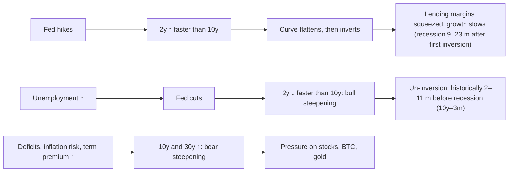

# 03. Bonds and the yield curve

The Fed sets one overnight rate; the bond market sets everything else. The 10-year Treasury yield is the benchmark for mortgages, corporate borrowing and the discount rate applied to stock and crypto valuations. The *shape* of the yield curve (how short-term yields compare with long-term ones) has preceded every US recession since the 1980s, and in 2022–2024 it gave its deepest warning in four decades without a recession following, at least as of October 2026. Benjamin Cowen returns to the 10-year yield and the curve regularly, especially the idea that the danger comes when an inverted curve *un-inverts*. This chapter explains how bond yields work, how to read the curve and its spreads, what the macro lab found about inversions and recessions, why the 2022–24 signal has not (yet) been followed by an NBER recession, and how to tell bull steepening from bear steepening. It closes with the indicators that sit next to the curve: term premium, real yields, breakevens, rate volatility and credit spreads.

**You will learn:**
- why bond prices fall when yields rise, and why long bonds move more than short ones (worked example);
- what the 3-month, 2-year, 10-year and 30-year yields each tell you;
- how to read the 10y–2y and 10y–3m spreads, and what the lab's inversion tables show about lead times;
- why the 2022–24 inversion has not been followed by a recession as of October 2026, and what would change that;
- Cowen's 2026 rate-shock framework: the "triple squeeze", "sequence risk" and his tables of 10-year peaks;
- the four kinds of curve move (bull/bear steepening and flattening) with dated episodes;
- how term premium, real yields, breakevens, the MOVE index and credit spreads fit together.

---

## Bond basics in five minutes

A Treasury bond pays a fixed coupon and returns its face value at maturity. Its **yield** is the annual return you lock in if you buy at today's price and hold to maturity. Price and yield move in opposite directions: when new bonds offer more, old bonds paying less must get cheaper.

**Worked example (illustrative numbers).** A bond with a face value of 100 pays a 4% annual coupon. When market yields equal 4%, it trades at 100. If yields jump to 5%:

| Maturity | Price at 4% yield | Price at 5% yield | Change |
|---|---|---|---|
| 2 years | 100.0 | 98.1 | −1.9% |
| 10 years | 100.0 | 92.3 | −7.7% |
| 30 years | 100.0 | 84.6 | −15.4% |

If the 10-year's yield instead falls to 3%, its price rises to about 108.5. The longer the maturity, the bigger the price swing for the same change in yield. That sensitivity is called **duration**. It is why "long-duration" assets (long bonds, growth stocks whose profits lie far in the future, and, by analogy, bitcoin) suffer most when long yields rise.

**What a yield contains.** A long yield is roughly: the average short-term policy rate the market expects over the bond's life, plus a **term premium** (extra pay for locking money up and bearing inflation and supply risk). A long yield can therefore rise because the Fed is expected to stay high, or because investors demand more term premium, or both. Telling the two apart is half of bond analysis.

---

## Treasury yields along the curve

Latest readings (lab dashboard for 2y and 10y; the course's Fed research for 3m and 30y):

| Maturity | FRED id / TradingView | Yield, 28 Oct 2026 | 2026 path |
|---|---|---|---|
| 3-month bill | `DGS3MO` / `TVC:US03MO` | 4.18% | pinned to policy (3.75–4.00% range) |
| 2-year | `DGS2` / `TVC:US02Y` | 4.67% | 3.52 (Jan) → 3.38 (27 Feb low) → 4.92 (28 Sep high) → 4.67 |
| 10-year | `DGS10` / `TVC:US10Y` | 5.05% | 4.26 (Jan) → 3.97 (Feb) → 5.31 (5 Oct) → 5.05 |
| 30-year | `DGS30` / `TVC:US30Y` | 5.37% | 4.87 (Jan) → 5.67 (7 Oct) → 5.37 |

Sources: [lab report](../../tools/macro-lab/REPORT-2026-10-30.md); FRED. A year earlier the 2-year was 3.47% and the 10-year 3.99% (lab).

### Short end: 3-month bill and 2-year yield (DGS3MO, DGS2)

**What it is.** Yields on Treasury bills and notes from the Treasury's daily par yield curve, published at about 3:30 pm ET and never revised. The 3-month yield is almost pure current policy. The 2-year is the market's expected policy path over two years and is the most Fed-sensitive point on the curve.

**Where to find it.** FRED `DGS3MO`, `DGS2` (daily), `TB3MS` and `GS2` (monthly, long history). TradingView `TVC:US03MO`, `TVC:US02Y`.

**How to read it.** Compare the 2-year with fed funds. On 28 Oct 2026 it was 4.67% against an effective fed funds rate of 3.88%: about 80 bp above, so the market was pricing more hikes. When the 2-year falls well below fed funds, cuts usually follow ([chapter 02](02-THE-FED-AND-INTEREST-RATES.md#fed-funds-versus-the-2-year-yield-the-fed-chases-the-2-year)).

**How Cowen uses it.** "The Fed chases the 2-year": he overlays fed funds and the 2-year and calls policy restrictive when fed funds sits above it (Bankless, 23 Dec 2025; see chapter 02).

**Connections.** Leads fed funds by roughly 0–6 months. Rises faster than the 10-year in hiking phases (bear flattening) and falls faster in cutting phases (bull steepening).

**What it has meant for assets.** A rising 2-year means a firmer dollar and tighter liquidity, which has hurt altcoins most within crypto. A sharply falling 2-year has meant either relief (insurance cuts) or alarm (recession cuts); the labor market tells you which.

**When the 2-year stops rising.** Cowen's [Triple Squeeze memo (30 Sep 2026)](https://benjamincowen.com/reports/the-triple-squeeze-september-2026) uses a simple confirmation: "when [the 2Y] stops making new highs, the market is signaling that the tightening cycle is largely priced". He adds that it works "better as confirmation than as a lead": in 2018 and 2023 the 2-year and 10-year peaked together, while in 2022 the 10-year peaked weeks earlier. In 2026 the 2-year's high so far was 4.92% (28 Sep); by 28 Oct it was 4.67%, but one lower month does not confirm a peak.

**Investor takeaway.** The short end tells you about the Fed.

### The 10-year Treasury yield (DGS10, US10Y)

**What it is.** The yield on the 10-year note: expected average short rates over ten years plus the term premium. It is the global discount rate and the anchor for 30-year mortgage rates.

**Where to find it.** FRED `DGS10` (daily), `GS10` (monthly, from 1953). TradingView `TVC:US10Y`.

**How to read it.** Separate the two drivers: if the 2-year rises as much as the 10-year, the move is about the Fed; if the 10-year rises while the 2-year is flat or falling, it is about term premium, inflation risk or fiscal supply. The most common misreading is "Fed cuts mean lower mortgage rates". After the first cut of September 2024 the 10-year *rose* from 3.63% (16 Sep 2024) to 4.58% at the end of 2024, because growth held up and the term premium rose. On 5 Oct 2026 it closed at 5.31%, the highest daily close since May 2002 on FRED data. (Cowen's September 2026 memo described about 5.29% as the highest since 2007; on FRED daily closes the 2007 high was 5.26%, so 5.29% was already the highest since 2002.)

**How Cowen uses it.** Dated claims:
- **4 Jan 2022** ("Bitcoin Vs. 10 Year Treasury Yields", Rosetta summary): bitcoin generally rises when the 10-year declines, and local *bottoms* in yields have marked bitcoin uptrends more reliably than yield peaks.
- **11 Jan 2025** ("Bitcoin Responds to the Labor Market"): "good news is bad news": strong jobs data lifted long yields and pushed bitcoin down.
- **June 2025**, [on X](https://x.com/benjamincowen/status/1939783091037356302): after the 2024 cuts "the long end of the yield curve went up".
- **30 Sep 2026** ([The Triple Squeeze](https://benjamincowen.com/reports/the-triple-squeeze-september-2026)): the 2026 rate shock (10-year about 5.29%, 30-year about 5.64%) as one leg of a squeeze on risk assets, and a sequence to watch: gold bottoms, then the long end tops, then stress appears. He also argues that a peak in long yields has sometimes preceded growth or financial stress (2000, 2007, 2011).
- **6 Oct 2026** ([BeInCrypto via Yahoo Finance](https://finance.yahoo.com/markets/crypto/articles/benjamin-cowen-says-yields-could-050200041.html)): he expected the 10-year to peak before mid-November, citing the 2018 and 2022 midterm years, when it topped between early October and mid-November. He called 5% a soft target and allowed for 5.4–5.6%. Two prior cases is a very small sample.
- **26 Oct 2026** ([X](https://x.com/benjamincowen/status/2114535552523612377), via search snippet): "10Y back to 5.3%" is one step in his bearish Q4 roadmap.

**Connections.** Leads mortgage rates almost one-for-one and housing activity by months ([chapter 06](06-GROWTH-AND-THE-BUSINESS-CYCLE.md)). Moves with the dollar in rate shocks. Historically tracked the copper/gold ratio, but that link broke in 2022–26 ([chapter 08](08-STOCKS-GOLD-AND-CROSS-ASSET.md)).

**What it has meant for assets.** A 10-year above 5% coincided with equity stress in 2007 and in October 2023 (S&P about −10%). In 2026 the S&P 500 made record highs (7,819 on 6 Oct 2026) with the 10-year at 5.0–5.3%, because earnings and AI investment dominated. For bitcoin the sign is usually negative (higher yields, lower BTC), but the strength varies by regime; see real yields below.

**Investor takeaway.** The 10-year tells you about everything other than the Fed: growth, inflation risk, term premium and deficits.

### The 30-year yield and the long end (DGS30)

**What it is.** The yield on the 30-year bond. It carries the most term premium and is the most sensitive to fiscal supply and long-run inflation fears.

**Where to find it.** FRED `DGS30`; TradingView `TVC:US30Y`.

**How to read it.** A 30-year rising faster than the 10-year, with the 2-year flat, is the signature of fiscal or term-premium stress. On 7 Oct 2026 it reached 5.67%, its highest since July 2002 per FRED (Cowen's memo cited about 5.64%, "highest since 2002").

**How Cowen uses it.** Mainly in 2026: "steepening from the long end" driven by term premium and fiscal supply (Triple Squeeze memo, 30 Sep 2026).

**Connections.** Treasury's quarterly refunding announcements (February, May, August, November) set the size of coupon auctions. Weak 10- and 30-year auctions (a large "tail" above the pre-auction yield, low bid-to-cover, low demand from foreign and real-money buyers) often coincide with spikes in long yields. US deficits of about 6% of GDP (reported) keep the supply story alive. A reported doubling of Treasury buybacks in August 2026 was credited in some coverage with helping risk assets (low-confidence source).

**What it has meant for assets.** Long-end stress raises discount rates for everything long-duration and tends to firm the dollar.

**Investor takeaway.** When the long end leads, ask about deficits and term premium before asking about the Fed.

---

## When the long end tops: Cowen's 2026 rate-shock framework

Cowen's September 2026 memo, [The Triple Squeeze](https://benjamincowen.com/reports/the-triple-squeeze-september-2026), is his most detailed written treatment of bonds. Its tables are his work and are summarized here in our words.

### The whole curve on one date

Instead of a single spread, the memo shows the full Treasury curve on 25 Sep 2026:

| Maturity | 1-month | 6-month | 1-year | 2-year | 10-year | 20-year | 30-year |
|---|---|---|---|---|---|---|---|
| Yield (approx.) | 3.93% | 4.34% | 4.55% | 4.89% | 5.29% | 5.69% | 5.64% |

How he read it: the curve was steepening "from the long end"; the 20-year was the highest point on the curve, slightly above the 30-year; and bill yields climbing with maturity (1-month 3.93% to 1-year 4.55%, against a 3.75–4.00% policy range) meant the front end was pricing more hikes. A one-date snapshot shows things a single spread hides, such as that hump.

### The "triple squeeze" and its loop

**Triple squeeze** is his name for rising yields, rising oil and a firming dollar acting as one tightening impulse. He describes it as a six-step loop:
1. Oil rises → headline inflation and **breakeven** inflation rise.
2. Yields follow; the long end adds term premium.
3. The dollar firms on relative real rates.
4. Assets that pay no yield de-rate: gold (opportunity cost) and long-duration stocks (discount rate).
5. Costs bite: mortgages, auto loans, refinancing, fuel.
6. Demand weakens.

He noted that oil rolled over before the 10-year by about 5 weeks in 2018 and about 4 months in 2022. [Chapter 13](13-HOW-IT-ALL-CONNECTS.md) puts the full loop into the course's causal map. One caution he makes himself: a 10-year top can reflect lower inflation expectations, Fed expectations, term premium or flight to quality, "so the signal is not specific to growth". And yields falling "because growth is breaking" are worse for risk assets than yields falling because inflation cools.

### "Sequence risk": what followed past 10-year peaks

The memo's Table 1 lists peaks in the 10-year and the stress that followed:

| 10y peak | Level | What followed | Timing after the peak |
|---|---|---|---|
| Oct 2023 | ~5.0% | No growth scare | none |
| Oct 2022 | ~4.3% | Silicon Valley Bank failure | ~4.5 months |
| Nov 2018 | ~3.2% | Selloff already under way | none |
| Dec 2013 | ~3.0% | Emerging-market turmoil | ~1 month |
| Feb 2011 | ~3.7% | Euro-area and debt-ceiling stress | ~2–6 months |
| Jun 2007 | ~5.3% | Credit stress | ~2 months; recession ~6 months |
| Jan 2000 | ~6.8% | Equity and tech peak | ~2 months; recession ~14 months |
| Nov 1994 | ~8.1% | Mexican peso crisis | ~1 month |

**Sequence risk** is his term for the order of turns he watches: gold bottoms first, the long end tops next, and stress tends to appear around or after the yield top. He flags the table as "a hand-picked set of peaks", and it should be read that way: there is no list of 10-year peaks that were *not* followed by stress, and 2023 is a clean miss within the list itself ([chapter 01](01-HOW-TO-READ-MACRO-CHARTS.md#survivorship-and-curve-fitting)).

### Gold, the dollar and the 10-year: turning points

Table 2 of the memo lines up three turns per episode:

| Episode | Dollar index peak | Gold low | 10y peak | Gold low came before the 10y peak by |
|---|---|---|---|---|
| 2023 | ~107 | ~$1,810 | ~5.0% | ~2 weeks |
| 2022 | ~115 | ~$1,615 | ~4.3% | ~3 weeks |
| 2018 | ~97 | ~$1,160 | ~3.2% | ~12 weeks |

In all three, gold's low came 2–12 weeks before the 10-year peak, near the dollar's high. The signal he watches for a gold low is a **dollar-yield divergence**: the dollar failing to make new highs while the 10-year is still making them. Three episodes is a small sample. [Chapter 08](08-STOCKS-GOLD-AND-CROSS-ASSET.md) covers gold itself.

### Midterm-year yield peaks, the equity low and the Fed

Table 3 compares midterm years:
- **2022:** the 10-year top roughly coincided with the S&P 500 low; the Fed had signaled a step-down in the pace of hikes.
- **2018:** the S&P fell about 16% from the yield top to its 24 Dec low; the Fed hiked on 19 Dec with QT "on autopilot".
- **2006:** the yield top roughly coincided with the equity low after an ~8% correction; the final hike came on 29 Jun, then a pause.

His conclusion: the Fed's stance near the yield peak decides whether the yield top marks the equity low (2006, 2022) or comes before a larger leg down (2018), and "2026 currently looks closer to the second case". Three cases, each with its own story; see [chapter 09](09-SEASONALITY-AND-POLITICAL-CYCLES.md) for midterm seasonality.

### How the memo's bond calls played out (to 30 Oct 2026)

- "The long end can still grind higher": borne out. The 10-year closed at 5.31% on 5 Oct (about 5.36% intraday on 7 Oct, reported) and the 30-year at 5.67% on 7 Oct, then the 10-year fell back to about 5.0% by 23 Oct and 5.05% on 28 Oct. Whether early October was *the* top was unconfirmed.
- Gold "closer to a low than a high, even if it undercuts prior lows first": gold traded below $4,000 on 23 Oct (reported); open.
- A dollar index above 101.8 would tighten conditions further: the dollar reached new 2026 highs "toward 102" on 1 Oct (reported); the late-October level was not verified.
- An S&P correction as a "growth scare inside an intact cycle" (the 2018 template: a correction that recovers without recession): no meaningful correction had occurred by 30 Oct.

---

## The yield curve: spreads, inversion and un-inversion

### 10y–2y and 10y–3m spreads (T10Y2Y, T10Y3M)

**What it is.** The difference between the 10-year yield and a short yield, in percentage points. A normal curve is upward-sloping (positive spread). An **inverted** curve has short yields above long yields (negative spread). **Un-inversion** is the return to positive.

**Where to find it.** FRED `T10Y2Y` (daily, from 1976) and `T10Y3M` (daily, from 1982); for longer history use `GS10` minus `TB3MS`. TradingView `FRED:T10Y2Y`, or the expression `TVC:US10Y-TVC:US02Y`. On 29 Oct 2026: **10y–2y +0.37 pp, 10y–3m +0.80 pp** (lab dashboard).

**How to read it.**
- **Which spread?** The Fed's own research prefers **10y–3m**: it has the better record and feeds the New York Fed's monthly recession-probability model ([NY Fed FAQ](https://www.newyorkfed.org/research/capital_markets/ycfaq.html)). Markets and media watch 10y–2y ("2s10s").
- **Why inversion matters.** An inverted curve says the market expects the Fed to cut in future, which usually means it thinks policy is too tight for the economy. It also squeezes banks, which borrow short and lend long.
- **It is a conditional signal with long, variable lags.** It raises the odds; it does not give a date.
- **Un-inversion usually happens because the Fed starts cutting** into weakness (bull steepening). That is why the period *after* un-inversion has historically been the dangerous one.

**How Cowen uses it.** A recurring topic from 2022 to 2024 ("Recessions and The Yield Curve", 17 Sep 2022; "The Yield Curve & Recessions", 20 Oct 2022 and 6 Oct 2023; "Bitcoin and the Yield Curve", 14 May 2023; "S&P 500 ROI After Yield Curve Inversion", 21 Jun 2023; all per the [Rosetta index](https://rosetta.to/u/intothecryptoverse)). His framing: the curve inverts long before a recession; the recession typically comes "upon the uninversion rather than during the inversion"; and stocks can keep rallying for more than a year after inversion. In October 2023 he said "there may be a recession around the corner based on the yield curve" ([Coin Edition](https://coinedition.com/yield-curve-inversion-raises-serious-recession-fears-analyst/), secondary). He also observed (on [X, 2023](https://x.com/benjamincowen/status/1720960708630688249)) that Google searches for "recession" first peak around inversion, "because people think that inversion means 'recession now'", and peak again when a recession actually arrives. His platform carries "Days After Inversion", "Days After Uninversion" and "ROI (to Low) After Yield Curve Inversion" charts.

**Connections.** See the lab tables below. Leads: Fed hikes (which cause the inversion). Lags: recession starts, rising unemployment and widening credit spreads have followed by months to two years.

**What it has meant for assets.** Inversion itself has had no reliable effect on stocks: they rose after the inversions of 2006, 2019 and 2023. The post-un-inversion window has historically been worse (2001, 2008, 2020), with bitcoin falling alongside stocks in early 2020. That pattern failed in 2024–26 (below).

**Investor takeaway.** Treat inversion as a raised probability with a long fuse, and the un-inversion as the point to start checking the labor market and credit spreads closely.

### The lab's inversion tables

Both tables are copied from the course's [macro lab report](../../tools/macro-lab/REPORT-2026-10-30.md) (FRED data, generated 30 Oct 2026). Lab method: monthly averages; an episode is two or more inverted months (one-month gaps merged); "un-inverted" is the first month back above zero; a negative lag means the recession began before the curve un-inverted.

**10y–3m (T10Y3M):**

| first inverted | un-inverted | low (pp) | next recession start | months inversion -> recession | months un-inversion -> recession |
|---|---|---|---|---|---|
| 1989-06 | 1989-09 | -0.16 | 1990-08 | 14 | 11 |
| 1989-11 | 1990-01 | -0.07 | 1990-08 | 9 | 7 |
| 2000-07 | 2001-02 | -0.70 | 2001-04 | 9 | 2 |
| 2006-08 | 2007-06 | -0.52 | 2008-01 | 17 | 7 |
| 2019-05 | 2019-10 | -0.36 | 2020-03 | 10 | 5 |
| 2022-11 | 2024-12 | -1.73 | none within 36 m | - | - |
| 2025-03 | 2025-09 | -0.06 | none yet (window open to 2028-03) | - | - |

**10y–2y (T10Y2Y):**

| first inverted | un-inverted | low (pp) | next recession start | months inversion -> recession | months un-inversion -> recession |
|---|---|---|---|---|---|
| 1978-09 | 1980-05 | -2.14 | 1980-02 | 17 | -3 |
| 1980-09 | 1981-11 | -1.36 | 1981-08 | 11 | -3 |
| 1982-02 | 1982-07 | -0.40 | none within 36 m | - | - |
| 1989-01 | 1989-10 | -0.32 | 1990-08 | 19 | 10 |
| 2000-02 | 2001-01 | -0.41 | 2001-04 | 14 | 3 |
| 2006-02 | 2006-04 | -0.10 | 2008-01 | 23 | 21 |
| 2006-06 | 2007-06 | -0.15 | 2008-01 | 19 | 7 |
| 2022-07 | 2024-09 | -0.93 | none within 36 m | - | - |

Credit: the course's open-source `macro_lab.py`, FRED series `T10Y3M`, `T10Y2Y` and `USREC`.

**How to read the tables.**
- **Lead from first inversion to recession:** 9–17 months on 10y–3m (1989–2019) and 11–23 months on 10y–2y. That is a wide window: knowing a recession is "coming" within 9–23 months is little help for timing.
- **From un-inversion to recession:** 2–11 months on 10y–3m. On 10y–2y the lag runs from −3 months (1980, 1981: the recession had *already started* before the curve un-inverted, because the Fed eased into it) to +21 months (2006, a short early episode). Cowen's "danger at un-inversion" fits 2001, 2008 and 2020 best.
- **Several episodes map to one recession.** The two 1989 rows on 10y–3m and the two 2006 rows on 10y–2y are one signal split by a brief positive month. On 10y–3m the series covers only four recessions (1990, 2001, 2008, 2020).
- **False or early signals.** The 1982 10y–2y episode came *during* the 1981–82 recession, so it was followed by no new recession within 36 months. The course's Fed research adds two older cases: 10y–3m inverted in 1966–67 with no recession until 1970, about 40 months later, and 2s10s dipped briefly in June 1998, 34 months before the 2001 recession.
- **Monthly averages versus daily data.** The lab's deepest 2022–24 readings (−1.73 and −0.93 pp) are monthly averages. On daily closes the extremes were deeper: −1.89 pp on 10y–3m (4 May 2023) and −1.08 pp on 10y–2y (3 Jul 2023, the deepest since 1981). Other sources quote slightly different dates and lags for the same reason ([chapter 01](01-HOW-TO-READ-MACRO-CHARTS.md#monthly-averages-versus-daily-closes)).
- **Unfinished window.** The 2025-03 episode is labelled "none yet (window open to 2028-03)": only about 19 months had passed by October 2026. It is undecided, not failed.

### Why the 2022–24 inversion has not been followed by a recession (as of October 2026)

**The facts.** 2s10s dipped below zero briefly on 1 and 4 Apr 2022, inverted for good on 6 Jul 2022 (daily closes) and returned durably above zero on 6 Sep 2024. The 10y–3m spread first closed below zero on 18 Oct 2022, stayed inverted from 25 Oct 2022, turned briefly positive in December 2024, re-inverted from February to August 2025, and has been durably positive since 17 Oct 2025. As of late October 2026 that is more than 50 months since the first 2s10s inversion, and more than 25 months since its un-inversion, with no NBER recession. On both spreads it was the deepest and longest inversion since 1980–81, and it has outlasted every historical lag in the lab's tables.

The labor-market side of the textbook sequence also fired: the Sahm rule triggered in July–August 2024, unemployment rose from 3.4% (April 2023) to 4.5% (November 2025), and the Fed cut 175 bp. Then the sequence stopped. Unemployment fell back to 4.2% (September 2026), initial claims were 194k (week of 24 Oct 2026), high-yield credit spreads stayed tight at 3.14 pp, and the Fed hiked again in September 2026 ([lab dashboard](../../tools/macro-lab/REPORT-2026-10-30.md)).

**Candidate explanations** (from the course's Fed research; none is proven, and they are not mutually exclusive):
1. **The inversion overstated how tight policy was.** Years of QE had pushed the term premium below zero (it was negative for much of 2016–2021). A curve with a depressed term premium is mechanically flatter, so part of the inversion reflected bond-market plumbing, not expected recession.
2. **Locked-in low rates weakened transmission.** Households and companies refinanced at very low fixed rates in 2020–21, so higher policy rates reached their cash flows slowly.
3. **Large fiscal deficits** kept supporting demand while monetary policy tightened.
4. **The AI capital-spending boom.** On 28 Oct 2026 Chair Warsh described capex as "a historically high share of GDP".
5. **A labor-supply surge.** Immigration expanded the labor force in 2023–24, so unemployment rose (and triggered the Sahm rule) without mass layoffs. When immigration fell in 2025–26, unemployment fell back.

**Two cautions.**
- **NBER dates recessions late**: it announced the February 2020 peak about 4 months later, the March 2001 peak about 8 months later and the December 2007 peak 12 months later. A recession that began in, say, mid-2026 would not yet be official. Nothing in the lab dashboard (claims, unemployment, Sahm at 0.00, tight credit spreads) suggests one had begun by October 2026, but "no recession yet" is a statement about announced data.
- **The 1998–2000 template is the one to watch.** In 1998 the curve bull-steepened with insurance cuts; in 1999–2000 the Fed hiked, the curve bear-flattened and re-inverted, and the 2001 recession followed. In 2026 the Fed re-hiked and 2s10s bear-flattened from +0.74 pp (30 Jan 2026) to +0.37 pp. A renewed 2s10s inversion would be the classic next step if hikes continue.

**Cowen's record here.** He expected a US recession "late 2023 or early 2024, likely mild" (13 Apr 2023, Rosetta summary) and called the inverted curve the "most elevated risk" (December 2023). No recession came. His "un-inversion is the danger" framing did not play out in 2024–26. In fairness, he consistently said stocks could rally for a long time after inversion, and they did. His 2026 written memos also changed how he uses the curve. In February 2026 he wrote that recession risk rises "during re-steepening, not at peak inversion", and that the curve "can 'look healthier' while the underlying economy is worsening" ([Macro Risk Memo Feb 2026](https://benjamincowen.com/reports/macro-risk-memo-feb-2026)). By August he described the re-steepening clock as "unusually mature" (10y–3m positive since late 2024) but offering little timing precision, and rested his timing on the labor market and his recession composite instead ([The Balance of Risks](https://benjamincowen.com/reports/the-balance-of-risks-august-2026)).

---

## Steepening and flattening: bull versus bear

### Curve moves (bull/bear steepening and flattening)

**What it is.** A way of naming *how* the curve changes shape, by which end moves more.
- **Bull steepening:** short yields fall faster than long yields (bond prices rise, hence "bull"). Typical when the Fed cuts into weakness.
- **Bear steepening:** long yields rise faster than short yields. Driven by term premium, inflation fears or fiscal supply.
- **Bear flattening:** short yields rise faster. Typical during hikes.
- **Bull flattening:** long yields fall faster. A flight to safety or a growth scare.

**Where to find it.** Plot `DGS2` and `DGS10` together with `T10Y2Y`, or `DGS3MO` with `T10Y3M`, and look at which leg moved.

**How to read it.** Worked example from 2026: between the 2-year's low on 27 Feb (3.38%) and 28 Oct (4.67%), the 2-year rose 129 bp while the 10-year rose about 108 bp (3.97% → 5.05%). Both yields rose (bear), and the short end rose more (flattening): a **bear flattening** in 2s10s. Measured against the 3-month bill, which is pinned by the policy rate, the same period was a *steepening*: 10y–3m went from +0.51 pp (31 Dec 2025) to +1.09 pp (30 Sep 2026; daily closes), because the 10-year rose much more than the bill. The same market can be "flattening" on one spread and "steepening" on another, so always name the spread.

**Episodes:**

| Move | Episodes | What drove it | What followed |
|---|---|---|---|
| Bull steepening | 2001; 2007–08; Aug–Sep 2024; 2025 (cuts) | Fed cutting into weakness, or insurance cuts | Recessions in 2001 and 2008; none after 2024–25 (as of Oct 2026) |
| Bear steepening | 2023; Oct 2024 – Jan 2025; 2026 versus bills | Term premium, sticky inflation, deficits | Equity pullback in Oct 2023; 10y to 5.31% in Oct 2026 |
| Bear flattening | 2022; 2026 (2s10s) | Fed hiking | 2022 bear market in stocks and crypto; 2026 open |
| Bull flattening | 2019 | Growth scare, flight to duration | Fed insurance cuts in 2019 |

**The classic template and how 2024–26 broke it.** The textbook order is bear flattening (hikes) → inversion → bull steepening (cuts begin) → recession. In 2024–26 a bull steepening (August–September 2024) was followed not by recession but by a *bear* steepening (October 2024 to January 2025: no recession, sticky inflation, a rising term premium), then by further bull steepening as the Fed cut through 2025, and then by bear flattening in 2026 as the Fed re-hiked.

**How Cowen uses it.** He described 2023 as a *bear* steepener ("The Yield Curve & Recessions", 6 Oct 2023, Rosetta summary). In February 2026 he wrote that curve re-steepening "has historically coincided with rising recession probability more often than with growth acceleration" ([Macro Risk Memo, Feb 2026](https://benjamincowen.com/reports/macro-risk-memo-feb-2026)). In September 2026 he described "steepening from the long end" driven by term premium and fiscal supply ([Triple Squeeze](https://benjamincowen.com/reports/the-triple-squeeze-september-2026)).

**Connections.** Bull steepening follows rising unemployment and Fed cuts with a lag of weeks. Bear steepening follows term-premium shocks, inflation surprises and heavy auction calendars. Bear flattening follows hawkish Fed repricing almost immediately.

**What it has meant for assets.** Bull steepening into recession: stocks and bitcoin down at first, long bonds up, gold up. Bear steepening: pressure on long-duration equities and crypto, a firmer dollar. In crypto, bear steepening driven by term premium and real yields has been hostile to bitcoin (the research's assessment).

**Investor takeaway.** "The curve is steepening" is half a sentence; ask whether the short end is falling (bull) or the long end is rising (bear), because they have opposite meanings.

---

## Beneath the 10-year: term premium, real yields and inflation expectations

A useful identity: **nominal yield ≈ real yield + breakeven inflation.** On 28–29 Oct 2026: 10-year nominal 5.05% ≈ 10-year TIPS real yield 2.67% + 10-year breakeven 2.35% (= 5.02%; the small gap is timing and liquidity). So a rise in the 10-year can come from higher real rates, higher inflation expectations, or both.

### Term premium (THREEFYTP10; NY Fed ACM)

**What it is.** The extra yield investors demand to hold a long bond rather than roll short bills. It is not observed; it comes from models: the Fed Board's Kim-Wright model (FRED `THREEFYTP10`) and the New York Fed's ACM model.

**Where to find it.** FRED `THREEFYTP10`; newyorkfed.org (ACM term premia, daily and monthly).

**How to read it.** It was negative for much of 2016–2021 (QE), about +0.2 pp in January 2024, reached 1.08 pp at the end of September 2026 and about 1.10 pp on 5 Oct 2026 (the highest since April 2010), and was 0.94 pp on 23 Oct 2026. Model estimates differ, so watch the direction rather than the decimals.

**How Cowen uses it.** As the explanation for long-end steepening in 2026 (Triple Squeeze memo); no dedicated videos.

**Connections.** A rising term premium explains why long yields rose after the 2024 cuts and why mortgage rates did not fall. It also helps explain why the 2022–24 inversion overstated tightness. It rises with deficits, inflation uncertainty, rate volatility and less central-bank buying (QT).

**What it has meant for assets.** Higher term premium means higher discount rates for long-duration stocks and crypto, and makes short bills relatively more attractive than long bonds.

**Investor takeaway.** When long yields rise without the Fed, check the term premium first.

### Real yields: TIPS (DFII10)

**What it is.** The yield on Treasury Inflation-Protected Securities, whose principal rises with CPI. It is the market's real (after-inflation) interest rate.

**Where to find it.** FRED `DFII10` (10-year, daily from 2003), `DFII5`.

**How to read it.** 2.67% on 28 Oct 2026, against 2.41% three months earlier and 1.71% a year earlier (lab); it reached 2.93% at the end of September and 2.95% on 5 Oct 2026, the highest since November 2008. A 10-year real yield above 2% marks the tightest real financial conditions in about 15 years.

**How Cowen uses it.** As a supporting argument: real yields "elevated versus prior expansions" (Feb 2026 memo). It is almost never a video topic. The policy-rate side is covered in [chapter 02](02-THE-FED-AND-INTEREST-RATES.md#real-policy-rate-and-real-interest-rates).

**Connections.** Driven by the expected real policy rate and the term premium. Gold and bitcoin are classically inverse to real yields: they pay no interest, so a higher real yield raises the cost of holding them.

**What it has meant for assets.** The inverse link with gold broke in 2022–24, when central-bank buying lifted gold despite rising real yields. For bitcoin, the lab's weekly correlation between BTC returns and changes in the 10-year real yield was −0.06 over the whole sample, −0.36 in 2020 and +0.09 in 2025 ([chapter 01](01-HOW-TO-READ-MACRO-CHARTS.md#rolling-correlation-the-labs-table)). The relationship works over regimes, not week to week. Gold fell about 30% from its late-January 2026 peak by late March, which the research reads as consistent with a real-yield and dollar squeeze ([chapter 08](08-STOCKS-GOLD-AND-CROSS-ASSET.md)).

**Investor takeaway.** The real yield is the cleanest "price of money" for assets that pay nothing.

### Breakeven inflation (T10YIE) and the 5y5y forward (T5YIFR)

**What it is.** Nominal yield minus TIPS yield: the average CPI inflation priced by the market over the bond's life. The 5-year, 5-year forward rate (5y5y) is expected inflation from five to ten years ahead, the gauge central banks watch for "anchoring".

**Where to find it.** FRED `T10YIE`, `T5YIFR` (daily).

**How to read it.** 10-year breakeven 2.35% and 5y5y 2.23% on 29 Oct 2026, essentially unchanged from a year earlier (2.30% and 2.20%) although headline CPI went from 2.4% (January) to above 4% (May) during 2026. Long-run expectations stayed anchored, which is the key difference from the 1970s ([chapter 04](04-INFLATION.md)). Breakevens also contain liquidity and risk premia, and consumer surveys (Michigan one-year expectations 4.6% in September 2026) are far less anchored. A 5y5y moving above about 2.6–2.7% would give the "second inflation wave" narrative real support; that had not happened.

**How Cowen uses it.** Not a named chart on his platform, but in [The Triple Squeeze (30 Sep 2026)](https://benjamincowen.com/reports/the-triple-squeeze-september-2026) breakevens are step 1 of his squeeze loop: oil rises, breakevens reprice higher, and nominal yields follow (see [the triple squeeze](#the-triple-squeeze-and-its-loop)). Otherwise he frames inflation through CPI and PCE prints ([chapter 04](04-INFLATION.md)).

**Connections.** Rises with oil shocks first (front-end breakevens), then with Fed credibility worries (long breakevens). Chair Warsh has said he targets "inflation compensation in market prices" staying low.

**What it has meant for assets.** Rising breakevens with flat real yields (reflation) have been friendly to commodities and gold; rising real yields with flat breakevens (the 2026 pattern) have been hostile to long-duration assets.

**Investor takeaway.** If breakevens stay calm while CPI jumps, the market believes the shock is temporary.

---

## Stress gauges next to the curve

### MOVE index (Treasury volatility)

**What it is.** The ICE BofA MOVE index: implied volatility of one-month options on 2-, 5-, 10- and 30-year Treasuries. Bonds' answer to the VIX.

**Where to find it.** TradingView `TVC:MOVE`; not on FRED.

**How to read it.** Peaks: about 260 in late 2008, in the 160s in March 2020, and about 199 in March 2023 (the Silicon Valley Bank failure), per reported figures. It was above 100 on 25 Sep 2026, around the hike (reported).

**How Cowen uses it.** Not a catalogue chart on his platform; rarely discussed.

**Connections.** Rate volatility forces leveraged investors to cut positions (value-at-risk limits, margin calls), so it tends to precede broad de-risking. It rises when central-bank guidance falls away, as under Warsh's "no forward guidance" approach.

**What it has meant for assets.** High MOVE readings coincided with stress in stocks and crypto in 2008, 2020, 2022 and March 2023.

**Investor takeaway.** A calm curve with a high MOVE is not calm.

### Credit spreads (BAMLH0A0HYM2, BAMLC0A0CM)

**What it is.** The extra yield (option-adjusted spread) of corporate bonds over Treasuries: ICE BofA US High Yield and US Corporate (investment grade) indices, daily.

**Where to find it.** FRED `BAMLH0A0HYM2` (high yield) and `BAMLC0A0CM` (investment grade). FRED now shows only about three years of ICE history because of licensing; full history is with ICE or Bloomberg.

**How to read it.** Benchmarks for high-yield OAS: about 2.4–2.6 pp signals extreme complacency (2007; 2.59 in January 2025); about 5 pp is the long-run average zone; about 8 pp or more is recession territory. Peaks: above 20 pp in December 2008, about 10.9 in March 2020, about 5.8 in mid-2022 (reported). The April 2025 tariff shock took it to 4.61. On 28 Oct 2026 high yield was **3.14 pp** (2.87 three months earlier, 2.82 a year earlier; lab) and investment grade 0.86 pp: tight, with no stress confirming a recession story.

**How Cowen uses it.** His platform has a credit-spreads card (three ICE BofA spread series) on the Macro Recession Risk dashboard, deliberately left out of the summary score. We found no video built around credit spreads.

**Connections.** Spreads typically widen before and during recessions and have led unemployment by about 1–6 months. The *low* in high-yield spreads has tended to come 6–18 months before a recession (June 2007 is the classic case). They move with the VIX and against stocks and bitcoin.

**What it has meant for assets.** Widening high-yield spreads have been one of the more reliable confirmations of a real downturn: risk assets down, Treasuries up, the dollar up in the crisis phase, gold up.

**Investor takeaway.** No recession call is credible without widening credit spreads; in October 2026 they were not widening much.

---

## Putting it together

1. **The Fed hikes → the 2-year rises faster than the 10-year (bear flattening, 2022) → the curve inverts (2s10s for good from 6 Jul 2022 after a brief dip in April, 10y–3m from 25 Oct 2022) → historically a recession followed 9–23 months after the first inversion (1989, 2000, 2006, 2019) → but by October 2026, more than 50 months later, none had come.** Stocks rose after inversion in 2006, 2019 and 2023, so inversion alone was never a sell signal for equities.
2. **Unemployment rises (3.4% → 4.2%, April 2023 → July–August 2024 in revised data; July was first printed at 4.3%) → the Fed cuts 50 bp (September 2024) → the curve bull-steepens and un-inverts (2s10s positive from 6 Sep 2024) → historically a recession within 2–11 months on 10y–3m (2001, 2008, 2020) → in 2024–26 unemployment peaked at 4.5% and fell back, claims stayed low, credit spreads stayed tight → no recession.** The missing confirmations (claims, credit) were the tell.
3. **The Fed cuts without a recession → long yields rise anyway (bear steepening): the 10-year went from 3.63% to 4.58% between September and December 2024 → mortgage rates did not fall → Cowen had flagged the "long end goes up after cuts" pattern (October 2024, June 2025).**
4. **An oil shock lifts inflation and the Fed re-hikes (September 2026) → the 2-year rises 129 bp from its February low and the 10-year about 108 bp → 2s10s bear-flattens from +0.74 to +0.37 pp → in the 1999–2000 template a re-inversion and a recession followed (2001) → watch whether 2s10s re-inverts.** Exception so far: the S&P 500 made record highs at a 5%+ 10-year.
5. **Term premium rises (from about 0.2 pp in January 2024 to about 1.1 pp in early October 2026) and real yields climb to 2.95% → the 10-year hits 5.31% and the 30-year 5.67% (October 2026) → discount rates rise for long-duration assets → gold fell about 30% from its January 2026 peak by late March, and crypto stayed in a bear market while stocks rose.** The real-yield link to bitcoin is loose week to week (lab correlation −0.06), so it works through regimes, not daily moves.
6. **High-yield spreads widen above about 5 pp, with jobless claims rising → that would be the confirmation that the curve's warning is finally being realized → in October 2026 spreads were 3.14 pp and claims 194k: no confirmation.**

---

## Check yourself

1. A 10-year bond with a 4% coupon trades at 100. Yields rise to 5%. Roughly what happens to its price, and why would a 30-year bond move more?
2. On 28 Oct 2026 the 10-year was 5.05%, the TIPS real yield 2.67% and the breakeven 2.35%. What does this decomposition tell you about the 2026 rise in yields?
3. According to the lab's 10y–3m table, how long after the first inversion did recessions start, and how long after un-inversion?
4. Why can the March 2025 10y–3m inversion not yet be counted as a failed signal?
5. Give three candidate explanations for why the 2022–24 inversion was not followed by a recession as of October 2026.
6. Between 27 Feb and 28 Oct 2026 the 2-year rose 129 bp and the 10-year about 108 bp. Name the move in 2s10s. Why did 10y–3m steepen over a similar period?
7. What did Cowen predict for the 10-year in October 2026, and what is the main statistical weakness of that call?
8. Which indicator in this chapter would most clearly confirm a recession call, and what did it read in late October 2026?

Answers

1. It falls to about 92.3 (−7.7%). A 30-year bond has a longer duration (more of its cash flows lie far in the future), so the same yield change moves its price more (about −15% in the example).
2. Most of the yield is real yield (2.67%), and breakevens barely moved during 2026, so the rise came mainly from higher real rates and term premium, not from higher long-run inflation expectations.
3. Recessions started 9–17 months after the first inversion and 2–11 months after un-inversion (1989–2019 episodes).
4. The 36-month window was unfinished: only about 19 months had passed by October 2026, which is why the lab now labels it "none yet (window open to 2028-03)".
5. Any three of: a QE-depressed term premium that made the inversion overstate tightness; locked-in low fixed-rate debt; large fiscal deficits; the AI capex boom; an immigration-driven labor-supply surge that raised unemployment without layoffs.
6. A bear flattening (both yields up, the short end more). Against the 3-month bill, which is pinned by the policy rate and rose less, the 10-year's rise steepened the curve.
7. On 6 Oct 2026 he expected the 10-year to peak before mid-November (soft target 5%, allowing 5.4–5.6%), based on the 2018 and 2022 midterm years. Two prior cases is far too small a sample to carry much weight.
8. High-yield credit spreads (with jobless claims). On 28 Oct 2026 high-yield OAS was 3.14 pp, tight, with no recession confirmation.

---

> Educational material, not financial advice. Past relationships between indicators can break.

[← 02 The Fed and interest rates](02-THE-FED-AND-INTEREST-RATES.md) | [Index](00-INDEX.md) | [04 Inflation →](04-INFLATION.md)
