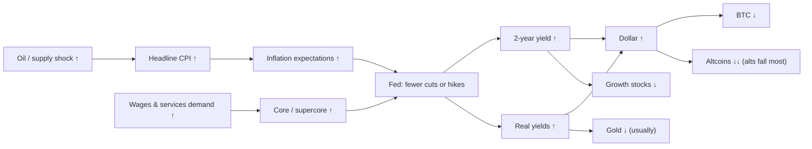

# 04. Inflation

Inflation is where macro meets your portfolio fastest. On a CPI morning, one number released at 8:30 am New York time can move the 2-year Treasury yield, the dollar, the Nasdaq and bitcoin within minutes. Over months, inflation decides how far the Federal Reserve can cut or how far it must hike. That in turn decides the price of money for every risky asset. Benjamin Cowen has published a video on almost every CPI release since 2022 ("Inflation Rises to 3.8%", "Inflation Soars to 3.3%"). His recurring point is simple: hot inflation means fewer or later cuts, higher yields and a firmer dollar, and that mix has been worst for altcoins. This chapter explains every inflation gauge he shows, how to read them without falling into the usual traps, and how inflation travels through the Fed, yields and the dollar into crypto. It also covers the history: the 1970s waves, the 2021–23 surge, the 2025 tariffs and the 2026 oil shock.

**You will learn**
- What CPI, core CPI, "supercore", shelter, PCE, core PCE and PPI measure, and which one the Fed actually targets.
- How to read year-over-year versus month-over-month annualized numbers, and how base effects fool people.
- The difference between disinflation and deflation.
- What happened in the 2021–23 inflation wave, the 2025 tariff scare and the 2026 oil shock, with dates and numbers.
- What the 1970s "second wave" analogy gets right and where it breaks down.
- How an inflation surprise moves the Fed, then yields, then the dollar, then crypto, and when that chain has failed.

---

## The inflation transmission chain at a glance

Before the indicator cards, here is the chain this whole chapter keeps returning to. Each arrow carries a sign. "↑" means the variable tends to rise.

The chain is a tendency, not a law. Section "When the chain breaks" below shows September 2026, when the Fed hiked, the dollar rose and bitcoin still rallied.

---

## Headline measures

### CPI and core CPI (CPIAUCSL, CPILFESL)

**What it is.** The Consumer Price Index for All Urban Consumers (CPI-U) measures the price of a fixed basket of goods and services bought by urban households. The Bureau of Labor Statistics (BLS) publishes it monthly, about 10–15 days after the month ends, at 8:30 am ET. "Headline" CPI includes everything. "Core" CPI excludes food and energy, the two most volatile categories. CPI is not revised, except that seasonal factors are recalculated for the last five years each February ([research notes B](../../research-notes/B-fed-rates-inflation-labor.md)).

**Where to find it.** FRED `CPIAUCSL` (seasonally adjusted index), `CPIAUCNS` (not seasonally adjusted; the YoY number BLS headlines), `CPILFESL` (core). TradingView `ECONOMICS:USIRYY` (headline YoY) and `ECONOMICS:USCIR` (core). The BLS release itself has a table of category contributions. Cowen's platform (ITC) carries CPI, core CPI and "Inflation YoY per category / contributions" charts, plus food-price charts such as eggs, dairy and meat.

**How to read it.**
- Headline is noisy because energy swings. Core shows *persistence*: whether price increases have spread into the broad economy.
- Compare the 3-month and 6-month annualized core rate with the YoY rate. If the short-term rate is above the YoY rate, inflation is turning up; if it is below, it is cooling.
- The gap between headline and core tells you the *kind* of inflation. A big headline-over-core gap means a supply shock (energy, food). A core that rises on its own means demand and wages.
- Common misreadings: treating one hot month as a trend, and treating a YoY decline as "inflation is falling" when it is only a base effect (see [Base effects](#yoy-mom-annualized-and-base-effects)).

**The path, 2021 to 2026** (seasonally adjusted YoY, computed from FRED `CPIAUCSL` / `CPILFESL`; [research notes B](../../research-notes/B-fed-rates-inflation-labor.md) and FRED data in the research folder):

| Month | Headline CPI YoY | Core CPI YoY | What was going on |
|---|---|---|---|
| Dec 2020 | 1.3% | – | Pandemic low; Fed at zero |
| Apr 2021 | 4.1% | – | Reopening; base effects from 2020 |
| Nov 2021 | 6.9% | – | Fed announces taper on 3 Nov 2021; BTC tops 10 Nov 2021 |
| Jun 2022 | **9.0%** | 5.9% | 40-year high (BLS's not-seasonally-adjusted headline: 9.1%); core peaks at 6.6% in Sep 2022 |
| Dec 2022 | 6.4% | – | Fed has hiked 4.25 pp in the year |
| Jun 2023 | 3.1% | – | Last hike comes in July 2023 |
| Sep 2024 | 2.4% | – | First cut (18 Sep 2024) |
| Apr 2025 | 2.3% | 2.8% | Tariff announcements |
| Sep 2025 | 3.0% | 3.0% | Fed resumes cuts |
| Oct 2025 | – | – | Not published (federal shutdown, 1 Oct – 12 Nov 2025) |
| Jan–Feb 2026 | 2.4% | 2.5% | The low |
| Mar 2026 | 3.3% | 2.6% | Iran war; CPI +0.87% in one month |
| May 2026 | **4.2%** | 2.8% | 2026 peak (BLS NSA headline: 4.25%) |
| Jun 2026 | 3.5% | 2.6% | Oil eases; CPI −0.42% in one month |
| Sep 2026 | 3.7% | 2.6% | Oil back up; headline +0.65% MoM, core +0.33% |

**How Cowen uses it.** He publishes a video on most CPI days, titled with the number: "Inflation Rises to 3%" (13 Feb 2025), "Inflation Rises to 3.0%" (25 Oct 2025), "Inflation Soars to 3.3%" (10 Apr 2026), "Inflation Rises to 3.8%" ([12 May 2026](https://rosetta.to/u/intothecryptoverse/inflation-rises-to-3-8)). His standing claim is that a hot print means fewer or later cuts, higher yields and a stronger dollar, which is worst for altcoins. He breaks the print down by category (housing, food, apparel, transportation). In 2026 he called the spike "mostly a supply driven issue", meaning energy and geopolitics rather than an overheating economy (video summaries via the [Rosetta index](https://rosetta.to/u/intothecryptoverse)).

**Connections.**
- *Leads:* CPI surprises lead the 2-year yield and fed funds futures within minutes. Over months, a rising core leads Fed policy (hikes or a longer pause).
- *Lags:* oil and gasoline lead headline CPI by about 0–1 month. PPI leads goods CPI by about 0–3 months. Market rents lead shelter CPI by about 12 months.
- *Mechanism:* the Fed has a 2% inflation target. Higher inflation means a higher policy rate for longer, which raises the discount rate on every asset and supports the dollar.
- *Episodes:* in 2022 a 9.0% CPI produced the fastest hiking cycle in decades (+525 bp in 16 months, [research notes B](../../research-notes/B-fed-rates-inflation-labor.md)), and BTC fell about 77% from its November 2021 top. In 2026 CPI went from 2.4% to 4.2% in four months, and the Fed moved from an easing bias (April) to a hike (16 Sep 2026).
- *Exception:* in 2026 core CPI (2.6%) stayed far below headline, so the shock did not broaden into core CPI. Core PCE behaved differently (see below), which is why the Fed still hiked.

**What it has meant for assets.** A CPI upside surprise has reliably lifted yields and the dollar and hit crypto and growth stocks on the day ([research notes B](../../research-notes/B-fed-rates-inflation-labor.md) rates it "high" reliability intraday). Over months the effect depends on the Fed's reaction. Energy stocks and commodities benefit from energy-led inflation. Gold is mixed: it tends to rise with inflation fear but falls when real yields jump.

**Investor takeaway.** Read headline and core together, and look at the short-term annualized core rate, not just YoY. The market reacts to the *surprise* against expectations and to what the surprise implies for the Fed, not to the level alone.

### Supercore, shelter and OER

**What it is.**
- *Shelter* (`CUSR0000SAH1`) is about 35% of CPI and about 44% of core CPI. Its biggest piece is *Owners' Equivalent Rent* (OER, `CUSR0000SEHC`): an imputed rent that homeowners "pay themselves". Nobody actually pays it, but BLS estimates it from rents.
- *Supercore* is core services excluding shelter. It is mostly labor-intensive services such as medical care, insurance, transport and recreation, so it tracks wages. It was Powell's favorite gauge in 2022–23. There is no single FRED series. You can approximate it with BLS "services less rent of shelter" (`CUSR0000SASL2RS`).

**Where to find it.** FRED ids above; BLS CPI release tables.

**How to read it.**
- Shelter is backward-looking. It lags market rents (Zillow, Apartment List) by about 12 months. Shelter YoY peaked at about 8% in 2023 and was 3.2% in September 2026 ([research notes B](../../research-notes/B-fed-rates-inflation-labor.md)). Its slow decline was the main driver of falling core CPI in 2024–25.
- Supercore tells you whether wage-driven services inflation is sticky, which is what the Fed worries about most.
- *Misreading:* a housing slowdown shows up in CPI only about a year later, so "shelter is still high" in a given month is often old news.

**How Cowen uses it.** He breaks down CPI categories including housing in his CPI-day videos (2026). He does not run a separate supercore series.

**Connections.** Market rents → shelter CPI (lag about 12 months, positive). Wages → supercore (positive, short lag). Mortgage rates → home demand → rents → shelter, with long lags.

**What it has meant for assets.** In 2023–24 falling shelter allowed core to fall without a recession, which let the Fed start cutting in September 2024. That supported stocks and BTC in 2024.

**Investor takeaway.** When core inflation moves, ask whether it is shelter (slow and predictable) or supercore (wage-driven and what the Fed fears).

### PCE and core PCE, the Fed's target (PCEPI, PCEPILFE)

**What it is.** The Personal Consumption Expenditures price index from the Bureau of Economic Analysis (BEA). It is released with Personal Income and Outlays about four weeks after month-end. The Fed's 2% target is defined on *headline* PCE, but core PCE is the operational guide. PCE covers more spending than CPI, including employer- and government-paid healthcare. It uses chain weights, so it adjusts as people substitute between goods, and gives shelter only about a 15% weight. Unlike CPI, it is revised.

**Where to find it.** FRED `PCEPI`, `PCEPILFE`; BEA. ITC carries PCEPI and core PCEPI.

**How to read it.** When CPI and PCE diverge, the Fed follows PCE. Core PCE peaked at 5.6% in September 2022. In September 2026 headline PCE was 3.65% and core PCE **3.12%** (FRED, the [macro lab](../../tools/macro-lab/REPORT-2026-10-30.md) shows the same 3.12%). Core PCE has been above 3% for most of 2026.

The 2026 twist: core PCE (3.1%) has been *above* core CPI (2.6%), which is unusual. The likely reasons ([research notes B](../../research-notes/B-fed-rates-inflation-labor.md)) are PCE's smaller weight on shelter, which is cooling, and larger weights on energy-sensitive services such as airfares and transport, and on portfolio-management fees, which rise with stock prices. Chair Kevin Warsh cited core PCE "about 3.2" at the 16 September 2026 press conference when the Fed hiked.

**How Cowen uses it.** It appears as a step in his October 2026 bearish roadmap: "PCE comes in hot (Oct 29)" (X post, 26 Oct 2026, as reported by [BeInCrypto via Yahoo](https://finance.yahoo.com/markets/crypto/articles/bitcoin-falls-below-80-000-032051576.html)). His [Triple Squeeze memo](https://benjamincowen.com/reports/the-triple-squeeze-september-2026) (30 Sep 2026) cites August PCE at 3.4% headline and 3.0% core.

**Revisions can create a "surprise": the August 2026 example.** In the same memo he pointed out that the August PCE print (3.4% headline, 3.0% core) came in well below the 3.7% / 3.3% consensus partly because of the **BEA annual revision**, which re-measured software, investment-management and legal-services prices. The revision also lowered July's already-published figures from 3.7% / 3.3% to 3.4% / 3.0%. So part of the apparent cooling was a change of yardstick, not a change in prices. The market still reacted: according to the memo, the odds of an October hike fell from about 70% to 35–42% after the release. The lesson is a data-literacy one ([chapter 01](01-HOW-TO-READ-MACRO-CHARTS.md) covers vintages): before reading a PCE surprise, check whether the prior months were revised, and compare like with like.

**Connections.** PCE is released after CPI and PPI, so analysts "nowcast" it from those two. PPI components such as airfares, medical services and portfolio management feed core PCE directly. That is why a PPI release can move rate expectations even after CPI is known.

**What it has meant for assets.** PCE surprises are usually smaller than CPI surprises because they are well forecast. The exception is when CPI and PCE diverge, as in 2026: a calm core CPI did not stop the hike because core PCE was above 3%.

**Investor takeaway.** If you want to know what the Fed will do, track core PCE. If you want to know what will move markets on the day, track CPI surprises.

### PPI, producer prices (PPIFIS)

**What it is.** The BLS Producer Price Index for final demand measures prices received by domestic producers. It is released around mid-month, usually after CPI.

**Where to find it.** FRED `PPIFIS` (final demand), `PPIACO` (all commodities). ITC carries PPI and PPIAC.

**How to read it.** PPI is a pipeline signal, not a target. It leads goods CPI by about 0–3 months. Year-over-year PPI was **6.3%** in September 2026, up from about 3% in 2025, and mostly energy ([research notes B](../../research-notes/B-fed-rates-inflation-labor.md)).

**How Cowen uses it.** "PPI Surges" (14 Aug 2025). In his [May 2026 Macro Risk Memo](https://benjamincowen.com/reports/macro-risk-memo-may-2026) he wrote that producer prices and transport costs were "leading the inflation move".

**Connections.** Oil → PPI energy → CPI energy and goods. PPI components → core PCE. ISM "Prices Paid" (77.9 in September 2026, see [chapter 06](06-GROWTH-AND-THE-BUSINESS-CYCLE.md#ism-manufacturing-pmi-main-street-and-the-alt-season-debate)) tells the same pipeline story from a survey.

**What it has meant for assets.** A hot PPI raises the odds that CPI and PCE stay hot, so it nudges yields up. It matters most when it confirms a trend already visible in CPI.

**Investor takeaway.** Use PPI and ISM Prices Paid as early warnings of what consumer prices will do over the next quarter.

### Inflation expectations: Michigan surveys and market breakevens

**What it is.** Two families of measure:
- *Surveys.* The University of Michigan asks consumers about expected inflation one year ahead (`MICH`) and 5–10 years ahead. A preliminary reading comes mid-month and a final one at month-end.
- *Market pricing.* The 10-year breakeven (`T10YIE`) is the nominal 10-year yield minus the inflation-protected (TIPS) yield. The 5-year, 5-year forward rate (`T5YIFR`) is expected inflation 5–10 years out, the Fed's favorite "anchoring" gauge. Both are covered in detail in [chapter 03](03-BONDS-AND-THE-YIELD-CURVE.md).

**How to read it.**
- Michigan 1-year expectations peaked at **6.6% in May 2025** on tariff fear and were 4.6% in September 2026 ([research notes B](../../research-notes/B-fed-rates-inflation-labor.md)). They are noisy and, since 2024, partisan: people's answers depend on who is in power.
- Market measures barely moved in 2026: the 10-year breakeven was 2.35% and the 5y5y 2.23% in late October 2026, essentially unchanged while CPI went from 2.4% to 4.2% (lab and [research notes B](../../research-notes/B-fed-rates-inflation-labor.md)). That means **long-run expectations are anchored**. This is the single biggest difference from the 1970s.
- [research notes B](../../research-notes/B-fed-rates-inflation-labor.md) suggests a rule of thumb: if the 5y5y broke above about 2.6–2.7%, the "second wave" story would gain real support. As of October 2026 it has not.

**How Cowen uses it.** Breakevens are not a named chart on his platform and are not a video topic. He argues from realized CPI and PCE instead.

**Connections.** Expectations feed wage demands and price-setting, so unanchored expectations make inflation self-sustaining. Anchored expectations let the Fed "look through" a supply shock, or hike only modestly.

**Investor takeaway.** When headline inflation spikes, check the 5y5y. If it is calm, the market believes the Fed. If it rises, the risk of a long inflation regime is real.

### YoY, MoM annualized and base effects

**What it is.** Three ways to state the same price change:
- *Year-over-year (YoY)*: this month's index ÷ the same month last year, minus 1.
- *Month-over-month (MoM)*: this month ÷ last month, minus 1.
- *MoM annualized*: (1 + MoM)^12 − 1. A 0.3% core month is about 3.7% annualized; 0.2% is about 2.4%.

**Base effects.** YoY falls or rises mechanically when a big month from a year ago drops out of the 12-month window. The March–May 2026 energy surge (+0.87%, +0.64%, +0.47% MoM, [research notes B](../../research-notes/B-fed-rates-inflation-labor.md)) will roll out of the YoY window in March–May 2027. That will pull headline YoY down sharply even if prices simply stay high. The June 2026 drop (−0.42%) will roll out in June 2027 and push YoY up. [research notes B](../../research-notes/B-fed-rates-inflation-labor.md)'s scenario note: "Base effects alone will pull headline YoY down sharply in Mar–May 2027 if oil merely stays flat."

**A data trap around missing months.** The October 2025 CPI was never collected because of the shutdown, so FRED has a blank month. A naive calculation that steps back "12 rows" instead of "12 calendar months" compares September 2026 with *August* 2025, a 13-month change, and gets about 4.0% instead of the correct 3.7% (FRED index 336.298 for September 2026 vs 324.245 for September 2025). The [lab dashboard](../../tools/macro-lab/REPORT-2026-10-30.md) matches calendar dates and shows 3.72%. Always check the date you are comparing against, especially around data gaps.

**Misreading.** "Inflation is falling" when only the YoY rate is falling because of base effects while the monthly run rate is still hot. Or the reverse in mid-2027.

**Investor takeaway.** Before reacting to a YoY headline, look at the last three MoM prints and at what dropped out of the window a year ago.

### Disinflation versus deflation

**Disinflation** means inflation is falling but still positive: prices rise more slowly. 2023–24 was disinflation (CPI from 9.0% to about 2.4%). **Deflation** means prices fall outright. It is rare in the US: 2009 (about −2% YoY headline, driven by oil) and briefly 2015 and 2020 ([research notes B](../../research-notes/B-fed-rates-inflation-labor.md)).

The distinction matters because disinflation with stable jobs is the friendliest backdrop for risk assets: the Fed can cut without a crisis. Deflation usually comes with a recession and falling profits, which is bad for stocks and crypto even though rates fall. Cowen's pre-2026 thesis was disinflation toward 2% (2023–25), with re-acceleration only through a policy mistake or a shock. In 2026 the shock came ([research notes B](../../research-notes/B-fed-rates-inflation-labor.md); [Benzinga, Feb 2025](https://benzinga.com/markets/cryptocurrency/25/02/43706856/could-inflation-unemployment-derail-the-bitcoin-bull-run), content not retrievable).

---

## Oil and energy: the supply-shock channel

### Oil (WTI, Brent) and energy stocks (DCOILWTICO, DCOILBRENTEU, XLE)

**What it is.** West Texas Intermediate (WTI, the US benchmark) and Brent (the international benchmark) crude oil prices, daily. Energy equities are tracked by the XLE sector fund. (Oil also appears in [chapter 08](08-STOCKS-GOLD-AND-CROSS-ASSET.md) as a cross-asset; it is covered in full here because its main macro channel is inflation.)

**Where to find it.** FRED `DCOILWTICO`, `DCOILBRENTEU` (daily spot), `WTISPLC` (monthly from 1946). TradingView `TVC:USOIL`, `TVC:UKOIL`, `AMEX:XLE`. ITC carries "Crude Oil (WTI)".

**How to read it.**
- Gasoline is a big, visible part of headline CPI, so oil leads headline CPI by weeks.
- The *speed* of a move matters more than the level, because businesses and households cannot adjust quickly.
- Supply-driven spikes (embargo, war, blockade) are more dangerous than demand-driven ones (a booming economy bidding up oil).
- Spot and futures prices can differ a lot during a blockade, so news quotes vary. The FRED Brent spot series and front-month futures quotes in the press disagreed by more than $10 at times in 2026.

**The 2026 oil shock** (FRED spot monthly averages, computed; event dates from [research notes A](../../research-notes/A-cowen-inventory.md) and B):

| Month (2026) | Brent average | WTI average | Event |
|---|---|---|---|
| Feb | $70.9 | $64.5 | US and Israeli strikes on Iran, 28 Feb |
| Mar | $103.1 | $91.4 | Strait of Hormuz closed; WTI $67 → $91 in one week |
| Apr | $117.3 | $100.3 | Brent spot high $138.21 on 7 Apr |
| Jun | $85.4 | $84.8 | 17 Jun Hormuz memorandum; prices ease |
| Jul–Aug | $83.8–91.1 | $80.5–83.9 | Strikes resume 7 Jul |
| Sep | $114.2 | $97.3 | Trump rejects Iran's plan to reopen Hormuz (28 Sep, per Al Jazeera) |
| Oct (to 27th) | $124.8 | $101.4 | Brent spot $123.10 on 27 Oct |

**How Cowen uses it.**
- "Oil Spikes 35%" (8 Mar 2026) described WTI going from $67 to $91 in one week, the "largest weekly rally since 1983".
- "The Mechanism That Ends Business Cycles" (28 Feb 2026): oil spikes historically precede recessions.
- Energy stocks top *last* in a cycle: energy "topped after the stock market in a late business cycle environment" (2026, [research notes B](../../research-notes/B-fed-rates-inflation-labor.md)).
- His [September 2026 memo](https://benjamincowen.com/reports/the-triple-squeeze-september-2026) notes oil rolled over before the 10-year yield, by about 5 weeks in 2018 and about 4 months in 2022.
- Oil at about $120 is a step in his October 2026 bearish roadmap (26 Oct 2026).

**Connections.**
- *Oil → headline CPI:* positive, lag weeks.
- *Oil → breakevens → yields:* oil moves market inflation expectations quickly. In his [Triple Squeeze memo](https://benjamincowen.com/reports/the-triple-squeeze-september-2026) (30 Sep 2026) Cowen makes this step 1 of a six-step "squeeze loop": oil up → headline inflation and breakevens reprice higher → yields follow, with the long end adding term premium → the dollar firms → non-yielding assets (gold, long-duration stocks) de-rate → costs bite (mortgages, autos, fuel) → demand weakens. Breakevens are explained in [chapter 03](03-BONDS-AND-THE-YIELD-CURVE.md), and the full loop is mapped in [chapter 13](13-HOW-IT-ALL-CONNECTS.md). In 2026 the first step was muted: the 10-year breakeven barely moved (2.30% a year earlier, 2.35% in late October, [lab](../../tools/macro-lab/REPORT-2026-10-30.md)) while real yields did most of the rising.
- *Oil → recession:* James Hamilton found that 10 of 11 post-war US recessions to 2008 were preceded by a sharp oil rise, while stressing it was a contributing factor, not the sole cause ([NBER Reporter 2011](https://www.nber.org/reporter/2011number2/oil-price-shocks)). [research notes C](../../research-notes/C-growth-liquidity-crossasset.md)'s own check found oil rose 184% into the 1973 recession, 166% into 1980, 160% into 1990, 205% into 2001 (with a long lag) and 93% into the 2007 start.
- *Counter-examples:* spikes without recessions include 1987, 2017–18, 2021–22 (WTI +113% YoY, $123 in June 2022) and 2026 so far (+58% YoY in April). The US is now a net petroleum exporter, so higher oil moves income from consumers to US producers rather than abroad. That softens the GDP hit while still hurting real incomes and sentiment.
- *Oil → Fed:* the historical Fed reaction was to *ease* once growth broke (1974, 1990, 2008). In 2026 the Fed hiked into the shock instead.

**What it has meant for assets.** Energy shocks have hit crypto (BTC fell in H1 2026), helped energy stocks, lifted breakevens first and then real yields, and supported the dollar. Gold rose early and then fell when real yields spiked (gold fell about 30% from late January to late March 2026).

**Investor takeaway.** Watch the speed of oil moves and whether they are supply-driven. A sustained supply spike plus a central bank that cannot ease is the classic recipe for the end of a business cycle, but in 2021–22 and so far in 2026 it has not been sufficient on its own.

---

## Episodes

### The 2021–23 inflation wave

This is the episode that brought macro into crypto analysis. Cowen's channel was almost purely technical until 2021. In 2022, 65 of his video titles or summaries touched CPI, PCE or PPI (a keyword count over his video index).

**How it built.** CPI went from 1.3% in December 2020 to 4.1% in April 2021, 6.9% in November 2021 and **9.0% in June 2022**. Core CPI peaked at 6.6% in September 2022 and core PCE at 5.6%. Part of the early rise was base effects from depressed 2020 prices. Then reopening demand, supply-chain bottlenecks, fiscal transfers and energy (Brent spot hit $133 on 8 March 2022) made it broad. The Fed initially called the rise "transitory" and kept rates at zero.

**How the Fed reacted.** The Fed announced the taper of its bond purchases on 3 November 2021. Bitcoin made its cycle top a week later, on 10 November 2021. The first hike came on 16 March 2022. The Fed then hiked 525 bp in 16 months, to a 5.25–5.50% range in July 2023, and ran QT (quantitative tightening) from June 2022. At the CPI peak, fed funds was only about 1.2%, far behind inflation ([research notes B](../../research-notes/B-fed-rates-inflation-labor.md) table below).

**What assets did.**
- BTC fell about 77% from its November 2021 top to November 2022. Its daily correlation with the S&P 500 rose to 0.56 in 2022 ([research notes C](../../research-notes/C-growth-liquidity-crossasset.md)), and the lab's weekly BTC-to-Nasdaq correlation was 0.44 that year, the highest in its table ([lab](../../tools/macro-lab/REPORT-2026-10-30.md)).
- The S&P 500 fell about 25% without a recession; the Nasdaq fell 33% in calendar 2022 (lab).
- The dollar surged: the DXY peaked on 28 September 2022 at 114.78 ([research notes C](../../research-notes/C-growth-liquidity-crossasset.md)).
- ETH/BTC fell 11% in 2022 while the Fed raised its target 4.25 pp (lab).

**Cowen's reading at the time.** "Bitcoin Vs. 10 Year Treasury Yields" (4 Jan 2022): high inflation raises cross-asset correlation. "S&P 500 Bear Markets with High Inflation" (10 Oct 2022). In February 2022 he argued a first hike was "not necessarily doom and gloom" for BTC ([Daily Hodl, 28 Feb 2022](https://dailyhodl.com/2022/02/28/interest-rate-hike-not-necessarily-doom-and-gloom-for-bitcoin-btc-says-analyst-benjamin-cowen-heres-why/)). He has since contrasted the *inflation-driven* 2021 top with the *unemployment-driven* Q4 2025 top ([Bankless, 23 Dec 2025](https://www.bankless.com/podcast/where-is-crypto-going-in-2026-ben-cowen)).

**How it ended.** Inflation fell to 2.3% by April 2025 without an NBER recession. Shelter disinflation did much of the late work. This "immaculate disinflation" broke several recession templates; see [chapter 05](05-THE-LABOR-MARKET.md) and [chapter 13](13-HOW-IT-ALL-CONNECTS.md).

### The 1970s "waves" analogy, and its limits

**The facts** (FRED CPI, [research notes B](../../research-notes/B-fed-rates-inflation-labor.md)):
1. CPI peaked at 6.4% in February 1970. The Fed cut fed funds from about 9% to about 3.5% by 1972, and CPI fell to about 3%.
2. CPI then rose to **12.2% in November 1974**, helped by the OPEC embargo. Under Chair **Arthur Burns** the Fed eased again, from 12.9% (July 1974) to about 4.7% (December 1976), while inflation was still about 5%.
3. CPI then climbed to **14.6% in March 1980**. Paul Volcker took fed funds to about 19% (June 1981), which broke inflation at the cost of a double-dip recession. CPI was about 2.5% by mid-1983.

A Hoover Institution / Fed paper (Nelson, 2024) attributes much of the 1976–80 wave to Burns-era easing ([research notes B](../../research-notes/B-fed-rates-inflation-labor.md)).

**Inflation peaks and the Fed's response** ([research notes B](../../research-notes/B-fed-rates-inflation-labor.md)):

| CPI peak | Peak | Fed funds at peak | Fed response | Outcome |
|---|---|---|---|---|
| Feb 1970 | 6.4% | 9.0% | Eased hard (to ~3.5% by 1972) | Recession 1970; inflation came back (wave 2) |
| Nov 1974 | 12.2% | 9.5% (12.9% Jul 1974) | Eased to ~4.7% by 1976 (Burns) | Trough 5.0% in Dec 1976, then wave 3 |
| Mar 1980 | 14.6% | 17.2% | Volcker: cut, then re-hiked to ~19% | Double-dip 1980 and 1981–82; inflation broken |
| Oct 1990 | 6.4% | 8.1% | Eased through the oil-shock recession | Recession 1990–91; inflation to ~3% |
| Jul 2008 | 5.5% | 2.0% | Looked through oil; was cutting | Oil spike → financial crisis; deflation 2009 |
| Jun 2022 | 9.0% | 1.2% | +525 bp in 16 months | Disinflation to 2.3% by Apr 2025, no recession |
| May 2026 | 4.2% | 3.6% | Paused, then hiked Sep 2026 | Ongoing |

**The 2022–26 overlay.** CPI peaked at 9.0% (June 2022), troughed at 2.3–2.4% (April 2025 and January 2026), and rose back to 3.7–4.2% in 2026. The *shape* rhymes with the 1970s: a peak, an early declaration of victory, a second wave. The 2026 trigger, an oil shock, is also 1973-like.

**The limits** ([research notes B](../../research-notes/B-fed-rates-inflation-labor.md)):
- *Magnitude.* The 1976 trough was 5%; the 2026 trough was 2.4%. The 2026 peak (4.2%) is a third of the 1974 peak.
- *Expectations.* Long-run expectations were unanchored in the 1970s. In 2026 the 5y5y sits around 2.2%.
- *The Fed's reaction.* Burns eased into a supply shock. The 2026 Fed hiked into one, which is Volcker-like rather than Burns-like. That lowers second-wave risk and raises the risk of a policy-error recession.
- *Structure.* Unions and wage indexation are weaker, the economy uses less energy per dollar of output, and the US is now a net oil exporter.
- *Sample size.* There is one 1970s. An analogy with one precedent is a story, not a statistic.

**How Cowen uses it.** He has described recurring 1970s-style waves as a risk but not his base case (2022–2025, per Benzinga). Videos include "S&P 500 Bear Markets with High Inflation" (10 Oct 2022), "Smoothed Recession Probabilities" (10 Jan 2023), "Inflation & Bitcoin" (11 Dec 2024) and "Bitcoin, Stocks, and Inflation" (14 Mar 2025). His argument is that inflationary periods force sustained hikes and cluster recessions. In May 2026 he said "If inflation were to start another major inflationary wave, that would have negative consequences for the stock market" ([research notes B](../../research-notes/B-fed-rates-inflation-labor.md), from the [Rosetta summary](https://rosetta.to/u/intothecryptoverse/inflation-rises-to-3-8)). He also compared the S&P 500 priced in gold to "the 1970s more than 2000" (January 2026). The 1970s analog appears in 38 of his video titles or summaries over 2019–mid-2026 (a keyword count over his video index).

**Fair verdict.** Supported in direction, weak in magnitude so far ([research notes B](../../research-notes/B-fed-rates-inflation-labor.md)). Use it as a risk scenario with a clear test: watch the 5y5y and core PCE momentum.

### Tariffs, 2025

**What happened.** The "Liberation Day" tariff announcements on 2 April 2025 produced:
- an expectations spike: Michigan 1-year expectations reached 6.5–6.6%;
- a credit spike: the high-yield spread hit 4.61 pp on 7 April;
- an equity drawdown of about −19% for the S&P 500 from its February 2025 peak to 8 April, according to [research notes B](../../research-notes/B-fed-rates-inflation-labor.md). Cowen's video said 20% ("The S&P500 Has Dropped 20%", 8 Apr 2025).

A 90-day pause followed (Cowen video "Trump 90-Day Tariff Pause", 10 Apr 2025). BTC's April 2025 low was about $74–76k, and ETH bottomed near $1,386 on 9 April 2025.

**Pass-through was modest and slow.** Core goods firmed, and core CPI went from 2.8% (April) to 3.1% (August 2025). Headline CPI was 2.3% in April and 3.0% in September 2025. Importers front-ran the tariffs, which distorted trade data: Q1 2025 GDP was first reported as a contraction and now shows +0.1% after revisions ([research notes C](../../research-notes/C-growth-liquidity-crossasset.md)).

**How the Fed treated it.** As a one-time price-level shift. It held at 4.25–4.50% from December 2024 to July 2025, then cut on 17 September 2025, citing "the shift in the balance of risks" toward the labor market (FOMC statement, [research notes B](../../research-notes/B-fed-rates-inflation-labor.md)).

**How Cowen used it.** In 2025 he framed tariffs as an inflation risk that could delay cuts ("S&P 500: What Is Happening?", 3 Apr 2025). He used a 1998 analog for the S&P: a 20% drop followed by new highs (8 Apr and 3 Jul 2025). The S&P did recover to new highs later in 2025.

**Lesson.** A price-level shock such as a tariff raises inflation for about a year and then fades, unless expectations come unanchored. The Fed looked through it. The market's biggest reaction came from the growth scare, not the inflation itself.

### The 2026 oil shock and the Fed's "checkmate"

**The sequence** ([research notes A](../../research-notes/A-cowen-inventory.md) and B):
1. **Jan–Feb 2026.** CPI 2.4%, core 2.5%. The Fed holds at 3.50–3.75% after three cuts in late 2025. QT ended on 1 December 2025.
2. **28 Feb 2026.** US and Israeli strikes on Iran. The Strait of Hormuz closes. Brent averages $103 in March and $117 in April.
3. **Mar–May.** CPI 3.3% → 3.8% → 4.2%. Core CPI only 2.6–2.8%, but core PCE above 3%. PPI and ISM Prices surge.
4. **29 Apr.** Powell's last meeting as Chair: a hold with an easing bias, and three dissents against that bias.
5. **17 Jun.** Warsh's first meeting: a 12–0 hold with the easing bias removed; the median dot implies a hike.
6. **29 Jul.** Hold, 9–3, with three dissents *for* a hike.
7. **16 Sep 2026.** **Hike of 25 bp to 3.75–4.00%**, the first since July 2023, 12–0. The 10-year Treasury closed at 5.31% on 5 October, its highest close in more than two decades (FRED via [research notes B](../../research-notes/B-fed-rates-inflation-labor.md)).
8. **28 Oct.** Hold, 10–2, with two dissents for another hike. CME FedWatch priced about 83% odds of a December hike ([research notes B](../../research-notes/B-fed-rates-inflation-labor.md)).

**Cowen's framing: "checkmate".** Supply-driven inflation plus a softening labor market leaves the Fed unable to cut (inflation) and unable to hike aggressively (jobs). In April and May 2026 he said: "They can defend one weakness, but if you have two weaknesses, the defense breaks down" and "that's how the Federal Reserve ultimately gets checkmated" (videos of 7 Apr and 12 May 2026, per Rosetta summaries; the framing also runs through "Inflation Soars to 3.3%", 10 Apr 2026, and the [May 2026 memo](https://benjamincowen.com/reports/macro-risk-memo-may-2026)). He argues this combination typically ends business cycles. The May memo's full PDF is titled "The Fed's Late Business Cycle Trap: Defending Two Weaknesses" (18 May 2026). It describes the resurgence as supply-driven (energy, transport and producer costs) with core inflation not yet re-accelerating, notes that "Fed policy tends to follow the direction implied by the front end", and expected markets to start pricing higher rates rather than cuts. That part was right: the Fed hiked four months later.

**What actually happened to the labor side.** It did not soften further. Unemployment fell from 4.5% (November 2025) to 4.1–4.2% (mid-2026), and initial claims were 194k in late October 2026 ([chapter 05](05-THE-LABOR-MARKET.md)). With one weakness instead of two, the Fed chose to hike.

### When the chain breaks: September 2026

The textbook chain at the top of this chapter predicts: a hike → a stronger dollar → weaker BTC. Before the September 2026 meeting, Cowen argued the Fed "really should" hike and that a hike would lift the dollar and sink BTC ([Benzinga, Sep 2026](https://www.benzinga.com/crypto/cryptocurrency/26/09/61640748/bitcoin-falls-as-analyst-says-the-fed-really-should-raise-rates-this-month)). The Fed hiked on 16 September and the dollar did rise, but BTC rose from about $76k on hike day to about $86k on 21 Sep (Coinbase), extending a rally that began near $63k in mid-August. [research notes A](../../research-notes/A-cowen-inventory.md) links part of the rally to a Treasury bond-buyback expansion in August (CoinDesk). Cowen conceded publicly that the thesis "was not rooted in the data" and that "None of the data suggests that a rate hike has ever been immediately bearish for Bitcoin" after checking December 2015, March 2022, September 2018 and September 2022 ([Benzinga via TradingView](https://www.tradingview.com/news/benzinga:45b48150d094b:0-bitcoin-analyst-admits-his-rate-hike-thesis-was-not-rooted-in-the-data/)).

The lesson is not that the chain is wrong. It is that each link is a probability, and the final link (dollar → crypto) is the weakest. The lab's weekly correlation between BTC and the broad dollar is only −0.08 over all weeks and −0.13 over the last 52 weeks ([lab](../../tools/macro-lab/REPORT-2026-10-30.md)). Over full cycles, the *level* of real rates and liquidity matters more than any single meeting.

---

## How inflation feeds the Fed, yields, the dollar and crypto

This table connects the inflation gauges to the rest of the course. Signs are typical directions; "reliability" is the research team's judgment ([research notes B](../../research-notes/B-fed-rates-inflation-labor.md) section 8).

| Inflation driver | Fed reaction | 2-year / 10-year yields | Dollar | BTC | Altcoins | Gold | Reliability |
|---|---|---|---|---|---|---|---|
| CPI upside surprise | Fewer cuts or a hike priced | 2Y ↑ most; 10Y ↑ | ↑ | ↓ on the day | ↓↓ | ± | High intraday |
| Core PCE trending above 3% | Holds or hikes | ↑ | ↑ | ↓ over months (2022) | ↓↓ | ↓ if real yields rise | Medium |
| Energy supply shock | Hesitates; 2026: hiked | Breakevens ↑ first, then real yields ↑ | ↑ | ↓ (H1 2026) | ↓↓ | ↑ early, ↓ if real yields spike | Medium |
| Disinflation with stable jobs | Cuts ("insurance") | ↓ (front end most) | ↓ | ↑ with lag | ↑ only if liquidity loosens | ↑ | Medium |
| Tariff price-level shock | Looks through | Mixed | Mixed (2025: dollar fell) | ↓ on growth scare | ↓↓ | ↑ | Low–medium |

**The link to the dollar and crypto, step by step.**
1. *Inflation → Fed.* The Fed reacts to core PCE and to expectations. A rising core means a higher expected policy path.
2. *Fed → 2-year yield.* The 2-year is the market's forecast of the policy path over two years. Cowen's shorthand is that "the Fed chases the 2-year" ([research notes B](../../research-notes/B-fed-rates-inflation-labor.md)). In late October 2026 the 2-year was 4.67% versus a 4.00% upper bound, which is the market pricing more hikes (lab).
3. *Yields → real yields.* If nominal yields rise faster than expected inflation, real yields rise. The 10-year TIPS yield reached 2.93% at the end of September and 2.95% on 5 Oct 2026, the highest since November 2008, and was 2.67% in late October (FRED, lab). Real yields are the cost of holding an asset that pays no income, such as gold or BTC.
4. *Real yields → dollar.* Higher US real yields attract capital and support the dollar. Cowen's September 2026 memo described a firmer dollar with higher lows since February as part of a "triple squeeze" ([memo](https://benjamincowen.com/reports/the-triple-squeeze-september-2026)). See [chapter 07](07-LIQUIDITY-MONEY-AND-THE-DOLLAR.md).
5. *Dollar and liquidity → crypto.* A stronger dollar tightens global dollar liquidity. Cowen argues this hits altcoins hardest: in his framing, an altcoin season is unlikely while the dollar strengthens (per secondary summaries of his dollar videos, e.g. "The Yield Curve & Bitcoin", 23 Oct 2024). He also says crypto "is more sensitive to rate cuts and liquidity than the stock market is" (12 May 2026, [research notes B](../../research-notes/B-fed-rates-inflation-labor.md)). See [chapter 12](12-DOMINANCE-ALTCOINS-AND-ROTATION.md).

---

## Putting it together

1. **A supply or price-level shock (oil, tariffs) → headline CPI ↑ → expectations stay anchored → Fed looks through.** This is the benign version. It happened in 2025 with tariffs: the Fed cut in September 2025 with core CPI at about 3% (3.1% in August). *Exception:* in 2026 core PCE was above 3% and the labor market was firm, so the Fed hiked instead (16 Sep 2026).

2. **Core and supercore ↑ for several months → the Fed hikes faster than expected → the 2-year rises more than the 10-year (bear flattening) → the dollar rallies → crypto falls with tech, alts fall most.** This was 2022: CPI 9.0% in June, +525 bp of hikes, the DXY at 114.78 in September, BTC −77% to November 2022, ETH/BTC −11% for the year. *Exception:* in September 2026 a hike and a firmer dollar came with a BTC rally (about $76k on hike day to about $86k on 21 Sep, Coinbase).

3. **Inflation falls back toward 2% while unemployment is stable → the Fed cuts as "insurance" → the front end falls → risk assets rise.** This was 2024: CPI 2.4% in September 2024, the first cut on 18 September, and the Nasdaq +25.6% and BTC +83% over the next 12 months (lab). *Caveat:* after that cut the 10-year rose from about 3.6% to about 4.8% and the dollar from about 100 to about 110 by January 2025, as Cowen had predicted for a cut without a recession (October 2024). Disinflationary cuts lower the front end, not necessarily the long end.

4. **A second inflation wave after a premature "victory" → the Fed must re-tighten → the cycle ends in recession.** This was 1972–74 and 1977–80. The 2026 overlay rhymes (2.4% → 4.2%) but at a third of the magnitude, with anchored expectations and a Fed that hiked rather than eased. As of late October 2026 there is no recession. The test to watch is the 5y5y and three-month annualized core PCE.

5. **Base effects in spring 2027 → headline YoY drops sharply even if oil stays high → "inflation is beaten" headlines → a possible dovish repricing.** This is a mechanical forecast of the *number*, not of the Fed. If monthly core is still running at 0.3% or more, the Fed is likely to look past the headline drop.

---

## Check yourself

1. In September 2026 headline CPI was 3.7% and core CPI 2.6%. What does that gap tell you about the kind of inflation, and which gauge did the Fed lean on to justify its hike?
2. Why does shelter make core CPI a lagging indicator of housing conditions?
3. A core CPI print of +0.3% MoM is roughly what annualized rate?
4. October 2025 CPI is missing from FRED. What goes wrong if you compute September 2026 YoY by stepping back 12 rows, and what is the correct figure?
5. Name three reasons the 1970s "second wave" analogy is weaker in 2026 than it looks on a chart.
6. What did the Fed do after the April 2025 tariff shock, and why?
7. Describe the chain from a hot CPI print to altcoins, and name the link that failed in September 2026.
8. What is the difference between disinflation and deflation, and which is usually friendlier for risk assets?

Answers

1. A large headline-over-core gap means a supply shock (energy) rather than broad demand-driven inflation. The Fed pointed to core PCE, which was above 3% (Warsh cited "about 3.2" on 16 Sep 2026), not to core CPI.
2. Shelter is about 35% of CPI and 44% of core CPI, and its main component (owners' equivalent rent) lags market rents by about 12 months. A housing slowdown therefore reaches core CPI about a year late.
3. About 3.7% annualized ((1.003)^12 − 1).
4. Stepping back 12 rows skips the missing October 2025 and lands on August 2025, so you measure a 13-month change (about 4.0%). Matching calendar dates (September 2026 vs September 2025) gives the correct 3.7%, which is what the lab dashboard shows (3.72%).
5. Any three of: the 2026 trough (2.4%) was far below the 1976 trough (5%); long-run expectations are anchored (5y5y about 2.2%); the Fed hiked into the shock instead of easing like Burns; weaker unions and indexation; a less energy-intensive economy and a US that is now a net oil exporter; a sample of one.
6. It held at 4.25–4.50% until July 2025 and then cut from 17 September 2025. It treated tariffs as a one-time price-level shift, and its statement cited a shift in the balance of risks toward the labor market.
7. Hot CPI → the market prices fewer cuts or hikes → the 2-year yield and real yields rise → the dollar firms → dollar liquidity tightens → BTC falls and alts fall more. In September 2026 the Fed hiked and the dollar rose, but BTC rallied: the dollar → crypto link failed.
8. Disinflation is falling but positive inflation; deflation is falling prices. Disinflation with stable jobs is usually friendlier because the Fed can cut without a crisis. Deflation usually comes with recession and falling profits.

---

## Sources for this chapter

- Course research files: inventory of Cowen's indicators ([research notes A](../../research-notes/A-cowen-inventory.md)), Fed/rates/inflation/labor ([research notes B](../../research-notes/B-fed-rates-inflation-labor.md)), growth/liquidity/cross-asset ([research notes C](../../research-notes/C-growth-liquidity-crossasset.md)), Cowen's written reports ([research notes E](../../research-notes/E-cowen-reports.md)), and the [macro lab report](../../tools/macro-lab/REPORT-2026-10-30.md) (FRED data to 29 Oct 2026).
- FRED series: [CPIAUCSL](https://fred.stlouisfed.org/series/CPIAUCSL), [CPILFESL](https://fred.stlouisfed.org/series/CPILFESL), [PCEPILFE](https://fred.stlouisfed.org/series/PCEPILFE), [PPIFIS](https://fred.stlouisfed.org/series/PPIFIS), [MICH](https://fred.stlouisfed.org/series/MICH), [T5YIFR](https://fred.stlouisfed.org/series/T5YIFR), [DCOILBRENTEU](https://fred.stlouisfed.org/series/DCOILBRENTEU), [DCOILWTICO](https://fred.stlouisfed.org/series/DCOILWTICO).
- FOMC statement, 16 Sep 2026: <https://www.federalreserve.gov/monetarypolicy/files/monetary20260916a1.pdf>; Warsh press conference: <https://www.federalreserve.gov/mediacenter/files/FOMCpresconf20260916.pdf>.
- Cowen memos: [How Risk Cascades Through Markets (Mar 2026)](https://benjamincowen.com/reports/how-risk-cascades-through-markets-march-2026), [Macro Risk Memo May 2026](https://benjamincowen.com/reports/macro-risk-memo-may-2026), [The Triple Squeeze (Sep 2026)](https://benjamincowen.com/reports/the-triple-squeeze-september-2026).
- Video index and summaries: <https://rosetta.to/u/intothecryptoverse> (titles and dates reliable; summaries machine-written).
- Hamilton, "Oil Price Shocks", NBER Reporter 2011: <https://www.nber.org/reporter/2011number2/oil-price-shocks>.

> Educational material, not financial advice. Past relationships between indicators can break.

[← 03 Bonds and the yield curve](03-BONDS-AND-THE-YIELD-CURVE.md) | [Index](00-INDEX.md) | [05 The labor market →](05-THE-LABOR-MARKET.md)
