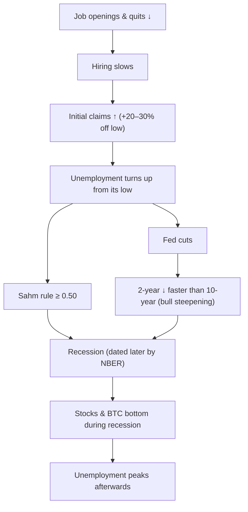

# 05. The labor market

Since 2023 the unemployment rate has been Benjamin Cowen's most important macro variable. His reasoning is that recessions are, in the end, labor-market events. Unemployment tends to bottom before a recession, then rise in a self-reinforcing, "non-linear" way. The Fed responds by cutting, and stocks and crypto make their lows *during* the recession, while unemployment is still rising. Unemployment then peaks *after* the market has already bottomed. That sequence held in every US recession since 1969. It also failed spectacularly in 2024–26, when unemployment rose by more than a percentage point, the Sahm rule fired and the Fed cut 175 bp, yet no recession came. This chapter teaches the labor indicators Cowen uses, the historical record behind his framework (with tables from this course's macro lab) and the reasons it broke this time.

**You will learn**
- What U-3, U-6, payrolls, jobless claims, JOLTS and the participation rate measure, and how often they are revised.
- How the Sahm rule works, its full real-time track record, and why it gave a false signal in 2024.
- How far ahead of recessions unemployment has bottomed, and how much it had risen by the time a recession began.
- Cowen's "unemployment rises → Fed cuts → risk assets" framework, with dated quotes and the record of where it worked and where it did not.
- Why a labor-*supply* shock (immigration, participation) can make unemployment rise or fall without layoffs.

---

## The labor-market sequence

This is the textbook late-cycle order, compiled by [research notes B](../../research-notes/B-fed-rates-inflation-labor.md) from post-war history. Lags are approximate.

Openings and quits roll over about 6–12 months before unemployment rises. Unemployment has bottomed a median of about 8 months before recessions. The Sahm rule has typically fired 1–3 months *after* a recession starts (lab table below). Unemployment has peaked 9–36 months after the Fed's first cut in recession cycles ([research notes B](../../research-notes/B-fed-rates-inflation-labor.md) section 6).

---

## Unemployment

### Unemployment rate, U-3 and U-6 (UNRATE, U6RATE)

**What it is.** The BLS Employment Situation report, from the household survey (the Current Population Survey, about 60,000 households). It is released on the first Friday of the month at 8:30 am ET for the previous month. **U-3** (`UNRATE`) counts people without a job who are actively looking, as a share of the labor force. **U-6** (`U6RATE`) adds people who are marginally attached to the labor force and part-timers who want full-time work. Seasonal factors are revised each January, which can change the recent history by a tenth or two.

**Where to find it.** FRED `UNRATE`, `U6RATE`. TradingView `ECONOMICS:USUR`. On Cowen's platform: Unemployment Rate (national, per state, number of states rising, global map), Unemployment Level by Reason, Alternative Measures (U-1 to U-6), Duration and Not in Labor Force.

**How to read it.**
- Watch the *change from the cycle low*, not the level. A 4.2% rate means very different things after a fall from 6% and after a rise from 3.4%.
- Since 1957 every recession began after unemployment had already risen 0.2–1.0 pp from its low (lab table below).
- Labor supply matters. In 2023–24 immigration expanded the labor force, so unemployment rose without a wave of layoffs. In 2025–26 net immigration fell sharply and participation fell, so the "break-even" pace of payroll growth needed to keep unemployment stable collapsed, possibly to 0–50k a month ([research notes B](../../research-notes/B-fed-rates-inflation-labor.md)). Weak hiring no longer meant rising unemployment.
- A one-month move of a tenth of a point means little: it can be sampling noise in a household survey.

**The 2023–26 path** (FRED `UNRATE`, current vintage, [research notes B](../../research-notes/B-fed-rates-inflation-labor.md) and the [macro lab](../../tools/macro-lab/REPORT-2026-10-30.md)):

| Date | U-3 | Note |
|---|---|---|
| Apr 2023 | 3.4% | Cycle low |
| Jul–Aug 2024 | 4.2–4.3% | Sahm rule fires on the July data |
| Jan 2025 | 4.0% | |
| Sep 2025 | 4.4% | Fed resumes cutting on 17 Sep 2025 |
| Oct 2025 | – | Not collected (federal shutdown) |
| **Nov 2025** | **4.5%** | Cycle high in current data; first published as **4.6%** |
| Jan–May 2026 | 4.3–4.4% | |
| Jul–Aug 2026 | 4.1% | |
| Sep 2026 | 4.2% | Latest (BLS, 2 Oct 2026) |

U-6 peaked at 8.7% in November 2025 and was 7.6% in September 2026 ([research notes B](../../research-notes/B-fed-rates-inflation-labor.md)).

**A note on 4.5% versus 4.6%.** The BLS first reported November 2025 unemployment as 4.6% ([BLS TED](https://www.bls.gov/opub/ted/2025/unemployment-rate-4-6-percent-in-november-2025.htm)). Cowen's video that month was titled "The Unemployment Rate Rises to 4.6%" (17 Dec 2025), and some write-ups repeat that figure. FRED's current `UNRATE` series, after revisions, shows **4.5%** for November 2025, and that is the figure used by the lab ("4.1% → 4.5% (14 m)" in its Fed table) and in this course. Both are correct for their vintage. This is a good example of why you should always know which vintage a chart uses.

**How Cowen uses it.** It is his most important macro chart since 2023. He shows unemployment with recession shading and a moving average. His claims, with dates:
- Unemployment bottoms before recessions and then rises *non-linearly*. Recessions start once that uptrend begins ("Unemployment, Recessions, and Stock Market Bottoms", 29 Sep 2022; "When Will The Stock Market Bottom?", 14 Jun 2022).
- Equity and crypto bottoms come *during* recessions, and unemployment peaks *after* the market bottom.
- "Once unemployment begins its nonlinear uptrend, recession typically follows" ([27 Mar 2026](https://rosetta.to/u/intothecryptoverse/bitcoin-in-a-late-business-cycle-environment)).
- The Q4 2025 BTC top was driven by rising unemployment, unlike the inflation-driven 2021 top. The long-term crypto bull case needs unemployment to fall again, as it did over 2009–2020 ([Bankless, 23 Dec 2025](https://www.bankless.com/podcast/where-is-crypto-going-in-2026-ben-cowen)).

**Connections.**
- *Leads:* unemployment rising from its low leads Fed cuts (the Fed has a maximum-employment mandate), then bull steepening of the yield curve ([chapter 03](03-BONDS-AND-THE-YIELD-CURVE.md)).
- *Lags:* openings and quits (6–12 months), initial claims (0–6 months), credit spreads (1–6 months, [research notes B](../../research-notes/B-fed-rates-inflation-labor.md)). Unemployment itself lags the stock market at the bottom.
- *Mechanism:* layoffs cut income → spending falls → firms cut more jobs. This feedback loop is why a 0.5 pp rise has historically tended to keep going.
- *Exceptions:* 2024–26 (rose 1.1 pp from the low, then reversed without a recession), and the 1960s (1962–63 and 1967) when unemployment crossed above its moving average without a recession ([research notes B](../../research-notes/B-fed-rates-inflation-labor.md)).

**What it has meant for assets.** In recession cycles a rising unemployment rate has come with falling stocks and BTC, falling short-term yields, gold up and the dollar mixed. In non-recession cycles (1995, 1998, 2024) a modest rise brought Fed cuts that were *good* for stocks. The difference is whether the rise becomes self-reinforcing.

**Investor takeaway.** Track the rise from the cycle low and confirm it with claims and layoffs. A rise caused by more people looking for work is very different from a rise caused by firing.

### Unemployment composition: job losers, entrants and youth

**What it is.** The household survey breaks the unemployed down by reason: *permanent job losers*, temporary layoffs, job leavers (quit), re-entrants and new entrants. It also reports rates by age, including 16–19-year-olds.

**Where to find it.** BLS Employment Situation table A-11; FRED series for each reason (for example "Unemployment Level – Permanent Job Losers"). ITC: "Unemployment Level by Reason".

**How to read it.** A rise driven by permanent job losers is the late-cycle warning: those are firings, not people entering the labor force. A rise driven by new entrants and re-entrants is a labor-supply story. Youth unemployment is very cyclical and moves first, but it is noisy.

**How Cowen uses it.** Permanent job losers rising is a late-cycle sign ("The Labor Market (and Bitcoin)", 2 Nov 2024). Youth unemployment at 15.7% in January 2026 was a "secondary warning sign" ("A Deeply Concerning Chart for Stocks", 20 Jan 2026).

**Connections.** Permanent job losers lead the headline rate in real downturns. In 2024 the composition pointed to entrants, which is why Claudia Sahm herself said her rule was "likely overstating" weakness ([research notes B](../../research-notes/B-fed-rates-inflation-labor.md)).

**Investor takeaway.** When unemployment rises, ask "rising because of whom?" before concluding anything.

### State-level diffusion and the Sahm rule by state

**What it is.** Unemployment rates for each of the 50 states, and the Sahm rule computed per state. Analysts count how many states show a rising trend or a triggered rule.

**Where to find it.** BLS Local Area Unemployment Statistics; FRED per-state series. ITC: Sahm Rule (Per State), Number of States Where Sahm Rule Triggered, Map of States Where Sahm Rule Triggered, unemployment per state.

**How to read it.** Breadth reveals a downturn that the national average hides. If unemployment is rising in a growing majority of states, the weakness is spreading. Caveat: the Sahm rule was designed for national data, and state data are noisier.

**How Cowen uses it.** In March 2024 he discussed the Sahm rule triggering in a rising number of states, while noting the rule was not designed for state-level use ([research notes B](../../research-notes/B-fed-rates-inflation-labor.md)). In his [February 2026 Macro Risk Memo](https://benjamincowen.com/reports/macro-risk-memo-feb-2026) he described "weakness diffusing across states" while the aggregate looked stable.

**Investor takeaway.** A useful breadth check, but expect false alarms. It is a context indicator, not a trigger.

### Labor force participation (CIVPART)

**What it is.** The share of the civilian population aged 16+ that is either working or looking for work, from the household survey. FRED `CIVPART`.

**How to read it.** Falling participation lowers measured unemployment, because people who stop looking are no longer counted as unemployed. Participation was 62.5–62.7% in 2024 and **61.8% in September 2026**, with a low of 61.4% in July 2026 ([research notes B](../../research-notes/B-fed-rates-inflation-labor.md)). The drivers are ageing and lower immigration.

**How Cowen uses it.** He noted in August 2024 that part of the 2024 rise in unemployment came from labor-force growth ("The Sahm Rule … has Signaled", 3 Aug 2024). In his [August 2026 memo](https://benjamincowen.com/reports/the-balance-of-risks-august-2026) he wrote that 264k people left the labor force in July 2026, which "accounts for part of the unemployment drop".

**Connections.** Participation ↓ → unemployment ↓ even with weak hiring. Participation ↑ (immigration, re-entrants) → unemployment ↑ without layoffs. Both happened in 2024–26, in that order.

**Investor takeaway.** In 2025–26 participation flattered the unemployment rate. Check the employment-to-population ratio and payrolls alongside U-3.

### GDP-weighted global unemployment rate (ITC)

**What it is.** An ITC series that weights the national unemployment rates of the 16 largest economies by their nominal GDP. Countries define unemployment differently, so the level is not comparable to US U-3; read it for *direction* only.

**How Cowen uses it.** In [The Balance of Risks](https://benjamincowen.com/reports/the-balance-of-risks-august-2026) (15 Aug 2026) it stood at **4.49% and falling**, which he read as "global labor slack is not building". Global recessions show up as sharp rises: about +2.6 points in 2008–09 and +3.3 points in the first half of 2020 (same memo).

**Connections.** A synchronized rise across large economies is the global version of the US "nonlinear break" described below; a falling global rate argues against a worldwide downturn, as in mid-2026.

**Investor takeaway.** A breadth check across countries, the international counterpart of the state-level diffusion charts above.

---

## Recession rules

### Sahm rule (SAHMREALTIME)

**What it is.** A rule devised by economist Claudia Sahm in 2019. It fires when the 3-month average of the U-3 unemployment rate is at least **0.50 pp** above its lowest 3-month average of the prior 12 months. FRED publishes two versions: `SAHMREALTIME`, built from unemployment data *as first published* (what you could have known at the time), and `SAHMCURRENT`, built from today's revised data.

**Where to find it.** FRED `SAHMREALTIME`, `SAHMCURRENT`. ITC: Sahm Rule Recession Indicator, plus the per-state charts above.

**How to read it.** The Sahm rule is a *dating* rule, not a forecaster. It usually fires after a recession has already started, so it confirms rather than predicts. Its real-time reading was **0.00** in September 2026, down from 0.23 a year earlier ([lab](../../tools/macro-lab/REPORT-2026-10-30.md)). It reached 0.43 in November 2025 without triggering ([research notes B](../../research-notes/B-fed-rates-inflation-labor.md)).

**Track record.** The table below is copied from this course's [macro lab report](../../tools/macro-lab/REPORT-2026-10-30.md) (FRED data to 29 Oct 2026). A trigger is the first month the real-time indicator reaches 0.50; the rule is re-armed after it falls below 0.30. "Months after start" greater than zero means the trigger came after the recession had begun.

| trigger month | value | recession start (+/-12 m) | months after start |
|---|---|---|---|
| 1960-12 | 1.30 | 1960-05 | 7 |
| 1969-10 | 0.50 | 1970-01 | -3 |
| 1970-02 | 0.53 | 1970-01 | 1 |
| 1974-03 | 0.50 | 1973-12 | 3 |
| 1976-11 | 0.50 | no recession within 12 m | - |
| 1980-04 | 0.67 | 1980-02 | 2 |
| 1981-11 | 0.80 | 1981-08 | 3 |
| 1990-11 | 0.50 | 1990-08 | 3 |
| 2001-06 | 0.53 | 2001-04 | 2 |
| 2008-04 | 0.50 | 2008-01 | 3 |
| 2020-04 | 4.00 | 2020-03 | 1 |
| 2024-07 | 0.53 | no recession within 12 m | - |

Notes on the table:
- The lab scans from 1960. [research notes B](../../research-notes/B-fed-rates-inflation-labor.md), scanning the full series from December 1959, finds a first crossing in December 1959 (0.77), about five months *before* the May 1960 recession. The lab's 1960-12 row is the next trigger after re-arming. Sources differ only because of the window start.
- 1969–70 shows two triggers because the indicator dipped below 0.30 between them.
- Of the real-time crossings, two were false: November 1976 (a borderline 0.50) and July 2024. The real-time version had no false positives between 1977 and 2023 ([research notes B](../../research-notes/B-fed-rates-inflation-labor.md)).
- The rule never fired more than about 3–5 months before a recession start, and typically 1–3 months after.

**The 2024 false trigger.** The July 2024 jobs report, published in early August 2024, took the real-time Sahm reading to 0.53 (0.57 in August). Unemployment had risen from 3.4% (April 2023) to 4.3%. Markets were already fragile: the same week saw the yen carry-trade unwind of 5 August 2024 ([chapter 07](07-LIQUIDITY-MONEY-AND-THE-DOLLAR.md)). The Fed cut 50 bp on 18 September 2024. No recession followed. As of October 2026 there is still no NBER recession. Why it failed ([research notes B](../../research-notes/B-fed-rates-inflation-labor.md)):
- The rise came largely from labor *supply* (immigration and re-entrants) rather than layoffs. Sahm herself said in 2024 that the rule was "likely overstating" weakness.
- Initial claims stayed low (a 2024 high of 258k, computed from FRED `ICSA`), so there was no firing wave.
- Later, falling immigration and participation pulled unemployment back down to 4.1–4.2% in 2026.

**How Cowen uses it.** He calls it a good recession signal but less useful for timing market bottoms or tops ("Sahm Rule Recession Indicator", 20 Jan 2023 and 5 Nov 2023). When it fired he covered it ("The Sahm Rule Recession Indicator has Signaled", 3 Aug 2024) and noted the mixed history for risk assets. According to secondary coverage, he described it as a signal of "looser monetary policy regardless of whether a recession is imminent" and connected it to a peak in BTC dominance ([research notes B](../../research-notes/B-fed-rates-inflation-labor.md), secondary). Sahm appears in only 3 of his video titles or summaries, but it is a core reference on his platform (inventory section 1c).

**Connections.** Sahm triggers have coincided with Fed easing (1974, 1990, 2001, 2008, 2020, 2024) and with bull steepening. In the 2024 case the Fed was already about to cut.

**What it has meant for assets.** In true recessions, stocks usually fell further after the trigger (2001, 2008). After the 2024 trigger, the Nasdaq rose 25.6% in the 12 months after the September 2024 first cut and BTC rose 83% (lab Fed table). A trigger is therefore not, by itself, a bearish asset signal.

**Investor takeaway.** Treat the Sahm rule as confirmation, not a forecast. Check what is driving the rise in unemployment before trusting it, and remember that a labor-supply shock can trigger it falsely.

### "Unemployment bottoms before recessions": the lab's evidence

This is the pattern at the heart of Cowen's framework. The table is copied from the [macro lab report](../../tools/macro-lab/REPORT-2026-10-30.md). The trough is the lowest monthly U-3 rate in the 36 months before the recession began, but after the previous recession ended (latest month on ties).

| recession start | unemployment low | months low -> recession | rise by recession start | peak within 36 m |
|---|---|---|---|---|
| 1960-05 | 1957-08 (4.1%) | 33 | 1.0 pp | 1961-05 (7.1%) |
| 1970-01 | 1969-05 (3.4%) | 8 | 0.5 pp | 1970-12 (6.1%) |
| 1973-12 | 1973-10 (4.6%) | 2 | 0.3 pp | 1975-05 (9.0%) |
| 1980-02 | 1979-05 (5.6%) | 9 | 0.7 pp | 1982-11 (10.8%) |
| 1981-08 | 1981-07 (7.2%) | 1 | 0.2 pp | 1982-11 (10.8%) |
| 1990-08 | 1989-03 (5.0%) | 17 | 0.7 pp | 1992-06 (7.8%) |
| 2001-04 | 2000-04 (3.8%) | 12 | 0.6 pp | 2003-06 (6.3%) |
| 2008-01 | 2007-05 (4.4%) | 8 | 0.6 pp | 2009-10 (10.0%) |
| 2020-03 | 2020-02 (3.5%) | 1 | 0.9 pp | 2020-04 (14.8%) |

**What it shows.**
- The low came 1–33 months before the recession. The median is 8 months.
- By the start of each recession, unemployment had already risen 0.2–1.0 pp from its low.
- The peak came much later and was much higher: 2.5 pp (2001–03) to 11.3 pp (2020) above the low.

**What it does not show.** The table only starts from recessions and looks back. It cannot tell you how often unemployment rose 0.5 pp *without* a recession following. [research notes B](../../research-notes/B-fed-rates-inflation-labor.md) ran that check with a different trigger (unemployment crossing above its 12-month moving average after at least 12 months below it): 14 signals since 1962, of which 7 were followed by recessions (one of them, 2019–20, caused by the pandemic). False alarms came in 1962, 1967, 1985, 1995, 1998, 2016 and 2023. The 2023–25 rise of more than 1 pp without a recession is the largest post-war counter-example. Cowen's slower 24-month moving-average version has fewer false signals, according to his March 2024 thread ([ThreadReader](https://threadreaderapp.com/thread/1764301220942868800.html)), but it was not independently tested.

**Unemployment peaks after the market bottom.** Combining the lab's unemployment peaks with [research notes C](../../research-notes/C-growth-liquidity-crossasset.md)'s S&P 500 troughs supports Cowen's claim in every recession since 1969 (the short 1980 recession, not shown, fits too: S&P 500 low 27 Mar 1980, unemployment 7.8% in Jul 1980):

| Recession | S&P 500 low | Unemployment peak | Months from market low to unemployment peak |
|---|---|---|---|
| 1969–70 | 26 May 1970 | Dec 1970 (6.1%) | ~7 |
| 1973–75 | 3 Oct 1974 | May 1975 (9.0%) | ~7 |
| 1981–82 | 12 Aug 1982 | Nov 1982 (10.8%) | ~3 |
| 1990–91 | 11 Oct 1990 | Jun 1992 (7.8%) | ~20 |
| 2001 | 9 Oct 2002 | Jun 2003 (6.3%) | ~8 |
| 2007–09 | 9 Mar 2009 | Oct 2009 (10.0%) | ~7 |
| 2020 | 23 Mar 2020 | Apr 2020 (14.8%) | ~1 |

The practical meaning: if you wait for unemployment to peak before believing a recovery, you have historically missed the market low by months.

---

## Flow data

### Initial and continuing jobless claims (ICSA, CCSA)

**What it is.** Weekly unemployment-insurance claims from the Department of Labor, released every Thursday at 8:30 am ET. *Initial claims* count new filings. *Continuing claims* count people still receiving benefits and are reported one week later.

**Where to find it.** FRED `ICSA` (initial, seasonally adjusted), `CCSA` (continuing), `IC4WSA` (4-week average). TradingView `ECONOMICS:USIJC`. ITC: claims per state, maps, and the "number of states with YoY rises".

**How to read it.**
- Claims are the most *timely* hard labor data: weekly, with only a five-day lag.
- Initial claims rising about 20–30% off their cycle low has preceded recessions by about 0–6 months ([research notes B](../../research-notes/B-fed-rates-inflation-labor.md)).
- Rising *continuing* claims with flat *initial* claims means people who lose jobs are slow to find new ones: a low-hire, low-fire market. That was the warning sign in 2025.
- Seasonal quirks: summer auto-plant retooling and January can distort the seasonally adjusted numbers. Cowen notes a summer rise in claims seen in 2023–2025.

**History** (computed from FRED `ICSA` in the research data):

| Episode | Low | High | Outcome |
|---|---|---|---|
| 2000–01 | 259k (Apr 2000) | 517k (Sep 2001) | Recession Mar–Nov 2001 |
| 2006–09 | 282k (Jan 2006) | 665k (Mar 2009) | Recession Dec 2007 peak to Jun 2009 |
| 2024 | 195k (Jan) | 258k (Oct) | No recession |
| 2025 | 203k (Dec) | 259k (Sep) | No recession |
| 2026 | 189k (Jul) | 230k (Jan) | Latest 194k (week to 24 Oct) |

Continuing claims were 1.70M (week to 17 Oct 2026), down from about 1.9–1.97M in 2025. On 28 October 2026 Chair Warsh described the 4-week average of initial claims as "at the lowest level in generations" ([research notes B](../../research-notes/B-fed-rates-inflation-labor.md)).

**How Cowen uses it.** "I do not think the United States is in a recession until we are looking at initial claims printing 300K" (April 2026; repeated in May 2026, [research notes B](../../research-notes/B-fed-rates-inflation-labor.md)). Rising continued claims is an early flag ("Recession Risk in 2024", 1 Dec 2023). His [August 2026 memo](https://benjamincowen.com/reports/the-balance-of-risks-august-2026) described layoffs as "subdued", with initial claims around 209k.

**Connections.** Claims lead the unemployment rate by weeks to months. They move with layoffs announced in earnings and with credit spreads. In 2024–26, low claims were the main reason the Sahm trigger did not turn into a recession.

**What it has meant for assets.** A confirmed rise in claims (above about 300k, or +30% off the low) has historically come with falling stocks and BTC, falling short-term yields and bull steepening ([research notes B](../../research-notes/B-fed-rates-inflation-labor.md) section 8). Low and falling claims support "good news is bad news" days: strong labor data push yields up and can hurt risk assets when inflation is the Fed's main worry, as on 11 January 2025 when Cowen described strong jobs → higher long yields → BTC down ("Bitcoin Responds to the Labor Market").

**Investor takeaway.** Claims are the first hard data to break in a real downturn. In October 2026 they are not breaking.

### Nonfarm payrolls and revisions (PAYEMS)

**What it is.** The number of jobs on employer payrolls from the BLS establishment survey (about 120,000 businesses), released with the unemployment rate. `PAYEMS` is the level; the monthly change is what makes headlines. The two prior months are revised with each release. Once a year a *benchmark revision* aligns the survey with tax-record counts (the QCEW) for March: a preliminary estimate comes in August or September and the final one with the January report in February.

**Where to find it.** FRED `PAYEMS`. TradingView `ECONOMICS:USNFP`. ITC: Total Nonfarm Employees, private payrolls, temp help.

**How to read it.** Use 3-month averages and cross-check with claims and the household survey. Revisions can be large:

| Benchmark (12 months to March) | Preliminary | Final |
|---|---|---|
| 2024 | −818k (Aug 2024) | −598k |
| 2025 | **−911k** (9 Sep 2025, largest on record) | −898k (11 Feb 2026) |
| 2026 | **−79k** (28 Aug 2026, smallest since 2021) | pending |

After the 1 August 2025 report revised May–June down by about 258k, the President fired the BLS commissioner, which started a debate about data credibility. [research notes B](../../research-notes/B-fed-rates-inflation-labor.md) judges the revisions large but within normal statistical behavior in direction.

**2026 monthly changes** (FRED, current vintage, thousands): +160, −156, +214, +148, +63, +31, −10, +133, +29. That is about 68k a month. Several months were negative, yet unemployment *fell*: a labor-supply story. Note that July 2026 was first reported as −23k with −103k of revisions to prior months (Cowen's [August 2026 memo](https://benjamincowen.com/reports/the-balance-of-risks-august-2026)); the current figure is −10k.

**How Cowen uses it.** Payroll growth slowing: "employment growth collapsed to 156k annually" ([27 Mar 2026](https://rosetta.to/u/intothecryptoverse/bitcoin-in-a-late-business-cycle-environment)).

**Payrolls YoY below zero: his recession-confirmation line.** In his written memos Cowen tracks the *12-month percentage change* in payrolls and calls it the measure that matters most for cycle timing ([May 2026 memo](https://benjamincowen.com/reports/macro-risk-memo-may-2026), 18 May 2026). His reasoning: payroll growth turning negative year over year has coincided with recessions, so a move below zero is a "particularly clean confirmation", though it can lag the start ([The Balance of Risks](https://benjamincowen.com/reports/the-balance-of-risks-august-2026), 15 Aug 2026). In that August memo the reading was **+0.20%**: barely positive, but not yet negative. Treat it like the Sahm rule: a confirmation line, not an early warning.

**Connections.** Payrolls move with the business cycle and with the labor supply. When immigration falls, the payroll number needed to hold unemployment steady falls too. Big downward benchmark revisions (2024, 2025) told us after the fact that hiring had been weaker than reported. A small one (2026) said the reverse.

**What it has meant for assets.** A weak print raises odds of Fed cuts (front-end yields down, dollar down), which risk assets welcome *unless* it signals recession. Strong prints in an inflation scare push yields up ("good news is bad news").

**Investor takeaway.** One payroll print means little. Use the trend, the revisions and the unemployment rate together.

### JOLTS: openings, quits, hires and layoffs (JTSJOL, JTSQUR)

**What it is.** The BLS Job Openings and Labor Turnover Survey, monthly with a lag of about five weeks (August 2026 data were released in October 2026). FRED `JTSJOL` (openings), `JTSQUR` (quits rate), `JTSHIR` (hires), `JTSLDR` (layoffs and discharges).

**How to read it.**
- Openings peaked at about 12M in March 2022 and were **7.08M** in August 2026 ([research notes B](../../research-notes/B-fed-rates-inflation-labor.md)).
- The quits rate of **1.9%** is below its pre-pandemic level of about 2.3%. Workers quit when they are confident of finding a better job, so low quits mean caution: a "low-hire, low-fire" market.
- *Openings per unemployed person* near 1.0 means the market is balanced.
- The Beveridge curve (openings plotted against unemployment) shows that the 2022–24 normalization came mostly through fewer openings rather than more unemployment. That was Fed Governor Waller's soft-landing argument ([research notes B](../../research-notes/B-fed-rates-inflation-labor.md)).

**How Cowen uses it.** "JOLTS" (3 May 2023), "The Labor Market and Bitcoin" (3 Oct 2025). He tracks openings, quits, hires and layoffs as the first domino in his labor sequence. In his August 2026 memo he described openings per unemployed at about 1.0 as "normalized rather than collapsed".

**Connections.** Openings and quits lead unemployment by about 6–12 months. Layoffs are close to coincident with claims.

**Investor takeaway.** JOLTS tells you whether the market is cooling through fewer vacancies (benign) or through more layoffs (dangerous).

### Temporary help services employment (TEMPHELPS)

**What it is.** The number of people employed by temporary-staffing agencies, a sub-series of nonfarm payrolls in the BLS establishment survey, released with the monthly jobs report.

**Where to find it.** FRED `TEMPHELPS`. ITC: "temp help" in the labor group.

**How to read it.** Temp workers are the easiest labor for a firm to add and the easiest to shed, so temp employment tends to turn before permanent payrolls in both directions. A sustained decline is an early, if noisy, late-cycle tell; a stabilization suggests firms are no longer trimming at the margin.

**How Cowen uses it.** In his [May 2026 memo](https://benjamincowen.com/reports/macro-risk-memo-may-2026) (18 May 2026) he showed temporary employment as the place where weakness appears first, because firms cut flexible labor before permanent staff. His reading then: temp help had "softened" with "recent stabilization". In the same memo he argued employers were holding on to permanent staff because of lingering labor shortages.

**Connections.** Temp help ↓ → leads total payrolls and layoffs; it sits alongside openings and quits as a first-domino series in the sequence at the top of this chapter.

**Investor takeaway.** A useful early check on payroll trends; do not read one month as a signal.

### Supporting labor checks: KC Fed LMCI, ADP, ISM employment

**What they are.**
- The Kansas City Fed **Labor Market Conditions Index** (LMCI) combines many labor-market variables into a level and a momentum reading.
- **ADP** publishes a private-payroll estimate two days before the official report, from its payroll-processing data.
- The ISM manufacturing and services surveys include **employment** sub-indices (ISM manufacturing employment was 52.7 in September 2026; see [chapter 06](06-GROWTH-AND-THE-BUSINESS-CYCLE.md)).

**How Cowen uses them.** As supporting checks ("Jobs Report", 6 Jan 2024; "[Labor Market Holds Steady](https://rosetta.to/u/intothecryptoverse/labor-market-holds-steady)", 8 May 2026). The KC Fed LMCI (level and momentum) is on his platform.

**Investor takeaway.** Use them to check the official numbers, not to replace them. ADP's monthly match with BLS payrolls is loose.

---

## Cowen's framework: unemployment rises → the Fed cuts → risk assets

### The framework in his words, with dates

| Date | Source | Claim |
|---|---|---|
| 14 Jun 2022 | "When Will The Stock Market Bottom?" | Market bottoms are tied to the recession and the labor market, not to the first bad headline |
| 29 Sep 2022 | "Unemployment, Recessions, and Stock Market Bottoms" | Unemployment bottoms first, then rises; stocks bottom during the recession; unemployment peaks after |
| 24 Jan 2023 | "Bitcoin and Interest Rates" | BTC has historically bottomed near the Fed's terminal rate; "the real bull market often begins after the last rate cut, not the first" |
| 13 Apr 2023 | "Fed Projecting a Mild Recession" | Expected a US recession "late 2023 or early 2024, likely mild" |
| 3 Mar 2024 | [X thread](https://threadreaderapp.com/thread/1764301220942868800.html) | Unemployment "still near historic lows"; the 24-month moving-average signal "takes a long time to play out" |
| 3 Aug 2024 | "The Sahm Rule Recession Indicator has Signaled" | Sahm fired; part of the rise is labor-force growth; mixed history for risk assets |
| 19 Sep 2024 | "The Rate Cutting Cycle Has Begun" | The first cut is not the most bullish event; risk assets often top around the start of cuts (2000, 2007, 2019) |
| 17 Dec 2025 | "The Unemployment Rate Rises to 4.6%" | Unemployment at its cycle high (first print) |
| 23 Dec 2025 | [Bankless](https://www.bankless.com/podcast/where-is-crypto-going-in-2026-ben-cowen) | The Q4 2025 BTC top was unemployment-driven; the next big crypto bull needs falling unemployment |
| 15 Jan 2026 | [Crypto Macro Risk Memo Q1 2026](https://benjamincowen.com/reports/crypto-macro-risk-memo-q1-2026) | "Recessions typically do not begin with slower hiring, they begin when layoffs accelerate" |
| 15 Feb 2026 | [Macro Risk Memo February 2026](https://benjamincowen.com/reports/macro-risk-memo-feb-2026) | Equity *durability*, not the size of a drop, is what transmits to jobs; labor "cooling, not nonlinear" |
| 27 Mar 2026 | "[Bitcoin in a Late Business Cycle Environment](https://rosetta.to/u/intothecryptoverse/bitcoin-in-a-late-business-cycle-environment)" | "Once unemployment begins its nonlinear uptrend, recession typically follows"; "It's the stock market going down that leads to the recession" |
| Apr 2026 | video ([research notes B](../../research-notes/B-fed-rates-inflation-labor.md)) | No recession until initial claims print 300k |
| 8 May 2026 | "[Labor Market Holds Steady](https://rosetta.to/u/intothecryptoverse/labor-market-holds-steady)" | "You have to have lower asset prices" before broad layoffs |
| 18 May 2026 | [Macro Risk Memo (May 2026)](https://benjamincowen.com/reports/macro-risk-memo-may-2026) | Seven-step recession feedback loop; economy "stuck in the earlier stages"; payrolls YoY is the timing measure |
| 15 Aug 2026 | [The Balance of Risks](https://benjamincowen.com/reports/the-balance-of-risks-august-2026) | "Low-hiring, low-firing" market; a regime change needs a *cluster* of signals |

[research notes B](../../research-notes/B-fed-rates-inflation-labor.md) summarizes his late-cycle sequence as: hiring and openings fall first, then layoffs and claims rise, then unemployment rises; the Fed cuts "for the wrong reasons" and stocks fall. His 2026 twist is causal: a falling stock market is itself what tips the labor market into recession, through the wealth effect and corporate cost-cutting. In that view, the labor market is the *last* domino of the risk cascade described in [chapter 06](06-GROWTH-AND-THE-BUSINESS-CYCLE.md#the-late-business-cycle-and-the-risk-cascade).

### The written-memo version (2026): four terms

Cowen's 2026 written memos ([research notes E](../../research-notes/E-cowen-reports.md), which read the full PDFs) sharpen the video version of the framework with four ideas worth knowing by name.

- **Nonlinear break, or "layoffs first".** Unemployment can drift up slowly for a long time, as it did in 2023–25, without a recession. The recession starts when *layoffs* accelerate and feed back on themselves, not when hiring slows: "Recessions typically do not begin with slower hiring, they begin when layoffs accelerate" ([Q1 memo](https://benjamincowen.com/reports/crypto-macro-risk-memo-q1-2026), 15 Jan 2026). That makes initial and continuing claims and the layoffs series the trigger data, and payrolls YoY below zero the confirmation. His February 2026 memo summarized the labor regime as "cooling, not nonlinear".
- **Low-hiring, low-firing.** A market in which firms neither hire nor fire much. Unemployment can then *fall* while payroll momentum stalls, especially if people leave the labor force. That was his description of mid-2026: unemployment down to 4.1% partly because 264k people left the labor force, July payrolls first reported at −23k, and openings per unemployed down from about 2.0 to about 1.0 ([The Balance of Risks](https://benjamincowen.com/reports/the-balance-of-risks-august-2026), 15 Aug 2026).
- **Recession cluster.** No single series should flip the call. In the August memo a regime change needed several signals at once: payrolls YoY below zero, rising claims, rising unemployment, a rising recession composite ([chapter 06](06-GROWTH-AND-THE-BUSINESS-CYCLE.md#cowens-macro-recession-risk-dashboard-concept)) and financial conditions moving toward or above neutral ([chapter 07](07-LIQUIDITY-MONEY-AND-THE-DOLLAR.md)). This is the same "dashboard, not a single signal" lesson that the 2024 Sahm trigger taught.
- **Equity durability.** How *long* stocks stay down matters more than how far they fall: "The magnitude of a correction matters less than its duration" ([February 2026 memo](https://benjamincowen.com/reports/macro-risk-memo-feb-2026), 15 Feb 2026). A quick rebound (1998) leaves hiring plans intact; persistent weakness (2000–01) compresses earnings expectations and credit, which leads to layoffs and then to a nonlinear rise in unemployment. He judged the early-2025 tariff drop to look like 1998, not 2000, and so far it has. The [May 2026 memo](https://benjamincowen.com/reports/macro-risk-memo-may-2026) turns this into a seven-step **recession feedback loop** (asset prices weaken → financial conditions tighten → confidence falls → hiring slows and layoffs rise → consumption weakens → activity contracts → more layoffs), with the economy "stuck in the earlier stages" in May 2026. The loop is explained in [chapter 06](06-GROWTH-AND-THE-BUSINESS-CYCLE.md#the-recession-feedback-loop) and mapped in [chapter 13](13-HOW-IT-ALL-CONNECTS.md).

### What the record says

The lab's Fed table (copied in part from the [macro lab report](../../tools/macro-lab/REPORT-2026-10-30.md); equity proxy is the Nasdaq Composite) separates easing cycles that ended in recession from those that did not:

| First cut | Nasdaq +12 m | Worst within 18 m | Unemployment at cut → peak (lag) | Recession within 24 m | BTC +12 m |
|---|---|---|---|---|---|
| 1995-07-06 | 21.6% | -0.0% | 5.7% -> 5.7% (0 m) | no | - |
| 1998-09-29 | 57.5% | -18.2% | 4.6% -> 5.0% (36 m) | no | - |
| 2001-01-03 | -21.9% | -48.1% | 4.2% -> 6.3% (29 m) | 2001-04 | - |
| 2007-09-18 | -20.8% | -52.2% | 4.7% -> 10.0% (25 m) | 2008-01 | - |
| 2019-08-01 | 32.5% | -15.4% | 3.6% -> 14.8% (8 m) | 2020-03 | 9% |
| 2024-09-19 | 25.6% | -15.2% | 4.1% -> 4.5% (14 m) | no | 83% |

**Reading it.**
- When unemployment kept rising and a recession followed (2001, 2007), stocks fell about 50% from the first cut. The "cuts are bearish" idea is true *conditional on recession* ([research notes B](../../research-notes/B-fed-rates-inflation-labor.md)).
- When unemployment rose only a few tenths (1995, 1998, 2024), cuts were followed by strong gains.
- 2019–20 is a special case: the recession was caused by the pandemic, not by the labor cycle.
- The deciding variable is whether the rise in unemployment becomes self-reinforcing. That is not knowable at the first cut.

### Where it worked and where it broke

**Worked (partly).**
- BTC topped on 6 October 2025, during a period of rising unemployment (4.4% in September, 4.5% in November) and Fed cuts (September, October, December 2025). Cowen's description of an unemployment-driven top fits.
- BTC fell about 52% to about $60k by 5–6 February 2026 and made its low so far around $57.7–58.6k on 30 June 2026 ([research notes A](../../research-notes/A-cowen-inventory.md)).
- Unemployment peaks have come after market lows in every recession since 1969 (table above).

**Broke.**
- **No recession.** He expected a recession "late 2023 or early 2024, likely mild" (April 2023); none came ([research notes A](../../research-notes/A-cowen-inventory.md), call #7, a miss). The Sahm rule fired in July 2024; still no recession as of October 2026.
- **Unemployment reversed.** It went from 4.5% (November 2025) to 4.1–4.2% (mid-2026) instead of rising non-linearly. Claims fell to 189–194k.
- **The Fed went the other way.** Instead of cutting into rising unemployment, it hiked in September 2026 because inflation re-accelerated ([chapter 04](04-INFLATION.md)).
- **Why** ([research notes B](../../research-notes/B-fed-rates-inflation-labor.md)): immigration and participation shocks moved unemployment without layoffs; households and firms had locked in low fixed rates in 2020–21; fiscal deficits stayed large; and an AI capital-spending boom supported demand.

**Fair verdict.** The framework is a good description of how recessions unfold once they start, and the "unemployment peaks after the market bottom" part has held every time. As a *forecast* of when a recession starts, it has been early, and in 2024–26 it was wrong. [research notes B](../../research-notes/B-fed-rates-inflation-labor.md): "Any course teaching the sequence should present it as probabilistic."

---

## Putting it together

1. **Unemployment rises 0.5 pp from its low and claims rise 20–30% → the Sahm rule fires → the Fed cuts faster → the 2-year falls faster than the 10-year (bull steepening) → historically a recession is already under way or starts within months → stocks fall 35–55% (2001, 2007–09) and BTC falls with them in the first phase → unemployment keeps rising after the market low.** Episodes: 2000–02 (claims 259k → 517k, Nasdaq −48% worst after the first cut) and 2007–09 (claims 282k → 665k, Nasdaq −52%). *Exception:* 2024 — Sahm fired at 0.53, the Fed cut 50 bp, claims peaked at only 258k, and the Nasdaq rose 25.6% over the next year.

2. **Unemployment rises because labor supply grows, not because of layoffs → the Sahm rule can fire falsely → the Fed cuts as insurance → risk assets rally.** This was 2024. The tell was low initial claims and a rise driven by entrants rather than permanent job losers.

3. **Unemployment falls because people leave the labor force → the Fed sees a "tight" labor market → with inflation above target it holds or hikes → yields and the dollar firm.** This was 2026: participation fell to 61.4% in July, unemployment fell to 4.1%, and the Fed hiked on 16 September 2026. Cowen's "checkmate" required two weaknesses (inflation *and* jobs); with only one, the Fed chose to fight inflation.

4. **Strong labor data during an inflation scare → "good news is bad news" → long yields up → BTC down.** Cowen's example: 11 January 2025, a strong jobs report pushed long yields up and BTC down. *Exception:* when inflation is not the Fed's main worry, strong jobs are simply good news for earnings.

5. **The stock market falls 10–20% → wealth effect and corporate cost-cutting → layoffs → claims above 300k → recession.** This is Cowen's 2026 causal story (27 Mar and 8 May 2026). As of late October 2026 the first step has not happened: the S&P 500 corrected about 9% in February–March 2026 and then set records (7,819 on 6 October 2026). The chain is untested in this cycle.

---

## Check yourself

1. What is the difference between U-3 and U-6, and where were they in September 2026?
2. Why does the course use 4.5% rather than 4.6% for the November 2025 unemployment peak?
3. How is the Sahm rule calculated, and why is it called a dating rule rather than a forecaster?
4. According to the lab table, what is the median number of months from the unemployment low to the start of a recession, and what range of rises had occurred by the start?
5. Give two reasons the 2024 Sahm trigger was a false positive.
6. What claims level does Cowen treat as the line for recession, and where were initial claims in late October 2026?
7. Why can payrolls be weak while unemployment falls?
8. In every recession since 1969, which came first: the stock market low or the unemployment peak? What does that imply for investors?

Answers

1. U-3 counts jobless people actively looking for work. U-6 adds marginally attached workers and involuntary part-timers. In September 2026 U-3 was 4.2% and U-6 was 7.6%.
2. 4.6% was the first published figure (and the title of Cowen's 17 Dec 2025 video). FRED's current, revised `UNRATE` series shows 4.5%, which the lab uses. Both are right for their vintage; the course uses the current FRED value.
3. It fires when the 3-month average unemployment rate is at least 0.50 pp above its lowest 3-month average of the prior 12 months. It typically fires 1–3 months after a recession has started, so it confirms rather than predicts.
4. A median of 8 months (range 1–33). By the recession start unemployment had risen 0.2–1.0 pp from its low.
5. Any two of: the rise came from labor supply (immigration, re-entrants) rather than layoffs; initial claims stayed low (2024 high 258k); unemployment later fell back to 4.1–4.2% as immigration and participation dropped; Sahm herself said it was likely overstating weakness.
6. About 300k initial claims (April and May 2026). Initial claims were 194k in the week to 24 October 2026.
7. Because the labor supply can shrink. In 2025–26 lower immigration and falling participation meant fewer people were looking for work, so the break-even payroll pace fell, possibly to 0–50k a month. Payrolls averaged about 68k a month in 2026 while unemployment fell.
8. The stock market low came first, by about 1–20 months (7 months in 2009, 8 months in 2002–03). Waiting for unemployment to peak has historically meant missing the market low.

---

## Sources for this chapter

- Course research files ([research notes A](../../research-notes/A-cowen-inventory.md): Cowen inventory; [research notes B](../../research-notes/B-fed-rates-inflation-labor.md): Fed, rates, inflation, labor; [research notes C](../../research-notes/C-growth-liquidity-crossasset.md): growth and cross-asset; [research notes E](../../research-notes/E-cowen-reports.md): Cowen's written reports) and the [macro lab report](../../tools/macro-lab/REPORT-2026-10-30.md) (Sahm triggers, unemployment lows, Fed cycles; FRED data to 29 Oct 2026).
- FRED series: [UNRATE](https://fred.stlouisfed.org/series/UNRATE), [U6RATE](https://fred.stlouisfed.org/series/U6RATE), [SAHMREALTIME](https://fred.stlouisfed.org/series/SAHMREALTIME), [ICSA](https://fred.stlouisfed.org/series/ICSA), [CCSA](https://fred.stlouisfed.org/series/CCSA), [PAYEMS](https://fred.stlouisfed.org/series/PAYEMS), [JTSJOL](https://fred.stlouisfed.org/series/JTSJOL), [JTSQUR](https://fred.stlouisfed.org/series/JTSQUR), [CIVPART](https://fred.stlouisfed.org/series/CIVPART).
- BLS: [unemployment 4.2% in September 2026](https://www.bls.gov/opub/ted/2026/unemployment-rate-little-changed-at-4-2-percent-in-september-2026.htm); [4.6% in November 2025 (first print)](https://www.bls.gov/opub/ted/2025/unemployment-rate-4-6-percent-in-november-2025.htm); [preliminary benchmark, 28 Aug 2026](https://www.bls.gov/news.release/archives/prebmk_08282026.htm).
- St. Louis Fed flash report (Oct 2026): <https://www.stlouisfed.org/on-the-economy/2026/oct/flash-report-unemployment-rises-slightly-job-growth-slows-september>.
- Cowen: [Bankless, 23 Dec 2025](https://www.bankless.com/podcast/where-is-crypto-going-in-2026-ben-cowen); memos [Q1 2026 (15 Jan)](https://benjamincowen.com/reports/crypto-macro-risk-memo-q1-2026), [Feb 2026](https://benjamincowen.com/reports/macro-risk-memo-feb-2026), [May 2026](https://benjamincowen.com/reports/macro-risk-memo-may-2026) and [Aug 2026](https://benjamincowen.com/reports/the-balance-of-risks-august-2026); video index <https://rosetta.to/u/intothecryptoverse>.

> Educational material, not financial advice. Past relationships between indicators can break.

[← 04 Inflation](04-INFLATION.md) | [Index](00-INDEX.md) | [06 Growth and the business cycle →](06-GROWTH-AND-THE-BUSINESS-CYCLE.md)
