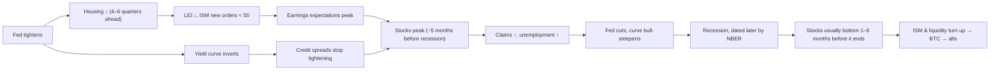
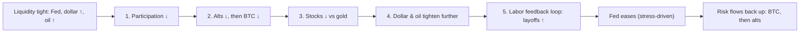

# 06. Growth and the business cycle

Growth data tell you which phase of the business cycle the economy is in: early recovery, mid-cycle expansion, late cycle or recession. That phase sets the backdrop for every asset. Benjamin Cowen's 2026 videos are built around one idea: the US is in a *late business cycle*, like 2007 and 2019, and late cycles end in recessions. In his view risk drains out of markets in a set order, from altcoins to bitcoin to stocks, with the labor market as the last domino. This chapter covers the growth gauges behind that view (GDP, GDI, GDPNow, the ISM surveys, the leading index, recession-probability models, housing, consumer sentiment, earnings and credit) and his late-cycle and risk-cascade framework. It also covers a popular competing idea that is *not* his: that a rising ISM manufacturing index signals an altcoin season. That thesis had a clean out-of-sample test in 2026, and it failed.

**You will learn**
- How GDP is measured and revised, why "two negative quarters" is not the US definition of a recession, and what GDI and GDPNow add.
- How to read the ISM manufacturing and services PMIs, and how Cowen uses ISM as a "Main Street" gauge.
- The "ISM above 50 → alt season" thesis, who holds it, the evidence for it, and how it failed in 2026.
- What the Leading Economic Index, smoothed recession probabilities and Cowen's recession-risk dashboard measure, and their false alarms.
- Why housing, consumer sentiment, earnings and credit matter, and which of them lead or lag.
- Cowen's late-business-cycle and risk-cascade framework, and how it has played out so far.

---

## The classic late-cycle sequence

[research notes C](../../research-notes/C-growth-liquidity-crossasset.md) compiled this order from the demand-driven recessions of 1989–91, 2000–01 and 2006–09. Signs show the typical direction; lags are approximate.

The 2024–26 cycle went off script. The curve inverted and un-inverted, the LEI fell for two years, the ISM sat below 50 for 26 months and the Fed cut 175 bp, but no recession followed ([research notes B](../../research-notes/B-fed-rates-inflation-labor.md) and C). Keep that in mind in every card below.

---

## Output: GDP, GDI and nowcasts

### Real GDP and NBER recession dating (GDPC1, A191RL1Q225SBEA, USREC)

**What it is.** Real gross domestic product is the inflation-adjusted value of all final goods and services produced in the US. The Bureau of Economic Analysis (BEA) publishes it quarterly as a seasonally adjusted annualized rate (SAAR). Each quarter gets three estimates: the *advance* estimate about four weeks after quarter-end, then a second and a third, followed by annual and comprehensive revisions. Over 1996–2024 the average absolute revision from the advance to the second estimate was about 0.5 pp ([research notes C](../../research-notes/C-growth-liquidity-crossasset.md)).

**Where to find it.** FRED `GDPC1` (level) and `A191RL1Q225SBEA` (% change, SAAR). FRED `USREC` is the NBER monthly recession indicator (0 or 1). Cowen's platform carries GDP, GDI, the average of the two, GNP/GNI, GDP per capita and net exports.

**How to read it.**
- Use the 2-quarter and 4-quarter pace rather than a single quarter.
- Look at *real final sales to private domestic purchasers* (GDP excluding inventories, government and trade), which many economists treat as "core GDP". Inventories and net exports swing the headline.
- **The "two negative quarters" myth.** The US does *not* define a recession as two consecutive negative quarters. The NBER Business Cycle Dating Committee judges depth, diffusion and duration across monthly indicators: real personal income less transfers, nonfarm payrolls, household employment, real consumer spending, real manufacturing and trade sales, and industrial production. It announces months or a year after the fact: the December 2007 peak was announced in December 2008, and the February 2020 peak in June 2020 ([research notes C](../../research-notes/C-growth-liquidity-crossasset.md)).

**Key episodes.**
- *H1 2022.* The first published GDP prints for Q1 and Q2 2022 were both negative, yet payrolls grew by more than 400k a month. The NBER declared no recession. In today's FRED data Q1 2022 is −1.0% and Q2 2022 has been revised to **+0.6%**.
- *Q1 2025.* First reported as a contraction, driven by imports rushed in ahead of tariffs. FRED now shows +0.1%.
- *2001.* The 2001 recession never showed two consecutive negative quarters in the data available at the time.

**Recent path** (FRED, % SAAR): 2025 Q1 +0.1, Q2 +4.0, Q3 +3.9, Q4 +0.2 (the shutdown quarter); 2026 Q1 +2.5, Q2 +2.2, **Q3 +3.4** (advance estimate, 29 Oct 2026). Real final sales to private domestic purchasers rose about 4.9% in Q3 2026 ([BEA](https://www.bea.gov/news/2026/gdp-advance-estimate-3rd-quarter-2026)). `USREC` was 0 in September 2026.

**How Cowen uses it.** He rarely trades off GDP prints. He uses NBER recession shading on long charts of the S&P 500, unemployment, yields and BTC to argue about sequences. In "Smoothed Recession Probabilities" (10 Jan 2023) he noted the negative GDP quarters of 2022 were not a recession because unemployment stayed low. His recurring point ([research notes C](../../research-notes/C-growth-liquidity-crossasset.md)'s reading, no single dated quote) is that recessions are recognized late, so by the time GDP confirms, risk assets have already moved.

**Connections.** GDP lags PMIs and the LEI by 1–2 quarters and is roughly coincident with payroll trends. Equities lead GDP: across the eight recessions from 1969 to 2020 the S&P 500 peaked on average about 5 months before the NBER start (range −1 to +12 months) and bottomed 1–6 months before the NBER end in seven of the eight ([research notes C](../../research-notes/C-growth-liquidity-crossasset.md)).

**What it has meant for assets.** Recessions decide how deep equity bear markets go: the S&P 500 fell about 36% on average in the eight recessions since 1969 (17% in 1980 to 57% in 2007–09), versus about 20–25% in bear markets without a recession, such as 2022 (−25.4%) ([research notes C](../../research-notes/C-growth-liquidity-crossasset.md)). Crypto is different: BTC's 2018 and 2022 bear markets (−84% and −77%) happened without a US recession. Crypto has no stable link to quarterly GDP.

**Investor takeaway.** Treat GDP as confirmation, not as a signal. A strong Q3 2026 print says the economy was not in recession over the summer; it says little about the next two quarters.

### Gross domestic income, GDI (A261RX1Q020SBEA)

**What it is.** GDI measures the same economy from the income side: wages, profits, interest and rents. In theory GDP and GDI are equal. In practice they differ by a "statistical discrepancy", and BEA also publishes their average.

**Where to find it.** FRED `A261RX1Q020SBEA` (real GDI). ITC: GDI and "Average of GDP and GDI".

**How to read it.** When GDP and GDI diverge, the truth is often in between, and the average is a better estimate than either alone. GDI arrives a month later than the advance GDP estimate for most quarters.

**How Cowen uses it.** In "Gross Domestic Income" (2 Jun 2023) he argued that real GDI shows slowdowns more clearly than headline GDP.

**Investor takeaway.** If GDP looks strong but GDI is weak, be cautious about the "strong economy" story.

### Atlanta Fed GDPNow (GDPNOW)

**What it is.** A model-based "nowcast" of current-quarter real GDP growth (SAAR) by the Federal Reserve Bank of Atlanta. It updates after major data releases, about six or seven times a month, until BEA's advance estimate. It is not an official forecast and has no judgmental adjustment.

**Where to find it.** atlantafed.org/cqer/research/gdpnow; FRED `GDPNOW`.

**How to read it.** Early-quarter readings are noisy, with errors of several points, and they converge as data arrives. The final nowcast before the advance release has had a root-mean-squared error of about 1.2 pp (Atlanta Fed documentation, via [research notes C](../../research-notes/C-growth-liquidity-crossasset.md)). The trend across updates matters more than any single number. One-off quirks can mislead: in 2025 a surge in gold imports produced a very negative Q1 nowcast, and the Atlanta Fed later published a gold-adjusted version.

**Latest.** The Q3 2026 nowcast ran around 4% in August (about 4.0% on 18 August, about 3.7% on 6 October) before the 3.4% advance print. A Q4 2026 nowcast had not been found as of 30 October ([research notes C](../../research-notes/C-growth-liquidity-crossasset.md)).

**How Cowen uses it.** No verified video built around GDPNow was found; it is not a named chart on his platform.

**Investor takeaway.** It is the best free real-time estimate of the current quarter. It does not forecast turning points; historically it has stayed positive right up to the start of downturns.

---

## Surveys: the purchasing managers

### ISM Manufacturing PMI: Main Street, and the alt-season debate

**What it is.** The Institute for Supply Management's monthly survey of purchasing managers at more than 300 US manufacturers. It is released on the first business day of the month at 10:00 ET. The headline PMI is a *diffusion index*: the percentage of firms reporting improvement plus half of those reporting no change, so that **50 separates expansion from contraction**. It is an equal-weighted composite of New Orders, Production, Employment, Supplier Deliveries (slower deliveries score higher) and Inventories. ISM says a PMI above **47.5** over time is consistent with growth in the *overall* economy. Seasonal factors are revised every January.

**Where to find it.** ismworld.org monthly reports; TradingView `ISM:MAN_PMI` (with some data vendors); tradingeconomics. Not on FRED (ISM withdrew it). Note: ISM is **not** in Cowen's ITC chart catalogue, which carries the OECD "Manufacturing Confidence Index" and "Composite Leading Indicator" instead; when he shows ISM he uses other sources ([research notes A](../../research-notes/A-cowen-inventory.md), section 1b).

**How to read it.**
- The level relative to 50 gives the direction of manufacturing.
- The **New Orders minus Inventories** spread leads the headline by about 3–6 months (a practitioner rule, [research notes C](../../research-notes/C-growth-liquidity-crossasset.md)).
- **Prices Paid** is an inflation pipeline gauge ([chapter 04](04-INFLATION.md#ppi-producer-prices-ppifis)).
- *Misreading:* manufacturing is only about 10% of US GDP. A sub-50 ISM is not a recession. From November 2022 to December 2024 the ISM printed below 50 for 26 straight months with no recession.

**History and latest** ([research notes C](../../research-notes/C-growth-liquidity-crossasset.md)):

| Date | ISM PMI | Context |
|---|---|---|
| Dec 2015 | ~48 | Manufacturing recession (oil and capex bust) |
| Aug 2018 | 61.3 | Cycle peak |
| Apr 2020 | 41.5 | Pandemic trough |
| Mar 2021 | **64.7** | Highest since Dec 1983 |
| Nov 2022 – Dec 2024 | < 50 | 26 months of contraction, no recession |
| Jan 2026 | 52.6 | First expansion in 12 months; New Orders 57.1 |
| Sep 2026 | **54.5** | 9th month above 50; New Orders 55.3; **Prices 77.9**; Employment 52.7 |

In September 2026 Prices Paid was 77.9, close to the 78.3 of March 2026 when the Iran war began. Customers' inventories were 41.6 ("too low"), which is usually bullish for future orders ([ISM via PR Newswire](https://www.prnewswire.com/news-releases/manufacturing-pmi-at-54-5-september-2026-ism-manufacturing-pmi-report-302894520.html)).

**How Cowen uses it: "Main Street".** For Cowen the ISM is a gauge of the real economy, "Main Street", as opposed to asset prices, "Wall Street". Dated claims:
- "Bitcoin and Main Street" (19 Nov 2025): major BTC peaks line up with ISM peaks, and an ISM below 50 means Main Street is struggling, which is why there was no retail euphoria this cycle.
- "Bitcoin is not the economy" (February 2026): when the ISM moved back above 50 and some crypto commentators (Strive's Joe Burnett, Plan C) called it the "risk-on" turn, this was his quoted reply. BTC had risen in 2025 while the ISM stalled, and it fell in early 2026 while the ISM rose ([Cointelegraph via TradingView](https://www.tradingview.com/news/cointelegraph:a453199ce094b:0-ism-manufacturing-pmi-at-highest-since-2022-as-analysts-debate-bitcoin-impact/)).
- "Bitcoin: Simulation Confirmed" (9 Mar 2026): the "news cycle, ISM, oil and labor reports are irrelevant" when the price chart keeps matching the midterm-year average path ([chapter 09](09-SEASONALITY-AND-POLITICAL-CYCLES.md)).
- His "business cycle" chart is a composite of the S&P 500, unemployment, rates, inflation and M2, *not* the ISM alone ([research notes C](../../research-notes/C-growth-liquidity-crossasset.md); see [the late business cycle](#the-late-business-cycle-and-the-risk-cascade) below).

**The competing thesis: "ISM above 50 → alt season" (not Cowen's).** The idea that the ISM *drives* crypto, and especially altcoins, belongs mainly to Raoul Pal (Global Macro Investor, Real Vision). His framing ([research notes C](../../research-notes/C-growth-liquidity-crossasset.md), via [Benzinga](https://benzinga.com/markets/cryptocurrency/23/11/35986621/raoul-pals-insights-on-business-cycle-impact-on-asset-classes-including-blue-chip-cryptos-) and [NewsBTC via TradingView](https://www.tradingview.com/news/newsbtc:13a8574a9094b:0-raoul-pal-bitcoin-bull-market-could-extend-to-2026-here-s-why/)):
- The ISM is "our preferred barometer for the business cycle".
- "Bitcoin goes up as the ISM goes up... If the ISM gets up to its normal cycle peak of somewhere between 56 and 65, that will give us the magnitude of the rise."
- Altcoins outperform late in the ISM upswing.
- In 2024–25 Pal argued that governments extending their debt maturities had stretched the cycle to about five years, putting the ISM and crypto peak in **Q2 2026**.

The historical fit looked good:

| Episode | ISM trough → peak | Crypto | Fit |
|---|---|---|---|
| 2016–18 | ~48 (Dec 2015) → 60.8 (Sep 2017) / 61.3 (Aug 2018) | Alt seasons Q2 2017 and Dec 2017–Jan 2018; BTC dominance down to about 33–35% | Good |
| 2020–21 | 41.5 (Apr 2020) → 64.7 (Mar 2021) | Alt season Apr–May 2021; BTC dominance about 40% | Good |
| 2022–24 | 26 months below 50 | No alt season; BTC dominance about 40% → 60%+ | Consistent |
| **2026 (out of sample)** | 52.6 (Jan) → 54.5–54.6 (Aug–Sep), highest since 2022 | ETH −24% YTD ($2,950 → $2,250 by 29 Oct); BTC −11% YTD; BTC dominance back near 60%; Altcoin Season Index about 53 (75+ = alt season) | **Failed** |

The lab's numbers agree: ETH/BTC fell 16% in 2026 to late October ([lab](../../tools/macro-lab/REPORT-2026-10-30.md)).

**Why it failed** ([research notes C](../../research-notes/C-growth-liquidity-crossasset.md)'s competing explanations):
1. *Composition.* The 2026 upswing was partly a supply-shock and price effect: Prices Paid near 78, plus restocking ahead of tariffs and war disruptions. It was inflationary, so it came with Fed hikes and a 5% 10-year yield, not the falling-rate, rising-liquidity mix of 2016–17 and 2020–21.
2. *Liquidity, not activity, drives crypto beta.* The good episodes coincided with global easing: PBOC, ECB and BOJ stimulus in 2016–17, and Fed QE plus fiscal transfers in 2020–21. In 2026 the Fed hiked and central-bank balance sheets were roughly flat ([chapter 07](07-LIQUIDITY-MONEY-AND-THE-DOLLAR.md)).
3. *Cowen's apathy argument.* Alt seasons came out of euphoric tops (2017, 2021). Apathetic tops (2019, 2025) did not rotate: "There's just no one left to sell the altcoins to" ([CryptoAdventure, 18 Apr 2026](https://cryptoadventure.com/benjamin-cowen-reveals-why-the-altcoin-season-never-came/)). See [chapter 12](12-DOMINANCE-ALTCOINS-AND-ROTATION.md).
4. *Supply.* Tens of millions of tokens and continuous unlocks mean "altcoins" no longer share one beta.
5. *Sample size.* The thesis rested on two episodes, which cannot separate "ISM causes alt seasons" from "both respond to a third factor" (global easing, the halving cycle).

**Connections.** ISM leads S&P 500 earnings growth by about 3–6 months, and YoY S&P returns have correlated with the ISM level at about 0.5–0.6 (practitioner studies, [research notes C](../../research-notes/C-growth-liquidity-crossasset.md)). The ISM tends to move with the 10-year yield and the copper/gold ratio ([chapter 08](08-STOCKS-GOLD-AND-CROSS-ASSET.md)). ISM troughs often come 3–9 months after the Fed starts easing and after the dollar peaks.

**What it has meant for assets.** A rising ISM has favored cyclical stocks, small caps, commodities and higher yields, and historically risk-on crypto (2016–17, 2020–21). A falling ISM favors bonds and defensive stocks. Reliability for crypto: weak to moderate.

**Investor takeaway.** The ISM is the best single monthly gauge of the manufacturing cycle. If you watch it for crypto, ask *why* it is rising: a disinflationary, easing-driven upswing has historically helped risk and alts; an inflationary one accompanied by tightening, as in 2026, did not.

### ISM Services PMI

**What it is.** The ISM survey of non-manufacturing firms, which cover about 75–90% of GDP. It is released on the third business day of the month. Its headline combines Business Activity, New Orders, Employment and Supplier Deliveries. 50 = expansion.

**Latest.** **54.9** in September 2026 (August 55.4), the 27th straight month of expansion. **Prices 74.0**, the highest since July 2022 and the sixth reading above 70 in 2026. Respondents cited fuel costs twice as often as any other issue ([First Trust](https://www.ftportfolios.com/Commentary/EconomicResearch/2026/10/5/the-ism-non-manufacturing-index-declined-to-54.9-in-september)).

**How to read it.** Services move with employment and consumption. Services prices lead services CPI and PCE by about 3–6 months. A sub-50 services print is a stronger recession warning than a sub-50 manufacturing print because services dominate output. During the 2025 tariff shock the services index briefly printed just below 50 (May 2025, first release); seasonal-factor revisions can move borderline readings like that, so counts of "consecutive months of expansion" can differ from first prints.

**How Cowen uses it.** ISM services employment is one of his supporting labor checks ([chapter 05](05-THE-LABOR-MARKET.md#supporting-labor-checks-kc-fed-lmci-adp-ism-employment)).

**Investor takeaway.** Services strength with prices at 74 is a "stagflation-lite" signature: growth fine, inflation pressure rising. That is the mix that led the Fed to hike in September 2026.

### S&P Global PMIs and the OECD indicators

**S&P Global PMIs.** Flash US manufacturing, services and composite PMIs from S&P Global come out about ten days before month-end. They use a broader panel and different weights than ISM. The October 2026 flash composite was **57.6** (September 58.4), with manufacturing at 56.0, a 53-month high. Chief economist Chris Williamson said the economy "continues to boom at the start of the fourth quarter" ([research notes C](../../research-notes/C-growth-liquidity-crossasset.md), secondary). Two independent survey families agreed that US activity was *accelerating* into Q4 2026.

**OECD Composite Leading Indicator and Manufacturing Confidence.** Cowen's platform carries the OECD Composite Leading Indicator (CLI) and the OECD "Manufacturing Confidence Index" rather than ISM. They are useful for comparing countries. No dated Cowen claim built on them was found.

---

## Recession gauges

### Conference Board Leading Economic Index (LEI)

**What it is.** A composite of ten leading indicators, published monthly by the Conference Board for the prior month (2016 = 100): average weekly manufacturing hours, initial jobless claims, new orders for consumer goods, ISM new orders, new orders for nondefense capital goods excluding aircraft, building permits, the S&P 500, the Leading Credit Index, the 10-year Treasury minus fed funds spread, and consumer expectations.

**Where to find it.** conference-board.org (press releases). FRED's `USSLIND` is a *different* Philadelphia Fed series and was discontinued in February 2020, so it is not a substitute.

**How to read it.** The Conference Board's recession rule is the "3Ds": a six-month annualized decline of about −4.1% (depth) together with a diffusion index below 50 (breadth).

**Latest.** The September 2026 LEI (released 22 October, delayed by the earlier shutdown) was **unchanged at 99.6** after −0.1% in August. The Conference Board said there was **no recession signal** ([research notes C](../../research-notes/C-growth-liquidity-crossasset.md), secondary).

**Famous failure.** The LEI fell continuously for about 24 months from early 2022 to early 2024 and triggered the 3Ds signal throughout 2022–23. No recession followed, and the Conference Board dropped its recession call in 2024. Likely reasons: the index is weighted toward manufacturing and goods while the economy was services-led; the yield-curve component was distorted after COVID; fiscal deficits of about 6% of GDP supported demand.

**How Cowen uses it.** Not a core Cowen chart, and not in his catalogue ([research notes A](../../research-notes/A-cowen-inventory.md), section 1b).

**Investor takeaway.** Useful for direction, but it has given long false alarms. Read a falling LEI as "rising risk", not as a dated forecast.

### Smoothed recession probabilities (RECPROUSM156N)

**What it is.** A monthly estimate of the probability that the US is *currently* in recession, from a model by economists Marcelle Chauvet and Jeremy Piger. The model looks at four coincident monthly series (nonfarm payroll employment, industrial production, real personal income excluding transfers, and real manufacturing and trade sales) and estimates whether their joint behavior looks more like an expansion or a recession. It is published on FRED with a lag of a few months.

**Where to find it.** FRED `RECPROUSM156N`. ITC: "Smoothed Recession Probabilities".

**How to read it.** It sits near zero in expansions and jumps when several coincident indicators weaken together. It is a *now*-cast of the recession state, not a forecast: it confirms faster than the NBER, which can take a year to announce, but it does not warn months ahead.

**How Cowen uses it.** "Smoothed Recession Probabilities" (10 Jan 2023): he presented it as more useful than waiting for NBER dating. It read **1.16% in late 2022**, which supported his point that the negative GDP prints of 2022 were not a recession.

**Connections.** It moves with the same data the NBER uses, so it agrees closely with NBER dates after the fact. It is coincident with the Sahm rule ([chapter 05](05-THE-LABOR-MARKET.md#sahm-rule-sahmrealtime)), and both lag the market.

**Investor takeaway.** A good antidote to "recession" headlines based on one GDP print. Don't expect it to warn you before the market moves.

### Cowen's Macro Recession Risk dashboard (concept)

**What it is.** A Pro-tier dashboard on Cowen's ITC platform. According to its public help text ([research notes A](../../research-notes/A-cowen-inventory.md), section 1b) it groups **17 FRED series** into four categories: Employment; National Income & Product; Production & Business; and Interest Rates (weighted 0.2). Each series is turned into a rate of change and scored by how well its current value fits the historical distributions seen in recessions versus expansions since 1947. The result is a 0–1 "macro recession risk" score. A separate card shows three ICE BofA credit-spread series but deliberately leaves them out of the summary score. The weighting details are proprietary and are not reproduced here.

**How Cowen uses it.** "Recession risk low for now" ("Recession Risk in 2024", 1 Dec 2023). In his [August 2026 memo](https://benjamincowen.com/reports/the-balance-of-risks-august-2026) the composite was **0.024**, "near the floor".

**Reading the legs separately.** His written memos show the four legs as separate 0–1 sub-scores: an **Employment Risk Indicator**, a **National Income and Product Risk Indicator**, a **Production and Business Risk Indicator**, and an **interest-rate leg** (figures in the [Q1 2026 memo](https://benjamincowen.com/reports/crypto-macro-risk-memo-q1-2026) of 15 Jan, the [February 2026 memo](https://benjamincowen.com/reports/macro-risk-memo-feb-2026) and [The Balance of Risks](https://benjamincowen.com/reports/the-balance-of-risks-august-2026) of 15 Aug 2026). His reading rules, from the August memo:
- The interest-rate leg (yield curve and policy rates) "tends to lead", but it is the noisiest and the most prone to false positives. It flashed in the late 1990s and again through 2022–26 without a recession.
- The slower legs (employment, income and product, production) confirm. No single leg should carry the regime call.
- For the same reason he no longer uses the yield curve as a clock: the 10-year minus 3-month spread has been positive since late 2024, so the re-steepening is "unusually mature" but gives little precision. Timing rests instead on the labor "recession cluster" ([chapter 05](05-THE-LABOR-MARKET.md#the-written-memo-version-2026-four-terms)) and on the slow legs of this composite.

**How to read it.** It is a coincident-to-slightly-leading summary of hard data. A score near zero means the data do not look like any past recession. Note the tension: the dashboard read near zero in August 2026 while his narrative was "late cycle". The two are consistent only if you read the dashboard as "not yet".

**Investor takeaway.** A composite like this is a good way to avoid cherry-picking one weak series. It inherits the limits of its inputs: if the hard data have not turned, it will not warn you.

### Uncertainty indices and financial conditions

**What they are.**
- **Economic Policy Uncertainty** (EPU, newspaper-based, by Baker, Bloom and Davis; policyuncertainty.com, also on FRED), its categorical sub-indices, the **World Uncertainty Index**, and the **Equity Market Volatility tracker**.
- **Financial conditions:** the Chicago Fed National Financial Conditions Index (FRED `NFCI`) and the St. Louis Fed Financial Stress Index (FRED `STLFSI4`). Both combine spreads, volatility and funding measures.

All of them are on Cowen's platform in the "Recessions" group, along with an RGDP recession indicator and a Coincident Economic Activity Index.

**How Cowen uses them.** Elevated uncertainty is a late-cycle feature ("Bitcoin in a Late Business Cycle Environment", [27 Mar 2026](https://rosetta.to/u/intothecryptoverse/bitcoin-in-a-late-business-cycle-environment)). Financial-conditions indices are context only; no video was found built around them.

**Investor takeaway.** Uncertainty spikes around shocks (tariffs in April 2025, the war in 2026). Financial-stress indices confirm stress rather than predict it; in October 2026 credit spreads, a key input, were tight (high-yield spread 3.14 pp, [lab](../../tools/macro-lab/REPORT-2026-10-30.md)).

### Soft, hard and no landing

**The terms.** A *soft landing* is a slowdown that brings inflation down without a recession. A *hard landing* is a slowdown that ends in recession. A *no landing* means the economy does not slow at all, which usually keeps inflation and rates high.

**How Cowen uses them.** In "Stocks: Hard or Soft Landing?" (28 Aug 2022) he sketched the scenarios in terms of S&P 500 drawdowns: roughly 30% (back toward the pre-pandemic high) in a soft landing and roughly 50% in a hard landing. In "Bitcoin: Hard Landing Vs. Soft Landing" (5 Sep 2024) he applied three scenarios to BTC, with the 100-week moving average as support in the soft cases. His February 2026 base case was a hard landing within two to three years (inventory section 1.5).

**What happened.** The S&P 500 fell 25.4% in 2022 without a recession, closer to the soft scenario. 2023–25 then looked like a soft landing, and 2026 looked like a "no landing" with re-accelerating inflation.

**Attribution note.** Comparisons of 2024–26 with the 1995 soft landing are common, but they are other analysts' framing. No Cowen video or quote built on 1995 was found. His 1990s analogs are 1996–2000 (S&P priced in M2), 1997 (one hike followed by a long hold) and 1998 (a 20% drop followed by new highs) (inventory section 2, T10).

**Investor takeaway.** The difference between a soft and a hard landing is mostly the difference between a −20–25% and a −35–55% equity bear market. You will not know which one you are in until unemployment and credit tell you.

---

## The consumer and housing

### Consumer sentiment (UMCSENT) and consumer confidence

**What it is.**
- *University of Michigan Consumer Sentiment* (FRED `UMCSENT`, 1966 Q1 = 100). Preliminary mid-month, final at month-end. It includes 1-year and 5–10-year inflation expectations ([chapter 04](04-INFLATION.md#inflation-expectations-michigan-surveys-and-market-breakevens)).
- *Conference Board Consumer Confidence* (1985 = 100), on the last Tuesday of the month. It leans more on labor-market perceptions; its "jobs plentiful minus jobs hard to get" differential is a useful proxy for unemployment.

**How to read it.** Sentiment is very sensitive to gasoline prices and inflation and, since 2020, to partisan identity, so its level correlates poorly with actual spending. Extreme lows have historically been *contrarian* positives for stocks: the June 2022 Michigan low of 50.0 came within days of the S&P's interim low and four months before its October 2022 final low.

**Latest** (FRED and [research notes C](../../research-notes/C-growth-liquidity-crossasset.md)):

| Date | Michigan sentiment | Note |
|---|---|---|
| Jun 2022 | 50.0 | Inflation peak; near the S&P interim low |
| Feb 2026 | 56.6 | Before the war |
| **May 2026** | **44.8** | Lowest in the FRED history |
| Sep 2026 | 48.1 | |
| Oct 2026 | 48.0 final (46.3 preliminary) | |

The Conference Board index was reported at 91.7 in October 2026, up from 84.2, by a single secondary source that was not checked against the release.

**How Cowen uses it.** On his platform, but zero video summaries mention consumer sentiment (inventory section 1c). It is a context indicator for him.

**Connections.** Gasoline ↑ → sentiment ↓ within weeks. Sentiment has weak links to spending and strong links to inflation pain. Record-low sentiment alongside 3.4% GDP growth in 2026 shows it measuring *inflation pain*, not output.

**Investor takeaway.** Read extreme lows as a sign of how much pain is priced in, not as a recession forecast.

### Retail sales, industrial production and capacity utilization (RSAFS, INDPRO)

**Retail sales.** The Census Bureau's Advance Monthly Retail Trade Report, mid-month, in nominal dollars (FRED `RSAFS`; real version `RRSFS`). The **control group** excludes autos, gasoline, building materials and food services and feeds into GDP. September 2026: headline +0.8% month over month, but more than 70% of the beat came from gasoline stations; the control group rose only 0.1% against an expected 0.3% ([research notes C](../../research-notes/C-growth-liquidity-crossasset.md), secondary). Nominal retail sales were +6.3% YoY against CPI at +3.7%, so real growth was about 2.5%. Lesson: in an oil shock, headline retail sales overstate real demand.

**Industrial production.** Federal Reserve G.17 release, mid-month (FRED `INDPRO`, 2017 = 100). September 2026: 103.95, **+2.2% YoY**. It is one of the NBER's core indicators. IP turning negative YoY has accompanied every post-war recession, but also several non-recessions (1985–86, 1998, 2015–16, 2019, 2023).

**Capacity utilization** (FRED `TCU`) comes in the same release and measures how much of industrial capacity is in use. High utilization tends to come with price pressure.

**How Cowen uses them.** On his platform (with business inventories, new orders, inventories-to-sales, vehicle sales and real manufacturing and trade sales); not video topics.

**Investor takeaway.** Use the retail control group, not the headline, and adjust for inflation.

### Housing: starts, permits, mortgage rates and prices

**What it is.**
- Housing starts (`HOUST`) and building permits (`PERMIT`) from the Census Bureau, around the 12th business day, in thousands at an annual rate.
- Existing home sales from the National Association of Realtors (NAR), around the 20th.
- The 30-year fixed mortgage rate from Freddie Mac, weekly on Thursdays (`MORTGAGE30US`).
- The S&P CoreLogic Case-Shiller national home price index (`CSUSHPINSA`), with a two-month lag.

**Where to find it.** FRED ids above. Cowen's platform has 19 real-estate charts, including the purchase-only house price index, Zillow home values, price cuts, listing prices, starts and units under construction, mortgage rates, real-estate loan delinquency, homeownership, owners' equity, rental vacancy, new home sales, the for-sale-to-sold ratio and months to sell.

**Why it matters.** Economist Edward Leamer's 2007 Jackson Hole paper, "Housing IS the Business Cycle", found residential investment was the leading contributor to weakness before most post-war recessions. Permits lead starts, starts lead residential investment, and residential investment leads the cycle by about 4–6 quarters. Mortgage rates carry long-term yields into the real economy.

**History and latest** (FRED, computed, and [research notes C](../../research-notes/C-growth-liquidity-crossasset.md)):

| Indicator | Reference points | Latest |
|---|---|---|
| 30-year mortgage | 2.65% (Jan 2021 low); 7.79% (26 Oct 2023 high); 6.26% (Nov 2025) | **7.24%** (29 Oct 2026) |
| Housing starts | 2026 range 1,182k (May) – 1,522k (Mar) | **1,221k** (Sep 2026, −7.4% YoY) |
| Building permits | 1,923k (Jan 2022, post-2020 high) | **1,398k** (Sep 2026, −3.2% YoY) |
| Case-Shiller national | −27% from Jul 2006 peak to Feb 2012 trough | **+2.1% YoY** (Aug 2026) |
| Existing home sales | Inventory about 1.6M, highest since Nov 2019 | **3.99M** (Sep 2026, −2.2% YoY); median $417,500 |

**How to read it.** Activity is depressed and prices are flat to slightly up. Owners locked into low mortgage rates do not sell, so supply is frozen and prices do not fall the way they did in 2007–09. Weak *volumes* without *forced selling* has been the 2023–26 pattern.

**How Cowen uses it.** In videos housing is peripheral: interviews with real-estate investor Jordan Wirsz in 2022–23, and "How to Fix the Real Estate Market" (8 Aug 2025). His 2026 written memos give it more weight, with a fixed set of charts: Case-Shiller national HPI YoY, the purchase-only house price index YoY, housing units under construction, median listing prices, the new-home for-sale-to-sold ratio (months' supply) and the median new-home price ([February 2026 memo](https://benjamincowen.com/reports/macro-risk-memo-feb-2026); [The Balance of Risks](https://benjamincowen.com/reports/the-balance-of-risks-august-2026), 15 Aug 2026). His verdict in both: housing is "slowing rather than breaking". The August memo's numbers:
- Case-Shiller national HPI **+1.6% YoY**, against a peak of about 21% in 2022. (FRED's later August reading, used in the table above, is +2.1%; the memo predates it, so the two describe different months.)
- Units under construction down from a peak of about **1.7M to about 1.26M**.
- New-home months' supply **9.3**; median new-home price about **$398,000**.

Why "not breaking": household balance sheets and mortgage underwriting are stronger than in 2006–08, so there is little forced selling. In his view a genuine housing break would need a labor shock first, which puts housing *downstream* of the labor market in this cycle rather than upstream as in Leamer's template.

**Connections.** The 10-year yield ↑ → mortgage rates ↑ (the 2026 rise in the 10-year from about 4.1% to 5.05–5.31% took mortgages back above 7%) → permits and starts ↓ → residential investment ↓ → growth ↓ about 4–6 quarters later. Housing weakness has historically fed into lower yields over 6–12 months and preceded Fed easing.

**What it has meant for assets.** Housing busts that involved forced selling and credit losses (2007–09) produced the deepest equity bear market of the modern era. Volume-only slumps (2023–26) have not.

**Investor takeaway.** Watch permits and mortgage rates for the direction of growth a year out. A prolonged spell of mortgage rates above 7% raises recession odds for 2027 ([research notes C](../../research-notes/C-growth-liquidity-crossasset.md)), but the locked-in owner base makes a 2008-style price collapse less likely.

---

## Profits and credit

### Corporate earnings

**What it is.** Quarterly earnings of S&P 500 companies, compiled by FactSet ("Earnings Insight", weekly, free), S&P Dow Jones Indices and LSEG I/B/E/S.

**Latest** ([FactSet, 23 Oct 2026](https://insight.factset.com/sp-500-earnings-season-update-october-23-2026), 24% of companies reported): Q3 2026 blended EPS growth **+29.5% YoY**, revenue +12.7%, net margin 14.9%, calendar-2026 EPS growth estimate +33.1%. Forward 12-month P/E 18.7 versus a 5-year average of 19.8. Energy upgrades from the oil shock contributed; Micron and NVIDIA were the largest contributors.

**How to read it.** Earnings are pro-cyclical and lagging. EPS has typically fallen about 15–30% in recessions (2001 about −30% on operating earnings), and far more in 2008–09: operating EPS roughly halved from its 2007 peak, and as-reported (GAAP) EPS, hit by write-downs, fell more than 80% ([Cambridge Associates, 2009](https://publishedresearch.cambridgeassociates.com/wp-content/uploads/2014/12/SP-500-Earnings-Gazing-Across-the-Abyss-June-2009.pdf)). Whether earnings fall is what separates a −20% bear market from a −40% one. Valuation lenses currently disagree: a forward P/E of 18.7 looks reasonable, while the Shiller CAPE near 41 looks extreme ([chapter 08](08-STOCKS-GOLD-AND-CROSS-ASSET.md)).

**Investor takeaway.** In 2026 equities have been carried by an extraordinary earnings cycle. A late-cycle call on stocks needs earnings revisions to turn down.

### Consumer credit, delinquencies and bankruptcies (TOTALSL, DRCCLACBS)

**What it is.**
- Fed G.19 consumer credit (`TOTALSL`, monthly, about a five-week lag): $5.20T in August 2026, +2.7% YoY.
- The New York Fed Household Debt and Credit Report (quarterly). Q2 2026: total household debt **$18.77T**, down $13B on the quarter, the first decline since 2020. **4.73%** of debt was in some stage of delinquency. Annual flow into serious delinquency: credit cards 6.97%, auto loans 3.00%, mortgages 1.52% (up from 1.29% a year earlier), student loans 7.83% (distorted by re-reporting) ([NY Fed](https://www.newyorkfed.org/newsevents/news/research/2026/20260811)).
- Credit-card delinquency at commercial banks (`DRCCLACBS`): **2.85%** in the latest FRED quarter (Q2 2026), against 6.77% at the 2009 peak and 1.53% at the 2021 low (computed from FRED).
- Corporate bankruptcies (S&P Global Market Intelligence): **785** in 2025, the most since 2010; **372** in H1 2026, the most for a first half since 2010 (secondary).
- The Fed's Senior Loan Officer Opinion Survey (SLOOS): the net share of banks tightening lending standards and reporting stronger loan demand. On Cowen's platform.

**How to read it.** Delinquencies and bankruptcies are *lagging*: they rise into and through recessions and peak afterwards. Credit *spreads* are the market-priced, leading version ([chapter 03](03-BONDS-AND-THE-YIELD-CURVE.md)). High-yield spreads above about 5–6% have historically accompanied recessions; they were 3.14% in late October 2026 ([lab](../../tools/macro-lab/REPORT-2026-10-30.md)). Tightening lending standards in the SLOOS tend to come before credit growth slows.

**Reading 2025–26.** Elevated bankruptcies with tight credit spreads: distress concentrated among small, floating-rate borrowers, not spreading system-wide ([research notes C](../../research-notes/C-growth-liquidity-crossasset.md)). Credit-card delinquency has edged down from 3.22% (Q2 2024) to 2.85%.

**How Cowen uses it.** Delinquency rates, consumer credit, loans and the SLOOS are on his platform, and credit spreads are a card on his recession dashboard, kept out of the score. No video was found built around credit spreads (inventory section 1.2).

**Investor takeaway.** No recession call is credible without credit confirming it ([research notes B](../../research-notes/B-fed-rates-inflation-labor.md)). In October 2026 credit was not confirming.

---

## The late business cycle and the risk cascade

This is Cowen's core 2026 framework. It is covered here because it is a business-cycle argument; [chapter 08](08-STOCKS-GOLD-AND-CROSS-ASSET.md) shows the cross-asset charts behind it and [chapter 13](13-HOW-IT-ALL-CONNECTS.md) places it in the full causal map.

### The ITC business-cycle metric (concept only)

In February 2026 Cowen introduced a "business cycle" chart on his platform: a single normalized line that combines the S&P 500 with the unemployment rate, inflation, interest rates and the money supply (M2). The idea is to measure how "extended" the cycle is: asset prices relative to the macro conditions that justify them. The exact construction is his and is not reproduced here. Videos: "Visualizing the Business Cycle" (22 Feb 2026), "Business Cycles Ends With Recessions" (25 Feb 2026), "The Mechanism That Ends Business Cycles" (28 Feb 2026), "Oil Spikes 35%" (8 Mar 2026), "Bitcoin in a Late Business Cycle Environment" (27 Mar 2026).

His claims with it:
- Recessions bring "extended valuations back to baseline".
- Cycles are getting larger in amplitude.
- In 2026 the US is in a "late business cycle like 2007 and 2019".
- His base case in February 2026 was a hard landing within two to three years; in May 2026 he wrote that the end of the cycle was "plausibly one to two years away" ([May 2026 memo](https://benjamincowen.com/reports/macro-risk-memo-may-2026)).
- "Liquidity conditions also reflect a late business cycle environment" ([X, March 2026](https://x.com/benjamincowen/status/2036990935075016905)).

His vocabulary defines a late business cycle as a tight labor market starting to turn, high valuations and rising uncertainty (inventory section 5).

### The risk cascade

His memo [How Risk Cascades Through Markets](https://benjamincowen.com/reports/how-risk-cascades-through-markets-march-2026) (15 Mar 2026; the PDF adds the subtitle "From Speculative Assets to the Real Economy") calls this the **ITC Risk Cascade Framework** and sets out five stages (paraphrased from [research notes E](../../research-notes/E-cowen-reports.md)):
1. Speculative participation declines (retail attention and breadth fade).
2. Highly speculative assets weaken: altcoins first, then BTC.
3. Traditional risk assets deteriorate *relative to gold* (the S&P 500 priced in gold falls).
4. Financial conditions tighten further through the dollar and energy, "even if central banks begin shifting toward easing".
5. A labor-market feedback loop emerges.

He placed March 2026 "between Stage 3 and Stage 4". In the video "Business Cycles Ends With Recessions" (25 Feb 2026) he gave the expected order of declines as altcoins, then BTC, then equities, with energy last. In tightening, risk flows *down* the risk curve; in easing it flows back *up*. His February and August memos add a "quality ladder" reading of the same idea: capital moves up in quality *within* each asset class (alts → BTC, small caps → large caps, speculative growth → cash-flow companies), so index records late in a cycle can be "the top of the ladder", not a sign of health ([chapter 08](08-STOCKS-GOLD-AND-CROSS-ASSET.md)).

Why the order? Assets furthest out on the risk curve depend most on cheap money and new buyers, so they lose support first. Bitcoin has more institutional and long-term holders than altcoins. Stocks have earnings to lean on. Gold and energy benefit from the inflation and geopolitical stress that late cycles often bring. And jobs are cut only after profits and asset prices fall: "It's the stock market going down that leads to the recession" (27 Mar 2026) and "You have to have lower asset prices" ([8 May 2026](https://rosetta.to/u/intothecryptoverse/labor-market-holds-steady)).

### The recession feedback loop

Stage 5 has its own mechanism. In the [May 2026 memo](https://benjamincowen.com/reports/macro-risk-memo-may-2026) (18 May 2026) Cowen describes a seven-step **recession feedback loop**:

1. Asset prices weaken.
2. Financial conditions tighten.
3. Business confidence deteriorates.
4. Hiring slows and layoffs rise.
5. Consumption weakens.
6. Economic activity contracts.
7. Further layoffs, which feed back into step 1.

His judgment in May was that the economy was "stuck in the earlier stages". His February memo adds the key condition for getting from step 1 to step 4: *equity durability*, meaning stocks have to stay down long enough for firms to cut jobs ([chapter 05](05-THE-LABOR-MARKET.md#the-written-memo-version-2026-four-terms)). The loop is the growth-side counterpart of the risk cascade; [chapter 13](13-HOW-IT-ALL-CONNECTS.md) puts both in one causal map. Historically this is the step that separates a "growth scare inside an intact cycle" (1998, 2018) from a recession (2001, 2008).

### Scorecard, October 2025 to October 2026

| Step | What the framework expects | What happened ([research notes A](../../research-notes/A-cowen-inventory.md) and C) | Verdict so far |
|---|---|---|---|
| 1. Altcoins | Fall first and most | Alts fell hardest in the 10 Oct 2025 crash (over $19B of liquidations); alt/BTC 0.29 on 14 Oct 2025; alts at 2022 lows by Feb 2026 | Consistent |
| 2. BTC | Falls next | Top about $126.1k on 6 Oct 2025; about $60k on 5–6 Feb 2026 (−52%); low about $57.7–58.6k on 30 Jun 2026; about $78k on 30 Oct | Consistent |
| 3. Equities vs gold | Stocks weaken relative to gold | S&P −9–10% Feb–late Mar 2026, then records (7,819 on 6 Oct 2026). S&P priced in gold went from about 1.32 (15 Mar) to about 1.9 (late Oct) because gold fell from its late-January peak near $5,560. Breadth weak (about 48% of members above their 200-day average in Sep) | Reversed after March |
| 4. Dollar and oil tighten | Conditions tighten even if the Fed leans dovish | DXY made higher lows from about 96.5 (Feb) to about 101.35 (30 Sep); Brent spot $123 on 27 Oct; 10-year 5.31% (5 Oct); the Fed hiked instead of easing | Consistent |
| 5. Labor | Breaks last | Unemployment 4.2%, initial claims 194k, Sahm 0.00 | Not yet |

**His probabilities.** In the August 2026 memo ([The Balance of Risks](https://benjamincowen.com/reports/the-balance-of-risks-august-2026)) his base case was a late-cycle expansion with a midterm correction (65%), a policy-error correction (20%) and a recessionary transition (15%). He tied each state to observable conditions; the 20% "policy-error correction" state, for example, was defined as energy re-accelerating while the Fed hikes into a stalling labor market, and by late October its trigger conditions had largely occurred without the sharp equity drawdown it implied ([research notes E](../../research-notes/E-cowen-reports.md), section 5). He restated the end of the cycle as "another year or more" away (August), after "one to two years" in May. He also listed what would invalidate his correction call: the Nasdaq-100 equal-weight to cap-weight ratio turning up, liquidity risk falling out of its tight band, financial conditions staying loose, BTC reclaiming its longer weekly moving averages, and the dollar breaking to new lows. The same memo self-scored the framework's 2026 record: the Q4 2025 top "confirmed"; January's capital-preservation call "confirmed (crypto), mixed (equities)", since the S&P was up 13.7% for the year at that point; the trapped, hawkish Fed "confirmed to date"; and the equities-versus-gold leg of the cascade "open". In September 2026 he conceded that BTC's rally was stronger than in prior midterm years and that the "burden of proof has shifted to the bears"; on 24–26 October 2026 he returned to a bearish Q4 roadmap (inventory sections 2 and 3).

**Fair assessment.**
- The crypto-internal steps (alts before BTC) fit well, and this is where his record is strongest overall: BTC dominance, alts bleeding against BTC, and fading the alt season (inventory section 3).
- The macro steps are mixed. Stage 4 forces did arrive (oil, a firm dollar, a 5.3% 10-year, a hike). But stage 3 reversed: equities set records and gold fell, so stocks *rose* against gold after March. Stage 5 is absent: the labor market tightened. [research notes E](../../research-notes/E-cowen-reports.md) grades the March memo's call "partial".
- The sample behind the framework is small (2007 and 2019 as named templates), and 2019's end came from an external shock (the pandemic).
- [research notes C](../../research-notes/C-growth-liquidity-crossasset.md)'s regime map (below) supports the core mechanism: liquidity-sensitive assets suffer first in a late-cycle, supply-shock setting, even when GDP and earnings are strong.

### Growth regimes and crypto

[research notes C](../../research-notes/C-growth-liquidity-crossasset.md)'s liquidity-and-growth regime map:

| Regime | Net liquidity | Dollar | Real yields | Typical BTC | Typical alts | Examples |
|---|---|---|---|---|---|---|
| Reflation | ↑ | ↓ | ↓ | Strong up | Outperform late (alt season) | 2016–17, 2020–21 |
| Tightening | ↓ | ↑ | ↑ | Bear | Underperform badly | 2018, 2022 |
| Stealth easing / flow-driven | → | → | → / ↑ | Up (ETFs, halving) | Underperform (BTC dominance ↑) | 2023–24 |
| Late cycle / supply shock | → / ↓ | → | ↑ | Bear, takes the S&P's downside | Underperform | 2019 (partly), 2025–26 |

**The supply-shock variant** ([research notes C](../../research-notes/C-growth-liquidity-crossasset.md), 1973–74, 1979–80, 1990, H1 2008, and partly 2022 and 2026): an oil shock lifts headline inflation and crushes sentiment (Michigan record lows in June 2022 and May 2026); the central bank hikes or delays cuts (Fed September 2026, ECB July 2008); growth and nominal data look strong at first (ISM Prices about 78, strong earnings); real incomes erode and housing weakens (mortgages 7.24%); whether it ends in recession depends on the length of the shock and the policy response. 1973, 1980 and 1990 did; 2022 did not; 2026 is undetermined.

---

## Putting it together

1. **Mortgage rates rise above 7% → permits and starts fall → residential investment falls → growth slows 4–6 quarters later → the Fed eventually eases → long yields fall.** Leamer's sequence held before most post-war recessions, including 2006–08 (Case-Shiller −27% from 2006 to 2012). *Exception:* 2023–25. Mortgages peaked at 7.79% in October 2023 and volumes slumped, but owners with locked-in low rates did not sell and no recession followed. Mortgages were back at 7.24% in October 2026: the test is running again.

2. **The ISM rises above 50 → manufacturing upswing → yields and commodities rise → (according to the Pal thesis) BTC, then alts, rally.** It fit 2016–17 and 2020–21, when global liquidity was also expanding. *Exception:* 2026. The ISM went from 52.6 (January) to 54.5 (September) with Prices near 78, the Fed hiked and the 10-year reached 5.31%, and ETH fell 24% while BTC dominance stayed near 60%. An inflationary upswing tightened policy instead of loosening it.

3. **An oil shock → headline inflation and ISM Prices ↑, sentiment ↓ → the Fed cannot ease (2026: it hiked) → real yields ↑ → crypto and long-duration assets fall first → if the shock persists, real incomes and housing crack → recession.** 1973–74, 1979–80 and 1990 completed the chain. 2022 stopped before recession. In 2026 the first half of the chain happened (Brent from $71 to $117 a month on average in April, Michigan sentiment 44.8 in May, a hike in September, BTC from $87.6k at the yearly open to a $58.5k close at the June low). The second half has not: Q3 GDP grew 3.4%.

4. **Risk cascades down the curve: participation ↓ → alts, then BTC ↓ → stocks ↓ vs gold → dollar and oil tighten → labor feedback loop → stress-driven Fed easing → risk flows back up.** In 2025–26 the crypto stages happened in order (alts at 2022 lows by February 2026, BTC −52% by the same month), and stage 4 tightening arrived (DXY to about 101.35, Brent above $120, a hike). Stocks-versus-gold reversed and labor had not broken by October 2026. If they do, history says the equity decline is much larger with a recession (about −36% on average) than without (about −20–25%).

5. **Hard data look fine (GDP 3.4%, recession dashboard 0.024, LEI flat, claims 194k) while survey and price data look stressed (sentiment 48, ISM Prices 78) → late cycle, not recession.** That combination has historically been hostile to liquidity-sensitive assets well before it shows up in GDP ([research notes C](../../research-notes/C-growth-liquidity-crossasset.md)). It is also the setup in which "recession imminent" calls have repeatedly failed (the LEI in 2022–23, Cowen's own 2023 call).

---

## Check yourself

1. Why is "two negative quarters of GDP" not the US definition of a recession? Give the 2022 example.
2. What does an ISM PMI of 50 mean, and why did 26 months below 50 in 2022–24 not produce a recession?
3. Whose thesis is "ISM above 50 → alt season", what was its historical evidence, and how did it fare in 2026?
4. What does Cowen mean by "Main Street", and what did he say when the ISM rose above 50 in early 2026?
5. What is the Conference Board's "3Ds" rule, and what was the LEI's famous false alarm?
6. What do smoothed recession probabilities measure, and why do they not warn you before the market moves?
7. Describe Cowen's risk-cascade order. Which steps had happened by October 2026, and which had not?
8. Why are delinquencies and bankruptcies lagging indicators, and which credit measure leads?

Answers

1. The NBER dates recessions from a broad set of monthly indicators (income, payrolls, household employment, spending, sales, industrial production), judging depth, diffusion and duration. In H1 2022 the first GDP prints were negative for two quarters, but payrolls grew by more than 400k a month and the NBER declared no recession; Q2 2022 has since been revised to +0.6%.
2. Below 50 means a majority of manufacturers report contraction; above 50, expansion. Manufacturing is only about 10% of GDP, services were expanding, and ISM itself says the overall economy grows when the PMI is above about 47.5 over time.
3. Mainly Raoul Pal's (Global Macro Investor / Real Vision), not Cowen's. It fit 2016–18 and 2020–21, when ISM upswings came with alt seasons. In 2026 the ISM rose from 52.6 to 54.5 but ETH fell 24% YTD, BTC dominance stayed near 60% and the Altcoin Season Index was about 53: it failed.
4. "Main Street" is the real economy, as opposed to "Wall Street" asset prices. In November 2025 he linked major BTC peaks to ISM peaks and said a sub-50 ISM explained the lack of retail euphoria. In February 2026, when the ISM rose above 50 and others called a risk-on turn, he replied "Bitcoin is not the economy".
5. A six-month annualized decline of about −4.1% (depth) with a diffusion index below 50 (breadth). The LEI fell for about 24 months from early 2022 to early 2024 and triggered the rule through 2022–23, but no recession followed.
6. The probability that the economy is *currently* in recession, estimated from four coincident indicators (payrolls, industrial production, real income ex transfers, real manufacturing and trade sales). Because it uses coincident data published with a lag, it confirms a recession quickly compared with the NBER but does not lead the market.
7. The five stages of his March 2026 memo: speculative participation declines → speculative assets weaken (alts, then BTC) → stocks weaken relative to gold → the dollar and oil tighten conditions further → a labor feedback loop; then stress-driven easing lets risk flow back up. By October 2026 stages 1–2 had happened in order and stage 4 forces had arrived (firm dollar, oil above $120, 10-year 5.3%, a hike); stage 3 reversed (S&P/gold from about 1.32 to about 1.9, equities at records); stage 5 had not happened (unemployment 4.2%, claims 194k).
8. They rise as a result of income losses and tighter credit, so they climb into and through recessions and peak afterwards. Credit spreads, priced daily in markets, lead: high-yield spreads above about 5–6% have historically come with recessions, versus 3.14% in late October 2026.

---

## Sources for this chapter

- Course research files ([research notes A](../../research-notes/A-cowen-inventory.md): Cowen inventory and ITC catalogue; [research notes B](../../research-notes/B-fed-rates-inflation-labor.md): Fed, inflation, labor; [research notes C](../../research-notes/C-growth-liquidity-crossasset.md): growth, liquidity, cross-asset; [research notes E](../../research-notes/E-cowen-reports.md): Cowen's written reports) and the [macro lab report](../../tools/macro-lab/REPORT-2026-10-30.md).
- FRED series: [GDPC1](https://fred.stlouisfed.org/series/GDPC1), [A191RL1Q225SBEA](https://fred.stlouisfed.org/series/A191RL1Q225SBEA), [USREC](https://fred.stlouisfed.org/series/USREC), [RECPROUSM156N](https://fred.stlouisfed.org/series/RECPROUSM156N), [UMCSENT](https://fred.stlouisfed.org/series/UMCSENT), [RSAFS](https://fred.stlouisfed.org/series/RSAFS), [INDPRO](https://fred.stlouisfed.org/series/INDPRO), [HOUST](https://fred.stlouisfed.org/series/HOUST), [PERMIT](https://fred.stlouisfed.org/series/PERMIT), [MORTGAGE30US](https://fred.stlouisfed.org/series/MORTGAGE30US), [CSUSHPINSA](https://fred.stlouisfed.org/series/CSUSHPINSA), [TOTALSL](https://fred.stlouisfed.org/series/TOTALSL), [DRCCLACBS](https://fred.stlouisfed.org/series/DRCCLACBS).
- BEA, Q3 2026 advance GDP: <https://www.bea.gov/news/2026/gdp-advance-estimate-3rd-quarter-2026>.
- ISM September 2026 manufacturing report: <https://www.prnewswire.com/news-releases/manufacturing-pmi-at-54-5-september-2026-ism-manufacturing-pmi-report-302894520.html>; ISM January 2026 (First Trust): <https://www.ftportfolios.com/Commentary/EconomicResearch/2026/2/2/the-ism-manufacturing-index-rose-to-52.6-in-january>.
- NY Fed Household Debt and Credit, Q2 2026: <https://www.newyorkfed.org/newsevents/news/research/2026/20260811>; FactSet Earnings Insight, 23 Oct 2026: <https://insight.factset.com/sp-500-earnings-season-update-october-23-2026>; NAR existing-home sales: <https://www.nar.realtor/newsroom/existing-home-sales-increased-1-5-in-september-according-to-nar-report>.
- Cowen memos: [Crypto Macro Risk Memo Q1 2026 (Jan)](https://benjamincowen.com/reports/crypto-macro-risk-memo-q1-2026), [Macro Risk Memo Feb 2026](https://benjamincowen.com/reports/macro-risk-memo-feb-2026), [How Risk Cascades Through Markets (Mar 2026)](https://benjamincowen.com/reports/how-risk-cascades-through-markets-march-2026), [Macro Risk Memo May 2026](https://benjamincowen.com/reports/macro-risk-memo-may-2026), [The Balance of Risks (Aug 2026)](https://benjamincowen.com/reports/the-balance-of-risks-august-2026); video index <https://rosetta.to/u/intothecryptoverse>.
- Raoul Pal's ISM thesis: [Benzinga](https://benzinga.com/markets/cryptocurrency/23/11/35986621/raoul-pals-insights-on-business-cycle-impact-on-asset-classes-including-blue-chip-cryptos-), [NewsBTC via TradingView](https://www.tradingview.com/news/newsbtc:13a8574a9094b:0-raoul-pal-bitcoin-bull-market-could-extend-to-2026-here-s-why/).

> Educational material, not financial advice. Past relationships between indicators can break.

[← 05 The labor market](05-THE-LABOR-MARKET.md) | [Index](00-INDEX.md) | [07 Liquidity, money and the dollar →](07-LIQUIDITY-MONEY-AND-THE-DOLLAR.md)
