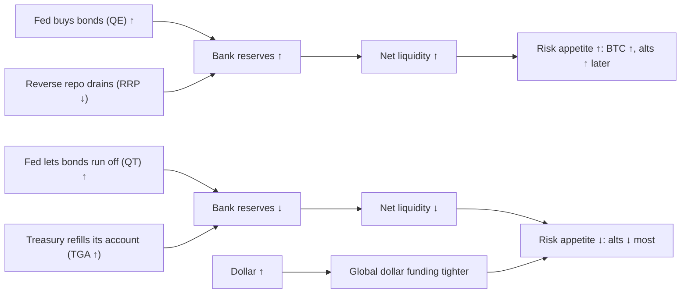

# 07. Liquidity, money and the dollar

"Liquidity" is the most used and least defined word in crypto commentary. Sometimes it means the money supply (M2). Sometimes it means the Federal Reserve's balance sheet. Sometimes it means the cash that banks hold at the Fed, or how easy it is to borrow dollars anywhere in the world. These are different things. They move at different speeds and they have related to bitcoin in different ways in different years. This chapter takes the word apart. You will see what each measure is, how the plumbing between them works (Fed balance sheet, Treasury cash account, reverse repo, bank reserves), how the dollar fits in, and what the data actually say about the popular claim that "bitcoin follows liquidity with a lag". The short answer: liquidity is a real background force. It is not a precise timing tool, and the regime it works in matters more than any fixed lag.

**You will learn**
- What M2 and "global M2" measure, why the year-on-year rate matters more than the level, and why global M2 in dollars is partly a dollar chart.
- How to build **net liquidity** (Fed total assets − Treasury General Account − reverse repo) and why it worked in 2020–22, broke in 2023–24 and partly came back in 2025–26.
- The QE/QT timeline from 2008 to the end of QT on 1 Dec 2025 and the reserve-management purchases after it.
- How bank reserves, SOFR and the repo market show when liquidity is getting scarce (Sep 2019, autumn 2025), and why loose *financial conditions* (the Chicago Fed NFCI) can coexist with tight *policy* liquidity.
- What the DXY is made of, how it differs from the broad dollar, and when the inverse dollar–bitcoin relationship held and when it failed.
- How the yen carry trade unwound on 5 Aug 2024, and why the 2026 Bank of Japan hikes did not repeat it.
- How Benjamin Cowen's own view moved from M2 to "global net liquidity", with dates.

---

## The plumbing in one picture

Read it as accounting first and behavior second. The Fed's balance sheet has assets (bonds, loans) and liabilities (currency, bank reserves, the Treasury's account, reverse repo). When the Fed buys bonds, reserves go up. When the Treasury moves cash into its account at the Fed, or when money-market funds park cash at the Fed's reverse repo facility, that cash is no longer in the banking system as reserves. "Net liquidity" is the attempt to count only the part that is left for markets.

**Key liquidity readings, late October 2026**

| Measure | Latest | Date | What it says |
|---|---|---|---|
| US M2, year on year | +5.71% | Sep 2026 | Money growing at a normal-to-firm pace |
| Fed total assets (WALCL) | $6,745.6 bn | 28 Oct 2026 | Slightly up from the $6.536 T low of 3 Dec 2025 |
| Overnight reverse repo (RRPONTSYD) | $0.35 bn | 29 Oct 2026 | Empty; the 2022–24 buffer is gone |
| Treasury General Account (WTREGEN) | about $1.0 T | 28 Oct 2026 | Near its highest since 2021 ($1.006 T on 22 Apr 2026), a drain on reserves |
| Net liquidity (WALCL − TGA − RRP) | $5.75 T | 28 Oct 2026 | Flat to down; 2025–26 range $5.60–5.99 T |
| Bank reserves (WRESBAL) | $2.89 T | 28 Oct 2026 | Near the bottom of the 2024–26 range ($2.85 T on 29 Oct 2025 to $3.63 T in Mar 2024) |
| SOFR vs target range | 3.94% vs 3.75–4.00% | late Oct 2026 | Near the top of the range: funding is firm |
| Chicago Fed NFCI | −0.549 | 15 Aug 2026 (Cowen memo) | Market financial conditions looser than average |
| Broad dollar (DTWEXBGS) | 121.32 | 23 Oct 2026 | Range-bound; 2026 low 117.44 on 29 Jan |
| DXY | about 101.7 | 30 Oct 2026 | Range-bound since early 2026 |
| USDJPY / Bank of Japan rate | 156.87 / 1.25% | 23 Oct / 18 Sep 2026 | Yen weak despite hikes |

Sources: lab report ([REPORT-2026-10-30](../../tools/macro-lab/REPORT-2026-10-30.md)) for M2, WALCL, RRP and the broad dollar; FRED series computed by the course research for TGA, net liquidity, reserves and SOFR; DXY from Trading Economics (secondary); BoJ from [CNBC, 18 Sep 2026](https://www.cnbc.com/2026/09/18/japan-raises-rates-30-year-high-yen-jgb.html).

---

## Money supply

### M2 money supply (M2SL)

**What it is.** M2 is the broad stock of money held by the public: currency, checking and demand deposits, savings deposits (including money-market deposit accounts), small time deposits under $100k, and retail money-market fund balances. The Federal Reserve publishes it in the H.6 release, monthly, on about the fourth Tuesday, roughly four weeks after the month ends. Units are billions of dollars, seasonally adjusted. Weekly data was discontinued in 2021. In May 2020 savings deposits were moved into M1, which broke the M1 series but not M2. Revisions are usually small.

**Where to find it.** FRED `M2SL` (monthly, seasonally adjusted). TradingView `ECONOMICS:USM2`. On Cowen's platform it is the "M2 Money Supply" chart (Pro tier).

**How to read it.** Look at the **year-on-year growth rate**, not the level, because the level almost always rises. Roughly, nominal M2 growth equals real growth plus inflation plus the change in velocity (how fast money turns over). Velocity is unstable, so the link between M2 and inflation is loose over short horizons. A few markers:
- M2 growth peaked at **+26.8% year on year in Feb 2021**, after pandemic transfers and QE. That surge came roughly 12–18 months before the 2021–22 inflation.
- M2 peaked at **$21.77 T in Mar 2022** and fell to **$20.71 T in Oct 2023**, a **−4.86%** decline. Year-on-year growth turned negative in **Dec 2022**, bottomed at **−4.66% in Apr 2023** and stayed negative until **Feb 2024**. It was the first year-on-year contraction in the FRED record, which starts in 1959, and the largest since the early 1930s, when the money stock fell by about a third (the pre-1959 data use a different definition, so the comparison is approximate).
- M2 regained its old peak in **May 2025** ($21.81 T) and was **$23.41 T, +5.7% year on year, in Sep 2026** (lab: +5.71%).

The most common misreading is "M2 down means crash". In 2023, with M2 shrinking, there was no recession, the S&P 500 rose 24% and bitcoin rose 156%. Households were still spending down a large stock of excess savings built up in 2020–21.

**How Cowen uses it.** Cowen uses M2 mainly as a **deflator** ("accounting for the money supply", next card) and less as a timing signal. In September 2026 he argued that bitcoin does *not* reliably rise with M2, pointing out that M2 was at highs in 2014, 2018 and 2022 while bitcoin fell sharply in each of those years ([Yahoo Finance / Benzinga write-up, Sep 2026](https://finance.yahoo.com/markets/crypto/articles/remember-bitcoin-supposed-rise-money-170010779.html)). A fact check: M2 levels were at highs in 2014 and 2018, but in 2022 M2 peaked in March and then fell, so the 2022 example is only true for the first quarter. His broader point, that the M2 level is not a timing tool, holds. M2 growth is also one of the five inputs to his platform's Macro Liquidity Risk score (see below).

**Connections.**
- *Leads:* inflation, loosely, by about 12–18 months when growth is extreme (2020–21 → 2021–22). With normal growth rates the lead is not usable.
- *Led by:* bank lending, the Fed's balance sheet (QE creates deposits when the Fed buys bonds from non-banks) and fiscal transfers.
- *Sign:* faster M2 growth is associated with rising asset prices and, later, inflation. Contraction tightens conditions.
- *Exceptions:* 2023 (M2 shrinking, assets rallying) and 2026 (M2 growing +5.7%, bitcoin in a bear market).

**What it has meant for assets.** M2 is a slow **regime** variable. Above-trend growth (above about 7–8%) has coincided with strong asset prices: 2020–21 for everything, including bitcoin and altcoins. Contraction in 2022 coincided with the bear market in stocks, bonds and crypto. After that the relationship broke in both directions. The lab's test of M2 as a leading indicator for bitcoin is below; the correlations are low.

**Investor takeaway.** Read M2 as year-on-year growth and treat it as the background weather, not a clock. Neither its contraction in 2023 nor its growth in 2026 told you what bitcoin would do next.

### Asset ÷ M2: "accounting for the money supply"

**What it is.** Dividing an asset's price (or market cap) by M2 strips out the part of its rise that came from monetary expansion. It is a chart construction, not a published series.

**Where to find it.** On TradingView you can type `SP:SPX/ECONOMICS:USM2` or `BITSTAMP:BTCUSD/ECONOMICS:USM2`. Cowen's platform shows asset ÷ M2 views alongside its M1 and M2 charts.

**How to read it.** A new nominal high that is *not* a new high in M2 terms means the rise is partly monetary. A ratio that oscillates in a range over decades suggests that much of the long-run trend in the asset is the money supply itself.

**How Cowen uses it.**
- **Bitcoin ÷ M2** ("Bitcoin: Accounting For The Money Supply", 29 Oct 2021 and 18 Nov 2021, per video summaries): he argued that bitcoin's 2021 high was not a new high after adjusting for M2.
- **S&P 500 ÷ M2** ("S&P 500: Accounting For the Money Supply", 11 Oct 2022 and 12 Jul 2025): the ratio has oscillated in a range for about 30 years, so much of the long-run equity trend is monetary. In December 2025 he said S&P/M2 "resembles the 1996–2000 pattern", which he read as about one more year of upside ([Bankless, 23 Dec 2025](https://www.bankless.com/podcast/where-is-crypto-going-in-2026-ben-cowen)). By **30 Mar 2026** ("Stocks Have Dropped 9%") he said he preferred the stock-to-gold ratio over S&P/M2. Chapter [08](08-STOCKS-GOLD-AND-CROSS-ASSET.md) covers both ratios.

**Connections.** The ratio falls when M2 grows faster than prices (2020) and rises when asset prices outrun money (late 1990s, 2021, 2024–26). It does not lead anything on its own; it reframes the level.

**What it has meant for assets.** It is a valuation lens, not a signal. A high S&P/M2 reading has not stopped equities from going higher for years (the 1996–2000 analogy is exactly that).

**Investor takeaway.** Use asset ÷ M2 to ask "how much of this move is just more money?". Do not use it to time anything.

### Global M2 (no official series)

**What it is.** There is no official "global M2". Practitioners (TradingView scripts, and analysts such as Lyn Alden, Raoul Pal, Joe Consorti, CoinGlass and BGeometrics) add up M2 or broad money for the US, euro area, China, Japan and the UK, sometimes 10–20 more economies, and convert each to dollars at the spot exchange rate. FRED's international M2 series (for example `MYAGM2CNM189N`) are stale; the IMF-based series end in 2017–2019.

**Where to find it.** Build it on TradingView from `ECONOMICS:USM2`, `ECONOMICS:EUM2`, `ECONOMICS:CNM2`, `ECONOMICS:JPM2` and the matching FX pairs, or use a community script. It is not on Cowen's platform as a named chart.

**How to read it.** Two warnings come first.
1. **It is partly a dollar chart.** Because each currency's money stock is converted at spot FX, a weaker dollar raises "global M2" mechanically, even if no new money was created anywhere. Compare it with a constant-FX version.
2. **China is the largest component** in local currency, so yuan moves and People's Bank of China easing move the aggregate.

The latest reported reading is a record of about **$103–104 T in Aug 2026**, about +8% year on year in dollars and about +4.5% at constant FX ([cryptorank](https://cryptorank.io/news/feed/44e74-global-money-supply-record-bitcoin-lags), secondary). At the same time bitcoin was 35–40% below its October 2025 peak.

**How Cowen uses it.** Mostly as a target of skepticism. On 8 May 2025 he posted: "What if #Bitcoin leads liquidity, rather than lags it? A lot of people show this chart, where they offset global M2 by 3-4 months and show BTC following it. The problem is that in 2021, this offset shows M2 going up for 6 months after BTC topped." He reported that in the last three cycles bitcoin topped **18–30 weeks before** global M2 did ([X post, 8 May 2025](https://x.com/benjamincowen/status/1920560445712159145)). He has also noted that dollar strength mechanically moves global-M2 aggregates. In his February 2026 memo he switched from the level to the **year-on-year change of global M2** (Figure 4 of the [Macro Risk Memo, 15 Feb 2026](https://benjamincowen.com/reports/macro-risk-memo-feb-2026)): risk assets respond to changes in the *slope*, not to the aggregate peak, and bitcoin "peaked before M2 rolled over and ultimately bottomed shortly after M2 peaked". The year-on-year view is the honest way to read any money aggregate, because the level of global M2 in dollars rises in almost every year.

**Connections.** Global M2 in dollars moves inversely with the dollar (mechanically), with Chinese credit, and with central-bank balance sheets. The popular claim is that it leads bitcoin by about 10–12 weeks (some use 70 or 90 days). See the test below.

**What it has meant for assets.** The overlay looked convincing in parts of 2023–24 and visibly failed in 2025–26, when global M2 made records and bitcoin fell by more than half from its high.

**Investor takeaway.** Before trusting a global-M2 chart, ask three questions: is it in constant FX, which countries are in it, and was the offset chosen after looking at the result?

### Testing the narrative: "bitcoin follows M2 with a lag"

The claim has two common forms: US M2 growth leads bitcoin by a few months, and global M2 (or net liquidity) leads bitcoin by 10–12 weeks. Two independent tests were run for this course.

**Test 1: the course lab, US data, whole sample.** The [macro lab](../../tools/macro-lab/REPORT-2026-10-30.md) correlated US M2 year-on-year growth with bitcoin's year-on-year return (monthly), and the 13-week change in net liquidity (WALCL − TGA − RRP) with bitcoin's 13-week log return (weekly), at different leads.

| M2 YoY leads BTC YoY by | Correlation | | Net liquidity (13-w change) leads BTC by | Correlation |
|---|---|---|---|---|
| 0 months | 0.18 | | 0 weeks | 0.18 |
| 2 months | 0.22 | | 4 weeks | 0.19 |
| 3 months | 0.22 | | 8 weeks | 0.19 |
| 6 months | 0.25 | | 12 weeks | 0.15 |
| 9 months | 0.22 | | 16 weeks | 0.11 |
| 12 months | 0.10 | | 26 weeks | 0.06 |

How to read it: a correlation of 0.25 means M2 growth "explains" about 6% of the variation in bitcoin's yearly return (0.25² ≈ 0.06). The best lead (6 months for M2, 4–8 weeks for net liquidity) is barely better than no lead at all. The lab also warns that overlapping year-on-year windows inflate correlations, so these numbers flatter the relationship. They are descriptive, not predictive.

**Test 2: the regime split.** The course research ([research notes C](../../research-notes/C-growth-liquidity-crossasset.md)) computed the same kind of relationship by window, using weekly data from FRED (`WALCL`, `WTREGEN`, `RRPONTSYD`, `CBBTCUSD`). In log *levels*, the correlation between net liquidity and bitcoin was about **0.81 in 2019–2022** (0.78 for the S&P 500) and **−0.26 in 2023–Oct 2026** (−0.54 for the S&P). In other words: in the first regime the two moved together, and in the second they moved in opposite directions, because both bitcoin and stocks rallied while net liquidity went sideways or down. The detailed lag profile:

| Window | Measure | lag 0 | 4 w | 8 w | 10 w | 12 w | 16 w | 20 w |
|---|---|---|---|---|---|---|---|---|
| 2016–Oct 2026 | levels | 0.78 | 0.78 | 0.78 | 0.77 | 0.77 | 0.77 | 0.76 |
| 2016–Oct 2026 | 13-w changes | 0.15 | 0.17 | 0.17 | 0.17 | 0.16 | 0.11 | 0.07 |
| 2020–2022 | levels | 0.80 | 0.81 | 0.80 | 0.79 | 0.78 | 0.77 | 0.77 |
| 2020–2022 | 13-w changes | 0.24 | 0.26 | 0.24 | 0.22 | 0.18 | 0.11 | 0.10 |
| 2023–Oct 2026 | levels | −0.26 | −0.18 | −0.13 | −0.09 | −0.06 | 0.01 | −0.01 |
| 2023–Oct 2026 | 13-w changes | 0.18 | 0.20 | 0.29 | 0.30 | 0.29 | 0.24 | 0.07 |
| 2025–Oct 2026 | levels | 0.26 | 0.44 | 0.60 | 0.65 | 0.66 | 0.74 | 0.72 |
| 2025–Oct 2026 | 13-w changes | −0.05 | 0.09 | 0.27 | 0.35 | 0.36 | 0.41 | 0.35 |

**What the two tests say together.**
- **Level correlations over long windows (0.77–0.81) are inflated by shared trends.** Two series that both rise over a decade will correlate whether or not one drives the other. The tell is that the long-window correlation barely changes with the lag. A real lead would show a clear peak at one lag.
- **On changes, which is the honest test, the explanatory power is small:** r ≈ 0.15–0.4, so R² ≈ 2–17%.
- **The "best" lag drifts:** about 4 weeks in 2020–22, about 10 weeks in 2023–26, about 16 weeks in 2025–26. A lag that moves around like this is what overfitting looks like. If you pick the offset that fits the last two years, it will probably not fit the next two.
- **The 2023–24 break had identifiable causes:** spot bitcoin ETF demand (approved January 2024), the April 2024 halving, and the reverse-repo drain that offset QT. AI earnings carried the S&P.
- **The 2025–26 re-coupling is real but short.** Net liquidity fell from $6.25 T (Apr 2025) to $5.60 T (Dec 2025) on the Treasury cash rebuild and late QT; bitcoin topped in October 2025 and fell to about $57.7–58.6k (depending on source) by 30 June 2026. The S&P ignored this decline entirely.

**Conclusion.** Liquidity is a meaningful *background* driver: its direction over 3–6 months tilts the odds, especially for crypto. A fixed 10–12-week lead is not a reliable forecasting rule. Treat it as a hypothesis with modest evidence, and remember that Cowen himself argued in May 2025 that bitcoin *led* global M2 at tops.

---

## The Fed's balance sheet and the plumbing

### Fed total assets (WALCL) and the QE/QT timeline

**What it is.** The total assets of the Federal Reserve: Treasuries, mortgage-backed securities (MBS), loans (discount window, the 2023 Bank Term Funding Program) and repo. Published in the H.4.1 release every Thursday at 4:30 pm ET, showing Wednesday values. Units: millions of dollars on FRED. **QE** (quantitative easing) means the Fed buys bonds and the balance sheet grows. **QT** (quantitative tightening) means it lets bonds mature without replacing them and the balance sheet shrinks. The mechanics and the policy decisions are covered in chapter [02](02-THE-FED-AND-INTEREST-RATES.md); this card covers the liquidity side.

**Where to find it.** FRED `WALCL`. TradingView `FRED:WALCL`. On Cowen's platform: "FED Total Assets", plus the "QT Ending Bear Markets" chart.

**How to read it.** The direction and the composition matter more than the level. A rising balance sheet because of emergency loans (March 2023) is a crisis signal, not easing. A flat balance sheet with the reverse repo draining (2023–24) can still add reserves. And the end of QT is not QE: the balance sheet stops shrinking, it does not start growing.

**The timeline to the end of QT (and after).**

| Period | Policy | WALCL | Market context |
|---|---|---|---|
| Nov 2008–Oct 2014 | QE1, QE2, Operation Twist, QE3 | ~$0.9 T (pre-crisis, mid-2008) → ~$4.5 T | Post-crisis bull market |
| Oct 2017–Jul 2019 | QT1 (caps up to $50 bn a month) | ~$4.5 T → ~$3.76 T | Q4 2018: S&P −19.8%; BTC −73% in 2018 |
| Sep–Oct 2019 | Repo spike (SOFR above 5%), then T-bill purchases "not QE" from Oct 2019 | rising | Reserves too scarce at ~$1.4–1.5 T |
| Mar 2020–Mar 2022 | Unlimited QE, taper from Nov 2021 | $4.17 T (Feb 2020) → $8.965 T peak (13 Apr 2022) | 2020–21 "everything rally" |
| Jun 2022 | QT2 begins (cap $47.5 bn, $95 bn from Sep 2022) | falling | 2022 bear market |
| Mar 2023 | Bank Term Funding Program (12 Mar) and discount window after SVB | +~$390 bn in weeks | BTC +70% in Q1 2023 |
| Jun 2024 | QT taper: Treasury cap $60 bn → $25 bn | falling more slowly | |
| Apr 2025 | Treasury cap → $5 bn | falling very slowly | |
| 1 Dec 2025 | QT ends; MBS run-off reinvested into bills | low of $6.536 T (3 Dec 2025) | BTC already about −25% from its high |
| Dec 2025–mid 2026 | Reserve-management purchases of T-bills, about $40 bn a month, cut to about $10 bn by Jun 2026, paused Aug–Sep 2026 (reported, not independently verified) | $6,745.6 bn (28 Oct 2026) | BTC bear market; Fed hikes on 16 Sep 2026 |

The FOMC statement of 29 Oct 2025 said: "The Committee decided to conclude the reduction of its aggregate securities holdings on December 1." QT2 took the balance sheet from about $8.97 T to about $6.54–6.57 T (sources differ slightly on the exact low). The Fed's July 2026 Monetary Policy Report put bill purchases since early January 2026 at about $250 bn, about $160 bn of them reserve-management purchases. Chair Kevin Warsh, who took over in May 2026, has long argued the balance sheet is too large and set up a task force on balance-sheet policy; there was no decision as of the 28 Oct 2026 press conference ([First Trust, Aug 2026](https://www.ftportfolios.com/Commentary/EconomicResearch/2026/8/13/can-warsh-shrink-the-feds-balance-sheet)). A renewed push to shrink the balance sheet would be a liquidity headwind that markets have not had to price since 2025.

**How Cowen uses it.** QT and QE are central to his crypto framework, more for *relative* performance than for prices:
- "Last cycle the transition from QT to QE marked the top for BTC dominance," and "I expect the Fed to transition from QT to QE next year" ([Cointelegraph Magazine, 19 Nov 2024](https://cointelegraph.com/magazine/bitcoin-dominance-crypto-predictions-bull-run-benjamin-cowen-hall-of-flame/)). Also: "My base case right now for Bitcoin dominance is that it will likely go higher until quantitative tightening is over" ([Benzinga, Nov 2024](https://www.benzinga.com/markets/cryptocurrency/24/11/41850110/federal-reserve-cuts-interest-ratesbitcoin-dominance-may-rise-as-a-result)).
- Bitcoin topped *before* QT ended in both cycles: about 5 weeks before in 2019 (top 26 Jun, QT end 1 Aug 2019) and about 8 weeks before in 2025 (top 6 Oct, QT end 1 Dec 2025). His videos rounded both to "about two months" ("Bitcoin and the End of Quantitative Tightening", 1 Dec 2025; Bankless, 23 Dec 2025); the 5- and 8-week figures are from his [Bitcoin Cycle Memo of 15 Jul 2026](https://benjamincowen.com/reports/bitcoin-cycle-memo-july-2026). His January 2026 memo generalizes the point: bitcoin "often leads liquidity cycles", and liquidity "tends to respond to macro stress" ([Crypto Macro Risk Memo Q1 2026, 15 Jan 2026](https://benjamincowen.com/reports/crypto-macro-risk-memo-q1-2026)).
- The end of QT is not the same as a growing balance sheet. In 2026 no QE followed, and the Fed hiked in September, so his "QT→QE marks the dominance top" rule went untested this cycle. The dominance side is covered in chapter [12](12-DOMINANCE-ALTCOINS-AND-ROTATION.md).
- His 2026 memos go one step further: even a *growing* balance sheet is not enough. The Fed's bill purchases after December 2025 looked like "reserve management, funding operations, and financial-system stabilization", not crisis QE, and crypto needs **speculative liquidity**, meaning capital that is "both abundant and willing to take risk" (Q1 memo, 15 Jan 2026). Crypto bull markets, in this reading, came when liquidity expanded *in response to* economic or financial stress (2019–20, 2020–21), not when tightening merely stopped.

**Connections.**
- *QE → lower real yields, weaker dollar, higher equities, crypto and gold* (2009–13, 2020–21). Lag: weeks to months.
- *QT → higher term premia, tighter liquidity, high-beta assets hurt most* (2018, 2022). But the *pace* of QT matters less than what happens to reserves, which also depend on the TGA and the reverse repo (next cards).
- *Balance-sheet turns have lined up with ETH/BTC lows twice:* 6 Sep 2019 (five weeks after the first cut and the QT end) and 21 Apr 2025 (three weeks after QT slowed to a trickle). Two cases is suggestive, not reliable.

**What it has meant for assets.** BTC: QE regimes coincided with bull markets (2020–21); QT regimes with bears (2018, 2022), but QT in 2023–24 coincided with a bull market because the reverse repo drained. Altcoins: the most sensitive; no alt season under QT in 2018–19 or 2023–25. Stocks: QE supportive; QT a headwind in 2018 and 2022, not in 2023–25. Gold: QE supportive via lower real yields.

**Investor takeaway.** Watch the direction of the balance sheet together with reserves. "QT ended" is a necessary-ish condition in Cowen's story for altcoin strength, not a sufficient one: in 2019 and in 2026 it was followed by more weakness, not by a rotation.

### Overnight reverse repo (RRPONTSYD)

**What it is.** The Fed's overnight reverse repurchase facility. Money-market funds and government-sponsored enterprises lend cash to the Fed overnight against Treasuries, at the ON RRP rate, which is the floor of the fed funds range. Daily, in billions of dollars.

**Where to find it.** FRED `RRPONTSYD`. Cowen's platform: "Overnight Reverse Repurchase Agreements (ON RRP)".

**How to read it.** Cash in the RRP is idle cash that is *not* in the banking system as reserves. When the RRP falls because money funds move into T-bills, that cash returns to the private system. So a *falling* RRP is a liquidity *injection*, even if the Fed is doing QT.
- Near zero until March 2021.
- A record **$2.554 T on 30 Dec 2022**: excess liquidity from QE and fiscal transfers with nowhere to go.
- Drained to about $0.4–0.5 T by 2024 and to near zero from late 2025: **$0.35 bn on 29 Oct 2026** (lab; $19.50 bn a year earlier).

**How Cowen uses it.** Mainly as an input to net liquidity, not as a standalone video topic ("Net Liquidity", 30 Jun 2023).

**Connections.** The 2023–24 "liquidity paradox" ran through the RRP. After the June 2023 debt-ceiling deal, the Treasury issued a flood of T-bills; money funds moved cash out of the RRP to buy them; bank reserves *rose* from $2.83 T (Jan 2023) to over $3.5 T (Dec 2023) even as the Fed shrank its balance sheet. QT happened, and BTC and stocks still rallied.

**What it has meant for assets.** A draining RRP cushioned QT for risk assets in 2023–24. With the RRP now empty, that cushion is gone: any further balance-sheet shrinkage or TGA rebuild comes straight out of bank reserves.

**Investor takeaway.** A large RRP is a buffer; an empty one means the system has no spare cash to absorb the next drain.

### Treasury General Account (WTREGEN)

**What it is.** The US Treasury's cash account at the Fed. It is a liability of the Fed, so when the Treasury's balance rises, bank reserves fall, all else equal. Weekly on FRED (millions of dollars); daily in the Daily Treasury Statement at fiscaldata.treasury.gov.

**Where to find it.** FRED `WTREGEN`. Cowen's platform: "Treasury Deposits With Federal Reserve Banks".

**How to read it.** Debt-ceiling standoffs run the TGA down (cash flows out to the economy: a liquidity injection). Resolutions refill it (a liquidity drain). Tax dates also cause spikes.
- 2023: after the June 2023 debt-ceiling deal, the TGA was rebuilt by about $0.7 T.
- 2025: the TGA fell to **$296 bn on 16 Jul 2025**, then was rebuilt to **$958 bn by 29 Oct 2025** after the July debt-limit increase. That drain of roughly $660 bn coincided with funding stress (next cards) and with bitcoin's October 2025 top and fall.
- Now: about **$1.0 T (28 Oct 2026)**, close to the April 2026 level of $1.006 T, the highest since 2021.

**How Cowen uses it.** As an input to net liquidity, not as a separate topic.

**Connections.** TGA ↑ → reserves ↓ → net liquidity ↓, usually within weeks. The effect is strongest when the RRP is empty, because nothing offsets it.

**What it has meant for assets.** The 2025 rebuild is the clearest recent case where a TGA refill coincided with a crypto top, but the coincidence is one episode and other forces (the 10 Oct 2025 liquidation cascade, cycle timing) were at work.

**Investor takeaway.** Watch debt-ceiling calendars. A big TGA rebuild into an empty RRP is a liquidity drain worth noticing.

### Net liquidity (WALCL − TGA − RRP)

**What it is.** A practitioner construct, popularized by Max Anderson and others around 2022: Fed total assets minus the Treasury General Account minus overnight reverse repo. It is **not** an official Fed measure. The idea is to count the part of the Fed's balance sheet that is available to banks and markets.

**Where to find it.** Build it yourself from FRED. Mind the units: `WALCL` and `WTREGEN` are in millions, `RRPONTSYD` is in billions (multiply by 1,000). Use Wednesday values. On TradingView: `FRED:WALCL-FRED:WTREGEN-FRED:RRPONTSYD*1000`. The [macro lab](../../tools/macro-lab/REPORT-2026-10-30.md) script computes it.

**How to read it.** Look at its trend over 3–6 months and at turning points. History:

| Date | Net liquidity | BTC | S&P 500 |
|---|---|---|---|
| 18 Mar 2020 | $4.31 T | $5.4k | 2,398 |
| 15 Sep 2021 (peak) | $7.14 T | $48.1k | 4,481 |
| 10 Nov 2021 (BTC top) | $6.96 T | $64.9k | 4,647 |
| 28 Sep 2022 (low) | $5.74 T | $19.4k | 3,719 |
| 23 Nov 2022 (BTC low week) | $6.07 T | $16.6k | 4,027 |
| 15 Mar 2023 (BTFP) | $6.35 T | $24.4k | 3,892 |
| 13 Mar 2024 | $6.25 T | $73.1k | 5,165 |
| 18 Dec 2024 | $5.99 T | $97.4k | 5,872 |
| 9 Apr 2025 | $6.25 T | $79.6k | 5,457 |
| 8 Oct 2025 (BTC top week) | $5.78 T | $121.7k | 6,754 |
| 3 Dec 2025 (low) | $5.60 T | $93.2k | 6,850 |
| 1 Jul 2026 (BTC low week) | $5.84 T | $59.9k | 7,483 |
| 28 Oct 2026 | $5.75 T | $81.2k | 7,744 |

**Episodes.**
- **2020–21:** net liquidity +66% (Mar 2020 → Sep 2021); BTC ×12, S&P ×1.9. The net-liquidity peak (Sep 2021) came about two months before the BTC top (Nov 2021) and about four months before the S&P top (Jan 2022). This is the episode that made the indicator famous.
- **2022:** net liquidity −20% (Jan → Sep 2022); BTC −64%, S&P −19.4% for the year. Net liquidity bottomed in September 2022, about two months before the BTC low (November, after FTX) and about two weeks before the S&P low (12 Oct 2022).
- **2023–24:** net liquidity roughly flat ($5.8–6.35 T) while BTC rose about sixfold and the S&P about 50%. **The narrative broke.** Drivers: AI earnings, ETF flows, the halving, fiscal deficits.
- **2025–26:** net liquidity fell from $6.25 T (Apr 2025) to $5.60 T (Dec 2025), recovered modestly to about $5.99 T (Jul 2026). BTC topped in October 2025, bottomed in June 2026 and rebounded to about $86k by early October. The fit improved again (r ≈ 0.74 at a 16-week lag in levels). The S&P ignored the decline.

**How Cowen uses it.** He made a short series on it in 2023–24 ("Net Liquidity", 30 Jun 2023; "Net Liquidity: S&P 500 and Bitcoin", 28 Jul 2023; "Bitcoin: Net Liquidity", 8 Feb 2024, per video summaries). His claims: it correlates with the S&P, and it is more useful for **relative** performance (higher-risk versus lower-risk assets) than for dollar prices. In late cycle and under QT, altcoins underperform bitcoin. His 2026 view moved to a *global* version (see the next section but one).

**Connections.** Net liquidity ← Fed balance sheet (+), TGA (−), RRP (−). It leads risk assets loosely in liquidity-dominated regimes (2020–22: a few weeks to two months at turning points) and not at all in earnings- or flow-dominated regimes (2023–24).

**What it has meant for assets.** BTC and alts: strongest link in 2020–22 and 2025–26. Stocks: decoupled first, in 2023, and stayed decoupled. Gold and the dollar: no stable link.

**Investor takeaway.** Net liquidity is the right *concept* (how much cash the system has). As a *model* it works in some regimes and not in others, and you only know which regime you were in afterwards.

### Bank reserves, SOFR and repo stress (WRESBAL, SOFR)

**What it is.** Bank reserves are the cash banks hold at the Fed (FRED `WRESBAL`, weekly). SOFR, the Secured Overnight Financing Rate, is the cost of borrowing cash overnight against Treasuries (New York Fed, daily, FRED `SOFR`). IORB is the interest the Fed pays on reserves, a ceiling-like administered rate. The Standing Repo Facility (SRF) lets eligible firms borrow from the Fed against Treasuries; usage is on the New York Fed website.

**Where to find it.** FRED `WRESBAL`, `SOFR`, `IORB`, and `DFEDTARU`/`DFEDTARL` for the target range.

**How to read it.** When reserves are "ample", SOFR trades a few basis points *below* IORB. When reserves approach "scarce", SOFR trades *above* IORB, repo rates spike at month-, quarter- and tax-date ends, and the Fed has to add reserves. Two episodes:
- **September 2019:** SOFR reached 5.25% with reserves at about $1.4 T. The Fed started buying T-bills in October 2019 and called it "not QE".
- **September–December 2025:** after the TGA rebuild, SOFR traded above IORB and the SRF saw record usage, about $50 bn on 31 Oct 2025 and about $75 bn on 31 Dec 2025 (reported, not independently verified against New York Fed data). QT ended on 1 Dec 2025 and reserve-management purchases began.

Now: reserves **$2.89 T (28 Oct 2026)**, against a 2024–26 range of $2.85 T (29 Oct 2025) to $3.63 T (March 2024) and $4.28 T at the December 2021 peak. SOFR **3.94%** with the range at 3.75–4.00%, near the top: funding is firm, partly because the TGA is at $1 T.

The **Bank Term Funding Program** (12 Mar 2023, after Silicon Valley Bank failed) lent for up to a year against Treasuries and MBS valued **at par**, removing the forced-sale risk from unrealized losses. Usage peaked at about $165–168 bn in early 2024; new lending stopped on 11 Mar 2024. The balance-sheet jump of about $390 bn in March 2023 and a +$0.55 T rise in net liquidity in three weeks coincided with bitcoin rallying from about $20k to about $28k and the "bitcoin as a bank-crisis hedge" narrative.

**How Cowen uses it.** Reserves appear on his platform as part of the monetary data; they are not a video topic.

**Connections.** Reserves fall when the TGA rises, when the RRP is empty and QT runs. Repo stress tends to *end* QT (2019, 2025). The Fed's response (bill purchases, emergency facilities) then adds liquidity, with a lag of weeks.

**What it has meant for assets.** Funding stress hits leveraged positions first. In 2019 the repo spike came in the middle of BTC's slide from its June high; in late 2025 it overlapped the post-top crash.

**Investor takeaway.** Reserves near $2.9 T, an empty RRP and a $1 T TGA mean the system has about as little slack as during the autumn-2025 funding squeeze, and less than at almost any time since 2020. A funding-market hiccup is a plausible risk channel for leveraged crypto, but it is a channel to watch, not a forecast.

### Financial conditions: the Chicago Fed NFCI (NFCI)

**What it is.** The Chicago Fed's National Financial Conditions Index: a weekly summary of risk, credit and leverage conditions in money markets, debt and equity markets and the banking system, built from about a hundred indicators. It is scaled so that **0 is the historical average**; negative values mean conditions are *looser* than average, positive values tighter. Published every Wednesday; past values are revised as new data come in.

**Where to find it.** FRED `NFCI` (also `ANFCI`, the version adjusted for the business cycle). Cowen's platform carries it as "National Financial Conditions Index (NFCI)" and his memos also call it the "Chicago Financial Conditions Index".

**How to read it.** The sign and the direction matter more than the decimals. Financial conditions are what markets are actually charging for credit and risk; policy liquidity (the policy rate, the balance sheet, the dollar) is what the central bank is doing. The two can disagree for long stretches.

**How Cowen uses it.** As the counterweight to his liquidity score. In August 2026 he contrasted **loose market conditions (NFCI −0.549)** with **tight policy liquidity (his Liquidity Risk score 0.813)** and called "restrictive policy alongside loose financial conditions" the "hallmark of a mature expansion", one that can persist but makes "the eventual turn abrupt". An NFCI move above zero would be "the early warning", and "financial conditions staying loose" is one of the observations that would refute his correction call ([The Balance of Risks, 15 Aug 2026](https://benjamincowen.com/reports/the-balance-of-risks-august-2026); also Figure 15 of the [February 2026 memo](https://benjamincowen.com/reports/macro-risk-memo-feb-2026)). The NFCI is one of the observables that define his three scenario states (chapter [13](13-HOW-IT-ALL-CONNECTS.md)).

**Connections.** Financial conditions tighten *after* policy when something breaks: credit spreads widen, equities fall, volatility jumps (chapter [03](03-BONDS-AND-THE-YIELD-CURVE.md) covers credit spreads). Loose conditions under tight policy usually reflect strong earnings and risk appetite, as in 2026 with the S&P at records and high-yield spreads near 3%.

**What it has meant for assets.** A negative and falling NFCI goes with rising equities and tight credit spreads. Turns above zero have come with stress episodes (2008, March 2020, 2022). For crypto, loose *market* conditions did not prevent a bear market in 2025–26, which is Cowen's point about the difference between aggregate liquidity and speculative liquidity.

**Investor takeaway.** Read policy liquidity and financial conditions side by side. When they disagree, the question is which gives way first.

### From M2 to "global net liquidity": how Cowen's view moved

Cowen's liquidity framing changed several times. Every "Cowen thinks X" about liquidity needs a date:

| Date | What he said or did | Source |
|---|---|---|
| 29 Oct and 18 Nov 2021 | Bitcoin ÷ M2: the 2021 high was not a new high in M2 terms | "Bitcoin: Accounting For The Money Supply" (video summaries) |
| 11 Oct 2022 | S&P ÷ M2 range-bound for about 30 years | "S&P 500: Accounting For the Money Supply" (video summary) |
| Jun 2023–Feb 2024 | US net liquidity (Fed assets − TGA − RRP) tracks the S&P; more useful for relative than absolute performance | "Net Liquidity" 30 Jun 2023; "Net Liquidity: S&P 500 and Bitcoin" 28 Jul 2023; "Bitcoin: Net Liquidity" 8 Feb 2024 (video summaries) |
| 8 May 2025 | Global M2 offset charts mislead; bitcoin topped 18–30 weeks *before* global M2 in the last three cycles | [X post](https://x.com/benjamincowen/status/1920560445712159145) |
| Dec 2025 | S&P ÷ M2 resembles 1996–2000 | [Bankless, 23 Dec 2025](https://www.bankless.com/podcast/where-is-crypto-going-in-2026-ben-cowen) |
| 15 Jan 2026 | Bitcoin "often leads liquidity cycles"; Fed balance-sheet growth is reserve management, not QE; crypto needs **speculative** liquidity | [Crypto Macro Risk Memo Q1 2026](https://benjamincowen.com/reports/crypto-macro-risk-memo-q1-2026) |
| 15 Feb 2026 | Liquidity **direction** versus **level**; **stabilization** versus **impulse**; global M2 read as a year-on-year change (slope), not a level | [Macro Risk Memo, Feb 2026](https://benjamincowen.com/reports/macro-risk-memo-feb-2026) |
| 20 Feb 2026 | "Why Alt Season Never Happened": tight liquidity (his Macro Liquidity Risk score) forces rotation toward safer assets | video summary |
| Mar 2026 | "Liquidity conditions also reflect a late business cycle environment" | [X post](https://x.com/benjamincowen/status/2036990935075016905) |
| 30 Mar 2026 | Prefers stock-to-gold over S&P ÷ M2 | "Stocks Have Dropped 9%" (video summary) |
| 15 Apr 2026 | Shows a **global liquidity proxy**: "major central bank balance sheets adjusted for RRP and TGA" | [Crypto Risk Memo Q2 2026](https://benjamincowen.com/reports/crypto-risk-memo-q2-2026) |
| Aug 2026 | "Liquidity risk falls out of its tight band" listed as an invalidation signal for his bear case | [Balance of Risks memo, 15 Aug 2026](https://benjamincowen.com/reports/the-balance-of-risks-august-2026) |
| Sep 2026 | Bitcoin tracks **global net liquidity** (major central-bank balance sheets minus drains like the TGA and RRP), not M2. He put it at about **$25 T versus about $30 T at the 2021–22 peak**, and said this explains why bitcoin lagged stocks; closest analog 2019 (M2 up, stocks at highs, BTC down) | [Yahoo Finance / Benzinga, Sep 2026](https://finance.yahoo.com/markets/crypto/articles/remember-bitcoin-supposed-rise-money-170010779.html) (secondary) |

The course research could not find a public series matching his $25 T figure, so treat that number as his, not as an independently verified one. The direction of the shift is clear: from a money-supply deflator (2021–22), to a US plumbing measure (2023–24), to skepticism of global M2 (2025), to a global balance-sheet measure net of drains (from April 2026 in his memos). The shift also fits the data in the regime-split table above: M2 kept rising in 2025–26 while measures net of drains did not.

### Liquidity level, direction and impulse (Cowen's 2026 vocabulary)

Three distinctions from his February 2026 memo ([Macro Risk Memo, 15 Feb 2026](https://benjamincowen.com/reports/macro-risk-memo-feb-2026)) are worth adopting whoever's framework you use:
- **Level versus direction.** "Less tight" is not "loose". In February 2026 his Liquidity Risk score sat in the upper quartile, in the "tight" to "very tight" regime, even though tightening had stopped (QT over, rate cuts in late 2025). A falling score from a high level is a change in *direction*, not a change in *level*.
- **Stabilization versus impulse.** Ending QT, pausing hikes or adding reserves for plumbing reasons *stabilizes* liquidity. A durable expansion in risk assets has historically needed an *impulse*: a clear, often stress-driven expansion (2019 cuts plus bill purchases, then 2020 QE). He listed "liquidity stabilization vs liquidity impulse" as one of five risk drivers in that memo.
- **Aggregate versus speculative liquidity.** Stocks and metals can be well supplied with liquidity while crypto is not (his January 2026 "segmentation of capital" argument, chapter [08](08-STOCKS-GOLD-AND-CROSS-ASSET.md)). The slope of liquidity, not its level, is what he watches for crypto.

These ideas explain why, in his reading, the end of QT on 1 Dec 2025 and the bill purchases that followed did not stop the 2026 bear market.

### ITC Macro Liquidity Risk score (concept)

**What it is.** A 0–1 gauge on Cowen's platform (Pro tier) of how tight US dollar liquidity is. Per the platform's public help text, it combines five monthly inputs (the effective fed funds rate, the 2-year Treasury yield, a dollar index, the month-on-month change in Fed total assets and the month-on-month change in M2) into one factor (first principal component), smooths it over six months and ranks it as a percentile since January 2003. High means tight. His March and July 2026 memos describe the inputs slightly differently ("policy rates, yields, dollar strength, central bank liquidity, and funding stress proxies"), so the published descriptions do not match exactly. Only the concept is described here; the exact implementation is his.

**How Cowen uses it.** "Why Alt Season Never Happened" (20 Feb 2026): tight liquidity forces flight-to-quality rotations, altcoins → bitcoin → stocks → gold. The next alt season needs significantly looser policy, possibly in 2027–2029. Readings in his memos: upper quartile ("tight" to "very tight") in February 2026, **0.809** on 15 Jul 2026 and **0.813** on 15 Aug 2026 (about 0.80 three months earlier). In August 2026 he listed "liquidity risk falls out of its tight band" as one of the signals that would invalidate his bearish view.

**Connections and takeaway.** Note what is inside: two rate measures and the dollar, plus two balance-sheet/money changes. A Fed hike, a firmer dollar and a flat balance sheet (all present in autumn 2026) keep such a score tight. Any composite is only as informative as its inputs; check them individually.

### Other central banks: Bank of Japan and the People's Bank of China

These belong mainly to chapter [02](02-THE-FED-AND-INTEREST-RATES.md), but they move global liquidity.
- **Bank of Japan:** 0.25% (31 Jul 2024), 0.5% (Jan 2025), 0.75% (Dec 2025), 1.0% (16 Jun 2026), **1.25% (18 Sep 2026)**, the highest since 1995 ([CNBC](https://www.cnbc.com/2026/09/18/japan-raises-rates-30-year-high-yen-jgb.html)). Cowen flagged BoJ hikes as a risk for bitcoin in June 2026 ("Bitcoin Falls to the 200W Moving Average", 5 Jun 2026, video summary). See the carry-trade card below.
- **People's Bank of China:** guided to "moderately loose" policy in 2026, cut structural relending rates by 25 bp to 1.25% in January 2026 and ran large medium-term lending operations; further 2026 headline rate cuts could not be verified. China matters for global-M2 arithmetic and for commodity demand (copper, oil). Its direct link to crypto has weakened since the 2021 mining and trading ban, though Chinese credit impulses helped the 2016–17 and 2019 reflations.

---

## The dollar

### DXY, the US Dollar Index (TVC:DXY)

**What it is.** A geometric-weighted index of the dollar against six currencies, published by ICE, with weights unchanged since the euro was introduced in 1999. Base: March 1973 = 100. Trades nearly 24 hours a day, five days a week.

| Currency | Weight in DXY |
|---|---|
| Euro (EUR) | 57.6% |
| Japanese yen (JPY) | 13.6% |
| British pound (GBP) | 11.9% |
| Canadian dollar (CAD) | 9.1% |
| Swedish krona (SEK) | 4.2% |
| Swiss franc (CHF) | 3.6% |

**Where to find it.** TradingView `TVC:DXY` (index) and `ICEUS:DX1!` (futures). **Not on FRED.** On Cowen's platform: "DXY", plus "BTC vs. DXY".

**How to read it.** With the euro at almost 58%, DXY is mostly the inverse of EURUSD. It omits the Chinese yuan, Mexican peso and Korean won, so it understates trade-relevant dollar moves. Above 100 is often called "strong"; moves of more than 10% in 12 months are "violent". Key dates:
- 2022: about +19% from January to September, the biggest move in decades, peaking at **114.78 on 28 Sep 2022**.
- After the Fed's first cut on 18 Sep 2024: from about 100 to about 110 by mid-January 2025.
- **H1 2025: −10.8%, the worst first half since 1973** ([Yahoo Finance / Business Insider](https://finance.yahoo.com/news/dollar-posted-worst-first-half-153518559.html)).
- 2026: a low around late January–February (about 96.5 per Cowen's September memo; the broad index bottomed on 29 Jan), then higher lows: 99.9 on 15 Aug, about 101.35 on 30 Sep (with a July high near 101.8), reported "new 2026 highs" toward 102 on 1 Oct (secondary), and about **101.7 on 30 Oct 2026** (Trading Economics, secondary).

**How Cowen uses it.** It is one of his most-cited macro charts (more than 200 video titles or summaries mention the dollar, mostly in 2020–2022):
- "Bitcoin bear markets have tended to correlate with the Dollar Index's sharp moves to the upside and vice versa" (attributed via Daily Hodl and the Informer Post, secondary).
- April 2022: "The parabolic rally by DXY does not bode well for risk-on assets like stocks and Bitcoin. Until the rally cools off, playing defense is the way to go" ([Cointelegraph](https://cointelegraph.com/news/bitcoin-rejects-40k-as-us-dollar-strength-hits-20-year-high)).
- He has also warned that dollar *weakness alone* is not a reason to turn bullish on bitcoin ([Informer Post](https://theinformerpost.beehiiv.com/p/bitcoin-bulls-shouldnt-be-fooled-by-weakening-us-dollar-according-to-crypto-analyst-benjamin-cowen), undated).
- Oct 2024 ("The Yield Curve & Bitcoin", 23 Oct 2024): after the first cut, unless a recession is imminent, the dollar and long yields tend to rally. That was correct for October 2024–January 2025. In July 2025 ("Is DXY Nearing A Low?", 7 Jul 2025) he noted the dollar had collapsed after that predicted rally.
- "Altcoin season is unlikely while the dollar strengthens." The BTC–DXY inverse correlation breaks down in high inflation ("Bitcoin vs. DXY", 10 Dec 2022).
- 2026 memos: in February he flagged dollar upside risk "similar to 2018" (a renewed dollar upswing tightens global liquidity even without QT); in March he noted the DXY "above 100" resembled early 2018. Both were borne out by the higher lows from about 96.5 to about 101.35. In August he added a presidential-term analog (the DXY rebased at each inauguration, chapter [09](09-SEASONALITY-AND-POLITICAL-CYCLES.md)) and called it "deliberately the lightest evidentiary leg" of his view ([Balance of Risks](https://benjamincowen.com/reports/the-balance-of-risks-august-2026)).
- September 2026 ([Triple Squeeze memo](https://benjamincowen.com/reports/the-triple-squeeze-september-2026)): a firmer dollar with higher lows since February was one leg of his "triple squeeze"; he watched for a break above about 101.8, and said "a dollar breaking to new lows" would invalidate the bearish view. Later that month bitcoin rose *with* the dollar after the Fed's hike, and he said "something clearly changed" (secondary report).

**Connections.**
- *Driven by:* relative policy rates (Fed versus ECB and BoJ), relative growth, and safe-haven demand in crises (March 2020, autumn 2022).
- *Leads:* global financial conditions, emerging-market stress, US multinational earnings (about 40% of S&P revenue is foreign).
- *Sign with risk assets:* usually inverse; see the bitcoin card below for when it held and when it failed.
- *Exceptions:* in a global risk-off both the dollar and US stocks can rise relative to the rest of the world; gold rose with a strong dollar at times in 2022–26 because central-bank buying dominated.

**What it has meant for assets.** BTC and alts: strong-dollar regimes have hurt altcoins most (2018, 2022). Stocks: a sharp dollar rally tightens conditions (2022). Gold: usually inverse, broken at times since 2022. Bonds: dollar rallies often come with rising US yields.

**Investor takeaway.** DXY is a euro chart in disguise. Use it for market chatter and for EURUSD-driven moves; use the broad dollar to judge how tight dollar conditions are for the world.

### Broad trade-weighted dollar (DTWEXBGS)

**What it is.** The Fed's Nominal Broad US Dollar Index: the dollar against 26 currencies weighted by trade (China about 13–15%, plus Mexico, Canada, the euro area, Japan and others). Daily, January 2006 = 100. Real (inflation-adjusted) versions also exist.

**Where to find it.** FRED `DTWEXBGS`.

**How to read it.** Same direction as DXY most of the time, but with more weight on emerging markets and China. Peaks: **128.45 (26 Sep 2022)** and **130.04 (13 Jan 2025)**. 2026 low: **117.44 (29 Jan 2026)**. Latest: **121.32 (23 Oct 2026)** (lab; 120.95 a year earlier).

**How Cowen uses it.** He uses DXY rather than the broad index in videos; the course lab uses the broad index because it is on FRED.

**Connections and takeaway.** Use the broad index to judge the financial-conditions impact on the world and on emerging markets. The two indexes can diverge when the euro and the yuan move differently.

### The dollar and bitcoin: when the inverse link holds and when it fails

**The mechanism.** (1) A strong dollar tightens *global* financial conditions, because about half of cross-border credit is in dollars. (2) Assets priced in dollars fall mechanically when the dollar rises. (3) A strong dollar usually reflects relatively tighter Fed policy or a safe-haven bid in a risk-off.

**The correlations, two ways.** The lab correlated bitcoin's *weekly* log return with the broad dollar's weekly log return; the course research did the same with *daily* returns.

| Year | Weekly (lab) | Daily (course research) |
|---|---|---|
| 2015 | — | 0.00 |
| 2016 | −0.00 | 0.05 |
| 2017 | 0.19 | 0.03 |
| 2018 | −0.14 | −0.01 |
| 2019 | −0.01 | −0.01 |
| 2020 | −0.28 | −0.30 |
| 2021 | −0.20 | −0.15 |
| 2022 | −0.23 | −0.29 |
| 2023 | −0.07 | −0.10 |
| 2024 | −0.08 | 0.03 |
| 2025 | −0.09 | −0.14 |
| 2026 | −0.11 | −0.22 |
| All weeks / last 52 weeks (lab) | −0.08 / −0.13 | — |

The inverse link is real but **modest** and **regime-dependent**. It was strongest in the macro-dominated years (2020, 2022, and on daily data 2026) and absent before institutional adoption (2015–19). In 2017 it was even positive on weekly data. A correlation of −0.3 means the dollar explains under 10% of bitcoin's weekly moves.

**Dollar peaks versus bitcoin cycle lows.**

| Episode | Dollar peak | BTC low | BTC vs the dollar | Notes |
|---|---|---|---|---|
| 2015 | DXY ~100.4 (13 Mar 2015) | 14 Jan 2015 (~$170 close) | BTC about 2 months *before* | The 2014–15 dollar surge overlapped the bear; BTC's 2016–17 bull coincided with DXY peaking (103.8, Dec 2016/Jan 2017) and falling ~10% in 2017 |
| 2018–19 | No peak: DXY rose from 88 (Feb 2018) to ~97–98 (late 2018), ~99 (Oct 2019) and 103 (Mar 2020) | 15 Dec 2018 (~$3.2k) | No dollar peak near the low | Counter-example: BTC bottomed and rose about fourfold in 2019 with the dollar *rising* |
| Mar 2020 | DXY 102.99 (19–20 Mar 2020, dash for cash) | 12–13 Mar 2020 (~$3.8–4.9k) | BTC about 1 week before | Everything sold for dollars, then swap lines and QE |
| 2022 | DXY 114.78 (28 Sep 2022); broad 128.45 (26 Sep) | 21 Nov 2022 (~$15.5k) | BTC about 8 weeks *after* | S&P low 12 Oct 2022, two weeks after; BTC delayed by FTX. Cleanest supporting case |
| 2025–26 | DXY ~110 (13 Jan 2025); broad 130.04 | Local low 7 Apr 2025 (~$75–76k); ATH Oct 2025 | BTC rallied as the dollar fell, then fell 53% (Oct 2025–Jun 2026) with the dollar flat-to-weaker | Counter-example: a weak dollar did not prevent a bear market |

**Verdict.** "Dollar peak → bitcoin bottom within about 0–3 months" fits 2020 and 2022, fails 2018 and is ambiguous in 2015. A falling dollar is supportive but not sufficient: in 2025–26 bitcoin fell despite it. And in September 2026 bitcoin rallied about 30% (roughly $63k → $83k) after a Fed hike that lifted the dollar, the opposite of the textbook. Read the dollar as one financial-conditions input, alongside real yields and liquidity.

### USDJPY and the yen carry trade (DEXJPUS)

**What it is.** USDJPY is the number of yen per dollar. A *carry trade* means borrowing in a low-yielding currency (for years, the yen) and investing in higher-yielding assets (US bonds, equities, emerging markets, crypto). It pays while the funding currency is stable or weakening. When the funding currency suddenly strengthens, the borrowed amount grows in dollar terms, losses force sales, and the unwind feeds on itself.

**Where to find it.** FRED `DEXJPUS` (noon New York buying rate, daily). TradingView `FX:USDJPY`.

**How to read it.** The level of Japanese rates matters less than the **change in the US–Japan rate gap** and the **speed** of a yen rally. A yen rally of 5–10% in a few weeks has been the danger signal.

**The 5 August 2024 unwind, step by step.**
1. USDJPY peaked at **161.73 on 10 Jul 2024**, a 38-year yen low. Japan's Ministry of Finance intervened on 11–12 July.
2. The **BoJ hiked to 0.25% on 31 Jul 2024** and signaled more. The Fed held the same day.
3. On 2 Aug the US payrolls report was weak and the Sahm rule triggered (chapter [05](05-THE-LABOR-MARKET.md)). Markets priced fast Fed cuts. The rate gap was now closing **from both sides** ([BIS Bulletin 90](https://www.bis.org/publ/bisbull90.pdf)).
4. **5 Aug 2024:** the Nikkei fell **12.4%**, its worst day since 1987. The VIX hit about 65.7 intraday (close 38.57). USDJPY fell to **143.95**, about −11% in four weeks. Bitcoin fell from about $66.8k (29 Jul) to **$54.0k on 5 Aug** on the Coinbase daily close (about −19%), with an intraday low near $49k. The S&P 500 closed at 5,186, −8.5% from its 16 Jul high.
5. **Recovery:** the S&P made new highs within about six weeks. Bitcoin took until November 2024 (the US election) to break out.

**How Cowen uses it.** He has been quoted comparing later BoJ-tightening setups to July 2024 ("the Fed cut rates while the BOJ raised rates, leading to the unwind of the carry trade"); the source is an undated aggregator, so treat it as attributed, not verified. In June 2026 he flagged BoJ hikes as a bitcoin risk.

**Connections.** BoJ hikes + expected Fed cuts → yen ↑ fast → forced deleveraging → VIX ↑, high-beta assets ↓ (crypto, Nikkei, Nasdaq) within days. The dollar falls *against the yen* in this episode even though it is a risk-off event, which shows that "dollar up = risk off" is not a law.

**Why 2026 was different.** The BoJ hiked to 1.0% (16 Jun 2026) and 1.25% (18 Sep 2026), yet the yen *weakened*: USDJPY reached **163.86 on 29 Jul 2026**, prompting coordinated US–Japan intervention, and was **156.87 on 23 Oct 2026**. The Fed was hiking too (16 Sep 2026), so the rate gap did not collapse from both sides. The 2024 crash needed both legs at once.

**What it has meant for assets.** A carry unwind is a short, violent deleveraging. In 2024 it produced the year's biggest one-day stress for equities and a −19% move in bitcoin in a week, without changing the longer trend for stocks.

**Investor takeaway.** Watch the direction of the US–Japan rate gap and the speed of the yen, not the BoJ rate level. A fast yen rally while the Fed turns dovish is the combination that has hurt.

---

## Putting it together

1. **Treasury refills its account + QT + empty reverse repo → reserves fall → SOFR rises above IORB, repo spikes → the Fed stops QT and adds reserves.** September 2019: reserves about $1.4 T, SOFR 5.25%, bill purchases from October 2019. Autumn 2025: TGA from $296 bn (16 Jul) to $958 bn (29 Oct), record repo-facility use, QT ended 1 Dec 2025, reserve-management purchases from December. Both times bitcoin had already topped before QT ended (26 Jun 2019, about 5 weeks earlier; 6 Oct 2025, about 8 weeks earlier) and kept weakening afterwards. *Exception:* the end of QT was not followed by a quick bull market either time; in 2019 lower highs lasted into 2020, and in 2026 the Fed hiked instead of easing.
2. **Reverse repo drains → cash returns to banks → reserves rise even under QT → net liquidity flat → risk rallies anyway.** 2023–24: the RRP fell from $2.55 T (Dec 2022) toward $0.4–0.5 T, reserves rose from $2.83 T to above $3.5 T in 2023, and bitcoin went from about $16.5k to $100k while net liquidity moved sideways. *Exception for the future:* with the RRP at $0.35 bn (29 Oct 2026), that offset no longer exists.
3. **Fed tighter than the rest of the world → dollar ↑ fast → global dollar funding tighter → stocks fall first, crypto falls hardest, altcoins worst.** 2022: DXY +19% from January to a 114.78 peak on 28 Sep; the S&P bottomed on 12 Oct, bitcoin on 21 Nov (eight weeks after the dollar peak, delayed by FTX). *Exceptions:* in 2019 bitcoin quadrupled with a rising dollar; in 2025–26 it fell 53% with a flat-to-weaker dollar; in September 2026 it rose with the dollar after a hike.
4. **BoJ hikes while the Fed is expected to cut → US–Japan rate gap closes from both sides → yen jumps → carry trades unwind → forced selling of high-beta assets within days.** 31 Jul–5 Aug 2024: USDJPY 161.73 → 143.95, Nikkei −12.4% in a day, bitcoin −19% in a week, S&P −8.5% from its high, then new S&P highs within six weeks. *Exception:* in 2026 the BoJ hiked twice but the Fed hiked too; the yen weakened to 163.86 and there was no unwind.
5. **Money growth turns negative → tight money → the textbook says assets fall.** 2022 fit: M2 peaked in March 2022 and stocks, bonds and crypto all fell. *Exception:* 2023, with M2 −4.66% year on year in April, saw no recession, the S&P +24% and bitcoin +156%. And in 2026 M2 grew +5.7% while bitcoin was in a bear market. M2 sets the background; it does not time turns.
6. **First Fed cut without a recession → long yields and the dollar rise, not fall.** Cowen's October 2024 call: after the 18 Sep 2024 cut, the 10-year went from about 3.6% to about 4.8% and DXY from about 100 to about 110 by mid-January 2025. Bitcoin still rose above $100k in that window, which shows the claim was about yields and the dollar, not about bitcoin. Chapter [02](02-THE-FED-AND-INTEREST-RATES.md) covers the cutting cycle; chapter [13](13-HOW-IT-ALL-CONNECTS.md) puts these chains into one map.

---

## Check yourself

1. Why should you read M2 as a year-on-year rate rather than a level, and what happened to risk assets during the 2023 M2 contraction?
2. Write the net-liquidity formula. Which FRED series do you need, and which unit trap must you fix?
3. The Fed was doing QT in 2023, yet bank reserves rose. How?
4. Name two reasons a "global M2" chart can rise even if no central bank creates new money.
5. In the lab, US M2 growth led bitcoin's yearly return with a best correlation of 0.25 at six months. What share of the variation is that, and why does the lab call it descriptive?
6. Which currency dominates the DXY, and what does that imply when you read a DXY chart?
7. Give one episode where a dollar peak lined up with a bitcoin low and one where it did not.
8. What two conditions combined to produce the 5 Aug 2024 carry-trade unwind, and why did the 2026 BoJ hikes not repeat it?

Answers

1. The level almost always rises, so only the growth rate tells you whether money is tightening or loosening. In 2023 M2 shrank (year on year −4.66% in April 2023), yet there was no recession, the S&P rose 24% and bitcoin 156%.
2. Net liquidity = WALCL − WTREGEN − RRPONTSYD. WALCL and WTREGEN are in millions of dollars; RRPONTSYD is in billions, so multiply it by 1,000. Use Wednesday values.
3. Money-market funds moved cash out of the reverse repo facility into newly issued T-bills (after the June 2023 debt-ceiling deal). The RRP drain returned cash to the banking system faster than QT removed it, so reserves rose from $2.83 T to above $3.5 T during 2023.
4. (a) A weaker dollar raises the dollar value of foreign money stocks mechanically. (b) The aggregate depends on which countries are included and on Chinese credit and the yuan; also, the offset used in overlays is usually chosen after looking at the fit.
5. 0.25² ≈ 0.06, so about 6%. Overlapping year-on-year windows inflate correlations, and the best lead is barely better than no lead, so it does not support a forecasting rule.
6. The euro, at 57.6%. A DXY chart is largely an inverted EURUSD chart and understates moves against China, Mexico and other trade partners; the broad dollar (DTWEXBGS) covers those.
7. Supporting: 2022 (DXY peak 28 Sep, bitcoin low 21 Nov; also March 2020). Failing: 2018–19 (bitcoin bottomed in December 2018 and rallied about fourfold while the dollar kept rising), or 2025–26 (bitcoin fell 53% with a flat-to-weaker dollar).
8. The BoJ hiked (31 Jul 2024) at the same time as weak US data made markets expect fast Fed cuts, so the rate gap closed from both sides and the yen jumped. In 2026 the Fed was hiking too (16 Sep 2026), so the gap did not collapse; the yen actually weakened to 163.86 in July 2026.

---

> Educational material, not financial advice. Past relationships between indicators can break.

[← 06 Growth and the business cycle](06-GROWTH-AND-THE-BUSINESS-CYCLE.md) | [Index](00-INDEX.md) | [08 Stocks, gold and cross-asset →](08-STOCKS-GOLD-AND-CROSS-ASSET.md)
