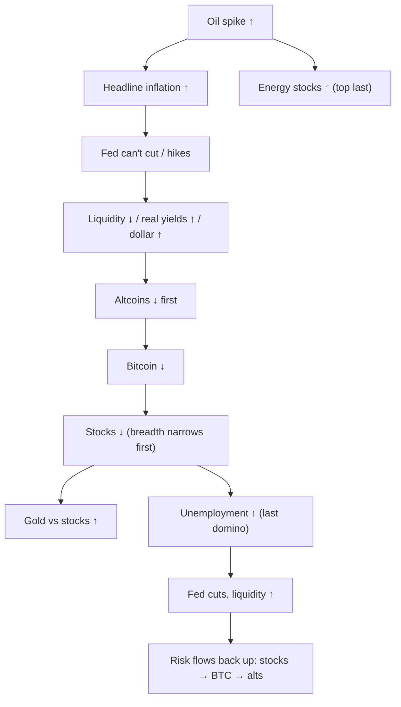

# 08. Stocks, gold and cross-asset

Bitcoin does not trade in a vacuum. On most days its biggest outside influence is the US stock market, and over a cycle the dollar, real yields, gold and oil all leave marks on it. Benjamin Cowen's videos switch constantly between bitcoin and these other markets: the S&P 500 in bear-market comparisons, the S&P divided by gold, gold and silver in his "Dubious Speculation" series, oil in 2026, and correlation coefficients that show how tightly crypto is tied to everything else. This chapter covers the equity indexes and their internals (breadth, volatility, valuation), the metals and oil, the ratios that compare one market with another, and what the data say about bitcoin's correlations. The main lesson is that cross-asset relationships are real but unstable. They tighten in macro-driven bear markets and loosen in calm or flow-driven years, and 2024–26 broke several old templates.

**You will learn**
- How to read the S&P 500, Nasdaq, Russell 2000, equal weight and breadth, and what equities typically do around recessions.
- What the VIX, Shiller CAPE, the Buffett indicator and forward P/E measure, and why they disagree in 2026.
- How S&P ÷ M2, S&P ÷ gold, BTC ÷ gold and the copper/gold ratio work, and where they failed.
- What drives gold and silver, and what happened in their January 2026 peak and crash.
- The oil-and-recession record from 1973 to 2026, and why 2026 is a live counter-example so far.
- What the lab's year-by-year correlations say about bitcoin versus stocks, the dollar and real yields.
- Cowen's "risk cascade" ordering and how it fared in 2025–26.

---

## How risk moves across markets

This is the ordering Cowen describes as the "risk cascade" (memo of [15 Mar 2026](https://benjamincowen.com/reports/how-risk-cascades-through-markets-march-2026)), drawn with the oil-shock branch that dominated 2026. Read it as a tendency, not a law: the section on the cascade below shows which steps happened in 2025–26 and which did not.

**Cross-asset readings, late October 2026**

| Market | Latest | Date | Context |
|---|---|---|---|
| S&P 500 | 7,743.98 | 28 Oct 2026 | Record 7,818.93 on 6 Oct; 2026 low 6,343.72 on 30 Mar (−9.1%); YTD +13.1% |
| Nasdaq 100 | 29,402.51 | 29 Oct 2026 | Record 31,224.69 on 6 Oct (−5.8%) |
| Russell 2000 | record about 3,068 | mid-Aug 2026 | +22.7% YTD on 12 Aug |
| RSP/SPY (equal ÷ cap weight) | record low 0.2710 | 7 Oct 2026 | Top 10 names about 39% of the S&P |
| VIX | 16.91 | 28 Oct 2026 | 2026 high close 31.05 (27 Mar) |
| Shiller CAPE | about 40.7–41.2 | Aug–Oct 2026 | Only 1999–2000 was higher |
| Forward P/E (FactSet) | 18.7 | 23 Oct 2026 | Below 5-year (19.8) and 10-year (19.1) averages |
| Gold | about $4,024 | 29–30 Oct 2026 | About −28% from the late-January futures peak |
| Silver / gold-silver ratio | about $51–52 / about 77 | 29–30 Oct 2026 | Silver futures record $121.79 on 29 Jan 2026 |
| WTI / Brent | $103.37 / $123.10 | 27 Oct 2026 | War premium since 28 Feb 2026 |
| Bitcoin | $77,939 | 29 Oct 2026 | −37.5% from the weekly-close high of $124,720 (5 Oct 2025) |

Sources: FRED via the course research and the [lab report](../../tools/macro-lab/REPORT-2026-10-30.md) for S&P, Nasdaq 100, VIX, oil and bitcoin; FactSet for forward P/E; Trading Economics and Investing.com (secondary) for metals; other rows as cited in the cards.

---

## Equity indexes

### S&P 500 (SP:SPX, FRED SP500)

**What it is.** The 500 largest US companies, weighted by float-adjusted market cap and maintained by S&P Dow Jones Indices. Real time during market hours. FRED's `SP500` covers only the last ten years of daily data.

**Where to find it.** TradingView `SP:SPX`; ETFs SPY, VOO, IVV; FRED `SP500`. On Cowen's platform: "ROI During S&P 500 Bear Markets", "ROI During S&P 500 Bull Markets", "S&P 500 Risk" and "S&P 500 Time in Risk Bands".

**How to read it.** A fall of 10% from a high is conventionally a correction; 20% is a bear market. The size of a drawdown depends heavily on whether a recession arrives and earnings fall:

| NBER recession | S&P peak | Peak vs recession start | Trough | Decline | Trough vs recession end |
|---|---|---|---|---|---|
| Dec 1969–Nov 1970 | 29 Nov 1968, 108.4 | 12 months before | 26 May 1970, 69.3 | −36% | 6 months before |
| Nov 1973–Mar 1975 | 11 Jan 1973, 120.2 | 10 months before | 3 Oct 1974, 62.3 | −48% | 5 months before |
| Jan–Jul 1980 | 13 Feb 1980, 118.4 | 1 month after | 27 Mar 1980, 98.2 | −17% | 4 months before |
| Jul 1981–Nov 1982 | 28 Nov 1980, 140.5 | 8 months before | 12 Aug 1982, 102.4 | −27% | 3 months before |
| Jul 1990–Mar 1991 | 16 Jul 1990, 369.0 | same month | 11 Oct 1990, 295.5 | −20% | 5 months before |
| Mar–Nov 2001 | 24 Mar 2000, 1,527 | 12 months before | 9 Oct 2002, 776.8 | −49% | 11 months after |
| Dec 2007–Jun 2009 | 9 Oct 2007, 1,565 | 2 months before | 9 Mar 2009, 676.5 | −57% | 3 months before |
| Feb–Apr 2020 | 19 Feb 2020, 3,386 | same month | 23 Mar 2020, 2,237 | −34% | 1 month before |

The table was assembled by the course research from standard S&P history (Motley Fool, First Trust, Kathmere); other studies covering longer histories put the averages at about 7 months of lead and −26% to −32%. In this set the average decline is about −36% and the peak came on average about 5 months before the recession began (range: 1 month after to 12 months before). The low came 1–6 months *before* the recession ended in seven of eight cases; 2001–02 is the exception.

Bear markets **without** a recession run shallower: 1962 (−28%), 1966 (−22%), 1987 (−34%, the crash), 1998 (−19%), 2011 (−19%), 2018 (−19.8%), 2022 (−25.4%), roughly −20% to −25% on average.

Recent path: the S&P fell about 20% into **8 Apr 2025** (tariff shock), recovered to new highs, fell **9.1%** from 6,978.6 (27 Jan 2026) to 6,343.72 (30 Mar 2026, the Iran-war shock low), and then set records, the latest at **7,818.93 on 6 Oct 2026**.

**How Cowen uses it.** The S&P is one of his most frequent subjects (about 240 titles or summaries):
- Bitcoin "tops earlier and bottoms earlier than stocks." Check: true for the 2021 top (bitcoin 10 Nov 2021, S&P January 2022) and the 2025 top (bitcoin 6 Oct 2025, S&P still rising a year later); not for the 2022 low (S&P 12 Oct, bitcoin 21 Nov after FTX).
- A 20% S&P drop is his line between a correction and a recession bear; in April 2025 he used the 1998 analog (a 20% drop followed by new highs) ("The S&P500 Has Dropped 20%", 8 Apr 2025). That analog worked.
- "Stocks to 10% Drop Soon?" (3 Feb 2026): the S&P fell about 9% into late March, then made new highs. A hit on the correction; the larger drop he expected later had not come by October.
- A serious further bitcoin leg down "would likely need a 10–20% equity selloff", and past midterm-year bitcoin lows came with equity corrections ([CoinMarketCap Academy, Sep 2026](https://coinmarketcap.com/academy/article/benjamin-cowen-puts-65percent-odds-on-lower-bitcoin-price-still-ahead), secondary). He uses the S&P's midterm-year lows (often October, sometimes May or December) to time bitcoin's four-year-cycle low (chapter [09](09-SEASONALITY-AND-POLITICAL-CYCLES.md)).
- He uses the S&P's 1962–1982 history to argue that a quiet, "apathetic" top does not prevent a bear market.
- Soft and hard landings defined by S&P drawdowns are covered in chapter [06](06-GROWTH-AND-THE-BUSINESS-CYCLE.md).

**Connections.**
- *Leads:* recessions, by about 5 months at the peak on average (above); the S&P is part of the Conference Board's leading index.
- *Led by:* earnings expectations, real yields, liquidity (loosely, see chapter [07](07-LIQUIDITY-MONEY-AND-THE-DOLLAR.md)), and credit spreads.
- *Sign with bitcoin:* positive since 2020, strongest in macro-driven bears (see the correlation card).
- *Exceptions:* 2023–26, when net liquidity went sideways or down and the S&P rose on AI earnings (S&P 2026 EPS growth about 30%).

**What it has meant for assets.** Equity bears with a recession: −17% to −57%, about −36% on average. Without: −20% to −25%. Bitcoin's −84% (2018) and −77% (2022) bears happened *without* US recessions; crypto cycles are not primarily recession-driven. In recoveries, small caps, cyclicals and high-beta assets lead (bitcoin about +306% in 2020).

**Investor takeaway.** Ask whether earnings are falling: that, more than the size of the first drop, has decided how deep equity bear markets went. And do not assume bitcoin needs stocks to fall to have its own bear market; 2018, 2022 and 2025–26 show otherwise.

### Nasdaq 100, Russell 2000, and pattern analogs

**What they are.** The **Nasdaq 100** is the 100 largest non-financial Nasdaq-listed stocks, modified cap-weight and tech-heavy (FRED `NASDAQ100`; TradingView `NASDAQ:NDX`; ETF QQQ). The course lab uses the broader **Nasdaq Composite** (FRED `NASDAQCOM`) because it is the longest free daily index on FRED. The **Russell 2000** covers small caps ranked 1001–3000 in the Russell 3000 (TradingView `TVC:RUT`; ETF IWM). It is the most rate- and credit-sensitive US index because of its floating-rate debt and unprofitable firms.

**How to read them.** Nasdaq is higher beta than the S&P; the lab uses it as the equity proxy for bitcoin correlations. The Russell is a breadth and credit thermometer. In 2026 small caps did something unusual: they **led** in a year of rate *hikes*, with a record close of about 3,068 in mid-August (+22.7% YTD on 12 Aug versus +13.2% for the S&P), likely because they track the manufacturing upswing (ISM above 50 for nine months), energy and industrials, and domestic revenue in a tariff world. By September Cowen's memo noted the S&P 600 small-cap index was about 9% below its mid-August high.

**How Cowen uses them.** Mostly as **analogs**: the spot-ETF launch compared with QQQ's history after its 1999 launch ("Bitcoin Market Cycles", 21 Nov 2024); ETH's drawdown path compared with Tesla's (December 2025, Bankless); and breakout-then-pullback patterns from palladium, the Hang Seng and earlier bitcoin dominance, applied to stablecoin dominance in 2026 ("Bitcoin: An Unfortunate Pattern", 7 Jan 2026; chapter [12](12-DOMINANCE-ALTCOINS-AND-ROTATION.md)). He also covered "Dow 50,000" in February 2026. These are pattern comparisons, not mechanisms; one analog chosen after the fact proves little.

**Investor takeaway.** Use Nasdaq for beta and the Russell for breadth and credit sensitivity. Treat chart analogs as hypotheses about shape, never as evidence.

### Equal weight and breadth (RSP/SPY, S5TH)

**What it is.** The S&P 500 Equal Weight Index gives each member 0.2%, rebalanced quarterly (TradingView `SP:SPXEW`; ETF RSP). The **RSP/SPY ratio** shows whether the "average stock" is beating the megacaps. Breadth tools: the percentage of S&P members above their 200-day moving average (TradingView `INDEX:S5TH`), the NYSE advance–decline line, new highs minus new lows, and the Russell 2000 relative to the S&P. Cowen's platform has "Advance Decline Ratios", "Advance Decline Index (ADI)" and "Absolute Breadth Index (ABI)", and crypto versions (coins above or below moving averages).

**How to read it.** Narrow leadership (RSP/SPY falling while the index rises) is often called unhealthy and historically preceded corrections such as 1999–2000 and 2021. But concentration can last for years, as 2023–2026 showed. Broad participation, with the advance–decline line making new highs, has historically argued against a major top within months.

Latest: equal weight led for most of 2026, then the lead flipped in mid-September. **RSP/SPY hit a record low of 0.2710 on 7 Oct 2026**, about 31% below its 2015 peak. On a total-return basis the two were roughly tied YTD through 21 Oct (RSP +14.4%, SPY +14.3%). The top 10 names were about **39%** of the S&P on 30 Sep 2026.

**How Cowen uses it.** Narrowing breadth means late cycle. In September 2026 he noted the S&P was +12.5% year to date with only about **48%** of members above their 200-day average, a combination "last seen around 1998 to 2000", and he lists "breadth broadens materially" among the signals that would invalidate his bear case ([Triple Squeeze, 30 Sep 2026](https://benjamincowen.com/reports/the-triple-squeeze-september-2026)). He applies the same idea to crypto ("Measuring The Breadth of Crypto Rallies", 14 May 2025): a rally led by bitcoin alone, with altcoins lagging, is a narrow rally. Two additions from his 2026 memos:
- **Nasdaq-100 equal weight ÷ cap weight (NDXE/NDX).** He calls it the equity-side analog of bitcoin dominance: a falling ratio means gains are concentrated in the mega-caps. It fell from about 0.50 in 2020 to about **0.35** in August 2026 (about 0.34 three months earlier), and "equal-weight to cap-weight ratio turning up" is part of his refutation cluster for a correction call ([Balance of Risks, 15 Aug 2026](https://benjamincowen.com/reports/the-balance-of-risks-august-2026)). TradingView: `NASDAQ:NDXE/NASDAQ:NDX`.
- **The quality ladder.** In tightening, capital moves *up the quality ladder within each asset class*: altcoins → bitcoin, small caps → large caps, speculative growth → cash-flow franchises. A rally in tight liquidity with narrowing leadership is a **flight-to-quality bull market** (his examples: 2006–07 and 2023–25). Index records then mark "the top of the ladder", in his words, "not the edge of a cliff" ([Macro Risk Memo, 15 Feb 2026](https://benjamincowen.com/reports/macro-risk-memo-feb-2026); August 2026 memo). This is how he reconciles a restrictive-liquidity view with S&P records.

**Connections.** Breadth narrows before index tops in classic late cycles (1999–2000, 2007, 2021), with leads of months. It broadens first out of bear-market lows, led by small caps.

**What it has meant for assets.** Record concentration makes the S&P effectively an AI and megacap earnings bet; index-level valuation is dominated by about ten companies. For crypto, narrow equity breadth has gone along with a late-cycle, risk-averse tone in which bitcoin dominance rises.

**Investor takeaway.** Check whether the index's new highs are shared by most stocks. Narrow highs are a yellow flag with poor timing.

### Small caps as a lead: S&P 600 versus S&P 500

**What it is.** The relative path of the S&P 600 small-cap index (TradingView `SP:SP600`; ETF IJR) against the S&P 500. Small caps carry more floating-rate debt and less pricing power, so they feel tightening first.

**How Cowen uses it.** As a lead at tops ([Triple Squeeze, 30 Sep 2026](https://benjamincowen.com/reports/the-triple-squeeze-september-2026), Figures 9–10). In **2018** small caps topped in late August and the S&P broke about **4–5 weeks later**; both bottomed on 24 Dec 2018. In **2026** the S&P 600 was about −9% from its mid-August high while the S&P stayed near records, which he called a "warning" and said the market was "six weeks past" the small-cap top. His stated test: the S&P following the S&P 600 lower would strengthen the 2018 analog; a small-cap recovery would defuse it. By late October the Russell 2000 had rebounded somewhat and the S&P was near its records (reported, secondary), which leans toward "defused", though the call was still open.

**Connections.** Small caps ↓ first → breadth narrows → the index tops weeks later (2018). The reverse at bottoms: small caps lead recoveries.

**Investor takeaway.** One clean precedent (2018) makes this a hypothesis. Watch it together with breadth and credit spreads rather than alone.

### International versus US equities

**What it is.** The relative performance of non-US equity indexes against US indexes (for example TradingView `AMEX:VEU/AMEX:VTI` or `AMEX:EFA/AMEX:SPY`).

**How Cowen uses it.** In February 2026 he argued that high US economic-policy uncertainty plus a softer dollar favors international over US equities, and that a 2018-style dollar rally would reverse that ([Macro Risk Memo, 15 Feb 2026](https://benjamincowen.com/reports/macro-risk-memo-feb-2026)). The course research could not verify how the relative trade performed through October 2026.

**Connections.** Dollar ↓ → foreign returns ↑ in dollar terms and easier global funding → international ↑ relative to US. The dollar's higher lows from February 2026 (chapter [07](07-LIQUIDITY-MONEY-AND-THE-DOLLAR.md)) worked against the trade.

**Investor takeaway.** The international-versus-US question is largely a dollar question; read it alongside the DXY.

### VIX (VIXCLS, TVC:VIX)

**What it is.** The Cboe Volatility Index: the 30-day implied volatility of S&P 500 options, in annualized percent. Computed in real time. VIX ÷ 16 is roughly the market's expected daily S&P move in percent (16 ≈ √256 trading days).

**Where to find it.** FRED `VIXCLS`; TradingView `TVC:VIX`. It is **not** a named chart on Cowen's platform.

**How to read it.** Below about 13–15 signals complacency; above about 30 signals stress. Records: closing **82.69 on 16 Mar 2020** and 80.86 on 20 Nov 2008; intraday 89.53 on 24 Oct 2008. Recent spikes: **5 Aug 2024** intraday about 65.7, close 38.57 (yen carry unwind, chapter [07](07-LIQUIDITY-MONEY-AND-THE-DOLLAR.md)); **8 Apr 2025** close 52.33 (tariffs); 2026 highest close **31.05 on 27 Mar** (Iran war). Latest **16.91 (28 Oct 2026)**. When the VIX is above its 3-month counterpart (VIX3M), the term structure is inverted, a sign of acute stress.

**How Cowen uses it.** Rarely, and not as a platform chart; where volatility appears in his videos he uses outside sources.

**Connections.** VIX spikes are mean-reverting and coincide with equity lows more than they predict them. Buying the S&P after VIX closes above 30 has historically produced positive 6–12-month returns in most cases, 2008 aside (practitioner statistic, secondary). Bitcoin has fallen in VIX spikes: March 2020, August 2024, April 2025.

**What it has meant for assets.** High VIX: equities and crypto down, Treasuries and the yen up, the dollar mixed. Low VIX alongside Brent above $120 and a hiking Fed, as in October 2026, looks like complacency relative to macro risk; implied volatility tends to stay low until something breaks.

**Investor takeaway.** The VIX tells you how scared option buyers are now, not what comes next. Extreme readings have marked stress peaks better than they have predicted them.

---

## Valuation

### Shiller CAPE and the excess CAPE yield

**What it is.** The cyclically adjusted P/E: the real S&P price divided by the 10-year average of real earnings. Robert Shiller's data run back to 1871 (econ.yale.edu/~shiller/data.htm; multpl.com publishes a daily estimate). The **excess CAPE yield** is roughly the CAPE earnings yield (1 ÷ CAPE) minus a real 10-year bond yield: how much more stocks "yield" than inflation-protected bonds.

**Where to find it.** multpl.com, GuruFocus, Shiller's spreadsheet. On Cowen's platform: "Shiller PE/CAPE Ratio", "Total Return CAPE Ratio", "Excess CAPE Yield".

**How to read it.** Long-run mean about 17. The 1929 peak was about 32, the **December 1999 record 44.2**, the November 2021 peak about 38. October 2026: **about 40.7** (multpl daily about 41.6 on 8 Oct; sources differ by about a point). High CAPE predicts *low 10-year real returns* (R² roughly 0.4–0.5 historically) and is nearly useless for one-year timing: CAPE above 30 persisted for most of 2017–2026. Critics point to accounting changes that depressed past earnings, structurally higher margins and tech share, and lower real rates. The counterpoint in 2026 is that real rates are not low: the 10-year TIPS yield was 2.67% on 28 Oct 2026 (lab).

**How Cowen uses it.** Rarely, and as a "cushion" rather than a trigger. His August 2026 memo put CAPE at **41.2**, "second-highest in a century after 2000", alongside a **trailing P/E of about 28** and an **earnings yield of 3.56%** (the inverse of the P/E), and argued that a CAPE of 41 "reached on positive earnings growth is a less fragile animal" than one reached on falling earnings ([Balance of Risks, 15 Aug 2026](https://benjamincowen.com/reports/the-balance-of-risks-august-2026)). One caveat on definitions: his platform's **excess CAPE yield** was about **0.97%**, while Shiller's published version was about **1.4%** at the time. The ITC version subtracts an ex-post real yield; Shiller's uses his own real-yield construction. Same name, different number: always check which version a chart uses. Cowen's platform also carries "Trailing PE Ratio", "Earnings Yield" and "Dividend Yield" charts.

**Connections.** CAPE falls in recessions as prices drop faster than 10-year earnings ("recessions bring extended valuations back to baseline", his 2026 business-cycle framing, chapter [06](06-GROWTH-AND-THE-BUSINESS-CYCLE.md)). It rises with falling real yields.

**What it has meant for assets.** Starting CAPE above 40 (2000) was followed by a lost decade for US stocks. It says little about the next 12 months for stocks and nothing direct about bitcoin.

**Investor takeaway.** CAPE is a long-horizon return estimate, not a sell signal. A low excess CAPE yield means stocks offer little extra compensation over real bonds.

### Buffett indicator (market cap ÷ GDP)

**What it is.** Total US equity market cap (Wilshire 5000, or the Fed's Z.1 nonfinancial corporate equities) divided by GDP or GNP. Warren Buffett (Fortune, 2001) called it "probably the best single measure" of valuation and said that approaching 200% is "playing with fire".

**Where to find it.** GuruFocus and other trackers; build it on FRED from Z.1 equity series and `GDP`.

**How to read it.** **Readings differ widely by construction.** In October 2026 GuruFocus showed **about 234–236%**, while other trackers showed **about 288–301%**. All are record territory, above 2000 (about 140–150%) and 2021 (about 200%). Caveat: a rising share of foreign revenue and higher margins make market cap to *domestic* GDP drift upward structurally, so the "normal" level has probably risen.

**How Cowen uses it.** Not a recurring chart for him; included here because it appears in most valuation debates.

**Investor takeaway.** Quote the source and construction with any Buffett-indicator number; the same month can read 235% or 300%.

### Forward P/E

**What it is.** Price divided by consensus next-12-month operating earnings per share (FactSet, LSEG).

**How to read it.** **18.7 on 23 Oct 2026** (FactSet), *below* the 5-year (19.8) and 10-year (19.1) averages, because 2026 earnings were growing about 30% (Q3 2026 blended growth +29.5% year on year). LSEG reported about 19.1.

**The disagreement.** CAPE about 41 says "very expensive on normalized earnings". Forward P/E of 18.7 says "fair if forecasts hold". The two reconcile only if the 2026 earnings surge (AI capex, energy, record margins) lasts. Earnings forecasts are pro-cyclical, so forward P/E typically looks cheapest just *before* earnings roll over, as in 2000 and 2007.

**Investor takeaway.** When CAPE and forward P/E disagree, the question is the durability of current earnings, which no ratio can answer.

---

## Ratios: stocks against money and gold

### S&P 500 ÷ M2

The construction and Cowen's dated uses (2022 "range-bound for about 30 years"; December 2025 "resembles 1996–2000, about one more year of upside"; March 2026 preference for stock-to-gold instead) are in chapter [07](07-LIQUIDITY-MONEY-AND-THE-DOLLAR.md). For equities the point is simple: when the S&P ÷ M2 ratio is high, prices have outrun the money supply, but a high reading stopped nothing in 1996–2000. It is a framing device for "how much of this rally is monetary?", not a timer.

### S&P 500 ÷ gold

**What it is.** The S&P 500 index level divided by the gold price in dollars per ounce: how many ounces of gold "one S&P" buys. It removes the dollar from the comparison, so it shows real-asset versus financial-asset leadership.

**Where to find it.** TradingView `SP:SPX/TVC:GOLD`.

**How to read it.** A rising ratio means stocks are beating gold (disinflationary growth, falling real yields with strong earnings, 1980–2000, 2009–2021). A falling ratio means gold is winning (stagflation, crises, 1970s, 2000–2011). In 2026 it went from about **1.32 on 15 Mar** (6,632 ÷ 5,018) to about **1.91 on 23 Oct** (7,624 ÷ about 3,990), per the course research's arithmetic on the levels in Cowen's memos and market reports.

**How Cowen uses it.** It became one of his main 2026 charts:
- January 2026 ("A Deeply Concerning Chart for Stocks", 20 Jan; "Gold and the Rotation Trap", 21 Jan; "Gold Breaks out against Stocks!", 22 Jan 2026): a break below about **1.4** preceded major downturns in **1973 and 2008**; gold was up **46%** against stocks since 2021; the chart looks "more like the 1970s than 2000". The "rotation trap" is selling the winner (gold) to buy laggards (stocks or crypto) on a rotation story.
- By 30 Mar 2026 he said he preferred stock-to-gold over S&P ÷ M2.
- In his risk-cascade framework, "traditional risk assets deteriorate relative to gold" is stage 3. In February 2026 he wrote that stocks bleeding to gold reflects "the same hierarchy of risk compression" as altcoins bleeding to bitcoin ([Macro Risk Memo, 15 Feb 2026](https://benjamincowen.com/reports/macro-risk-memo-feb-2026)).

**How it played out.** The January 2026 call came at gold's peak. Gold then fell sharply (his 23 Mar 2026 video was titled "Gold Drops Nearly 30%", though his own 15 Mar memo still put gold near $5,018, about 10% below the peak, so the size of the late-March drop is not independently verified), the S&P set records, and the ratio rose from about 1.3–1.4 to about 1.9 by late October. His own August 2026 scorecard listed the equities-versus-gold transmission as "open". The course track record scores it a near-term miss. The 1973 and 2008 precedents remain two observations.

**Connections.** The ratio falls when real yields fall and inflation fears rise (gold up), or when earnings collapse (stocks down). It rises when real yields rise and earnings grow, as in 2026 after January.

**What it has meant for assets.** Long declines in the ratio (1970s, 2000s) were poor decades for stocks in real terms. Short breaks have been noisy.

**Investor takeaway.** S&P ÷ gold is a useful regime chart for the "inflation versus earnings" question. A single break of a round number is weak evidence.

### Bitcoin ÷ gold

**What it is.** Bitcoin's price in ounces of gold (TradingView `BITSTAMP:BTCUSD/TVC:GOLD`). It removes the dollar from bitcoin and asks whether "digital gold" is beating gold.

**How to read it.** In late-cycle, tight-liquidity phases, hard assets have tended to beat speculative ones, so the ratio falls; in liquidity-driven bull markets it rises.

**How Cowen uses it.** As a relative call: "Bitcoin to Drop Another 30% against Gold?" (3 Apr 2026), where he said bitcoin could fall another 30–40% *against gold*, framed as a relative view, not a dollar target. He also said his improved social-risk metric tracks BTC ÷ gold ("Bitcoin: An Improved Social Risk Metric", 31 Mar 2026; chapter [11](11-ON-CHAIN-AND-SENTIMENT.md)).

**Investor takeaway.** Pricing bitcoin in gold separates "bitcoin versus hard money" from "bitcoin versus the dollar". The two can disagree for months.

---

## Metals and commodities

### Gold (TVC:GOLD, XAUUSD)

**What it is.** The spot price of one troy ounce of gold in dollars. The LBMA auction price is the benchmark; FRED removed its LBMA series in 2022.

**Where to find it.** TradingView `TVC:GOLD`, `OANDA:XAUUSD`; COMEX futures `GC1!`. Cowen's platform lists gold among its TradFi assets, with risk and Google Trends views.

**How to read it.** Four drivers, in rough order of how they have worked historically:
1. **Real yields** (inverse; strong in 2006–2021). Gold pays nothing, so higher real yields raise the cost of holding it.
2. **The dollar** (inverse).
3. **Central-bank buying.** It accelerated after Russia's reserves were frozen in 2022 and broke the real-yield relationship from 2022 onward: gold rose even as real yields rose.
4. **Safe-haven and debasement fear.**

**Recent path.**
- 2025: about $3,300 (April), $3,600 (September), $3,900 (6 Oct), $4,200 (16 Oct 2025).
- Above $4,800 on 21 Jan 2026, then a parabolic peak in late January. Sources differ: COMEX futures reached about **$5,627 on 29 Jan 2026** and fell more than $880 the next day (settling at $4,745); reported spot records range from about $4,970 to $5,600 depending on source; Cowen's coverage used about $5,560.
- A sharp spring decline (Cowen's video "Gold Drops Nearly 30%", 23 Mar 2026; the exact late-March level is not independently verified, and his 15 Mar memo still had gold near $5,018); a late-June low of about **$3,970**; about $4,210–4,370 in August–September; about **$4,024 on 29–30 Oct 2026**, about 28% below the futures peak, *during a war*.

That last point matters. The 2026 decline fits **rising real yields** (10-year TIPS from 1.71% a year earlier to 2.67% on 28 Oct 2026, per the lab; nominal 10-year at 5.0–5.3%; the Fed hiking) plus the unwinding of a crowded parabola. It is not proof that "the safe haven failed".

**How Cowen uses it.** Gold went from an occasional topic to a frequent one in 2025–26 (31 of the 116 videos he published between 1 January and 11 June 2026 mention it, per the course's keyword count; the video index ends on 11 June). His recurring "Gold: Dubious Speculation" scenario series ran through 2026 (e.g., 6 Feb and 27 Oct 2026). Dated lines:
- January 2026: don't rotate out of gold; S&P ÷ gold breakdown risk (above). Near-term miss: the call came at the peak.
- July 2026: gold rose while bitcoin fell, so "a single real-rate or liquidity story does not explain both" ([Bitcoin Cycle Memo, 15 Jul 2026](https://benjamincowen.com/reports/bitcoin-cycle-memo-july-2026)).
- August 2026: near-term weakness with a possible retest of the late-June low near $3,970 ([Balance of Risks](https://benjamincowen.com/reports/the-balance-of-risks-august-2026)). Gold traded around $3,990 intraday on 23 Oct, "below $4,000 for the first time since July" (secondary), so the retest happened; whether it undercut $3,970 was not verified.
- September 2026: "gold bottoms first, then the long end tops", then stress. His table of three episodes (2018, 2022, 2023) has gold's initial low 2–12 weeks before the 10-year yield peak and near the dollar's high; the signal he watches is the dollar failing to make new highs while the 10-year still does. He judged gold "likely closer to a low than a high, even if it undercuts prior lows first" ([Triple Squeeze memo](https://benjamincowen.com/reports/the-triple-squeeze-september-2026)). The yield side of that sequence is in chapter [03](03-BONDS-AND-THE-YIELD-CURVE.md); gold's midterm-year low window is in chapter [09](09-SEASONALITY-AND-POLITICAL-CYCLES.md).
- He says he holds metals and uranium (Bankless, 23 Dec 2025).

**Connections.** Gold ← real yields (−), dollar (−), central-bank demand (+), crises (+, usually after an initial dip as in March 2020 and 2008, when everything was sold for dollars). Gold vs bitcoin: the 30-day correlation hit **−0.88 in March 2026** (CryptoQuant), then the 90-day correlation rose to **about 0.5–0.86 by early September 2026**, roughly a six-year high, as both fell together ([The Block, 3 Sep 2026](https://www.theblock.co/news/markets/2026-09-03-bitcoin-gold-correlation-hits-six-year-high-but-analysts-question-whether-equity-decoupling-will-last-413437)). Over long windows it is close to zero and unstable.

**What it has meant for assets.** Gold has been the last risk-off holdout in many late cycles, and it rallied hard in 2025 while bitcoin topped. In 2026 it fell sharply when real yields rose. "Digital gold" is a narrative, not a stable statistical property: in Cowen's words, "Bitcoin has never traded like gold" (Bankless, 23 Dec 2025).

**Investor takeaway.** Read gold against real yields and central-bank demand first. A parabolic move in a "safe" asset can unwind as violently as a speculative one.

### Silver, the gold/silver ratio and other metals

**What it is.** Silver is part monetary metal, part industrial input (solar panels, electronics). The **gold/silver ratio** is ounces of silver per ounce of gold (TradingView `TVC:GOLD/TVC:SILVER`).

**How to read it.** The historical range is about 30–125 (125 in March 2020). High readings mean fear and deflation; low readings mean reflation and speculative excess. Silver tends to outperform gold late in metal bull runs and underperform in busts.

Path: silver made all-time highs from October to December 2025; futures reached a record **$121.79 on 29 Jan 2026** and settled at **$78.53 a day later**; "Silver Drops 38%" (Cowen video, 31 Jan 2026). Now about **$51–52**, gold/silver ratio about **77** (29–30 Oct 2026).

**How Cowen uses it.** Gold/silver ratio analogs (1973, 1987, 1998, 2006, 2011): in February 2026 he argued silver had likely topped while gold could still make new highs, and wrote that silver often peaks before gold late in the cycle (1973–74, 2011) ([Macro Risk Memo, 15 Feb 2026](https://benjamincowen.com/reports/macro-risk-memo-feb-2026)). Silver did top; gold did not make new highs by October. He also covers palladium, platinum, copper and uranium in the same series, and uses palladium's breakout-and-pullback pattern as an analog for crypto charts.

**Investor takeaway.** Silver is gold with leverage and an industrial cycle attached. The gold/silver ratio is a sentiment gauge for the metals complex, with wide historical swings.

### Copper/gold ratio vs the 10-year yield

**What it is.** Copper ($ per pound) divided by gold ($ per ounce). Copper is cyclical demand; gold is a haven. A rising ratio signals reflation and growth. Jeffrey Gundlach popularized it as a guide to "fair value" for the 10-year Treasury yield. TradingView `COMEX:HG1!/COMEX:GC1!` against `TVC:US10Y`.

**How to read it.** From about 2000 to 2021 the ratio and the 10-year moved together tightly (60-day correlation averaged about 0.85). **It broke from 2022 to 2026.** Central-bank gold buying depressed the ratio while yields rose on inflation, deficits and term premium; the 60-day correlation was about 0.08 in early-to-mid 2026, and the 10-year traded above its ratio-implied level. Gundlach has reportedly called the model a failure and now prefers oil and the dollar. Copper itself hit records, about $6.4 per pound in mid-2026, +36% year on year.

**How Cowen uses it.** It is not one of his charts; it is included because it is common in macro videos.

**Investor takeaway.** A broken intermarket relationship is itself information. The 10-year at 5.05% (28 Oct 2026, lab) reflects inflation, Treasury supply and term premium more than growth; chapter [03](03-BONDS-AND-THE-YIELD-CURVE.md) covers those.

### Oil: WTI and Brent (DCOILWTICO, DCOILBRENTEU)

**What it is.** West Texas Intermediate (US benchmark) and Brent (international benchmark) crude, dollars per barrel. FRED daily `DCOILWTICO` and `DCOILBRENTEU`; monthly WTI from 1946 as `WTISPLC`. TradingView `TVC:USOIL`, `TVC:UKOIL`. Cowen's platform: "Crude Oil (WTI)". Oil as an *inflation* input is in chapter [04](04-INFLATION.md); this card covers oil and the business cycle.

**How to read it.** Watch the **speed** of a move and its cause. A supply shock (embargo, war) that doubles prices within a year has a different effect from a slow demand-driven rise.

**The record.** James Hamilton found that 10 of 11 post-war US recessions up to 2008 were preceded by a sharp oil-price rise, while noting oil was a contributing factor, not the sole cause ([NBER Reporter, 2011](https://www.nber.org/reporter/2011number2/oil-price-shocks)). The course research checked it with FRED monthly WTI (maximum price from 18 months before to 3 months after the recession start, versus the minimum of the prior 24 months):

| Recession start | Oil rise into it | Verdict |
|---|---|---|
| Dec 1969 | +12% | No spike |
| Nov 1973 | +184% (OPEC embargo) | Yes |
| Jan 1980 | +166% (Iranian revolution) | Yes |
| Jul 1981 | same 1979–80 spike | Partial |
| Jul 1990 | +160% (Iraq invades Kuwait, Aug 1990) | Yes, concurrent |
| Mar 2001 | +205% (1999–2000 rebound) | Yes, long lag |
| Dec 2007 | +93% to Mar 2008, then $133 (Jul 2008 monthly) | Yes |
| Feb 2020 | +57% (2017–18) | No (pandemic) |

Five of the last eight recession starts followed or coincided with oil roughly doubling within two years. **Spikes without recessions** (12-month change of +50% or more): 1987, 1999 (about 19 months before 2001), 2002–05, 2009–10 (rebound), 2017–18, **2021–22** (+113% year on year; WTI $123 in June 2022) and **2026** (+58% year on year in April).

**2026 so far.** Brent was about $72 before the US–Israeli strikes on Iran on 28 Feb 2026. WTI went from **$67 to $91 in one week** in early March. Brent's monthly average went $71 (Feb) → $103 (Mar) → $117 (Apr); reports of the spring peak range from about $118 to $138 depending on source and contract. After a 17 Jun Hormuz memorandum Brent fell to **$69.63 (24 Jun)**, then rose above $100 again on 23 Jul after strikes resumed on 7 Jul. Brent averaged $114 in September and about $125 in October; **FRED Brent was $123.10 and WTI $103.37 on 27 Oct 2026**. And yet: real GDP grew **3.4% annualized in Q3 2026**, ISM manufacturing was 54.5 in September, and there was no recession as of October.

**Why 2026 has not (yet) followed the template.** The US is now a net petroleum exporter, so higher oil moves income from consumers to producers *within* the US (energy capex, Texas) rather than abroad. That softens the GDP hit while still hurting real incomes and sentiment: Michigan sentiment hit a record low of 44.8 in May 2026 alongside strong GDP. The bigger recession channel is the **policy response**: Fed hikes and 5% yields, as in 1973–74, 1979–81 and 2008.

**How Cowen uses it.** Oil went from rare to central in 2026 ("The Mechanism That Ends Business Cycles", 28 Feb 2026; "Oil Spikes 35%", 8 Mar 2026; "FOMC: The End of an Era", 29 Apr 2026; "Oil Prices Keep Rising, Is a Market Correction Coming", 19 Oct 2026):
- Oil spikes historically precede recessions; the *speed* of the move matters more than its level (he called the March 2026 week the largest weekly rally since 1983).
- Energy stocks top last in a cycle; energy is the last step of his risk cascade.
- Oil rolled over before the 10-year yield in 2018 (by about 5 weeks) and 2022 (by about 4 months).
- April 2026: supply-driven inflation plus a softening labor market leaves the Fed in "checkmate", unable to cut or hike aggressively ("Inflation Soars to 3.3%", 10 Apr 2026). The Fed then hiked on 16 Sep 2026 (chapter [02](02-THE-FED-AND-INTEREST-RATES.md)).
- His 26 Oct 2026 bearish roadmap included oil around $120 as one step ([Yahoo Finance / BeInCrypto](https://finance.yahoo.com/markets/crypto/articles/bitcoin-falls-below-80-000-032051576.html), secondary).

**Connections.** Oil ↑ → headline inflation ↑ within 1–2 months → breakevens ↑ → central banks hike or delay cuts → real yields ↑ → growth slows with a lag of quarters. Oil has tended to roll over before long yields at turning points.

**What it has meant for assets.** Energy stocks up; broad equities mixed (held up in 2026 by earnings); crypto weak during the shock (bitcoin fell from about $68k on 1 Mar to lower lows by June 2026, while other forces were also at work); gold up early, down when real yields spike; the dollar mixed.

**Investor takeaway.** Oil spikes are a common ingredient of recessions, not a sufficient cause. Ask whether the shock is supply-driven and how the central bank responds; 2021–22 and, so far, 2026 are spikes that did not produce a recession.

### Energy stocks (XLE) and "energy tops last"

**What it is.** The Energy Select Sector SPDR fund (ticker XLE), the standard proxy for US energy equities (TradingView `AMEX:XLE`).

**How Cowen uses it.** He has long said energy stocks top last in a cycle. His August 2026 memo dated it ([Balance of Risks, 15 Aug 2026](https://benjamincowen.com/reports/the-balance-of-risks-august-2026), Table 1):

| S&P 500 cycle peak | Energy (XLE) peak | Energy lag |
|---|---|---|
| March 2000 | May 2001 | about 14 months |
| October 2007 | May 2008 | about 7 months |

His inference: with energy at new highs *alongside* the S&P in mid-2026, the cycle "still has room to run", since energy has historically peaked after the index. He calls two out of two "a tendency", not a rule. In February 2026 he also noted that energy has historically outperformed high-beta assets in midterm years. Outcome so far: the energy sector set a record on 23 Oct 2026 (secondary report), so the "energy last" ordering held through October.

**Connections.** Late-cycle inflation and supply shocks lift energy earnings while higher rates hurt long-duration growth stocks; energy then falls when demand breaks (2001, 2008).

**Investor takeaway.** Energy leadership late in a cycle is common; two dated precedents give a rough lag of 7–14 months after the index top, which is a description, not a timer.

---

## Bitcoin across assets

### Bitcoin's correlations with stocks, the dollar and real yields

**What it is.** A correlation coefficient measures how closely two return series move together, from −1 to +1. A *rolling* correlation recomputes it over a moving window (30, 90, 365 days). Chapter [01](01-HOW-TO-READ-MACRO-CHARTS.md) explains the method; Cowen's platform has a "Correlation Coefficients" chart (rolling 365-day).

**The lab's year-by-year table.** The [macro lab](../../tools/macro-lab/REPORT-2026-10-30.md) correlated bitcoin's *weekly* log return with the Nasdaq Composite's weekly log return, the broad dollar's weekly log return, and the weekly change in the 10-year real yield (TIPS, `DFII10`):

| Period | BTC vs Nasdaq | BTC vs broad dollar | BTC vs 10y real yield change |
|---|---|---|---|
| All weeks (2015–2026) | 0.21 | −0.08 | −0.06 |
| Last 52 weeks | 0.32 | −0.13 | −0.03 |
| 2016 | 0.05 | −0.00 | 0.06 |
| 2017 | −0.03 | 0.19 | −0.09 |
| 2018 | 0.14 | −0.14 | −0.08 |
| 2019 | −0.09 | −0.01 | 0.11 |
| 2020 | 0.30 | −0.28 | −0.36 |
| 2021 | 0.34 | −0.20 | 0.01 |
| 2022 | 0.44 | −0.23 | −0.07 |
| 2023 | 0.18 | −0.07 | −0.11 |
| 2024 | 0.20 | −0.08 | −0.11 |
| 2025 | 0.41 | −0.09 | 0.09 |
| 2026 | 0.30 | −0.11 | −0.06 |

**A second view, daily data (course research).** Daily log returns on common trading days, Coinbase bitcoin versus the S&P 500 and Nasdaq 100, plus a Wednesday-to-Wednesday weekly figure:

| Year | BTC–S&P daily | BTC–Nasdaq 100 daily | BTC–S&P weekly | BTC return | S&P return |
|---|---|---|---|---|---|
| 2017 | 0.06 | 0.05 | 0.20 | +1,324% | +19.4% |
| 2018 | 0.07 | 0.07 | 0.21 | −73% | −6.2% |
| 2019 | −0.11 | −0.09 | −0.09 | +94% | +28.9% |
| 2020 | 0.43 | 0.43 | 0.59 | +306% | +16.3% |
| 2021 | 0.26 | 0.25 | 0.30 | +59% | +26.9% |
| 2022 | 0.56 | 0.58 | 0.71 | −64% | −19.4% |
| 2023 | 0.16 | 0.19 | −0.16 | +156% | +24.2% |
| 2024 | 0.28 | 0.24 | 0.39 | +123% | +23.3% |
| 2025 | −0.02 | 0.00 | 0.44 | −7% | +16.4% |
| 2026 YTD | 0.44 | 0.42 | 0.32 | −11% | +13.1% |

**How to read the two tables together.**
- **The link became material only around 2020**, with institutional participation and a macro-driven regime. Before that it was near zero.
- **It peaks in macro-driven bear markets and rate shocks:** 2022 (weekly 0.44 with Nasdaq in the lab, 0.71 with the S&P in the research's weekly figure) and 2026.
- **Measurement choices matter.** For 2025 the daily S&P correlation was −0.02 while weekly figures were 0.41–0.44. Bitcoin trades 24/7 and the Coinbase daily stamp is not synchronous with the 4 pm New York close, which biases daily correlations toward zero. Different weekly cut-offs (the lab versus a Wednesday-to-Wednesday week) also give different numbers, as 2023 shows (0.18 versus −0.16). With 52 weekly observations, a correlation within about ±0.27 of zero (two standard errors, 2 ÷ √52) is hard to tell from noise. Treat single-year numbers as rough.
- **Correlation says nothing about relative performance.** In 2025–26 bitcoin was positively correlated with stocks yet underperformed the S&P by roughly 23–24 percentage points in each year (2025: −7% versus +16.4%; 2026 to date: −11% versus +13.1%).
- **The link is asymmetric.** Bitcoin's beta to S&P *down* days versus *up* days was **1.90 versus 1.12 in 2022** and **1.68 versus 1.20 in 2026** (2024: 1.30 versus 1.27, symmetric). In 2026 bitcoin averaged −1.04% on S&P down days and +0.88% on up days while the S&P itself was up 13%. In plain terms, bitcoin took the downside of equities without the upside.
- **The 90-day rolling BTC–S&P correlation** ranged from a high of **0.62 (13 Jul 2022)** to a low of **−0.33 (18 Aug 2025)** and was **0.38 on 28 Oct 2026**.
- **Dollar and real yields:** both negative most years, but small. The dollar card in chapter [07](07-LIQUIDITY-MONEY-AND-THE-DOLLAR.md) has the episodes. The real-yield link was strongest in 2020 (−0.36) and otherwise weak.

**How Cowen uses it.** He regularly overlays bitcoin on the S&P to argue that bitcoin is a high-beta risk asset. In December 2025 he cited rolling 365-day correlations of total crypto market cap with gold of **0.23** and with the S&P of **0.61** ([Bankless, 23 Dec 2025](https://www.bankless.com/podcast/where-is-crypto-going-in-2026-ben-cowen)). In January 2022 he argued high inflation raises cross-asset correlation ("Bitcoin Vs. 10 Year Treasury Yields", 4 Jan 2022), which 2022 then showed. In September 2026 he suggested the spot ETFs may have tightened bitcoin's link to traditional finance (Benzinga, secondary). He attributes bitcoin's 2025–26 lag behind stocks to global liquidity not expanding while AI earnings carried the S&P. Two related charts from his 2026 memos:
- **The correlation heatmap and "segmentation of capital"** (January 2026): a matrix of rolling correlations across crypto, equities and metals. Weak crypto–equity correlation while metals tracked macro assets told him that the liquidity supporting stocks and metals was not the liquidity that fuels crypto; capital was going to gold, silver, copper and platinum instead. He saw the same decoupling in 2019 ([Crypto Macro Risk Memo Q1 2026, 15 Jan 2026](https://benjamincowen.com/reports/crypto-macro-risk-memo-q1-2026)).
- **The BTC/SPX overlay** (February 2026): bitcoin priced in S&P terms, with the S&P drawn on top. In 2019 bitcoin weakened against equities *before* equities showed stress, which he reads as evidence that risk leaves the most speculative assets first ([Macro Risk Memo, 15 Feb 2026](https://benjamincowen.com/reports/macro-risk-memo-feb-2026)). TradingView: `BITSTAMP:BTCUSD/SP:SPX`.

**What it has meant for assets.** In regimes where the correlation is high, bitcoin has behaved like a leveraged Nasdaq on the way down. In low-correlation regimes (2019, 2023, 2025 on daily data) crypto-internal forces (halving, ETFs, leverage cycles) dominated.

**Investor takeaway.** Do not treat "bitcoin is correlated with stocks" as a constant. Check the window and the frequency, and remember the asymmetry: in 2022 and 2026 bitcoin participated more in equity declines than in equity rallies.

### The risk cascade (Cowen's ordering)

**What it is.** Cowen's 2025–26 framework (formally the "ITC Risk Cascade Framework") for how risk leaves and re-enters markets. In tightening, risk flows *down* the curve: altcoins → bitcoin → stocks → gold, with energy holding longest. In easing it flows *up*. The labor market is the last domino. His March 2026 memo phrased it as: "crypto speculation unwinds first → risk spreads to equities (stocks weaken vs gold) → dollar and oil tighten conditions → the labor market is the final stage" ([How Risk Cascades Through Markets, 15 Mar 2026](https://benjamincowen.com/reports/how-risk-cascades-through-markets-march-2026); also "Business Cycles Ends With Recessions", 25 Feb 2026).

**The five stages, as written in the March 2026 memo.**
1. Speculative participation declines.
2. Highly speculative assets weaken.
3. Traditional risk assets deteriorate relative to gold.
4. Financial conditions tighten further through the dollar and energy, "even if central banks begin shifting toward easing".
5. A labor-market feedback loop emerges.

On 15 Mar 2026 he placed the market "between Stage 3 and Stage 4". The full chain, with the labor and recession loops, is drawn in chapter [13](13-HOW-IT-ALL-CONNECTS.md).

**How it fared to late October 2026.**

| Stage | What happened | Fit |
|---|---|---|
| 1. Speculative participation declines | Social interest at "ghost town" levels (Jan 2026); new views on major crypto YouTube channels an order of magnitude below 2021 (Jul 2026) | Yes |
| 2. Speculative assets weaken | Alts fell hardest in the 10 Oct 2025 crash and were back at 2022 lows by Feb 2026; BTC −53% from the Oct 2025 high to the 30 Jun 2026 low | Yes |
| 3. Risk assets weaken versus gold | S&P −9.1% (Jan–Mar 2026), then records; S&P ÷ gold went from about 1.32 (15 Mar) to about 1.91 (23 Oct) as gold fell about 28% | Reversed after March |
| 4. Dollar and energy tighten conditions | Brent above $120; DXY higher lows from about 96.5 to about 101.35; 10-year about 5.3%; Fed hiked 16 Sep | Yes |
| 5. Labor feedback loop | Unemployment 4.2% (Sep 2026), down from 4.5% in Nov 2025 (first printed as 4.6%); recession composite 0.024 (Aug) | Not yet |

His own August 2026 scorecard graded the equities-versus-gold leg "open". The textbook ordering also says energy holds longest; it did (energy-sector record on 23 Oct 2026, secondary), while gold, often listed as the last holdout, did not.

**Connections.** The cascade is a liquidity-and-leverage story: the most speculative, least cash-generative assets lose marginal buyers first. It matches the "flight to quality" behavior of 2018 and 2022 and the rising bitcoin dominance of 2023–25 (chapter [12](12-DOMINANCE-ALTCOINS-AND-ROTATION.md)).

**Investor takeaway.** The ordering has been a good description of the crypto end of the curve. Whether the equity and labor steps follow depends on earnings and the Fed, which in 2026 had not broken.

### Spot bitcoin ETF flows

**What it is.** Daily net creations and redemptions in the US spot bitcoin ETFs, which launched on **11 Jan 2024** (IBIT, FBTC and others). Trackers: Farside Investors, SoSoValue, Bitbo, TFTC. Cowen's platform has "Crypto ETF Flows" and "Crypto Treasuries". The on-chain and holdings side is in chapter [11](11-ON-CHAIN-AND-SENTIMENT.md); this card covers the macro role.

**How to read it.** Cumulative net inflows since launch exceed $55 bn. 2026 flows (TFTC and others, secondary): about −$5.6 bn year to date by end-July, with June about −$4.5 bn around the bitcoin low; August +$3.5 bn; September +$2.6 bn; October mixed, with IBIT taking +$665 m on 19 Oct, its largest day since October 2025. US spot ETF holdings bottomed at about 1.22 m BTC on 13 Jul 2026 and were about 1.29 m BTC by late September; IBIT assets were about $67 bn on 29 Oct.

**How Cowen uses it.** ETF holdings "absorbed supply on the way up but have rolled over" (July 2026 memo, [Bitcoin Cycle Memo](https://benjamincowen.com/reports/bitcoin-cycle-memo-july-2026)); ETF and treasury-company narratives "did not prevent Bitcoin from losing roughly half its value" and are unreliable timing tools ("Bitcoin: The Structure of a Bear Market", 10 Mar 2026).

**Connections.** ETF flows are a *transmission channel* for macro risk appetite into bitcoin (advisers, wealth platforms, hedge-fund basis trades), not an independent driver. They are pro-cyclical: outflows clustered near the June 2026 low, as they did in early 2025. Part of the flow is the cash-and-carry basis trade (long ETF, short CME futures), which depends on funding rates and the futures basis, so it is partly a *rates* trade. In 2024, ETF demand is the main reason bitcoin rose while net liquidity was flat (chapter [07](07-LIQUIDITY-MONEY-AND-THE-DOLLAR.md)).

**Investor takeaway.** Read ETF flows as a thermometer of institutional risk appetite. They have followed price more than led it.

### Political regimes and returns by party

**What it is.** Market returns grouped by which party holds the White House and Congress. Cowen's platform has a "Political Market Regimes" tool and about 30 politics charts (returns, drawdowns and Sharpe ratios by regime, presidential-term paths, an inauguration event study).

**How Cowen uses it.** "Market Returns by Political Party" (13 May 2026, video summary): markets trend up under any party; averages and medians differ by regime, and the samples are small.

**Investor takeaway.** Party-based return differences rest on a handful of administrations and are dominated by what the economy and the Fed were doing at the time. The calendar version of this idea, the presidential cycle, is in chapter [09](09-SEASONALITY-AND-POLITICAL-CYCLES.md).

---

## Putting it together

1. **Liquidity tightens and real yields rise → altcoins fall first → bitcoin follows → stocks hold up if earnings grow → gold falls if real yields rise faster than fear.** October 2025–June 2026: alts back at 2022 lows by February 2026, bitcoin −53% to 30 Jun 2026, S&P only −9.1% (27 Jan–30 Mar) and then records on ~30% earnings growth, gold −28–30% from its January peak as 10-year TIPS yields rose toward 2.7%. *Exception to the textbook cascade:* stocks and gold did not take their expected turns.
2. **Oil doubles on a supply shock → headline inflation ↑ → the central bank hikes into it → real incomes fall → recession within about 0–18 months.** 1973 (+184%), 1979–80 (+166%), 1990 (+160%), 2007–08 (+93%, then $133 in July 2008). *Exceptions:* 2021–22 (+113%, no recession) and 2026 so far (WTI +58% year on year in April; Brent $123.10 on 27 Oct; Q3 GDP +3.4%). The US as a net oil exporter and the strength of earnings are the leading explanations.
3. **Recession arrives → earnings fall → equity bear deepens (about −36% on average, up to −57%) → stocks bottom 1–6 months before the recession ends → small caps and high beta lead the recovery.** 1973–74, 2000–02, 2007–09, 2020 (S&P low 23 Mar 2020, bitcoin about +306% that year). *Exceptions:* 2001–02, when the low came 11 months *after* the recession ended; and crypto, whose −77% and −84% bears (2018, 2022) needed no recession at all.
4. **Macro-driven sell-off (rate shock, inflation) → cross-asset correlations jump → bitcoin trades like leveraged Nasdaq on the way down.** 2022: weekly BTC–Nasdaq 0.44 (lab), BTC–S&P weekly 0.71, downside beta 1.90 versus 1.12 on up days. 2026: daily BTC–S&P 0.44, downside beta 1.68. *Exception:* in 2025 the daily correlation was −0.02 and the 90-day reading hit −0.33 (18 Aug 2025) while bitcoin made its high.
5. **Gold breaks out against stocks (S&P ÷ gold falls toward 1.4) → 1973 and 2008 analog → equity downturn.** Cowen's January 2026 reading. *Exception:* gold peaked within days (about $5,560–5,627 at the end of January 2026), fell sharply into the spring and was about 28% below the peak by late October, and the S&P set records into October. Two historical precedents were not enough to make the signal reliable.
6. **Index rises while breadth narrows (RSP/SPY at a record low 0.2710 on 7 Oct 2026; about 48% of members above their 200-day in September) → late-cycle warning.** Fits 1999–2000 and 2021. *Exception:* concentration lasted for most of 2023–2026 while the index kept rising; breadth warnings have poor timing.

---

## Check yourself

1. Why do equity bear markets with a recession tend to be deeper than those without? Give the rough averages.
2. CAPE was about 41 and forward P/E 18.7 in October 2026. What has to be true for both to be "right"?
3. Name two reasons why bitcoin's daily and weekly correlations with the S&P can differ so much in the same year (for example 2025).
4. What does "asymmetric beta" mean for bitcoin in 2022 and 2026, in plain words?
5. Which driver broke gold's traditional inverse relationship with real yields after 2022, and what did rising real yields do to gold in 2026?
6. Why might the 2026 oil shock not have produced a recession by October 2026, unlike 1973, 1980 and 1990?
7. Give one step of Cowen's risk cascade that happened in 2025–26 and one that did not.
8. Why should you always quote the source with a Buffett-indicator reading?

Answers

1. Recessions cut earnings, so prices fall on both lower earnings and lower multiples. With a recession the S&P fell about −36% on average (eight recessions, 1969–2020; −17% to −57%); bear markets without a recession averaged roughly −20% to −25%.
2. The 2026 earnings surge (about +30%, driven by AI capex, energy and margins) has to be durable. Forward P/E uses expected earnings, which are pro-cyclical and tend to look cheapest just before earnings roll over (2000, 2007).
3. Bitcoin trades 24/7 and the Coinbase daily close is not synchronous with the 4 pm New York close, which biases daily correlations toward zero; weekly figures depend on the chosen weekly cut-off; and with about 52 weekly observations a correlation within roughly ±0.27 of zero is hard to tell from noise.
4. Bitcoin moved more on the stock market's down days than on its up days (2022: 1.90 versus 1.12; 2026: 1.68 versus 1.20). It took the downside of equities without the upside, so it could fall while the S&P rose 13% in 2026.
5. Central-bank gold buying, which accelerated after Russia's reserves were frozen in 2022. In 2026, as 10-year TIPS yields rose (1.71% a year earlier to 2.67% on 28 Oct) and the Fed hiked, gold fell about 28% from its January peak despite a war.
6. The US is now a net petroleum exporter, so higher oil shifts income within the US to producers and energy capex rather than abroad; earnings and capex (AI) were booming; Q3 GDP grew 3.4%. The main recession risk channel is the policy response (hikes, 5% yields), which works with a lag.
7. Happened: altcoins fell first and hardest, then bitcoin (−53% to June 2026); energy held up. Did not: stocks did not weaken much (records in October), gold fell instead of holding, and the labor market did not break (unemployment 4.2% in September 2026).
8. Constructions differ (market-cap source, GDP versus GNP), and in October 2026 the readings ranged from about 234–236% (GuruFocus) to about 288–301% (other trackers).

---

> Educational material, not financial advice. Past relationships between indicators can break.

[← 07 Liquidity, money and the dollar](07-LIQUIDITY-MONEY-AND-THE-DOLLAR.md) | [Index](00-INDEX.md) | [09 Seasonality and political cycles →](09-SEASONALITY-AND-POLITICAL-CYCLES.md)
