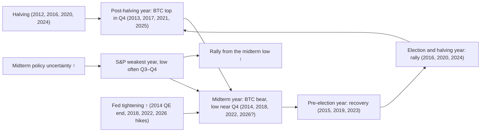

# 09. Seasonality and political cycles

Calendars are seductive. "September is the worst month", "the midterm year is the weakest year", "Uptober" and "the pre-election year is the strongest" are easy to remember and easy to chart. In 2026 the calendar became one of the main tools in Benjamin Cowen's videos: about 30% of his videos between 1 January and 11 June 2026 (35 of 116) touched the midterm or presidential cycle, and he called bitcoin's early-2026 path "simulation confirmed" because it tracked the average of past midterm years so closely. This chapter explains the political cycle in US stocks, monthly seasonality in stocks and bitcoin, and how midterm years have lined up with bitcoin's bear markets. It also explains why that alignment is so hard to interpret: bitcoin's halving clock, the US election clock and, in every case so far, a Fed tightening phase have all run in step, and there are only three complete bitcoin cycles to test. Seasonality is a weak prior. It is useful for context and dangerous as a rule.

**You will learn**
- How the presidential cycle looks in the Nasdaq since 1972 (the course lab) and in the S&P 500 since 1950 (published estimates), and why mean and median tell different stories.
- What midterm years have looked like in detail: drawdowns, the timing of lows and the rally that followed.
- The "sell in May", September and Q4 effects in stocks, and how weak they are statistically.
- Bitcoin's monthly seasonality, and why two careful tables built from different data give different answers.
- Cowen's midterm-year "window of weakness" template, his year-to-date and inauguration overlays (including for gold, the dollar and the 10-year yield), and how 2026 tracked and then broke the template.
- Why three cycles cannot separate the midterm effect from the halving cycle.

---

## Three clocks that tick together

The bitcoin clock (halvings), the political clock (US elections every two years, presidential terms every four) and, so far, a Fed tightening phase have all landed on the same years. When three things move together, a chart that shows one of them "working" does not tell you which one is doing the work.

**The four-year calendar side by side**

| Year of the presidential term | Bitcoin cycle year | Typical bitcoin behavior | Typical equity behavior | Examples |
|---|---|---|---|---|
| Post-election (year 1) | Post-halving | Cycle top in Q4 | Usually fine | 2013, 2017, 2021, 2025 |
| Midterm (year 2) | Bear year | Bear market; low near Q4 | Weakest year on average; low often Q3–Q4 | 2014, 2018, 2022, 2026 |
| Pre-election (year 3) | Pre-halving / recovery | Recovery (2015, 2019 +94%, 2023 +156%) | Strongest year on average | 2015, 2019, 2023 |
| Election (year 4) | Halving year | Rally into and after the election | Above average | 2016, 2020, 2024 |

Sources: [research notes C](../../research-notes/C-growth-liquidity-crossasset.md), section 5.6, and the course's crypto research for bitcoin returns. Four data points for crypto, so read the right-hand columns as descriptions, not rules.

---

## The presidential cycle in stocks

### Presidential cycle (four-year cycle in US stocks)

**What it is.** The claim that stock returns differ systematically by the year of the US presidential term: post-election (year 1), midterm (year 2), pre-election (year 3) and election (year 4). Yale Hirsch popularized it in the *Stock Trader's Almanac* from 1967. It is a calendar grouping of returns, not a published indicator.

**Where to find it.** Build it from annual index returns (FRED `NASDAQCOM` or `SP500`, Shiller's long S&P data). The [macro lab](../../tools/macro-lab/REPORT-2026-10-30.md) computes the Nasdaq version. Cowen's platform has a "Presidential Cycles" group: "Annual Returns by Presidential Cycle", "Presidential Term Return Paths", "Inauguration Event Study" and others.

**How to read it.** The lab's table uses Nasdaq Composite calendar-year returns since 1972 (the Nasdaq is the longest free daily index on FRED). Credit for the computation: the course's macro lab, run on 30 Oct 2026.

| Year of the cycle | Years in sample | Mean | Median | Up years |
|---|---|---|---|---|
| Election year | 14 | 10.3% | 15.7% | 11/14 |
| Post-election year | 14 | 13.8% | 19.8% | 11/14 |
| Midterm year | 13 | −0.5% | 7.4% | 7/13 |
| Pre-election year | 13 | 30.5% | 29.8% | 11/13 |

Three things to notice:
1. **Midterm years are the weakest, and the pre-election year is the strongest**, matching the folklore.
2. **The midterm mean (−0.5%) and median (+7.4%) disagree.** A few very bad midterm years (1974 −35.1%, 2002 −31.5%, 2022 −33.1%, 1990 −17.8%) drag the mean down. The *typical* midterm year was mildly positive; the *average* was dragged negative by crashes. Only 7 of 13 midterm years were up, against 11 of 13 or 14 in the other three years.
3. **The samples are small**: 13–14 observations per bucket, overlapping with specific events (the 1999 bubble sits in a pre-election year, the 2008 crash in an election year).

For the **S&P 500 since 1950**, commonly cited averages (price returns, approximate and varying by source) are: year 1 about +6–7%, **year 2 about +4–5% (weakest)**, **year 3 about +16–17% (strongest)**, year 4 about +7% (Almanac, CFRA and LPL summaries). The course research reconstructed the midterm mean as about +4.6% from published annual returns for 1950–2022 and flagged it as **an estimate to verify**; no primary-source table was found. Treat the S&P numbers as approximate and the lab's Nasdaq numbers as the reproducible ones.

**Proposed mechanisms.** (1) Administrations front-load painful policies early in the term and stimulate before re-election. (2) Midterm uncertainty: markets dislike not knowing which party will control Congress. (3) After the midterm, gridlock is priced and uncertainty resolves. Evidence for a *causal* mechanism is weak; the pattern rests on about 19 cycles since 1950.

**How Cowen uses it.** He treats the midterm year as the weakest year of the four, for the S&P and for bitcoin ("The midterm year is typically the worst year", [Bankless, 23 Dec 2025](https://www.bankless.com/podcast/where-is-crypto-going-in-2026-ben-cowen)). In December 2023 he argued pre-election years tend to see a Q3 correction ("S&P 500 Outlook", 15 Dec 2023, video summary). His August 2026 memo said September is the weakest month across about 24 midterm years since 1930 and put recent midterm-year S&P drawdowns at about 7% (2014), 20% (2018) and 25% (2022) ([Balance of Risks, 15 Aug 2026](https://benjamincowen.com/reports/the-balance-of-risks-august-2026)). He has also posted that "The SPX would often bottom in October, but occasionally it would occur earlier (May) and sometimes later (December)" ([X post, 2026](https://x.com/benjamincowen/status/2101053560720863561), text via search snippet), which he uses to time bitcoin's four-year-cycle low.

**Connections.** Midterm weakness → a low most often in Q3–Q4 → a strong rally into the pre-election year. Recessions have *not* started evenly across the term; see the recession-start table below.

**What it has meant for assets.** Stocks: weaker year 2, stronger year 3, on average. Bitcoin: midterm years 2014, 2018 and 2022 were its bear years (below). Bonds, dollar, gold: no established presidential-cycle pattern in the research.

**Investor takeaway.** The presidential cycle is a statement about averages over a few dozen observations. It tilts expectations a little; it does not tell you what any particular year will do, as 2026 showed.

### The midterm year in detail

The lab's midterm-year table (Nasdaq Composite) shows what "weakest year" looks like in practice:

| Year | Calendar return | Max drawdown in year | Date of year low | Low → +12 months |
|---|---|---|---|---|
| 1974 | −35.1% | −43.2% | 1974-10-03 | +37.6% |
| 1978 | +12.3% | −20.4% | 1978-01-11 | +23.9% |
| 1982 | +18.7% | −18.7% | 1982-08-13 | +88.2% |
| 1986 | +7.4% | −16.4% | 1986-01-09 | +17.8% |
| 1990 | −17.8% | −30.7% | 1990-10-16 | +66.2% |
| 1994 | −3.2% | −13.7% | 1994-06-24 | +35.3% |
| 1998 | +39.6% | −29.5% | 1998-10-08 | +103.4% |
| 2002 | −31.5% | −45.9% | 2002-10-09 | +70.5% |
| 2006 | +9.5% | −14.8% | 2006-07-21 | +33.0% |
| 2010 | +16.9% | −17.3% | 2010-07-02 | +34.6% |
| 2014 | +13.4% | −8.4% | 2014-02-03 | +18.3% |
| 2018 | −3.9% | −23.6% | 2018-12-24 | +44.6% |
| 2022 | −33.1% | −35.5% | 2022-12-28 | +47.8% |

What the table says (our arithmetic on the lab's numbers):
- **Every midterm year had a drawdown of at least 8%**; the median was about 20% on the Nasdaq. Even the strong years (1998 +39.6%) had a deep dip inside the year.
- **The low came in the second half in 9 of 13 years**, most often in October (1974, 1990, 1998, 2002). But four lows came in the first half, three of them in January or February, so "the low is always in October" is not true.
- **The rally from the midterm low was positive in all 13 cases**, from +17.8% (1986) to +103.4% (1998), median about +38%. The catch is hindsight: the lowest close of the year is only known afterwards.

**S&P 500 statistics (published, secondary).** The average intra-year peak-to-trough drawdown in midterm years has been put at about 17.5% since 1950 (Carson via Plain Economy), about 16.7% (Dreyer Wealth, 1950–2022), about 19% (Longview, 25 cycles since 1926) and about 20% (First Trust). Use "about 17–20%"; non-midterm years average roughly 13%. The S&P has averaged about **+32%** in the 12 months after the lowest close of a midterm year since 1950, positive in 19 of 19 cases (Silvia Insights via [Plain Economy](https://plaineconomy.com/stock-market-after-midterm-elections/)); First Trust and MoneyFlows put it at about +36% ([First Trust](https://www.ftportfolios.com/Commentary/Insights/2024/4/8/midterm-election-client-resource-kit---march-2024)). Measured from **election day**, the S&P was higher 12 months later after all 19 midterms since 1950, by about 15% on average. Typical S&P midterm lows: 1962 (June/October), 1966, 1974, 1990, 2002 and 2022 (all October); 2010 (July), 2014 (a mini-low in October), 2018 (December).

**2026 so far.** The S&P's midterm drawdown was only about **9.1%** (27 Jan, 6,978.6 → 30 Mar, 6,343.72), shallower than average, and the index then made new highs (7,818.93 on 6 Oct). From mid-August to late September the S&P was roughly flat (7,708 on 19 Aug, 7,704 on 24 Sep), so the "weak September" was flat rather than weak. Either the midterm pain came early and was mild, or the seasonal pattern was overridden by an earnings boom of about 30%. The midterm elections are on **3 Nov 2026**; the Fed held rates on 28 Oct, with Chair Warsh saying politics had "no role".

### Recession starts by presidential year

Cowen's platform carries "Recession Starts by Presidential Cycle" and "Recession Start Timing by Presidential Term" charts. Using the NBER recession start months listed in the [lab report](../../tools/macro-lab/REPORT-2026-10-30.md), the nine recessions since 1960 fall like this (our classification by calendar year):

| Year of the term | Recession starts since 1960 | Years |
|---|---|---|
| Post-election | 3 | 1973, 1981, 2001 |
| Midterm | 2 | 1970, 1990 |
| Pre-election | 0 | — |
| Election | 4 | 1960, 1980, 2008, 2020 |

No recession began in a pre-election year in this sample, which fits the "stimulate before re-election" story, but with nine events and one of them a pandemic (2020) it is a curiosity, not evidence. Note also that the midterm year's market weakness has not usually come from recessions: of the thirteen midterm years in the lab's Nasdaq table (1974–2022), only 1990 saw a recession begin.

### Year-to-date overlays against past midterm years

**What it is.** Each asset's price divided by its price on 1 January, plotted day by day and overlaid on the same curve for earlier years (Cowen mostly uses 2018 and 2022, or the average of midterm years with a ±1 standard-deviation band). On his charts this is labeled "ROI", but it is a **normalized price ratio**, not a percentage: 1.137 means +13.7% year to date, 0.714 means −28.6% ([Bitcoin Cycle Memo, 15 Jul 2026](https://benjamincowen.com/reports/bitcoin-cycle-memo-july-2026) explains the convention). Chapter [01](01-HOW-TO-READ-MACRO-CHARTS.md) covers rebased overlays in general.

**How Cowen uses it.** He applied the midterm overlay to bitcoin and the S&P from February 2026 ("Bitcoin YTD ROI vs Midterm Years", "S&P 500 YTD vs Average Midterm Year", [Macro Risk Memo, 15 Feb 2026](https://benjamincowen.com/reports/macro-risk-memo-feb-2026)) and in September extended it to **the 10-year yield and gold** ([Triple Squeeze, 30 Sep 2026](https://benjamincowen.com/reports/the-triple-squeeze-september-2026)). Readings from his memos:

| Asset | Year-to-date ratio | Date | His reading |
|---|---|---|---|
| S&P 500 | 1.137 | 15 Aug 2026 | Strong year despite the midterm; a midterm correction "window approaching" |
| Bitcoin | 0.714 | 15 Aug 2026 | Tracking the bearish midterm average |
| Gold | 1.010 | 15 Aug 2026 | Flat after the January spike and crash |
| 10-year yield | about 1.27 (+27%) | 30 Sep 2026 | "Converged on the 2018 path" |

**Gold's midterm low window.** On average gold's midterm-year low has come in the summer; in 2018 it came in late summer and in 2022 in September–November. In August 2026 he wrote that 2026 "may still prove to be a reset year" like 2022 ([Balance of Risks, 15 Aug 2026](https://benjamincowen.com/reports/the-balance-of-risks-august-2026)). Gold's late-June low near $3,970 was retested around $3,990 on 23 Oct (secondary report).

**Investor takeaway.** Overlays make one year look like another by construction, because they all start at 1.0 on the same day. Two or three analog years are a narrative device; check how wide the spread between the analogs is before reading anything into the current year's position.

### Assets rebased at each presidential inauguration

**What it is.** The same rebasing idea, anchored at each inauguration day instead of 1 January, so each four-year term starts at 100. Cowen's platform has "Presidential Term Return Paths" and an "Inauguration Event Study".

**How Cowen uses it.**
- **The dollar.** In August 2026 he showed the DXY rebased to 100 at each inauguration. The 2025 term had replicated 2017's first-year decline, and the turn expected in year two was "late", with the index at about 91.5 on the rebased scale. He called this "deliberately the lightest evidentiary leg" of his dollar view; the falsifier he named was a decisive break to new lows for the term ([Balance of Risks, 15 Aug 2026](https://benjamincowen.com/reports/the-balance-of-risks-august-2026)). The DXY then made higher lows into October (chapter [07](07-LIQUIDITY-MONEY-AND-THE-DOLLAR.md)).
- **Bitcoin.** In July 2026 he showed bitcoin rebased at each inauguration: in the prior terms the low came "near the midterm elections". He noted himself that this restates the midterm lens and is "not fresh evidence" ([Bitcoin Cycle Memo, 15 Jul 2026](https://benjamincowen.com/reports/bitcoin-cycle-memo-july-2026)).

**Investor takeaway.** Re-anchoring the same data at a different date does not add observations. Treat inauguration overlays as another view of the presidential cycle, not as independent confirmation.

---

## Calendar seasonality in stocks

### "Sell in May", September weakness and Q4 strength

**What it is.** Average returns grouped by month or season, usually for the S&P 500 since 1950. Sources: the *Stock Trader's Almanac* and many summaries.

**Where to find it.** TradingView's "Seasonality" view on `SP:SPX`; any spreadsheet of monthly closes.

**How to read it.**
- **Sell in May / the best six months.** Since 1950, November–April has delivered most of the S&P's price gains (about +7% on average) versus May–October (about +2%). Bouman and Jacobsen (2002, *American Economic Review*) found a "Halloween effect" in 36 of 37 countries. The effect has been weaker since publication, and May–October is still positive on average. Acting on it means giving up positive expected returns and paying taxes and costs.
- **September** has been the worst month for the S&P since 1950, averaging about −0.5% to −0.7% and positive only about 44% of the time ([Stock Trader's Almanac](https://stocktradersalmanac.com/Alert/20240815_1.aspx); [Motley Fool](https://www.fool.com/research/september-effect-statistics)).
- **Q4 strength.** October–December, especially November–December and the "Santa Claus rally" (the last five trading days of the year plus the first two of the next), has been seasonally strong. Q4 of the midterm year through Q2 of the pre-election year is often called the "sweet spot" of the four-year cycle.

**How Cowen uses it.** Mostly for bitcoin (below). For stocks, his August 2026 memo tabulated **S&P 500 monthly returns in every midterm year since 1930** (about two dozen years, with the average and standard deviation for each month). September is the weakest month; **October and November close as the two strongest**, although October often prints the intra-month low, as in 2014 and 2022 ([Balance of Risks, 15 Aug 2026](https://benjamincowen.com/reports/the-balance-of-risks-august-2026)). That is the stock-market version of the "low in the autumn, then a rally" midterm shape.

**Connections.** Seasonal effects are small relative to a single month's normal volatility, and they are swamped by Fed decisions, earnings and shocks. A −0.6% average September against monthly moves of several percent is a whisper, not a signal.

**What it has meant for assets.** Stocks: a mild tilt. Bitcoin: its own, much noisier seasonality (next section). Other assets: no robust calendar effect in the research.

**Investor takeaway.** Seasonal averages describe the past distribution of a few dozen years. They are a reason to be unsurprised by a weak September, not a reason to act on one.

---

## Bitcoin seasonality

### Bitcoin monthly returns

**What it is.** Bitcoin's average, median and hit rate (share of positive years) by calendar month, computed from month-end to month-end closes.

**Where to find it.** Heatmaps on CoinGlass, Bitcoin Magazine Pro and TradingView "Seasonality"; Cowen's platform has "Monthly Returns", "Quarterly Returns", "Monthly Average ROI" and "Historical Monthly Average ROI".

**How to read it.** The course research built two tables from different data and periods. Comparing them is the most useful lesson in this section:

| Month | Median 2013–2025 | Mean 2013–2025 | Up years 2013–2025 | Median 2015–Sep 2026 | Mean 2015–Sep 2026 | Up years 2015–Sep 2026 |
|---|---|---|---|---|---|---|
| Jan | +0.9% | +4.4% | 7/13 | −0.3% | −1.7% | 5/12 |
| Feb | +12.3% | +13.2% | 10/13 | +12.4% | +10.6% | 9/12 |
| Mar | −2.1% | +12.9% | 6/13 | +2.2% | +0.7% | 6/12 |
| Apr | +8.2% | +12.2% | 8/13 | +12.2% | +10.3% | 8/12 |
| May | +9.0% | +10.0% | 7/13 | +9.1% | +7.7% | 6/12 |
| Jun | +1.8% | −0.7% | 7/13 | 0.0% | −0.3% | 6/12 |
| Jul | +8.1% | +7.9% | 9/13 | +8.1% | +8.9% | 9/12 |
| Aug | −8.4% | +1.0% | 4/13 | −5.0% | +2.3% | 4/12 |
| Sep | −2.9% | −3.2% | 5/13 | +2.8% | −1.2% | 6/12 |
| Oct | +14.8% | +19.9% | 10/13 | +14.4% | +19.1% | 9/11 |
| Nov | +8.9% | +41.4% | 8/13 | +6.6% | +6.7% | 6/11 |
| Dec | −3.4% | +4.0% | 5/13 | +0.3% | +9.7% | 6/11 |

The first three columns use Coin Metrics daily reference closes (course crypto research); the last three use Coinbase closes from FRED (`CBBTCUSD`; [research notes C](../../research-notes/C-growth-liquidity-crossasset.md)). Differences come from the start year (2013 versus 2015), the data source and the extra months of 2026.

What survives in both tables: **February and October have been strong**, **August weak by median**, and **June flat**. What does not survive: March's median flips sign; September's median flips sign; November's mean goes from +41.4% (inflated by November 2013) to +6.7%. When adding two years or changing the data vendor flips a month's sign, that month carries no reliable seasonal information. With 11–13 observations per month and bitcoin's volatility, no single month's average is statistically significant at conventional levels.

**2026, month by month (Coin Metrics, to 29 Oct):** January −10.1%, February −14.9%, March +1.9%, April +11.9%, May −3.5%, June −20.5%, July +7.4%, August +24.9%, September +6.4%, October −6.4%. Note February (historically strong) was very weak, and August and September (historically weak) were strong.

**How Cowen uses it.** Monthly seasonality is a recurring theme: the yearly "Wake Me Up When September Ends" videos (2021–2025) and "Bitcoin Monthly Returns" (18 Aug 2024, 7 Aug 2025), per video summaries. His claims: September averages about −5% for bitcoin; August–September are the weakest pair; in post-halving years a green July–August tends to be followed by a red September and then a Q4 top. For midterm years he flagged an average August of about −10% (secondary report). His July 2026 memo has the primary version, a table of **bitcoin's monthly returns in midterm years** (2014, 2018, 2022, 2026): August and September were negative in all three prior midterm years, with August about −18%, −15% and −15%, while July tended to be green ([Bitcoin Cycle Memo, 15 Jul 2026](https://benjamincowen.com/reports/bitcoin-cycle-memo-july-2026)). He expected the same in 2026. On calendar months that failed: August 2026 was +24.9% and September +6.4%. On a mid-month basis August looked closer to the template ($65.3k on 15 Jul, about $63k on 15 Aug), which shows how much the chosen window matters. The difference between his "about −5%" and the −1.2% to −3.2% means in the table above is another illustration of sample dependence; it depends on which years and which data are used.

**Connections.** Bitcoin's monthly pattern mostly reflects *which cycle year* each month fell in. October's strength comes largely from bull years (2013, 2021, 2023). Monthly seasonality and the four-year cycle are not independent effects.

**What it has meant for assets.** Bitcoin only; altcoins amplify it. Stock seasonality and bitcoin seasonality do not line up month by month.

**Investor takeaway.** Read a bitcoin seasonality heatmap as a summary of a dozen cycle-dependent years. Check the median and the hit rate, not only the mean, and check whether the pattern survives a different data source.

### Q4: "Uptober", post-halving Q4 tops and midterm Q4 drops

Bitcoin's fourth quarter by year (Coinbase, course research): 2015 +81%, 2016 +60%, 2017 +220%, **2018 −44%**, 2019 −14%, 2020 +169%, 2021 +5%, **2022 −15%**, 2023 +57%, 2024 +55%, **2025 −26%** (Coin Metrics gives −23% for 2025; sources differ slightly).

| Q4 of… | Year | Q4 return | Note |
|---|---|---|---|
| Post-halving year | 2013 | +479% | Top 4 Dec 2013 |
| Post-halving year | 2017 | +221% | Top 17 Dec 2017 |
| Post-halving year | 2021 | +6% | Top 10 Nov 2021 |
| Post-halving year | 2025 | −23% | Top 6 Oct 2025, the first day of Q4 |
| Midterm year | 2014 | −17.6% | Cycle low 14 Jan 2015 |
| Midterm year | 2018 | −44.2% | Cycle low 15 Dec 2018 |
| Midterm year | 2022 | −15.0% | Cycle low 21 Nov 2022 |

Source: course crypto research (Coin Metrics daily closes).

Two patterns. First, "Uptober" is real in the sample but driven by bull-cycle years; in all three midterm years with data, Q4 was *negative* and ended near the cycle low. Second, the post-halving Q4 top crept earlier each cycle (4 Dec → 17 Dec → 10 Nov → 6 Oct), and in 2025 the "Q4 top" was the first day of Q4, not a Q4 rally. 2025 was the first post-halving "top year" to finish negative (−6.3% for the calendar year).

**Cowen's post-halving template.** "The Pattern That Historically Ended The Bull Market" (12 Aug 2025): in 2013, 2017 and 2021, a July–August rally was followed by a September pullback to the bull market support band and then a Q4 top, with diminishing percentage returns. In 2025 bitcoin dipped in late September, made a new high on 6 Oct and crashed from 10 Oct. That call was correct. The support band itself is explained in chapter [10](10-BITCOIN-CYCLES-AND-VALUATION-MODELS.md).

### The summer lull and the yearly open

- **Summer lull.** Cowen describes summer chop as normal; highs can still come later in the year ("Bitcoin: Bull Market Support Band", 19 May 2025, video summary). The tables above agree only loosely: July has been positive in 9 of 12–13 years, June flat, August weak by median.
- **Yearly open and year-to-date return by cycle year.** He compares each year's path from the 1 January price. Pre-halving years have been about half up and half down, so "bulls and bears both get wrecked"; recovery years (2015, 2019, 2023) show a mix of green and red months ("Bitcoin Monthly Returns", 6 Jan 2023; "Pre-Halving Year Returns" series, 2023). In midterm years he tracks the distance from the yearly open: on average bitcoin was about −15% from the open by early March. Calendar-year returns for reference (Coin Metrics): 2013 +5,286%, 2014 −56%, 2015 +34%, 2016 +126%, 2017 +1,337%, 2018 −74%, 2019 +94%, 2020 +305%, 2021 +60%, 2022 −64%, 2023 +156%, 2024 +121%, 2025 −6.3%, 2026 to 29 Oct −10.7%.

---

## Midterm years and bitcoin bear markets

### Cowen's midterm-year template and the "window of weakness"

**What it is.** An average path for bitcoin in the US midterm year, built from 2014, 2018 and 2022. As Cowen described it in early 2026: a **February low**, an **early-March rally** (peaking around 2–5 March), **April–June weakness**, a **July pop**, a **weak August–September**, and a **final low in Q4**. On average bitcoin was about −15% from the yearly open by early March. "Windows of weakness" are the stretches in which midterm-year lows tended to occur: February, late March to April, June, and September–October. In 2026 he also cited day counts (a low around day 56 of the year, a rally into about day 62).

**Where it comes from.** "Bitcoin: Midterm Year Returns" (26 Feb 2026); "…Are We In A Simulation?" (5 Mar 2026); "Bitcoin: Simulation Confirmed" (9 Mar 2026); "The Window of Weakness is Open" (28 Mar 2026); "The Window of Weakness" (29 May 2026), per video summaries; and the [July 2026 cycle memo](https://benjamincowen.com/reports/bitcoin-cycle-memo-july-2026). "We live in a simulation" is his ironic shorthand for price tracking the historical average. The theme dominated his channel: 35 of 116 videos published between 1 January and 11 June 2026 matched midterm, presidential or election keywords.

**His framing.** "The midterm year is typically the worst year. Buying from mid-to-late midterm year is historically a good time to accumulate" (Bankless, 23 Dec 2025). In late May 2026 he said investors had historically done better being cautious on bitcoin in the first half of midterm years and looking for value in the second half (29 May 2026, video summary). These are his historical observations, reported here as such; they are not course recommendations.

**How 2026 tracked the template.**

| Template step | 2026 | Fit |
|---|---|---|
| February low | Crash to about $60k on 5–6 Feb (−52% from the high) | Yes |
| Early-March rally, rejected | Bounce to about $68k by 1 Mar after a $63k dip on the 28 Feb Iran strikes; rally rejected | Yes ("Simulation Confirmed", 9 Mar) |
| April–June weakness | Rally to about $82–83k rejected in Apr–May; rejected at the 200-day average on 19 May; 200-week average tagged 5 Jun; low $58.5k close on 30 Jun ($57.7k intraday, 1 Jul) | Yes, with the low earlier than Q4 |
| July pop | July +7.4% | Yes |
| Weak August–September | August +24.9%, September +6.4%; above the May high and the 50-week average by late September; $85,453 on 6 Oct | **No** |
| Final low in Q4 | Broke $82k on 22 Oct; about $78k on 30 Oct; no lower low than June as of 30 Oct | Open |

In September 2026 Cowen admitted the rally was stronger than in prior midterm years (about 50% versus roughly 40% in 2018 and 2022, and a higher high rather than a lower high) and wrote that "the burden of proof has shifted to the bears" ([Triple Squeeze, 30 Sep 2026](https://benjamincowen.com/reports/the-triple-squeeze-september-2026); the 50%-versus-40% comparison is from a secondary report). On 24–26 Oct 2026 he returned to a bearish Q4 roadmap, conditional on bitcoin staying below $83k ([Yahoo Finance / BeInCrypto, 26 Oct 2026](https://finance.yahoo.com/markets/crypto/articles/bitcoin-falls-below-80-000-032051576.html)). He also said that if no lower low came by end-October or end-year, the bearish case would weaken and he expected "to be a bull again going into 2027".

Two qualifications from his own memos matter for reading the template. First, in April 2026 he wrote that midterm seasonality only matters when it **coincides with late-cycle macro**, and that "multiple crypto cycles can occur within a single broader business cycle" ([Crypto Risk Memo Q2 2026, 15 Apr 2026](https://benjamincowen.com/reports/crypto-risk-memo-q2-2026)); the calendar is a supporting lens, not the driver. Second, in July 2026 he projected the average midterm decay forward as an *illustration*: it implied a year-end ratio of about 0.49 of the 1 January price, about **$43,800** from a 1 January anchor near $89,300, below the realized price. He framed it as what the seasonal path would imply, not as a target, and wrote that the series "has been better on direction than on level" ([Bitcoin Cycle Memo, 15 Jul 2026](https://benjamincowen.com/reports/bitcoin-cycle-memo-july-2026)). With bitcoin near $78k on 30 Oct, that path looked unlikely.

**Connections.** The template's low months line up with the S&P's midterm-low months (often Q3–Q4). Cowen also expects midterm bitcoin lows to come with a 10–20% equity drawdown; in 2026 the S&P's drawdown was only 9.1% and came early (January–March).

**Investor takeaway.** An average of three paths will always look smooth and will always fit some months of a fourth year. The 2026 test shows both sides: a striking fit in February–June and a clear break in August–September.

### Midterm hike-year behavior

A narrower 2026 pattern. In the two prior midterm years in which the Fed hiked (2018 and 2022), bitcoin held near its level on the hike day for about seven weeks before breaking lower ([Triple Squeeze memo, Sep 2026](https://benjamincowen.com/reports/the-triple-squeeze-september-2026)). His September memo charted bitcoin's path in the year after the September hike of each midterm year (2018, 2022, 2026) and put the likely break around day 50, i.e. early November 2026; a 2022-type fall of about 15% would take bitcoin near $64k, a 2018-type fall of about 50% near $38k. He offered a second, wider lens in the same memo, bitcoin after the *first* hike of a tightening cycle: after December 2015 it fell about 20% in two months and then rose about 70% over twelve; after March 2022 it rose about 12% in two weeks and then fell more than 60% (chapter [10](10-BITCOIN-CYCLES-AND-VALUATION-MODELS.md)). In October 2026 he described the midterm-hike pattern as "Bitcoin typically flat ~50 days, then drops" and put bitcoin at about day 43 after the 16 Sep 2026 hike (Benzinga, via search snippet). Two prior cases is an anecdote, not a statistic; and his own September 2026 review of hike dates (December 2015, March 2022, September 2018, September 2022) concluded that "none of the data suggests that a rate hike has ever been immediately bearish for Bitcoin" (secondary report). Chapter [02](02-THE-FED-AND-INTEREST-RATES.md) covers the hike itself.

### Testing the claim: midterm years 2014, 2018, 2022 and 2026

| Midterm year | BTC calendar return | Prior cycle top | Cycle low | Low inside the midterm year? | S&P that year |
|---|---|---|---|---|---|
| 2010 | Large gain (pre-market era: ~$0.06 in Jul 2010 to ~$0.30) | n/a | n/a | No bear | +12.8% |
| 2014 | −56% to −58% (sources differ) | 4 Dec 2013 (~$1,135 close) | 14 Jan 2015 (~$176 close) | No (two weeks after); retest Aug 2015 | +11.4% |
| 2018 | −73% to −74% | 17 Dec 2017 (~$19.6k close) | 15 Dec 2018 (~$3.2k) | Yes | −6.2% |
| 2022 | −64% | 10 Nov 2021 (~$67.5k close; ~$69k intraday) | 21 Nov 2022 (~$15.5k intraday) | Yes | −19.4% |
| 2026 | −10.7% to −11.1% year to date (to 29 Oct) | 6 Oct 2025 (~$124.7–124.8k close; ~$126k intraday) | So far 30 Jun 2026 ($58.5k close, −53%) | To be determined | +13.1% year to date |

Sources: [research notes C](../../research-notes/C-growth-liquidity-crossasset.md) and [research notes D](../../research-notes/D-crypto-cycles-onchain-alts.md) (Coin Metrics and Coinbase data; secondary for 2014 prices).

**Verdict.**
1. **Descriptively true.** 2014, 2018 and 2022 were bitcoin bear years. Two of the three cycle lows fell inside the midterm year, and the third came two weeks after it. Cowen's July 2026 memo put it as "two of the three prior cycles bottomed in that quarter".
2. **The S&P was not always weak in those years:** +11.4% in 2014, +13% so far in 2026. Bitcoin's midterm-year losses (−56% to −74%) were far larger than the equity midterm effect would imply.
3. **2026 fits on price, not yet on timing.** It was a bear year with a −53% drawdown, but the low so far came on 30 Jun, about three months before Cowen's October window. 24/7 Wall St. called a three-cycle sample "a narrow and potentially unreliable basis" ([6 Oct 2026](https://247wallst.com/investing/cryptocurrency/2026/10/06/benjamin-cowen-said-the-cycle-would-bottom-bitcoin-near-60000-in-october-did-benjamin-cowen-predict-the-bitcoin-bottom-correctly/)).

### Why three cycles cannot separate the midterm effect from the halving cycle

**1. The clocks are in phase.** Halvings came on 28 Nov 2012, 9 Jul 2016, 11 May 2020 and 20 Apr 2024. Bitcoin topped 371, 525, 546 and 534 days later, always in Q4 of the following year, which is always a post-election year. The bear market then fills the next year, which is always a midterm year. A chart that says "midterm years are bad for bitcoin" and a chart that says "the second year after a halving is bad for bitcoin" are the *same chart*. No observation in the sample distinguishes them.

**2. A third clock runs alongside.** In each bitcoin midterm year the Fed was tightening in some form (our observation from the course timelines): 2014 was the year the Fed's bond buying ended (QE3, October 2014); 2018 had rate hikes and QT; 2022 had the fastest hikes in decades and QT; and in 2026 the Fed hiked on 16 Sep. So a liquidity explanation fits the same years too.

**3. The sample is three, maybe four.** With n = 3 completed cycles, almost any four-year pattern you can name will fit. The bitcoin cycle-timing statistics are tight (low-to-top 1,067, 1,059 and 1,062 days), but that regularity is just as consistent with the halving, with reflexive positioning (everyone expects the cycle, so it happens) or with the liquidity cycle as with US politics.

**4. The mechanisms are different and only loosely related.** The halving is a miner-supply shock that has shrunk geometrically: in 2024 the issuance cut was about 450 BTC a day (about $30m at the time), small next to ETF flows that sometimes exceeded $1bn a day. The midterm effect is about political uncertainty. That the two still line up in 2025–26 suggests the cycle may now be driven as much by expectations and the macro calendar as by supply, which is also how Cowen has described it: halvings matter less over time, and "BTC does not have a monopoly on the four-year cycle" ([X post, 6 Feb 2026](https://x.com/benjamincowen/status/2019835733503255006), via search snippet).

**5. The next test will not separate them either.** The next halving is estimated for about April 2028, an election year, so the 2029 post-election year and the 2030 midterm year will again line up with both clocks. One interesting wrinkle: cycle lows came 542, 513 and 528 days before the following halving. If June 2026 proves to be the final low, the gap to the 2028 halving would be about 655 days, out of pattern; a Q4 2026 low would be back in pattern (about 540 days). That is one quantitative reason Cowen kept looking for a Q4 low.

**Investor takeaway.** The midterm-year pattern in bitcoin is a real description of three cycles and an unproven explanation. Treat it as one of several overlapping four-year stories, none of which can be tested on its own until the clocks drift apart.

### Related cycle tools (covered in chapter 10)

These cycle-timing ideas appear alongside the seasonal ones in Cowen's videos; the full treatment is in chapter [10](10-BITCOIN-CYCLES-AND-VALUATION-MODELS.md):
- **The four-year (halving) cycle:** tops in Q4 of the post-halving year (2013, 2017, 2021, 2025), lows about a year later around the midterm Q4. "The cycle is primarily about the timing of lows, not exact prices" (26 May 2026, video summary); "The Four Year Cycle Did Not Die" (12 Mar 2026). On 6 Feb 2026 he wrote that the most likely low was October 2026, possibly as early as May.
- **Day counts.** Low-to-top durations of about 1,060 days in each of the last three cycles. Write-ups of his numbers are inconsistent (about 1,062 versus 1,059 and 1,067 in December 2025; 1,162 versus 1,059 and 1,168 in a May 2026 write-up), so rely on computed values. The primary source settles it: his July 2026 memo counts from the 21 Nov 2022 low (day 1,332 on 15 Jul 2026), puts this cycle's peak at day 1,050 versus 1,061 and 1,068 before, and the two prior bottoms at days **1,424 and 1,432**, which maps to about 15–23 Oct 2026. The memo also explains that an earlier version had wrongly anchored on the 9 Nov 2022 FTX low, which is where the inconsistent figures came from ([Bitcoin Cycle Memo, 15 Jul 2026](https://benjamincowen.com/reports/bitcoin-cycle-memo-july-2026)). On 15 Aug 2026 he posted "day 1363 of the cycle". The June 2026 low fell on day 1,317. His 2019 analog bottomed on day 261 after its top; the July 2026 memo put this cycle at day 282 "without the flush".
- **Right- versus left-translated cycles:** a top that comes early (left) or late (right) relative to the cycle midpoint; macro forces such as inflation or unemployment can pull a top earlier ("Right Translated or Left Translated?", 7 Mar 2025; "Bitcoin: Market Cycles", 7 Mar 2024).
- **Three psychological stages of a bear market** (7 Jun 2026): disbelief (Oct 2025–Feb 2026), partial acceptance (Feb–Jun 2026), broad acceptance (possibly Jun–Oct 2026); reversals tend to come when about 75–80% are bearish.
- **Political regimes** (returns by party) are in chapter [08](08-STOCKS-GOLD-AND-CROSS-ASSET.md).

---

## Putting it together

1. **Midterm year → policy uncertainty and (so far) Fed tightening → S&P drawdown of about 17–20% on average → low most often in Q3–Q4 → rally of about 30–36% over the next 12 months.** 2002 (Nasdaq low 9 Oct, +70.5% a year later), 2022 (Nasdaq low 28 Dec, +47.8%; S&P low 12 Oct). *Exceptions:* 2014 (Nasdaq drawdown only 8.4%, low in February) and 2026 (S&P drawdown 9.1%, low on 30 Mar, then records on ~30% earnings growth).
2. **Halving → post-halving-year Q4 bitcoin top → midterm-year bear → low near midterm Q4.** Halving 9 Jul 2016 → top 17 Dec 2017 → low 15 Dec 2018; halving 11 May 2020 → top 10 Nov 2021 → low 21 Nov 2022; halving 20 Apr 2024 → top 6 Oct 2025 → low so far 30 Jun 2026. *Exceptions:* the 2014–15 low slipped into January 2015, and the 2026 low (so far) came in June, roughly 100–115 days before the day-count window (prior bottoms at days 1,424 and 1,432).
3. **Post-halving year: July–August rally → September pullback to the support band → Q4 top.** 2013, 2017, 2021 and 2025 (dip in late September 2025, high 6 Oct, crash from 10 Oct). *Exception:* the size of the Q4 move shrank every cycle (+479%, +221%, +6%, −23%), and in 2025 the top came on the first day of Q4.
4. **Seasonal average says "weak August–September" → but liquidity and policy shocks override.** In August 2026 bitcoin rose 24.9% (Coinbase closes $62,887 on 31 Jul → $78,603 on 31 Aug), in a month when the US Treasury expanded its bond buybacks (reported by CoinDesk; the causal link is not established), and September added 6.4%, despite a Fed hike on 16 Sep. *The lesson:* a seasonal tilt of a few percent is small next to a macro or flow impulse.
5. **Midterm year + Fed hike → bitcoin flat for about seven weeks, then lower (2018, 2022).** In 2026, about 43 days after the 16 Sep hike, bitcoin was about $78k on 30 Oct, below its early-October high of $85,453 but well above its June low. Two prior cases; the outcome was still open at the time of writing.

---

## Check yourself

1. In the lab's Nasdaq table, the midterm-year mean is −0.5% but the median is +7.4%. What explains the gap?
2. Why do the course's two bitcoin seasonality tables disagree about March and September, and what does that tell you?
3. In how many of the 13 Nasdaq midterm years did the year's low come in the second half, and in how many was the rally from the low positive?
4. Give two reasons why "midterm years are bad for bitcoin" and "the second year after a halving is bad for bitcoin" cannot be told apart.
5. Which steps of Cowen's midterm template fit 2026, and which clearly failed?
6. Why does the S&P's +32% average rally from the midterm low overstate what an investor could have captured?
7. Since 1960, in which year of the presidential term has no US recession begun, and why is that weak evidence?

Answers

1. A few very bad midterm years (1974 −35.1%, 2002 −31.5%, 2022 −33.1%, 1990 −17.8%) pull the mean down. The typical (median) midterm year was mildly positive; only 7 of 13 were up.
2. They use different start years (2013 versus 2015), different data (Coin Metrics versus Coinbase) and one table includes 2026. When such changes flip the sign of a month's median, that month has no reliable seasonal signal; 11–13 observations per month are too few for bitcoin's volatility.
3. The low came in the second half in 9 of 13 years (four of them in October), and the rally over the following 12 months was positive in all 13, from +17.8% to +103.4%.
4. (a) The halving, the post-halving top and the midterm bear year have always fallen on the same calendar years, so no observation separates them. (b) A third factor, Fed tightening (2014 end of QE, 2018 and 2022 hikes and QT, 2026 hike), coincided with every midterm bear year too; and there are only three completed cycles.
5. Fit: February low (5–6 Feb), early-March rally rejected, April–June weakness ending in a June low, July pop. Failed: weak August–September (August +24.9%, September +6.4%), and the low came in June rather than Q4 (as of 30 Oct no lower low).
6. It is measured from the *lowest close* of the year, which is only known in hindsight. Measured from election day the average 12-month gain was about 15%.
7. The pre-election year: none of the nine recessions since 1960 started in one. With nine events, one of them a pandemic, the pattern could easily be chance.

---

> Educational material, not financial advice. Past relationships between indicators can break.

[← 08 Stocks, gold and cross-asset](08-STOCKS-GOLD-AND-CROSS-ASSET.md) | [Index](00-INDEX.md) | [10 Bitcoin cycles and valuation models →](10-BITCOIN-CYCLES-AND-VALUATION-MODELS.md)
