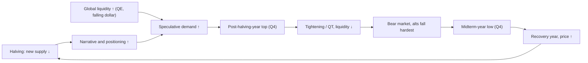

# 10. Bitcoin cycles and valuation models

Most of a typical Benjamin Cowen video is not about the Fed or inflation. It is about where bitcoin sits in its own cycle: how many days since the last low, how far above or below "fair value", whether price is above the bull market support band, what the 200-week moving average is doing, and how this cycle's returns compare with the last three. These tools are price-based. They need no economic data, and they are what the macro chapters ultimately feed into. This chapter explains each one, shows the numbers for every cycle from 2011 to October 2026, and is honest about which tools kept working when the 2025–26 cycle came in far smaller than its predecessors. The short version: the *timing* regularities held remarkably well, and almost every *price-level* threshold that was fixed in advance stopped firing.

**You will learn**
- what a halving is, how the four-year cycle is dated, and the full table of tops, lows, durations, drawdowns and multiples for every cycle;
- what "diminishing returns" means in numbers, and why Cowen dropped his "lengthening cycles" theory after 2021;
- how a logarithmic regression "fair value" is fitted, why two honest fits give different answers, and what power law, stock-to-flow and the 2026 quantile fan add or get wrong;
- how a 0–1 "risk metric" is built in general (not Cowen's proprietary formula), and its pitfalls;
- how to read the bull market support band, the 20W/21W/50W/100W/200W/200D averages, golden and death crosses, the Mayer Multiple, the Pi Cycle indicator, RSI and divergences, Fibonacci levels and weekly closes;
- what the 2025 top and the 2026 bear market looked like through all of these tools, and where Cowen's October 2026 bottom-timing call stands as of 30 October 2026.

> **A note on the numbers.** Unless stated otherwise, cycle statistics are computed from Coin Metrics daily reference closes (UTC) by this course's research, so they differ slightly from exchange intraday highs and lows; both are given where it matters. The course's own [macro lab report](../../tools/macro-lab/REPORT-2026-10-30.md) recomputes moving averages and a regression from FRED's Coinbase series (`CBBTCUSD`, data to 29 October 2026). Exchange-specific prints (for example the exact October 2025 all-time high, quoted as $126,080, $126,198 or $126,296 depending on the venue) are not independently verified. For the basics of log scales, moving averages, regressions and z-scores, see [chapter 01](01-HOW-TO-READ-MACRO-CHARTS.md).

---

## 1. The halving clock and the four-year cycle

### Bitcoin halvings (block height; mempool.space)

**What it is.** Every 210,000 blocks, roughly every four years, the reward paid to miners for each new block halves. So far there have been four halvings: block 210,000 on 28 November 2012 (50 → 25 BTC), block 420,000 on 9 July 2016 (25 → 12.5), block 630,000 on 11 May 2020 (12.5 → 6.25) and block 840,000 on 20 April 2024, 00:09 UTC (19 April in the Americas; 6.25 → 3.125). The next, at block 1,050,000, is estimated for about April 2028. The date is not fixed in advance; it depends on how fast blocks arrive.

**Where to find it.** Block height on [mempool.space](https://mempool.space) or blockchain.com. Long price history: TradingView `INDEX:BTCUSD` or `BITSTAMP:BTCUSD`; FRED `CBBTCUSD` (Coinbase, from December 2014).

**How to read it.** A halving cuts new supply, not existing supply. Its direct effect has shrunk each time. In 2024 the cut was about 450 BTC per day, worth about $30 million a day at the time, while spot ETF flows sometimes exceeded $1 billion in a single day. So the halving is best read as the *clock* that the market has learned to synchronize on, not as a supply shock that mechanically lifts price.

**How Cowen uses it.** He anchors his four-year cycle to halvings and, even more, to cycle lows. He has said halvings matter less over time and that the cycle may be driven as much by liquidity and the business cycle (midterm years, the timing of quantitative tightening). In March 2026 he put it bluntly: "Bitcoin tops when it always tops, like every cycle, it tops in the fourth quarter" ([Cointelegraph Magazine, 6 Mar 2026](https://cointelegraph.com/magazine/bitcoin-four-year-cycle-dead-debate-bear-market-2026-benjamin-cowen)).

**Connections.** Halving → top has taken 371 days (2013), 525 days (2017), 546 days (2021) and 534 days (2025): the last three fall in a tight 525–546-day band, which is the origin of the "12–18 months after the halving" rule of thumb. The halving calendar is also in phase with the US political calendar: 2013, 2017, 2021 and 2025 were post-election years and 2014, 2018, 2022 and 2026 were midterm years (see [chapter 09](09-SEASONALITY-AND-POLITICAL-CYCLES.md)). Global liquidity cycles add a third clock. With three or four cycles you cannot tell which of these clocks is doing the work.

**What it has meant for assets.** For BTC: a top 12–18 months after each of the last three halvings. Alts tended to peak around or after BTC in the cycles that had an alt season (2017–18, 2021) and not at all in 2025 (chapter [12](12-DOMINANCE-ALTCOINS-AND-ROTATION.md)). No reliable effect on stocks, bonds, the dollar or gold.

**Investor takeaway.** Treat the halving as a calendar marker that the market watches, not as a cause you can measure. Its supply effect is now small relative to ETF and institutional flows.

### The four-year cycle (pre-halving, halving, post-halving and midterm years)

**What it is.** The observation that bitcoin has moved in roughly four-year waves: a recovery year, a halving year, a post-halving year that ends in a blow-off top (usually in Q4), then a bear year. Cowen's labels are: pre-halving year (2023), halving year (2024), post-halving year (2025, the top year) and midterm year (2026, the bear year).

**Where to find it.** Any long log-scale BTC chart; ITC's "ROI After Halving", "ROI After Cycle Bottom" and "ROI After Cycle Peak" charts show the overlays.

**How to read it.** The cycle is a description of four past waves, not a law. Read it as a set of *timing priors*: roughly when tops and lows have tended to come. The price levels change every cycle.

**How Cowen uses it.** It is his master frame. Tops fall in Q4 of the post-halving year (2013, 2017, 2021, 2025) and lows about a year later, around the US midterm elections. "The cycle is primarily about the timing of lows, not exact prices" (video of 26 May 2026, per the [rosetta.to video index](https://rosetta.to/u/intothecryptoverse)). His 2026 videos "The Four Year Cycle Did Not Die" (12 Mar 2026) and "…Is Not Dead" (26 May 2026) defended the frame against the popular claim that ETFs had killed it. On 6 February 2026 he posted that "the most likely low for BTC is October 2026, based on the 4 year cycle. Under some circumstances it could happen as early as May" ([X post, 6 Feb 2026](https://x.com/benjamincowen/status/2019835733503255006), text from a search snippet).

**Connections.** The table below is the backbone of the whole chapter.

| Cycle | Prior low | Halving | Top (daily close; intraday) | Halving → top | Low → top | Next low (daily close; intraday) | Top → low | Low → low | Drawdown | Low → top multiple |
|---|---|---|---|---|---|---|---|---|---|---|
| 2011–15 | 18 Nov 2011, ~$2 | 28 Nov 2012 | 4 Dec 2013, $1,135 (~$1,150–1,160 Bitstamp) | 371 d | 747 d | 14 Jan 2015, $176 (~$152–170) | 406 d | 1,153 d | −84.5% (≈−86/−87% intraday) | 539× |
| 2015–18 | 14 Jan 2015 | 9 Jul 2016 | 16–17 Dec 2017, $19,641 (~$19.8k; CMC ~$20.1k) | 525 d | 1,067 d | 15 Dec 2018, $3,185 (~$3,122) | 364 d | 1,431 d | −83.8% | 112× |
| 2018–22 | 15 Dec 2018 | 11 May 2020 | 8–10 Nov 2021, $67,542 (~$69.0k on 10 Nov) | 546 d | 1,059 d | 9 Nov 2022, $15,758; intraday low 21 Nov 2022, ~$15.5k | 366 d | 1,425 d (1,437 to 21 Nov) | −76.7% (−77.5% intraday) | 21× |
| 2022–26 | 9 / 21 Nov 2022 | 20 Apr 2024 | 6 Oct 2025, $124,824 (~$126.1–126.3k) | 534 d | 1,062 d (1,050 from 21 Nov) | So far: 30 Jun 2026, $58,525; intraday $57,748 (reported for 1 Jul; some sources say 30 Jun) | 267 d so far | 1,329 d so far | −53.1% (−54.2% intraday) so far | 7.9× |

Source: course research from Coin Metrics daily closes; intraday levels are approximate exchange or CoinMarketCap prints. The 2011 low and the 2013 top multiples come from a very thin early market and should be read loosely.

Three regularities stand out. Low → top has been extraordinarily stable in the last three cycles: 1,067, 1,059 and 1,062 days (a spread of about four days). Top → low was 406, 364 and 366 days before 2026. And every top landed in Q4 of a post-halving year. One regularity broke: the amplitude. The 2026 bear market is the shallowest on record so far.

**What it has meant for assets.** BTC: three completed cycles ended with −77% to −85% drawdowns; the fourth, so far, with −53%. Alts: bigger swings in both directions in 2017 and 2021, and a broad failure in 2024–26 (chapter [12](12-DOMINANCE-ALTCOINS-AND-ROTATION.md)). Equities: the S&P 500 did not follow BTC's four-year rhythm closely; it rose in 2014 (+11.4%) and was up about 13% year-to-date in 2026 while BTC fell (see [chapter 08](08-STOCKS-GOLD-AND-CROSS-ASSET.md) and [chapter 09](09-SEASONALITY-AND-POLITICAL-CYCLES.md)).

Cowen himself qualifies the frame: in his [Crypto Risk Memo of 15 April 2026](https://benjamincowen.com/reports/crypto-risk-memo-q2-2026) he wrote that midterm seasonality matters only in combination with late-cycle macro, and that "multiple crypto cycles can occur within a single broader business cycle".

**Investor takeaway.** The four-year cycle is three or four observations. Its timing has been more reliable than its price levels, but the halving, the US election calendar and global liquidity are entangled, so nobody can say which one drives it or whether it will repeat.

### Day counts: low → top, top → low, low → low

**What it is.** Counting calendar days between cycle anchor points (prior low, halving, top, next low) and comparing the current cycle with past ones.

**Where to find it.** Compute it yourself from daily closes; ITC's "ROI After Cycle Bottom" and "ROI After Cycle Peak" charts plot the same idea.

**How to read it.** A day count is only as good as the anchor. Choosing the close or the intraday low, or 9 vs 21 November 2022, moves the count by 12 days. Be suspicious of counts that are quoted without the anchor.

**How Cowen uses it.** In the Bankless interview of 23 December 2025 he cited about 1,062 days low-to-top this cycle against about 1,059 and 1,067 before, saying the 2025 top came "within one week of when it historically tops" ([Bankless, 23 Dec 2025](https://www.bankless.com/podcast/where-is-crypto-going-in-2026-ben-cowen)). A May 2026 [CoinMarketCap Academy write-up](https://coinmarketcap.com/academy/article/%20bitcoin-4-year-cycle-october-2026) quoted different numbers (1,162 vs 1,059 and 1,168). The two sets do not reconcile; the course's own computation matches the Bankless figures, so the CMC numbers are probably a different anchor or a transcription error. His written [Bitcoin Cycle Memo of 15 July 2026](https://benjamincowen.com/reports/bitcoin-cycle-memo-july-2026) gives the corrected count. Anchored on the 21 November 2022 intraday low, 15 July 2026 was day 1,332; the two previous cycles bottomed on days 1,424 and 1,432 of their own counts, which puts the analog low on 15–23 October 2026, "roughly ninety to one hundred days out"; and this cycle peaked on day 1,050 against days 1,061 and 1,068 before. The memo says an earlier version had wrongly anchored on the 9 November 2022 FTX low, the likely source of the inconsistent counts in some write-ups. (The course's own daily-close count gives 1,062 / 1,059 / 1,067 days low → top; differences of a few days come from close vs intraday anchors.) On 15 August 2026 he posted "#BTC is now on day 1363 of the cycle", on the same anchor. The same memo noted that the 2019 analog had bottomed on day 261 after its top, while this cycle was at day 282 "without the flush".

**Connections.** Cycle low → next halving has been 542, 513 and 528 days. If 30 June 2026 is the final low, the gap to an April 2028 halving would be about 655 days, out of pattern; a Q4 2026 low would be back near 540. This is one quantitative reason Cowen kept looking for a Q4 low even after June. The 30 June low fell on day 1,317 of his count, about 115 days "early".

**What it has meant for assets.** The low → top count was the best top-timing tool of the 2025 cycle; valuation extremes were not (section 3 and [chapter 11](11-ON-CHAIN-AND-SENTIMENT.md)).

**Investor takeaway.** Low → top timing has a spread of about four days across three cycles, which is striking, but n = 3 with hindsight in choosing the anchors. Treat it as a prior to be updated, not a date to bet on.

### Left- vs right-translated cycles and the post-halving-year template

A cycle is **right-translated** when the top comes late in the cycle (after the midpoint between two lows) and **left-translated** when it comes early. Cowen discussed whether macro (inflation, unemployment) could pull the top earlier in "Right Translated or Left Translated?" (7 Mar 2025) and "Bitcoin: Market Cycles" (7 Mar 2024), per the [video index](https://rosetta.to/u/intothecryptoverse). In "The Pattern That Historically Ended The Bull Market" (12 Aug 2025) he laid out the post-halving-year template seen in 2013, 2017 and 2021: a summer rally, a September pullback to the bull market support band, then a Q4 top, with diminishing percentage returns each time. In 2025 that sequence played out: BTC dipped in late September, made its all-time high on 6 October and crashed from 10 October. The peak date has crept earlier within Q4 (4 Dec 2013 → 17 Dec 2017 → 10 Nov 2021 → 6 Oct 2025), and Q4 returns in post-halving years shrank from +479% (2013) and +221% (2017) to +6% (2021) and −23% (2025). In 2025 the "Q4 top" was the first days of the quarter, not a Q4 rally. Monthly seasonality and the midterm-year template are covered in [chapter 09](09-SEASONALITY-AND-POLITICAL-CYCLES.md).

### The three psychological stages of a bear market

In "Bitcoin Enters the 3rd Stage of the Bear Market" (7 Jun 2026, [transcript via rosetta.to](https://rosetta.to/u/intothecryptoverse/bitcoin-enters-the-3rd-stage-of-the-bear-market)) Cowen described a bear in three stages: disbelief (few accept it is a bear; October 2025 to February 2026), partial acceptance (about half do; February to June 2026) and broad acceptance (the majority do; possibly June to October 2026). He said reversals tend to come when roughly 75–80% are bearish. This is a sentiment framework, not a measurable indicator; its measurable cousins (Fear & Greed, social risk) are in [chapter 11](11-ON-CHAIN-AND-SENTIMENT.md).

---

## 2. Diminishing returns, and the theory Cowen abandoned

### Diminishing returns

**What it is.** Each cycle's top is a smaller multiple of its starting point than the previous cycle's, and each bear market's drawdown is (so far) smaller too. It is the single best-supported regularity in bitcoin's price history.

**Where to find it.** ITC "ROI Bands", "ROI After Cycle Bottom", "Price Drawdown From ATH"; free: compute from any long BTC history.

**How to read it.**

| Measure | 2013 cycle | 2017 cycle | 2021 cycle | 2025 cycle |
|---|---|---|---|---|
| Top as multiple of prior cycle low | 539× | 112× | 21× | 7.9× |
| Top as multiple of log-log fair value | 11× | 6.6× | 3.0× | 1.23× |
| Regression residual at the top | +3.47σ | +2.72σ | +1.57σ | +0.29σ |
| Drawdown, top → next low (close) | −84.5% | −83.8% | −76.7% | −53.1% (so far) |
| Price ÷ 200-week SMA at the top | n/a | 16.9× | 3.95× | 2.33× |

Each cycle's multiple has been roughly 1/2.7 to 1/5 of the previous one. Meanwhile, bottoms have sat in a fairly constant zone of about 0.42–0.59× log-log fair value. In other words, the *ceiling* has been falling toward the trend line much faster than the *floor*. That asymmetry is why fixed top thresholds failed in 2021 and 2025 while bottom zones stayed comparatively stable.

**How Cowen uses it.** Diminishing returns has been central to his framework since 2019 and he kept it after dropping lengthening cycles (next card). His 2026 study "Asymmetric Tail Curvature in Bitcoin Price Quantiles" (29 May 2026) formalizes the same observation: the upper tail compresses across cycles while lower support stays close to a power law ([report](https://benjamincowen.com/reports/asymmetric-tail-curvature-in-bitcoin-price-quantiles)).

**Connections.** Diminishing returns is the reason every "fixed" indicator in this chapter decays: the Mayer Multiple at tops (5.71 → 3.78 → 1.48 → 1.18), MVRV at tops (4.72 → 4.43 → 2.85 → 2.29, [chapter 11](11-ON-CHAIN-AND-SENTIMENT.md)), the Pi Cycle cross (no cross at all in 2024–25). Plausible mechanisms: a larger market cap needs far more money to move by the same percentage; volatility has fallen steadily; and the holder base has shifted to ETFs and corporate treasuries, which are stickier than leveraged retail.

**What it has meant for assets.** BTC: smaller tops and, in 2026, a much shallower bear. Alts: diminishing returns in BTC terms have been even harsher (most alts never regained their 2021 highs, [chapter 12](12-DOMINANCE-ALTCOINS-AND-ROTATION.md)).

**Investor takeaway.** Any model whose upper band does not shrink over time will overstate future tops. Expect smaller multiples at both ends, and especially at the top.

### The lengthening cycles theory (abandoned)

**What it is.** The theory, popular in 2019–2021, that each cycle stretches longer in time, so the 2021 top would come later than the four-year rhythm implied.

**How Cowen used it.** He was one of its best-known proponents ("Bitcoin Lengthening Cycles And Diminishing Returns", 19 Jul 2021). In November 2021 he said the market cycle "has now *unofficially* lengthened" ("Market Cycle Has Now *Unofficially* Lengthened", 19 Nov 2021) and argued for re-accumulation rather than a parabolic Q4 2021 ("Bitcoin Re-accumulation", 23 Nov 2021) (titles per the [video index](https://rosetta.to/u/intothecryptoverse)).

**What happened.** BTC had already topped on 10 November 2021 and fell 77% into November 2022. The top came on the four-year schedule, as did the 2025 top. Cowen later said diminishing returns and lengthening cycles "are not mutually exclusive" and that a $64k top in 2021 would have been "diminishing returns without lengthening cycles" ([The Informer Post summary](https://theinformerpost.beehiiv.com/p/bitcoins-bull-market-different-from-previous-cycles-says-analyst-benjamin-cowen-heres-why)). From 2023 he returned to four-year timing. The keyword "diminishing returns" appears in 114 video titles or summaries, 98 of them from 2019–22.

**Investor takeaway.** When you hear "lengthening cycles" in an old video, know that Cowen himself dropped it. Do not attribute it to his current view.

### Drawdown from all-time high

**What it is.** Percentage below the running all-time high. ITC: "Price Drawdown From ATH"; free: TradingView or any spreadsheet.

**How to read it.** Past bears bottomed at −84.5%, −83.8% and −76.7% on daily closes. The 2026 bear reached −53.1% on closes (−54.2% intraday) by 30 June–1 July 2026. As of the lab's latest weekly close ($77,939, week ending 1 November 2026, partial), BTC was −37.5% from its weekly-close high of $124,720 (5 Oct 2025) per the [lab report](../../tools/macro-lab/REPORT-2026-10-30.md).

**How Cowen uses it.** "Bitcoin Percentage Drawdown from the All Time High" (22 Nov 2022) argued bears linger at 60–70% drawdowns before bottoming. In 2026 he described BTC as "~50% down" with the bear market "not over".

**Connections.** Drawdown depth has tracked how far the top overshot fair value: the 2025 top was only 1.23× fair value, so a −53% fall took price back to about 0.45× fair value, the same relative zone as previous bottoms.

**Investor takeaway.** Do not expect a fixed drawdown (such as "−80%") to repeat. Comparing the drawdown with the distance to a trend line is more informative than the percentage alone.

### ROI views: cycle ROI, running ROI, ROI bands, ROI after halving / bottom / peak

**What it is.** Return comparisons between cycles from fixed anchor points: from the cycle bottom, from the halving, from the peak. "Running ROI" (for example the trailing one-year return) shows momentum through time. ITC has about 20 ROI charts ("ROI After Cycle Bottom", "ROI After Halving", "ROI After Cycle Peak", "ROI Bands", "Year-To-Date ROI", "Running ROI").

**How to read it.** Overlaying cycles shows whether the current one is running "hot" or "cold" compared with history at the same day count. Use log scale.

| Days after the cycle low | From Jan 2015 low | From Dec 2018 low | From Nov 2022 low |
|---|---|---|---|
| Day 1,000 | 27.0× | 14.1× | 7.5× |
| Day 1,400 | 31.7× | 6.0× | 5.5× |
| Day 1,432 | 18.2× | 5.2× | 5.1× |

Since about day 1,300, the 2022–26 cycle has tracked the 2018–22 cycle closely in running-ROI space.

**ROI in Cowen's charts is a ratio, not a percentage.** His memos define ROI as "current price divided by the stated reference price": an ROI of 0.520 from the peak means −48%, and a year-to-date ROI of 0.731 means −26.9% ([July 2026 memo](https://benjamincowen.com/reports/bitcoin-cycle-memo-july-2026)). Every ITC overlay is read this way (see also [chapter 01](01-HOW-TO-READ-MACRO-CHARTS.md)). His August 2026 memo put BTC's ROI from the cycle bottom at about 4.0×, down from about 5.0× three months earlier, and the cycle's peak multiple at about 8× from the bottom against about 22× in the prior cycle ([The Balance of Risks](https://benjamincowen.com/reports/the-balance-of-risks-august-2026)); the course's computed 7.9× and 21× agree.

**The drawdown-from-QT-peak overlay (2019 vs 2025).** The core chart of his 2019 analog lines up BTC's fall from its June 2019 peak with its fall from the October 2025 peak, both tops having come shortly before QT ended: about five weeks before (26 Jun → 1 Aug 2019) and about eight weeks before (6 Oct → 1 Dec 2025). The 2019 path ends at its day-261 COVID-crash low at about 0.29 of the peak; the 2025 path stood at about 0.52 on day 282 in mid-July 2026 ([Q1 2026 memo](https://benjamincowen.com/reports/crypto-macro-risk-memo-q1-2026); [Q2 2026 memo](https://benjamincowen.com/reports/crypto-risk-memo-q2-2026); [July 2026 memo](https://benjamincowen.com/reports/bitcoin-cycle-memo-july-2026)). His reading: both tops came on apathy with no durable rotation into alts; the 2019 bear's first ~50% decline came from liquidity tightening, and the deeper flush needed an exogenous shock (COVID). Without such a catalyst he expected "a reset completed through time rather than through a comparable flush". The weakness of the analog as a bottom template is exactly that it needs a shock that may not come.

Calendar-year returns (close to close): 2013 +5,286%, 2014 −56%, 2015 +34%, 2016 +126%, 2017 +1,337%, 2018 −74%, 2019 +94%, 2020 +305%, 2021 +60%, 2022 −64%, 2023 +156%, 2024 +121%, 2025 −6.3%, 2026 to 29 October −10.7%. 2025 was the first post-halving "top year" to finish negative.

**How Cowen uses it.** "Bitcoin Market Cycle ROI" (many videos) and "Bitcoin: ROI After Halving" (14 Jul 2025) place the current cycle against past ones and show diminishing multiples. The keyword "ROI" appears in 167 video titles or summaries.

**Connections.** ROI from the bottom is the cleanest way to see diminishing returns; ROI after the peak is how he compared the 2026 bear with 2014, 2018 and 2022. Monthly and quarterly return heatmaps belong to [chapter 09](09-SEASONALITY-AND-POLITICAL-CYCLES.md).

**Investor takeaway.** ROI overlays tell you how unusual the current path is, not where it will end. They are most useful for spotting when a cycle is clearly breaking from its predecessors, as 2026 did on depth.

### BTC after the first hike of a tightening cycle (and the midterm-hike lens)

**What it is.** BTC's price divided by its price on the day of a rate hike, tracked for the following months: an ROI overlay anchored on Fed decisions rather than on cycle lows. Cowen uses two versions: after the *first* hike of a tightening cycle (December 2015, March 2022, September 2026) and after a *September hike in a midterm year* (2018, 2022, 2026).

**Where to find it.** Compute from any daily BTC series and the Fed's decision dates (FRED `DFEDTARU`; [chapter 02](02-THE-FED-AND-INTEREST-RATES.md)).

**How to read it.** The first-hike lens has a wide spread: after December 2015, BTC fell about 20% in two months and then rose about 70% over twelve; after March 2022, it rose about 12% in two weeks and then fell more than 60% ([The Triple Squeeze, 30 Sep 2026](https://benjamincowen.com/reports/the-triple-squeeze-september-2026)). Two cases pointing in opposite directions mean the hike itself explains little; the cycle phase around it explains more.

**How Cowen uses it.** Before the 16 September 2026 FOMC he argued the Fed "really should" hike and that a hike would push BTC lower via the dollar. The Fed hiked to 3.75–4.00%, the dollar rose, but BTC rose from about $76k on hike day to about $86k on 21 Sep (Coinbase), extending a rally that began near $63k in mid-August; he conceded the thesis was "not rooted in the data" and said "none of the data suggests that a rate hike has ever been immediately bearish for Bitcoin" ([Benzinga via TradingView](https://www.tradingview.com/news/benzinga:45b48150d094b:0-bitcoin-analyst-admits-his-rate-hike-thesis-was-not-rooted-in-the-data/)). His September memo framed the hike as the *resumption* of an existing cycle (like 1999 after the 1998 "insurance cuts"), not a liftoff from low rates like 2015 or 2022, and said 2026 resembled early 2022 on the first-hike lens. On the midterm-hike lens, BTC held near its hike-day level for about seven weeks in 2018 and 2022 before breaking lower; applied to 2026, that pointed to a break around day 50 after 16 September (early November), with a 2022-type −15% implying about $64k and a 2018-type −50% about $38k. On 30 October 2026, day 44, BTC was about $78k; the window had not yet been reached.

**Connections.** Hikes act on BTC through the dollar, real yields and risk appetite ([chapter 07](07-LIQUIDITY-MONEY-AND-THE-DOLLAR.md)). In 2022 the hike came with QT and a recession scare; in 2015 and 2026 it came without QT. Cowen's own 2022 view was also that a hike is "not necessarily doom and gloom" ([Daily Hodl, 28 Feb 2022](https://dailyhodl.com/2022/02/28/interest-rate-hike-not-necessarily-doom-and-gloom-for-bitcoin-btc-says-analyst-benjamin-cowen-heres-why/)).

**Investor takeaway.** Two or three hike episodes, with opposite outcomes, are not a pattern. Treat event-anchored ROI overlays as a way to frame scenarios, not as a forecast.

---

## 3. Regression models: fair value, bands and the power law

### Logarithmic regression bands and fair value

**What it is.** A best-fit line of log price against log time (days since bitcoin's genesis block on 3 January 2009). Because both axes are logarithmic, this is a power law: price ∝ days^b. The fitted line is called "fair value"; bands are drawn at fixed multiples or standard deviations of the residuals. The "Bitcoin Rainbow Chart" (Blockchaincenter, based on a 2014 bitcointalk regression) is a coloured version. Cowen's "fair value logarithmic regression" is fitted only to "non-bubble" data.

**Where to find it.** ITC: "(Legacy) Logarithmic Regression" (free tier), "(Legacy) Fair Value Logarithmic Regression", "(Legacy) Logarithmic Regression Rainbow"; free: Bitcoin Magazine Pro "Rainbow Price Chart", blockchaincenter.net, TradingView community scripts such as "Logarithmic Regression Fib Deviation Bands" or "Bitcoin Power Law Bands". The course's [macro lab](../../tools/macro-lab/REPORT-2026-10-30.md) fits one from FRED data.

**How to read it.** Two fits from honest data, side by side:

| | Full-history fit (course research) | Macro lab fit |
|---|---|---|
| Data | Coin Metrics daily closes from Aug 2010 | FRED `CBBTCUSD` (Coinbase) weekly closes from Dec 2014 |
| Equation | log10(P) = −16.305 + 5.628 · log10(days) | slope b = 5.84 |
| Residual spread (1σ) | 0.301 log10 units (a factor of ~2.0) | ≈ 0.24 log10 units (implied by its z-score) |
| Fair value, late Oct 2026 | ≈ $144k (±1σ: $72k–$288k) | $147,386 |
| Price ÷ fair value | ≈ 0.54 | 0.53 |
| Residual z-score | −0.88σ | −1.17σ |

Both put fair value in the mid-$140,000s and price at a bit over half of it. They disagree on how *unusual* that is, because the lab's window starts after the wild 2010–2014 years. Its residuals are smaller, so the same 0.53 ratio looks like a deeper undervaluation (−1.17σ instead of −0.88σ). The lesson for any regression or z-score chart: the start date of the fit changes the slope, the band width and therefore the signal. Neither fit is "the" fair value; the lab report says its own fit is there "to learn the method, not as the canonical fair value".

The full-history fit also shows the diminishing-returns asymmetry clearly. Residuals at tops: +3.47σ (2013), +2.72σ (2017), +1.57σ (2021), +0.29σ (2025). Residuals at bottoms: −0.88σ (2015), −0.76σ (2018), −1.14σ (2022), −1.15σ (June 2026). Tops are converging toward the line while bottoms hold a stable −0.8σ to −1.15σ zone. The curve's projected values (about $152k at end-2026, $206k at end-2027 and $275k at end-2028 on the full-history fit) are curve arithmetic, not forecasts.

Common misreadings: treating fair value as a price target; assuming symmetric bands (a symmetric-σ model will never fire at a top again); forgetting that the fit moves as new data arrive; and using log price against *linear* time, which implies exponential growth and overstates future fair value.

**How Cowen uses it.** Log regression is one of his most frequent tools (277 video titles or summaries, 2019–26) and runs through his "Bitcoin Logarithmic Regression" videos (25 Aug 2021, 16 Jun 2022) and "Ethereum: Logarithmic Regression" (31 Dec 2025). He describes fair value as "where price tends to return" and calls a bear year spent below fair value "time-based capitulation" rather than price capitulation. In March–June 2022 he argued that the non-bubble fair value and the 200-week SMA both pointed to about $20k; BTC fell to $17.6k in June and $15.5k in November 2022. In December 2025 he said ETH's "fair value log regression could be near $2,100 in 2026" ([Bankless](https://www.bankless.com/podcast/where-is-crypto-going-in-2026-ben-cowen)). The ITC app now labels its classic regression charts "(Legacy)" and promotes the quantile fan below.

**Connections.** Price has reverted to fair value or below around halvings and at bear lows; tops have come in upper bands that compress each cycle. Regression residuals move with the liquidity cycle (QE years push price above the line; QT years pull it below), but the relationship is loose.

**What it has meant for assets.** For BTC, a decent map of where cycle lows have been and a poor guide to how high a top will go. The same method applied to ETH or total crypto market cap is far less stable because the history is shorter.

**Investor takeaway.** Use regression as a long-term map with asymmetric, time-decaying bands. Always ask what window it was fitted on.

### Total crypto market cap vs its trendline ("The Beauty of Mathematics")

The same log-regression idea applied to the whole crypto market. Cowen's monthly series "The Beauty of Mathematics" reached Part 71 on 9 June 2026 (the episode marking his channel's 1 million subscribers). ITC offers it free as "Total Crypto Market Cap & Trendline" and "Total Crypto Valuation vs. Trendline". It measures how extended the whole market is. In "Why I DO NOT think we are close to a market cycle peak" (20 Feb 2021) he used it to argue the market was "not close to a peak"; the market rose further and peaked in November 2021, a call the course's research scores as a hit. Limitations: total market cap includes stablecoins and thousands of new tokens, so its composition changes over time in a way a single trendline cannot capture. TradingView ticker: `CRYPTOCAP:TOTAL` ([chapter 12](12-DOMINANCE-ALTCOINS-AND-ROTATION.md)).

### Power law

**What it is.** The same functional form as log-log regression, popularized by Giovanni Santostasi and, as a "power law corridor", by Harold Burger: price ∝ days^~5.7–5.8. The course's full-history fit gives an exponent of 5.63 and the lab's post-2014 fit 5.84, which shows how much the exponent depends on start date and window.

**How to read it.** Bottoms have respected the lower corridor: June 2026 sat at about 0.45× fair value, the same as November 2022. The 2025 top barely exceeded the mid-line.

**Connections.** Consistent with diminishing returns. Its proponents' long-range projections (of the "$1M by 2033" type) depend on the exponent staying fixed, which is untested.

**Investor takeaway.** The power law is a useful description of the floor. Be skeptical of any decade-ahead number derived from it.

### Asymmetric quantile regression fan (2026)

**What it is.** A working paper Cowen published on 29 May 2026, "Asymmetric Tail Curvature in Bitcoin Price Quantiles" ([report and PDF](https://benjamincowen.com/reports/asymmetric-tail-curvature-in-bitcoin-price-quantiles); video 30 May 2026). Instead of one "fair value" line through the middle of the data, it fits a separate line for each price *quantile*: the 1% line is the curve that only 1% of days fall below, the 50% line is the median, the 99% line the curve that only 1% of days rise above. On ITC it appears as "Asymmetric Quantile Regression Fan" (free tier).

**How it is built, in plain words.** The paper regresses log price on log time with a curved (quadratic) term, and lets the upper-tail quantiles and the lower-tail quantiles have *different* curvature. A "rearrangement" step stops the quantile lines from crossing each other. Uncertainty is estimated with a *block bootstrap*: the history is resampled in chunks of 14–90 days so that the strong day-to-day dependence in prices is preserved. Out-of-sample skill is tested with an *expanding window* (fit up to a cut-off date, score the years after it, repeat) using *check-loss* (also called pinball loss), the standard error measure for quantile forecasts. The data are 5,788 daily observations from 2010 to 2026.

**What it found.** The upper tail bends downward clearly (its curvature is negative and statistically significant, bootstrap p ≈ 0.012), while the lower tail's curvature cannot be told apart from zero: the floor is close to a straight power law. Upper-tail fit errors improved by roughly 27–29% against a straight-line quantile power law. As benchmarks, an ordinary power law calibrated to 2018 overpredicted price on 77.2% of later days (average error +32.1% over 2019–2026); stock-to-flow overpredicted on 94.9% of days (+294.5%); S2FX by about +1,699%. The paper credits earlier work: Santostasi's power law, the "Trolololo" log regression, PlanB's S2F/S2FX and "Plan C" quantile models.

**The mechanism it proposes: structural vs speculative.** Price is modelled as a *structural* component, demand from gradual monetization, which produces a straight power-law floor, times a *speculative* multiplier that decays as market cap grows ("diminishing reflexivity"). That is a formal version of diminishing returns. The authors call it a "sufficiency, not uniqueness" argument: it explains the data, but other mechanisms could too.

**Caveats he states.** It is "not a forecast, a price floor, or a measure of portfolio loss risk". The curvature is identified only on the full sample, and results depend on choices such as the assumed genesis date.

**How Cowen uses it.** His July 2026 memo put price "essentially on" the 1st-percentile band (about $65.5k), with the median near $116k and the 99th percentile near $202k ([July 2026 memo](https://benjamincowen.com/reports/bitcoin-cycle-memo-july-2026)). It noted that the 1% band has been undercut before: by 12.2% in late 2010 and for 40 days around the FTX collapse. Price later rose well above it (about $78–86k in September–October 2026).

**Investor takeaway.** Quantile regression is the formal answer to the "symmetric bands never fire at the top again" problem: it lets the ceiling shrink while the floor stays put. It describes where price has been relative to time; it does not say where price must go.

### Stock-to-flow (S2F) and why it failed

**What it is.** A model published by the pseudonymous analyst PlanB in March 2019 that regressed log market cap on the log of the stock-to-flow ratio (stock = existing supply; flow = annual new issuance). Because flow halves at each halving, S2F doubles, and the model predicted a step-jump in "fair value" after each halving. The S2FX extension (April 2020) projected about $288k as the average for 2020–24, and the model was widely read as implying about $100k by end-2021.

**Where to find it.** ITC "Stock to Flow (S2F)"; various free sites.

**What happened.** The 2021 cycle peaked at $69k. The 2025 cycle peaked at about $126k, against S2F values that by 2024–25 implied several hundred thousand dollars. In October 2026 BTC traded near $78–80k. Cowen's 2026 quantile report puts S2F's average error since publication at +295% and S2FX's at +1,699%.

**Why it failed.**
1. It is a regression of two trending series (supply and price both trend up), the textbook recipe for a spurious correlation.
2. It has no demand or liquidity variable at all.
3. The out-of-sample test was tiny: two halvings.
4. As issuance falls toward zero, flow stops mattering; after 2024 daily issuance is dwarfed by ETF and treasury-company flows.

**How Cowen uses it.** He discussed it with PlanB in 2021–22 ("…Stock-To-Flow, Lengthening Cycles…", 11 Aug 2021) as one theory among several and was a long-time skeptic, arguing for diminishing returns where S2F implied accelerating returns.

**Investor takeaway.** A model with no demand variable and an exploding forecast is a narrative, not a valuation. S2F is the cautionary tale for every model that fits a few cycles well.

---

## 4. Normalized risk scales

### The risk-metric concept (a 0–1 scale)

**What it is.** A single number between 0 and 1 that says where price sits on its own historical "ladder": near 0 when price has historically been low relative to its trend, near 1 when it has been stretched. Cowen's version, colour-coded from blue (low) to red (high) and available per asset and per denomination (in USD, in BTC, in ETH), is proprietary. Only the general concept is described here.

**Where to find it.** ITC "Historical Risk Levels", "Current Risk Levels", "Price Color-Coded By Risk", "Time In Risk Bands" (paid tiers). TradingView hosts community scripts that call themselves simplified versions of Cowen's metric; their authors state they are approximations, not his formula.

**How such a metric is built, in general.** Any of several recipes produce something similar:
1. Choose an anchor: a long moving average (350-day, 400-day, 50-week, 200-week) or a log-regression fair value.
2. Measure the extension: x(t) = ln(price ÷ anchor).
3. Correct for diminishing returns: scale x(t) by a time factor, or divide by a decaying envelope, chosen so that past tops reach similar heights.
4. Normalize to 0–1: an all-time min–max scaling or a percentile rank of the adjusted series.
5. Optionally smooth it, or average it with other sub-metrics (on-chain, social).

**How to read it.** It is a position on a historical scale, not a probability; ITC's own help text says so. 0.1-wide "risk bands" let you see how long price historically spent in each zone. High readings have historically been rare and brief.

**How Cowen uses it.** It has been his flagship tool since 2019 ("Bitcoin: Validating the risk model", 21 Dec 2019; "Bitcoin Risk Analysis – Have a plan!", 7 May 2020; a "Bitcoin Risk Metric" series 2021–24). He describes it as price-based, accounting for time, volatility and diminishing returns, and uses it to frame "dynamic DCA": accumulating more in low-risk bands and scaling out in high-risk bands, instead of trying to call exact tops and bottoms. "High-risk levels are historically rare and brief" (6 Jun 2024). "No model is perfect." His July 2026 memo said risk sat "in the low zone historically associated with accumulation" ([memo](https://benjamincowen.com/reports/bitcoin-cycle-memo-july-2026)). Portfolio-process uses are covered in [chapter 14](14-COWEN-FRAMEWORK-AND-VIDEO-DECODER.md).

**Connections.** A price-based risk metric is a transformed version of the regression residual, so it inherits the regression's dependence on the fit window. It moves with BTC price coincidentally; it does not lead it.

**Pitfalls.**
- **Repainting.** Min–max normalization is refitted with hindsight, so past readings change when new extremes arrive.
- **Parameter fitting.** The time-decay parameter is effectively chosen to make old tops line up, which guarantees a good-looking history.
- **Under-firing at small tops.** On simple versions, a 2025 top at 1.23× fair value maps to only about 0.6–0.7, not near 1 (the course's own estimate for a naive scale).

**Investor takeaway.** A 0–1 risk scale is a compact summary of "how stretched is price versus its trend, after adjusting for diminishing returns". Know what anchor and adjustment sit inside any version you use, and remember that its history was fitted with hindsight.

### Composite ("total") indicator risk

ITC's "Crypto Indicator Risk Dashboard" averages three sub-scores, each 0–1 and equally weighted: price metrics, on-chain metrics and social metrics, built from about two dozen indicators scored by their position between a lower and an upper band on a log scale. Cowen introduced the composite in "Bitcoin Total Indicator Risk" (29 Nov 2022, 22 Dec 2022, 8 Feb 2023) and argued that combining them avoids single-indicator false bottoms: in late 2022, social risk kept the composite from showing a "deep value zone" even though price risk was low. The on-chain and social components are covered in [chapter 11](11-ON-CHAIN-AND-SENTIMENT.md).

### Short-term bubble risk

The extension of price above its 20-week SMA, used to flag local overheating within a bull market. Cowen used it in "Bitcoin: Short-Term Bubble Risk" (29 Mar 2023, 23 Jan 2024), flagging episodes such as December 2021 and January 2024. ITC: "Short Term Bubble Risk" (Basic tier). It is the same idea as the Mayer Multiple (below) on a shorter, weekly anchor.

### Cowen Corridor

A band built from the ratio of two moving averages and its slope on the weekly chart, giving upper and lower bounds. It is on ITC (Standard tier) and rarely discussed in videos. Community re-creations on [TradingView](https://www.tradingview.com/scripts/cowen/) describe themselves as approximate.

### Terminal price and balanced price (on-chain price bands)

These are price bands derived from on-chain data: terminal price has historically marked the ceiling region of cycle tops, balanced price a deep-value floor. Cowen cited terminal price at about $188k in "Bitcoin: Terminal Price" (4 Dec 2024); it was not reached in 2025, which he attributes to the top coming "on apathy". The band keeps rising with the cost basis: his July 2026 memo put it near $320,000 ([memo](https://benjamincowen.com/reports/bitcoin-cycle-memo-july-2026)). He notes every bear has broken below balanced price, which was about $37.7–40k in 2026. How they are computed, and why they have not been tested since 2022, is in [chapter 11](11-ON-CHAIN-AND-SENTIMENT.md#balanced-price-terminal-price-and-cvdd).

### Niche platform charts: Cycles Deviation, Benford's law, price-milestone crossings

ITC also hosts educational or niche price charts: "Cycles Deviation" (how far the current cycle deviates from past ones), "Benford's Law" (the distribution of leading digits in price data) and "Price Milestone Crossings" ("How many times has BTC crossed $100k?"; videos of 3 Mar 2025 and 13 Nov 2025). They are rarely central to an argument. If one appears in a video, it is usually illustrating how price behaves around round numbers or how unusual the current cycle is.

---

## 5. Moving averages and the trend regime

A moving average (MA) is the average of the last N closes; an exponential moving average (EMA) weights recent closes more. The general mechanics are in [chapter 01](01-HOW-TO-READ-MACRO-CHARTS.md). This section covers the specific averages Cowen uses and how they behaved in 2025–26.

| Level (late October 2026) | Macro lab (FRED Coinbase weekly) | Course research (Coin Metrics) | Price ≈ $78k is… |
|---|---|---|---|
| 20-week SMA (lower BMSB) | $72,965 | $72.4k | above |
| 21-week EMA (upper BMSB) | $76,677 | $76.5k | just above |
| 50-week SMA | n/a | $76.0k (Pintu: $75.8k) | just above |
| 200-week SMA | $67,497 | $67.1k (Pintu: $67.49k) | ~15–17% above |
| 200-week EMA | n/a | $69.6k | above |
| 200-day SMA | n/a | $73.1k | above (Mayer 1.07) |
| 50-day SMA | n/a | $81.9k | below |
| 111-day SMA vs 2 × 350-day SMA | n/a | $74.9k vs $152.2k | far from a Pi Cycle cross |

Small differences between the columns come from the data source (Coinbase vs a multi-exchange reference rate) and the week-ending convention. Where they differ, this course quotes the lab's FRED-based values.

### Bull Market Support Band (BMSB: 20-week SMA + 21-week EMA)

**What it is.** The zone between the 20-week simple moving average and the 21-week exponential moving average of weekly closes. Cowen coined and popularized the name.

**Where to find it.** TradingView: add SMA(20) and EMA(21) to a 1-week `BTCUSD` chart. ITC: "Bull Market Support Band (BMSB)" (Basic tier). The [macro lab](../../tools/macro-lab/REPORT-2026-10-30.md) computes it.

**How to read it.** In bull markets, weekly closes stay above the band and pullbacks to it act as support. Losing it on weekly closes and failing the retest has marked the start of bears. In bears, the same band becomes resistance. It is a regime filter, not a precise level: in sideways markets it flips repeatedly and produces whipsaws (July–September 2024).

**How Cowen uses it.** It is his most frequent single chart: 307 video titles or summaries mention the band and about 500 mention the 20W/21W averages; he has run a weekly "Bitcoin: Bull Market Support Band" series since 2020, most recently on 22 October 2026. Key lines: "A bear market for Bitcoin is weekly closes below the 20-week SMA" (22 Jun 2021); systematic rejections at the band are a red flag (7 Mar 2022); "two consecutive weekly closes" confirm a break; BTC "tends to break below it on the first retest". In post-halving years the band is often lost and regained in September. In late 2025 he argued that the 50-week SMA acted as the "real" bull-market support this cycle.

**Connections.** State changes on weekly closes (course research):

| Year | Event |
|---|---|
| 2021 | Lost May 2021, regained Aug 2021, lost 5 Dec 2021 (bear confirmed) |
| 2023 | Regained 15 Jan 2023 (new cycle confirmed) |
| 2024 | Lost and regained repeatedly Jul–Sep 2024, a chop that preceded the Q4 2024 breakout |
| 2025 | Lost 9 Mar, regained 27 Apr, lost 19 Oct and again 2 Nov 2025 (top confirmation) |
| 2026 | Brief regain 26 Apr, lost again 31 May, regained 23 Aug 2026; above since (band now ~$73–77k) |

Some write-ups date the 2026 regain to September–October; the weekly-close data put it at 23 August. On 22 October 2026 BTC broke below $82k, but as of 30 October price (~$78k) remained above the band.

**What it has meant for assets.** BTC: losing the band confirmed the 2021–22 and 2025–26 bears within weeks of the top; regaining it confirmed the 2023 recovery. Alts typically fall harder than BTC after a band loss.

**Investor takeaway.** The band is a lagging, weekly regime label. It confirms, it does not predict, and in sideways markets it whipsaws.

### Bear Market Resistance Band

The same 20W/21W band seen from below during a bear market. Rallies back to it are typically lower highs that get rejected; losing it again after a brief reclaim confirms the bear. Cowen used the name in "Bitcoin Bear Market Resistance Band Update" (24 Jan 2022), "Bitcoin Rallies to the Bear Market Resistance Band" (20 Apr 2026) and "Bitcoin Closes Below the Bear Market Resistance Band" (1 Jun 2026, [transcript list](https://rosetta.to/u/intothecryptoverse)). In April–May 2026 the band sat at about $82–83k and rejected BTC; the weekly close of 31 May put price back below it. The reclaim on 23 August was the first sign the 2026 bear was weakening.

### 50-week SMA

**What it is.** The average of the last 50 weekly closes, about one year of price.

**Where to find it.** TradingView SMA(50) on a 1-week chart.

**How to read it.** In Cowen's sequence of a bear market, price loses the 50W first, then the 100W, then the 200W. A rally back *to* the 50W that fails is a classic lower high. A falling 50W is easier to reclaim than a rising one and does not mean the same thing.

**How Cowen uses it.** "The Importance of the 50 Week Moving Average" (6 Jul 2025); "Bitcoin Falls Below the 50 Week Moving Average" (17 Nov 2025), which he treated as the turn. In December 2025 he expected a rally to the 50W (about $100–102k) to confirm the bear: "Bitcoin historically rallies to the 50-week moving average to confirm a bear market" ([Bankless, 23 Dec 2025](https://www.bankless.com/podcast/where-is-crypto-going-in-2026-ben-cowen)). That rally did not happen; BTC fell to about $60k on 5–6 February 2026 instead. His July 2026 memo set the bar precisely: the bear framework stays intact unless BTC posts two consecutive weekly closes above the 50W (then about $86.5k), which he called stronger confirmation than any 200W reclaim ([memo](https://benjamincowen.com/reports/bitcoin-cycle-memo-july-2026)). The 50W has since fallen to about $76k as 2025's high prices rolled out of the window, and BTC reclaimed it around the week of 20 September 2026; his September memo called the reclaim "a clear point for the bulls" ([The Triple Squeeze](https://benjamincowen.com/reports/the-triple-squeeze-september-2026)). Whether two consecutive weekly closes held above the original ~$86.5k level is not verified.

**Investor takeaway.** Moving targets move. A reclaim of a falling 50W is a weaker signal than the same reclaim of a rising one.

### 200-week SMA (and the 100-week and 300-week)

**What it is.** The average of the last 200 weekly closes, about 3.8 years, roughly one full cycle. The 200-week EMA weights recent data more and sits higher in uptrends.

**Where to find it.** TradingView SMA(200) on 1W; Bitcoin Magazine Pro "200 Week Moving Average Heatmap"; ITC "Moving Averages"; the [macro lab](../../tools/macro-lab/REPORT-2026-10-30.md) ($67,497 on the latest weekly close).

**How to read it.** It has marked the value zone at cycle lows with surprising precision, but it is not a floor.

| Cycle low | Price ÷ 200W SMA |
|---|---|
| Jan 2015 | 0.92 |
| Dec 2018 | 1.00 |
| Nov 2022 (FTX capitulation) | 0.66 |
| Jun 2026 | 0.94 |

Weekly closes below the 200W: Aug–Sep 2015 (5 weeks), 15 Mar 2020 (1), Jun 2022–Mar 2023 (36), mid/late 2023 (11), 28 Jun 2026 ($59,517 vs about $62,433) and marginal closes on 2 and 16 Aug 2026. At tops the multiple collapsed from 16.9× (2017) to 3.95× (2021) and 2.33× (2025).

**How Cowen uses it.** He calls price meeting the 200W "a date with destiny" (videos in 2022, 2025 and 2026). In November 2025: "I think Bitcoin has a date with destiny (200 week moving average) in 2026, probably around $60k–$70k" ([X, 17 Nov 2025](https://x.com/intocryptoverse/status/1990511167538954667)). In December 2025: "Accumulation for BTC in the midterm year is typically near the 200-week moving average" (Bankless). BTC tagged it on 5 June 2026 ("Bitcoin Falls to the 200W Moving Average"), closed a week below it, and on 29 June he wrote: "The four year cycle strikes again. Bitcoin just had a weekly close below the 200W moving average. The first time it closed below the 200W moving average in 2022 was also in June" ([X, Jun 2026](https://x.com/benjamincowen/status/2071633906118402321)). He also uses a lagging top signal: when the 200W crosses above the *prior* cycle's all-time high, it has lined up with cycle tops ("Bitcoin: An Indicator For Market Cycle Tops", 12 Jun 2025). The 100W and 300W SMAs appear as intermediate and deep levels. After BTC climbed back above the 200W in July 2026, his memo warned that a 200W reclaim is "not a bottom signal": in 2022 price broke below it, reclaimed it, and then broke below again ([July 2026 memo](https://benjamincowen.com/reports/bitcoin-cycle-memo-july-2026)).

**Connections.** The 200W rises over time (about $62.4k at the end of June 2026, about $67.5k by late October), so time spent near it matters as much as the touch. It lines up with the realized price zone ([chapter 11](11-ON-CHAIN-AND-SENTIMENT.md)) at most bear lows; in 2026 the two were about $8–9k apart and price never reached realized price.

**What it has meant for assets.** BTC: every cycle low since 2015 came within about 0.66–1.0× of the 200W. Alts have no equivalent reliability because most lack enough history.

**Investor takeaway.** The 200W is a value *zone*, not a line: 2022 undercut it by a third. It is one of the more stable bottom markers precisely because it moves slowly.

### 200-day SMA (and the 50-day, 100-day and 8-week)

**What it is.** The average of the last 200 daily closes; the standard bull/bear trend divider in all markets. Cowen also watches the 50D and 100D, and the 8-week SMA, whose loss tends to lead to a test of the BMSB.

**How to read it.** In bull markets it is support; in bear markets it is frequent resistance. A falling 200D that price cannot reclaim is a classic bear sign.

**How Cowen uses it.** The 200D was resistance in the 2018, 2022 and 2026 bears; "Bitcoin Rejected off the 200D" (19 May 2026) marked the end of the spring 2026 rally, after which BTC fell to about $73k in late May.

**Connections.** Price ÷ 200D is the Mayer Multiple; the 50D crossing the 200D is the golden or death cross. Both are below.

**Investor takeaway.** The 200D is the shortest of the "big" averages, so it changes regime fastest, and generates more false signals.

### Golden cross and death cross (50-day vs 200-day SMA)

**What it is.** A golden cross is the 50-day SMA crossing above the 200-day; a death cross is the reverse. ITC: "Golden/Death Crosses".

**How to read it.** Both are lagging by construction (they need weeks of price movement to happen). Since 2017 (course research):

| Death crosses | Golden crosses |
|---|---|
| 30 Mar 2018 | 23 Apr 2019 |
| 26 Oct 2019 | 18 Feb 2020 |
| 26 Mar 2020 | 21 May 2020 |
| 19 Jun 2021 | 15 Sep 2021 |
| 15 Jan 2022 | 7 Feb 2023 |
| 11 Sep 2023 | 30 Oct 2023 |
| 10 Aug 2024 | 28 Oct 2024 |
| 7 Apr 2025 | 22 May 2025 |
| 16 Nov 2025 | 8 Sep 2026 |

Several crosses (2019, 2021, 2024, 2025) came near local extremes and then reversed, so they are contrarian about as often as they confirm.

**How Cowen uses it.** Mostly as a short-term contrarian signal: "The Death Cross Rally" (22 Apr 2025), "Bitcoin: Upcoming Golden Cross" (20 May 2025), "The Golden Cross Dump" (23 May 2025). ITC's "Metric Analyzer" applies the same crossing logic to any metric.

**Investor takeaway.** A cross describes what has already happened. It is a regime label, not a signal.

### Mayer Multiple (price ÷ 200-day SMA)

**What it is.** Price divided by its 200-day SMA, proposed by Trace Mayer around 2017. Bitcoin Magazine Pro charts it.

**How to read it.** The classic thresholds (above 2.4 = "bubble", below 1 = "cheap") have decayed with diminishing returns. At tops: 5.71 (2013), 3.78 (2017), 1.48 (2021), 1.18 (2025); April 2013 was 8.26 and April 2021 1.97. At bottoms: 0.40, 0.51, 0.67, 0.78 (2026). Late October 2026: 1.07. Top readings falling and bottom readings rising means the oscillator is compressing, just as volatility has.

**How Cowen uses it.** It is not one of his named recurring tools; it appears here because it is the standard free version of the "extension from a long average" idea behind short-term bubble risk and risk metrics.

**Investor takeaway.** Fixed Mayer thresholds would have missed both the 2021 and 2025 tops. If you use it, compare readings with the same point in previous cycles rather than with a fixed number.

### Pi Cycle Top (111-day SMA vs 2 × 350-day SMA) and Pi Cycle Bottom

**What it is.** A top signal created by Philip Swift in 2019: it fires when the 111-day SMA crosses above twice the 350-day SMA. A bottom variant uses a different pair of averages. ITC: "Pi Cycle Bottom/Top"; Bitcoin Magazine Pro: "Pi Cycle Top Indicator".

**How to read it.** Crosses: 6 Apr 2013, 5 Dec 2013 (one day after the top), 16 Dec 2017 (the top day) and 12 Apr 2021 (the April mid-cycle top, not the November top). There was no cross in 2024–25: the 111D peaked well below 2 × 350D. Late October 2026: $74.9k vs $152.2k.

**How Cowen uses it.** "The Pi Cycle Top Has Signaled" (12 Apr 2021); revisited in "Bitcoin: Pi Cycle Top Indicator" (22 Mar, 21 Aug, 26 Nov 2024). It is a rare topic (10 videos).

**Connections.** The fixed 2× multiplier is the problem: cycle amplitude decays, the multiplier does not. It is the textbook example of a fixed threshold meeting diminishing returns.

**Investor takeaway.** No Pi Cycle signal is not evidence of no top (November 2021, October 2025).

### The "hold the line" conjecture

Cowen's 2022 idea that once BTC has held its 20-week SMA as support during a cycle, it does not revisit that level. He tested it at about $40k in "Bitcoin: The 'Hold The Line' Conjecture" (20 Jan 2022); BTC lost $40k that month and the conjecture failed, while his broader "below the band = bear" call was right. It is a useful example of him publishing a testable rule and then reporting that it failed.

---

## 6. Momentum, levels and chart structure

### RSI (daily, weekly, monthly) and divergences

**What it is.** The Relative Strength Index (14 periods by default) compares average gains with average losses and scales the result 0–100. Above 70 is conventionally "overbought", below 30 "oversold". ITC: "Relative Strength Index (RSI)".

**How to read it.** On BTC's weekly and monthly charts: monthly RSI above about 90 marked the 2013 and 2017 tops, about 80–85 the 2021 top, and lower readings in 2024–25 (approximate values from secondary sources). Bear markets have ended with weekly RSI around 25–30 (2015, 2018, 2022), recovering above 50 later. A **bearish divergence** is a higher high in price with a lower high in RSI; it appeared on weekly and monthly charts into both the 2021 and 2025 tops. A bullish divergence is the mirror image at lows.

**How Cowen uses it.** To compare corrections in context: "Bitcoin Correction In Context (Relative Strength Index)" (11 Apr 2022) and "Bitcoin Relative Strength Index" (9 Nov 2025), plus "Bearish Divergence" type videos. RSI appears in 63 video titles or summaries.

**Connections.** RSI peaks have followed diminishing returns like everything else, so "monthly RSI above 90" is no longer a usable top marker. Divergences can persist for months.

**Investor takeaway.** RSI divergence is a warning that momentum is fading, not a timer. Compare readings with the same stage of previous cycles.

### 180-day realized volatility

**What it is.** The standard deviation of daily returns over the past 180 days (usually annualized): how violently price has been moving. ITC "Volatility"; easy to compute from any daily series.

**How to read it.** Bitcoin's volatility has trended down across cycles, which is the volatility side of diminishing returns. Within a cycle, low volatility near highs means the market is calm, not that it is safe.

**How Cowen uses it.** "Low volatility at cycle highs is not stability, but rather fragility" ([Crypto Macro Risk Memo Q1 2026, 15 Jan 2026](https://benjamincowen.com/reports/crypto-macro-risk-memo-q1-2026)). He argues that compression is followed either by a sharp repricing or by long stagnation, and lists a *constructive* volatility re-expansion (volatility rising with price, not against it) among the conditions that would change his bearish view. Volatility compression is also a theme of his 2020 "Bitcoin Letters", which he describes as identifying "risk regimes" rather than setting price targets, noting that the "marginal return per unit of risk declined" ([Bitcoin Letters 2020](https://benjamincowen.com/reports/bitcoin-letters-2020); the full PDF is behind an e-mail form and was not read by the course research).

**Connections.** Volatility is one input to the Fear & Greed Index (25%, [chapter 11](11-ON-CHAIN-AND-SENTIMENT.md#crypto-fear--greed-index-alternativeme)) and to most normalized risk scales. Low-volatility rallies dominated by ETF flows (2024–25) produced smaller tops.

**Investor takeaway.** Read low volatility as stored energy whose direction is unknown, not as a sign of stability.

### MACD, Bollinger Bands, Supertrend and Heikin-Ashi candles

These are on the ITC platform ("Moving Average Convergence Divergence (MACD)", "Bollinger Bands", "Supertrend") and rarely discussed in videos. MACD is the difference between two EMAs (usually 12 and 26 periods) with a signal line; Bollinger Bands are a moving average plus and minus two standard deviations; Supertrend is a volatility-based trailing line. Heikin-Ashi candles average each candle with the previous one to smooth the trend view; Cowen used them in "Bitcoin: Heikin-Ashi Candles" (26 Apr 2026). All four describe trend and volatility already visible in price; none adds independent information.

### Fibonacci retracements

**What it is.** Horizontal levels at fixed fractions (0.236, 0.382, 0.5, 0.618, 0.786) of a prior move, drawn from a swing low to a swing high or the reverse.

**How Cowen uses it.** Occasionally, as reference levels. In November 2024: "BTC dominance has retraced to the 0.618 Fib (60%), which marked the top for dominance last cycle" (X post, per the course research). In December 2025 he pointed to ETH/BTC 0.053 as both the 0.5 retracement and the pre-Merge low (Bankless). In May 2026 he noted that BTC bear-market rallies tend to stall near the 0.382 retracement ("Bitcoin: Dubious Speculation", 14 May 2026).

**How to read it.** There is no mechanism behind the ratios themselves; they matter, if at all, because many traders watch the same levels. Results depend on which swing points you choose.

**Investor takeaway.** Treat Fibonacci levels as a shared vocabulary for "a partial retracement", not as forces.

### Market structure: lower highs, lower lows, counter-trend rallies and fakeouts

A bear market on a weekly chart is a sequence of lower highs and lower lows; a **counter-trend rally** is a bear-market rally that fails at resistance (the BMSB, the 200D, the 50W); a **fakeout** is a break of a level that quickly reverses. Cowen describes bears that "trend up for weeks before sharp breakdowns" ("Bitcoin: The Structure of a Bear Market", 10 Mar 2026) and occasionally uses harmonic patterns ("Ethereum: The Butterfly Effect", 4 Mar 2025). His late-October 2026 roadmap counted a "fakeout" on 25 October as one of its steps. These are descriptions; whether a high is "lower" is only known after the next swing.

### Weekly, monthly, daily and 3-day closes

**What it is.** The last price of a candle period. Most crypto charts close the week at Sunday 24:00 / Monday 00:00 UTC; exchanges differ, and CME futures add weekend gaps.

**How to read it.** A close filters intraday noise and liquidation wicks. A level is "lost" when a candle closes beyond it, ideally on two consecutive weekly closes.

**How Cowen uses it.** "Wicks don't matter, closes do" ("An Important Weekly Close", 17 Oct 2021). His roadmap conditions are written as closes: in late October 2026 he followed a bearish Q4 roadmap whose first condition was "a weekly close below $83k" and which he said was void if BTC got back above $83k ([BeInCrypto via Yahoo Finance, 26 Oct 2026](https://finance.yahoo.com/markets/crypto/articles/bitcoin-falls-below-80-000-032051576.html)). The June 2026 200W "loss" was a weekly close (28 Jun), not the intraday wick.

**Investor takeaway.** When someone says a level "broke", ask: on which timeframe's close, and on which exchange's data?

---

## 7. The 2025 top and the 2026 bear through these tools

| Date | Event | What the tools said |
|---|---|---|
| 21 Jan 2025 | New ATH above $100k | Post-halving year under way |
| 9 Mar – 27 Apr 2025 | BMSB lost, then regained; April tariff-shock low ~$74–76k | Death cross 7 Apr ("death cross rally"); golden cross 22 May |
| 6 Oct 2025 | **Cycle top**: $124,824 close; ~$126.1–126.3k intraday | Day 1,062 from the low (on schedule); 534 days after the halving; only 1.23× fair value (+0.29σ); Mayer 1.18; no Pi Cycle cross; Fear & Greed peaked at only 74 |
| 10 Oct 2025 | Crash with a reported ~$19B of derivatives liquidations (not independently verified) | Market-structure break, four days after the top |
| 2 Nov 2025 | BMSB lost on a weekly close | Top confirmed |
| 16–17 Nov 2025 | Death cross; 50W SMA lost | Cowen: the turn |
| 5–6 Feb 2026 | Crash to ~$60k (−52% from the ATH) | No rally to the 50W first, contrary to his December expectation |
| Apr – May 2026 | Rally rejected at the bear-market resistance band (~$82–83k) and the 200D (19 May) | Classic counter-trend rally |
| 5 Jun 2026 | 200W SMA tagged; the February low swept on 6 Jun | "A date with destiny" |
| 28 Jun 2026 | Weekly close of $59,517, below the 200W (about $62.4k) | Same month as the first 200W close below in 2022 |
| 30 Jun – 1 Jul 2026 | **Low so far**: $58,525 close; $57,748 intraday | −53% / −54%; 0.94× 200W; ~0.45× fair value; ~10% above realized price |
| 23 Aug 2026 | BMSB regained on a weekly close | First regime improvement |
| 8 Sep 2026 | Golden cross | Lagging confirmation |
| ~20 Sep 2026 | 50W SMA (now falling, ~$76k) reclaimed | Cowen: "burden of proof has shifted to the bears" (Sep 2026) |
| 6 Oct 2026 | $85,453 (−32% year on year) | One year after the top |
| 22–30 Oct 2026 | Below $82k, weekly close below $83k, ~$78k on 30 Oct | Still above the BMSB (~$73–77k) and the 200W (~$67.5k) |

**A "demand exhaustion" top.** In his Q1 2026 memo (15 January 2026) Cowen described the 2025 top as one of *demand exhaustion* rather than *overheating*: his on-chain model never reached euphoric levels, long-term holders distributed into strength, and the market rolled over when a narrow pool of institutional and systematic buyers ran out ([memo](https://benjamincowen.com/reports/crypto-macro-risk-memo-q1-2026)). The 2017 and 2021 tops, by contrast, came with extreme valuation, sentiment and social readings. His conclusion at the time was that rallies after such a top would be "tactical rather than structural". The sentiment side of this is in [chapter 11](11-ON-CHAIN-AND-SENTIMENT.md#apathy-vs-euphoria-at-the-top).

**The open question: Cowen's October 2026 bottom-timing call.** The facts as of 30 October 2026:
- **The call.** Since late 2025 his base case had been a cycle low in Q4 2026, "probably October", based on the four-year cycle and on midterm-year lows (Q4 2014 into January 2015, December 2018, November 2022). In December 2025 he expected lows of "60–70K by May/June 2026" and an October 2026 bottom if October 2025 was the top. In his July 2026 memo he named Q4 2026 the "primary bottom window", with a possible spill into January (the 2015 precedent), and said the low was "most likely a matter of months rather than weeks away". He noted that a genuine on-chain reset (MVRV-Z below zero) requires price below the realized price (~$53k), so a reset "through time" alone would not satisfy it, and showed an illustrative seasonal path ending the year at an ROI of about 0.49, roughly $43,800 ([memo](https://benjamincowen.com/reports/bitcoin-cycle-memo-july-2026)).
- **What happened.** The low so far came on 30 June–1 July 2026, about three months before his October window. The low ($57.7–58.5k) came slightly below the $60–70k range he had named for May/June; the timing matched that earlier expectation, not the October base case.
- **His September position.** He put 65% odds on the cycle low still lying ahead, and said: "If no lower low through October, odds shift to bulls". He also said he expected to "be a bull again going into 2027" (as reported in September 2026; see [CoinMarketCap Academy](https://coinmarketcap.com/academy/article/benjamin-cowen-puts-65percent-odds-on-lower-bitcoin-price-still-ahead)).
- **His late-September position.** In "Bitcoin: Where We Were Wrong" inside his 30 September memo he wrote: "We did not think BTC would take out its May high, and it has", and that the "burden of proof has shifted to the bears". He added that holding above about $83k kept the breakout alive, while a weekly close back below that area "would materially weaken the breakout case" ([The Triple Squeeze](https://benjamincowen.com/reports/the-triple-squeeze-september-2026)). That weekly close below $83k came on 25 October.
- **His late-October position.** On 24–26 October 2026 he published a bearish Q4 roadmap (a weekly close below $83k, a fakeout, the Fed not hiking on 28 October, a hot PCE, oil near $120, the 10-year back to about 5.3%, then stocks and BTC falling in Q4), void above $83k ([BeInCrypto via Yahoo Finance](https://finance.yahoo.com/markets/crypto/articles/bitcoin-falls-below-80-000-032051576.html)). The Fed did hold on 28 October.
- **Where price is.** BTC was about $78k on 30 October 2026, roughly a third above the June low. No lower low has printed. On his own day count, the historical window (days 1,424–1,432 in his July memo, i.e. 15–23 October) has just passed; 30 October is day 1,439. The midterm-hike lens (section 2) pointed to a break around early November, which had not yet arrived.
- **Status.** Unresolved. Q4 runs to 31 December. A lower low later in Q4 would fit the full-cycle model; no lower low would mean the cycle bottomed early, which on his own September test shifts the odds toward the bulls. The course does not take a side.

---

## Putting it together

1. **Post-halving year → Q4 top → band lost → bear.** About 1,060 days after the cycle low (and 525–546 days after the halving) → price tops in Q4 of the post-halving year → within weeks, weekly closes below the BMSB, then the 50W → a death cross follows → the bear runs about a year. Episodes: Dec 2017 → death cross March 2018 → low Dec 2018; Nov 2021 → BMSB lost 5 Dec 2021, death cross Jan 2022 → low Nov 2022; Oct 2025 → BMSB lost 2 Nov, death cross 16 Nov 2025 → low (so far) June 2026. Exception: in 2021 the Pi Cycle fired at the April mid-top, not the November top.
2. **Smaller top → shallower bear.** Top only modestly above fair value (2025: 1.23×, +0.29σ) → drawdown smaller than history (−53% vs −77% to −85%) → the low arrives at a similar *relative* zone (≈0.45× fair value, ≈0.9–1.0× the 200W) rather than at a fixed percentage. Exception: 2022 undercut the 200W by a third because of the FTX collapse.
3. **Fixed threshold + diminishing returns → missed top.** A top indicator with a fixed threshold (Pi Cycle 2×, Mayer 2.4, monthly RSI 90, S2F) → fired in 2013 and 2017 → under-fired in 2021 → did not fire at all in 2025. Bottom indicators, which compare price with slowly moving anchors (200W, realized price), kept working better.
4. **Bear-market rally → resistance → lower high.** In a bear, price rallies to the BMSB / 200D / 50W → gets rejected → makes a lower high. 2022 (band rejections), April–May 2026 (rejected at ~$82–83k and the 200D on 19 May). Exception: in August–September 2026 BTC reclaimed the band and the (falling) 50W, a higher high that Cowen said shifted the burden of proof.
5. **Midterm-year low window → accumulation zone.** Midterm years (2014, 2018, 2022) → lows around Q4, near the 200W → historically good long-run entry zones. 2026 broke the timing: the low came in June. Whether a lower low follows in Q4 2026 is the open question above.

---

## Check yourself

1. Why did the halving's direct supply effect matter less in 2024 than in 2012?
2. Which regularity of the four-year cycle held tightly in 2025, and which one broke?
3. The full-history regression and the lab's regression give almost the same fair value but different z-scores (−0.88σ vs −1.17σ). Why?
4. Name three indicators that fired at the 2013 or 2017 top but not at the 2025 top, and the common reason.
5. What are the main steps for building a generic 0–1 risk metric, and what is "repainting"?
6. What did Cowen claim with the "lengthening cycles" theory, and what happened?
7. Why is a reclaim of the 50-week SMA in September 2026 a weaker signal than it would have been in 2023?
8. As of 30 October 2026, what had and had not happened relative to Cowen's October 2026 bottom-timing call?

Answers

1. The 2024 halving cut issuance by only about 450 BTC per day (≈$30M), small next to ETF flows that sometimes exceeded $1B in one day. In 2012 new issuance was a much larger share of daily supply and demand.
2. Timing held: the top came 1,062 days after the low (vs 1,059 and 1,067) and in Q4 of the post-halving year. Amplitude broke: the top was only 7.9× the prior low and 1.23× fair value, and the bear reached only −53% instead of −77% to −85%.
3. The lab fits only data since December 2014, which excludes the very volatile 2010–2014 years. Its residual spread is narrower (≈0.24 vs 0.30 log units), so the same price-to-fair-value ratio (~0.53) counts as more standard deviations below the line. Fit window changes slope, band width and the signal.
4. For example: the Pi Cycle cross, Mayer Multiple above 2.4, MVRV-Z above 7, monthly RSI above 90, regression residual above +2σ. Common reason: the thresholds are fixed while each cycle's peak multiple shrinks (diminishing returns).
5. Choose an anchor (long MA or regression fair value), compute the log extension from it, adjust for diminishing returns with a time factor, normalize to 0–1 (min–max or percentile), optionally smooth or combine. Repainting: because normalization uses the all-time range, historical readings change when new extremes appear.
6. That cycles were stretching in time, so the 2021 top would come later and there would be no parabolic Q4 2021. BTC had already topped on 10 November 2021, on the four-year schedule. He abandoned the theory and kept diminishing returns.
7. In 2026 the 50W was falling (from about $86.5k in July to about $76k) as 2025's high prices left the window, so price could "reclaim" it without rising much. A reclaim of a rising average requires real strength.
8. Had happened: a low on 30 June–1 July 2026 (~$57.7–58.5k), slightly below his $60–70k area and about three months before October; his historical day-count window (15–23 October in his July memo) passed; no lower low as of 30 October (~$78k); the Fed held on 28 October as his roadmap expected. Had not happened: a lower low, a broad equity sell-off. The call remains open until year-end; by his own September test, no lower low through October shifts the odds toward the bulls.

> Educational material, not financial advice. Past relationships between indicators can break.

[← 09 Seasonality and political cycles](09-SEASONALITY-AND-POLITICAL-CYCLES.md) | [Index](00-INDEX.md) | [11 On-chain and sentiment →](11-ON-CHAIN-AND-SENTIMENT.md)
