# 11. On-chain and sentiment

Price-based tools ([chapter 10](10-BITCOIN-CYCLES-AND-VALUATION-MODELS.md)) only know what price did. Bitcoin's public ledger knows more: at what price each coin last moved, how long holders have sat on their coins, whether coins are being sold at a profit or a loss, and how much miners earn. Sentiment data adds a second layer: how many people are paying attention, how leveraged the speculators are, and how much new money is parked in stablecoins or flowing through ETFs. Cowen leans on a handful of these (realized price, MVRV-Z, supply in profit vs loss, social risk) to judge whether a bear market has "reset", and the 2026 bear produced an unusual picture: sentiment hit record lows while the deepest on-chain capitulation signals never fired. This chapter explains each indicator, its history at past tops and bottoms, and what it said in 2025–26.

**You will learn**
- how on-chain "cost basis" metrics work: realized price, short- and long-term holder cost bases, MVRV and MVRV-Z, NUPL, supply in profit vs loss, SOPR;
- deep-value and ceiling bands (balanced price, terminal price, CVDD), miner metrics (Puell, hash ribbons, thermocap), coin-age metrics and exchange balances;
- how Fear & Greed, social risk, Google Trends, YouTube views and app rankings measure attention, and why the 2025 top came "on apathy";
- how funding rates, open interest, ETF flows, stablecoin supply and the stablecoin supply ratio measure leverage and fresh money;
- how Cowen's Risk Scorecard compares a whole dashboard of 0–1 readings with the same point of the previous cycle;
- which signals fired at each cycle turn since 2013, and which were missing in 2026.

> **Data notes.** On-chain values differ by a few percent between providers (Glassnode, CryptoQuant, Coin Metrics, Bitcoin Magazine Pro) because of different entity clustering and price sources. Historical values below are computed by the course research from the Coin Metrics Community API unless stated otherwise; values quoted from news or analyst write-ups are labelled as reported. Items the research could not verify are flagged in the text.

---

## How on-chain data works, in one paragraph

Bitcoin's ledger records every coin's movements. For each unspent coin you can look up the price on the day it last moved; that is treated as its holder's cost basis. Summing those gives the network's aggregate cost basis (realized cap). Splitting coins by how long ago they moved gives cohorts: **short-term holders** (STH, coins moved within about 155 days) and **long-term holders** (LTH, older). Comparing current price with these cost bases tells you how much paper profit or loss holders are sitting on, which in turn shapes how eager they are to sell. Limitations: one coin moving between a person's own wallets looks like a sale; exchange and ETF custodians pool many owners; and much ETF and futures trading never touches the chain at all.

```mermaid
flowchart LR
    R["Rate shock / tightening ↑"] --> L["Leverage flush: funding < 0, OI ↓"]
    L --> S["Sentiment extreme: Fear & Greed < 15"]
    S --> C["Price ≤ STH cost basis; supply in profit ↓"]
    C --> Z["MVRV-Z ≤ 0; price ≤ realized price"]
    Z --> M["Miner stress: hash ribbons, Puell < 0.7"]
    M --> B["Cycle low"]
    B --> ST["Stablecoin supply growth ↑, ETF inflows ↑"]
    ST --> U["Recovery: BMSB regained"]
```

The chain above is the typical order in 2022 and, partly, in 2025–26. In 2026 the "MVRV-Z ≤ 0 / price below realized price" step never happened (section 8).

---

## 1. The cost-basis family

### Realized price and realized cap

**What it is.** Realized cap is the sum, over every coin, of the price at which that coin last moved: the network's aggregate cost basis. Realized price is realized cap divided by circulating supply. In Cowen's words: "The realized price is essentially just equivalent to the realized cap of Bitcoin divided by the circulating supply" ("Bitcoin: The Cost Basis of the Network", 11 Jun 2026, [transcript via rosetta.to](https://rosetta.to/u/intothecryptoverse/bitcoin-the-cost-basis-of-the-network)). Updated daily; it rises slowly as coins change hands at higher prices.

**Where to find it.** Glassnode Studio, checkonchain.com, Bitcoin Magazine Pro, NewHedge, CryptoQuant; Coin Metrics Community API (realized cap = market cap ÷ `CapMVRVCur`).

**How to read it.** Price below realized price means the average holder is under water. Historically, BTC traded below realized price for long stretches only near the end of bear markets: 304 days (October 2014–October 2015), 134 days (November 2018–April 2019) and 179 days (June 2022–January 2023). In 2026: zero days. The 30 June 2026 low ($58.5k close) held about 10% above realized price. Realized price was about $53–54k from June to September 2026; about $54.1k on Coin Metrics and $52.5k per crypto.news (24 October) in late October. Cowen's July 2026 memo used about $53,000 ([memo](https://benjamincowen.com/reports/bitcoin-cycle-memo-july-2026)).

**How Cowen uses it.** He calls it "the cost basis of the network" and stresses that every prior bear bottomed *below* it (2011, 2014–15, 2018, the 2020 crash, 2022), but "doesn't spend much time there". In June 2026 he flagged that not reaching it "would break some models". Because it was still untested, he kept a 65% probability (September 2026) that the cycle low lay ahead, with realized price (~$53k) as the level to watch if a lower low came ([July 2026 memo](https://benjamincowen.com/reports/bitcoin-cycle-memo-july-2026); [CoinMarketCap Academy](https://coinmarketcap.com/academy/article/benjamin-cowen-puts-65percent-odds-on-lower-bitcoin-price-still-ahead)).

**Connections.** Realized price and the 200-week SMA usually sit close together at bear lows; in 2026 they were roughly $8–9k apart and price stopped near the 200W (about 0.94× it at the June low), above realized price. Realized price lags price (it is a cumulative average), so it confirms value zones rather than predicting them. Its growth rate reflects capital flowing into the network.

**What it has meant for assets.** BTC: time spent below realized price has been one of the best long-run accumulation zones in its history. It has no stable equivalent for alts, whose on-chain data are less comparable.

**Investor takeaway.** A bear market that never trades below realized price is evidence of either a shallower cycle (a stickier holder base of ETFs and treasury companies) or an incomplete capitulation. As of late October 2026, the data have not settled which.

### Short-term and long-term holder realized price and supply (STH / LTH)

**What it is.** The same cost-basis calculation for the two cohorts: STH realized price is the average cost of coins that moved within about 155 days; LTH realized price covers older coins. LTH supply is the amount held by the older cohort. Glassnode popularized the split.

**Where to find it.** Glassnode Studio ("STH realized price", "STH-MVRV"), NewHedge, checkonchain.

**How to read it.** The STH cost basis is the line that bulls need to hold in bull markets and the ceiling in bear markets. STH-MVRV (price ÷ STH realized price) oscillates around 1: above 1 recent buyers are in profit, below 1 they are under water. LTH supply rises in bears (accumulation, "HODLing") and falls into tops (distribution).

**How Cowen uses it.** He mostly refers to the whole-network realized price and to supply in profit vs loss; STH metrics are more often from Glassnode or Checkmate. They are context for his framework rather than one of his named tools.

**Connections.** In late 2026 the reported STH cost basis ranged from about $69k (crypto.news, 24 October) to about $73.5–74.6k (21Shares, late September; NewHedge, 20 October): sources differ. STH-MVRV was reported at 1.15 in late September 2026 (its highest since November 2025) and about 0.96 on 24 October. With price around $78–80k, the cohort sat near break-even. LTH distribution was heavy in 2024–25, including a reported sale of about 80,000 Satoshi-era BTC through Galaxy in July 2025, absorbed largely by ETFs (reported; not independently verified).

**Investor takeaway.** The STH cost basis is a useful "who is under water" line for the next few months; LTH supply tells you whether old holders are distributing or accumulating.

### MVRV and MVRV Z-score

**What it is.** MVRV = market cap ÷ realized cap (Murad Mahmudov and David Puell, 2018). MVRV-Z = (market cap − realized cap) ÷ the standard deviation of market cap over all history (a 2019 formulation). MVRV = 1 means price equals realized price.

**Where to find it.** ITC "Market Value to Realized Value (MVRV)" and "MVRV Z-Score"; Glassnode, Bitcoin Magazine Pro, checkonchain; Coin Metrics `CapMVRVCur`.

**How to read it.** The classic rules were "MVRV-Z above 7 = top zone, below 0 = bottom zone". They failed at both ends this cycle:

| Point | MVRV | MVRV-Z |
|---|---|---|
| Top, Apr 2013 | 5.64 | 10.7 |
| Top, Dec 2013 | 4.72 | 7.7 |
| Top, Dec 2017 | 4.43 | 9.4 |
| Mid-top, Apr 2021 | 3.43 | 5.4 |
| Top, Nov 2021 | 2.85 | 3.5 |
| **Top, Oct 2025** | **2.29** | **2.5** |
| Low, Jan 2015 | 0.56 | −0.6 |
| Low, Dec 2018 | 0.69 | −0.5 |
| Low, Nov 2022 | 0.75 | −0.4 |
| **Low, Jun 2026** | **1.10** | **+0.18** |
| **Late Oct 2026** | **1.45** | **~0.8** |

Source: course research from Coin Metrics data; Glassnode values differ slightly. A related "mean MVRV price" was reported at about $97k (21Shares).

**How Cowen uses it.** A drop below zero marks the accumulation zone and cycle bottoms ("Bitcoin On-Chain Analysis: MVRV Z-Score", 2022–24; "Bitcoin: MVRV Z-Score", 22 Jan 2025). His July 2026 memo noted the "MVRV Z-Score is bouncing rather than resetting below zero", which he read as an incomplete reset, one argument for his Q4 lower-low scenario ([memo](https://benjamincowen.com/reports/bitcoin-cycle-memo-july-2026)).

His July memo spelled out the arithmetic link: "The MVRV Z-Score cannot reset below zero while price holds above realized price", so a bear that only grinds sideways ("time-based capitulation") cannot complete the on-chain reset by itself. ITC's own MVRV-Z read 0.395 in mid-July 2026 ([memo](https://benjamincowen.com/reports/bitcoin-cycle-memo-july-2026)); provider values differ from the course's Coin Metrics figures in the table.

**Connections.** MVRV is just price ÷ realized price, so it moves with price and with the slow drift of the cost basis. Its peak readings shrank in step with diminishing returns (chapter 10), which is why a fixed "Z > 7" threshold stopped working. The STH version (STH-MVRV) is more responsive and turned below 1 in the 2026 bear.

**What it has meant for assets.** Readings near or below 1 (Z ≤ 0) have coincided with every BTC cycle low before 2026. MVRV readings above about 3.5 coincided with the 2013 and 2017 tops and, at 3.43, the April 2021 mid-top; the November 2021 top reached only 2.85.

**Investor takeaway.** Read MVRV relative to its own past cycle values, not against fixed thresholds. In 2026 it bottomed at 1.10, the highest bottom reading on record.

### NUPL (Net Unrealized Profit/Loss)

**What it is.** (Market cap − realized cap) ÷ market cap, which equals 1 − 1/MVRV: the share of market value that is unrealized profit. Conventional zones: below 0 capitulation, 0–0.25 hope/fear, 0.25–0.5 optimism, 0.5–0.75 belief/greed, above 0.75 euphoria. ITC "Net Unrealized Profit/Loss (NUPL)".

**How to read it.** Tops: above 0.75 in 2013 and 2017; about 0.65–0.7 in 2021; about 0.56 in October 2025 (1 − 1/2.29). Bottoms: −0.43 (2018), −0.31 (2022) and +0.09 in 2026 (reported by Pintu, and consistent with MVRV 1.10).

**How Cowen uses it.** Mostly in his 2020–23 educational series; in 2025–26 only as a background check.

**Investor takeaway.** NUPL tells the same story as MVRV in different units. The 2026 bear never entered "capitulation" (below zero), and the 2025 top never reached "euphoria".

### Supply in profit vs supply in loss

**What it is.** The percentage of circulating supply whose last-move price is below (in profit) or above (in loss) the current price. ITC "Supply In Profit Or Loss"; Glassnode.

**How to read it.** In bull markets 90%+ of supply can be in profit. Bear-market bottoms have historically come with only about 35–50% in profit (the research gives 35–45% per Cowen and roughly 40–50% per other analysis: sources differ) and with the profit line dropping below the loss line.

**How Cowen uses it.** It is one of his main 2026 bottoming tools ("Bitcoin: Timing Cycle Bottoms", 19 Jan 2026; "Bitcoin: A Beautiful Chart", 10 Jun 2026). Cycle lows came about 1–4 months after the profit and loss lines crossed (2011, 2014, 2018, 2022). His July 2026 memo noted the lines crossed at the early-summer 2026 low and stressed that the cross "marks the window in which bottoms have historically formed", not the bottom itself; whipsaws around 50% are typical. In mid-July it showed 56.83% of supply in profit and 43.15% in loss ([memo](https://benjamincowen.com/reports/bitcoin-cycle-memo-july-2026)). On his 1–4 month rule, that window ran roughly July to October 2026 (the course's inference from his statements).

**Connections.** Supply in profit is a distribution version of MVRV: the same price-vs-cost-basis comparison, but counting coins instead of dollars. It moves with price, and the 1–4 month lag is based on four episodes.

**Investor takeaway.** A profit/loss crossing has been a necessary feature of past lows, not a timer. In 2026 the cross happened at the June low; the window it implies runs into October.

### SOPR (Spent Output Profit Ratio)

**What it is.** For coins moved on a given day, the ratio of the value when spent to the value when acquired (Renato Shirakashi, 2019). Above 1 means coins are being moved at a profit on average. aSOPR excludes outputs younger than one hour. ITC "Spent Output Profit Ratio (SOPR)".

**How to read it.** In bear markets, SOPR below 1 marks capitulation (people selling at a loss), and rallies back to 1 meet resistance from holders selling at break-even. In bull markets, 1 acts as support.

**How Cowen uses it.** An educational topic ("SOPR", 9 Jan 2022), not a current core tool.

**Connections.** In 2026 the 90-day SOPR bottomed at 0.993 against a prior cycle low of 0.987 (reported by Pintu): a milder capitulation than 2022.

**Investor takeaway.** SOPR shows whether the market is realizing losses or profits right now; the 1.0 line is its most useful level.

---

## 2. Deep-value and ceiling bands

### Balanced price, terminal price and CVDD

**What they are.** Three on-chain price bands built from "coin days destroyed" (coins × days since they last moved, counted when they are spent):
- **CVDD** (Willy Woo): cumulative value-days destroyed divided by (market age × 6 million). Historically it touched the absolute lows (2015, 2018, the 2020 wick, 2022).
- **Balanced price** (David Puell): realized price minus "transferred price" (an average built from coin days destroyed). A deep-value floor.
- **Terminal price**: transferred price × 21. A historical ceiling region for tops.

**Where to find it.** ITC "Terminal Price"; Bitcoin Magazine Pro, Glassnode, checkonchain.

**How to read it.** These floors rise slowly with the cost basis. None of them has been tested since 2022.

**How Cowen uses it.** Tops come near terminal price: about $188k in "Bitcoin: Terminal Price" (4 Dec 2024). It was not reached in 2025, which he attributes to the top coming "on apathy". Every bear has broken below balanced price, which was about $37.7–40k in 2026 ("How low will Bitcoin go?", 12 Feb 2026; [July 2026 memo](https://benjamincowen.com/reports/bitcoin-cycle-memo-july-2026)). In June 2026 terminal-price analysis was cited as a model "arguing the low is not yet in" (reported). Because both bands rise with the cost basis, their levels move: his July 2026 memo put balanced price near $37,700 and terminal price near $320,000, against about $188k for terminal price in December 2024.

**Investor takeaway.** In a cycle with shallower amplitude, these deep-value floors may never be tested again. Treat them as worst-case context, not as targets. (The same bands are referenced from [chapter 10](10-BITCOIN-CYCLES-AND-VALUATION-MODELS.md).)

---

## 3. Miner metrics

### Puell Multiple

**What it is.** The daily US-dollar value of newly issued coins divided by its 365-day average (David Puell). ITC "Puell Multiple"; Bitcoin Magazine Pro.

**How to read it.** Above about 4 has historically been "miner euphoria"; below about 0.5 "miner capitulation". Computed values (7-day average, approximate): tops 8.65 (2013), 5.84 (2017), 1.55 (2021), 1.17 (2025); bottoms 0.44, 0.35, 0.59 and 0.68 (June 2026); about 1.1 in late October 2026. Caveat: each halving mechanically cuts the numerator, so the year after a halving reads low regardless of conditions. That is another reason fixed thresholds decay.

**How Cowen uses it.** "Puell Multiple (Identifying Macro Bottoms)" (26 Nov 2022) is part of his 2020–23 bottoming series; in 2025–26 it is a background check.

**Investor takeaway.** Like MVRV, the Puell Multiple shows diminishing returns at the top and a creeping-up floor. Compare it with past cycles at the same stage after a halving.

### Hash rate and hash ribbons

**What it is.** Hash rate is the total computing power securing the network (estimated from block times, so daily values are noisy). **Hash Ribbons** (Charles Edwards, 2019) flag miner capitulation when the 30-day average of hash rate falls below the 60-day average; the "recovery" comes when the 30-day crosses back above. ITC "Hash Rate", "Hash Ribbons", "Hash Rate Divided By Price", "Miner Revenue".

**How to read it.** Major capitulations: October 2018–January 2019; March–April 2020 (COVID); May/June–August 2021 (the China mining ban); June–August 2022; November 2022–January 2023; May–July 2024 (post-halving). In 2026: 6 January–26 February, 27 March–10 May, and 8 June–26 August (the longest). The 30-day hash rate peaked at about 1,111 EH/s on 11 November 2025, fell to about 896 EH/s on 28 July 2026 (−19%, the largest drawdown since the 2021 China ban) and recovered to about 1,022 EH/s by late October. Ribbon recoveries came near the 2019, 2020, mid-2021, 2023 and August 2026 turning points.

**How Cowen uses it.** "Hash Ribbons" (23 Apr 2022), part of the educational series; not a current core tool.

**Connections.** Miner economics are BTC price × block subsidy ÷ hash rate (the "hashprice") minus the cost of power. High energy prices (oil above $100 in September 2026) and the post-halving subsidy squeeze both stress miners, and AI data-centre conversions diverted some mining capacity in 2025–26 (reported). Macro therefore reaches the hash rate through energy costs ([chapter 08](08-STOCKS-GOLD-AND-CROSS-ASSET.md) covers oil).

**Investor takeaway.** Hash-ribbon recoveries are a lagging confirmation that miner stress is ending, not a top signal.

### Thermocap ratios (MCTC, mCTC, RCTC)

**What they are.** Thermocap is the cumulative US-dollar value of all coins ever paid to miners: a measure of total security spending. ITC charts three ratios: **MarketCap to ThermoCap (MCTC)**, **MinerCap to ThermoCap (mCTC)** and **Realized MarketCap to ThermoCap (RCTC)**. A high market cap relative to what has been spent on security has historically marked froth; a low one, value.

**How Cowen uses it.** "MinerCap To ThermoCap Ratio" (16 May 2025) as an educational topic. In his July 2026 Risk Scorecard (section 5), the miner-cap-to-thermocap risk read 0.054, against 0.777 a year earlier, and market-cap-to-thermocap 0.148 ([memo](https://benjamincowen.com/reports/bitcoin-cycle-memo-july-2026)). Market-cap-to-thermocap is one of the named components of his on-chain composite ([August 2026 memo](https://benjamincowen.com/reports/the-balance-of-risks-august-2026)).

**Investor takeaway.** Another way of normalizing price by a slow-moving fundamental. It shares the same diminishing-returns drift as MVRV.

### Transaction fees (fee risk)

**What it is.** The fees users pay to get transactions into blocks, in BTC or USD; ITC "Transaction Fees". Normalized to 0–1 on ITC's risk scale, it becomes "fee risk".

**How to read it.** Fees rise when demand for block space is high, which has historically happened in speculative manias (late 2017, 2021, and bursts around new token or inscription fads). Low fees mean little on-chain activity. As the block subsidy halves, fees matter more for miners' income and the network's long-run security budget.

**How Cowen uses it.** As a row in his July 2026 Risk Scorecard: fee risk was 0.000 (the bottom of its historical range), against 0.106 a year earlier and 0.183 four years earlier ([memo](https://benjamincowen.com/reports/bitcoin-cycle-memo-july-2026)). Read with the attention rows below it, it is another sign of very low participation.

**Investor takeaway.** Fees are a cheap, public measure of on-chain demand. With ETFs and exchanges handling much of the trading off-chain, low fees understate total demand, but they still tell you the speculative crowd is absent.

---

## 4. Coin age, exchanges and whales

### HODL waves, RHODL, coin days destroyed and dormancy

**What they are.** **HODL waves** colour the supply by how long ago each coin last moved; **RHODL** weights those bands by realized value and compares young with old coins. **Coin days destroyed (CDD)** sums coins × days since last moved for every coin spent, so it spikes when old coins move; binary CDD, supply-adjusted CDD and **dormancy** (CDD per coin spent) are variants. ITC: "HODL Waves", "RHODL Waves", "RHODL Ratio", "Coin Days Destroyed", "90D Coin Days Destroyed", "Dormancy", "Liveliness".

**How to read it.** CDD spikes mean old coins are moving, usually long-term holders distributing; they clustered near tops in 2017, 2021 and 2024–25 (with the large old-whale sales). A rising share of old coins in HODL waves marks bear-market accumulation.

**How Cowen uses it.** "Bitcoin HODL Waves" (9 Jul 2025) and the 2020–23 educational series; in January 2026 he used HODL waves to argue that long-term holders were distributing into strength near the top ([Q1 2026 memo](https://benjamincowen.com/reports/crypto-macro-risk-memo-q1-2026)); RHODL is one of the "weightless" (displayed but unweighted) indicators on ITC's risk dashboard.

**Investor takeaway.** Context indicators. With ETFs, a large share of trading happens off-chain and never shows up in coin age.

### Exchange balances (supply held by exchanges)

**What it is.** BTC held on addresses labelled as belonging to exchanges (Glassnode, CryptoQuant). ITC: "Supply Held By Exchanges", "Supply Flow To Exchanges", "Exchange Whale Ratio" and other exchange-flow charts.

**How to read it.** The idea: coins moving onto exchanges may be sold; coins leaving may be held. Since 2020 the balance has declined for years as ETFs, custodians and self-custody grew; one report had exchange reserves down about 28,000 BTC in the final week of September 2026 (21Shares). Caveats: address-labelling errors, and ETF custodian wallets blur what counts as "exchange".

**How Cowen uses it.** Mainly a platform chart; not a recurring video thesis. (A reported ~$6B Binance hack in late October 2026 appeared in headlines; it was not independently verified by the course research.)

**Investor takeaway.** Exchange balances tell you more about market structure than about tops and bottoms.

### Whale watching

ITC's "Whale Watching Dashboard" combines 25 Santiment and CryptoQuant inputs into a "Whale Activity Score" and shows large-trader positioning on Hyperliquid via CoinGlass; related charts include "Whale Transactions" and "Address Count by Balance". Cowen treats whale data as background, not as a signal in its own right.

---

## 5. Composite on-chain risk

ITC scores each on-chain indicator from 0 to 1 by its position between a lower and an upper band on a log scale, and averages them into an **on-chain risk** gauge that feeds the total indicator risk (with price and social risk, [chapter 10](10-BITCOIN-CYCLES-AND-VALUATION-MODELS.md#composite-total-indicator-risk)). Cowen has published "Bitcoin On-Chain Risk" videos since November 2022 (most recently 8 Dec 2025 in the research's index); his August 2026 memo put it at 0.181 ([The Balance of Risks, Aug 2026](https://benjamincowen.com/reports/the-balance-of-risks-august-2026)). That memo names its components: MVRV, MVRV-Z, the Puell Multiple, RHODL, market-cap-to-thermocap and supply in profit. (The platform's risk dashboard lists RHODL and supply in profit/loss as display-only, unweighted indicators, so the memo's composite and the dashboard's weighting may not be identical.) The July memo had it at 0.188. The construction details are his; conceptually it is a summary of the metrics in sections 1–4, with the same diminishing-returns issues.

### The Risk Scorecard (concept)

**What it is.** A table in Cowen's July 2026 memo that lists about 22 indicators, each mapped onto ITC's 0–1 risk scale, and shows each one now, six months ago, one year ago and four years ago ([Bitcoin Cycle Memo, July 2026](https://benjamincowen.com/reports/bitcoin-cycle-memo-july-2026)). It turns the dashboard into a before-and-after comparison. A selection of his published rows:

| Risk reading (0–1) | Jul 2026 | 6 months earlier | 1 year earlier | 4 years earlier (Jul 2022) |
|---|---|---|---|---|
| Bitcoin (price) risk | 0.311 | 0.317 | 0.582 | 0.197 |
| Running ROI risk | 0.349 | 0.385 | 0.674 | 0.329 |
| On-chain risk | 0.188 | 0.193 | 0.584 | 0.119 |
| MVRV Z-Score | 0.200 | 0.205 | 0.530 | 0.101 |
| Supply profit/loss composite risk | 0.226 | 0.165 | 0.989 | 0.240 |
| Miner cap to thermocap | 0.054 | 0.068 | 0.777 | 0.146 |
| Transaction fees | 0.000 | 0.000 | 0.106 | 0.183 |
| Social risk (composite) | 0.237 | 0.293 | 0.529 | 0.000 |
| Fear & Greed | 0.024 | 0.000 | 0.617 | 0.000 |
| YouTube views | 0.059 | 0.154 | 0.352 | 0.547 |
| App ranking (Coinbase) | 0.256 | 0.271 | 0.828 | 0.536 |

Source: Cowen, July 2026 memo (selected rows; the full table also covers total market cap, MVRV, RHODL, Puell, terminal price, market-cap-to-thermocap, the Cowen Corridor, Google Trends, X followers and Wikipedia page views).

**How to read it.** *Running ROI risk* is the trailing return (his memo gives a 365-day running ROI of 0.555, i.e. price at 55.5% of its level a year earlier) placed on the 0–1 scale. The *supply profit/loss composite* combines the supply-in-profit and supply-in-loss series into one risk score. Note the one-year collapse almost everywhere: broad de-risking since the top.

**How Cowen uses it.** He compares the current column with July 2022, the previous bear market's comparable point. Valuation and on-chain readings were *above* their July 2022 levels while attention readings were *below* them, so the market was "not yet as valuation-distressed" as in mid-2022, but with far less attention. He calls this split "the apathy signature stated in comparative terms". He flags the X-follower rows as noisy and "low-conviction".

**Investor takeaway.** Comparing a whole dashboard with the same stage of the previous cycle is more informative than any single reading. The specific numbers are his model's outputs and are not reproducible without his formulas.

---

## 6. Sentiment and attention

### Crypto Fear & Greed Index (alternative.me)

**What it is.** A daily 0–100 index published since February 2018: volatility 25%, momentum and volume 25%, social media 15%, surveys 15% (paused), BTC dominance 10%, Google Trends 10%. Other versions exist (CoinMarketCap, CoinGlass), so values differ by source.

**Where to find it.** [alternative.me](https://alternative.me/crypto/fear-and-greed-index/) (free API at `api.alternative.me/fng/`); ITC "Fear & Greed Index" (free tier).

**How to read it.** Contrarian at extremes, but extremes cluster and persist.

| Episode | Fear & Greed range |
|---|---|
| Dec 2018 low | 10–27 |
| Mar 2020 crash | 8–17 |
| Feb 2021 | 95 (all-time high) |
| Apr 2021 mid-top | 70–79 |
| Nov 2021 top | 71–84 |
| Jun 2022 | 6–14 |
| Nov 2022 low | 20–40 |
| Mar 2024 | 75–90 |
| **Oct 2025 top** | **49–74** (no "extreme greed" at the top) |
| Feb 2026 | **5** (all-time low, on 12 and 23 Feb) |
| Jun 2026 low | 11–23 |

In 2026 the index was at 20 or below on 98 days; its 2026 high was 78 (22 September); on 30 October it read 30 ("Fear"), down from about 50 the week before. On 21 November 2025, at the ~$81–82k low after the top, it read 11 (reported).

**How Cowen uses it.** A recurring check ("Bitcoin: Fear & Greed", 28 Jan 2025 and 12 Nov 2025): extreme fear is not by itself a bottom.

**Connections.** The index embeds price momentum and volatility, so it is partly circular: it reports what price has already done. Fear readings can last months (2022 and 2026) before the low. February 2026 at 5 was not the low; June was lower in price with a less extreme reading.

**What it has meant for assets.** Readings below 10 have come within months of major BTC lows (March 2020, June 2022, February–June 2026), but not at the exact low.

**Investor takeaway.** Extreme fear has been close to necessary for a bottom and never sufficient. The 2025 top at only 74 is the clearest sign that this top lacked euphoria.

### Social risk (concept)

**What it is.** Cowen's composite gauge of retail attention, scaled 0–1, built from YouTube subscribers and views of crypto channels, plus X followers of analysts, exchanges and Layer-1s. An "improved" 2026 version adds Google Trends and the Coinbase app ranking ("An Improved Social Risk Metric", 31 Mar 2026). The formula is his; only the concept is described here.

**Where to find it.** ITC social charts: "YouTube Subscribers", "YouTube Views", "X Followers (Analysts / Exchanges / Layer 1s)", "X Posts", "Google Trends (Bitcoin)", "Wikipedia Page Views", "App Ranking (Coinbase)", "Social Volume", "Social Dominance", "Sentiment Metrics". Free proxies: Google Trends and public YouTube statistics.

**How to read it.** A proxy for retail participation and the fresh liquidity it brings. Tops in 2017 and 2021 came with very high social interest; bottoms come in apathy.

**How Cowen uses it.** Introduced in "Bitcoin: Social Risk" (13 Nov 2022). His January 2026 memo describes a composite built from "content consumption, exchange activity, and crypto-related social discourse" ([Q1 2026 memo](https://benjamincowen.com/reports/crypto-macro-risk-memo-q1-2026)). He has described social risk as in a downtrend since May 2021 (June 2023) and since November 2024, and argued that alt seasons need it to turn up ([chapter 12](12-DOMINANCE-ALTCOINS-AND-ROTATION.md)). Key readings:
- January 2026: crypto was a "ghost town", with social interest at about 16% of 2021 levels ("Crypto Ghost Town", 13 Jan 2026); crypto-YouTube views were at their lowest since January 2021 ([Forklog](https://forklog.com/en/youtube-cryptocurrency-content-views-plummet-to-lowest-since-2021/)).
- July 2026: social interest about 0.25, "the same level as 2018" and below about 0.5 in the 2022 bear; major-channel YouTube views about 358k per day, about 91% below 2021. "Frankly, there are dozens of us left at this point" ([Sahm Capital, 23 Jul 2026](https://www.sahmcapital.com/news/content/there-are-dozens-of-us-left-analyst-says-as-bitcoin-social-interest-crashes-to-2018-levels-2026-07-23)).
- July 2026 memo: new social risk 0.237. New views across a basket of major crypto YouTube channels were about 389,000, against about 4 million at the 2021 peak, "an order of magnitude" lower ([memo](https://benjamincowen.com/reports/bitcoin-cycle-memo-july-2026)). (The ~358k per day quoted above comes from a news report with a different date and possibly a different basket.)
- August 2026: about 0.2, matching August 2018 (per transcripts).
- He expected social interest to keep falling for 6–12 months after the top and separately argued that a "structural reputation problem" (scams, memecoins) may depress retail interest independently of the cycle ([BeInCrypto](https://beincrypto.com/cowen-crypto-scam-reputation-interest/)).

**Connections.** Low social risk goes with high BTC dominance and no alt rotation (2019, 2025–26). His improved metric, he says, tracks BTC/gold. In late 2022 social risk kept his composite risk from signalling deep value even when price risk was low.

**Caveats.** As a top signal, social data now lags, because retail never came back in size. Cowen's own channel is part of the sample, which introduces selection bias, and ETF exposure via brokerage apps does not show up in crypto-app or YouTube data.

**Investor takeaway.** Social metrics may still mark bottoms (apathy lows coincided with the 2015, 2018 and 2022 lows) even though they failed to mark the 2025 top.

### Apathy vs euphoria at the top

**What it is.** Cowen's distinction between tops that come with retail mania (2017, 2021) and tops that come without it (2019, 2025).

**How Cowen uses it.** "When you top on apathy, like in 2019, you don't get that rotation… there's just no one left to sell the altcoins to" (spoken quote reported by [Cointelegraph Magazine](https://cointelegraph.com/magazine/why-bitcoin-setup-looks-more-like-2019-benjamin-cowen), via search snippet; the apathy-top thesis itself is set out in his [Crypto Macro Risk Memo, Q1 2026](https://benjamincowen.com/reports/crypto-macro-risk-memo-q1-2026)). "Topping on apathy doesn't mean you don't have a bear market" (May 2026, reported by 24/7 Wall St.). He argues apathy-driven bears are choppier, with repeated counter-trend rallies, and not necessarily deeper.

**Connections.** The 2025 evidence: Fear & Greed peaked at 74, Coinbase ranked about 260th in the US App Store in September 2025, Google Trends stayed muted, ETH/BTC was 0.03–0.04 instead of 0.08–0.15, and there was no broad alt season. Bitwise's André Dragosch summarized it as "retail is almost nowhere to be found" (reported).

**Investor takeaway.** The kind of top matters for what follows: euphoric tops have been followed by alt-season blow-offs and deeper busts; the two apathy tops were followed by no alt rotation.

### Google Trends ("bitcoin", worldwide)

**What it is.** Search interest normalized 0–100 within each query and time window ([trends.google.com](https://trends.google.com)); ITC "Google Trends (Bitcoin)".

**How to read it.** The all-time high was December 2017; the May 2021 and November 2024 spikes were well below it, and interest stayed muted at the 2025 highs (these relative peaks are reported, not independently verified). The methodology changed in 2022, and values are only comparable within one download.

**Investor takeaway.** A rough retail-attention gauge. Compare like with like, and do not splice downloads.

### YouTube views, X followers and Wikipedia page views

These are the raw inputs to social risk: views and subscriber growth of major crypto channels, follower counts of analysts, exchanges and Layer-1 projects on X, and Wikipedia page views for "Bitcoin". They rise with price in manias and fall for months after tops. Their main weaknesses are platform changes (algorithm shifts, bot purges) and selection of which channels count.

### Coinbase app ranking

**What it is.** The rank of the Coinbase app in the US Apple App Store ([ITC "App Ranking (Coinbase)"](https://app.intothecryptoverse.com/); paid trackers such as Sensor Tower or appfigures).

**How to read it.** Reported #1 overall in December 2017 and in 2021 (the exact dates are not independently verified). It jumped from 55th to 3rd in November 2024, then fell to 137th in July 2025 and about 260th in September 2025, during all-time highs ([The Block](https://www.theblock.co/post/370698/coinbase-app-store-ranking-suggests-retail-still-on-sidelines-despite-crypto-rally)).

**Caveat.** ETFs moved much retail exposure into brokerage apps, so a crypto-exchange app rank now understates participation.

### Memecoins and capital misallocation

Cowen argued in "The Misallocation of Capital in Crypto (Memecoins)" (12 Feb 2025) and "Investors Should Rebuke Memecoins" (18 Feb 2025) that memecoin scams and influencer pumps drained retail capital and goodwill, and that the industry needs real revenue models (also on [Bankless](https://www.bankless.com/podcast/where-is-crypto-going-in-2026-ben-cowen)). It ties into his "structural reputation problem" explanation for weak social interest in 2025–26. It is a qualitative argument, not an indicator.

---

## 7. Leverage, flows and fresh money

### Funding rates, open interest and liquidations

**What it is.** Perpetual futures have no expiry; a periodic **funding rate** keeps their price near spot. Positive funding means longs pay shorts (longs crowded); negative means shorts pay longs. **Open interest (OI)** is the total value of open derivative contracts. Liquidations are forced closures when margin runs out.

**Where to find it.** CoinGlass, Coinalyze, Velo; TradingView `BTCUSDT.P` funding. ITC has "Open Interest Of Crypto Futures", "Open Interest Of Crypto Options" and long/short ratio charts, but no named funding-rate chart.

**How to read it.** Persistently high positive funding plus rising OI means crowded leverage and liquidation risk; negative funding in a downtrend often marks local lows (short squeezes follow).

**Key events.**
- 10–11 October 2025: a reported record of about $19B of liquidations after a US–China tariff shock, four days after the all-time high. Many analysts mark it as the market-structure break of the cycle. The total is widely reported but was not checked against raw exchange data.
- 5 February 2026: about $2.65B of liquidations in one day (reported).
- 21 September 2026: a short squeeze with about $650M of shorts liquidated; funding "briefly turned negative" afterwards (21Shares).
- 24–25 October 2026: about $191M of long liquidations as BTC fell below $80k (reported).

**How Cowen uses it.** Rarely as a primary signal; he treats leverage flushes as noise inside the cycle framework.

**Connections.** Leverage flushes are usually the first step after a macro shock (the mermaid chain above). Rate and dollar shocks raise the cost of carry and trigger margin calls.

**Investor takeaway.** Funding and OI tell you how fragile positioning is, not which way the trend goes.

### Spot ETF holdings and flows

**What it is.** Daily net creations and redemptions of US spot bitcoin ETFs (launched 11 January 2024; IBIT, FBTC and others), and their total BTC holdings. Data: [Farside Investors](https://farside.co.uk), SoSoValue; ITC "Crypto ETF Flows", "Crypto Treasuries".

**How to read it.** Cumulative net inflows since launch exceed $55B (Glassnode via 21Shares). In 2026: −$5.6B year-to-date by end-July (−$4.5B in June alone, around the low), then +$3.5B in August and +$2.6B in September (including about $1B days on 21–22 September); October was mixed, with IBIT's +$665M on 19 October its largest day since October 2025 (reported). Holdings bottomed at 1.22M BTC on 13 July 2026 and reached about 1.29M BTC (over 6% of supply) by late September.

**How Cowen uses it.** ETF holdings "absorbed supply on the way up but have rolled over" ([July 2026 memo](https://benjamincowen.com/reports/bitcoin-cycle-memo-july-2026)). ETF and treasury-company narratives "did not prevent Bitcoin from losing roughly half its value" and are "unreliable timing tools" ("The Structure of a Bear Market", 10 Mar 2026). "To pretend like it's different this time because of some narrative on Wall Street…" ([CoinMarketCap Academy](https://coinmarketcap.com/academy/article/%20bitcoin-4-year-cycle-october-2026)): ETFs do not cancel the cycle. In September 2026 he suggested ETFs may have tightened BTC's link to traditional finance (Benzinga, reported). His written memos quantify the role change: ETF holdings rose from about 640,000 BTC to a peak above 1.25 million in late 2025 and reached 6.77% of total supply in April 2026 (his measure; 6.77% of roughly 20 million BTC is about 1.35 million, above the 1.22–1.29 million US spot-ETF figures quoted earlier, so the fund coverage likely differs), but had stopped growing, moving "from a driver of price appreciation to a stabilizing component" ([Crypto Risk Memo Q2 2026, 15 Apr 2026](https://benjamincowen.com/reports/crypto-risk-memo-q2-2026); [July 2026 memo](https://benjamincowen.com/reports/bitcoin-cycle-memo-july-2026)).

**Connections.** Flows are pro-cyclical: they chase price and amplify trends, with outflows clustered near the June 2026 low as in early 2025. Part of the flow is the cash-and-carry basis trade (long ETF, short CME futures), which depends on funding costs (SOFR) and the futures basis, so it is partly a rates trade. Since 2024 ETFs have dominated marginal demand, which helps explain both the higher bottoms (sticky holders) and the muted tops (less retail leverage). See [chapter 08](08-STOCKS-GOLD-AND-CROSS-ASSET.md) for the macro side.

**Investor takeaway.** ETF flows are a transmission channel for macro risk appetite into BTC, not an independent driver. They follow price at least as much as they lead it.

### Public-company bitcoin holdings (treasury companies)

**What it is.** BTC held on the balance sheets of listed companies ("bitcoin treasury companies"). ITC "Crypto Treasuries"; public trackers aggregate company filings.

**How to read it.** Company buying is lumpy and often financed by issuing shares or debt, so it depends on equity-market appetite for those securities.

**How Cowen uses it.** In April 2026 he noted that company holdings were still rising while ETF holdings had plateaued, and treated them as "structural demand": a "foundation for stability", not a catalyst ([Crypto Risk Memo Q2 2026](https://benjamincowen.com/reports/crypto-risk-memo-q2-2026)). Earlier, in March 2026, he called ETF and treasury-company narratives "unreliable timing tools" that did not stop BTC from losing about half its value. The course research did not verify a 2026 total for company holdings.

**Connections.** Like ETFs, treasury companies concentrate demand in BTC rather than alts ([chapter 12](12-DOMINANCE-ALTCOINS-AND-ROTATION.md)) and may help explain why the 2026 bear never traded below realized price.

**Investor takeaway.** Structural holders can raise the floor without lifting the ceiling; they change the shape of the cycle more than its direction.

### Stablecoin supply (growth)

**What it is.** The total market value of USD stablecoins (USDT, USDC and others). Data: [DefiLlama](https://defillama.com/stablecoins); TradingView `CRYPTOCAP:USDT`.

**How to read it.** Stablecoin growth is crypto's internal "M2": dollars that have entered crypto rails and can be deployed. The 90-day growth rate matters more than the level. History: +125% over 90 days in the April 2021 boom; a peak of $188B on 2 April 2022; a contraction to a $123B trough on 19 August 2023 during Fed hikes and QT; re-expansion to $300.8B at the October 2025 top (+18.7% over 90 days, but decelerating); then flat at about $300–310B through the whole 2026 bear (−1.6% over 90 days at the June low, +0.6% in late October). Some outlets reported higher totals (for example about $320B in May 2026); coverage differs by data provider.

**How Cowen uses it.** Through stablecoin dominance and the SSR (below and [chapter 12](12-DOMINANCE-ALTCOINS-AND-ROTATION.md)) rather than supply growth directly.

**Connections.** A stalled supply coincided with bear phases (2022–23, 2026); re-acceleration preceded the 2023–24 recovery. Stablecoin growth responds to dollar liquidity and to demand for on-chain dollars ([chapter 07](07-LIQUIDITY-MONEY-AND-THE-DOLLAR.md)).

**Investor takeaway.** Watch the 90-day growth rate. Flat stablecoin supply in 2026 meant crypto-native liquidity was not expanding while ETF flows set the marginal price.

### Stablecoin Supply Ratio (SSR) and its oscillator

**What it is.** BTC market cap divided by the market cap of stablecoins. A low SSR means stablecoins are large relative to BTC: more "dry powder" that could buy. The oscillator version normalizes it (for example as a z-score around a moving average). ITC "Stablecoin Supply Ratio (SSR)".

**How Cowen uses it.** "Bitcoin: Stablecoin Supply Ratio (Oscillator)" (videos from 2023 to 2025) as a measure of stablecoin buying power relative to BTC's size.

**Connections.** When BTC falls and stablecoin supply stays flat (2026), SSR falls mechanically. A low SSR is only bullish if that dry powder is actually deployed, which depends on risk appetite.

**Investor takeaway.** SSR is a potential-energy gauge, not a trigger.

---

## 8. What fired at each cycle turn

| Episode | Earliest warnings (lead) | Coincident | Lagging confirmation |
|---|---|---|---|
| Dec 2013 top | MVRV ~4.7, Mayer 5.7; Pi Cycle crossed 5 Dec (one day after) | Mt Gox / PBoC ban news (5 Dec 2013) | Below BMSB early 2014; Mt Gox collapse Feb 2014 |
| Jan 2015 bottom | MVRV < 1 from Oct 2014; price < realized price; Puell ~0.4 | Capitulation 14 Jan | 200W reclaimed; realized price reclaimed Oct 2015 |
| Dec 2017 top | Fed hiking and QT announced (Sep 2017); ETH/BTC peaked Jun 2017; Google Trends peak; Coinbase #1 | Pi Cycle cross on the top day; MVRV-Z 9.4 | Death cross Mar 2018; BTC dominance low Jan 2018 |
| Dec 2018 bottom | Hash-ribbon capitulation from 30 Oct; MVRV < 1 from 19 Nov | Fed hike 19 Dec, then the Jan 2019 pivot; Fear & Greed ~10 | QT ended Aug 2019; ETH/BTC low Sep 2019 |
| Apr / Nov 2021 tops | Apr: Pi Cycle, MVRV-Z 5.4, F&G 70–79, alt index 98. Nov: weekly RSI bearish divergence, lower MVRV high (2.85) | Fed taper announced 3 Nov 2021; CPI 6.2% | BMSB lost 5 Dec 2021; death cross Jan 2022; first hike Mar 2022 |
| Nov 2022 bottom | Hash-ribbon capitulation; price < realized price from Jun 2022; stablecoin supply shrinking | FTX collapse (8–11 Nov); MVRV 0.75; F&G ~20 | BMSB regained 15 Jan 2023; golden cross Feb 2023 |
| Oct 2025 top | ~1,060 days from the low; weak breadth (ETH/BTC 0.03–0.04, alt index never ≥75 in Q4); apathetic social data; Coinbase ~260th; stablecoin growth slowing; lower MVRV high (2.29) | ~$19B liquidation cascade (10 Oct, reported); Fed cutting; QT end announced 29 Oct | BMSB lost 2 Nov; death cross 16 Nov; extreme fear mid-Nov; Feb 2026 crash |
| Jun/Jul 2026 low (provisional) | F&G record low 5 (Feb); social interest at 2018 levels; hash-ribbon capitulation from 8 Jun; supply in profit/loss cross | Weekly close below the 200W (28 Jun); ETF holdings trough 13 Jul | Hash-ribbon recovery 26 Aug; BMSB regained 23 Aug; golden cross 8 Sep. **Missing:** MVRV < 1, a realized-price test, Fed easing (the Fed hiked in Sep 2026) |

Source: course research compiled from Coin Metrics, alternative.me, FRED and news reports.

**Patterns.** Valuation extremes (MVRV-Z, Mayer, Pi Cycle, Puell) fired in the parabolic 2013 and 2017 cycles, under-fired in 2021 and failed in 2025; timing and breadth signals did better at the 2025 top. Bottoms have been best flagged by a *combination*: realized price or MVRV near 1, a 200W touch, hash-ribbon capitulation, Fear & Greed below 15 for weeks, and social apathy. In 2026 most of that combination appeared, but the two deepest on-chain conditions did not.

---

## Putting it together

1. **Macro shock → leverage flush → sentiment extreme → on-chain capitulation → low.** 2022: CPI peak and 75 bp hikes (June 2022) → Fear & Greed 6 → price below realized price (13 June) and hash-ribbon capitulation (9 June) → final low after the FTX shock (November 2022). 2025–26: tariff shock and ~$19B liquidations (October 2025, reported) → Fear & Greed 5 (February 2026) → hash-ribbon capitulation (June) → weekly close below the 200W (28 June) → low (30 June–1 July). Exception: the Fed's hike on 16 September 2026 did *not* produce a new low; September closed +6.4%.
2. **Apathetic top → no alt rotation → choppy bear.** Social interest low at the top (2019, 2025) → Fear & Greed peaks only in the 70s, Coinbase app rank in the hundreds → no alt season, BTC dominance stays high ([chapter 12](12-DOMINANCE-ALTCOINS-AND-ROTATION.md)) → the bear is choppy with counter-trend rallies rather than a single collapse.
3. **Shallower cycle → higher on-chain floors.** Smaller top (MVRV 2.29) → smaller drawdown → MVRV bottoms at 1.10 instead of 0.56–0.75, NUPL at +0.09 instead of negative, no days below realized price. Either the holder base is stickier (ETFs, treasury companies; ETF holdings rose from 1.22M to 1.29M BTC after July), or the reset is incomplete. Cowen's July 2026 memo leaned toward "incomplete"; price action through October has not resolved it.
4. **Stablecoin growth stalls → crypto-native demand stalls → ETF flows set the price.** Stablecoin 90-day growth decelerated into the October 2025 top and stayed near zero through 2026 → crypto-internal liquidity did not expand → BTC moved with ETF flows (−$4.5B in June, +$3.5B in August) → re-acceleration of stablecoin supply would be the first sign of fresh crypto-native money, as in 2023.
5. **Supply in profit/loss cross → low within 1–4 months (Cowen's rule).** The cross at the June 2026 low → his window July to October 2026 → no lower low by 30 October. Whether the cross marked the low itself (like an "early" bottom) or a lower low still comes later in Q4 remains open.

---

## Check yourself

1. What is realized price, and how did 2026 differ from every previous bear market on this metric?
2. Why did the rule "MVRV-Z above 7 = top" fail in 2021 and 2025?
3. What does an STH-MVRV reading of about 0.96 (24 October 2026) mean?
4. Why is the Puell Multiple distorted in the year after a halving?
5. The Fear & Greed Index hit an all-time low of 5 in February 2026. Was that the price low? What does this say about the indicator?
6. Name three pieces of evidence that the October 2025 top came "on apathy".
7. Why are ETF flows called pro-cyclical, and what part of them is really a rates trade?
8. Which two classic on-chain capitulation conditions were missing in 2026?

Answers

1. Realized cap (the sum of each coin's last-moved price) divided by supply: the network's average cost basis. Every previous bear traded below it for months (304, 134 and 179 days); in 2026 price never closed below it, holding about 10% above at the June low.
2. Peak MVRV readings shrank each cycle with diminishing returns (4.43 in 2017, 2.85 in November 2021, 2.29 in October 2025), so a fixed threshold of 7 was never reached. MVRV-Z peaked at 3.5 and 2.5.
3. Price was about 4% below the average cost of coins that moved in the last ~155 days: recent buyers were slightly under water, near break-even.
4. Its numerator (daily issuance in dollars) is mechanically cut in half by the halving, while the 365-day average still includes pre-halving issuance, so readings are depressed for about a year regardless of market conditions.
5. No. Price went lower in June 2026 (with Fear & Greed at 11–23). Extremes cluster and persist, and the index embeds price momentum; extreme fear has been close to necessary for a bottom but not sufficient.
6. For example: Fear & Greed peaked at only 74; the Coinbase app ranked about 260th in September 2025; Google Trends stayed muted; crypto-YouTube views kept falling; ETH/BTC was only 0.03–0.04 and there was no alt season.
7. They chase price: inflows after rallies, outflows near lows (June 2026), amplifying trends. Part of the flow is the basis trade (long ETF, short CME futures), whose attractiveness depends on funding costs such as SOFR and on the futures basis.
8. MVRV below 1 (price below realized price) and NUPL below zero. (A Fed easing step, often present at past lows, was also missing; the Fed hiked.)

> Educational material, not financial advice. Past relationships between indicators can break.

[← 10 Bitcoin cycles and valuation models](10-BITCOIN-CYCLES-AND-VALUATION-MODELS.md) | [Index](00-INDEX.md) | [12 Dominance, altcoins and rotation →](12-DOMINANCE-ALTCOINS-AND-ROTATION.md)
