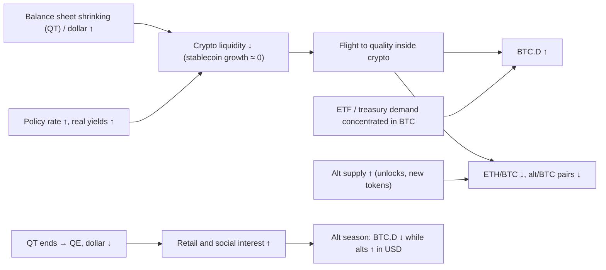

# 12. Dominance, altcoins and rotation

For anyone holding more than bitcoin, the most important question is often not "will crypto go up?" but "will the rest of crypto beat bitcoin, or bleed against it?". Cowen's best-documented calls are exactly here: bitcoin dominance rising toward 60% and then 65%, ETH "going home" to its $1,500–1,600 base in April 2025 (the ETH/BTC low came the same month), and no alt season in 2024–25 when most of the market expected one. This chapter explains the dominance and ratio charts he uses, the history of every alt season and every bleed, the mechanisms that make altcoins suffer more in tightening, and the evidence on his central claim that the Fed's *balance sheet* (QT vs QE) matters more for rotation than the policy *rate*, including the cases where that claim did not hold.

**You will learn**
- what BTC.D, ETH.D, USDT.D, TOTAL, TOTAL2, TOTAL3, OTHERS and OTHERS.D measure, and why BTC dominance with and without stablecoins can tell different stories;
- the history of BTC dominance and ETH/BTC from 2017 to October 2026, including the macro lab's ETH/BTC-by-year table;
- how alt/BTC pairs, the altcoin-to-BTC market-cap ratio and the Altcoin Season Index are read, and what Cowen means by "alt season" and the "final rotation";
- why altcoins tend to bleed against BTC when liquidity tightens;
- what the record says about balance sheet vs rates, with counter-examples from 2017, 2019, 2024 and 2026.

> **Data notes.** Dominance levels differ by 1–2 points between CoinMarketCap, CoinGecko and TradingView because they cover different sets of coins. Extremes from 2017–2019 vary most by provider and are not independently verified. ETH/BTC values are computed from Coin Metrics (course research) or from FRED's Coinbase series (the [macro lab](../../tools/macro-lab/REPORT-2026-10-30.md)); exchange prints can differ slightly.

---

## 1. The tickers

| Ticker (TradingView) | What it measures | Late October 2026 |
|---|---|---|
| `CRYPTOCAP:BTC.D` | BTC market cap ÷ total crypto market cap (including stablecoins) | 59.37% (CoinGecko, 30 Oct); 59.5–60.1% in CoinMarketCap-based reports |
| BTC dominance ex-stablecoins | BTC ÷ (total − stablecoins) | ~67% (Cowen, Feb and Aug 2026) |
| `CRYPTOCAP:ETH.D` | ETH market cap ÷ total | 10.34% (CoinGecko) |
| `CRYPTOCAP:USDT.D`, `USDC.D`, `STABLE.C.D` | Stablecoin market caps ÷ total | USDT.D 6.79%, USDC.D 2.68% |
| `CRYPTOCAP:TOTAL` | Total crypto market cap | ~$2.67T (30 Oct, reported) |
| `CRYPTOCAP:TOTAL2` | Total excluding BTC | |
| `CRYPTOCAP:TOTAL3` | Total excluding BTC and ETH | |
| `CRYPTOCAP:OTHERS`, `OTHERS.D` | Coins outside the top 10, and their share | |
| `BINANCE:ETHBTC`, `SOLBTC`, … | Price of an alt in BTC | ETH/BTC 0.0289 (29 Oct) |
| Altcoin Season Index (blockchaincenter.net, CoinMarketCap) | % of top-50 (or top-100) coins beating BTC over 90 days | ~45–53, "mixed" (reported) |

ITC equivalents: "Dominance" (free tier), "Altcoin Market Capitalizations", "Altcoin Season Index", "Total Crypto Valuation vs. Trendline", a synthetic "Total Market Cap excl. BTC, ETH and stables", "Market Cap Hypotheticals", the "Flippening Index", and risk metrics for TOTAL and BTC.D as synthetic assets.

---

## 2. Dominance

### Bitcoin dominance (CRYPTOCAP:BTC.D), with and without stablecoins

**What it is.** BTC's share of total crypto market capitalization. Because stablecoins are part of "total crypto", a rise in stablecoin market cap mechanically lowers BTC.D even if nothing changes between BTC and altcoins. That is why Cowen shows it both including and excluding stablecoins.

**Where to find it.** TradingView `CRYPTOCAP:BTC.D`; [CoinGecko](https://www.coingecko.com/en/charts/bitcoin-dominance); CoinMarketCap; ITC "Dominance".

**How to read it.** Rising dominance means BTC is beating the rest of the market, whether the whole market is rising or falling. Falling dominance can mean alts are rising faster (an alt season) or that stablecoins' share is growing in a falling market (risk-off). Always check which.

| Date | BTC.D (including stablecoins) | Context |
|---|---|---|
| Before 2017 | ~80–95% | Few alternatives |
| Jun 2017 | ~37–38% | ICO boom; ETH/BTC all-time high |
| Jan 2018 | 32.4% (CMC, 14 Jan); 31.1% (CoinGecko) | All-time low, a month after BTC's Dec 2017 top |
| Sep 2019 | ~70–73% | Peak around 10 Sep; QT ended 1 Aug 2019 |
| Jan 2021 | ~70% | Start of the 2021 alt season |
| May 2021 | ~39–40% (39.3% on 19 May) | Alt-season low, during QE and zero rates |
| Late 2022 | ~38–40% | Bear-market low for dominance |
| 30 Oct 2024 | 60% | Cowen's long-held target reached |
| Early May 2025 | ~65% (64.98–65.2%) | Highest since early 2021; cycle high in June 2025 |
| Jul–Aug 2025 | ~57–61% | ETH rally toward its all-time high |
| 2026 | ~58–61% (high ~60.6% on 5 May) | Headline stalled as stablecoins' share rose; ex-stables ~67% |
| 30 Oct 2026 | 59.37% (CoinGecko) | |

**How Cowen uses it.** It is one of his most frequent charts (281 video titles or summaries) and the source of several of his best calls:
- From mid-2023 he targeted 60% (for example 23 Aug and 8 Oct 2023), expecting it "by end of summer or September" (May 2024) and then "September or December" ([Benzinga, Aug 2024](https://benzinga.com/markets/cryptocurrency/24/08/40402971/bitcoin-market-dominance-in-final-stretch-will-peak-at-60-until-december-analyst-says)). It reached 60% on 30 October 2024 ("Bitcoin Dominance Hits 60%!"). In November 2024 he noted dominance had "retraced to the 0.618 Fib (60%), which marked the top for dominance last cycle" (X post, reported).
- His base case was that dominance "will likely go higher until quantitative tightening is over" ([Benzinga, Nov 2024](https://www.benzinga.com/markets/cryptocurrency/24/11/41850110/federal-reserve-cuts-interest-ratesbitcoin-dominance-may-rise-as-a-result)), and "last cycle the transition from QT to QE marked the top for BTC dominance" ([Cointelegraph Magazine, 19 Nov 2024](https://cointelegraph.com/magazine/bitcoin-dominance-crypto-predictions-bull-run-benjamin-cowen-hall-of-flame/)).
- In November 2024 he expected dominance to "go down in 2025". It rose instead, and on 25 February 2025 he moved the target to 66% ("The Bitcoin Dominance Train (To 66%?)"). It broke 65% on 6 May 2025 ("Bitcoin Dominance Breaks 65%!") and made a cycle high on 22 June 2025.
- He argues rising dominance "is not inherently negative", that it happens whether BTC/USD rises or falls, and that a BTC-heavy portfolio has given better risk-adjusted returns while dominance rises.
- In 2026 he pointed to dominance excluding stablecoins to show that BTC was still gaining on alts even while the headline number stalled: about 67% on 15 February, 66.8% in his July memo (up from about 40% at the 2021 low) and 67.37% in his [August 2026 memo](https://benjamincowen.com/reports/the-balance-of-risks-august-2026). In April he wrote that the headline's apparent stability at 58–60% was misleading because the stablecoin share had grown ([Crypto Risk Memo Q2 2026](https://benjamincowen.com/reports/crypto-risk-memo-q2-2026)).
- **"Durable rotation."** His July 2026 memo defines the condition he would need to see before calling a real rotation into higher-risk crypto: "a sustained decline in Bitcoin dominance excluding stablecoins, persisting over months rather than weeks" ([memo](https://benjamincowen.com/reports/bitcoin-cycle-memo-july-2026)). Isolated alt rallies, such as ETH's run in July–August 2025, do not count. Neither the 2019 nor the 2025 top was followed by a durable rotation.

**Connections.** Dominance has tracked liquidity regimes: it fell in the 2017 global-QE / ICO boom and the 2020–21 QE (about 70% → about 39–40%), and rose through hikes and QT (2018–19: about 33% → about 70%+; 2022–25: about 40% → about 65%). Since 2024 the ETF and corporate-treasury bid has been concentrated in BTC, adding a structural floor. Sections 4 and 5 test the QT link in detail.

**What it has meant for assets.** Rising dominance has meant alts underperforming BTC, both in rallies and in falls. Falling dominance with rising alt prices has occurred only in liquidity booms (2017, 2021) and short bursts.

**Investor takeaway.** Dominance is a relative-performance gauge, not a price signal. Read it with and without stablecoins, or you will confuse a risk-off move into stables with an alt rotation.

### Stablecoin dominance (USDT.D, USDC.D, STABLE.C.D)

**What it is.** Stablecoin market cap ÷ total crypto market cap.

**How to read it.** It rises when crypto prices fall (the denominator shrinks) and when money parks in stables, so it moves inversely to `TOTAL`. Breaks of USDT.D support or resistance are used as risk-on / risk-off confirmation. In 2026 it rose through the drawdown because stablecoin supply held flat (about $300–310B, [chapter 11](11-ON-CHAIN-AND-SENTIMENT.md#stablecoin-supply-growth)) while crypto market cap fell; in late October USDT.D was 6.79% and USDC.D 2.68%.

**How Cowen uses it.** "Stablecoin Dominance" (26 Jan 2024) and, in 2026, an "unfortunate pattern": stablecoin dominance broke out of a multi-year base and pulled back, like earlier breakouts in BTC dominance, the Hang Seng Index and palladium, which he read as bearish for crypto ("Bitcoin: An Unfortunate Pattern", 7 Jan 2026, with updates on 18 Mar and 20 May 2026). He targeted 14–15% later in 2026. As of 30 October 2026, USDT.D plus USDC.D was about 9.5% on CoinGecko's data; whether his target used the same measure is not verified, so the course treats the call as open. BTC rallied from July to early October 2026. Rising stablecoin dominance is also his explanation for why headline BTC.D stalled in 2026.

**Investor takeaway.** Stablecoin dominance is mostly an inverted crypto price index plus the stablecoin supply trend. Read it as risk appetite inside crypto.

### ETH dominance (CRYPTOCAP:ETH.D)

ETH's share of total crypto market cap: about 10.34% in late October 2026 (CoinGecko), against peaks of about 20–22% in 2021 and briefly 30%+ in 2018 (reported). It moves with ETH/BTC and with ETH's share of the alt market. Cowen discusses ETH mainly through ETH/BTC (next section), which removes the effect of the overall market's direction.

---

## 3. ETH/BTC and the altcoin ratios

### ETH/BTC (BINANCE:ETHBTC)

**What it is.** The price of one ether in bitcoin. Cowen calls ETH "the altcoin index": the largest and most liquid alt, whose ratio to BTC tends to lead or summarize the rest (2023, reported via Coin Bureau).

**Where to find it.** TradingView `BINANCE:ETHBTC`; compute from FRED `CBETHUSD` ÷ `CBBTCUSD`.

**How to read it.** A rising ratio means ETH (and usually alts) beat BTC. Key history (course research from Coin Metrics):
- all-time high 0.146 on 12 June 2017 (about 0.15 intraday); a secondary peak of about 0.113 in January–February 2018;
- a bleed during QT to 0.0164 on 6 September 2019;
- 0.0255 at end-2020, then 0.0877 on 8 December 2021; 0.0847 around the Merge (7 September 2022);
- a long bleed to 0.0181 on 21 April 2025, the lowest since 2019 (some exchange prints about 0.0177);
- a bounce to 0.0422 on 24 August 2025, when ETH made a nominal all-time high of about $4,950 intraday, while the ratio stayed far below 2017 and 2021;
- 0.0352 (6 January 2026) → 0.0257 (6 June 2026) → 0.0327 (13 September, reported) → 0.0289 (29 October 2026).

The [macro lab](../../tools/macro-lab/REPORT-2026-10-30.md) measures the ratio by calendar year against the Fed's rate moves:

| Year | ETH/BTC first week | Last week | Change | Fed target change in year | Balance-sheet regime (context) |
|---|---|---|---|---|---|
| 2017 | 0.0082 | 0.0535 | +549% | +0.75 pp | QT announced Sep, started Oct; global QE and ICO boom |
| 2018 | 0.0691 | 0.0362 | −48% | +1.00 pp | QT |
| 2019 | 0.0386 | 0.0182 | −53% | −0.75 pp | QT until 1 Aug, then end of QT |
| 2020 | 0.0184 | 0.0262 | +42% | −1.50 pp | Unlimited QE from March |
| 2021 | 0.0298 | 0.0800 | +169% | 0.00 pp | QE (taper announced Nov) |
| 2022 | 0.0810 | 0.0724 | −11% | +4.25 pp | QT from June |
| 2023 | 0.0722 | 0.0539 | −25% | +1.00 pp | QT |
| 2024 | 0.0506 | 0.0362 | −28% | −1.00 pp | QT (slowed in June) |
| 2025 | 0.0361 | 0.0336 | −7% | −0.75 pp | QT slowed to a trickle in April; ended 1 Dec |
| 2026 | 0.0343 | 0.0289 | −16% (to late Oct) | +0.25 pp | No QT; reserve-management bill purchases |

Read the "rate" column alone and the link looks weak or backwards: 2017 was ETH/BTC's best year with rates *rising*, and 2019 and 2024, both cutting years, were among its worst. Add the balance-sheet column and the pattern improves: the two big up-years (2017, 2020–21) coincided with abundant global or Fed liquidity, and most down-years with QT. 2022 is a partial exception: the ratio fell only 11% despite +4.25 pp of hikes and the start of QT; one likely reason is the Merge narrative, which lifted ETH/BTC to 0.0847 in September 2022. Section 5 goes further.

**How Cowen uses it.** It is one of his most frequent charts (146 video titles or summaries).
- Earlier calls: "ETH/BTC could crash to 0.032" (Benzinga, September 2023); a target of 0.03–0.04 and "all BTC pairs to 0.25" (25 October 2024). In November 2024 he wrote: "For the 1st time in 3 years, there is an actual chance that ETH/BTC has bottomed… 0.03465" ([X, Nov 2024](https://x.com/benjamincowen/status/1855065310186889454)). That was premature: the ratio fell another ~48% over five months.
- His QT anchor from 2019: "ETH/BTC bottomed when QT ended" and "In 2019, ETH/BTC bottomed about 5 weeks after the 1st rate cut"; no clear reason to assume the bleed was over "until quantitative tightening ends" ([Daily Hodl, 6 Feb 2025](https://dailyhodl.com/2025/02/06/benjamin-cowen-warns-ethereum-could-continue-bleeding-against-bitcoin-says-one-factor-to-determine-bottom/); [13 Mar 2025](https://dailyhodl.com/2025/03/13/welcome-to-pain-analyst-benjamin-cowen-says-ethereum-mirroring-2019-market-cycles-playbook/)).
- Spring 2025: "Welcome Home, Ethereum" (7 Apr 2025) — ETH back to its $1,500–1,600 base. ETH's low was about $1,386 on 9 April 2025. He says he bought ETH in April 2025 and that ETH/BTC bottomed then ([Bankless, 23 Dec 2025](https://www.bankless.com/podcast/where-is-crypto-going-in-2026-ben-cowen)). ETH rose about 3.5× to its August all-time high, and ETH/BTC to about 0.042.
- December 2025: a possible ETH/BTC target near 0.053 (the 0.5 Fibonacci retracement and pre-Merge low); ETH's "fair value log regression could be near $2,100 in 2026"; a run to $5k in early 2026 would likely be a bull trap. ETH "does best when the fed funds rate is at or below the 2-year yield" (Bankless). ETH was "back home" again in February 2026 ("Welcome Back Home, Ethereum!", 9 Feb 2026) and about $2,230–2,260 in late October 2026.

**Connections.** ETH/BTC bottoms have come near balance-sheet turns: 6 September 2019 (five weeks after the first cut on 31 July and the end of QT on 1 August) and 21 April 2025 (three weeks after QT's Treasury runoff was slowed to a trickle on 1 April). Both times the bounce faded once the BTC bear market began. Alts also bottom later than BTC in BTC terms: ETH/BTC's 2019 low came nine months after BTC's December 2018 low, and its 2025 low more than two years after BTC's November 2022 low.

His 2020 "Ethereum Letters" (the web summary, dated 20 February 2020; the PDF is behind an e-mail form) already argued that ETH is "fundamentally different from Bitcoin", not just higher-beta BTC, and that "ETH/BTC dynamics … often provide more actionable information than absolute price levels" ([Ethereum Letters 2020](https://benjamincowen.com/reports/ethereum-letters-2020)).

**Investor takeaway.** ETH/BTC is the cleanest single gauge of whether the market is rewarding risk inside crypto. Two of two lows came near a balance-sheet turn, which is suggestive, not proof.

### Alt/BTC pairs and the altcoin-to-BTC market-cap ratio

**What it is.** Any altcoin priced in BTC (`SOLBTC`, `ADABTC`, …), and Cowen's aggregate version: altcoin market cap divided by BTC market cap.

**How to read it.** Most alt/BTC charts since 2021 are long downtrends punctuated by sharp, short rallies.

**How Cowen uses it.** "Altcoins are oscillators at best and bleeders at worst" (August 2024). An alt season, he argues, requires alts to capitulate to historical range lows against BTC first ("all bitcoin pairs to range lows"), with the aggregate ratio near 0.25. He tracked it in "Altcoins Hit 0.32 / 0.31 / 0.29" (14 Jun, 4 Jul, 14 Oct 2025): 0.32 in June 2025, 0.31 in July and 0.29 in October, when he said 0.25 was "already reached" if USDC is included. Alts were "back at 2022 lows" by February 2026. See also "SOL/BTC: Dealing With Emotions" (27 Feb 2025) and "Bitcoin Dominance: The Final Stretch" (12 Aug 2024).

**Investor takeaway.** Pricing alts in BTC strips out the overall market's direction and shows whether holding them instead of BTC paid off. For most alts since 2021 it has not.

### TOTAL, TOTAL2, TOTAL3, OTHERS and OTHERS.D

**What they are.** `TOTAL` is the whole crypto market cap; `TOTAL2` removes BTC; `TOTAL3` removes BTC and ETH; `OTHERS` is everything outside the top 10, and `OTHERS.D` its share of the total. ITC adds a synthetic "Total Market Cap excl. BTC, ETH and stables" and treats TOTAL as an asset with its own risk metric ("Total Cryptocurrency Market Capitalization Risk Metric", 5 Oct 2021).

**How to read them.** They are the "long-tail alt" gauges. OTHERS.D has made lower highs every cycle since 2021, and TOTAL3 failed to exceed its 2021 high in real terms through most of 2024–26. The 2024–26 cycle is the first in which BTC made decisive new highs while the median alt never regained its 2021 high: a "narrow" crypto bull, similar to the mega-cap concentration in US equities (the course's interpretation). Breadth tools such as ITC's crypto "Advance Decline" charts and "Coins Above/Below Moving Average" measure the same narrowness; equity breadth is in [chapter 08](08-STOCKS-GOLD-AND-CROSS-ASSET.md).

**Investor takeaway.** Check TOTAL3 and OTHERS.D before believing that "crypto" is in a bull market: in 2024–25, BTC was, most of the market was not.

### The Altcoin Season Index and the definition of alt season

**What it is.** The [blockchaincenter.net index](https://www.blockchaincenter.net/en/altcoin-season-index/) is the percentage of the top 50 coins (excluding stablecoins and wrapped tokens) that outperformed BTC over the past 90 days; 75 or more is "altcoin season", 25 or less "Bitcoin season". CoinMarketCap publishes a top-100 version. ITC has "Altcoin Season Index" (Basic tier).

**How to read it.** It peaked at 98 on 16 April 2021. It never reached 75 in Q4 2025 and read about 45–53 ("mixed") in late October 2026. Because it uses 90-day windows, short bursts can push it up without a lasting change in trend.

**How Cowen uses it.** He defines alt season as **falling BTC dominance while alts rise in USD** (falling dominance in a crash does not count). "Bitcoin Season Vs. Altcoin Season" (11 Dec 2022) compares the 90-day ROI of BTC with the top 50. He lists three conditions for a real alt season: "(1) looser monetary policy, (2) high retail social interest, (3) Bitcoin topping on euphoria rather than apathy" (22 Dec 2025). None was present in 2024–25, so he called for no alt season ("Why Has Alt Season Not Happened Yet?", 7 Feb 2025 and Part 2, 27 Jun 2025; "Why ALT Season Has Not Happened", 4 Nov 2025; "Why So Many People Were Wrong About Altcoins", 22 Dec 2025; [Benzinga, Jul 2025](https://www.benzinga.com/crypto/cryptocurrency/25/07/46217148/heres-why-altcoin-season-for-xrp-eth-sol-has-not-happened-yet)). In February 2026 he said the next alt season would come "only when monetary conditions become significantly looser, potentially in 2027–2029" (reported). The research scores this as one of his clearest hits: he held the call against the crowd for about two years.

**Investor takeaway.** An index reading is a snapshot; Cowen's three conditions describe the regime that has produced lasting alt seasons in the past.

### The "final rotation"

**What it is.** Cowen's name for the late-cycle return of capital from alts back into BTC in the post-halving year: dominance rises again into September–October as alts give back their gains.

**How Cowen uses it.** "Bitcoin Dominance: The Final Rotation" (31 Aug, 29 Sep, 10 Oct, 21 Oct, 26 Oct 2025) and "Bitcoin Dominance To Surge Into December" (Nov 2025). After dominance dipped to about 57–58% during the July–August 2025 ETH rally, he expected it back up into autumn. Alts fell hardest in the 10 October 2025 crash and the alt/BTC ratio reached 0.29 on 14 October; the research scores the call as a hit.

**Investor takeaway.** Late in a cycle, alt rallies that are not backed by the three conditions above have tended to reverse into BTC.

### Flippening Index and market-cap hypotheticals

Platform tools rather than video topics. The "Flippening Index" tracks ETH's market cap as a share of BTC's (a "flippening" would be ETH overtaking BTC); "Market Cap Hypotheticals" shows what price a coin would have at another coin's market cap. Both are useful mainly as reality checks on narratives.

---

## 4. Why altcoins bleed against bitcoin when liquidity tightens

The mechanisms below are the course's synthesis, consistent with Cowen's framing:

1. **Higher beta, longer duration.** Alts are riskier, with weaker cash-flow anchors. A rising discount rate (higher real yields) cuts the present value of distant, uncertain payoffs most.
2. **The marginal buyer disappears first.** Tightening shrinks speculative liquidity: leverage, stablecoin growth and retail inflows. Those are precisely the buyers of small caps.
3. **Supply keeps growing.** Token unlocks and new listings inflate alt supply continuously while BTC supply is nearly fixed. Tens of millions of tokens split the alt bid ("index dilution").
4. **Institutional demand is BTC-first.** In 2024–26, spot ETF and corporate-treasury demand concentrated in BTC. Spot ETH ETFs (July 2024) drew far less, until the mid-2025 ETH-treasury-company fad.
5. **Flight to quality inside crypto.** In risk-off phases, crypto holders rotate from alts into BTC or stablecoins before leaving crypto entirely. Cowen calls this the **quality ladder**: in tightening, capital climbs toward quality within each asset class (alts → BTC, small caps → large caps, speculative growth → cash flow), so record highs at the top of the ladder can coexist with weakness further down ([August 2026 memo](https://benjamincowen.com/reports/the-balance-of-risks-august-2026); equity side in [chapter 08](08-STOCKS-GOLD-AND-CROSS-ASSET.md)).

Cowen describes this as a **risk cascade**: in tightening, risk leaves from the outer end of the risk curve inward — altcoins first, then BTC, then equities, with gold and energy holding longest — and returns in reverse in easing. The staged framework is in his [How Risk Cascades Through Markets memo (15 Mar 2026)](https://benjamincowen.com/reports/how-risk-cascades-through-markets-march-2026); the explicit asset ordering comes from his video "Business Cycles Ends With Recessions" (25 Feb 2026, per video summary). The cross-asset version is in [chapter 13](13-HOW-IT-ALL-CONNECTS.md). He also argues "altcoin rotations have historically followed stock market sell-offs that prompted Fed easing. The Fed doesn't rescue crypto directly" (Bankless, 23 Dec 2025).

**Alt seasons and bleeds, by episode**

| Episode | BTC.D | ETH/BTC | Macro backdrop | What happened |
|---|---|---|---|---|
| May–Jun 2017 and Dec 2017–Jan 2018 | 38% → 32% | ATH 0.146 (Jun 2017) | Fed hiking, but global QE and the ICO mania | Alt season; alts peaked after BTC (ETH/USD top 13 Jan 2018) |
| 2018–2019 | ~33% → ~70%+ | 0.146 → 0.0164 (Sep 2019) | Hikes to Dec 2018; QT Oct 2017–Jul 2019 | Long bleed; ETH/BTC bottomed after QT ended |
| Q1–Q2 2021 | ~70% → ~40% | 0.0255 → 0.0877 (Dec 2021) | $120B/month QE, zero rates | Alt season; index 98 on 16 Apr 2021 |
| 2022–Apr 2025 | ~40% → ~65% | 0.085 → 0.0181 | Hikes to Jul 2023, QT from Jun 2022; cuts from Sep 2024 but QT continuing | Long bleed despite the 2024 cuts |
| Feb 2024; Nov–Dec 2024 | brief dips | brief bounces | Post-election optimism | Short bursts, no regime change |
| Jul–Aug 2025 | 65% → ~57–58% | 0.0181 → 0.0422 | QT slowed (Apr), ETH-treasury companies | ETH-led rally; faded into the "final rotation" |
| 2026 | ~58–61% (ex-stables ~67%) | 0.0352 → 0.0257 → 0.0289 | No QT, but a hike on 16 Sep; 10-year > 5%; oil > $100 | No alt season; alts back at 2022 lows by Feb 2026 |

---

## 5. Balance sheet vs policy rate: what the record shows

Cowen's claim is about the *balance sheet*: BTC dominance rises during QT and peaks around the QT → QE transition, and ETH/BTC bottoms near the end of QT. The policy *rate* is secondary. The table below (course research from FRED `DFEDTARU` and `WALCL`, Coin Metrics and dominance reports) checks it regime by regime.

| Fed regime (dates) | BTC.D | ETH/BTC | Fits "tightening → BTC.D up, ETH/BTC down"? |
|---|---|---|---|
| Hikes Dec 2015 → Dec 2018 (0.25% → 2.50% upper bound); QT Oct 2017 → Jul 2019 | 2017: fell to 32% despite hikes; 2018–19: rose to ~70% during QT | 0.146 (Jun 2017) → 0.0164 (Sep 2019) | 2017 contradicts; 2018–19 fits |
| Cuts 31 Jul, 18 Sep, 30 Oct 2019; QT ended 1 Aug 2019 | Peaked ~Sep 2019 | Bottom 6 Sep 2019, five weeks after the first cut | Fits (Cowen's anchor case) |
| Emergency cuts Mar 2020 to 0–0.25%; unlimited QE (Fed assets ~$4.2T → ~$8.9T by 2022) | ~70% (Jan 2021) → ~39–40% (May 2021) | 0.023 (Mar 2020) → 0.0877 (Dec 2021) | Fits strongly; alts lagged QE by ~9–12 months |
| Taper announced 3 Nov 2021; hikes Mar 2022 → Jul 2023 (to 5.50%); QT from 1 Jun 2022 | ~40% → 54% (2023) → ~57–60% (2024) | 0.085 (Sep 2022) → 0.038 (Sep 2024) | Fits |
| Cuts 18 Sep, 7 Nov, 18 Dec 2024 (to 4.50%); QT continuing (Treasury cap cut Jun 2024) | Kept rising to ~60–62% | Kept falling (0.0385 at the first cut) | Rate cuts alone did **not** reverse it; QT continued |
| QT slowed 1 Apr 2025 (Treasury runoff cap ~$5B/month) | Above 65% from early May 2025; cycle high 22 Jun 2025 | Bottom 21 Apr 2025 (0.0181) → 0.0422 (24 Aug) | Fits the "balance sheet over rates" version |
| Cuts 17 Sep, 29 Oct, 10 Dec 2025 (to 3.50–3.75%); QT ended 1 Dec 2025 | ~57–61% | 0.032–0.036 (Dec 2025–Jan 2026) | BTC topped 6 Oct 2025, ~8 weeks before QT ended (2019: top 26 Jun, QT end 1 Aug, ~5 weeks) |
| Holds Jan–Jul 2026; hike 16 Sep 2026 (to 3.75–4.00%); hold 28 Oct; 10-year > 5.2%, Brent > $100 (Sep) | ~58–61% | 0.0257 (Jun) → ~0.029 | Consistent with no alt season under renewed tightening |

**What holds up.**
- Dominance and ETH/BTC have responded to *net liquidity* (balance sheet, reserves, the dollar, stablecoin growth) more than to the level of the policy rate.
- The cleanest signals were the end of QT in 2019 and the QT slowdown in April 2025: ETH/BTC bottomed within about 0–6 weeks of a balance-sheet turn in both. That is two cases.
- BTC topped shortly before QT ended in both 2019 and 2025, about five weeks before (26 June → 1 August 2019) and about eight weeks before (6 October → 1 December 2025) per his July 2026 memo, a pattern Cowen highlights and reads as "Bitcoin often leads liquidity cycles" ([Crypto Macro Risk Memo Q1 2026, 15 Jan 2026](https://benjamincowen.com/reports/crypto-macro-risk-memo-q1-2026); see also "Bitcoin and the End of QT", 1 Dec 2025; [CryptoAdventure, 18 Apr 2026](https://cryptoadventure.com/benjamin-cowen-reveals-why-the-altcoin-season-never-came/)).

**Counter-examples and limits.**
- **2017:** the biggest alt season on record happened during a Fed hiking cycle, with QT starting in October. Global QE (ECB, BOJ, PBOC) and the ICO mania outweighed the Fed.
- **2019:** the end of QT and three cuts did not produce an alt rotation; ETH/BTC kept falling into 2020 and only turned with the 2020 QE.
- **2024:** three cuts did not stop the ETH/BTC bleed, because QT continued.
- **2025:** the April ETH/BTC low and the August bounce came *before* the September 2025 cut; QT ended on 1 December 2025 but no QE followed, so Cowen's "QT → QE marks the dominance top" rule went untested this cycle. His November 2024 call that dominance would fall in 2025 was a miss.
- **2026:** the Fed hiked, and dominance stayed near 58–61% with no alt season. Consistent with the framework, but a framework that predicts "no alt season" in most regimes is easy to agree with.
- **Structure may now dominate liquidity.** Institutional BTC preference and continuous token supply inflation may keep dominance high even in an easing cycle. That has not yet been tested.

**The ISM → alt-season thesis is not Cowen's.** A popular competing view (Raoul Pal / Real Vision) links alt seasons to the ISM manufacturing index rising above 50. The ISM rose above 50 in January 2026 and reached about 54–55 by August–September, yet ETH fell about 24% year-to-date and there was no alt season. Cowen never endorsed that thesis ("Bitcoin is not the economy"). The test is in [chapter 06](06-GROWTH-AND-THE-BUSINESS-CYCLE.md).

**Investor takeaway.** The policy link to alt performance is real but loose. It works through liquidity (QT/QE, the dollar, stablecoin growth) more than through the policy rate, rests on very few cycles, and may be weakening as institutional demand concentrates in BTC.

---

## Putting it together

1. **QT on → dominance up → alts bleed.** Fed balance sheet shrinking → dollar liquidity and stablecoin growth stall → speculative buyers leave alts first → BTC.D rises, ETH/BTC falls, whether BTC/USD is rising (2023–24) or falling (2018, 2022). Episodes: 2018–19 (BTC.D ~33% → ~70%), 2022–25 (~40% → ~65%). Exception: 2017, when global QE and the ICO mania produced an alt season despite Fed hikes and the start of QT.
2. **Balance-sheet turn → ETH/BTC low within weeks → bounce fades if the BTC bear starts.** QT ends (1 Aug 2019) or slows to a trickle (1 Apr 2025) → ETH/BTC bottoms within ~0–6 weeks (6 Sep 2019; 21 Apr 2025) → a sharp bounce (2025: 0.0181 → 0.0422 by August) → but once the BTC bear begins (2019 H2; Oct 2025), the ratio rolls over again. n = 2.
3. **Rate cuts without balance-sheet easing → no rotation.** First cut while QT continues (Sep 2024) → long yields and the dollar rise (10-year ~3.6% → ~4.8%, DXY ~100 → ~110 by January 2025) → BTC rallies on ETF flows, alts lag → BTC.D rises to 60% (Oct 2024) and 65% (May 2025). Cuts help alts only when liquidity actually expands.
4. **Apathetic top → no one left to sell alts to → final rotation into BTC.** Social interest low at the top (2019, 2025) → alt rallies are short and narrow (ETH Jul–Aug 2025) → late in the post-halving year, dominance rises again (Sep–Oct 2025) → alts fall hardest in the crash (10 Oct 2025) → alts back at 2022 lows by February 2026.
5. **Renewed tightening in a late cycle → stablecoin share up → headline dominance stalls but ex-stables dominance rises.** 2026: Fed hike (16 Sep), 10-year above 5%, oil above $100 → crypto falls, stablecoin supply flat → USDT.D and USDC.D rise → headline BTC.D stuck near 58–61% while BTC's share ex-stables stays about 67%. Cowen's conditions for the next alt season (looser policy, retail return, a euphoric top) were not in place as of October 2026.

---

## Check yourself

1. Why does Cowen show bitcoin dominance both including and excluding stablecoins?
2. By Cowen's definition, is a fall in BTC dominance during a crypto crash an alt season? Why or why not?
3. In the lab's ETH/BTC-by-year table, which years contradict the simple idea that "rate cuts help alts and hikes hurt them"?
4. What happened to ETH/BTC within weeks of the end of QT in 2019 and of the QT slowdown in April 2025, and why is that not proof?
5. Name three mechanisms that make alts bleed against BTC in tightening.
6. What are Cowen's three conditions for an alt season, and which were present in 2025?
7. What did TOTAL3 and OTHERS.D show about the 2024–26 crypto bull market?
8. Which Cowen dominance calls were hits and which was a miss in 2024–25?

Answers

1. Stablecoins are part of the total market cap, so when their share grows (often in falling markets) headline BTC.D falls even if BTC is still beating alts. In 2026, headline dominance stalled near 58–61% while ex-stablecoin dominance was about 67%.
2. No. Alt season means BTC dominance falls *while alts rise in USD*. In a crash dominance can fall because money moves into stablecoins, which is risk-off, not a rotation into alts.
3. 2017 (ETH/BTC +549% while the Fed hiked 0.75 pp), 2019 (−53% despite 0.75 pp of cuts), 2024 (−28% despite 1.00 pp of cuts) and 2025 (−7% despite 0.75 pp of cuts). 2022 is also odd: only −11% despite +4.25 pp. The balance-sheet regime explains several of these better than the rate.
4. ETH/BTC bottomed on 6 September 2019 (about five weeks after QT ended on 1 August) and on 21 April 2025 (about three weeks after QT slowed on 1 April). It is two observations, and in both cases the bounce faded once BTC's bear market began.
5. Any three of: higher beta and longer duration (hurt more by rising discount rates); the speculative marginal buyer leaves first; continuous token supply inflation and index dilution; institutional demand concentrated in BTC; flight to quality inside crypto.
6. Looser monetary policy, high retail social interest, and a BTC top on euphoria rather than apathy. In 2025 none was clearly present: QT ran until December, social interest was low, and the October top came on apathy.
7. That it was narrow: BTC made decisive new highs while TOTAL3 failed to exceed its 2021 high in real terms and OTHERS.D kept making lower highs; the median alt never regained its 2021 high.
8. Hits: BTC.D to 60% (reached 30 October 2024), the move to 66% (broke 65% on 6 May 2025), no alt season, ETH "going home" to $1,500–1,600 (April 2025) and the "final rotation" into October 2025. Miss: the November 2024 call that dominance would go down in 2025 (and the premature November 2024 ETH/BTC bottom call at 0.0347).

> Educational material, not financial advice. Past relationships between indicators can break.

[← 11 On-chain and sentiment](11-ON-CHAIN-AND-SENTIMENT.md) | [Index](00-INDEX.md) | [13 How it all connects →](13-HOW-IT-ALL-CONNECTS.md)
