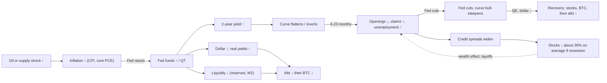
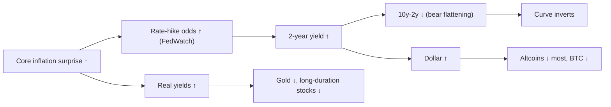
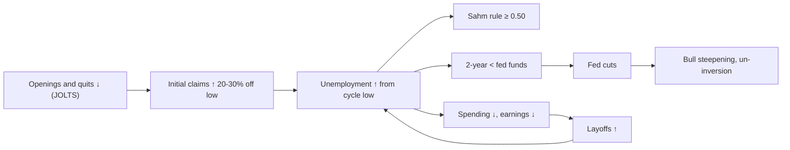
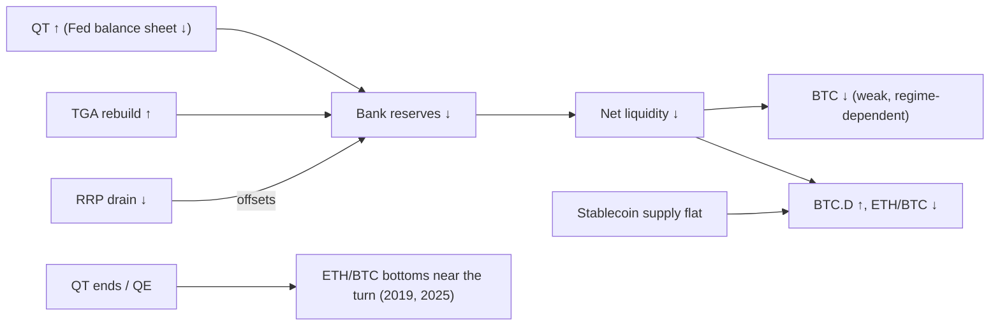
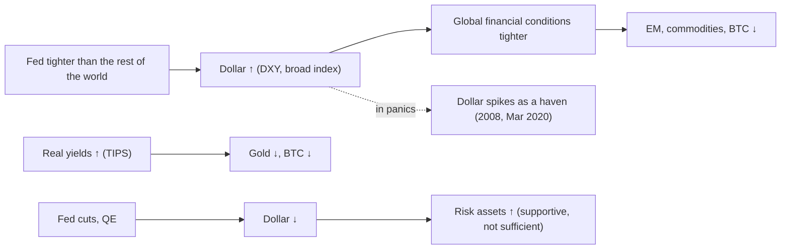
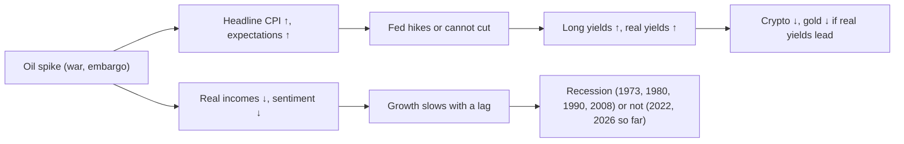
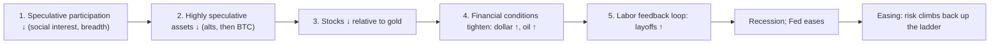
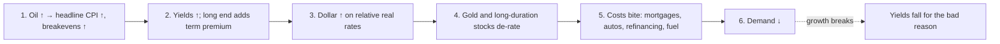

# 13. How it all connects

**Why this chapter matters.** Chapters 02 to 12 describe one indicator at a time. Markets do not move one indicator at a time. A typical chain looks like this: inflation goes up, then the Fed hikes, then the 2-year yield goes up faster than the 10-year, then hiring slows, then unemployment starts to rise, then the Fed cuts, then the curve steepens, and only then do stock prices and bitcoin show what kind of ending it was. This chapter puts the pieces in order. It gives the causal map, the usual sequences with their lags and dated episodes, a regime table that says what every major indicator and asset tends to do in each phase, a relationship matrix, the numbers from the course's macro lab, the counter-examples (2024–26 broke several templates), a real-time checklist for telling a soft landing from a hard one, and a factual description of where things stood on 30 October 2026.

**You will learn**
- the master causal map of the US cycle and seven smaller maps of its sub-systems, including Cowen's risk cascade, recession loop and squeeze loop;
- the canonical "late cycle → first cut → soft landing or recession → recovery" sequences, with typical lags, and how they played out in 1995, 1998, 2001, 2007–08, 2019–20, 2024–25 and 2026;
- what each indicator and each asset class has typically done in each phase of the cycle;
- which relationships are strong, which are weak, and which broke recently;
- Benjamin Cowen's late-business-cycle and "risk cascade" framework, as he stated it with dates, and an independent assessment of it;
- how to judge in real time whether a slowdown is turning into a recession;
- where the indicators stood on 30 October 2026.

---

## 1. The short version

Most of the course fits in one paragraph. Read it slowly, then use the rest of the chapter to check each link.

> Inflation rises (or a supply shock pushes it up) → the Fed hikes → the **2-year** yield rises faster than the **10-year**, so the curve **bear-flattens and inverts** → the dollar firms, real yields rise, liquidity tightens → speculative assets (altcoins first, then bitcoin) weaken while stocks can keep rising on earnings → job openings and quits roll over, then **claims** and **unemployment** turn up from their low → the 2-year falls below the policy rate and the Fed stops, then **cuts** → short yields fall faster than long ones, so the curve **bull-steepens and un-inverts** → if unemployment keeps rising (about +0.5 pp, the Sahm rule) and **credit spreads** widen, a **recession** follows within months, stocks fall about 36% on average (17–57% peak to trough in the eight recessions since 1969), and the Fed cuts deep and restarts QE → liquidity turns up, the dollar falls → stocks bottom 1–6 months before the recession ends (2001–02 was the exception), bitcoin usually earlier, altcoins last → a new expansion begins. If unemployment instead stabilises and spreads stay tight, it was an "insurance" cycle (a **soft landing**), stocks rise 11–29% in the year after the first cut, and the next risk is that the economy re-accelerates and the Fed has to hike again.

Every arrow in that paragraph has exceptions. The 2022–24 yield-curve inversion was the deepest since 1981 and no recession followed. The Sahm rule fired in July 2024 and no recession followed. M2 shrank in 2023 for the first time in the post-1959 record and bitcoin rose 156% that year. Sections 5, 6 and 9 show how reliable each link has been. The details of each indicator are in its own chapter: [02 Fed](02-THE-FED-AND-INTEREST-RATES.md), [03 bonds](03-BONDS-AND-THE-YIELD-CURVE.md), [04 inflation](04-INFLATION.md), [05 labor](05-THE-LABOR-MARKET.md), [06 growth](06-GROWTH-AND-THE-BUSINESS-CYCLE.md), [07 liquidity and dollar](07-LIQUIDITY-MONEY-AND-THE-DOLLAR.md), [08 cross-asset](08-STOCKS-GOLD-AND-CROSS-ASSET.md), [10 bitcoin cycles](10-BITCOIN-CYCLES-AND-VALUATION-MODELS.md), [12 dominance and alts](12-DOMINANCE-ALTCOINS-AND-ROTATION.md).

---

## 2. The master causal map

Arrows show the usual direction of influence. The sign says whether a rise in the first box tends to raise (↑) or lower (↓) the second. Dashed arrows are feedback loops.

How to read the map:
- **The engine is the policy rate relative to inflation.** The Fed moves the short end of the curve directly. Everything downstream (dollar, real yields, reserves, credit) responds to where the market thinks the policy rate is heading, which is why the 2-year yield matters more than the decision itself ([chapter 02](02-THE-FED-AND-INTEREST-RATES.md)).
- **There are two transmission belts.** One is *financial*: dollar, real yields, liquidity and spreads. It works within days to months and hits crypto first. The other is *real-economy*: hiring, layoffs, spending and earnings. It works with lags of a year or more and decides how deep the equity bear market gets.
- **The labor market closes the loop.** Rising unemployment is what makes the Fed switch from hiking to cutting, and falling asset prices can feed back into layoffs (the dashed arrow). Cowen stresses this feedback: "It's the stock market going down that leads to the recession" (["Bitcoin in a Late Business Cycle Environment", 27 Mar 2026](https://rosetta.to/u/intothecryptoverse/bitcoin-in-a-late-business-cycle-environment), video summary).
- **Supply shocks enter on the left.** An oil spike raises inflation while hurting growth, which puts the Fed in a bind. That is the 1973–74, 1979–80, 1990 and 2026 variant (map 3.5).

---

## 3. Smaller maps of the sub-systems

### 3.1 Inflation → Fed → the curve

Episodes: 2022 (CPI 9.0% in June, +525 bp of hikes in 16 months, 10Y–2Y inverted from July 2022) and 2026 (CPI rose from 2.4% in Jan–Feb to a May peak, the 2-year rose about 130 bp from its 27 February low of 3.38% while the 10-year rose about 108 bp, so 10Y–2Y bear-flattened from +0.74 on 30 January to +0.37 on 29 October). Data: [research notes B, FRED](https://fred.stlouisfed.org/series/T10Y2Y). Counter-example: in 2026 bitcoin *rose* after the Fed hiked on 16 September, from about $76k on the day to about $86k on 21 September (Coinbase via [FRED](https://fred.stlouisfed.org/series/CBBTCUSD)), extending a rally that began near $63k in mid-August, and the broad dollar rose with it (section 9).

### 3.2 The labor loop

Unemployment has momentum: once it has risen about 0.5 pp, layoffs cut spending, which causes more layoffs. That is why the Sahm rule works as a recession *confirmation* (in the [lab report](../../tools/macro-lab/REPORT-2026-10-30.md) it fired 1–3 months after the recession start in most cases since 1970). The 2024 trigger broke the loop because the rise came from a growing labor force (immigration, re-entrants) rather than from layoffs ([chapter 05](05-THE-LABOR-MARKET.md)).

### 3.3 Liquidity plumbing → crypto

Net liquidity is the Fed balance sheet minus the Treasury's cash account (TGA) minus the reverse-repo facility (RRP). In 2023–24 the RRP drained from a record $2.554T (30 Dec 2022) toward zero and offset QT, so reserves rose while the Fed shrank its balance sheet. That is the "liquidity paradox" of 2023–24: QT ran, and bitcoin and stocks still rallied ([chapter 07](07-LIQUIDITY-MONEY-AND-THE-DOLLAR.md)). On 29 October 2026 the RRP was $0.35bn, so that buffer is gone.

### 3.4 Dollar and real yields → everything priced in dollars

The link is real but modest. In the lab, bitcoin's weekly return correlation with the broad dollar was −0.08 over all weeks since 2015, −0.28 in 2020 and −0.11 in 2026 ([lab report](../../tools/macro-lab/REPORT-2026-10-30.md)). A falling dollar is supportive but not sufficient: the dollar had its worst first half since 1973 in H1 2025 (−10.8%), and bitcoin still topped in October 2025 and fell by half ([research notes C](https://finance.yahoo.com/news/dollar-posted-worst-first-half-153518559.html)).

### 3.5 The supply-shock variant (stagflation risk)

Five of the last eight US recession starts (1973, 1980, 1990, 2001, 2008) followed or coincided with oil roughly doubling within two years. The 2021–22 spike (+113% year on year) and the 2026 spike (+58% year on year in April) had not produced a recession as of October 2026 ([research notes C, FRED `WTISPLC`](https://fred.stlouisfed.org/series/WTISPLC)). The US is now a net petroleum exporter, so an oil spike partly moves income from consumers to US producers instead of abroad.

### 3.6 The risk cascade (Cowen's five stages)

This is Cowen's ordering, set out in his memo ["How Risk Cascades Through Markets"](https://benjamincowen.com/reports/how-risk-cascades-through-markets-march-2026) (15 Mar 2026; the PDF subtitle is "From Speculative Assets to the Real Economy"). He calls it the ITC Risk Cascade Framework.

In the March memo he placed the economy "between Stage 3 and Stage 4", and he wrote that stage 4 can happen "even if central banks begin shifting toward easing". Within each asset class he describes the same movement as a **quality ladder**: in tightening, capital moves from altcoins to bitcoin, from small caps to large caps, and from speculative growth to cash-flow companies. Index records in that phase are, in his August 2026 memo, "what the late stage of the ladder looks like": evidence of narrowing leadership, not of broad health, though not by themselves "the edge of a cliff" either. Section 8 tests the five stages against what happened next.

### 3.7 The recession feedback loop (seven steps)

From his May 2026 memo, ["The Fed's Late Business Cycle Trap"](https://benjamincowen.com/reports/macro-risk-memo-may-2026) (18 May 2026). This is the "one thing goes down, then another" chain for the real economy.

In May 2026 he judged the economy "stuck in the earlier stages". Two refinements from his February 2026 memo matter for reading it. First, **equity durability**: "the magnitude of a correction matters less than its duration". A short, sharp fall that recovers (1998, and early 2025 in his reading) does not reach step 4; persistent weakness (2000–01) compresses earnings expectations and credit, and layoffs follow. Second, **layoffs, not slower hiring, start recessions** (January 2026 memo): unemployment can drift up for a long time while firms simply hire less ("low-hiring, low-firing", as in 2024–26); the **nonlinear break** comes when layoffs accelerate and feed back through steps 5–7. He treats payrolls turning negative year on year as the confirmation line, while warning that it can lag (August 2026 memo).

### 3.8 The squeeze loop (six steps)

From his September 2026 memo, ["The Triple Squeeze"](https://benjamincowen.com/reports/the-triple-squeeze-september-2026) (30 Sep 2026; subtitle "Rising Yields, Rising Oil and a Firming Dollar Into Q4"). This is the supply-shock version of tightening, which works even without Fed hikes.

The memo adds a **sequence** to watch, which he calls sequence risk: gold tends to make its low first, near the dollar's high and 2–12 weeks before the 10-year yield peaks (about 12 weeks in 2018, about 3 in 2022, about 2 in 2023); the long end tops next; stress tends to show up around or after the yield top (his table of 10-year peaks since 1994, which he flags as "a hand-picked set"). The signal he gives for gold's low is a **dollar-yield divergence**: the dollar failing to make new highs while the 10-year still does. Oil rolled over before the 10-year by about 5 weeks in 2018 and about 4 months in 2022. He also warns that when yields fall "primarily because growth is breaking", that is worse for risk assets than yields falling because inflation cools.

---

## 4. The canonical sequences, with lags and dates

### 4.1 Step by step

The table merges the regularities from [research notes B](../../research-notes/B-fed-rates-inflation-labor.md) (§6.5) and C (§6.1) with the [lab report](../../tools/macro-lab/REPORT-2026-10-30.md). "Lag" is measured to the start of the NBER recession unless stated.

| Step | What happens | Typical lag | Range and evidence | Failed in |
|---|---|---|---|---|
| 1 | Fed hikes; 2-year rises above 10-year (bear flattening → inversion) | 10Y–3M inversion leads recession by 9–17 months | Lab: 14, 9, 9, 17, 10 months (1989–2019); 10Y–2Y 11–23 months | 1966–67, 1998 (brief), 2022–24 |
| 2 | Job openings and quits roll over | about 6–12 months before unemployment turns | 2022 openings peak about 12M → 7.08M (Aug 2026) | 2022–24 (openings fell, unemployment barely rose) |
| 3 | High-yield spreads make their low | 6–18 months before recession | HY OAS about 2.4–2.6 at the 2007 and Jan 2025 lows | 2025–26 (no recession yet) |
| 4 | Unemployment makes its cycle low | median about 8 months before recession | Lab: 33, 8, 2, 9, 1, 17, 12, 8, 1 months (1960–2020) | 2023 low of 3.4% (no recession) |
| 5 | 2-year falls below fed funds; last hike; pause | pause of about 4–18 months, mean about 10 | 1995: 5 m; 1998: 18 m; 2001: 7.5 m; 2007: 14.5 m; 2024: 14 m | no reliable link between pause length and outcome |
| 6 | Claims up 20–30% off the low; unemployment +0.5 pp (Sahm) | roughly coincident with recession start | Sahm fired 1–3 months after the start in 1980–2020 (lab) | 1976, 2024 false triggers |
| 7 | First cut; curve bull-steepens and un-inverts | 2–11 months before recession (lab); 0–7 months by [research notes B](../../research-notes/B-fed-rates-inflation-labor.md)'s daily dating | Lab, 10Y–3M: 11 and 7 (two 1989–90 episodes), 2, 7, 5 months | 2024–25 (un-inverted, no recession) |
| 8 | Stocks peak | about 5 months before recession on average (from 12 months before to 1 month after) | S&P peaks: Mar 2000, Oct 2007 (3 weeks after the first cut), Feb 2020 | 1987 crash and 2022 bear without recession |
| 9 | Recession begins (NBER dates it about 4–12 months later) | — | NBER announced the Dec 2007 peak in Dec 2008 | — |
| 10 | Unemployment peaks; stocks bottom | unemployment peaks 9–36 months after the first cut (median about 20); stocks bottom 1–6 months before the recession ends | 2001–02 is the exception: the low came 11 months after the trough | — |
| 11 | Liquidity turns up; BTC, then alts recover | months | 2020–21: QE, BTC +306% in 2020, alt season Apr–May 2021 | 2019: no alt season followed the end of QT |

Two numbers anchor the whole table. In recession cycles since 1970, the S&P 500 was on average about +3% twelve months after the first cut, with a range of −15% to +22% and drawdowns of up to −55% (2007–09). In non-recession cycles it was about +18% on average (+11% to +29%) ([research notes B §6.1](https://raw.githubusercontent.com/datasets/s-and-p-500/main/data/data.csv)). "Rate cuts are bearish" is therefore true only *conditional on a recession*, and nobody knows at the first cut which kind of cycle it is.

### 4.2 Soft landings and insurance cycles

| Episode | Last hike → first cut | Curve | Unemployment | Stocks after the first cut | Crypto | Outcome |
|---|---|---|---|---|---|---|
| **1995** | 1 Feb 1995 → 6 Jul 1995 (5 months; peak 6.00%) | no inversion episode in the lab tables | 5.7% at the cut, no further rise | Nasdaq +21.6% at 12 months, worst close 0% (lab); S&P +16% at 12 months, +66% at 24 months | — | Textbook soft landing |
| **1998** | 25 Mar 1997 → 29 Sep 1998 (18 months; peak 5.50%); cuts after the LTCM crisis | brief 10Y–2Y dip in Jun 1998 | 4.6%, flat | Nasdaq +57.5% at 12 months, worst −18.2% (lab); S&P +29% | — | Insurance cuts; then the Fed re-hiked in 1999–2000, the curve inverted again in 2000, and the 2001 recession followed |
| **2019** | 19 Dec 2018 → 31 Jul 2019 (7 months; peak 2.50%) | 10Y–3M inverted May 2019, un-inverted Oct 2019 (lab) | 3.6% at the cut | Nasdaq +32.5% at 12 months, worst −15.4% (lab) | BTC topped 26 Jun 2019, before the cut and about 5 weeks before QT ended on 1 Aug 2019 (Cowen's July 2026 memo puts the 2025 gap at about 8 weeks); BTC +9% at 12 months; ETH/BTC low 0.0164 on 6 Sep 2019 | Insurance cycle overrun by an outside shock: COVID recession from Mar 2020 |
| **2024–25** | 26 Jul 2023 → 18 Sep 2024 (14 months; peak 5.50%); 175 bp of cuts to Dec 2025 | 10Y–2Y un-inverted 6 Sep 2024; 10Y–3M durably positive from 17 Oct 2025 | 4.1% at the cut → 4.5% peak in Nov 2025 (first reported as 4.6%); Sahm triggered Jul 2024 | Nasdaq +25.6% at 12 months, worst −15.2% (lab); S&P −11% at the Apr 2025 tariff low, then records | BTC +83% at 12 months (lab); BTC.D 60% on 30 Oct 2024, about 65% in May 2025; ETH/BTC low 0.0181 on 21 Apr 2025; BTC top 6 Oct 2025 | No recession as of Oct 2026; re-hike on 16 Sep 2026 |

What the soft landings share: unemployment rose little or not at all after the first cut (0 to +0.4 pp), credit spreads stayed tight, and stocks rose. What they do *not* share: the curve (no inversion in 1995, deep inversion in 2022–24), the length of the pause (5 to 18 months), and what crypto did (2019 topped before the cut; 2024 rallied after it). A detail from 2024: after the first cut on 18 Sep 2024, the 10-year yield *rose* from 3.63% to 4.58% by the end of 2024 and the DXY went from about 100 to about 110 by mid-January 2025. Cowen had argued in October 2024 that without a recession, the long end and the dollar rally after the first cut (["The Yield Curve & Bitcoin", 23 Oct 2024](https://rosetta.to/u/intothecryptoverse/the-yield-curve-bitcoin)). That call was right.

### 4.3 Recessions

| Episode | Last hike → first cut | Curve | Unemployment | Stocks | Other markets | Recession |
|---|---|---|---|---|---|---|
| **2001** | 16 May 2000 → 3 Jan 2001 (7.5 months; peak 6.50%) | 10Y–3M inverted Jul 2000, un-inverted Feb 2001, 2 months before the recession (lab) | low 3.8% in Apr 2000, 12 months before; 4.2% at the cut → 6.3% in Jun 2003 | S&P peaked 24 Mar 2000; −42% from the first cut to 9 Oct 2002; Nasdaq −48.1% worst within 18 months (lab) | oil +205% in 1999–2000 | Mar/Apr–Nov 2001; Sahm fired Jun 2001 |
| **2007–08** | 29 Jun 2006 → 18 Sep 2007 (14.5 months; peak 5.25%) | 10Y–3M inverted Aug 2006, un-inverted Jun 2007, 7 months before (lab) | low 4.4% in May 2007, 8 months before; 4.7% → 10.0% in Oct 2009 | S&P made its all-time high 3 weeks *after* the first cut (9 Oct 2007), then −55% to 9 Mar 2009 | oil to $133 (Jul 2008 monthly); HY spreads above 20 pp (Dec 2008); VIX close 80.86 (20 Nov 2008) | Dec 2007/Jan 2008–Jun 2009; Sahm fired Apr 2008 |
| **2020** | (insurance cuts from Aug 2019) → emergency cuts 3 and 15 Mar 2020 | un-inverted months before | low 3.5% in Feb 2020 → 14.8% in Apr 2020 | S&P −34% (19 Feb → 23 Mar 2020); low about a week after the last cut | VIX close record 82.69 (16 Mar); DXY 102.99 (19–20 Mar); BTC low 12–13 Mar 2020 (about $3.8–4.9k), then +306% in 2020 | Feb/Mar–Apr 2020; unlimited QE took the Fed balance sheet from $4.17T to $8.965T (Apr 2022) |

What the recessions share: unemployment had already risen 0.5–0.9 pp from its low by the time the recession started (lab: 0.6 pp in 2001, 0.6 pp in 2008, 0.9 pp in 2020), the Fed cut *into* the rise, the curve had un-inverted shortly before, and stocks kept falling well after the first cut. In 2008 and 2020 the dollar spiked as a haven before falling. Bitcoin only existed for the last one; in March 2020 it fell with everything else and then led the recovery once the Fed flooded the system.

### 4.4 The 2026 regime: oil shock and a re-hike

2026 fits neither template cleanly. The sequence, all dated:

| Date | Event | Source |
|---|---|---|
| Dec 2025 | Fed's third cut of 2025, to 3.50–3.75%; QT had ended on 1 Dec 2025 | [Fed statements](https://www.federalreserve.gov/newsevents/pressreleases/monetary20251210a.htm) |
| Jan 2026 | CPI 2.4%; 10Y–2Y peaks at +0.74 (30 Jan); ISM Manufacturing back above 50 (52.6) for the first time in 12 months; gold peaks near $5,560 (late Jan) | [research notes B](../../research-notes/B-fed-rates-inflation-labor.md), C |
| 5–6 Feb | BTC crashes to about $60k (−52% from its ATH); Fear & Greed hits an all-time low of 5 (12 and 23 Feb) | [research notes A](../../research-notes/A-cowen-inventory.md), D |
| 28 Feb | US–Israeli strikes on Iran; WTI goes from $67 to $91 within a week in early March | [research notes A](../../research-notes/A-cowen-inventory.md) |
| Mar–May | CPI 3.3% (Mar), 3.8% (Apr), peak in May; Brent averages $117 in April; S&P falls 9.1% to 6,343.72 (30 Mar), then recovers; Michigan sentiment record low 44.8 (May) | [research notes B](../../research-notes/B-fed-rates-inflation-labor.md), C |
| 15 May | Powell's term as chair ends (his last meeting was 29 Apr); Kevin Warsh succeeds him and chairs from the June meeting | [research notes A](../../research-notes/A-cowen-inventory.md), B |
| 30 Jun | BTC low so far: about $58.5k close, $57.7k intraday | [research notes D](../../research-notes/D-crypto-cycles-onchain-alts.md) |
| 29 Jul | Fed holds 9–3; three dissents *for a hike* | [Fed](https://www.federalreserve.gov/newsevents/pressreleases/monetary20260729a.htm) |
| 16 Sep | **Fed hikes 25 bp to 3.75–4.00%**, its first hike since 2023 | [Fed statement](https://www.federalreserve.gov/monetarypolicy/files/monetary20260916a1.pdf) |
| 5–7 Oct | 10Y closes at 5.31% (highest since May 2002); 30Y 5.67%; S&P record 7,818.93 (6 Oct); BTC $85,453 (6 Oct) | [research notes B](../../research-notes/B-fed-rates-inflation-labor.md), C |
| 28 Oct | Fed holds, 10–2, two dissents for another hike; FedWatch about 83% for a December hike | [Fed](https://www.federalreserve.gov/newsevents/pressreleases/monetary20261028a.htm) |
| 29 Oct | Q3 real GDP +3.4% annualised (advance) | [BEA](https://www.bea.gov/news/2026/gdp-advance-estimate-3rd-quarter-2026) |

The closest historical shape is **1998 → 2000** (Cowen's September 2026 memo makes the same comparison, calling the hike a "resumption" like 1999): insurance cuts (1998), a re-acceleration, renewed hikes (1999–2000), the curve re-inverting, then a recession in 2001. [research notes B](../../research-notes/B-fed-rates-inflation-labor.md) also lists two other templates as scenarios, not forecasts: **1990** (an oil shock plus a hiking Fed tips a slowing economy into a short recession) and a **soft re-landing** (oil reverses, base effects pull headline inflation down in spring 2027, the Fed stops after one or two hikes). The structural difference from the 1970s: long-run inflation expectations stayed anchored (5y5y forward 2.23% on 29 Oct 2026), and the Fed hiked into the shock instead of easing ([chapter 04](04-INFLATION.md)).

---

## 5. Regime table: what indicators and assets typically do in each phase

This table is a synthesis of the research files, not a law. Phases overlap (late cycle and tightening often run together), and 2024–26 has mixed readings from several columns at once. Example periods are given so you can check each cell on a chart.

### 5.1 Macro indicators by phase

| Indicator | Early recovery | Expansion | Late cycle | Tightening / QT | First cuts | Recession | Re-acceleration |
|---|---|---|---|---|---|---|---|
| Example periods | 2009–10, mid-2020–21 | 2013–17, 1996–97 | 1999–2000, 2006–07, 2018–19 | 2018, 2022–23 | 1995, 1998, 2001, 2007, 2019, 2024 | 2001, 2008–09, 2020 | 1999, 2025–26 |
| Fed funds | near zero, QE | on hold or slow hikes | at or near the peak, then pause | hiking; QT running | cutting 25–50 bp | cutting fast, QE | pause, then re-hike (1999, Sep 2026) |
| 2-year yield | low, flat | rising slowly | peaks; then drops below fed funds | rising fast | falling, below fed funds | collapses | rises back above fed funds (4.67% vs 3.88% EFFR, Oct 2026) |
| 10-year yield | rising from a low | rising | often peaks before stress (2000, 2007) | rising, less than the 2-year | falls less than the 2-year; can rise (Sep 2024 → Jan 2025) | falls (flight to safety) | rises (term premium; 5.31% on 5 Oct 2026) |
| Curve (10Y–2Y, 10Y–3M) | steep | flattening | flat or inverted | bear flattening → inversion | bull steepening → un-inversion | steep and steepening | bear flattening again (10Y–2Y +0.74 → +0.37 in 2026) |
| Unemployment | high, peaking then falling | falling | at the cycle low | low | rising off the low | rising 2–5 pp | stable or falling (4.5% → 4.2%, Nov 2025 → Sep 2026) |
| Initial claims | falling from a spike | low | at multi-year lows | low | up 20–30% from the low (if recession) | spike | low (194k, week of 24 Oct 2026) |
| CPI | low or falling | near 2% | rising | high, peaking | falling, unless a supply shock | falling | re-accelerating |
| ISM Manufacturing | below 50, rising fast | above 50 | peaking; new orders slip | falling | usually below 50 | trough (41.5 in Apr 2020) | back above 50 (54.5 in Sep 2026) |
| M2 / liquidity | surging (M2 +26.8% YoY, Feb 2021) | growing | growth slowing | contracting (M2 −4.86% peak to trough, 2022–23) | turning up as QT ends | QE, surging | flat to up |
| Dollar (DXY, broad) | falling after a crisis spike | mixed | firming | rising (DXY 114.78, 28 Sep 2022) | peaking, then falling | spikes in the panic, then falls | firm, range-bound |
| HY credit spreads | narrowing from wide | tight | very tight (lows about 2.4–2.6) | widening slowly | widening if recession | very wide (8+; about 20 in Dec 2008) | tight (3.14, 28 Oct 2026) |
| VIX | falling from a high | low | low, complacent | rising | elevated | above 30; spikes to 80+ | low (16.91, 28 Oct 2026) |

### 5.2 Assets by phase

| Asset | Early recovery | Expansion | Late cycle | Tightening / QT | First cuts | Recession | Re-acceleration |
|---|---|---|---|---|---|---|---|
| S&P 500 | strong rally; small caps and cyclicals lead | uptrend | still rising on earnings; breadth narrows; often peaks | correction or bear (2022 −25.4%, no recession) | up 11–29% if no recession; down if recession | about −36% on average (−17% to −57%); bottoms 1–6 months before the recession ends | up, led by earnings (record 7,818.93 on 6 Oct 2026) |
| Bitcoin | strongest phase (2020–21, +306% in 2020) | depends on the halving cycle | tends to top early (Jun 2019, Nov 2021, Oct 2025) | bear (2018 −73%, 2022 −64%) | mixed: topped before the 2019 cut; +83% after the 2024 cut | falls with stocks first, then leads the recovery (2020) | weak in 2026 (−37.5% from the weekly-close ATH on 29 Oct 2026, lab) |
| Altcoins (ETH/BTC, BTC.D) | alt season late in this phase with QE (BTC.D about 70% → 40%, Jan–May 2021) | mixed | BTC.D rises, alts bleed | BTC.D up, ETH/BTC down (2022–24) | ETH/BTC bottoms near balance-sheet turns (Sep 2019, Apr 2025) | crash hardest | no alt season; BTC.D about 58–61%, ETH/BTC about 0.029 (2026) |
| Gold | rising as real yields fall | mixed | strong late (2006–07, 2025) | usually weak with rising real yields; 2022–24 broke the pattern (central-bank buying) | rising | dips in liquidations, then rallies (2008, Mar 2020) | hit by rising real yields: about −28% from the Jan 2026 futures peak |
| Treasuries (long bonds) | rally, then sell off | mixed | selling off | worst phase (2022) | front end rallies most | long bonds rally strongly | long end sells off (30Y 5.67% on 7 Oct 2026) |

Two cautions. First, crypto cells rest on very few cycles (2015–2026 contains three bitcoin cycles and one recession). Second, bitcoin's deepest bear markets (2018 −84%, 2022 −77%) happened *without* US recessions. Crypto cycles have been driven at least as much by liquidity, leverage and the halving calendar as by the business cycle ([chapter 10](10-BITCOIN-CYCLES-AND-VALUATION-MODELS.md)).

---

## 6. Indicator-to-indicator relationship matrix

"Sign" is the direction of the second variable when the first rises. "Reliability" is a judgement from the evidence in the research files and the lab: **high** (held in most episodes, with known exceptions), **medium** (held often but with important failures), **low** (small sample or recently broken).

| Relationship (A → B) | Sign | Typical lag | Reliability | Mechanism | Evidence and exceptions |
|---|---|---|---|---|---|
| Core inflation surprise → expected policy path / 2-year yield | + | same day to 3 months | high | Fed reaction function | 2022; 2026: hawkish dissents against the easing bias in April and for a hike in July, the meeting before the Sep hike |
| Fed funds / 2-year ↑ → 10Y–2Y spread | − | coincident | high | short end moves more than the long end | 2022, 2026 bear flattening |
| 10Y–3M inversion → recession start | leads | 9–17 months (lab) | medium | market expects cuts because policy is too tight | 1966–67 and 2022–26 inverted with no recession |
| Un-inversion via bull steepening → recession start | leads | 2–11 months in the lab (0–7 by [research notes B](../../research-notes/B-fed-rates-inflation-labor.md)'s daily dating) | medium | Fed cuts as the economy weakens | 2024–25 un-inversion, no recession |
| Unemployment cycle low → recession start | leads | median about 8 months (lab: 1–33) | high as a sequence, but the low is only known afterwards | hiring stalls first | 2023 low of 3.4%, no recession |
| Sahm rule ≥ 0.50 → recession | confirms | usually 1–3 months *after* the start (lab range −3 to +7) | high | unemployment momentum | false positives 1976 and Jul 2024 |
| Initial claims +20–30% off the low → recession | leads | 0–6 months | medium-high | layoffs are the first hard data | Oct 2026: 194k, near multi-decade lows |
| Rising unemployment → Fed's first cut | + | about 4–17 months from the low (2007 about 4–6, 2024 about 17) | high | dual mandate | the 1998 (LTCM) and 2019 (trade-war insurance) cuts came with unemployment still at or near its low |
| Fed's first cut → S&P 12 months later | conditional | 12 months | high, *conditional on recession* | earnings fall only in recessions | no recession: +11% to +29%; recession: about −15% to +22% with deep drawdowns |
| First cut, no recession → 10-year yield and dollar | + | 0–4 months | medium | growth holds, term premium rises | Sep 2024 → Jan 2025: 10Y about 3.6% → 4.8%, DXY about 100 → 110 |
| HY spreads widen → unemployment rises | leads | 1–6 months | high as confirmation | credit rationing, defaults | no recession call is credible without wider spreads; 3.14 in Oct 2026 |
| Oil roughly doubles → recession | leads | 0–18 months | medium | real-income squeeze plus policy response | 5 of the last 8 recessions; spikes without recession 2021–22 and 2026 so far |
| Real yields ↑ → gold and BTC | − | coincident | medium | opportunity cost of zero-yield assets | gold link broke in 2022–24; lab BTC weekly correlation −0.06 overall, −0.36 in 2020 |
| Dollar ↑ → BTC | − | coincident | low-medium | tighter global conditions | lab −0.08 overall; 2018–19 BTC bottomed and rallied while the dollar rose |
| Net liquidity ↑ → BTC | + | 0–12 weeks | low (regime-dependent) | reserves fund risk-taking | lab 13-week changes: r = 0.15–0.19; 2023–24 BTC ×6 while net liquidity was flat |
| US M2 YoY → BTC YoY | + | 2–9 months | low | money growth lifts asset prices | lab best r = 0.25 at 6 months, inflated by overlapping windows; 2023 M2 contraction with BTC +156% |
| QT / balance-sheet shrinkage → BTC.D and ETH/BTC | BTC.D +, ETH/BTC − | through the QT period | medium-low (n = 2–3) | speculative marginal buyer shrinks first | ETH/BTC lows 6 Sep 2019 and 21 Apr 2025 near balance-sheet turns; 2017 alt season during hikes (global QE) |
| S&P drawdown → BTC | + (BTC falls more) | coincident | medium, regime-dependent | shared risk appetite | lab weekly correlation with the Nasdaq 0.21 since 2015, 0.44 in 2022; BTC beta on S&P down days 1.90 (2022) and 1.68 (2026) vs 1.12 and 1.20 on up days |
| VIX spike → BTC | − | coincident | high, short-term | forced deleveraging | Mar 2020, 5 Aug 2024 (BTC −19%), Apr 2025 |
| ISM rising above 50 → alt season (a thesis of other analysts, not Cowen's) | + | months | low | high-beta assets track the business cycle | fit 2017 and 2021; failed in 2026 (ISM 54.5, ETH −24% YTD, no alt season) |
| Falling stock prices → layoffs (Cowen's feedback argument) | + | months | medium | wealth effect, capex and hiring cuts | S&P peaks led recessions by about 5 months on average; but the 1987 crash and the 2022 bear came without recession |

Sources: [research notes B](../../research-notes/B-fed-rates-inflation-labor.md) §6 and §8, [research notes C](../../research-notes/C-growth-liquidity-crossasset.md) §2–4 and §6, [research notes D](../../research-notes/D-crypto-cycles-onchain-alts.md) §7, and the [lab report](../../tools/macro-lab/REPORT-2026-10-30.md).

---

## 7. Lab numbers

The course's [macro lab](../../tools/macro-lab/README.md) recomputes these tables from free FRED data. The snapshot used here is [REPORT-2026-10-30.md](../../tools/macro-lab/REPORT-2026-10-30.md) (data through 29 October 2026). The figures most relevant to this chapter:

| Test | Result | What it means |
|---|---|---|
| 10Y–3M inversion → recession (5 episodes, 1989–2019) | 9–17 months from first inversion; 2–11 months from un-inversion | long and variable lead; the 2022–24 episode had no recession within 36 months, and the 2025 episode's window is still open (to Mar 2028) |
| 10Y–2Y inversion → recession (1978–2007) | 11–23 months; in 1980 and 1981 the curve un-inverted 3 months *after* the recession began | in the Volcker era the Fed eased into recessions |
| Sahm rule (real-time) since 1960 | fired before the start once (1969, −3 months), otherwise 1–7 months after; false in 1976 and 2024 | a dating rule, not a forecast |
| Unemployment low → recession | 1–33 months; rise of 0.2–1.0 pp by the start | the low is the earliest labor signal, but only visible in hindsight |
| Fed cycles: Nasdaq 12 months after the first cut | no recession within 24 months: +12.3% (1984), +19.6% (1987), +21.6% (1995), +57.5% (1998), +25.6% (2024); recession: +3.8% (1989), −21.9% (2001), −20.8% (2007), +32.5% (2019, COVID) | the outcome depends on whether a recession comes |
| BTC weekly correlation with the Nasdaq | 0.21 all weeks; 0.44 (2022), 0.41 (2025), 0.30 (2026); −0.09 (2019) | material only since 2020 |
| Net liquidity 13-week change leading BTC | r = 0.18–0.19 at 0–8 weeks, 0.06 at 26 weeks | weak and short |
| US M2 YoY leading BTC YoY | best r = 0.25 at a 6-month lead | weak, inflated by overlapping windows |
| ETH/BTC by year vs Fed target change | fell in 2019 (−53%), 2024 (−28%) and 2025 (−7%) despite cuts; rose in 2017 (+549%) despite hikes | the policy *rate* alone does not explain alt performance |

Eight recessions and three bitcoin cycles are tiny samples. Read every row as "what happened", not "what will happen".

---

## 8. Cowen's late-cycle and risk-cascade framework

This section is in two parts. First his framework, as he stated it, with dates. Then an independent assessment. The course is not affiliated with him; quotes come from his public memos and from video summaries, linked inline.

### 8.1 His framework, in his terms

**The business cycle as the master clock (Feb 2026).** In a run of videos in late February 2026, ["Visualizing the Business Cycle"](https://rosetta.to/u/intothecryptoverse/visualizing-the-business-cycle) (22 Feb), ["Business Cycles Ends With Recessions"](https://rosetta.to/u/intothecryptoverse/business-cycles-ends-with-recessions) (25 Feb) and ["The Mechanism That Ends Business Cycles"](https://rosetta.to/u/intothecryptoverse/the-mechanism-that-ends-business-cycles) (28 Feb), he presented his ITC business-cycle metric. Conceptually it measures how stretched the stock market is relative to the labor market, inflation, interest rates and the money supply; the exact construction is proprietary and is not reproduced here ([chapter 06](06-GROWTH-AND-THE-BUSINESS-CYCLE.md)). His claims, per the video summaries: recessions bring "extended valuations back to baseline"; cycles are getting larger in amplitude; 2026 is a "late business cycle like 2007 and 2019"; and his base case in February 2026 was a hard landing within two to three years. He also argued that oil spikes precede recessions (28 Feb 2026).

**The regime label (Jan–Mar 2026).** His memos from January to March 2026 describe the period as **restrictive digestion** (a "post-cycle digestion phase"): the Fed had stopped tightening, but conditions were still restrictive, so the excess of the 2023–25 rally was being absorbed slowly rather than flushed. The March memo's header reads "Late-cycle restrictive digestion with emerging supply-driven pressures". He separates liquidity *level* from liquidity *direction*: less tightening is not easing, and the Fed's balance-sheet growth after December 2025 was, in his reading, reserve management rather than QE (January and February 2026 memos, [Q1 memo](https://benjamincowen.com/reports/crypto-macro-risk-memo-q1-2026), [February memo](https://benjamincowen.com/reports/macro-risk-memo-feb-2026)). Bull markets can still run in tight liquidity, but as **flight-to-quality bull markets** with narrowing leadership (2006–07, 2023–25), which is how he reconciles tight liquidity with S&P records.

**The order of the cascade (Feb–Mar 2026).** On 25 Feb 2026 he described the expected order of declines as altcoins, then bitcoin, then equities, with energy last. His memo of 15 March 2026, ["How Risk Cascades Through Markets"](https://benjamincowen.com/reports/how-risk-cascades-through-markets-march-2026), formalised it as the five stages in map 3.6 and placed the economy "between Stage 3 and Stage 4". In easing, the flow reverses and climbs back up the risk curve.

**The labor trigger (Mar–May 2026).** "Once unemployment begins its nonlinear uptrend, recession typically follows" (["Bitcoin in a Late Business Cycle Environment"](https://rosetta.to/u/intothecryptoverse/bitcoin-in-a-late-business-cycle-environment), 27 Mar 2026). "It's the stock market going down that leads to the recession" (same video). "You have to have lower asset prices" before broad layoffs (["Labor Market Holds Steady"](https://rosetta.to/u/intothecryptoverse/labor-market-holds-steady), 8 May 2026). He set a practical line for claims: "I do not think the United States is in a recession until we are looking at initial claims printing 300K" (April 2026, video summary). His May memo turned this into the seven-step recession loop in map 3.7 and judged the economy "stuck in the earlier stages".

**The Fed "checkmate" (Apr–May 2026).** Supply-driven inflation plus a softening labor market means the Fed "can't cut, can't hike aggressively": "They can defend one weakness, but if you have two weaknesses, the defense breaks down" (["Inflation Soars to 3.3%"](https://rosetta.to/u/intothecryptoverse/inflation-soars-to-3-3), 10 Apr 2026, and May 2026). He links this to how business cycles end, and noted that energy "topped after the stock market in a late business cycle environment".

**Timing and probabilities (May–Sep 2026).** His May 2026 macro memo put the end of the cycle "plausibly one to two years away" ([Macro Risk Memo, May 2026](https://benjamincowen.com/reports/macro-risk-memo-may-2026)). His August memo, ["The Balance of Risks"](https://benjamincowen.com/reports/the-balance-of-risks-august-2026) (15 Aug 2026), restated it as "another year or more" and gave a scenario distribution, each state tied to things you can observe. He calls the weights "subjective base rates".

| State (Aug 2026) | Weight | What it looks like | Observable conditions he named |
|---|---|---|---|
| Midterm correction, then recovery: a **growth scare inside an intact cycle** (the 2018 template) | about 65% | an equity correction beginning in late Q3 and bottoming between September and Q4; BTC's low forming *during* that correction (bottom-watch near $63k) | recession composite low (0.024, "near the floor"); claims low (209k); unemployment 4.1%; payrolls still +0.20% YoY |
| **Policy-error correction** | about 20% | a deeper drawdown | energy re-accelerates and the Fed hikes into stalling labor |
| Recessionary transition | about 15% | the labor loop of map 3.7 runs | a **recession cluster**: payrolls negative YoY, rising claims, rising unemployment and a rising recession composite; separately, he named a move of the Chicago Fed financial-conditions index (NFCI, −0.549 then) above zero as the early warning |

Two further ideas from the same memo: **restrictive policy plus loose financial conditions** (tight ITC liquidity risk at 0.813 alongside a loose NFCI) is "the hallmark of a mature expansion" and makes the eventual turn abrupt; and the recession composite's interest-rate leg "tends to lead" but is the noisiest, with false positives in the late 1990s and 2022–26. The memo also listed a refutation cluster for the correction call: the equal-weight to cap-weight ratio turning up, liquidity risk leaving its tight band, financial conditions staying loose, bitcoin reclaiming its longer weekly moving averages, and the dollar breaking to new lows.

His September memo, ["The Triple Squeeze"](https://benjamincowen.com/reports/the-triple-squeeze-september-2026) (30 Sep 2026), pointed to the 10-year near 5.29% ("highest since 2007" in his wording; on FRED daily closes the 5.31% of 5 Oct was the highest since May 2002), the 30-year near 5.64%, a dollar making higher lows, and oil, and set out the six-step squeeze loop and the sequence risk in map 3.8 ("gold bottoms first, then the long end tops, then stress"; the curve steepening "from the long end"). He read the 16 Sep hike as a **resumption hike**, "similar to 1999 after the 1998 insurance cuts", not a liftoff from zero like 2015 or 2022. He argued that the Fed's stance at the yield top decides the equity outcome: in 2022 and 2006 the yield top roughly coincided with the equity low because the Fed signalled a step-down or paused; in 2018 the Fed kept hiking and the S&P fell another 16% after the yield top. "2026 currently looks closer to the second case." He also flagged small caps: in 2018 the S&P broke 4–5 weeks after the S&P 600 topped, and in 2026 the S&P 600 had fallen about 9% from its mid-August high.

**The crypto layer.** He ties the cascade to crypto through liquidity: alts bleed against bitcoin in tight conditions, and an alt season needs "significantly looser" policy, "potentially in 2027–2029" (["Why Alt Season Never Happened"](https://rosetta.to/u/intothecryptoverse/why-alt-season-never-happened), 20 Feb 2026). "Altcoin rotations have historically followed stock market sell-offs that prompted Fed easing. The Fed doesn't rescue crypto directly" ([Bankless, 23 Dec 2025](https://www.bankless.com/podcast/where-is-crypto-going-in-2026-ben-cowen)).

**Where he stood at the end of October 2026.** On 24–26 Oct 2026 he published a bearish Q4 "roadmap": a weekly close below $83k, a fakeout, the Fed not hiking on 28 Oct, a hot PCE, oil around $120, the 10-year back to 5.3%, then stocks and bitcoin falling in Q4, with the roadmap "void above $83k" ([BeInCrypto via Yahoo, 26 Oct 2026](https://finance.yahoo.com/markets/crypto/articles/bitcoin-falls-below-80-000-032051576.html)). In September he had also said that if no lower low came through October, the odds would shift to the bulls, and that he expected to "be a bull again going into 2027" ([CoinMarketCap Academy](https://coinmarketcap.com/academy/article/benjamin-cowen-puts-65percent-odds-on-lower-bitcoin-price-still-ahead)). Chapter [14](14-COWEN-FRAMEWORK-AND-VIDEO-DECODER.md) tracks how these views moved through 2026.

### 8.2 Independent assessment

**How the March stages and the August states played out (to 30 Oct 2026).** Stage 4 forces did arrive after March: the oil spike, a firmer dollar (DXY from about 96.5 in February to about 101.35 on 30 Sep, per his own September memo) and a 10-year at its highest since 2002. Stage 3 reversed: the S&P/gold ratio went from about 1.32 on 15 Mar to about 1.9 in late October ([research notes E](../../research-notes/E-cowen-reports.md) arithmetic from reported prices). Stage 5 did not arrive. In his August self-scoring he marked the equities-versus-gold leg as "open". Of the August states, the energy and Fed conditions of the 20% policy-error state occurred (oil above $100, a hike on 16 Sep), though labor was not stalling, and the equity drawdown did not: the S&P's largest pullback after mid-August was only about 2–3% and it set a record on 6 Oct.

**What the 2025–26 data support.**
- *Crypto unwound first, and alts first within crypto.* The altcoin-to-bitcoin market-cap ratio fell to 0.29 in October 2025, altcoins were back at their 2022 lows by February 2026, and bitcoin topped on 6 Oct 2025 while the S&P 500 went on to a record on 6 Oct 2026. That is the cascade order he described.
- *Energy held up longest.* Brent was $123.10 on 27 Oct 2026 ([FRED](https://fred.stlouisfed.org/series/DCOILBRENTEU)), not far below its April 2026 high of about $138 ([research notes B](../../research-notes/B-fed-rates-inflation-labor.md)), and energy stocks set records in October.
- *The checkmate diagnosis fits the Fed's behaviour.* The Fed did not cut in 2026 and hiked on 16 Sep with inflation driven by energy.

**What the data do not (yet) support.**
- *Stocks weakening against gold.* The opposite happened in 2026: gold fell about 28% from its January futures peak while the S&P made new highs. His January 2026 "rotation trap" warning came at gold's peak (track record, chapter 14).
- *The labor stage.* Unemployment was 4.2% in September 2026, down from 4.5% in November 2025; initial claims were 194k in late October, far from his 300k line; the real-time Sahm reading was 0.00 ([lab report](../../tools/macro-lab/REPORT-2026-10-30.md)).
- *Credit.* High-yield spreads were 3.14 pp on 28 Oct 2026. In [research notes B](../../research-notes/B-fed-rates-inflation-labor.md)'s words, no recession call is credible without wider credit spreads.

**Method critique.**
- The ordering is *descriptive* and rests on few clean cycles (2000, 2007, 2019 for equities; 2018, 2022, 2025–26 for crypto). It tells you what to watch in which order. It does not tell you when.
- The feedback claim ("stocks falling cause the recession") is partly supported: S&P peaks have led recessions by about 5 months on average. But the 1987 crash (−34%) and the 2022 bear (−25%) came without recessions, so a falling market is not sufficient.
- 2024–26 had several cycle-lengthening forces that the 2007/2019 analogies do not contain: a large AI capital-spending boom, fiscal deficits around 6% of GDP, a higher estimated neutral rate (the Fed's longer-run dot rose to 3.2% by Sep 2026), and an immigration-driven labor-supply swing that let unemployment rise and fall without layoffs. These are the same forces [research notes B](../../research-notes/B-fed-rates-inflation-labor.md) lists as candidate reasons the 2022–24 curve signal failed.
- "A hard landing within two to three years" (Feb 2026) cannot be scored before 2028–29. His probability framing (65/20/15 in August) is easier to evaluate fairly than single-path calls, and he has published explicit invalidation levels.

**Bottom line.** As a map of *sequence* the framework is useful and largely consistent with the history in section 4. As a *timing* tool it shares the weakness of every late-cycle framework in 2024–26: the economy kept not breaking. Use it as a checklist of dominoes and check each domino against data, not as a calendar.

---

## 9. Counter-examples: when the chain broke

| Year | What the template said | What happened | Lesson |
|---|---|---|---|
| 1966–67 | 10Y–3M inverted, so recession | no recession until 1970, about 40 months later | inversion has no fixed clock |
| 1987 | a 34% crash means recession | no recession | equity crashes do not always reach the real economy |
| 1998 | 2s10s dipped below zero, LTCM crisis | three insurance cuts, Nasdaq +57.5% in 12 months | cuts without recession are bullish |
| 2017 | Fed hiking, QT announced, so alts suffer | alt season, ETH/BTC peaked at 0.146 in Jun 2017 | global QE and the ICO mania outweighed US hikes |
| 2018–19 | dollar up, so BTC down | BTC bottomed in Dec 2018 and rose about ×4 to its June 2019 high while the dollar firmed | the BTC–dollar link is loose |
| 2019 | first cut is bullish for crypto | BTC topped in June, before the cut | crypto can top ahead of easing |
| H1 2022 | two negative GDP quarters = recession | NBER did not declare one; payrolls grew by more than 400k a month | recessions are dated on broad data |
| 2022–24 | deepest inversion since 1981, so recession | none as of Oct 2026 | QE-compressed term premium, locked-in low rates, fiscal support, AI capex |
| 2023 | M2 contracting for the first time on record, so crash | S&P +24%, BTC +156% | the stock of excess savings mattered more than the flow |
| Jul 2024 | Sahm triggered | no recession; unemployment peaked at 4.5% and fell back | a labor-*supply* shock can trigger the rule |
| 2024 | first cut lowers long yields | 10Y rose about 100 bp in 3 months | term premium and growth dominate after insurance cuts |
| 2025 | weak dollar is bullish for BTC | worst first half for the DXY since 1973; BTC topped in October and halved | supportive, not sufficient |
| 2026 | ISM above 50 brings alt season | ISM 52.6 → 54.5; no alt season; ETH −24% YTD | an inflationary ISM upswing comes with hikes, not liquidity |
| 2026 | oil spike plus hikes means recession | Q3 GDP +3.4%, S&P records | the US as an oil exporter; earnings boom |
| Sep 2026 | a hike lifts the dollar and sinks BTC | BTC rose from about $76k on hike day to about $86k within a week (and about $83k at month-end), while the dollar rose | Cowen himself said the thesis "was not rooted in the data" |

---

## 10. Soft landing or hard landing: a real-time checklist

Nobody knows at the first cut which kind of cycle it is. These indicators have separated the two in the past. Look for *several* turning together; any one alone has failed.

| Indicator (FRED id) | Soft landing reading | Hard landing reading | 2024–25 reading | Oct 2026 reading |
|---|---|---|---|---|
| Initial claims (ICSA) | stays near the low | rises 20–30% from the low and keeps going; Cowen's line is 300k | rose modestly, then fell | 194k (24 Oct) |
| Unemployment (UNRATE) | rises ≤ 0.5 pp, then stalls | rises 0.5–1.0 pp and accelerates | 3.4% → 4.5%, then back to 4.2% | 4.2% (Sep) |
| Why unemployment rises | more people looking (participation up) | layoffs (permanent job losers up) | labor-force growth | participation 61.8%, falling |
| Sahm rule (SAHMREALTIME) | stays below 0.50, or triggers on supply | triggers and keeps rising | 0.53 (Jul 2024), then fell | 0.00 (Sep) |
| HY spread (BAMLH0A0HYM2) | stays below about 5 | moves toward 8+ | 4.61 at the Apr 2025 peak | 3.14 (28 Oct) |
| Curve | un-inverts while unemployment stalls | bull-steepens as unemployment rises | un-inverted Sep 2024 | 10Y–2Y +0.37, bear-flattening |
| Payrolls, 3-month average (PAYEMS) | positive | negative and revised down | slowing | about 68k a month in 2026; benchmark revision only −79k |
| ISM new orders | above 50 or turning up | below 50 and falling | headline ISM below 50 for 26 months (Nov 2022–Dec 2024), no recession | 55.3 (Sep) |
| Earnings | growing | estimates being cut | growing | Q3 S&P EPS +29.5% YoY (FactSet) |
| Stocks after the first cut | higher at 6–12 months | lower at 6–12 months; new lows | higher | near record |

Two practical rules follow from the history. First, **the reason for cutting matters more than the cut**: cuts into rising claims and widening spreads have been bearish for risk assets; cuts with stable claims have been bullish. Second, **in 2024–26 every single-indicator recession call failed**. A dashboard ([chapter 15](15-YOUR-DASHBOARD-AND-ROUTINE.md)) that requires agreement between labor, credit and the curve would have stayed out of that trap.

---

## 11. Where we are: 30 October 2026

Facts only, with dates. Values are from the [lab report](../../tools/macro-lab/REPORT-2026-10-30.md) (FRED) unless another source is named. Where research files disagree, the lab value is used and the difference is noted.

| Area | Reading (date) | Matches which phase in section 5 |
|---|---|---|
| Fed | 3.75–4.00% after a 16 Sep hike; held 28 Oct (10–2, two dissents for a hike); December hike about 83% priced (FedWatch, per CNBC) | tightening / re-acceleration |
| 2-year | 4.67% (28 Oct), about 80 bp above effective fed funds (3.88%) | market pricing more hikes |
| 10-year | 5.05% (28 Oct); 5.31% on 5 Oct, highest close since May 2002 | tightening / late cycle |
| Curve | 10Y–2Y +0.37 (29 Oct, down from +0.74 on 30 Jan); 10Y–3M +0.80 | bear flattening, not first-cut bull steepening |
| Real yield (10Y TIPS) | 2.67% (28 Oct); 2.95% on 5 Oct (FRED DFII10), the highest since Nov 2008 | tight |
| Inflation | CPI YoY 3.72% for September (lab, seasonally adjusted CPIAUCSL, date-matched; BLS headline 3.7%), down from the May peak of about 4.25%; core CPI 2.6%; core PCE 3.12%; 10Y breakeven 2.35% | late cycle with a supply shock; long-run expectations anchored |
| Labor | unemployment 4.2% (Sep); Sahm 0.00; initial claims 194k (24 Oct) | expansion |
| Growth | Q3 GDP +3.4% annualised (advance, 29 Oct); ISM Manufacturing 54.5 with prices paid 77.9 (Sep); ISM Services 54.9 | expansion with inflationary pressure |
| Liquidity | M2 +5.71% YoY (Sep); Fed balance sheet $6.746T; RRP $0.35bn; TGA about $1.0T; net liquidity about $5.75T, flat to down since 2025 ([research notes C](../../research-notes/C-growth-liquidity-crossasset.md)) | neutral to tight; no buffer left in the RRP |
| Dollar | broad index 121.32 (23 Oct); DXY about 101.7 ([research notes C](../../research-notes/C-growth-liquidity-crossasset.md)) | range-bound |
| Credit and volatility | HY spread 3.14 pp (28 Oct); VIX 16.91 (28 Oct) | expansion, calm |
| Oil | Brent $123.10 (27 Oct, FRED) | supply shock |
| Stocks | S&P 500 7,744 (28 Oct), record 7,818.93 on 6 Oct; equal-weight vs cap-weight at a record low on 7 Oct | late cycle (narrow) |
| Bitcoin | $77,939 (29 Oct, lab); −37.5% from the $124,720 weekly-close ATH (5 Oct 2025); 15% above the 200-week SMA ($67,497); above the 20W/21W band ($72,965 / $76,677); price/log-regression fair value 0.53 (lab fit since Dec 2014) | crypto bear market, mid-recovery from the June low |
| Crypto internals | BTC dominance about 58.5–60% (CoinGecko and CoinMarketCap, late Oct; providers differ); ETH/BTC about 0.029; Fear & Greed 30 (30 Oct) | tightening-regime pattern; no alt season |
| Gold | about $4,024, about −28% from the January futures peak ([research notes C](../../research-notes/C-growth-liquidity-crossasset.md)) | hit by rising real yields |
| Recession status | no NBER recession (USREC = 0, Sep 2026) | — |

**Reading the table as a whole.** The indicators do not sit in one column. Labor, credit, volatility and activity read like an **expansion**. The Fed, the 2-year, the 10-year, real yields and the curve read like **tightening**, driven by an energy supply shock rather than by demand. Crypto internals (high dominance, weak ETH/BTC, a bitcoin bear market) read like the **tightening / late-cycle** column. Equities read like a **narrow late-cycle** market carried by earnings. That split is the fact pattern of late October 2026. [research notes B](../../research-notes/B-fed-rates-inflation-labor.md) and C list what would change the picture: a break in oil (a ceasefire or the Strait of Hormuz reopening), a Fed turn back to cuts as unemployment rises, renewed balance-sheet growth, or a dollar breakdown; and on the other side, a December hike, a 10-year above 5.3%, or a funding-market accident with reserves (about $2.89T) falling further. Those are signposts, not forecasts.

---

## 12. Putting it together

1. **Late cycle, demand-driven.** Unemployment rises 0.5 pp from its low → claims rise 20–30% → the 2-year falls below fed funds and the Fed cuts → the curve bull-steepens and un-inverts → high-yield spreads widen → historically a recession within months, stocks fell 34–57% peak to trough in these episodes, bitcoin falls with stocks in the first phase, and the dollar spikes in the panic. Then QE, a weaker dollar, and a recovery led by bitcoin and later altcoins. Episodes: 2001, 2007–08, and (with COVID as the trigger) 2020. Exception: 2024–25, when the first four steps happened and the recession did not.
2. **Insurance cuts.** The Fed cuts with unemployment flat and spreads tight → stocks +11% to +29% in 12 months → long yields and the dollar can *rise* after the first cut → crypto depends on liquidity: bitcoin topped before the 2019 cut and rallied after the 2024 cut. Episodes: 1995, 1998, 2024. Sting in the tail: after 1998 the economy re-accelerated, the Fed re-hiked, the curve re-inverted and a recession came in 2001.
3. **Supply shock.** Oil roughly doubles → headline CPI jumps → the Fed hikes or cannot cut → long yields and real yields rise → crypto and gold suffer before GDP slows → recession in 1973, 1980 and 1990; no recession in 2022 and, so far, in 2026. The policy response decides the ending.
4. **Liquidity and the alt cycle.** QT and a firm dollar → BTC dominance rises and ETH/BTC bleeds → ETH/BTC has bottomed within weeks of a balance-sheet turn (Sep 2019 after QT ended; Apr 2025 when QT slowed) → alt seasons came only with broad easing and retail euphoria (2017, 2021). Exception: 2017, when alts boomed while the Fed hiked, because global liquidity was still expanding.
5. **2026 test.** Re-hike plus 5% yields plus oil above $100 → the template says crypto weakens first, then stocks, then labor → by 30 Oct 2026 crypto had weakened, stocks had not, and labor had not. Whether the next dominoes fall is the open question the dashboard in [chapter 15](15-YOUR-DASHBOARD-AND-ROUTINE.md) is built to answer.
6. **The squeeze loop, step by step (2026).** Oil up (Brent from about $72 before 28 Feb to about $117 on average in April) → headline CPI up (2.4% → a May peak) → yields up, the long end most (10-year to 5.31% on 5 Oct) → the dollar firmer (higher lows since February) → gold de-rated (about −28% from its January peak) → costs bite (30-year mortgage rate 7.24% on 29 Oct) → demand should weaken next. By 30 Oct 2026 steps 1–5 had happened and step 6 had not shown up in the data (Q3 GDP +3.4%). In Cowen's sequence, the yield top comes before the stress; in 2018 the S&P fell 16% after the 10-year topped because the Fed kept hiking, while in 2022 the yield top and the equity low roughly coincided.

---

## Check yourself

1. Name the two transmission belts from Fed policy to markets and say which one reaches crypto first.
2. What separates the Fed cycles where the S&P 500 rose 12 months after the first cut from those where it fell?
3. According to the lab, how many months before recessions did the 10Y–3M curve un-invert in 1990–2020, and what happened after the 2024–25 un-inversion?
4. Why did the Sahm rule fire in July 2024 without a recession?
5. In Cowen's risk cascade, what is the expected order of declines in tightening, and which stage had not happened by 30 Oct 2026?
6. Give two reasons the 2026 ISM upswing did not bring an alt season.
7. On 30 Oct 2026, which indicators read like an expansion and which like tightening?
8. Which three signals would you require together before treating a slowdown as a hard landing?

Answers

1. The financial belt (dollar, real yields, liquidity, credit spreads) works within days to months and reaches crypto first. The real-economy belt (hiring, spending, earnings) works with lags of a year or more and decides the depth of the equity bear market.
2. Whether a recession followed. Without one, the S&P was about +11% to +29% after 12 months (1984, 1995, 1998, 2024); with one, the average was about +3% with drawdowns up to −55% (2001, 2007).
3. Between 2 and 11 months (lab: 11 and 7 for two 1989–90 episodes, then 2, 7 and 5 months). After the 2024–25 un-inversion no recession had started by October 2026.
4. The rise in unemployment came mainly from labor-force growth (immigration and re-entrants), not from layoffs. Claims stayed low and unemployment fell back from 4.5% to 4.2%.
5. In his five stages (March 2026 memo): speculative participation falls; speculative assets fall (altcoins, then bitcoin); stocks fall against gold; the dollar and oil tighten conditions; a labor feedback loop starts. He placed March 2026 between stages 3 and 4. By 30 Oct 2026 equities had not weakened (record on 6 Oct; gold fell), and the labor stage had not arrived (unemployment 4.2%, claims 194k).
6. The upswing was inflationary (ISM prices about 78), so it came with Fed hikes and 5% yields instead of easing; liquidity was flat (net liquidity about $5.75T, RRP empty); and, in Cowen's framing, the 2025 top came on apathy with no retail left to rotate into alts. The thesis also rested on only two episodes (2017, 2021).
7. Expansion: unemployment, Sahm, claims, GDP, ISM, credit spreads, VIX. Tightening: the Fed (a hike and hawkish dissents), the 2-year above fed funds, the 10-year at 5%, real yields, bear flattening of the curve, and the crypto internals.
8. For example: initial claims up 20–30% from the low and still rising; unemployment up 0.5 pp or more driven by layoffs; and high-yield spreads widening toward 5–8. A bull-steepening curve and falling ISM new orders are useful additional confirmations.

---

> Educational material, not financial advice. Past relationships between indicators can break.

[← 12. Dominance, altcoins and rotation](12-DOMINANCE-ALTCOINS-AND-ROTATION.md) | [Index](00-INDEX.md) | [14. Cowen's framework and video decoder →](14-COWEN-FRAMEWORK-AND-VIDEO-DECODER.md)
