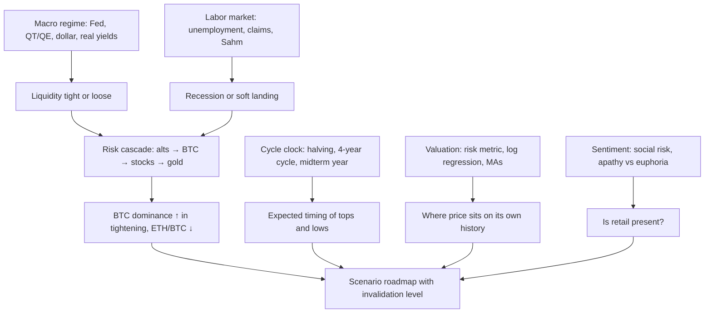

# 14. Cowen's framework and a video decoder

**Why this chapter matters.** Benjamin Cowen (YouTube @benjaminjcowen, "Into The Cryptoverse", ITC) has published well over 2,000 videos (2,385 are indexed from 2019 to 11 Jun 2026). Each one uses a small vocabulary of charts and phrases that he rarely re-explains. This chapter is the dictionary. It lists his recurring theses with dates and their status in October 2026, translates every recurring phrase and chart family into plain language with a link to the chapter that explains it, reviews his public track record from 2021 to October 2026 (hits and misses), sets out the limits of each of his methods, and shows how his views moved during 2026. **This course is independent of Benjamin Cowen and Into The Cryptoverse. It is not affiliated with or endorsed by him.** His proprietary metrics (risk metric, social risk, business-cycle metric) are described as concepts only.

**You will learn**
- the 23 recurring theses behind most of his videos, when he stated them and how they have held up;
- what each of his recurring phrases and chart families means, and where in this course it is explained;
- a fair scorecard of his checkable calls, 2021 to October 2026;
- the strengths and limits of each of his methods;
- how his 2026 view changed month by month;
- a five-step routine for decoding any of his videos.

**Sources and their quality.** The material comes from the [research inventory](../../research-notes/A-cowen-inventory.md) compiled for this course on 30 Oct 2026. It draws on his public memos at [benjamincowen.com/reports](https://benjamincowen.com/reports) (primary), the public chart catalogue of the ITC app (primary), a full index of his video titles with machine-written summaries at [rosetta.to](https://rosetta.to/u/intothecryptoverse) (titles and dates reliable; summaries mostly accurate but not perfect), the [Bankless interview of 23 Dec 2025](https://www.bankless.com/podcast/where-is-crypto-going-in-2026-ben-cowen), and news write-ups. Quotes taken from video summaries or news articles are secondary and are labelled with their source. Every "Cowen thinks X" below carries a date, because his views changed quickly in 2026.

---

## 1. How his toolset evolved

His content went through three phases, judging from keyword counts across 2,385 video titles and summaries (2019 to 11 Jun 2026).

| Period | Main tools | Typical topics |
|---|---|---|
| 2019–2021 | technical and quantitative | log regression, the bull market support band, the risk metric, ROI comparisons, lengthening cycles, the dollar index, DCA; almost no macro |
| 2022–2024 | macro enters with the Fed hiking cycle | CPI, the Fed, the yield curve, recession risk, unemployment, S&P 500 bear markets; from 2023, bitcoin dominance, the 2019 analog, QT and social risk |
| 2025–2026 | late cycle | the labor market, the end of QT, "why no alt season", the apathy top, the midterm-year template, gold, the late business cycle, oil and the Fed "checkmate", on-chain bottoming tools (realized price, supply in profit or loss, MVRV) |

The most frequent topics overall were the 20-week/21-week moving-average family (about 500 videos), the bull market support band (307), bitcoin dominance (281), log regression and fair value (277), the Fed (270), seasonality (267) and the halving (243). Macro-economic series he almost never builds a video around: credit spreads, consumer sentiment and real rates. Those counts are approximate.

### 1.1 His written reports

Besides videos, he publishes written reports at [benjamincowen.com/reports](https://benjamincowen.com/reports). The index lists 11 reports in two series, and as of 30 Oct 2026 there are no others (the site map and web archives show the same 11). The nine 2026 reports embed their full PDFs on the public page (193 pages in total); the two 2020 reports offer the PDF only through an e-mail form, so only their page summaries were used here. The reports are his work: this course paraphrases them.

| Date | Report (page title; PDF title if different) | Main topics |
|---|---|---|
| 5 Jan 2020 | [Bitcoin Letters (2020)](https://benjamincowen.com/reports/bitcoin-letters-2020) | diminishing returns, volatility compression, **risk regimes** (periods when risk-adjusted returns favor exposure vs when downside dominates); "deliberately omits price targets" |
| 20 Feb 2020 | [Ethereum Letters (2020)](https://benjamincowen.com/reports/ethereum-letters-2020) | ETH as "fundamentally different from Bitcoin"; ETH/BTC "often more actionable" than USD prices; model uncertainty |
| 15 Jan 2026 | [Crypto Macro Risk Memo – Q1 2026](https://benjamincowen.com/reports/crypto-macro-risk-memo-q1-2026) ("Crypto Risk Memo (Q1 2026)") | apathy top, 2019 analog, Fed balance sheet as reserve management, 180-day volatility ("low volatility at cycle highs is not stability, but rather fragility"), correlation heatmap, recession sub-risks |
| 15 Feb 2026 | [Macro Risk Memo February 2026](https://benjamincowen.com/reports/macro-risk-memo-feb-2026) ("Macro Risk Memo (Q1 2026)") | liquidity level vs direction, equity durability → labor, global M2 YoY, curve, financial conditions, housing, dollar upside risk "similar to 2018" |
| 15 Mar 2026 | [How Risk Cascades Through Markets](https://benjamincowen.com/reports/how-risk-cascades-through-markets-march-2026) (subtitle "From Speculative Assets to the Real Economy") | the five-stage risk cascade; liquidity risk, business-cycle and recession models |
| 15 Apr 2026 | [Crypto Risk Memo (Q2 2026)](https://benjamincowen.com/reports/crypto-risk-memo-q2-2026) | incomplete reset, time-based capitulation, dominance with and without stablecoins, ETF and company holdings |
| 18 May 2026 | [Macro Risk Memo (May 2026)](https://benjamincowen.com/reports/macro-risk-memo-may-2026) ("The Fed's Late Business Cycle Trap") | supply-driven inflation, the Fed "checkmate", temp help and payrolls YoY, the seven-step recession loop |
| 29 May 2026 | [Asymmetric Tail Curvature in Bitcoin Price Quantiles](https://benjamincowen.com/reports/asymmetric-tail-curvature-in-bitcoin-price-quantiles) (working paper) | quantile regression; structural power-law floor vs decaying speculative component; out-of-sample errors of power law, S2F and S2FX |
| 15 Jul 2026 | [Bitcoin Cycle Memo – July 2026](https://benjamincowen.com/reports/bitcoin-cycle-memo-july-2026) ("The Analog Enters Its Timing Test") | 2019 analog timing, a 22-metric risk scorecard, day counts, 200W and 50W rules, realized price, "The Bull Case in Its Strongest Form" |
| 15 Aug 2026 | [The Balance of Risks](https://benjamincowen.com/reports/the-balance-of-risks-august-2026) ("Weighing a Maturing Cycle Into Q4") | 65/20/15 scenario states, NFCI, recession-composite legs, breadth, energy lag, dollar analog, self-scored record |
| 30 Sep 2026 | [The Triple Squeeze](https://benjamincowen.com/reports/the-triple-squeeze-september-2026) ("Rising Yields, Rising Oil and a Firming Dollar Into Q4") | the six-step squeeze loop, sequence risk, midterm yield peaks, small caps, BTC after hikes, "Bitcoin: Where We Were Wrong" |

**How a 2026 memo is built.** Every 2026 memo uses the same template, which is worth knowing because the header tells you his stance in four lines:
- **Reference levels** (prices on the publication date).
- **Cycle status / cycle assessment** (e.g. "Risk-Off" in January; "Late-cycle restrictive digestion with emerging supply-driven pressures" in March; "Late-stage crypto markdown, bottom-watch window open" in July).
- **Regime characteristics**.
- **Recommended posture**, a phrase rather than a trade: "Capital preservation and tactical positioning" (January), "Defensive positioning with tactical deployment during periods of weakness" (May), and variants with "selective deployment" or "patience over aggressive deployment".
- **Primary risk drivers** (in February: policy restrictiveness relative to neutral, equity durability, the dollar, liquidity stabilization vs impulse, and the breadth of labor softness vs a nonlinear break).
- Scope and limitations, an executive summary, numbered sections, then **"What would change this view"** (the falsifiers) and a bottom line. The August and September memos add a "what changed since the last edition" box and a cross-asset table.

**Falsifiers.** Each memo lists observable conditions that would refute it. January: broader participation, an on-chain reset, constructive volatility re-expansion, or a decisive liquidity shift (collapsing real yields, balance-sheet expansion, emergency easing). February: a nonlinear labor break, durable equity weakness, a constraining dollar, or a decisive pivot. July: two consecutive weekly closes above the 50-week average (about $86,500 then). August: the refutation cluster listed in [chapter 13 §8](13-HOW-IT-ALL-CONNECTS.md#81-his-framework-in-his-terms).

**Self-scoring and steel-manning.** The August memo contains a "Framework's 2026 Record" that grades his own calls as *confirmed*, *confirmed to date*, *open* or *mixed*: the Q4 2025 top confirmed; January's capital-preservation stance "confirmed (crypto), mixed (equities)" because the S&P was +13.7% year to date; the Feb–Mar equity weakness as late-cycle rather than recession confirmed to date; the trapped hawkish Fed confirmed to date; the equities-vs-gold transmission open. The July memo has a section titled "The Bull Case in Its Strongest Form", and the September memo one titled "Bitcoin: Where We Were Wrong" ("We did not think BTC would take out its May high, and it has"). In July he also wrote that the series "has been better on direction than on level".

**Small inconsistencies between memos.** The 2025 peak is "near $126k" in one memo and "$124,700 (daily close)" in another; the 2026 low appears as "near $57,000", "near $58,500" (30 Jun daily close) and "near $57.7K". The inputs of his liquidity-risk score are described slightly differently in the app help text and in the memos (the memos add "funding stress proxies"). None of this changes the argument, but quote the specific memo when you quote a number.

---

## 2. The framework in one picture

He combines four independent "clocks": the macro and liquidity regime, the four-year cycle, valuation relative to price history, and retail sentiment. When they agree he states a view; when they conflict he usually says so and gives probabilities and an invalidation level. The labor market is the variable he has treated as most important for the macro view since 2023.

---

## 3. His recurring theses, with dates and status

Status is as of 30 Oct 2026. "Where explained" points to the chapter that tests the underlying indicator.

| # | Thesis (his framing, dated) | Status, Oct 2026 | Where explained |
|---|---|---|---|
| T1 | **The four-year cycle.** BTC tops in Q4 of the post-halving year and bottoms around the midterm-year Q4. "The most likely low for BTC is October 2026… it could happen as early as May" (X, 6 Feb 2026, per search snippet). "The cycle is primarily about the timing of lows, not exact prices" (26 May 2026). | Tops on 4 Dec 2013, 17 Dec 2017, 10 Nov 2021 and 6 Oct 2025 all fell in Q4 of a post-halving year. The 2026 low so far came on 30 Jun, earlier than his October base case; no lower low by 30 Oct. Sample of three or four cycles. | [10](10-BITCOIN-CYCLES-AND-VALUATION-MODELS.md), [09](09-SEASONALITY-AND-POLITICAL-CYCLES.md) |
| T2 | **Diminishing returns (kept) and lengthening cycles (abandoned).** 2019–21: cycles lengthen, so no top in 2021 ("Market Cycle Has Now *Unofficially* Lengthened", 19 Nov 2021). | Lengthening failed: BTC topped on 10 Nov 2021. Diminishing returns held: cycle-low-to-top multiples of about ×539, ×112, ×21 and ×7.9. | [10](10-BITCOIN-CYCLES-AND-VALUATION-MODELS.md) |
| T3 | **BTC dominance rises during QT, hikes and pre-halving years, and peaks at the QT → QE transition** (Cointelegraph Magazine, 19 Nov 2024). Target 60% from mid-2023, then 66% (25 Feb 2025). | 60% hit on 30 Oct 2024; above 65% on 6 May 2025. QT ended 1 Dec 2025 with no QE after it, so the "QT→QE top" rule was not tested this cycle. Headline dominance about 58–61% in 2026; about 67% excluding stablecoins (Feb and Aug 2026). | [12](12-DOMINANCE-ALTCOINS-AND-ROTATION.md), [07](07-LIQUIDITY-MONEY-AND-THE-DOLLAR.md) |
| T4 | **Altcoins bleed against BTC; no alt season without (1) looser policy, (2) high retail interest, (3) a euphoric BTC top** (22 Dec 2025). Next alt season "potentially in 2027–2029" (20 Feb 2026). | Correct for 2024–26: alt/BTC ratio 0.29 in Oct 2025; alts back at 2022 lows by Feb 2026. | [12](12-DOMINANCE-ALTCOINS-AND-ROTATION.md) |
| T5 | **ETH/BTC: bleed, "going home", then a bottom.** "Welcome Home, Ethereum" (7 Apr 2025), ETH to $1,500–1,600. | ETH low about $1,386 on 9 Apr 2025, then an ATH near $4,950 on 24 Aug 2025. ETH/BTC about 0.029 on 30 Oct 2026. | [12](12-DOMINANCE-ALTCOINS-AND-ROTATION.md) |
| T6 | **Rate cuts are not bullish at first; the real bull starts after the last cut**, especially when the Fed pivots because of economic damage (["Bitcoin and Interest Rates"](https://rosetta.to/u/intothecryptoverse/bitcoin-and-interest-rates), 24 Jan 2023). Without a recession, long yields and the dollar rise after the first cut (23 Oct 2024). | The 2024 yield-and-dollar call was right (10Y about 3.6% → 4.8%, DXY about 100 → 110 by Jan 2025). Counter-cases: 1995 and 1998 cuts were bullish for stocks. | [02](02-THE-FED-AND-INTEREST-RATES.md), [13](13-HOW-IT-ALL-CONNECTS.md#4-the-canonical-sequences-with-lags-and-dates) |
| T7 | **Unemployment-led recession playbook.** Unemployment bottoms, rises non-linearly, the Sahm rule triggers, the curve un-inverts as the Fed cuts, the recession is dated late, markets bottom during it (videos of 14 Jun 2022, 29 Sep 2022, 3 Aug 2024; "once unemployment begins its nonlinear uptrend, recession typically follows", 27 Mar 2026). | Sahm triggered Aug 2024 (on July data) without a recession; unemployment peaked at 4.5% (Nov 2025, first printed 4.6%) and fell to 4.2%. His 2023 call of a recession "late 2023 or early 2024" did not come true. | [05](05-THE-LABOR-MARKET.md), [13](13-HOW-IT-ALL-CONNECTS.md) |
| T8 | **The 2019 analog.** Top on apathy shortly before QT ended (about 5 weeks before in 2019 and about 8 weeks before in 2025, per his July 2026 memo; "about two months" for both in interviews), no durable rotation, lower highs. 2019's first ~50% drop came from liquidity; the deeper flush needed an outside shock (COVID), so without one he expected a "time-based capitulation" (Apr 2026 memo). | Fit the 2025 top well. As a bottom template it needs a final flush; his July 2026 memo noted the 2019 path had passed its day-261 low "without the flush". | [10](10-BITCOIN-CYCLES-AND-VALUATION-MODELS.md), [13](13-HOW-IT-ALL-CONNECTS.md) |
| T9 | **Midterm-year template and the "window of weakness."** Feb low, early-March pop, Apr–Jun weakness, July rally, weak Aug–Sep, Q4 low. "Fade Bitcoin in the first half of midterm years and look for deals in the second half" (29 May 2026). | The first half matched closely. The Jul–Oct rally was stronger than in 2018 and 2022 (about 50% vs about 40%, a higher high), which he acknowledged in September 2026. | [09](09-SEASONALITY-AND-POLITICAL-CYCLES.md) |
| T10 | **1990s analogs: 1996–2000, 1997 and 1998 (not 1995).** S&P/M2 "resembles 1996–2000" (Dec 2025); a 1998-style 20% drop then new highs (Apr 2025); for the Sep 2026 hike, a CMC Academy write-up cited a March-1997 single hike, but his own memo of 30 Sep 2026 calls it a "resumption" like 1999 after the 1998 insurance cuts (prefer the memo). | The 1998 analog fit 2025. The 1995 soft-landing analogy belongs to other analysts, not to him. | [08](08-STOCKS-GOLD-AND-CROSS-ASSET.md), [13](13-HOW-IT-ALL-CONNECTS.md#42-soft-landings-and-insurance-cycles) |
| T11 | **1970s inflation waves → energy shock → the Fed's "checkmate".** A second wave is a risk, not the base case (2022–25); in 2026 supply-driven inflation plus softening labor means the Fed "can't cut, can't hike aggressively" (10 Apr 2026). | The Fed did not cut in 2026 and hiked once (16 Sep). Long-run inflation expectations stayed anchored (5y5y 2.23%). | [04](04-INFLATION.md) |
| T12 | **Late business cycle and the risk cascade.** Five stages: speculative participation falls, speculative assets fall, stocks fall against gold, the dollar and oil tighten conditions, then a labor feedback loop; March 2026 placed "between Stage 3 and Stage 4" (memo, 15 Mar 2026). The May memo adds a seven-step recession loop; the September memo a six-step squeeze loop. Aug 2026 probabilities: 65% late-cycle expansion with a midterm correction, 20% policy-error correction, 15% recessionary transition. | Crypto weakened first; stocks and labor had not broken by 30 Oct 2026. | [13 §8](13-HOW-IT-ALL-CONNECTS.md#8-cowens-late-cycle-and-risk-cascade-framework) |
| T13 | **Log regression fair value and bands.** Price oscillates around a log-time fair value with compressing upper bands ("Beauty of Mathematics" series, 2020–26). | ITC now labels the classic regression charts "(Legacy)" and promotes a quantile fan (May 2026 report). The lab's own fit puts price at 0.53 of fair value (29 Oct 2026). | [10](10-BITCOIN-CYCLES-AND-VALUATION-MODELS.md) |
| T14 | **The bull market support band (BMSB) as the bull/bear switch.** "A bear market for Bitcoin is weekly closes below the 20-week SMA" (22 Jun 2021). Bear rallies fail at the band or the 50W. | Resistance at about $82–83k in Apr–May 2026; lost again 28 May / 1 Jun; regained Aug–Sep 2026. | [10](10-BITCOIN-CYCLES-AND-VALUATION-MODELS.md) |
| T15 | **The 200-week SMA as the midterm-year accumulation zone ("a date with destiny").** Estimated at $60–70k (Dec 2025). | Tagged on 5 Jun 2026; one weekly close below it in late June (plus two marginal closes in August, per [research notes D](../../research-notes/D-crypto-cycles-onchain-alts.md)), then reclaimed. Lab: price 15% above the 200W ($67,497) on 29 Oct 2026. | [10](10-BITCOIN-CYCLES-AND-VALUATION-MODELS.md) |
| T16 | **Risk metric and dynamic DCA.** His approach since 2019: accumulate in low risk bands, scale out in high ones. | In July 2026 he wrote that risk sat "in the low zone historically associated with accumulation". The formula is proprietary. | [10](10-BITCOIN-CYCLES-AND-VALUATION-MODELS.md), section 8 below |
| T17 | **Social risk, apathy and "retail never returned."** "Why Retail Never Returned" (24 Apr 2025); "Crypto Ghost Town" (13 Jan 2026), social interest at about 16% of 2021 levels. | Consistent with Fear & Greed peaking at only 74 at the Oct 2025 top and Coinbase ranked about 260th in the App Store in Sep 2025. | [11](11-ON-CHAIN-AND-SENTIMENT.md) |
| T18 | **Seasonality: September, the summer lull, then a Q4 top in post-halving years** ("The Pattern That Historically Ended The Bull Market", 12 Aug 2025). | Correct in 2025: late-September dip, ATH on 6 Oct, crash from 10 Oct. | [09](09-SEASONALITY-AND-POLITICAL-CYCLES.md) |
| T19 | **The dollar.** Strong-dollar regimes hurt alts; DXY channel analysis. | In 2026 a firmer dollar fed his "triple squeeze" (Sep memo). In September 2026 BTC rose *with* the dollar and he said "something clearly changed". | [07](07-LIQUIDITY-MONEY-AND-THE-DOLLAR.md) |
| T20 | **Stablecoin dominance "unfortunate pattern."** USDT+USDC dominance broke out of a base like earlier BTC.D, palladium and Hang Seng breakouts; target 14–15% later in 2026 (7 Jan, 18 Mar, 20 May 2026). | Not verified; USDT.D was about 6.8% and USDC.D about 2.7% on 30 Oct 2026 (CoinGecko). | [12](12-DOMINANCE-ALTCOINS-AND-ROTATION.md) |
| T21 | **Gold and the S&P/gold ratio; the "rotation trap."** S&P/gold near the 1.4 line that preceded the 1973 and 2008 declines; "don't sell winners to buy losers" (20–22 Jan 2026). | Gold peaked in late January 2026 (about $5,560) and fell sharply in spring (his 23 Mar video was titled "Gold Drops Nearly 30%"; the late-March level is not independently verified), to a late-June low of about $3,970 (about −29% from the peak) and about $4,024 on 30 Oct; the S&P made records. | [08](08-STOCKS-GOLD-AND-CROSS-ASSET.md) |
| T22 | **Narratives follow price; "Bitcoin is not the economy."** "Market narratives follow price action, not the other way around" (4 Nov 2025); short-term prediction is "comparable to random walk physics" (8 Jan 2026). | A process principle rather than a forecast. His ISM remark held up in 2026. | [06](06-GROWTH-AND-THE-BUSINESS-CYCLE.md) |
| T23 | **Rate hikes are not immediately bearish** (Feb 2022), contradicted by his own Sep 2026 call, then reaffirmed: "None of the data suggests that a rate hike has ever been immediately bearish for Bitcoin" (Sep 2026, per Benzinga). | BTC rose after the 16 Sep 2026 hike: from about $76k on the day to about $86k on 21 Sep (Coinbase via FRED), extending a rally from about $63k in mid-August. | [02](02-THE-FED-AND-INTEREST-RATES.md) |

Three attribution notes. "ISM above 50 means alt season" is mainly Raoul Pal's thesis; Cowen's 2026 reply was "Bitcoin is not the economy" ([chapter 06](06-GROWTH-AND-THE-BUSINESS-CYCLE.md)). The 1995 soft-landing analogy is not his. "Lengthening cycles" was his until 2021, and he dropped it.

---

## 4. The video decoder

How to use these tables: when a phrase or chart comes up in a video, find it here, read the one-line meaning, then follow the link for the full explanation, the data source and the historical record.

### 4.1 Risk, valuation and price models

| Phrase or chart | What it means | Chapter |
|---|---|---|
| Risk metric | His 0–1 normalised, de-trended price oscillator for an asset, available per denomination (USD, BTC, ETH). 0 = historically cheap relative to its own path, 1 = historically stretched. A position on the asset's own historical ladder, not a probability. Formula proprietary. | [10](10-BITCOIN-CYCLES-AND-VALUATION-MODELS.md) |
| Risk bands, "time in risk bands" | 0.1-wide buckets of the risk metric; charts show how long price historically stayed in each band. | [10](10-BITCOIN-CYCLES-AND-VALUATION-MODELS.md) |
| Price color-coded by risk; historical / current risk levels | The price chart painted by risk band (blue low, red high). | [10](10-BITCOIN-CYCLES-AND-VALUATION-MODELS.md) |
| Total (composite) indicator risk | The equal-weighted average of price, on-chain and social risk, each 0–1. Built to avoid single-indicator false bottoms. | [10](10-BITCOIN-CYCLES-AND-VALUATION-MODELS.md), [11](11-ON-CHAIN-AND-SENTIMENT.md) |
| On-chain risk | A 0–1 composite of on-chain valuation metrics (MVRV, supply in profit, etc.). It read 0.181 in Aug 2026. | [11](11-ON-CHAIN-AND-SENTIMENT.md) |
| Social risk; "improved social risk metric" | A 0–1 composite of retail attention: YouTube subscribers and views, X followers of analysts, exchanges and layer-1s; the 2026 version adds Google Trends and the Coinbase app rank. | [11](11-ON-CHAIN-AND-SENTIMENT.md) |
| Logarithmic regression (bands), regression rainbow | A best-fit line of log price against log time with bands around it; upper bands mark past bubble zones. ITC labels these "(Legacy)". | [10](10-BITCOIN-CYCLES-AND-VALUATION-MODELS.md) |
| Fair value logarithmic regression | A log regression fitted only to "non-bubble" data, read as long-term fair value. | [10](10-BITCOIN-CYCLES-AND-VALUATION-MODELS.md) |
| "The Beauty of Mathematics" | His monthly series (Part 71 by Jun 2026) on log-regression and fair-value charts, mostly for total crypto market cap. | [10](10-BITCOIN-CYCLES-AND-VALUATION-MODELS.md) |
| Total crypto market cap and trendline | Extension of the whole market above or below its regression trend. | [10](10-BITCOIN-CYCLES-AND-VALUATION-MODELS.md) |
| Asymmetric quantile regression (fan) | His 2026 model with separate curvature for upper and lower price quantiles: the upper tail flattens, lower support stays near a power law. He calls it descriptive, not a forecast. | [10](10-BITCOIN-CYCLES-AND-VALUATION-MODELS.md) |
| Diminishing returns | Each cycle's peak multiple is smaller than the last. | [10](10-BITCOIN-CYCLES-AND-VALUATION-MODELS.md) |
| Lengthening cycles (LCT) | His 2019–21 theory that each cycle lasts longer. Abandoned after the Nov 2021 top. | [10](10-BITCOIN-CYCLES-AND-VALUATION-MODELS.md) |
| Running ROI; ROI after bottom / halving / peak; ROI bands | Returns compared between cycles from fixed anchor points (cycle low, halving day, cycle top). | [10](10-BITCOIN-CYCLES-AND-VALUATION-MODELS.md) |
| Drawdown from ATH | Percent below the all-time high. BTC bears bottomed at about −77% to −84% before 2026, less each cycle. | [10](10-BITCOIN-CYCLES-AND-VALUATION-MODELS.md) |
| Short-term bubble risk | How far price is extended above the 20-week SMA. | [10](10-BITCOIN-CYCLES-AND-VALUATION-MODELS.md) |
| Cowen Corridor | A band built from the ratio of two moving averages and its slope (weekly). Community re-creations are approximate. | [10](10-BITCOIN-CYCLES-AND-VALUATION-MODELS.md) |
| Stock-to-flow (S2F), S2FX | Scarcity models he discussed as one theory among several; his 2026 study put their out-of-sample errors at about +295% and +1,699%. | [10](10-BITCOIN-CYCLES-AND-VALUATION-MODELS.md) |
| Satoshi value | Value measured in BTC rather than USD. | [12](12-DOMINANCE-ALTCOINS-AND-ROTATION.md) |

### 4.2 Cycles, seasonality and timing

| Phrase or chart | What it means | Chapter |
|---|---|---|
| Four-year cycle | The halving-linked cycle: pre-halving year, halving year, post-halving year (top in Q4), midterm year (bear). | [10](10-BITCOIN-CYCLES-AND-VALUATION-MODELS.md) |
| Post-halving / pre-halving / halving / midterm year | His labels for the four years of the cycle, e.g. 2025 / 2023 / 2024 / 2026. | [10](10-BITCOIN-CYCLES-AND-VALUATION-MODELS.md), [09](09-SEASONALITY-AND-POLITICAL-CYCLES.md) |
| Midterm year | The US midterm-election year; historically BTC's (and the S&P's) weakest, with the cycle low around Q4. | [09](09-SEASONALITY-AND-POLITICAL-CYCLES.md) |
| Window of weakness | Seasonal windows in which midterm-year lows tended to come (Feb, late Mar/Apr, Jun, Sep–Oct). | [09](09-SEASONALITY-AND-POLITICAL-CYCLES.md) |
| "We live in a simulation", "Simulation confirmed" | Ironic shorthand for price tracking the historical midterm-year average path (["Bitcoin: Simulation Confirmed"](https://rosetta.to/u/intothecryptoverse/bitcoin-simulation-confirmed), 9 Mar 2026). | [09](09-SEASONALITY-AND-POLITICAL-CYCLES.md) |
| Yearly open | The 1 January price, used to compare midterm-year paths (e.g. −15% by early March on average). | [09](09-SEASONALITY-AND-POLITICAL-CYCLES.md) |
| Summer lull; "Wake me up when September ends" | Seasonal weakness in summer and September; a yearly September video since 2021. | [09](09-SEASONALITY-AND-POLITICAL-CYCLES.md) |
| Monthly / quarterly returns; historical monthly average ROI | Calendar-month and calendar-quarter return heatmaps. | [09](09-SEASONALITY-AND-POLITICAL-CYCLES.md) |
| Left-translated / right-translated cycle | A top that comes early (left) or late (right) relative to the cycle's midpoint. | [10](10-BITCOIN-CYCLES-AND-VALUATION-MODELS.md) |
| Day counts ("day 1,363 of the cycle") | Days since the last cycle low, used to compare where each cycle is. His July 2026 memo fixes the anchor at the 21 Nov 2022 low (an earlier version used the 9 Nov FTX low): day 1,332 on 15 Jul 2026, prior bottoms at days 1,424 and 1,432, which pointed to October 2026. Counts in news write-ups differ. | [10](10-BITCOIN-CYCLES-AND-VALUATION-MODELS.md) |
| Three stages of a bear market | Disbelief, partial acceptance, broad acceptance; dated Oct 2025–Feb 2026, Feb–Jun 2026 and Jun–Oct 2026 (7 Jun 2026). | [11](11-ON-CHAIN-AND-SENTIMENT.md) |
| Time-based capitulation | A bear market that resets through months of sideways drift rather than one crash. | [10](10-BITCOIN-CYCLES-AND-VALUATION-MODELS.md) |
| Bottom-watch mode | 2026 memo phrase: the framework moves from confirming the decline to watching for the low. | [13](13-HOW-IT-ALL-CONNECTS.md#11-where-we-are-30-october-2026) |
| The 2019 analog | 2019 as the template for an apathy top shortly before QT ended, no alt season, then lower highs. | [13](13-HOW-IT-ALL-CONNECTS.md#42-soft-landings-and-insurance-cycles) |
| Midterm hike-year behavior | In two prior midterm hike years BTC held near its hike-day level for about 7 weeks before breaking lower (Sep 2026 memo); "flat about 50 days, then drops" (Oct 2026). | [09](09-SEASONALITY-AND-POLITICAL-CYCLES.md) |

### 4.3 Moving averages, closes and chart structure

| Phrase or chart | What it means | Chapter |
|---|---|---|
| Bull market support band (BMSB) | The 20-week SMA plus the 21-week EMA. Weekly closes above = bull; below = bear. | [10](10-BITCOIN-CYCLES-AND-VALUATION-MODELS.md) |
| Bear market resistance band | The same band acting as resistance from below during a bear market. | [10](10-BITCOIN-CYCLES-AND-VALUATION-MODELS.md) |
| 20W / 21W / 50W / 100W / 200W / 300W | Weekly moving averages. In bears the 50W, 100W and 200W are lost in that order; a rally to the 50W "confirms" a bear. | [10](10-BITCOIN-CYCLES-AND-VALUATION-MODELS.md) |
| "A date with destiny" | Price meeting the 200-week SMA (for BTC or the S&P 500). | [10](10-BITCOIN-CYCLES-AND-VALUATION-MODELS.md) |
| 200D (200-day SMA); 50D; 8W | Daily and short weekly trend lines. The 200D was resistance in the 2018, 2022 and 2026 bears. | [10](10-BITCOIN-CYCLES-AND-VALUATION-MODELS.md) |
| Golden cross / death cross | The 50D crossing above / below the 200D. Often a short-term contrarian signal for him ("the golden cross dump", "the death cross rally"). | [10](10-BITCOIN-CYCLES-AND-VALUATION-MODELS.md) |
| Pi Cycle top / bottom | The 111D SMA crossing twice the 350D SMA; a historical top marker. No cross in the 2024–25 cycle. | [10](10-BITCOIN-CYCLES-AND-VALUATION-MODELS.md) |
| RSI, MACD, Bollinger Bands, Supertrend, Heikin-Ashi | Standard momentum and volatility tools; he mostly uses RSI to put corrections in context. | [10](10-BITCOIN-CYCLES-AND-VALUATION-MODELS.md), [01](01-HOW-TO-READ-MACRO-CHARTS.md) |
| Fibonacci retracements (0.382, 0.5) | Retracement levels; e.g. ETH/BTC 0.053 as a 0.5 retracement (Dec 2025). | [10](10-BITCOIN-CYCLES-AND-VALUATION-MODELS.md) |
| Weekly / monthly / 3-day close | The candle close used to confirm a break: "wicks don't matter, closes do". | [10](10-BITCOIN-CYCLES-AND-VALUATION-MODELS.md), [01](01-HOW-TO-READ-MACRO-CHARTS.md) |
| Counter-trend rally | A bear-market rally that fails at resistance (BMSB, 200D, 50W). | [10](10-BITCOIN-CYCLES-AND-VALUATION-MODELS.md) |
| Macro lower high / lower low | Bear-market structure on weekly or monthly charts. | [10](10-BITCOIN-CYCLES-AND-VALUATION-MODELS.md) |
| Fakeout | A break above or below a level that quickly reverses ("fakeout confirmed", 25 Oct 2026). | [10](10-BITCOIN-CYCLES-AND-VALUATION-MODELS.md) |
| "Hold the line" (conjecture) | Holding a support level, usually the 20W, in a bull market; his Jan 2022 conjecture that BTC would not revisit the 20W once held, which failed at $40k. | [10](10-BITCOIN-CYCLES-AND-VALUATION-MODELS.md) |
| Breadth: advance-decline, coins above/below MA | The share of coins (or S&P members) in uptrends. Narrow breadth = late cycle. | [08](08-STOCKS-GOLD-AND-CROSS-ASSET.md), [12](12-DOMINANCE-ALTCOINS-AND-ROTATION.md) |
| Roadmap ("void above X") | An ordered checklist of expected events with an explicit invalidation level, e.g. the Oct 2026 Q4 roadmap "void above $83k". | section 6 below |

### 4.4 On-chain and sentiment

| Phrase or chart | What it means | Chapter |
|---|---|---|
| Realized price, "cost basis of the network" | Realized cap divided by supply; every prior bear bottomed below it. About $53–54k in Jun–Oct 2026 and untested. | [11](11-ON-CHAIN-AND-SENTIMENT.md) |
| MVRV, MVRV Z-score | Market value vs realized value, raw and standardised; Z below 0 = historical bottoming zone. | [11](11-ON-CHAIN-AND-SENTIMENT.md) |
| Supply in profit / loss (crossing) | The share of coins in profit vs in loss; the lines crossing preceded cycle lows by about 1–4 months. | [11](11-ON-CHAIN-AND-SENTIMENT.md) |
| Balanced price / terminal price | On-chain price bands: a deep-value floor / a historical top ceiling. | [11](11-ON-CHAIN-AND-SENTIMENT.md) |
| Puell multiple, hash ribbons, thermocap ratios, SOPR, NUPL, HODL waves, RHODL, coin days destroyed, dormancy | Miner, holder and spending metrics, used mainly in 2020–23 educational series and as background checks since. | [11](11-ON-CHAIN-AND-SENTIMENT.md) |
| Stablecoin supply ratio (SSR) and oscillator | Stablecoin "dry powder" relative to BTC market cap. | [11](11-ON-CHAIN-AND-SENTIMENT.md) |
| ETF flows, crypto treasuries | Spot ETF holdings and flows; corporate holdings. "ETF holdings absorbed supply on the way up but have rolled over" (Jul 2026). | [11](11-ON-CHAIN-AND-SENTIMENT.md) |
| Fear & Greed Index | A 0–100 sentiment index; "extreme fear is not by itself a bottom". | [11](11-ON-CHAIN-AND-SENTIMENT.md) |
| Apathy vs euphoria top | Whether the cycle peak came with retail mania (2017, 2021) or without it (2019, 2025). "Topping on apathy doesn't mean you don't have a bear market." | [11](11-ON-CHAIN-AND-SENTIMENT.md) |
| Crypto ghost town | His Jan 2026 description of collapsed retail participation. | [11](11-ON-CHAIN-AND-SENTIMENT.md) |
| Memecoins, "misallocation of capital" | Memecoin scams and influencer pumps drained retail (Feb 2025). | [11](11-ON-CHAIN-AND-SENTIMENT.md) |

### 4.5 Dominance and altcoins

| Phrase or chart | What it means | Chapter |
|---|---|---|
| Bitcoin dominance (BTC.D), with and without stablecoins | BTC market cap ÷ total crypto market cap. Stablecoins in the denominator can hide a rising BTC share. | [12](12-DOMINANCE-ALTCOINS-AND-ROTATION.md) |
| USDT.D, stablecoin dominance | Stablecoins' share of total crypto market cap; rising = risk-off within crypto. | [12](12-DOMINANCE-ALTCOINS-AND-ROTATION.md) |
| "An unfortunate pattern" | His 2026 reading of a stablecoin-dominance breakout and pullback as bearish for crypto. | [12](12-DOMINANCE-ALTCOINS-AND-ROTATION.md) |
| ETH/BTC, "the altcoin index" | Ether priced in bitcoin; his proxy for the whole alt market. | [12](12-DOMINANCE-ALTCOINS-AND-ROTATION.md) |
| TOTAL / TOTAL2 / TOTAL3 / OTHERS(.D) | Total crypto cap / excluding BTC / excluding BTC and ETH / outside the top 10 (TradingView tickers). | [12](12-DOMINANCE-ALTCOINS-AND-ROTATION.md) |
| "All bitcoin pairs to range lows", "alts to 0.25" | Alts must capitulate against BTC (aggregate alt cap about 25% of BTC cap) before an alt season. | [12](12-DOMINANCE-ALTCOINS-AND-ROTATION.md) |
| Alt season; Altcoin Season Index; "Bitcoin season vs altcoin season" | BTC dominance falling while alts rise in USD; the index is the share of top coins beating BTC over 90 days (75+ = alt season). | [12](12-DOMINANCE-ALTCOINS-AND-ROTATION.md) |
| Final rotation | A late-cycle return of capital from alts into BTC (a dominance spike), e.g. Sep–Oct 2025. | [12](12-DOMINANCE-ALTCOINS-AND-ROTATION.md) |
| "Oscillators at best, bleeders at worst" | His description of altcoins against BTC over full cycles. | [12](12-DOMINANCE-ALTCOINS-AND-ROTATION.md) |
| "Going home" (ETH) | ETH returning to a prior base ($1,500–1,600 in 2025). | [12](12-DOMINANCE-ALTCOINS-AND-ROTATION.md) |
| Does It Bleed | ITC chart family showing whether an asset loses value against BTC over time. | [12](12-DOMINANCE-ALTCOINS-AND-ROTATION.md) |
| Flippening index; market cap hypotheticals | Platform tools for ETH-vs-BTC size and "what if" market-cap scenarios. | [12](12-DOMINANCE-ALTCOINS-AND-ROTATION.md) |

### 4.6 Macro phrases

| Phrase | What it means | Chapter |
|---|---|---|
| The pivot | The Fed's switch from hiking or holding to cutting, or from QT to QE. | [02](02-THE-FED-AND-INTEREST-RATES.md) |
| QT / QE / QT taper / end of QT | Balance-sheet shrinkage / expansion / slowing the runoff / stopping it (1 Dec 2025). "The end of QT is not the same as a growing balance sheet." | [07](07-LIQUIDITY-MONEY-AND-THE-DOLLAR.md) |
| Terminal rate | The peak policy rate of a hiking cycle; BTC has historically bottomed near it. | [02](02-THE-FED-AND-INTEREST-RATES.md) |
| Neutral (rate) | His shorthand for fed funds ≈ the 2-year yield; fed funds above the 2-year = restrictive. | [02](02-THE-FED-AND-INTEREST-RATES.md) |
| "The Fed chases the 2-year" | The 2-year leads the policy rate; when it falls below fed funds the Fed eventually cuts. | [02](02-THE-FED-AND-INTEREST-RATES.md) |
| Liquidity, net liquidity | Central-bank balance sheets minus the TGA and RRP; more generally, the ease of dollar funding. | [07](07-LIQUIDITY-MONEY-AND-THE-DOLLAR.md) |
| Global liquidity, "global M2" | Summed money supply of major economies in USD. In May 2025 he asked whether BTC *leads* liquidity rather than lags it. | [07](07-LIQUIDITY-MONEY-AND-THE-DOLLAR.md) |
| Accounting for the money supply | Dividing an asset by M2 (or M1) to strip out monetary inflation, e.g. S&P/M2, BTC/M2. | [07](07-LIQUIDITY-MONEY-AND-THE-DOLLAR.md) |
| Macro recession risk; liquidity risk | ITC 0–1 scores: how recession-like US data look; how tight dollar liquidity is (fed funds, 2-year, DXY, Fed assets, M2). | [06](06-GROWTH-AND-THE-BUSINESS-CYCLE.md), [07](07-LIQUIDITY-MONEY-AND-THE-DOLLAR.md) |
| Soft / hard / no landing | Slowdown without recession / with recession / no slowdown. In 2022 he defined them by S&P drawdown (soft about −30% to the pre-pandemic high, hard about −50%). | [13 §10](13-HOW-IT-ALL-CONNECTS.md#10-soft-landing-or-hard-landing-a-real-time-checklist) |
| Late business cycle | Tight labor turning, high valuations, rising uncertainty; risk cascades down the curve. | [13 §8](13-HOW-IT-ALL-CONNECTS.md#8-cowens-late-cycle-and-risk-cascade-framework) |
| ITC business cycle (metric) | His composite of how stretched stocks are relative to unemployment, inflation, rates and money supply (proprietary construction). | [06](06-GROWTH-AND-THE-BUSINESS-CYCLE.md) |
| Risk cascade, risk curve | Risk leaves in the order alts → BTC → stocks → gold (energy last) and returns in reverse. | [13 §8](13-HOW-IT-ALL-CONNECTS.md#8-cowens-late-cycle-and-risk-cascade-framework) |
| Checkmate (for the Fed) | Supply-driven inflation plus a weakening labor market: the Fed can't cut and can't hike aggressively. | [04](04-INFLATION.md) |
| Triple squeeze | His Sep 2026 memo title: rising long yields, a firming dollar and oil tightening conditions together. | [13](13-HOW-IT-ALL-CONNECTS.md#81-his-framework-in-his-terms) |
| Sahm rule | Recession signal: the 3-month average unemployment rate ≥ 0.5 pp above its prior-12-month low. | [05](05-THE-LABOR-MARKET.md) |
| "300K claims" | His 2026 line: no US recession until initial claims print about 300k. | [05](05-THE-LABOR-MARKET.md) |
| Uninversion, bull steepener, bear steepener | The curve moving back above zero / steepening because short yields fall / steepening because long yields rise. | [03](03-BONDS-AND-THE-YIELD-CURVE.md) |
| "Good news is bad news" | Strong data raise yields and delay cuts, which hurts risk assets. | [02](02-THE-FED-AND-INTEREST-RATES.md), [05](05-THE-LABOR-MARKET.md) |
| Main Street vs Wall Street | ISM and the real economy vs asset prices; retail crypto needs Main Street. | [06](06-GROWTH-AND-THE-BUSINESS-CYCLE.md) |
| Rotation trap | Selling outperformers (gold) to buy laggards (stocks or crypto) on a rotation story. | [08](08-STOCKS-GOLD-AND-CROSS-ASSET.md) |
| Bear goggles; realist vs doomer | His terms for bearish bias, and for balanced vs catastrophist views. | section 7 below |
| "Not financial advice", "NFA Live" | His disclaimer, and the name of his live shows with other crypto YouTubers. | — |
| Dubious Speculation | His explicitly speculative scenario-video series (about 106 videos, 2021–26). | section 8 below |

### 4.7 ITC chart families

The ITC app catalogue (extracted 30 Oct 2026) lists 380 charts. Tiers: Lite (free), Basic, Standard, Pro (all macro charts and dashboards). He uses the families below in videos; the right column says where the underlying indicator is explained.

| ITC family (catalogue category) | What it contains | Chapter |
|---|---|---|
| Price Metric / Risk | historical and current risk levels, price color-coded by risk, time in risk bands | [10](10-BITCOIN-CYCLES-AND-VALUATION-MODELS.md) |
| Price Metric / Logarithmic Regression | asymmetric quantile regression fan; (Legacy) log regression, fair value log regression, rainbow | [10](10-BITCOIN-CYCLES-AND-VALUATION-MODELS.md) |
| Price Metric / Moving Averages | moving averages, BMSB, short-term bubble risk, color-coded MA strength, Pi Cycle bottom/top, coins above/below MA, SMA cycle-top breakout | [10](10-BITCOIN-CYCLES-AND-VALUATION-MODELS.md) |
| Price Metric / Technical Analysis and Momentum | RSI, MACD, golden/death crosses, Bollinger Bands, Supertrend | [10](10-BITCOIN-CYCLES-AND-VALUATION-MODELS.md) |
| Price Metric / Return On Investment | monthly, quarterly and average returns; YTD ROI; ROI bands; ROI after cycle bottom, peak, halving and sub-cycle bottom; Altcoin Season Index; "QT Ending Bear Markets"; Best Day to DCA; days since % decline/gain | [10](10-BITCOIN-CYCLES-AND-VALUATION-MODELS.md), [09](09-SEASONALITY-AND-POLITICAL-CYCLES.md), [07](07-LIQUIDITY-MONEY-AND-THE-DOLLAR.md) |
| Price Metric / Market Capitalization | total crypto valuation vs trendline, dominance, SSR, altcoin market caps, portfolios weighted by market cap, crypto heatmap, market cap hypotheticals | [10](10-BITCOIN-CYCLES-AND-VALUATION-MODELS.md), [12](12-DOMINANCE-ALTCOINS-AND-ROTATION.md) |
| Price Metric / Other | Does It Bleed, BTC vs DXY, drawdown from ATH, correlation coefficients, volatility, Benford's law, price milestone crossings, cycles deviation; also running ROI, Cowen Corridor, Fear & Greed | [08](08-STOCKS-GOLD-AND-CROSS-ASSET.md), [10](10-BITCOIN-CYCLES-AND-VALUATION-MODELS.md), [12](12-DOMINANCE-ALTCOINS-AND-ROTATION.md) |
| Price Metric / Advances & Declines | advance-decline ratios and index, absolute breadth index (crypto) | [12](12-DOMINANCE-ALTCOINS-AND-ROTATION.md) |
| On-Chain (valuation, supply, mining, exchanges, transactions, addresses) | MVRV, MVRV-Z, supply in profit/loss, RHODL, Puell, terminal price, thermocap ratios, SOPR, NUPL, NVT, HODL waves, S2F, hash ribbons, exchange flows, CDD, dormancy | [11](11-ON-CHAIN-AND-SENTIMENT.md) |
| Social Media | Google Trends, Wikipedia page views, Coinbase app ranking, social volume and dominance, sentiment, X followers, YouTube subscribers and views | [11](11-ON-CHAIN-AND-SENTIMENT.md) |
| Derivatives | long/short ratios, open interest of futures and options | [11](11-ON-CHAIN-AND-SENTIMENT.md) |
| Money, Banking & Finance / Interest Rates | fed funds target range, effective rate, global rate map, Treasury yields, spreads and curve, days after inversion / uninversion, real interest rates, spreads and curve | [02](02-THE-FED-AND-INTEREST-RATES.md), [03](03-BONDS-AND-THE-YIELD-CURVE.md) |
| Money, Banking & Finance / Monetary Data and Exchange Rates | M1, M2, currency in circulation, retail money funds, Fed total assets, ON RRP, TGA; DXY | [07](07-LIQUIDITY-MONEY-AND-THE-DOLLAR.md) |
| Money, Banking & Finance / Recessions | past recession statistics, ITC business cycles, smoothed recession probabilities, Sahm rule (national and per state), RGDP recession indicator, CLI, NFCI, St. Louis Fed stress index, uncertainty indices | [06](06-GROWTH-AND-THE-BUSINESS-CYCLE.md), [05](05-THE-LABOR-MARKET.md) |
| Money, Banking & Finance / Banking | deposits, consumer credit, delinquency rates, loan standards (SLOOS) | [06](06-GROWTH-AND-THE-BUSINESS-CYCLE.md) |
| People, Employment & Labor | unemployment (rate, per state, by reason, U-1 to U-6, duration), claims (per state, maps), JOLTS, KC Fed LMCI, participation, Michigan sentiment, OECD manufacturing confidence | [05](05-THE-LABOR-MARKET.md), [06](06-GROWTH-AND-THE-BUSINESS-CYCLE.md) |
| Prices | CPI, core CPI, contributions by category, PCE and core PCE, PPI, global inflation map, crude oil (WTI) | [04](04-INFLATION.md) |
| National Income & Product; Production & Business; Real Estate | GDP, GDI, income, saving, profits, debt and deficits; industrial production, new orders, retail sales; house prices, starts, mortgage rates | [06](06-GROWTH-AND-THE-BUSINESS-CYCLE.md) |
| S&P Statistics | trailing P/E, Shiller CAPE, excess CAPE yield, real values, S&P 500 risk, ROI in bear and bull markets, ROI after yield-curve inversion | [08](08-STOCKS-GOLD-AND-CROSS-ASSET.md), [03](03-BONDS-AND-THE-YIELD-CURVE.md) |
| Politics | presidential cycles, political regimes, Congress control, recession starts by presidential term | [09](09-SEASONALITY-AND-POLITICAL-CYCLES.md) |
| AI-capex block | major tech capex, data-center investment, semiconductor production | [06](06-GROWTH-AND-THE-BUSINESS-CYCLE.md) |
| Dashboards | Crypto Indicator Risk (price + on-chain + social), TradFi Indicator Risk (metals Google Trends), Whale Watching, Macro Recession Risk (17 FRED series; credit spreads shown but kept out of the score), Macro Liquidity Risk (five monthly inputs, percentile since 2003) | [10](10-BITCOIN-CYCLES-AND-VALUATION-MODELS.md), [06](06-GROWTH-AND-THE-BUSINESS-CYCLE.md), [07](07-LIQUIDITY-MONEY-AND-THE-DOLLAR.md) |
| Tools | DCA simulator, exit strategies, MPT simulation, portfolio-weighted risk, metric analyzer, workbench, investment backtest, political market regimes, ETF flows, macro calendar | section 8 below |

Not in the catalogue as named charts: ISM PMIs, the Conference Board LEI, VIX and MOVE, inflation breakevens, term-premium models, GDPNow, global M2 and funding rates. When he shows ISM or VIX, the data come from other sources such as TradingView or FRED ([chapter 15](15-YOUR-DASHBOARD-AND-ROUTINE.md) lists free sources).

### 4.8 Terms from his written memos (2026)

| Term | What it means | Chapter |
|---|---|---|
| ROI as a normalized price ratio | In his charts "ROI" is current price ÷ a reference price, not a % return: 0.52 from the peak = −48%; a YTD ROI of 0.731 = −26.9%. Needed to read every ITC overlay. | [01](01-HOW-TO-READ-MACRO-CHARTS.md) |
| Restrictive digestion (post-cycle digestion phase) | His 2026 regime label: tightening has stopped, conditions are still restrictive, excess is absorbed slowly. | [13 §8](13-HOW-IT-ALL-CONNECTS.md#81-his-framework-in-his-terms) |
| Quality ladder; flight-to-quality bull market | In tightening, capital moves up quality inside each asset class (alts → BTC, small → large caps, speculative growth → cash flow); rallies in tight liquidity have narrow leadership (2006–07, 2023–25). | [13 §3.6](13-HOW-IT-ALL-CONNECTS.md#36-the-risk-cascade-cowens-five-stages), [08](08-STOCKS-GOLD-AND-CROSS-ASSET.md) |
| Liquidity level vs direction; stabilization vs impulse; speculative liquidity | Less tightening is not easing; durable risk expansion needs an *impulse*; crypto needs capital that is "both abundant and willing to take risk", which reserve-management balance-sheet growth is not. | [07](07-LIQUIDITY-MONEY-AND-THE-DOLLAR.md) |
| Equity durability | How *long* stocks stay down decides whether firms cut jobs: "the magnitude of a correction matters less than its duration". | [13 §3.7](13-HOW-IT-ALL-CONNECTS.md#37-the-recession-feedback-loop-seven-steps), [05](05-THE-LABOR-MARKET.md) |
| Nonlinear break; layoffs-first; low-hiring, low-firing | Recessions start when layoffs accelerate, not when hiring slows; unemployment can drift or even fall while payrolls stall. | [05](05-THE-LABOR-MARKET.md) |
| Recession feedback loop (7 steps) | Asset prices → financial conditions → confidence → hiring and layoffs → consumption → activity → more layoffs (May 2026). | [13 §3.7](13-HOW-IT-ALL-CONNECTS.md#37-the-recession-feedback-loop-seven-steps) |
| Recession cluster | Several signals at once: payrolls negative YoY, rising claims, rising unemployment, a rising recession composite, the NFCI toward zero. | [13 §8](13-HOW-IT-ALL-CONNECTS.md#81-his-framework-in-his-terms) |
| Restrictive policy + loose financial conditions | "Hallmark of a mature expansion"; makes the eventual turn abrupt. | [07](07-LIQUIDITY-MONEY-AND-THE-DOLLAR.md) |
| ITC risk cascade (5 stages) | Participation ↓ → speculative assets ↓ → stocks ↓ vs gold → dollar and oil tighten → labor feedback loop. | [13 §3.6](13-HOW-IT-ALL-CONNECTS.md#36-the-risk-cascade-cowens-five-stages) |
| Squeeze loop (6 steps); triple squeeze | Oil → breakevens and yields → dollar → non-yielding assets de-rate → costs bite → demand weakens; yields, oil and dollar rising together. | [13 §3.8](13-HOW-IT-ALL-CONNECTS.md#38-the-squeeze-loop-six-steps), [03](03-BONDS-AND-THE-YIELD-CURVE.md) |
| Sequence risk; dollar-yield divergence | The order of turns: gold low first (near the dollar high), long-end top next, stress around or after it; gold's signal is the dollar failing to make new highs while the 10Y still does. | [13 §3.8](13-HOW-IT-ALL-CONNECTS.md#38-the-squeeze-loop-six-steps), [03](03-BONDS-AND-THE-YIELD-CURVE.md) |
| Growth scare inside an intact cycle | A correction that recovers without recession (the 2018 template); his 65% state in Aug 2026. | [13 §8](13-HOW-IT-ALL-CONNECTS.md#81-his-framework-in-his-terms) |
| Policy-error correction | His 20% state: energy re-accelerates and the Fed hikes into stalling labor. | [13 §8](13-HOW-IT-ALL-CONNECTS.md#81-his-framework-in-his-terms) |
| Resumption hike vs liftoff; insurance cuts | Sep 2026 reversed part of the 175 bp of 2024–25 cuts inside the same cycle, like 1999 after the 1998 insurance cuts, not a liftoff from zero (2015, 2022). | [02](02-THE-FED-AND-INTEREST-RATES.md) |
| Durable rotation | "A sustained decline in Bitcoin dominance excluding stablecoins, persisting over months rather than weeks"; one-off alt rallies do not count. | [12](12-DOMINANCE-ALTCOINS-AND-ROTATION.md) |
| Demand exhaustion top | A top that comes when marginal buyers run out rather than with on-chain euphoria (his reading of 2025). | [10](10-BITCOIN-CYCLES-AND-VALUATION-MODELS.md) |
| Risk asymmetry; tactical vs structural rally | Whether the forward distribution is skewed; rallies on positioning vs on improving liquidity and participation. | section 1.1 |
| Cycle status / regime characteristics / recommended posture / primary risk drivers | The fixed header of every 2026 memo. | section 1.1 |
| "What would change this view"; refutation cluster; falsifier | Observable conditions listed in each memo that would invalidate it. | section 1.1 |
| Scenario distribution with observable states | Weights (65/20/15 in Aug 2026) tied to measurable conditions. | [13 §8](13-HOW-IT-ALL-CONNECTS.md#81-his-framework-in-his-terms) |
| Framework scorecard; "The Bull Case in Its Strongest Form"; "Where We Were Wrong" | Self-grading and steel-manning sections (Jul, Aug, Sep 2026). | section 1.1 |
| Structural vs speculative component; quantile-regression terms | In the May 2026 paper: a power-law price floor (structural) plus a speculative multiplier that decays as the market grows (the formal version of diminishing returns); terms such as conditional quantile, check (pinball) loss, block bootstrap, expanding-window out-of-sample test. | [10](10-BITCOIN-CYCLES-AND-VALUATION-MODELS.md) |
| Risk regimes (2020 letters) | Periods when risk-adjusted returns favor exposure vs when downside dominates; the 2020 letters gave no price targets. | section 1.1 |

---

## 5. Track record, 2021 to October 2026

Verdicts: **Hit**, **Partial**, **Miss**, **Open**. The list covers his most widely reported, checkable calls; it is not exhaustive. Outcomes use market data where available. The Source column says where his framing comes from: machine-written video summaries (rosetta.to) and news write-ups are secondary, his memos are primary.

| # | Date | Call (his framing) | What happened | Verdict | Source |
|---|---|---|---|---|---|
| 1 | Feb 2021 | Total crypto cap "not close to a cycle peak" (log regression) | market rose further; BTC peaked at $69k on 10 Nov 2021 | Hit | video summary (rosetta.to) |
| 2 | Jul–Dec 2021 | Lengthening cycles: top after 2021, "re-accumulation", no parabolic Q4 | BTC topped 10 Nov 2021 and fell 77% | Miss | video "Market Cycle Has Now *Unofficially* Lengthened", 19 Nov 2021 (rosetta.to) |
| 3 | Dec 2021–Jan 2022 | Below the BMSB = bear; "hold the line" at about $40k | $40k lost in Jan 2022; bear confirmed | Hit on the bear signal; Miss on hold-the-line | videos (rosetta.to) |
| 4 | Mar–Jun 2022 | Downside to the 200W SMA, about $20k | $17.6k (Jun 2022), $15.5k (Nov 2022) | Hit (went slightly deeper) | videos (rosetta.to) |
| 5 | 2022–2023 | BTC dominance would bottom and trend up | about 39–40% (late 2022) → 60% (Oct 2024) | Hit | videos (rosetta.to) |
| 6 | Jan 2023 | 2023 a choppy "recovery year"; ATHs only in 2024–25 | BTC +156% in 2023; ATH Mar 2024 | Partial | video summary (rosetta.to) |
| 7 | Apr / Dec 2023 | US recession "late 2023 or early 2024, likely mild" | no NBER recession through Oct 2026 | Miss | video, 13 Apr 2023 (rosetta.to); [Coin Edition](https://coinedition.com/yield-curve-inversion-raises-serious-recession-fears-analyst/) |
| 8 | Sep 2023 | Pre-halving-year pullback toward about $23k | Sep 2023 low about $24.9k, then a rally | Partial | news write-ups ([research notes A](../../research-notes/A-cowen-inventory.md)) |
| 9 | Q4 2023 (reported) | BTC to stall below about $35k in Q4 2023 | did not happen (reported in [research notes D](../../research-notes/D-crypto-cycles-onchain-alts.md), not independently verified) | Miss | [research notes D](../../research-notes/D-crypto-cycles-onchain-alts.md); not independently verified |
| 10 | 2023–Aug 2024 | BTC.D to 60%, "end of summer/Sept" or "Sept or Dec" | 60% on 30 Oct 2024 | Hit (level exact, timing close) | [Benzinga, Aug 2024](https://benzinga.com/markets/cryptocurrency/24/08/40402971/bitcoin-market-dominance-in-final-stretch-will-peak-at-60-until-december-analyst-says) |
| 11 | Sep–Oct 2024 | After the first cut, absent a recession, the 10Y and dollar rally | 10Y about 3.6% → 4.8%, DXY about 100 → 110 (Sep 2024–Jan 2025) | Hit | ["The Yield Curve & Bitcoin", 23 Oct 2024](https://rosetta.to/u/intothecryptoverse/the-yield-curve-bitcoin) |
| 12 | Nov 2024 | BTC.D will "go down in 2025"; QT → QE in 2025 | BTC.D rose to about 65–66%; QT ended Dec 2025 with no QE | Miss (revised to 66% in Feb 2025) | [Cointelegraph Magazine, 19 Nov 2024](https://cointelegraph.com/magazine/bitcoin-dominance-crypto-predictions-bull-run-benjamin-cowen-hall-of-flame/) |
| 13 | Nov 2024 | "For the 1st time in 3 years… ETH/BTC has bottomed" at 0.0347 | ratio fell about 48% more, to 0.0181 (Apr 2025) | Miss (premature) | [research notes D](../../research-notes/D-crypto-cycles-onchain-alts.md) (news write-ups) |
| 14 | Feb–Apr 2025 | BTC.D to 66%; ETH "going home" to $1,500–1,600 | BTC.D broke 65% (6 May 2025); ETH low about $1,386 (9 Apr 2025) | Hit | videos 25 Feb and 7 Apr 2025 (rosetta.to) |
| 15 | 2024–2025 | No alt season while QT runs and social risk is low; alts/BTC toward 0.25 | no broad alt season; alts/BTC 0.29 (Oct 2025) | Hit | [Benzinga, Jul 2025](https://www.benzinga.com/crypto/cryptocurrency/25/07/46217148/heres-why-altcoin-season-for-xrp-eth-sol-has-not-happened-yet) |
| 16 | Apr–Jul 2025 | ETH/BTC bottomed; he bought ETH | ETH about ×3.5 to its ATH near $4,950 (24 Aug 2025); ETH/BTC to about 0.04 | Hit | [Bankless, 23 Dec 2025](https://www.bankless.com/podcast/where-is-crypto-going-in-2026-ben-cowen) |
| 17 | Jan–Aug 2025 | Q4 2025 cycle top after a September dip to the BMSB | ATH about $126.1k on 6 Oct 2025; >$19B liquidations on 10 Oct; bear from Nov | Hit | video, 12 Aug 2025 (rosetta.to) |
| 18 | Aug–Oct 2025 | "Final rotation": BTC.D up, alts underperform | alts fell hardest in the 10 Oct crash; alts/BTC 0.29 on 14 Oct | Hit | videos (rosetta.to) |
| 19 | Nov–Dec 2025 | Bear market; rally to the 50W (about $100–102k) in early 2026; lows "60–70K by May/June 2026"; October 2026 bottom | no rally to $100k; ~$60k on 5–6 Feb and ~$57.7–58.6k on 30 Jun 2026 | Partial (bear and level right; no rally; low came earlier) | [Bankless, 23 Dec 2025](https://www.bankless.com/podcast/where-is-crypto-going-in-2026-ben-cowen); videos |
| 20 | Dec 2025 | Powell won't cut aggressively before leaving; headwinds through summer 2026 | no cuts in 2026; hike in Sep 2026 | Hit | [Bankless, 23 Dec 2025](https://www.bankless.com/podcast/where-is-crypto-going-in-2026-ben-cowen) |
| 21 | Jan–Feb 2026 | Midterm template: Feb low, early-March rally rejected ("simulation confirmed", 9 Mar) | low 5–6 Feb; March bounce faded; lower prices into June | Hit | ["Bitcoin: Simulation Confirmed", 9 Mar 2026](https://rosetta.to/u/intothecryptoverse/bitcoin-simulation-confirmed) |
| 22 | Feb 2026 | S&P about 10% correction ("Stocks to 10% Drop Soon?", 3 Feb) | S&P −9.1% to 30 Mar, then records | Hit on the correction; larger drop not seen by Oct | video, 3 Feb 2026 (rosetta.to) |
| 23 | Jan 2026 | Don't rotate out of gold; S&P/gold breakdown risk | gold peaked late Jan (about $5,560), fell to about $3,970 by late June (about −29%) and was about −28% on 30 Oct; S&P records | Miss (near term) | ["Gold and the Rotation Trap"](https://rosetta.to/u/intothecryptoverse/gold-and-the-rotation-trap) |
| 24 | Mar–May 2026 | Stablecoin dominance to 14–15% later in 2026 | not verified; BTC rallied Jul–Oct | Open | videos 7 Jan, 18 Mar, 20 May 2026 (rosetta.to) |
| 25 | May–Jul 2026 | Final BTC low in Q4 2026, possibly via realized price about $53k | 30 Jun low held through 30 Oct; BTC ~$85k (6 Oct) then ~$78k (30 Oct) | Open | [July memo](https://benjamincowen.com/reports/bitcoin-cycle-memo-july-2026); videos |
| 26 | Aug 2026 (memo) | 65% late-cycle expansion with a midterm correction; BTC low *during* an equity correction; "bottom-watch" near $63k | no notable equity correction by late Oct; BTC rallied without one | Open | [August memo](https://benjamincowen.com/reports/the-balance-of-risks-august-2026) |
| 27 | Sep 2026 | The Fed "really should" hike; a hike → stronger dollar → lower BTC | hike on 16 Sep; dollar rose, BTC rallied from ~$76k on hike day to ~$86k on 21 Sep (part of a ~$63k → ~$83k move from mid-August to end-September); he said the thesis was "not rooted in the data" | Miss (admitted publicly) | [Benzinga](https://www.benzinga.com/crypto/cryptocurrency/26/09/61640748/bitcoin-falls-as-analyst-says-the-fed-really-should-raise-rates-this-month); [Benzinga via TradingView](https://www.tradingview.com/news/benzinga:45b48150d094b:0-bitcoin-analyst-admits-his-rate-hike-thesis-was-not-rooted-in-the-data/) |
| 28 | Sep 2026 | 65% odds the low is still ahead; "if no lower low through October, odds shift to bulls" | no lower low as of 30 Oct | Open; by his own test, leaning to the bulls | [CMC Academy](https://coinmarketcap.com/academy/article/benjamin-cowen-puts-65percent-odds-on-lower-bitcoin-price-still-ahead) |
| 29 | 24–26 Oct 2026 | Bearish Q4 roadmap: weekly close < $83k, fakeout, no Fed hike on 28 Oct, hot PCE, oil ~$120, 10Y back to 5.3%, then stocks and BTC drop; void above $83k | Fed held on 28 Oct; BTC below $80k, about $78k on 30 Oct; Brent $123.10 on 27 Oct (FRED) | Open | [BeInCrypto via Yahoo, 26 Oct 2026](https://finance.yahoo.com/markets/crypto/articles/bitcoin-falls-below-80-000-032051576.html) |

### 5.1 Calls in the written memos (2026)

His memos give reference prices and dated conditions, so they can be checked more precisely than video remarks. Outcomes to 30 Oct 2026; prices on a given day differ slightly by source.

| Memo (date, BTC reference) | Call | What happened | Verdict |
|---|---|---|---|
| Q1 memo (15 Jan; about $97,153) | rallies "tactical rather than structural"; capital preservation; a 2019-style digestion | BTC to about $60k (5–6 Feb) and about $57.7–58.5k (late Jun / early Jul); S&P +13.7% YTD by mid-August | Hit for crypto; his own grade "mixed" for equities (forgone upside) |
| Feb memo (15 Feb; about $69,799) | dollar upside risk "similar to 2018"; energy and industrials favored; crypto in "cyclical contraction"; internationals may outperform | DXY made higher lows from about 96.5 to about 101.35 (30 Sep); energy stocks at records; BTC lower; international vs US not verified | Hit (dollar, energy, crypto); international unverified |
| Mar memo (15 Mar; about $71,214) | cascade "between Stage 3 and Stage 4"; no date | stage 4 forces arrived (oil, dollar, 10Y about 5.3%); stage 3 reversed (S&P/gold about 1.32 → about 1.9); no labor break | Partial; he graded it "open" himself in August |
| Q2 memo (15 Apr; about $74,822) | incomplete reset; "further downside remains possible"; time-based capitulation | lower low in late Jun / early Jul, then a rally to about $83k (30 Sep) and about $85–86k (early Oct) | Hit on further downside; Partial on "rallies tactical" (the September rally cleared the 50W) |
| May memo (18 May; about $76,433) | markets to price hikes, not cuts; the Fed "checkmate"; cycle end "one to two years away" | holds with hike dissents (Jul), a hike on 16 Sep, a hold on 28 Oct; no recession signal | Hit on the hawkish path; cycle timing open |
| Quantile paper (29 May) | descriptive only, "not a forecast" | — | no forecast |
| Jul memo (15 Jul; about $65,300) | primary bottom window Q4 2026, October by cycle duration; August and September negative as in all three prior midterms; illustrative year-end path about $43.8k; bear framework intact unless two weekly closes above the 50W (about $86.5k); MVRV Z to reset below zero before the low | no lower low by 30 Oct (about $78k); August roughly in line, September strongly positive (about $63k → $83k); the September memo says BTC "reclaimed its 50-week moving average"; price stayed above realized price | October window: Miss so far, Q4 open; Aug Partial, Sep Miss; $43.8k open; 50W condition at least partly met; MVRV reset open |
| Aug memo (15 Aug; about $63,000) | 65% correction beginning late Q3, bottoming Sep–Q4; 20% policy-error state; dollar firms; gold may retest the June low (about $3,970); energy constructive; BTC low during the equity correction | S&P record 7,818.93 on 6 Oct, largest pullback about 2–3%; oil and a hike arrived but no drawdown; DXY to about 101.35 (30 Sep) and "new 2026 highs" (1 Oct); gold about $3,990 intraday on 23 Oct; energy records | correction: open, not happening so far; policy-error: Partial (conditions met, outcome not); dollar Hit; gold retest Hit; energy Hit so far; BTC sequencing open |
| Sep memo (30 Sep; about $83,000) | the long end "can still grind higher"; gold "closer to a low than a high"; a weekly close back below about $83k "would materially weaken the breakout case"; midterm-hike analog: a break around day 50 (early November) | 10Y 5.31% close (5 Oct), highest since 2002, then about 5.0% (23 Oct); gold about $3,990–4,054 late Oct; BTC weekly closes below $83k, about $78k on 30 Oct | long end Hit; gold open; breakout weakened (his named condition occurred); day-50 window not yet reached |

**A fair summary.**
- *Strongest:* crypto-internal, relative calls. Bitcoin dominance (rows 5, 10, 14), alts bleeding against BTC (15, 18), the ETH/BTC bottom and "going home" (14, 16), and the timing of the 2025 top (17). Recognising a confirmed bear market (3, 4) also scored well.
- *Weakest:* macro-economic forecasts (the 2023–24 recession, row 7; the 2026 hike thesis, row 27) and the exact timing of bottoms (row 19; the 2026 low came about four months before his October base case). Lengthening cycles (row 2) is the largest single miss, and he dropped the theory.
- *Written memos (2026):* right on direction for crypto into mid-year, the hawkish Fed path, the dollar, energy leadership, the rising long end and gold's autumn weakness; wrong or unconfirmed on equities transmitting stress (the equity-vs-gold leg reversed; no Q4 correction by 30 Oct) and on an October bitcoin low.
- *Process:* he publicly revises views and admits misses, gives probabilities, and writes explicit invalidation levels. That makes his calls checkable, which is more than many commentators offer. Several of his best calls were made against the crowd (no alt season in 2024–25).

---

## 6. How his views changed during 2026

| Date | View or call | Source |
|---|---|---|
| 7 Jan | Stablecoin dominance "unfortunate pattern": bearish crypto | ["Bitcoin: An Unfortunate Pattern"](https://rosetta.to/u/intothecryptoverse/bitcoin-an-unfortunate-pattern) |
| 12 Jan | Institutional risk after the reported DOJ probe of Powell: "A Line Has Been Crossed" | [video](https://rosetta.to/u/intothecryptoverse/a-line-has-been-crossed) |
| 13 Jan | "Crypto Ghost Town": social interest about 16% of 2021 levels | [video](https://rosetta.to/u/intothecryptoverse/crypto-ghost-town) |
| 15 Jan | Memo header "Risk-Off"; posture "capital preservation and tactical positioning"; the top came from "demand exhaustion", not overheating | [Q1 memo](https://benjamincowen.com/reports/crypto-macro-risk-memo-q1-2026) |
| 20–22 Jan | S&P/gold near the 1.4 line; "rotation trap": stay with gold | ["Gold and the Rotation Trap"](https://rosetta.to/u/intothecryptoverse/gold-and-the-rotation-trap) |
| 6 Feb | Most likely BTC low October 2026, possibly as early as May | X post (search snippet) |
| 15 Feb | Liquidity "tight to very tight" but direction matters; dollar upside risk like 2018; equity *durability* decides whether labor breaks | [February memo](https://benjamincowen.com/reports/macro-risk-memo-feb-2026) |
| Feb | "Bitcoin is not the economy" (in reply to the ISM-above-50 argument) | [Cointelegraph via TradingView](https://www.tradingview.com/news/cointelegraph:a453199ce094b:0-ism-manufacturing-pmi-at-highest-since-2022-as-analysts-debate-bitcoin-impact/) |
| 20 Feb | No alt season until policy is much looser, possibly 2027–2029 | ["Why Alt Season Never Happened"](https://rosetta.to/u/intothecryptoverse/why-alt-season-never-happened) |
| 22–28 Feb | Late business cycle like 2007 and 2019; base case a hard landing within 2–3 years; oil spikes precede recessions | business-cycle videos ([13 §8](13-HOW-IT-ALL-CONNECTS.md#8-cowens-late-cycle-and-risk-cascade-framework)) |
| 9–12 Mar | "Simulation confirmed"; "The Four Year Cycle Did Not Die" | [video](https://rosetta.to/u/intothecryptoverse/bitcoin-the-four-year-cycle-did-not-die) |
| 15 Mar | Risk-cascade memo | [memo](https://benjamincowen.com/reports/how-risk-cascades-through-markets-march-2026) |
| 27 Mar | "Bitcoin in a Late Business Cycle Environment"; non-linear unemployment rise → recession | [video](https://rosetta.to/u/intothecryptoverse/bitcoin-in-a-late-business-cycle-environment) |
| 3 Apr | BTC could drop another 30–40% against gold (a relative call) | [video](https://rosetta.to/u/intothecryptoverse/bitcoin-to-drop-another-30-against-gold) |
| 10 Apr | The Fed's "checkmate": supply-driven inflation plus softening labor | [video](https://rosetta.to/u/intothecryptoverse/inflation-soars-to-3-3) |
| 15 Apr | Reset incomplete; further downside possible, otherwise time-based capitulation; "multiple crypto cycles can occur within a single broader business cycle" | [Q2 memo](https://benjamincowen.com/reports/crypto-risk-memo-q2-2026) |
| May | End of the cycle "plausibly one to two years away"; "the cycle is primarily about the timing of lows" (26 May); "fade the first half, look for deals in the second half" (29 May) | [May memo](https://benjamincowen.com/reports/macro-risk-memo-may-2026); [video](https://rosetta.to/u/intothecryptoverse/bitcoin-the-window-of-weakness) |
| 7–11 Jun | "Third stage of the bear market"; realized price as "the cost basis of the network" | [video](https://rosetta.to/u/intothecryptoverse/bitcoin-enters-the-3rd-stage-of-the-bear-market) |
| 15 Jul | Header "Late-stage crypto markdown, bottom-watch window open"; final low expected in Q4 (October by day count); the 2019 path passed its low "without the flush"; base case "a reset completed through time"; risk metric in the accumulation zone; a 200W reclaim is "not a bottom signal", two weekly closes above the 50W would be | [July memo](https://benjamincowen.com/reports/bitcoin-cycle-memo-july-2026) |
| 15 Aug | 65% / 20% / 15% scenario weights tied to observable states; recession composite 0.024; "restrictive policy alongside loose financial conditions" = a mature expansion; "bottom-watch" near $63k; self-scored 2026 record | [Balance of Risks](https://benjamincowen.com/reports/the-balance-of-risks-august-2026) |
| Sep (before 16 Sep) | The Fed "really should" hike; a hike would lift the dollar and sink BTC | [Benzinga](https://www.benzinga.com/crypto/cryptocurrency/26/09/61640748/bitcoin-falls-as-analyst-says-the-fed-really-should-raise-rates-this-month) |
| Sep (after the hike) | Concedes the thesis was "not rooted in the data"; "burden of proof has shifted to the bears"; 65% odds the low is still ahead; expects to "be a bull again going into 2027" | [Benzinga via TradingView](https://www.tradingview.com/news/benzinga:45b48150d094b:0-bitcoin-analyst-admits-his-rate-hike-thesis-was-not-rooted-in-the-data/); [CMC Academy](https://coinmarketcap.com/academy/article/benjamin-cowen-puts-65percent-odds-on-lower-bitcoin-price-still-ahead) |
| 30 Sep | "The Triple Squeeze": long yields, dollar, oil; "gold bottoms first, then the long end tops, then stress" | [memo](https://benjamincowen.com/reports/the-triple-squeeze-september-2026) |
| 6 Oct | Expects the 10-year to peak before mid-November, as in the 2018 and 2022 midterms | [BeInCrypto via Yahoo](https://finance.yahoo.com/markets/crypto/articles/benjamin-cowen-says-yields-could-050200041.html) |
| 24–26 Oct | Bearish Q4 roadmap, "void above $83k" | [BeInCrypto via Yahoo](https://finance.yahoo.com/markets/crypto/articles/bitcoin-falls-below-80-000-032051576.html) |
| 29–30 Oct | "Bitcoin: Post-FOMC"; "Bitcoin Q4 Dump (Live Show!)" | YouTube RSS |

The arc: bearish from January to June, with a late-cycle macro frame and a Q4 low as the base case; a concession in September when bitcoin rallied through a hike and above the May high; and a return to a bearish Q4 roadmap in late October, with an explicit level that would void it.

---

## 7. Limits and critique of each method

| Method | What it is good for | Limits |
|---|---|---|
| Risk metric | a consistent, rules-based way to frame "cheap vs stretched" relative to an asset's own history | proprietary and re-normalised over time, so past readings can shift; it describes position, not probability; a diminishing-returns adjustment is itself a modelling choice |
| Log regression and fair value | long-run trend and the compression of tops | the fit depends on the start date (the lab fit since Dec 2014 gives a different slope and fair value than fits that include 2010–14); "non-bubble" data selection is a judgement; ITC itself now labels these charts legacy |
| BMSB and weekly moving averages | a clear, checkable trend switch; good at confirming bears | lagging by design; whipsaws in ranges (2026 lost and regained the band several times); "hold the line" failed |
| Four-year cycle and day counts | the most robust timing regularity in BTC so far (tops about 1,060 days after lows) | three or four observations; halving, US election and liquidity cycles are entangled; reported day counts differ between sources |
| Midterm-year template | a useful prior for the shape of a bear year | three crypto cycles; the 2026 low came early and the summer rally was stronger than the template |
| Monthly seasonality | context for "normal" moves | 11–12 observations per month; huge standard errors |
| Dominance and QT link | explained 2018–19 and 2022–25 well | 2017 contradicts it; QT→QE turn untested this cycle; dominance levels differ by provider by 1–2 points; stablecoins distort the headline |
| Social risk and apathy | captures the absence of retail in 2025–26 | his own channel is in the sample (selection bias); ETFs moved retail exposure into brokerage apps that the metric cannot see |
| On-chain bottom tools | historically strong at bottoms (realized price, MVRV) | in 2026 the classic readings (MVRV < 1) never came; fixed thresholds stopped firing at tops |
| Macro recession calls (unemployment, Sahm, curve) | the textbook sequence is real across 1970–2020 | 2022–26 broke the curve and Sahm signals; labor-supply shocks distort unemployment; his 2023–24 recession call missed |
| Business-cycle metric and risk cascade | orders the dominoes; matched the crypto-first unwind in 2025–26 | descriptive; few cycles; cannot time; stocks-vs-gold stage went the other way in 2026 |
| Scenario weights and self-scoring (2026 memos) | weights tied to observable states make the view testable; self-grading includes misses and forgone upside | the weights are "subjective base rates"; self-grades use his own categories ("confirmed to date") and are not independent |
| Historical analogs (2019, 1999, 1998) | communicates a path in one word | you choose the analog after seeing the present; each analog has a different ending |
| Roadmaps with invalidation levels | makes calls falsifiable; enforces discipline | multi-step roadmaps can look "on track" for weeks on easy steps while the decisive steps remain untested |
| Asset ÷ M2 and correlation charts | strips out monetary inflation; shows changing relationships | ratios hide which side moved; correlations on overlapping windows look stronger than they are (lab: weekly correlations are the honest version) |

He describes his own approach as probabilistic ("No model is perfect"; "Sometimes I am wrong, sometimes right"). The critique above is about method, not motive. His habit of publishing invalidation levels and admitting misses is what makes a scorecard like section 5 possible.

---

## 8. Process and portfolio tools

These recur in the framing of almost every video. They are described here so you can follow the videos, not as recommendations.

- **DCA and dynamic DCA.** Dollar-cost averaging means buying a fixed amount at regular intervals. His *dynamic* version varies the amount by risk band: larger purchases in low bands, none or selling slices in high bands. He has framed midterm years as a period to accumulate "in the second half" rather than trying to hit the exact low (Bankless, Dec 2025; 29 May 2026). ITC has a DCA simulator and a "Best Day to DCA" chart. He has also discussed DCA versus a **lump sum** (investing the whole amount at once), for example in "Investing $1,000 Into Crypto?" (22 Jul 2025). The general trade-off: a lump sum tends to do better when prices trend up after you start, while DCA limits the damage of starting near a top.
- **Exit strategies.** Selling in slices as risk rises (for example through 0.4 … 1.0), with preset profiles on the platform, rather than trying to call the exact top.
- **Portfolio construction.** Modern portfolio theory simulations, portfolio-weighted risk, and portfolios weighted by market cap. His recurring point: a bitcoin-heavy crypto portfolio has had better risk-adjusted returns while dominance rises ("Cryptocurrency Portfolio Weighting Strategies", 3 Jan 2025).
- **"Dubious Speculation."** A named series (about 106 videos) in which he labels a scenario as explicitly speculative. Treat anything in that series as a scenario, not a base case.
- **Diversification beyond crypto.** "Don't marry one asset class"; "wealth preservation is the name of the game in a midterm bear" (2025–26). He has said he holds metals and uranium.
- **Roadmaps and invalidation.** Ordered expected steps with a price or event that voids the scenario.

A note on using these ideas yourself: a rule like "buy more when an indicator is low" depends entirely on the indicator's construction, its re-normalisation, and your own time horizon and finances. This course explains the concepts; it does not recommend a strategy.

---

## 9. How to decode any of his videos in five steps

1. **Identify the clock.** Is the video about the macro regime (Fed, labor, liquidity), the cycle clock (halving, midterm year), valuation (risk metric, regression, moving averages), or sentiment (social risk, apathy)? The title usually tells you.
2. **Translate the chart.** Look it up in section 4, then open the linked chapter for the data source and history.
3. **Separate fact, thesis and scenario.** A chart reading is a fact; "the cycle low is likely in Q4" is a thesis (section 3); a "Dubious Speculation" path or a roadmap is a scenario.
4. **Find the invalidation.** He usually gives one (a weekly close, a level, an event). Write it down with the date.
5. **Check it independently.** Use the dashboard in [chapter 15](15-YOUR-DASHBOARD-AND-ROUTINE.md) and the [macro lab](../../tools/macro-lab/README.md) to see whether the data say the same, and revisit the call when the invalidation date passes.

---

## Putting it together

1. **Tightening regime in his framework.** QT running and the dollar firm → liquidity risk in its tight band → BTC dominance rises and ETH/BTC falls → "no alt season" → this held in 2018–19 and 2022–25 (BTC.D 39–40% → about 65%). Exception: 2017, when global QE outweighed Fed hikes.
2. **Cycle clock plus macro.** Post-halving Q4 top (6 Oct 2025, on schedule) → midterm-year bear (2026) → he expected the low in Q4 2026 → the low came on 30 Jun 2026 instead, and the Jul–Oct rally was stronger than the template → he conceded in September that the burden of proof had shifted, then laid out a bearish roadmap in late October.
3. **Labor as the last domino.** Unemployment turning up non-linearly → recession and equity bear → Fed easing → the next alt rotation (his 2027–29 window) → as of October 2026 unemployment was 4.2% (September), below its 4.5% peak of November 2025, so this chain had not started.
4. **Rate hikes and BTC.** His February 2022 view (hikes are not immediately bearish) → his September 2026 call (a hike would sink BTC via the dollar) → BTC rose about 13% in the week after the hike (and about 30% from its mid-August level) → he returned to the 2022 view. His own check of the hikes of Dec 2015, Sep 2018, Mar 2022 and Sep 2022 found none that was immediately bearish for bitcoin.

---

## Check yourself

1. Which two popular theses are often attributed to Cowen but are not his?
2. In which category of calls has his record been strongest, and in which weakest?
3. What does "void above $83k" mean in his October 2026 roadmap?
4. What is the difference between his risk metric and a probability?
5. Why did the "QT → QE marks the dominance top" rule go untested in 2025–26?
6. What changed in his view between early and late September 2026, and why?
7. Name two limits of the four-year-cycle method.

Answers

1. "ISM above 50 means alt season" (mainly Raoul Pal's) and the "1995 soft landing" analogy. (Also, "lengthening cycles" was his but he dropped it after 2021.)
2. Strongest: crypto-internal relative calls (dominance, alts vs BTC, ETH/BTC bottom) and the timing of the 2025 top. Weakest: macro-economic forecasts (the 2023–24 recession, the 2026 hike thesis) and the exact timing of bottoms.
3. If bitcoin moves back above $83k (in practice, reclaims and holds it on a closing basis), the bearish roadmap is invalidated.
4. The risk metric places price on its own historical range (0 = historically cheap, 1 = historically stretched). It does not say how likely a rise or fall is.
5. QT ended on 1 Dec 2025, but no QE followed; the Fed held in 2026 and then hiked in September. There was no QT → QE transition to test.
6. Before the 16 Sep hike he argued the Fed should hike and that it would lift the dollar and sink BTC. After BTC rallied instead (from about $76k on hike day to about $86k within a week) he said the thesis "was not rooted in the data" and noted the burden of proof had shifted to the bears.
7. Very small sample (three or four cycles); the halving, US election and liquidity cycles move together, so the cause cannot be isolated; in 2026 the low came earlier than the template and the drawdown was much smaller.

---

> Educational material, not financial advice. Past relationships between indicators can break.

[← 13. How it all connects](13-HOW-IT-ALL-CONNECTS.md) | [Index](00-INDEX.md) | [15. Your dashboard and routine →](15-YOUR-DASHBOARD-AND-ROUTINE.md)
