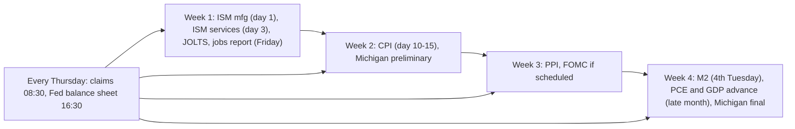

# 15. Your dashboard and routine

**Why this chapter matters.** Knowing what each indicator means is half the job. The other half is looking at the right ones, on the right day, in the same way every time, so that you notice when the regime changes instead of reacting to headlines. This chapter turns the course into a working routine: a dashboard of about 40 free series with exact FRED ids and TradingView tickers, a US release calendar, a weekly and a monthly routine, instructions for the course's macro lab script, a one-page checklist, and exercises that use real October 2026 data.

**You will learn**
- which free sources and exact tickers to use for every indicator in the course;
- when each major US release lands (day of the month, day of the week, time);
- a 30-minute weekly routine and a 60-minute monthly routine;
- how to run `tools/macro-lab/macro_lab.py` and read its report;
- a one-page regime checklist;
- how to avoid the most common data traps (units, revisions, base effects, provider differences).

---

## 1. The dashboard

### 1.1 Rates, inflation, labor, growth, liquidity and cross-asset

All FRED series are free at `https://fred.stlouisfed.org/series/<ID>` and downloadable as CSV at `https://fred.stlouisfed.org/graph/fredgraph.csv?id=<ID>` (no API key). TradingView tickers work on the free plan. The "Watch" column says what to look at, not what to do.

| Indicator | FRED id | TradingView / other | Frequency | Watch | Chapter |
|---|---|---|---|---|---|
| Fed funds target range | DFEDTARU, DFEDTARL | ECONOMICS:USINTR | at FOMC meetings | direction and *why* it moves | [02](02-THE-FED-AND-INTEREST-RATES.md) |
| Effective fed funds | DFF, EFFR (daily), FEDFUNDS (monthly) | FRED:FEDFUNDS | daily | gap to the 2-year | [02](02-THE-FED-AND-INTEREST-RATES.md) |
| Market-implied Fed path | — | CME FedWatch (cmegroup.com) | intraday | *changes* in odds | [02](02-THE-FED-AND-INTEREST-RATES.md) |
| 3-month bill | DGS3MO, TB3MS | TVC:US03MO | daily | anchor for 10Y–3M | [03](03-BONDS-AND-THE-YIELD-CURVE.md) |
| 2-year Treasury | DGS2 | TVC:US02Y | daily | above or below fed funds | [03](03-BONDS-AND-THE-YIELD-CURVE.md) |
| 10-year Treasury | DGS10 | TVC:US10Y | daily | level vs 5%; direction | [03](03-BONDS-AND-THE-YIELD-CURVE.md) |
| 30-year Treasury | DGS30 | TVC:US30Y | daily | fiscal and term-premium stress | [03](03-BONDS-AND-THE-YIELD-CURVE.md) |
| Curve 10Y–2Y, 10Y–3M | T10Y2Y, T10Y3M | TVC:US10Y-TVC:US02Y (spread expression) | daily | bull vs bear steepening or flattening | [03](03-BONDS-AND-THE-YIELD-CURVE.md) |
| 10Y real yield (TIPS) | DFII10 | — | daily | cost of money for gold and BTC | [03](03-BONDS-AND-THE-YIELD-CURVE.md) |
| Breakeven inflation, 5y5y | T10YIE, T5YIFR | — | daily | 5y5y above about 2.6–2.7% = expectations drifting | [04](04-INFLATION.md) |
| Term premium (Kim-Wright) | THREEFYTP10 | NY Fed ACM (newyorkfed.org) | daily / monthly | why long yields rise after cuts | [03](03-BONDS-AND-THE-YIELD-CURVE.md) |
| High-yield and IG spreads | BAMLH0A0HYM2, BAMLC0A0CM | — | daily | about 5 = average, 8+ = recession; FRED keeps only about 3 years | [03](03-BONDS-AND-THE-YIELD-CURVE.md) |
| Bond volatility (MOVE) | not on FRED | TVC:MOVE | daily | above 100 = rate stress | [03](03-BONDS-AND-THE-YIELD-CURVE.md) |
| VIX | VIXCLS | TVC:VIX | daily | below 15 calm, above 30 stress | [08](08-STOCKS-GOLD-AND-CROSS-ASSET.md) |
| CPI headline / core | CPIAUCSL, CPILFESL (SA); CPIAUCNS (NSA headline) | ECONOMICS:USIRYY, ECONOMICS:USCIR | monthly | 3-month annualised core vs YoY | [04](04-INFLATION.md) |
| Shelter, OER | CUSR0000SAH1, CUSR0000SEHC | — | monthly | lags market rents by about 12 months | [04](04-INFLATION.md) |
| PCE / core PCE | PCEPI, PCEPILFE | — | monthly | the Fed's gauge | [04](04-INFLATION.md) |
| PPI final demand | PPIFIS | — | monthly | pipeline pressure | [04](04-INFLATION.md) |
| Michigan 1-year expectations | MICH | — | monthly | noisy; compare with 5y5y | [04](04-INFLATION.md) |
| Unemployment U-3 / U-6 | UNRATE, U6RATE | ECONOMICS:USUR | monthly | change from the cycle low | [05](05-THE-LABOR-MARKET.md) |
| Sahm rule | SAHMREALTIME, SAHMCURRENT | — | monthly | 0.50 trigger (confirmation, not forecast) | [05](05-THE-LABOR-MARKET.md) |
| Initial / continuing claims | ICSA, CCSA, IC4WSA | ECONOMICS:USIJC | weekly | rise of 20–30% from the low; Cowen's 300k line | [05](05-THE-LABOR-MARKET.md) |
| Payrolls | PAYEMS (take differences) | — | monthly | 3-month average and revisions | [05](05-THE-LABOR-MARKET.md) |
| JOLTS openings, quits | JTSJOL, JTSQUR | — | monthly | early labor turn | [05](05-THE-LABOR-MARKET.md) |
| Participation | CIVPART | — | monthly | supply-driven unemployment moves | [05](05-THE-LABOR-MARKET.md) |
| Real GDP | A191RL1Q225SBEA, GDPC1 | — | quarterly | confirmation only | [06](06-GROWTH-AND-THE-BUSINESS-CYCLE.md) |
| GDPNow | GDPNOW | atlantafed.org | 6–7 times a month | current-quarter nowcast | [06](06-GROWTH-AND-THE-BUSINESS-CYCLE.md) |
| ISM Manufacturing / Services | not on FRED | ismworld.org; ISM:MAN_PMI on some vendors | monthly | new orders and prices, not just the headline | [06](06-GROWTH-AND-THE-BUSINESS-CYCLE.md) |
| NBER recession flag; smoothed probability | USREC; RECPROUSM156N | — | monthly | dated after the fact | [06](06-GROWTH-AND-THE-BUSINESS-CYCLE.md) |
| M2 | M2SL | ECONOMICS:USM2 | monthly | YoY growth, not level | [07](07-LIQUIDITY-MONEY-AND-THE-DOLLAR.md) |
| Fed balance sheet | WALCL ($ millions) | — | weekly | QT/QE direction | [07](07-LIQUIDITY-MONEY-AND-THE-DOLLAR.md) |
| TGA | WTREGEN ($ millions) | fiscaldata.treasury.gov (daily) | weekly | rebuilds drain reserves | [07](07-LIQUIDITY-MONEY-AND-THE-DOLLAR.md) |
| Reverse repo | RRPONTSYD ($ billions) | — | daily | the buffer; near zero since late 2025 | [07](07-LIQUIDITY-MONEY-AND-THE-DOLLAR.md) |
| Bank reserves, SOFR, IORB | WRESBAL, SOFR, IORB | — | weekly / daily | SOFR above IORB = scarce reserves | [07](07-LIQUIDITY-MONEY-AND-THE-DOLLAR.md) |
| Dollar | DTWEXBGS (broad) | TVC:DXY, ICEUS:DX1! | daily | financial-conditions input | [07](07-LIQUIDITY-MONEY-AND-THE-DOLLAR.md) |
| Yen, euro | DEXJPUS, DEXUSEU | FX:USDJPY | daily | speed of yen moves (carry trade) | [07](07-LIQUIDITY-MONEY-AND-THE-DOLLAR.md) |
| Oil | DCOILWTICO, DCOILBRENTEU, WTISPLC | TVC:USOIL, TVC:UKOIL | daily | speed of the move | [08](08-STOCKS-GOLD-AND-CROSS-ASSET.md) |
| Gold, silver, copper/gold | not on FRED | TVC:GOLD, OANDA:XAUUSD, TVC:SILVER, COMEX:HG1!/COMEX:GC1! | daily | vs real yields | [08](08-STOCKS-GOLD-AND-CROSS-ASSET.md) |
| Stocks | SP500 (last 10 years), NASDAQCOM, NASDAQ100 | SP:SPX, NASDAQ:NDX, TVC:RUT, SP:SPXEW, INDEX:S5TH | daily | breadth (RSP/SPY, % above 200-day) | [08](08-STOCKS-GOLD-AND-CROSS-ASSET.md) |

### 1.2 Crypto

| Indicator | Ticker / source | Watch | Chapter |
|---|---|---|---|
| BTC and ETH price | FRED CBBTCUSD, CBETHUSD; TradingView INDEX:BTCUSD, BITSTAMP:BTCUSD | weekly close vs 20W SMA / 21W EMA (BMSB), 50W, 200W | [10](10-BITCOIN-CYCLES-AND-VALUATION-MODELS.md) |
| Bitcoin dominance | CRYPTOCAP:BTC.D (includes stablecoins); CoinGecko, CoinMarketCap | trend; providers differ by 1–2 points | [12](12-DOMINANCE-ALTCOINS-AND-ROTATION.md) |
| ETH dominance | CRYPTOCAP:ETH.D | — | [12](12-DOMINANCE-ALTCOINS-AND-ROTATION.md) |
| ETH/BTC | BINANCE:ETHBTC | trend vs the 2025 low (0.0181) | [12](12-DOMINANCE-ALTCOINS-AND-ROTATION.md) |
| Total crypto cap and slices | CRYPTOCAP:TOTAL, TOTAL2 (ex-BTC), TOTAL3 (ex-BTC and ETH), OTHERS (outside the top 10) | alt breadth | [12](12-DOMINANCE-ALTCOINS-AND-ROTATION.md) |
| Long-tail alt share | CRYPTOCAP:OTHERS.D | lower highs each cycle since 2021 | [12](12-DOMINANCE-ALTCOINS-AND-ROTATION.md) |
| Stablecoin dominance | CRYPTOCAP:USDT.D, USDC.D, STABLE.C.D | rising = risk-off inside crypto | [12](12-DOMINANCE-ALTCOINS-AND-ROTATION.md) |
| Alt/BTC pairs | e.g. BINANCE:SOLBTC | range lows vs BTC | [12](12-DOMINANCE-ALTCOINS-AND-ROTATION.md) |
| Altcoin Season Index | blockchaincenter.net/en/altcoin-season-index; CoinMarketCap version | 75+ = alt season, 25 or less = bitcoin season | [12](12-DOMINANCE-ALTCOINS-AND-ROTATION.md) |
| Stablecoin supply | DefiLlama (defillama.com/stablecoins); TradingView CRYPTOCAP:USDT | 90-day growth rate | [11](11-ON-CHAIN-AND-SENTIMENT.md) |
| Fear & Greed | alternative.me (API api.alternative.me/fng/) | extremes persist for weeks | [11](11-ON-CHAIN-AND-SENTIMENT.md) |
| Spot ETF flows | farside.co.uk, SoSoValue | pro-cyclical | [11](11-ON-CHAIN-AND-SENTIMENT.md) |
| Funding, open interest, liquidations | CoinGlass, Coinalyze, Velo; TradingView BTCUSDT.P | crowded leverage | [11](11-ON-CHAIN-AND-SENTIMENT.md) |
| Realized price, MVRV, NUPL, SOPR, supply in profit | Glassnode Studio, checkonchain.com, Bitcoin Magazine Pro, CryptoQuant, Coin Metrics community API | bottom zones | [11](11-ON-CHAIN-AND-SENTIMENT.md) |
| Puell, hash rate, hash ribbons | Bitcoin Magazine Pro, Glassnode, mempool.space | miner stress | [11](11-ON-CHAIN-AND-SENTIMENT.md) |
| Google Trends | trends.google.com ("bitcoin", worldwide) | compare within one download only | [11](11-ON-CHAIN-AND-SENTIMENT.md) |
| Halving dates, block height | mempool.space, blockchain.com | next halving about April 2028 | [10](10-BITCOIN-CYCLES-AND-VALUATION-MODELS.md) |

Cowen's own platform (intothecryptoverse.com) has many of these charts behind subscription tiers; his free memos are at [benjamincowen.com/reports](https://benjamincowen.com/reports). The course does not depend on either.

---

## 2. The US release calendar

Times are US Eastern. "Business day" excludes weekends and federal holidays. Exact dates move each year; check the publisher's calendar (bls.gov/schedule, bea.gov, federalreserve.gov, ismworld.org).

| Release | Publisher | When | Time (ET) | Revisions and quirks |
|---|---|---|---|---|
| ISM Manufacturing PMI | ISM | 1st business day of the month (prior month) | 10:00 | seasonal factors revised each January |
| ISM Services PMI | ISM | 3rd business day | 10:00 | — |
| Employment Situation (unemployment, payrolls) | BLS | usually the 1st Friday (prior month) | 08:30 | two prior months revised each release; annual benchmark: preliminary Aug/Sep, final with the January report in February; household seasonal factors revised each January |
| JOLTS | BLS | about 5 weeks after the reference month, early in the month | 10:00 | revised |
| Initial jobless claims | Dept. of Labor | every Thursday | 08:30 | continuing claims lag one more week; seasonal quirks in summer and January |
| CPI | BLS | about 10–15 days after month-end | 08:30 | not revised except seasonal factors (5 years, each February) |
| PPI | BLS | about mid-month, usually after CPI | 08:30 | revised |
| Michigan sentiment and expectations | Univ. of Michigan | preliminary mid-month, final at month-end | 10:00 | — |
| PCE and core PCE (Personal Income and Outlays) | BEA | about 4 weeks after month-end | 08:30 | revised |
| GDP | BEA | advance about 4 weeks after quarter-end, then second and third estimates | 08:30 | mean absolute revision advance → second about 0.5 pp (1996–2024) |
| GDPNow | Atlanta Fed | after major releases, 6–7 times a month | — | converges toward the advance estimate |
| M2 (H.6) | Fed | 4th Tuesday of the month, about a 4-week lag | 13:00 | weekly data discontinued in 2021 |
| Fed balance sheet (H.4.1) | Fed | every Thursday (Wednesday values) | 16:30 | — |
| Treasury yields | US Treasury / FRED | daily | about 15:30 | — |
| Effective fed funds | NY Fed | daily, for the prior day | about 09:00 | — |
| TGA | Treasury (Daily Treasury Statement) | daily | afternoon | weekly on FRED (WTREGEN) |
| FOMC statement and press conference | Fed | 8 scheduled meetings a year | 14:00 statement, 14:30 press conference | minutes 3 weeks later; Warsh said on 28 Oct 2026 that in 2027 one of the eight meetings will be a "strategy" meeting with no rate vote |
| Summary of Economic Projections (dots) | Fed | March, June, September, December meetings | 14:00 | under Warsh the chair submits no dot |
| Treasury quarterly refunding | Treasury | early February, May, August, November | — | sets coupon issuance sizes |
| NBER recession dating | NBER | months to a year after the turn | — | the Dec 2007 peak was announced in Dec 2008 |

**Dates to note as of 30 Oct 2026:** the October ISM Manufacturing report on 2 Nov 2026; the US midterm elections on 3 Nov 2026; the next FOMC meeting on 8–9 Dec 2026, with FedWatch putting about 83% on a hike after the October meeting (per CNBC, 28 Oct 2026). The federal shutdown of 1 Oct – 12 Nov 2025 left a permanent hole: the October 2025 household survey (unemployment) and the October 2025 CPI were never published.

A typical month:



---

## 3. A weekly routine (about 30 minutes)

Do it at the same time each week, for example after the Friday close or at the weekend after bitcoin's weekly close on Sunday (UTC).

1. **Refresh the numbers.** Run the macro lab (section 5) or open your saved FRED graphs. Note the date of each value.
2. **Policy and the front end.** Is the 2-year above or below effective fed funds, and by how much? Did FedWatch odds for the next meeting change by more than about 20 points? Any Fed speeches or dissents?
3. **Long end and curve.** 10-year and 30-year levels; 10Y–2Y and 10Y–3M. Name the move: bull or bear, steepening or flattening.
4. **Labor (fast).** Initial claims and the 4-week average against their cycle low; continuing claims.
5. **Stress gauges.** HY spread, VIX, MOVE. Any sharp widening?
6. **Liquidity and dollar.** WALCL, TGA, RRP, reserves (compute net liquidity = WALCL − TGA − RRP); the broad dollar or DXY; USDJPY if the yen is moving fast.
7. **Oil.** Brent and WTI: level and the size of the weekly move.
8. **Crypto.** BTC weekly close vs the BMSB, 50W and 200W; BTC.D, ETH/BTC, USDT.D, OTHERS.D; Fear & Greed; ETF flows; stablecoin supply.
9. **Log it.** One line per area: what changed, and which column of the regime table in [chapter 13](13-HOW-IT-ALL-CONNECTS.md#5-regime-table-what-indicators-and-assets-typically-do-in-each-phase) it now fits. If you follow Cowen's videos, add his latest stated invalidation level with its date ([chapter 14](14-COWEN-FRAMEWORK-AND-VIDEO-DECODER.md)).

## 4. A monthly routine (about 60 minutes, after the jobs report and CPI)

1. **Labor.** Unemployment change from the cycle low; Sahm rule; 3-month average payrolls and revisions; participation (is unemployment moving because of layoffs or labor supply?); JOLTS openings and quits.
2. **Inflation.** CPI headline and core YoY *and* 3-month annualised; shelter; PCE and core PCE when released; PPI; 5y5y breakeven. Check what base effects will do to YoY over the next three months.
3. **Growth.** ISM new orders, prices and employment; GDPNow; earnings season when it runs.
4. **Money.** M2 YoY; the trend in net liquidity over three months.
5. **Re-score the regime.** Fill the checklist in section 6. Count how many readings sit in each column.
6. **Soft vs hard landing check.** Run through the table in [chapter 13 §10](13-HOW-IT-ALL-CONNECTS.md#10-soft-landing-or-hard-landing-a-real-time-checklist).
7. **Review.** Re-read last month's log. What did you expect, what happened, what did you misread?

**Quarterly additions:** read the new dot plot and compare it with FedWatch; read the GDP advance estimate (and GDI); note the Treasury refunding sizes; re-run the full lab and compare the tables with the snapshot the course uses.

---

## 5. The macro lab: how to run it and read it

The [macro lab](../../tools/macro-lab/README.md) is one Python script, `tools/macro-lab/macro_lab.py`, that downloads free FRED data and recomputes every statistical table this course quotes.

**Requirements.** Python 3.9 or newer, standard library only (no pandas, no API key, no account), and internet access to fred.stlouisfed.org.

**Run it.**

```bash
cd tools/macro-lab
python3 macro_lab.py                     # writes REPORT.md
python3 macro_lab.py --out my-report.md  # choose the output file
python3 macro_lab.py --offline           # recompute from the cache only
python3 macro_lab.py --cache .fred-cache # choose the cache folder (default)
```

The first run downloads about 25 CSV files (a few MB) into `.fred-cache/`. Later runs within 24 hours reuse them. If a download fails, the script falls back to the cached copy and prints a warning. The output is a single Markdown file you can open in any editor or on GitHub.

**What each section of the report tells you.**

| Section | What it computes | How to read it |
|---|---|---|
| Dashboard: latest values | 19 series: latest value, 3 months ago, 1 year ago (CPI, core PCE and M2 as YoY %) | Check the "as of" column first; monthly series lag by 4–6 weeks |
| NBER recessions | start and end months since 1960 from USREC | the reference for every lag in the other tables |
| Yield curve 10Y–3M and 10Y–2Y | inversion episodes (2+ months, monthly averages), months to the next recession from first inversion and from un-inversion | negative lags mean the recession started before un-inversion; "none within 36 m" means a failed signal; "none yet" means the 36-month window is still open |
| Sahm rule triggers | first month at 0.50 or more (re-armed below 0.30) vs recession start | positive "months after start" = the rule confirmed late |
| Unemployment low vs recession | cycle low in the 36 months before each recession and the rise by the start | the low comes 1–33 months before |
| Fed cycles | last hike → first cut; Nasdaq +3/+6/+12 months; worst close within 18 months; unemployment peak; BTC +12 months | split the rows by "recession within 24 m" before drawing any conclusion |
| Presidential cycle | Nasdaq calendar-year returns by year of the term; midterm-year drawdowns and the rebound from the low | the rebound uses the low known only afterwards |
| Bitcoin status | 200-week SMA, BMSB (20W SMA / 21W EMA), log-regression fair value and z-score | the regression starts in Dec 2014 (FRED's coverage), so its slope and fair value differ from fits that include 2010–14 |
| Rolling correlations (weekly) | BTC vs Nasdaq, broad dollar, 10Y real yield, by year | weekly returns are the honest version; daily stamps are not synchronous |
| Net liquidity and M2 leads | correlations at different lead times | low values (about 0.1–0.25) mean weak relationships |
| ETH/BTC vs Fed target change | yearly ETH/BTC change next to the change in the Fed target | a check on "alts need rate cuts" |

**Worked example: the 30 Oct 2026 snapshot** ([REPORT-2026-10-30.md](../../tools/macro-lab/REPORT-2026-10-30.md)).
- Dashboard: fed funds upper bound 4.00% (up from 3.75% three months earlier), 2-year 4.67%, 10-year 5.05%, 10Y–2Y +0.37, unemployment 4.2%, Sahm 0.00, claims 194,000, CPI 3.72% YoY (Sep), core PCE 3.12%, HY spread 3.14, VIX 16.91, bitcoin $77,939. Reading: the Fed and long yields are tightening while labor, credit and volatility are calm.
- Yield curve: the 2022–24 10Y–2Y inversion (low −0.93 in monthly averages) and the 2022–24 10Y–3M episode show "none within 36 m"; the brief 2025 10Y–3M episode reads "none yet (window open to 2028-03)". Reading: the 2022–24 signal failed; the 2025 one is still undecided.
- Fed cycles: the 2023–24 cycle shows Nasdaq +25.6% at 12 months, unemployment 4.1% → 4.5%, no recession within 24 months, BTC +83%. Reading: an insurance cycle.
- Bitcoin: 37.5% below the $124,720 weekly-close ATH; 15% above the 200-week SMA ($67,497); above the 20W SMA ($72,965) and 21W EMA ($76,677); price at 0.53 of the lab's regression fair value (z = −1.17).
- Liquidity tests: net liquidity leading BTC at 0–8 weeks gives r ≈ 0.18–0.19; M2 leading BTC gives at most 0.25. Reading: background drivers, not timing tools.

**Limits you should know** (from the lab README): FRED's bitcoin series starts in Dec 2014, so the 2010–14 history is missing; the Nasdaq Composite stands in for "stocks" because FRED's S&P 500 covers only ten years; eight recessions and three bitcoin cycles are tiny samples; correlations on overlapping YoY windows look stronger than they are. Gaps in the data need care: FRED has no October 2025 CPI print (government shutdown), so a script that steps back "12 rows" instead of 12 calendar months silently computes a 13-month change for every month after the gap. The lab matches by date, which is why its September 2026 CPI YoY (3.72%, seasonally adjusted) agrees with the BLS headline of 3.7%. When a number matters, check the method as well as the value.

---

## 6. One-page checklist

Copy this table into your notes each month. For each row, mark which column today's reading fits best. The point is the *count* and the *change* from last month, not any single row.

| Question | Indicator | Expansion | Late cycle / tightening | Recession risk rising | Today (date) |
|---|---|---|---|---|---|
| Which way is policy going? | fed funds, 2-year vs fed funds, FedWatch | 2-year ≈ fed funds | 2-year above fed funds; hikes priced | 2-year well below fed funds; cuts priced | |
| What is the curve doing? | T10Y2Y, T10Y3M | steep, stable | bear flattening or inverted | bull steepening, un-inverting | |
| Are long yields squeezing? | DGS10, DFII10, THREEFYTP10 | stable | rising; real yield above 2% | falling fast (flight to safety) | |
| Is inflation the constraint? | core CPI 3-month annualised, core PCE, 5y5y | near 2% | above 3%; supply shock | falling | |
| Are layoffs starting? | ICSA, CCSA | at lows | at lows | up 20–30% from the low | |
| Is unemployment turning? | UNRATE, SAHMREALTIME, CIVPART | falling or flat | at the low | +0.5 pp from the low, layoff-driven | |
| Is credit cracking? | BAMLH0A0HYM2 | below about 4 | about 2.4–3.5 (complacent) | widening toward 5–8 | |
| Is activity rolling over? | ISM new orders, GDPNow | above 50 | above 50 with high prices paid | below 50 and falling | |
| Is liquidity growing? | M2 YoY, net liquidity, RRP, reserves | growing | flat; buffers used up | QT or a funding accident | |
| Is the dollar tightening? | DTWEXBGS, DXY | flat or falling | rising | spiking (haven), then falling | |
| Is there stress? | VIX, MOVE | VIX below 15 | VIX 15–20 | VIX above 30, MOVE above 100 | |
| What is oil doing? | Brent, WTI | stable | up 50%+ in a year | spiking or collapsing | |
| Crypto trend | BTC weekly close vs BMSB, 50W, 200W | above the BMSB | below the BMSB | near or below the 200W | |
| Crypto breadth | BTC.D, ETH/BTC, OTHERS.D, USDT.D | BTC.D falling with alts up in USD | BTC.D rising; ETH/BTC falling | USDT.D rising; everything falling | |
| Sentiment | Fear & Greed, social metrics | greed | apathy | extreme fear for weeks | |

Rules of thumb drawn from the course: no single row decides the regime; labor, credit and the curve agreeing is the strongest combination; in 2024–26 every one-row recession call failed ([chapter 13](13-HOW-IT-ALL-CONNECTS.md#9-counter-examples-when-the-chain-broke)).

---

## 7. Data traps

| Trap | Example | Fix |
|---|---|---|
| Units | WALCL and WTREGEN are in $ millions, RRPONTSYD in $ billions | multiply RRP by 1,000 before subtracting |
| Revisions | the year to March 2025 payroll benchmark was revised by −911k (preliminary) and −898k (final) | use 3-month averages; check the next release |
| Base effects | the Mar–May 2026 CPI jumps (+0.87%, +0.64%, +0.47% MoM) roll off in Mar–May 2027 and will pull YoY down even if prices stay high | look at MoM and 3-month annualised rates |
| Missing data | no October 2025 unemployment or CPI (shutdown) | do not interpolate silently; mark the gap |
| Truncated history | FRED keeps only about 3 years of ICE credit-spread data | use published benchmarks for history (chapter 03) |
| Provider differences | BTC dominance differs by 1–2 points between TradingView, CoinGecko and CoinMarketCap; Fear & Greed has several versions | always use the same source and note it |
| Intraday vs close | BTC ATH about $126.1k intraday vs $124,824 daily close vs $124,720 weekly close | say which one you mean |
| Labor-supply shocks | 2024: Sahm triggered on labor-force growth | check participation and claims together |
| Overlapping windows | M2 YoY vs BTC YoY correlations | prefer weekly or monthly *changes* |
| Hindsight | "the midterm low" or "the cycle low" is known only afterwards | write down what you knew on the date |

---

## 8. Putting it together

1. **Thursday 08:30, claims jump.** Initial claims rise 20–30% from the low over several weeks → check continuing claims and the HY spread the same day → if both rise, the next jobs report is the key release; a 0.5 pp rise in unemployment would trigger the Sahm rule → historically the Fed then cuts and the curve bull-steepens, with recession within months (2001, 2008). Exception: 2024, when unemployment rose on labor supply and claims stayed low.
2. **CPI day, hot core.** Core CPI 3-month annualised jumps → the 2-year and FedWatch odds move within minutes → the dollar rises and altcoins fall most on the day → check whether 5y5y breakevens moved (2026: they did not, so long-run expectations stayed anchored).
3. **FOMC week.** Read the statement for wording changes and the vote for dissents → in 2026 three dissents against the easing bias in April and three dissents for a hike in July (the meeting before) preceded the September hike → then compare the dots with FedWatch.
4. **Sunday weekly close.** BTC closes below the BMSB → check BTC.D and ETH/BTC (are alts falling faster?) and USDT.D (is money parking in stablecoins?) → in Cowen's framework a loss of the band after a top marks a bear (Dec 2021, Nov 2025); in 2026 the band was lost and regained several times, so confirmation over more than one close mattered.

---

## 9. Exercises

Use the numbers given. Answers are in the collapsible blocks.

**Exercise 1.** On 28 Oct 2026 the 2-year yield was 4.67% and effective fed funds 3.88%. What is the market pricing, and how does Cowen describe this relationship?

<details>
<summary>Answer</summary>

The 2-year is about 80 bp above effective fed funds, so the market expects the policy rate to rise (more hikes). FedWatch put about 83% on a December 2026 hike. Cowen's shorthand: "the Fed chases the 2-year"; fed funds below the 2-year means policy is not restrictive relative to what the market expects ([chapter 02](02-THE-FED-AND-INTEREST-RATES.md)).
</details>

**Exercise 2.** Compute the real fed funds rate using effective fed funds of 3.88% and core PCE inflation of 3.12% (Sep 2026). Then compute it against headline PCE (3.65%). What do the two answers tell you?

<details>
<summary>Answer</summary>

3.88 − 3.12 = +0.76 pp; 3.88 − 3.65 = +0.23 pp. Policy is only mildly restrictive in real terms, and barely positive against headline inflation. That is why hawkish FOMC members argued for more hikes in 2026. For comparison, in mid-2024 the real rate was about +2.6.
</details>

**Exercise 3.** Practice numbers (made up for the exercise): the 3-month average unemployment rate over the past 12 months had a minimum of 3.9%. The last three monthly readings are 4.3%, 4.4% and 4.5%. Does the Sahm rule trigger? What two checks would you make before calling it a recession signal?

<details>
<summary>Answer</summary>

The 3-month average is (4.3 + 4.4 + 4.5) / 3 = 4.4%. 4.4 − 3.9 = 0.5 pp, so yes, it triggers. Checks: (1) are layoffs driving it (initial and continuing claims rising, permanent job losers up), or labor supply (participation rising, as in 2024)? (2) are high-yield spreads widening? The rule usually fires 1–4 months after a recession has already begun, and it gave false signals in 1976 and 2024.
</details>

**Exercise 4.** From their 27 Feb 2026 lows (3.38% and 3.97%) to 28 Oct 2026, the 2-year rose about 130 bp and the 10-year about 108 bp; 10Y–2Y went from +0.74 (30 Jan) to +0.37 (29 Oct). Name the curve move and the usual reason for it.

<details>
<summary>Answer</summary>

Bear flattening: both yields rose, the short end more. It usually happens when the Fed is hiking or expected to hike. It is the opposite of the bull steepening that typically comes with first cuts into a weakening economy.
</details>

**Exercise 5.** Compute US net liquidity from the lab dashboard: Fed balance sheet $6,745.64bn (28 Oct), RRP $0.35bn (29 Oct), and TGA about $1,000bn ([research notes C](../../research-notes/C-growth-liquidity-crossasset.md), 28 Oct). What trap does the FRED data contain, and why does an RRP near zero matter?

<details>
<summary>Answer</summary>

6,745.64 − 1,000 − 0.35 ≈ $5,745bn, about $5.75T. Trap: on FRED, WALCL and WTREGEN are in $ millions and RRPONTSYD in $ billions; convert before subtracting. An RRP near zero means the buffer that offset QT in 2023–24 is gone: any further balance-sheet shrinkage or TGA rebuild now comes straight out of bank reserves.
</details>

**Exercise 6.** Using the lab's Fed-cycles table, sort the first cuts into "recession within 24 months" and "no recession", and compare the Nasdaq's 12-month returns.

<details>
<summary>Answer</summary>

No recession: 1984 (+12.3%), 1987 (+19.6%), 1995 (+21.6%), 1998 (+57.5%), 2024 (+25.6%). Recession within 24 months: 1989 (+3.8%), 2001 (−21.9%), 2007 (−20.8%), 2019 (+32.5%, recession caused by COVID). Without a recession every case was positive; with a recession the results ranged from deep losses to a large gain in 2019–20 when the Fed flooded the system after the crash. The first cut alone does not tell you the outcome.
</details>

**Exercise 7.** The lab shows BTC at $77,939, the 200-week SMA at $67,497, the 20-week SMA at $72,965 and the 21-week EMA at $76,677. Where is price relative to each, and how would Cowen's framework label it?

<details>
<summary>Answer</summary>

About 15% above the 200W SMA and above both lines of the bull market support band, though only about 1.6% above the 21W EMA. In his framework, weekly closes above the band read as bullish trend and below it as bearish; a close back below it would put the 200W (the "date with destiny") back in focus. Note that his late-October 2026 roadmap was bearish anyway, with $83k as the level that would void it.
</details>

**Exercise 8.** Headline CPI rose +0.87%, +0.64% and +0.47% month on month in March, April and May 2026. If prices are flat in March–May 2027, what happens to the year-on-year rate, and why does it matter for reading the Fed?

<details>
<summary>Answer</summary>

Those large months drop out of the 12-month window, so YoY falls mechanically by roughly the size of those months (about 2 pp in total over the three months), even with no real improvement. A headline saying "inflation is falling" in spring 2027 could be mostly base effects. Watch MoM and 3-month annualised core instead; the Fed watches core PCE.
</details>

**Exercise 9.** The lab finds that US M2 YoY leading BTC YoY by 6 months has a correlation of 0.25. Give two reasons why this is not a usable timing signal.

<details>
<summary>Answer</summary>

(1) r = 0.25 means R² ≈ 6%: M2 explains a small share of BTC's moves. (2) Overlapping year-on-year windows inflate correlations, because each monthly point shares 11 months of data with the next. Also: in 2023 M2 contracted for the first time in the post-1959 record and BTC rose 156%, and in 2025–26 M2 grew while BTC fell by half.
</details>

**Exercise 10.** It is Thursday at 08:30 ET. Which US release has just come out? Which one comes out at 16:30 the same day?

<details>
<summary>Answer</summary>

Weekly initial jobless claims (Department of Labor) at 08:30; the Fed's H.4.1 balance-sheet release (WALCL, Wednesday values) at 16:30.
</details>

**Exercise 11.** Classify each statement from Cowen's 24–26 Oct 2026 roadmap as fact (as of 30 Oct), forecast or invalidation: (a) "weekly close below $83k"; (b) "the Fed does not hike on 28 Oct"; (c) "oil around $120"; (d) "stocks and BTC drop in Q4"; (e) "void above $83k".

<details>
<summary>Answer</summary>

(a) fact: BTC closed below $83k (week of 25 Oct). (b) fact: the Fed held on 28 Oct. (c) roughly fact: Brent was $123.10 on 27 Oct (FRED). (d) forecast, unresolved as of 30 Oct. (e) invalidation level. Notice that the confirmed steps were the easier, near-term ones; the decisive step (d) was still open.
</details>

**Exercise 12.** On 30 Oct 2026 you see BTC.D about 59–60%, ETH/BTC about 0.029, the Altcoin Season Index around 45–53 and USDT.D about 6.8%. ISM Manufacturing is 54.5. Which regime does the crypto data fit, and what does that say about the "ISM above 50 → alt season" thesis?

<details>
<summary>Answer</summary>

A bitcoin-led, tightening-type regime: dominance high, ETH/BTC near its lows, no alt season (75+ needed). The ISM upswing happened without an alt season, so the thesis (associated with Raoul Pal, not Cowen) failed its 2026 test. The ISM rise came with high prices paid and Fed hikes, not with easing and growing liquidity ([chapter 06](06-GROWTH-AND-THE-BUSINESS-CYCLE.md)).
</details>

---

## Check yourself

1. Which three releases would you never miss in a month, and why?
2. Why should you note the "as of" date of every value on your dashboard?
3. What does it mean when SOFR trades above IORB?
4. Which two lab sections would you read first to judge whether a first Fed cut is likely to end well?
5. Why does the checklist ask you to count readings across rows instead of trusting one?

<details>
<summary>Answers</summary>

1. The jobs report (unemployment and payrolls), CPI, and the FOMC decision. Together they cover the labor trigger, the inflation constraint and the policy response. Weekly claims are the fast check in between.
2. Monthly series lag by 4–6 weeks and some are revised; mixing a fresh daily value with a stale monthly one can make the picture look more consistent (or less) than it is.
3. Bank reserves are getting scarce; funding is tight. It happened in Sep 2019 and in late 2025, and the Fed responded by adding reserves.
4. The Fed-cycles table (outcomes split by whether a recession followed) and the unemployment / Sahm tables (whether the labor market is turning). Then check credit spreads on the dashboard.
5. Every single-indicator recession call failed in 2024–26 (curve, Sahm, M2, ISM). Agreement across labor, credit and the curve has been more reliable than any one series.
</details>

---

> Educational material, not financial advice. Past relationships between indicators can break.

[← 14. Cowen's framework and video decoder](14-COWEN-FRAMEWORK-AND-VIDEO-DECODER.md) | [Index](00-INDEX.md) | [16. Glossary →](16-GLOSSARY.md)
