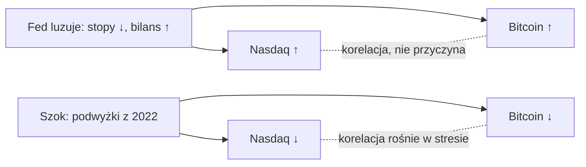

# 01. Jak czytać wykresy makro

Każdy kolejny rozdział tego kursu stawia przed tobą wykres i pyta, co on oznacza: krzywa rentowności schodząca poniżej zera, bezrobocie odbijające w górę od dołka, bitcoin poniżej linii „wartości godziwej” (fair value), współczynnik korelacji równy 0,44. Kilka tych samych sztuczek potrafi sprawić, że takie wykresy wyglądają bardziej przekonująco, niż na to zasługują. Oś pionową można rozciągnąć, seria może pokazywać poziom albo tempo zmian, kilka szczęśliwych punktów danych może dźwigać cały wniosek, a zależność może po cichu przestać działać. Ten rozdział to zestaw narzędzi. Każdej idei towarzyszy mały przykład liczbowy, który możesz samodzielnie przeliczyć, a przykłady opierają się na prawdziwych danych z [raportu laboratorium makro](../../tools/macro-lab/REPORT-2026-10-30.md) kursu (dane FRED do 29 października 2026) i na badaniach, na których zbudowano kurs.

**Czego się nauczysz:**
- dlaczego wieloletnie wykresy aktywów powinny mieć skalę logarytmiczną i co oznacza „równa odległość” na każdej ze skal;
- czym różni się poziom, zmiana w punktach procentowych i zmiana procentowa oraz jak mają się do siebie tempo rok do roku (r/r), miesiąc do miesiąca (m/m) i w ujęciu rocznym;
- jak liczy się średnie kroczące (SMA i EMA) i dlaczego tygodniowe zamknięcia są ważniejsze niż śróddzienne knoty;
- jak buduje się linię „wartości godziwej” z regresji logarytmicznej i jej pasma oraz jak co do zasady buduje się znormalizowaną skalę „ryzyka” 0–1;
- jak czytać współczynnik korelacji, korelację kroczącą i tabelę wyprzedzeń i opóźnień;
- statystyczne pułapki, w które wpada większość argumentów makroekonomicznych: nakładające się okna, maleńkie próby (dziewięć recesji w USA od 1960 roku), zmiana reżimu, niezamknięte okna, rewizje i nadmierne dopasowanie do danych (curve-fitting).

---

## Skale: logarytmiczna a liniowa

**Idea.** Na osi liniowej (arytmetycznej) równe odległości w pionie oznaczają równe zmiany *w dolarach*. Na osi logarytmicznej równe odległości w pionie oznaczają równe zmiany *procentowe*.

**Przykład liczbowy.** Bitcoin rośnie z 10 000 USD do 20 000 USD, a później z 60 000 USD do 70 000 USD. Oba ruchy dodają 10 000 USD, więc na wykresie liniowym mają tę samą wysokość. Pierwszy ruch to +100%, drugi +16,7%. Na osi log10 położenie punktów wygląda tak:

| Cena | log10(cena) | Odległość od poprzedniego punktu |
|---|---|---|
| 10 000 USD | 4,000 | |
| 20 000 USD | 4,301 | 0,301 (podwojenie) |
| 60 000 USD | 4,778 | |
| 70 000 USD | 4,845 | 0,067 |

Na wykresie logarytmicznym podwojenie jest 4,5 raza wyższe niż ruch o +16,7% — i właśnie tak odczuwa je inwestor.

**Praktyczne zasady.**
- Skali logarytmicznej używaj dla każdego wykresu aktywa, który obejmuje kilka lat lub kilkukrotną zmianę wartości (bitcoin, Nasdaq od lat 70., M2 od 1960 roku). Liniowy wykres bitcoina od 2013 roku sprawia, że wszystko przed 2020 rokiem wygląda płasko, a ostatnie ruchy są przesadnie wyolbrzymione.
- Linie trendu, linie regresji i „pasma” na wykresach aktywów mają sens tylko w przestrzeni logarytmicznej, bo wzrost się kumuluje (procent składany).
- Skali liniowej używaj dla stóp i spreadów, które mogą być zerowe lub ujemne (stopa funduszy federalnych, spread 10y–2y, bezrobocie). Nie da się obliczyć logarytmu z −0,5.
- Wykres z dwiema osiami (na przykład bitcoin na osi logarytmicznej i indeks dolara na osi liniowej) można przeskalować tak, by niemal dowolne dwie linie do siebie „pasowały”. Zanim uwierzysz w nakładkę, sprawdź obie osie.

---

## Poziomy, zmiany i tempo zmian

**Punkty procentowe a procenty.** Stopa bezrobocia wzrosła z 3,4% (kwiecień 2023) do 4,5% (listopad 2025, dane po rewizji; pierwszy odczyt wynosił 4,6%). To wzrost o 1,1 **punktu procentowego** (pp), a zarazem wzrost samej stopy o 32%. Autorzy piszący o makroekonomii prawie zawsze mają na myśli punkty procentowe. Nagłówek „bezrobocie wzrosło o 32%” jest formalnie prawdziwy i bardzo mylący.

**Punkty bazowe.** Jeden punkt bazowy (pb, ang. bp) to 0,01 pp. Wrześniowa (2026) podwyżka stóp przez Fed podniosła górną granicę przedziału docelowego z 3,75% do 4,00%: +25 pb, czyli +0,25 pp, czyli +6,7% w ujęciu względnym. Ludzie z rynku stóp procentowych zawsze mówią w punktach bazowych.

**Poziom a zmiana.** Wiele wskaźników ma znaczenie przez swoją *zmianę*, a nie poziom. Reguły Sahm ([rozdział 05](05-RYNEK-PRACY.md)) nie interesuje, czy bezrobocie wynosi 4%, czy 7%; pyta, o ile średnia trzymiesięczna wzrosła od swojego 12-miesięcznego minimum. W tabeli laboratorium pokazującej dołki bezrobocia przed recesjami wzrost od dołka do początku recesji wynosił we wszystkich przypadkach od 1960 roku zaledwie 0,2–1,0 pp, i to z bardzo różnych poziomów wyjściowych (3,4% w 1969 roku, 7,2% w 1981 roku).

**Rok do roku (r/r, YoY), miesiąc do miesiąca (m/m, MoM) i w ujęciu rocznym.**
- r/r = indeks z bieżącego miesiąca ÷ ten sam miesiąc rok wcześniej − 1.
- m/m = bieżący miesiąc ÷ poprzedni miesiąc − 1.
- m/m w ujęciu rocznym = (1 + m/m)^12 − 1.

Przykład liczbowy: inflacja bazowa CPI rośnie o 0,3% w ciągu miesiąca. W ujęciu rocznym daje to 1,003^12 − 1 = **3,66%**. Miesiąc z odczytem 0,2% daje w ujęciu rocznym **2,43%**. Dlatego odczyt „0,3” niepokoi bank centralny z celem 2%, a odczyt „0,2” jest blisko celu. Tempo trzymiesięczne w ujęciu rocznym (składasz ze sobą trzy ostatnie zmiany miesięczne, a wynik podnosisz do czwartej potęgi) to rozwiązanie pośrednie: szybsze niż r/r, mniej zaszumione niż pojedynczy miesiąc.

**Efekty bazy.** Wskaźnik r/r porównuje z przesuwającym się punktem odniesienia, więc może się zmieniać nawet wtedy, gdy ceny stoją w miejscu. Przykład zabawkowy: indeks cen wynosi 100 w styczniu i lutym, w marcu skacze do 102, a potem się nie zmienia. Inflacja r/r pokazuje 2% w każdym miesiącu od marca do lutego następnego roku, a potem w marcu kolejnego roku spada do 0%, choć w tym miesiącu nic się nie wydarzyło. Prawdziwy przypadek z 2026 roku: energia podbiła amerykański CPI o 0,87%, 0,64% i 0,47% m/m w marcu, kwietniu i maju 2026 (według badań kursu dotyczących Fed i inflacji). Gdy te miesiące wypadną z okna r/r w marcu–maju 2027, inflacja ogólna r/r spadnie mechanicznie, nawet jeśli ceny pozostaną wysokie. [Rozdział 04](04-INFLACJA.md) wielokrotnie z tego korzysta.

### Nakładki przeskalowane do wspólnej bazy i „ROI” jako iloraz cen

Wykresy analogii umieszczają kilka okresów na jednej osi dzięki **przeskalowaniu do wspólnej bazy** (rebasing): każdą serię dzielisz przez jej wartość w dniu odniesienia i mnożysz przez 100 (albo zostawiasz jako iloraz). Przy kotwicy z lipcowego (2026) memorandum ustawionej na 1 stycznia, około 89 300 USD, bitcoin po 65 300 USD w połowie lipca pokazuje 73 na wykresie przeskalowanym do 100.

Pisemne raporty Cowena używają „ROI” właśnie w tym sensie ilorazu: „current price divided by the stated reference price” („bieżąca cena podzielona przez wskazaną cenę odniesienia”) ([Bitcoin Cycle Memo, lipiec 2026](https://benjamincowen.com/reports/bitcoin-cycle-memo-july-2026)). ROI równe **0,520** liczone od szczytu cyklu oznacza więc, że cena wynosi 52% szczytu, czyli obsunięcie (drawdown) o 48%. ROI od początku roku równe **0,731** oznacza −26,9% od 1 stycznia. ROI równe 4,0 liczone od dołka cyklu oznacza cenę czterokrotnie wyższą od dołka. Tak czytaj każdą nakładkę Into The Cryptoverse: 1,0 oznacza „bez zmian”, a nie zero.

Jego memoranda stosują tę samą metodę daleko poza bitcoinem: S&P 500, złoto, a nawet rentowność 10-letnich obligacji przeskalowane do 1 stycznia i nałożone na lata 2018 i 2022 (rentowność 10-latek była „+27% YTD”, czyli od początku roku, w [The Triple Squeeze, 30 września 2026](https://benjamincowen.com/reports/the-triple-squeeze-september-2026)), a także indeks dolara i bitcoin przeskalowane do 100 w dniu każdego zaprzysiężenia prezydenta ([The Balance of Risks, 15 sierpnia 2026](https://benjamincowen.com/reports/the-balance-of-risks-august-2026)). Trzy przestrogi:
- **Obraz zależy od daty kotwicy.** Przeskalowanie do 1 stycznia, do dołka cyklu albo do zaprzysiężenia daje z tych samych danych różne „dopasowania”.
- **Przeskalowanie rentowności daje procentową zmianę rentowności, a nie ceny.** Wzrost rentowności 10-latek z 4% do 5% to „+25%” na przeskalowanym wykresie, ale +1 pp w języku obligacji — i oznacza *spadek* cen obligacji.
- **Analogie wybiera się po fakcie.** Sam Cowen nazwał analogię dolara wyrównaną do zaprzysiężenia „lightest evidentiary leg” („najsłabiej udokumentowaną nogą”) swojego memorandum z sierpnia 2026. Przy dwóch lub trzech latach porównawczych dobre dopasowanie nakładki jest opisem, a nie dowodem ([rozdział 09](09-SEZONOWOSC-I-CYKLE-POLITYCZNE.md)).

---

## Średnie kroczące, zamknięcia i oscylatory

### Prosta i wykładnicza średnia krocząca

**SMA (prosta średnia krocząca, simple moving average)** z n okresów to zwykła średnia z ostatnich n wartości. **EMA (wykładnicza średnia krocząca, exponential moving average)** nadaje większą wagę najnowszym wartościom: EMA_dziś = α × wartość_dziś + (1 − α) × EMA_wczoraj, gdzie α = 2 / (n + 1).

Przykład liczbowy z pięcioma tygodniowymi zamknięciami: 100, 102, 101, 105, 110.
- 3-tygodniowa SMA w ostatnim tygodniu = (101 + 105 + 110) / 3 = **105,3**.
- 3-tygodniowa EMA (α = 0,5), startująca od 100: 101,0 → 101,0 → 103,0 → **106,5**.

EMA szybciej reaguje na skok do 110. W trendzie wzrostowym EMA leży powyżej SMA o tej samej długości; w trendzie spadkowym — poniżej.

**Gdzie je spotkasz.** Pas wsparcia rynku byka (Bull Market Support Band, BMSB) Benjamina Cowena to strefa między 20-tygodniową SMA a 21-tygodniową EMA z tygodniowych zamknięć bitcoina. W raporcie laboratorium (tydzień kończący się 1 listopada 2026) pas wynosił **72 965 / 76 677 USD**, a 200-tygodniowa SMA **67 497 USD**. [Rozdział 10](10-CYKLE-I-MODELE-WYCENY-BITCOINA.md) omawia, co te poziomy oznaczały historycznie.

**Średnia krocząca to ruchomy cel.** W lipcu 2026 Cowen napisał, że trwałe odzyskanie przez cenę 50-tygodniowej SMA na zamknięciu tygodniowym (wtedy około 86,5 tys. USD) osłabiłoby jego niedźwiedzią tezę ([Bitcoin Cycle Memo, lipiec 2026](https://benjamincowen.com/reports/bitcoin-cycle-memo-july-2026)). Pod koniec października 50-tygodniowa średnia spadła do około 76 tys. USD, bo wysokie ceny z 2025 roku wypadły z jej okna. Cena była powyżej niej, ale przebicie opadającej średniej to słabsze wydarzenie niż przebicie rosnącej. Zawsze zwracaj uwagę na nachylenie średniej, a nie tylko na to, po której jej stronie jest cena.

### Zamknięcia tygodniowe i miesięczne a knoty

„Knot” świecy (wick) to śróddzienne ekstremum; „zamknięcie” (close) to ostatnia cena w danym okresie (dla kryptowalut zwykle niedziela, 00:00 UTC, w przypadku świec tygodniowych). Zasada Cowena brzmi: zamknięcia są ważniejsze niż knoty. Przykład z badań: pierwsze tygodniowe zamknięcie bitcoina poniżej 200-tygodniowej SMA w 2026 roku nastąpiło w tygodniu kończącym się 28 czerwca 2026, na poziomie 59 517 USD przy wartości 200-tygodniowej średniej około 62,4 tys. USD. Śróddzienne spadki poniżej tej linii wcześniej w czerwcu nie liczyły się jako „utrata” poziomu. Różne giełdy zamykają okresy o różnych porach, więc „to” tygodniowe zamknięcie może się różnić o kilkaset dolarów między źródłami danych.

### Oscylatory na przykładzie RSI

Oscylator przekształca cenę w liczbę z ograniczonego przedziału. Wskaźnik siły względnej (Relative Strength Index, RSI) z n okresów to RSI = 100 − 100 / (1 + RS), gdzie RS = średni wzrost ÷ średni spadek w tych n okresach.

Przykład liczbowy: w ciągu 14 tygodni średni tygodniowy wzrost wynosi 2%, a średni tygodniowy spadek 1%. RS = 2, więc RSI = 100 − 100/3 = **66,7**. Odczyty powyżej 70 umownie oznaczają „wykupienie”, a poniżej 30 „wyprzedanie”. W przypadku bitcoina badania odnotowują tygodniowe RSI w okolicach 25–30 na końcu rynków niedźwiedzia z 2015, 2018 i 2022 roku. **Niedźwiedzia dywergencja** (cena wyznacza wyższy szczyt, a RSI niższy szczyt) pojawiła się przed szczytami z 2021 i 2025 roku, ale dywergencje mogą trwać miesiącami, więc ostrzegają, a nie wyznaczają momentu.

---

## Linie i pasma regresji

### Jak buduje się linię „wartości godziwej” z regresji logarytmicznej

1. Weź każdą dzienną (lub tygodniową) cenę P i jej wiek t, mierzony w dniach od bloku genezy bitcoina (3 stycznia 2009).
2. Przekształć obie wielkości: y = log10(P), x = log10(t).
3. Dopasuj prostą y = a + b·x metodą najmniejszych kwadratów. W kategoriach ceny daje to P = 10^a × t^b, czyli **prawo potęgowe** (power law).
4. Prosta to „wartość godziwa”. Pionowa odległość między dzisiejszą ceną w skali logarytmicznej a prostą to **reszta** (residual).
5. Oblicz odchylenie standardowe σ wszystkich reszt. Pasma rysuje się na poziomie prostej ± 1σ, ± 2σ (albo na stałych wielokrotnościach).

**Przykład liczbowy z laboratorium.** Laboratorium dopasowało log10(cena) = a + 5,84 × log10(dni od 2009-01-03) do danych FRED o bitcoinie od grudnia 2014. 29 października 2026:
- wartość godziwa = **147 386 USD**; cena = 77 939 USD; cena ÷ wartość godziwa = **0,53**;
- reszta = log10(0,529) = **−0,277** (w jednostkach log10);
- laboratorium podaje to jako **−1,17σ**, co oznacza σ ≈ 0,277 / 1,17 = **0,236** jednostki log10. Krok o 1σ to zatem czynnik 10^0,236 ≈ **1,72**.

Z tych liczb (to nasza arytmetyka, nie prognoza): pasmo −1σ leży około 147 386 USD / 1,72 ≈ **85,5 tys. USD**, pasmo −2σ około **49,6 tys. USD**, a pasmo +1σ około **254 tys. USD**. Cena znajdowała się między −1σ a −2σ.

**Ta sama metoda, inna odpowiedź.** Badania kursu dotyczące kryptowalut przeprowadziły własne dopasowanie na danych dziennych od sierpnia 2010: nachylenie 5,63, σ = 0,301 (czynnik około 2,0), wartość godziwa około **144 tys. USD**, a cena na poziomie **−0,88σ**. Oba dopasowania różnią się tylko datą początkową i źródłem danych, a mimo to jedno umieszcza cenę w okolicy −0,9σ, a drugie w okolicy −1,2σ. Traktuj każdą „wartość godziwą” jako właściwość dopasowania, a nie bitcoina.

**Dlaczego symetryczne pasma zawodzą na szczytach.** W dopasowaniu z badań reszty bitcoina na szczytach cyklu wynosiły +3,47σ (2013), +2,72σ (2017), +1,57σ (2021) i **+0,29σ (2025)**, podczas gdy dołki mieściły się w wąskiej strefie od −0,76σ do −1,15σ. Reguła oparta na pasmach w rodzaju „szczyty wypadają na +2σ” nie uruchomiłaby się ani w 2021, ani w 2025 roku. To malejące zwroty (diminishing returns), widoczne jako kurczące się reszty. „Fair value logarithmic regression” Cowena (logarytmiczna regresja wartości godziwej, dopasowana wyłącznie do danych spoza baniek) i jego asymetryczny wachlarz z regresji kwantylowej z 2026 roku ([raport, 29 maja 2026](https://benjamincowen.com/reports/asymmetric-tail-curvature-in-bitcoin-price-quantiles)) to próby naprawienia tego problemu; omawia je rozdział 10.

### Wyniki standaryzowane (z-score)

Wynik standaryzowany (z-score) mówi, o ile odchyleń standardowych wartość leży od średniej: z = (wartość − średnia) / σ. Opisana wyżej reszta regresji to z-score reszty. Z-score ma sens tylko wtedy, gdy historia użyta do obliczenia średniej i σ jest długa i stabilna. Jeśli zmienność z czasem maleje (jak w przypadku bitcoina), stare σ sprawia, że dzisiejsze ruchy wyglądają na małe. MVRV-Z (rozdział 11) to kolejny z-score, który spotkasz.

---

## Znormalizowane skale „ryzyka” 0–1

Kilka narzędzi ze świata Cowena (jego cenowa „metryka ryzyka” (risk metric), ryzyko on-chain, ryzyko społeczne (social risk), makroekonomiczne pulpity ryzyka recesji i ryzyka płynności w Into The Cryptoverse) ściska wskaźnik do liczby między 0 a 1. Formuły jego metryk są autorskie i niejawne. Poniżej opisujemy ogólną ideę, własnymi słowami, a nie jego formułę.

**Krok 1: wybierz miarę oddalenia.** Na przykład x = ln(cena ÷ kotwica), gdzie kotwicą jest długa średnia krocząca albo wartość godziwa z regresji.

**Krok 2 (opcjonalny): skoryguj o malejące zwroty.** Ponieważ szczyt każdego kolejnego cyklu jest mniejszą wielokrotnością, surowe oddalenie na każdym szczycie się kurczy. Twórcy takich wskaźników mnożą x przez czynnik rosnący w czasie, dobrany tak, by dawne szczyty znalazły się na podobnej wysokości.

**Krok 3: przeskaluj do 0–1.** Najprostsza metoda to min–max: ryzyko = (x − x_min) / (x_max − x_min). Drugą popularną metodą jest ranga percentylowa (odsetek historii poniżej dzisiejszej wartości).

**Przykład liczbowy (zmyślone liczby).** Załóżmy, że skorygowane w czasie oddalenie wahało się od −0,60 w najgłębszym dołku do +1,20 na najwyższym szczycie, a dziś wynosi +0,10. Ryzyko min–max = (0,10 + 0,60) / (1,20 + 0,60) = 0,70 / 1,80 = **0,39**. Jeśli 45% wszystkich wcześniejszych dni miało niższe oddalenie, wersja z rangą percentylową pokazuje **0,45**.

**Jak czytać taką skalę.**
- To pozycja na historycznej drabinie danego aktywa, a nie prawdopodobieństwo. Tekst pomocy Into The Cryptoverse opisuje to tak samo. „Ryzyko 0,39” nie oznacza 39% szansy na cokolwiek.
- **Wykres się przemalowuje (repaints).** Nowe historyczne ekstremum zmienia x_min albo x_max, co przesuwa każdy wcześniejszy odczyt. Stare zrzuty ekranu i dzisiejszy wykres mogą się nie zgadzać co do tego, jakie „było ryzyko” tego samego dnia.
- **Korekta czasowa jest dopasowana z perspektywy czasu.** Dobiera się ją tak, by dawne szczyty się wyrównały, więc jej historia poza próbą jest krótsza, niż sugeruje wykres.
- **Wskaźniki złożone uśredniają problemy.** „Całkowite ryzyko” (total risk) Cowena uśrednia ryzyko cenowe, on-chain i społeczne. Każdy składnik mieści się w 0–1, więc średnia też, ale wagi są kwestią wyboru.
- Wersje makroekonomiczne działają tak samo. Wskaźnik ryzyka płynności ITC, zgodnie z jego publicznym tekstem pomocy, bierze pięć miesięcznych składników (efektywną stopę funduszy federalnych, rentowność 2-latek, indeks dolara, zmianę aktywów Fed i zmianę M2), łączy je w jeden czynnik, wygładza go w okresie sześciu miesięcy i wyraża jako rangę percentylową od stycznia 2003. Złożony wskaźnik ryzyka recesji wynosił w sierpniu 2026 **0,024**, „near the floor” („blisko dna”), według [memorandum Balance of Risks](https://benjamincowen.com/reports/the-balance-of-risks-august-2026) Cowena. Wartość bliska zera na tej skali oznacza „te dane nie przypominają dawnych recesji”, a nie „recesja jest niemożliwa”.

---

## Korelacja, przyczynowość oraz wyprzedzenie i opóźnienie

### Współczynnik korelacji

Współczynnik r Pearsona przyjmuje wartości od −1 (doskonale przeciwny ruch) przez 0 (brak zależności liniowej) do +1 (doskonale zgodny ruch). Jego kwadrat daje odsetek wariancji „wyjaśnionej” w sensie zależności liniowej. r równe 0,44 daje r² = 0,19: mniej więcej jedna piąta tygodniowej zmienności jest wspólna, a cztery piąte nie.

**Koreluj zmiany, a nie poziomy.** Dwie serie, które obie mają trend wzrostowy (bitcoin i M2 od 2010 roku), wykażą wysoką korelację *poziomów* niezależnie od tego, czy jedna napędza drugą. To korelacja pozorna. Z tego powodu laboratorium koreluje tygodniowe logarytmiczne stopy zwrotu albo tygodniowe zmiany.

### Korelacja krocząca: tabela laboratorium

Laboratorium obliczyło korelację tygodniowej logarytmicznej stopy zwrotu bitcoina z trzema innymi seriami, dla całej próby i rok po roku:

| Tygodniowa stopa zwrotu BTC a | wszystkie tygodnie | 2017 | 2019 | 2020 | 2022 | 2025 | 2026 |
|---|---|---|---|---|---|---|---|
| Tygodniowa stopa zwrotu Nasdaqa | 0,21 | −0,03 | −0,09 | 0,30 | 0,44 | 0,41 | 0,30 |
| Tygodniowa stopa zwrotu szerokiego indeksu dolara | −0,08 | 0,19 | −0,01 | −0,28 | −0,23 | −0,09 | −0,11 |
| Rentowność realna 10-latek, zmiana tygodniowa | −0,06 | −0,09 | 0,11 | −0,36 | −0,07 | 0,09 | −0,06 |

Wybrane lata z [raportu laboratorium](../../tools/macro-lab/REPORT-2026-10-30.md); pełna tabela obejmuje lata 2016–2026.

Co z tego wynika:
- **Liczba dla całej próby ukrywa reżimy.** „Korelacja BTC–Nasdaq wynosi 0,21” to prawda średnio, ale wartości roczne wahają się od −0,09 (2019) do 0,44 (2022). Korelacja z akcjami była najsilniejsza w latach napędzanych makroekonomią (cykl podwyżek z 2022 roku).
- **Małe liczby to głównie szum.** Przy około 52 tygodniowych obserwacjach w roku roczne r mieszczące się mniej więcej między −0,27 a +0,27 trudno odróżnić od zera. Większość wartości dla dolara i rentowności realnej mieści się w tym przedziale.
- **Częstotliwość zmienia odpowiedź.** Badania kursu dotyczące różnych klas aktywów wykazały *dzienną* korelację BTC–S&P na poziomie −0,02 dla 2025 roku, podczas gdy *tygodniowa* wartość laboratorium dla 2025 roku wynosi 0,41. Bitcoin jest notowany całą dobę, a giełda akcji zamyka się o 16:00 czasu nowojorskiego, więc dzienne pary są ze sobą niezsynchronizowane, a dzienne korelacje są zaniżone w kierunku zera. Dane tygodniowe są bardziej wiarygodne; zawsze pytaj, z jakiej częstotliwości pochodzi cytowana korelacja.

### Korelacja to nie przyczynowość

Korelacja może wynikać ze wspólnego czynnika. W latach 2020–21 luzowanie przez Fed podniosło zarówno bitcoina, jak i Nasdaqa; żadne z nich nie było przyczyną drugiego. Może też wynikać z odwróconej przyczynowości albo z przypadku w krótkiej próbie.

### Tabele wyprzedzeń i opóźnień

Aby zapytać „czy X wyprzedza Y?”, przesuń X do przodu o k okresów i oblicz korelację X(t) z Y(t + k) dla kilku wartości k. Jeśli korelacja osiąga szczyt przy k = 8 tygodni, to w tej próbie X miał tendencję do poruszania się około 8 tygodni przed Y.

Dwa testy laboratorium:

| Płynność netto wyprzedza BTC o | 0 tyg. | 4 tyg. | 8 tyg. | 12 tyg. | 16 tyg. | 26 tyg. |
|---|---|---|---|---|---|---|
| Korelacja (zmiany 13-tygodniowe) | 0,18 | 0,19 | 0,19 | 0,15 | 0,11 | 0,06 |

| M2 w USA r/r wyprzedza BTC r/r o | 0 mies. | 2 mies. | 3 mies. | 6 mies. | 9 mies. | 12 mies. |
|---|---|---|---|---|---|---|
| Korelacja (miesięczna) | 0,18 | 0,22 | 0,22 | 0,25 | 0,22 | 0,10 |

Jak czytać je uczciwie:
- Profile są **płaskie**: 0,18, 0,19, 0,19 to statystycznie ta sama liczba. Płaski profil to właśnie to, co dają dwie serie o luźno wspólnym trendzie. Nie jest to dowód na precyzyjne „wyprzedzenie o 10–12 tygodni”.
- Szczytowe korelacje są niskie (około 0,2–0,25, czyli r² rzędu 4–6%).
- Badania kursu dotyczące płynności wykazały, że płynność netto i bitcoin poruszały się blisko siebie w poziomach w latach 2019–2022 (r = 0,81) i w *przeciwnych* kierunkach w latach 2023–2026 (r = −0,26). Opóźnienie dobrane w jednym reżimie może zawieść w następnym. Szczegóły znajdziesz w [rozdziale 07](07-PLYNNOSC-PIENIADZ-I-DOLAR.md).

---

## Statystyczne pułapki

### Nakładające się okna zawyżają korelacje

Miesięczna seria r/r dzieli 11 z 12 miesięcy z wartością z następnego miesiąca. Dziesięć lat miesięcznych danych r/r daje 120 liczb, ale tylko około **10 niezależnych lat**. Korelacje między dwiema seriami r/r wyglądają na gładsze i silniejsze, niż uzasadniają to dowody, a standardowe testy istotności są o wiele za łaskawe. Raport laboratorium mówi to wprost pod swoją tabelą M2: „Overlapping YoY windows inflate correlations; treat these as descriptive” („Nakładające się okna r/r zawyżają korelacje; traktuj je jako opisowe”). To samo dotyczy zmian 13-tygodniowych próbkowanych co tydzień (tabela płynności netto) i kroczących korelacji 365-dniowych.

### Małe próby: dziewięć recesji od 1960 roku

NBER datuje **dziewięć** recesji w USA od 1960 roku (laboratorium wymienia je od 1960-05 do 2020-03). Dzienna seria krzywej rentowności 10y–3m zaczyna się w 1982 roku, więc tabela odwróceń krzywej w laboratorium może sprawdzić tylko cztery z nich (1990, 2001, 2008, 2020), rozłożone na pięć epizodów odwrócenia. Każda reguła dotycząca recesji, na przykład „recesja przychodzi 9–17 miesięcy po odwróceniu”, opiera się na garstce przypadków, a jeden z nich wywołała pandemia. W kryptowalutach jest jeszcze skromniej: bitcoin przeszedł trzy lub cztery pełne cykle. Sam Cowen to zaznacza. Jego szablony dla roku wyborów połówkowych (midterm) opierają się na latach 2014, 2018 i 2022, a badania odnotowują, że miesięczna sezonowość BTC ma 13 obserwacji na każdy miesiąc kalendarzowy, co dla żadnego pojedynczego miesiąca nie jest istotne statystycznie.

Praktyczna zasada: przy mniej niż mniej więcej dziesięciu przypadkach opisz, co stało się w każdym z nich („w latach 1989, 2000, 2006 i 2019 …”), zamiast cytować średnią, jakby była prawem.

### Fałszywe alarmy i częstości bazowe

Tabela reguły Sahm w laboratorium wymienia 12 sygnałów w czasie rzeczywistym od 1960 roku. Dziesięciu towarzyszyła recesja w ciągu 12 miesięcy; dwóm (1976 i 2024) nie. Zdania „reguła Sahm ma świetną historię” i „reguła Sahm dała fałszywy sygnał w 2024 roku” są oba prawdziwe. Zawsze licz pudła obok trafień i pytaj, jak często sygnał pojawia się *bez* recesji.

### Niezamknięte okna (cenzurowanie danych)

Tabela 10y–3m w laboratorium pokazuje odwrócenie od 2025-03 do 2025-09, a jej kolumna recesji brzmi „none yet (window open to 2028-03)” („na razie brak (okno otwarte do 2028-03)”). To uczciwy opis: do października 2026 od marca 2025 minęło tylko około 19 miesięcy, więc 36-miesięczne okno nie jest zamknięte. Niestaranna tabela (albo niestaranny czytelnik), która wpisze tu „brak w ciągu 36 mies.”, zamienia „na razie bez recesji” w „bez recesji w ciągu 36 miesięcy”, czego nikt nie może wiedzieć przed marcem 2028. Ta sama ostrożność dotyczy każdego twierdzenia „tym razem nie zadziałało”, wypowiadanego, zanim zegar przestał tykać.

### Zmiana reżimu

Zależności zależą od reżimu, w którym powstały. Przykłady z danych tego kursu:
- Tygodniowa korelacja BTC–Nasdaq wzrosła z około 0 (2016–2019) do 0,44 (2022), gdy pojawiły się instytucje, a stopy procentowe stały się dominującym czynnikiem.
- Relacja miedź/złoto ściśle podążała za rentownością 10-latek mniej więcej od 2000 do 2021 roku, a potem w latach 2022–2026 się rozjechała, bo banki centralne kupowały złoto, a rentowności rosły z powodu inflacji i deficytów ([rozdział 08](08-AKCJE-ZLOTO-I-INNE-AKTYWA.md)).
- Podręcznikowa sekwencja „krzywa się odwraca → Fed obniża stopy → krzywa wraca do dodatniego nachylenia (un-inversion) → recesja” sprawdziła się w latach 1990, 2001, 2008 i 2020, a potem zawiodła w latach 2022–2026 ([rozdział 03](03-OBLIGACJE-I-KRZYWA-RENTOWNOSCI.md)).

Gdy wykres pokazuje piękne dopasowanie w ciągu 30 lat, zapytaj, czy ostatnie pięć lat wygląda jak pierwsze 25.

### Efekt przetrwania i nadmierne dopasowanie

**Efekt przetrwania (survivorship):** pamiętamy wskaźniki, które zadziałały. Wiele sygnałów szczytu zaczęto promować, gdy już wyłapały szczyty z 2013 i 2017 roku. Pi Cycle Top przeciął się w ciągu kilku dni od szczytów z 2013 i 2017 roku, potem wyłapał tylko szczyt z połowy cyklu z kwietnia 2021, a w latach 2024–25 nie dał żadnego sygnału.

**Nadmierne dopasowanie (curve-fitting):** przy wystarczającej liczbie wolnych parametrów da się dopasować dowolną historię. Model stock-to-flow dopasowano do dwóch halvingów, a potem prognozował wartości kilkakrotnie wyższe od cen, które rzeczywiście nastąpiły. Badanie Cowena z 2026 roku wykazało, że przeszacowywał cenę w około 95% dni w latach 2019–2026, ze średnim geometrycznym błędem około **+295%**, wobec około **+32%** dla prostego prawa potęgowego skalibrowanego na danych z 2018 roku. Każde dodatkowe pokrętło (data początkowa, długość wygładzania, czynnik zaniku w czasie) to kolejna okazja do dopasowania się do szumu. Wybieraj proste modele, testuj je na danych, do których nie były dopasowywane, i nie ufaj modelowi, którego autor zmienił parametry po pomyłce.

### Rewizje, dane w czasie rzeczywistym i brakujące dane

Dane makroekonomiczne są rewidowane, czasem mocno:
- **Zatrudnienie:** wstępna rewizja benchmarkowa za rok kończący się w marcu 2025 wyniosła **−911 tys.** (opublikowana 9 września 2025, największa w historii), a ostatecznie w lutym 2026 ustalono ją na −898 tys.
- **Bezrobocie:** listopad 2025 w pierwszym odczycie wynosił 4,6%, a w danych po rewizji wynosi 4,5%.
- **Coroczne rewizje benchmarkowe (wersje danych, vintages):** Biuro Analiz Ekonomicznych (Bureau of Economic Analysis) okresowo na nowo mierzy rachunki narodowe i indeks cen PCE. We wrześniu 2026 Cowen zauważył, że część sierpniowej „niespodzianki” w PCE (3,4% ogółem / 3,0% bazowa wobec konsensusu 3,7% / 3,3%) wynikała z corocznej rewizji: dane za lipiec zrewidowano z 3,7% / 3,3% do 3,4% / 3,0% ([The Triple Squeeze](https://benjamincowen.com/reports/the-triple-squeeze-september-2026)). Gospodarka się nie zmieniła; zmienił się pomiar. Porównuj nowy odczyt z *zrewidowanym* poprzednim miesiącem, a nie z tym, który pamiętasz.
- **Brakujące miesiące:** październikowe (2025) badanie gospodarstw domowych nigdy nie zostało przeprowadzone z powodu zamknięcia administracji federalnej (shutdown), więc w danych FRED jest luka.
- **Dane w czasie rzeczywistym a po rewizji:** `SAHMREALTIME` w FRED używa danych w wersji pierwszej publikacji; `SAHMCURRENT` używa dzisiejszych danych po rewizji. Gdy testujesz sygnał na danych historycznych, używaj wersji z czasu rzeczywistego, jeśli istnieją. W przeciwnym razie testujesz go na informacjach, których wtedy nikt nie miał.

### Wyrównanie sezonowe

Większość amerykańskich serii makroekonomicznych publikuje się w wersji wyrównanej sezonowo (SA), aby usunąć regularne wzorce kalendarzowe: zatrudnianie w okresie świątecznym, letnie przezbrajanie fabryk samochodów widoczne we wnioskach o zasiłek dla bezrobotnych, styczniowe aktualizacje cen. Wartości r/r w wersji wyrównanej sezonowo i niewyrównanej (NSA) mogą się w przypadku CPI różnić o około 0,1 pp. Same czynniki sezonowe są ponownie szacowane (dla CPI co luty rewiduje się czynniki z pięciu lat), co jest kolejnym źródłem rewizji. Sezonowość aktywów, na przykład „wrzesień jest słaby”, to inny temat. To statystyczny wzorzec w stopach zwrotu, a nie korekta danych ([rozdział 09](09-SEZONOWOSC-I-CYKLE-POLITYCZNE.md)).

### Średnie miesięczne a zamknięcia dzienne

Laboratorium używa średnich miesięcznych dla krzywej rentowności, co wygładza skoki. Najgłębszy miesięczny odczyt 10y–3m w epizodzie 2022–24 wynosi **−1,73 pp**; najgłębsze *dzienne* zamknięcie wyniosło **−1,89 pp** (4 maja 2023). Minimum spreadu 2s10s w laboratorium to −0,93 pp w danych miesięcznych wobec −1,08 pp w danych dziennych (3 lipca 2023). Przesuwają się też daty: „początek odwrócenia” może się różnić o miesiąc lub więcej w zależności od tego, czy używasz danych dziennych, średnich miesięcznych, czy łączysz krótkie przerwy. Dlatego różne źródła podają nieco inne opóźnienia dla tego samego epizodu.

### Zacienienie recesji rysuje się po fakcie

Szare pasy na wykresach FRED to daty recesji według NBER. NBER ogłasza je wiele miesięcy po fakcie: około 4 miesiące w przypadku szczytu z lutego 2020, 8 miesięcy w przypadku marca 2001 i 12 miesięcy w przypadku grudnia 2007. W czasie rzeczywistym nikt nie widzi szarego pasa. Gdy wykres pokazuje wskaźnik „zawracający dokładnie na początku recesji”, pamiętaj, że inwestor, który przez to przechodził, nie wiedział, że recesja już się zaczęła.

---

## Lista kontrolna do czytania wykresów

| Pytanie | Co może pójść nie tak | Szybkie rozwiązanie |
|---|---|---|
| Jaka jest skala? | Skala liniowa ukrywa wczesną historię; dwie osie można rozciągnąć tak, by „pasowały” | Dla wieloletnich wykresów aktywów używaj skali logarytmicznej; sprawdzaj obie osie |
| Poziom czy zmiana? | pp a %; r/r ukrywa niedawne przyspieszenie | Oglądaj tempo 3-miesięczne w ujęciu rocznym obok r/r |
| Jaka częstotliwość i jakie zamknięcie? | Dzienne zamknięcia kryptowalut i akcji są niezsynchronizowane; knoty a zamknięcia | Do analiz między klasami aktywów wybieraj zamknięcia tygodniowe |
| Ile jest niezależnych przypadków? | Dziewięć recesji od 1960 roku, trzy lub cztery cykle kryptowalut, nakładające się okna | Wypisz przypadki; nie cytuj średnich jak praw |
| Czy okno jest zamknięte? | „Brak recesji w ciągu 36 miesięcy”, gdy minęło dopiero 19 | Porównaj daty z dzisiejszą |
| Ten sam reżim? | Korelacje i opóźnienia odwracają się między reżimami | Porównaj wczesne i późne podpróby |
| Ile parametrów dostrojono? | Nadmierne dopasowanie, przemalowujące się skale 0–1 | Preferuj proste modele; proś o testy poza próbą |
| Dane w czasie rzeczywistym czy po rewizji? | Testy historyczne korzystają z informacji, których nikt wtedy nie miał | Używaj wersji z czasu rzeczywistego (np. `SAHMREALTIME`) |
| Jaka jest kotwica przeskalowanej nakładki? | „ROI 0,52” odczytane jako +52%; data kotwicy dobrana pod dopasowanie | Czytaj ROI jako cenę ÷ cenę odniesienia; sprawdź inne kotwice |

---

## Składamy to w całość

1. **Liniowy wykres bitcoina od 2013 roku pokazuje „paraboliczne” lata 2024–25 → przełącz na skalę logarytmiczną → wzrost do 2025 roku od dołka z 2022 roku wyniósł około 8x, wobec około 21x w latach 2018–21 i 112x w latach 2015–17 → obraz zmienia się na „malejące zwroty”, a nie „przyspieszenie”.** To samo przełączenie w ogóle umożliwia budowę pasm regresji.
2. **Inflacja CPI r/r spada wiosną 2027 → sprawdź m/m i tempo 3-miesięczne w ujęciu rocznym → jeśli bieżące tempo miesięczne nadal jest wysokie, spadek r/r to efekt bazy wynikający z wypadania z okna miesięcy marzec–maj 2026, napędzanych energią → Fed nie potraktowałby tego jako dezinflacji.** Odwrotnie dzieje się, gdy z okna wypada miękki miesiąc (czerwcowy (2026) odczyt −0,42% podbije r/r *w górę* w czerwcu 2027).
3. **Film pokazuje korelację 0,44 między bitcoinem a Nasdaqiem → zapytaj: który rok, jaka częstotliwość? → rok 2022, dane tygodniowe, rok podwyżek stóp → w 2019 roku wynosiła −0,09 → ta zależność jest cechą reżimu lat zacieśniania, a nie stałą.** Wyjątek: w 2025 roku wartość dzienna wynosiła około zera, a tygodniowa 0,41, wyłącznie z powodu godzin notowań.
4. **Nakładka pokazuje, że M2 r/r „wyprzedza” bitcoina o 6 miesięcy → sprawdź tabelę wyprzedzeń i opóźnień → szczyt to 0,25 przy 6 miesiącach, ale 0,22 przy 2, 3 i 9 miesiącach → płaski profil, nakładające się okna r/r → traktuj to jako luźno wspólny reżim, a nie narzędzie do wyczucia momentu.**
5. **Dzisiejszy odczyt ryzyka 0–1 wynosi 0,35 → zapytaj, jak jest znormalizowany i czy się przemalowuje → jeśli następny szczyt ustanowi nowe ekstremum, dzisiejsze 0,35 może zostać później przerysowane w dół → używaj go jako przybliżonej pozycji na drabinie, a nie jako prawdopodobieństwa czy sygnału do działania.**
6. **Krzywa 10y–3m się odwraca → historia (1989, 2000, 2006, 2019) mówi, że recesja następowała 9–17 miesięcy później → ale to pięć epizodów obejmujących tylko cztery recesje w tej serii, a w latach 2022–24 reguła zawiodła → traktuj odwrócenie jako coś, co podnosi prawdopodobieństwo, i czekaj na potwierdzające dane, takie jak wnioski o zasiłek, bezrobocie i spready kredytowe ([rozdział 13](13-JAK-TO-SIE-LACZY.md)).**

---

## Sprawdź się

1. Stopa bezrobocia rośnie z 4,0% do 4,5%. Podaj zmianę w punktach procentowych i w procentach.
2. Inflacja bazowa CPI rośnie o 0,4% w ciągu jednego miesiąca. Ile mniej więcej wynosi to w ujęciu rocznym?
3. Indeks cen skacze o 3% w kwietniu 2026, a potem się nie zmienia. Co dzieje się z inflacją r/r w kwietniu 2027 i dlaczego?
4. Oblicz 3-okresową SMA i 3-okresową EMA (rozpocznij EMA od pierwszej wartości) dla 50, 50, 56.
5. Dopasowanie regresji logarytmicznej daje wartość godziwą 100 000 USD i σ reszt = 0,25 jednostki log10. Cena wynosi 56 000 USD. O ile mniej więcej σ poniżej wartości godziwej się znajduje?
6. Dlaczego metryka ryzyka 0–1 może dziś pokazywać dla 1 marca 2024 inną wartość niż ta, którą pokazywała 1 marca 2024?
7. Laboratorium opisuje odwrócenie krzywej rentowności z 2025-03 jako „none yet (window open to 2028-03)”. Dlaczego nazwanie tego nieudanym sygnałem byłoby błędem?
8. Badanie wykazuje korelację 0,9 między *poziomami* M2 i bitcoina od 2012 roku. Dlaczego to słaby dowód?

Odpowiedzi

1. +0,5 pp, co stanowi +12,5% (0,5 / 4,0).
2. 1,004^12 − 1 ≈ 4,9%.
3. Inflacja r/r spada w kwietniu 2027 o około 3 pp, bo skok z kwietnia 2026 wypada z 12-miesięcznego okna. To efekt bazy, a nie nowe zachowanie cen.
4. SMA = (50 + 50 + 56) / 3 = 52. EMA z α = 0,5: 50 → 50 → 53.
5. log10(56 000 / 100 000) = log10(0,56) ≈ −0,25, czyli około −1σ.
6. Bo jest znormalizowana względem całej historii: nowe ekstremum (albo ponownie dopasowana korekta czasowa) zmienia skalę i przemalowuje wszystkie wcześniejsze wartości.
7. Okno nie jest zamknięte: do października 2026 minęło dopiero około 19 miesięcy, więc stwierdzenia „brak recesji w ciągu 36 miesięcy” nie da się ocenić przed marcem 2028.
8. Obie serie z czasem rosną, więc ich poziomy są skorelowane niezależnie od tego, czy jedna napędza drugą (korelacja pozorna). Zamiast tego koreluj zmiany i sprawdzaj zależność w różnych reżimach.

---

> Materiał edukacyjny, nie doradztwo finansowe. Historyczne zależności między wskaźnikami mogą przestać działać.

[← 00 Indeks](00-INDEKS.md) | [Indeks](00-INDEKS.md) | [02 Fed i stopy procentowe →](02-FED-I-STOPY-PROCENTOWE.md)
