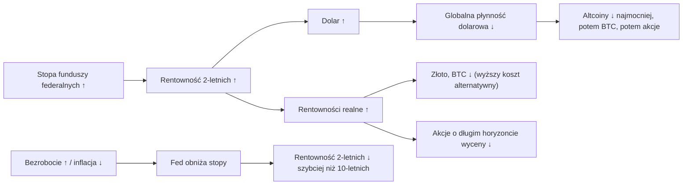

# 02. Fed i stopy procentowe

Rezerwa Federalna (Fed) wyznacza cenę dolara pożyczanego na jedną noc, a niemal każda inna cena w finansach jest podawana w odniesieniu do niej: rentowności obligacji skarbowych USA (Treasuries), oprocentowanie kredytów hipotecznych, kurs dolara, stopa dyskontowa stosowana do zysków spółek oraz koszt alternatywny trzymania aktywa, które nic nie wypłaca, takiego jak złoto czy bitcoin. W filmach Benjamina Cowena Fed lub FOMC pojawiają się częściej niż niemal każdy inny temat makro, a jego główna teza brzmi: to polityka pieniężna, a nie wiadomości, napędza apetyt na ryzyko. Ten rozdział wyjaśnia mechanizm (kto decyduje, kiedy i jak decyzja trafia na rynki), narzędzia do oceny, czy polityka jest restrykcyjna, czy luźna, oraz historię tego, co działo się po tym, jak Fed przestawał podnosić stopy i zaczynał je obniżać. Kończy się nietypowym cyklem 2024–2026: 175 punktów bazowych (pb) obniżek, dziewięciomiesięczna pauza, a we wrześniu 2026 podwyżka w samym środku szoku naftowego.

**Czego się nauczysz:**
- co mówią ci przedział docelowy stopy funduszy federalnych, komunikat FOMC, wykres kropkowy (dot plot) i FedWatch oraz gdzie je znaleźć;
- trzy sposoby oceny, czy polityka jest restrykcyjna: stopa neutralna, reguła Taylora i realna stopa polityki pieniężnej, każdy z przykładem liczbowym;
- co następowało po każdym przejściu „ostatnia podwyżka → pierwsza obniżka” od 1984 roku (tabela z laboratorium makro) i dlaczego wyniki dzielą się na miękkie lądowania i recesje;
- czym w skrócie są luzowanie ilościowe (QE) i zacieśnianie ilościowe (QT);
- cykl obniżek 2024–26, podwyżkę z września 2026 i jej tło w postaci szoku energetycznego;
- tezy Cowena „obniżki stóp na początku nie są bycze” i „podwyżki stóp nie są od razu niedźwiedzie”, z datami i konfrontacją z danymi.

Strzałki pokazują zwykły kierunek każdego powiązania. Każde powiązanie ma wyjątki, które opisują poniższe sekcje.

---

## Mechanizm: kto decyduje i kiedy

Fed ma od Kongresu **podwójny mandat**: maksymalne zatrudnienie i stabilne ceny. „Stabilne ceny” zdefiniowano jako inflację 2% mierzoną ogólnym indeksem cen PCE, przy czym bazowy PCE służy jako praktyczny drogowskaz ([rozdział 04](04-INFLACJA.md)). Gdy inflacja jest wysoka, a bezrobocie niskie, oba cele wskazują ten sam kierunek (podwyżka). Gdy oba wyglądają źle jednocześnie, wchodzą w konflikt. Cowen nazywa ten konflikt „szachem matem” (checkmate) dla Fed (więcej poniżej).

Stopy ustala **Federalny Komitet Otwartego Rynku (FOMC)**: 7 członków Rady Gubernatorów, prezes Fed z Nowego Jorku i 4 rotujących prezesów regionalnych, łącznie 12 głosujących. Komitet zbiera się osiem razy w roku. W 2026 roku posiedzenia odbyły się 27–28 stycznia, 17–18 marca, 28–29 kwietnia, 16–17 czerwca, 28–29 lipca, 15–16 września i 27–28 października, a 8–9 grudnia jeszcze przed nami.

### Przedział docelowy stopy funduszy federalnych i stopa efektywna (DFEDTARU, DFEDTARL, DFF)

**Co to jest.** FOMC ustala przedział docelowy (target range) o szerokości 25 pb, na przykład 3,75–4,00%. **Efektywna stopa funduszy federalnych (EFFR)** to ważona wolumenem mediana oprocentowania niezabezpieczonych pożyczek overnight między bankami, publikowana przez Fed z Nowego Jorku każdego ranka za dzień poprzedni. Fed utrzymuje ją wewnątrz przedziału za pomocą stóp administrowanych: oprocentowania sald rezerw (IORB, 3,90% od 17 września 2026), stopy odwrotnego repo overnight jako dolnego ograniczenia (3,75%) i stałego instrumentu repo (standing repo facility) jako górnego ograniczenia (4,00%). Przed grudniem 2008 roku istniała jedna stopa docelowa (FRED `DFEDTAR`). Decyzje ogłaszane są o 14:00 czasu nowojorskiego i nigdy nie są rewidowane.

**Gdzie to znaleźć.** FRED `DFEDTARU` (górna granica), `DFEDTARL` (dolna granica), `DFF` (dzienna EFFR), `FEDFUNDS` (średnia miesięczna). TradingView `FRED:FEDFUNDS` lub `ECONOMICS:USINTR`. Daty decyzji w FRED to daty *wejścia w życie*, więc obniżka ogłoszona 18 września 2024 widnieje pod 19 września.

**Jak to czytać.** Sam poziom mówi niewiele. Liczy się poziom w relacji do inflacji (stopa realna), do stopy neutralnej i do rentowności obligacji 2-letnich (oczekiwania rynku). Rynki poruszają *kierunek*, a przede wszystkim **punkty zwrotne** (ostatnia podwyżka i pierwsza obniżka). Najczęstszy błąd interpretacyjny to „obniżki stóp są bycze”. Obniżki wymuszone załamaniem wzrostu takie nie były (zob. tabelę z laboratorium poniżej). Na 29 października 2026 górna granica wynosiła **4,00%**, wobec 3,75% trzy miesiące wcześniej i 4,25% rok wcześniej ([pulpit laboratorium](../../tools/macro-lab/REPORT-2026-10-30.md)); EFFR wynosiła 3,88%.

**Jak używa tego Cowen.** Nagrywa filmy „Pre-FOMC” i „Post-FOMC” przy niemal każdym posiedzeniu (na przykład „Bitcoin Pre-FOMC”, 9 grudnia 2025, i „Bitcoin: Post-FOMC”, 29 października 2026, według jego [kanału YouTube](https://www.youtube.com/feeds/videos.xml?channel_id=UCRvqjQPSeaWn-uEx-w0XOIg)). Jego powracające tezy: polityka pieniężna napędza apetyt na ryzyko; bitcoin historycznie osiągał dno w pobliżu *końcowej* (szczytowej) stopy Fed (terminal rate); a „prawdziwy rynek byka często zaczyna się po ostatniej obniżce stóp, a nie po pierwszej” („Bitcoin and Interest Rates”, 24 stycznia 2023, według [indeksu filmów Rosetta](https://rosetta.to/u/intothecryptoverse), streszczenie z drugiej ręki).

**Powiązania.**
- *Co go wyprzedza:* rentowność 2-letnich obligacji skarbowych, o mniej więcej 0–6 miesięcy (pasują lata 2019, 2024 i 2026). Wzrost bezrobocia od dołka wyprzedzał pierwszą obniżkę o kilka miesięcy: o ok. 4–6 miesięcy w 2007 roku (od dołków 4,4% z marca i maja 2007), o ok. 17 w 2024 roku (od dołka 3,4% z kwietnia 2023), ale w 2019 roku prawie wcale, gdy bezrobocie przed lipcową obniżką wzrosło tylko z 3,6% do 3,7%. Niespodzianki inflacyjne poprzedziły podwyżki z 2022 roku i z września 2026.
- *Co on wyprzedza:* dolar i rentowności realne reagują w ciągu dni; rynek pracy reaguje z długimi i zmiennymi opóźnieniami (często rok lub dłużej).
- *Weryfikacja tezy o stopie końcowej:* w 2018 roku ostatnią podwyżkę ogłoszono 19 grudnia 2018 (w życie 20 grudnia), a dołek bitcoina przypadł 15 grudnia 2018, cztery dni wcześniej. W latach 2022–23 dołek bitcoina (21 listopada 2022) wypadł osiem miesięcy *przed* ostatnią podwyżką (ogłoszoną 26 lipca 2023, w życie 27 lipca). Idea sprawdza się luźno, jako „dna przychodzą późno w cyklu podwyżek”, a nie z dokładnością do tygodnia.

**Co to oznaczało dla aktywów.** Wyższe stopy polityki pieniężnej podnoszą stopę dyskontową i koszt trzymania aktywów bez odsetek. Zwykły kierunek: negatywnie dla bitcoina, altcoinów i akcji wzrostowych o długim horyzoncie wyceny, pozytywnie dla dolara i negatywnie dla złota poprzez rentowności realne. Efekt jest najsilniejszy, gdy ruch jest *niespodzianką*. Ruch w pełni wyceniony (ok. 90% przed podwyżką z 16 września 2026) często niewiele zmienia w dniu decyzji.

**Wniosek dla inwestora.** Obserwuj kierunek polityki i jego przyczynę, a nie poziom.

### Komunikat FOMC i konferencja prasowa

**Co to jest.** Krótki komunikat o 14:00 czasu wschodnioamerykańskiego (ET), konferencja prasowa przewodniczącego o 14:30 ET i protokół (minutes) trzy tygodnie później. Pod przewodnictwem Kevina Warsha (od końca maja 2026) komunikaty stały się znacznie krótsze („The Committee will deliver price stability”), zniknął z nich znany akapit o bilansie ryzyk i nie ma w nich jawnych wskazówek co do przyszłej polityki (forward guidance). 28 października 2026 Warsh ogłosił, że jedno z ośmiu posiedzeń w 2027 roku będzie posiedzeniem „strategicznym” bez głosowania nad stopami, a w 2028 roku odbędą się dwa posiedzenia strategiczne i sześć posiedzeń decyzyjnych ([transkrypcja konferencji prasowej, 28 października 2026](https://www.federalreserve.gov/mediacenter/files/FOMCpresconf20261028.pdf)).

**Gdzie to znaleźć.** federalreserve.gov, „Monetary policy” → „FOMC calendars and information”.

**Jak to czytać.** Porównaj treść z poprzednim komunikatem linijka po linijce i policz **zdania odrębne** (dissents): pokazują, w którą stronę prawdopodobnie pójdzie następny ruch. Sekwencja z 2026 roku to przykład podręcznikowy. Gubernator Miran od stycznia do kwietnia głosował odrębnie za obniżkami. W kwietniu trzech prezesów regionalnych (Hammack, Kashkari, Logan) sprzeciwiło się „skłonności do luzowania” (easing bias). W lipcu ta sama trójka głosowała odrębnie *za podwyżką*. Podwyżka przyszła we wrześniu. W październiku Cook i Hammack głosowali odrębnie za kolejną podwyżką. Pierwsze jastrzębie zastrzeżenia (kwiecień) pojawiły się trzy posiedzenia przed podwyżką, a pierwsze zdania odrębne za podwyżką (lipiec) jedno posiedzenie przed nią. Sygnałem są też długość i sformułowania: notatka Cowena z lipca 2026 (15 lipca) zwracała uwagę, że Fed pod wodzą Warsha skrócił komunikat do ok. 130 słów i usunął skłonność do luzowania, a jego notatka sierpniowa wskazywała lipcowe głosowanie 9–3 (trzy zdania odrębne za podwyżką) jako dowód jastrzębiej funkcji reakcji ([Bitcoin Cycle Memo, July 2026](https://benjamincowen.com/reports/bitcoin-cycle-memo-july-2026); [The Balance of Risks, Aug 2026](https://benjamincowen.com/reports/the-balance-of-risks-august-2026)).

**Jak używa tego Cowen.** Filmy w dniu FOMC, w tym „FOMC: The End of an Era” (29 kwietnia 2026, [streszczenie Rosetta](https://rosetta.to/u/intothecryptoverse/fomc-the-end-of-an-era)), w którym jego scenariuszem bazowym było to, że „Fed ostatecznie obniży stopy, goniąc rentowność 2-letnich obligacji”. Fed zamiast tego podniósł stopy.

**Powiązania i aktywa.** Zmienność stóp, dolara i kryptowalut osiąga szczyt między 14:00 a 15:30 ET. Kierunek wynika z niespodzianki względem wyceny rynkowej: najpierw ruszają 2-latki, potem dolar, potem kryptowaluty.

**Wniosek dla inwestora.** Zdania odrębne i zmiany w sformułowaniach niosą więcej informacji niż sama decyzja, która zwykle jest już wyceniona.

### Projekcje ekonomiczne (SEP) i wykres kropkowy

**Co to jest.** Cztery razy w roku (marzec, czerwiec, wrzesień, grudzień) każdy uczestnik FOMC składa projekcje wzrostu, bezrobocia i inflacji, a także stopy funduszy federalnych, którą uważa za właściwą na koniec każdego roku: to jest „kropka”. Tabela (Summary of Economic Projections, SEP) podaje mediany i przedziały. Pod przewodnictwem Warsha przewodniczący nie składa swojej kropki („I don't submit a dot. I don't plan on submitting a dot”, 28 października 2026), więc projekcje z 2026 roku odzwierciedlają 18 uczestników. Patrz dalej niż na medianę, na **rozkład głosów**: w czerwcowym SEP 2026 dziewięciu uczestników wpisało podwyżkę w 2026 roku, ośmiu utrzymanie stóp, a jeden obniżkę (według sierpniowej notatki Cowena z 2026). Mediana skrywająca podział 9–8 to znacznie słabszy sygnał niż mediana z wyraźną większością.

**Gdzie to znaleźć.** federalreserve.gov, `fomcprojtablYYYYMMDD.htm` (na przykład [tabela z września 2026](https://www.federalreserve.gov/monetarypolicy/fomcprojtabl20260916.htm)).

**Jak to czytać.** Jak zmieniała się mediana w latach 2024–2026, według opracowania kursu o Fed:

| SEP | Mediana stopy funduszy federalnych: ten rok / następny / kolejny | Stopa długookresowa | PCE / bazowy PCE w tym roku | Bezrobocie w tym roku |
|---|---|---|---|---|
| 09.2024 | 4,4 / 3,4 / 2,9 | 2,9 | 2,3 / 2,6 | 4,4 |
| 12.2025 | 3,6 / 3,4 / 3,1 | 3,0 | 2,9 / 3,0 | 4,5 |
| 03.2026 | 3,4 / 3,1 / 3,1 | 3,1 | 2,7 / 2,7 | 4,4 |
| 06.2026 | 3,8 / 3,6 / 3,4 | 3,1 | 3,6 / 3,3 | 4,3 |
| 09.2026 | 4,1 / 4,1 / 3,9 | 3,2 | 3,7 / 3,4 | 4,1 |

(Dla grudnia 2025 „ten rok” oznacza 2025 dla inflacji i bezrobocia, a trzy stopy to koniec 2025 / 2026 / 2027; dla projekcji z 2026 roku stopy dotyczą końca 2026 / 2027 / 2028).

Kropki to prognozy *warunkowe*, a nie obietnice. We wrześniu 2024 roku sugerowały 2,9% na koniec 2026. Faktyczna stopa wynosi ok. 3,9%, bo w międzyczasie nastąpił szok energetyczny. Czytaj kropki jako funkcję reakcji Komitetu („jeśli inflacja zrobi X, my zrobimy Y”). Kropka długookresowa to szacunek Komitetu dla nominalnej stopy neutralnej; przesunęła się w górę z ok. 2,5% (2019–2023) do 3,2%.

**Jak używa tego Cowen.** Sprawdza, czy Fed prognozuje recesję albo podwyżki („Fed Projecting a Mild Recession”, 13 kwietnia 2023, według [indeksu Rosetta](https://rosetta.to/u/intothecryptoverse)), i zestawia kropki z wyceną rynkową oraz z rentownością 2-latek.

**Powiązania i aktywa.** Przesunięcie kropek w górę (czerwiec i wrzesień 2026) jest jastrzębie: podnosi rentowność 2-latek, dolara i rentowności realne, a ciąży aktywom o długim horyzoncie wyceny i kryptowalutom. Czerwcowe przesunięcie z 2026 roku zbiegło się ze spadkiem bitcoina do dołka z 30 czerwca 2026 (ok. 57,7–58,6 tys. USD, zależnie od źródła).

**Wniosek dla inwestora.** Rynki i kropki często się rozjeżdżają, a w punktach zwrotnych częściej rację miały rynki. Używaj kropek, by zrozumieć, jak myśli Fed, a nie by przewidzieć, gdzie będą stopy.

### Ścieżka implikowana przez rynek: CME FedWatch, kontrakty terminowe i rynki predykcyjne

**Co to jest.** Prawdopodobieństwa poszczególnych wyników posiedzeń FOMC wyliczone z 30-dniowych kontraktów terminowych na stopę funduszy federalnych (CME FedWatch); podobne informacje dają kontrakty terminowe na SOFR, swapy na stopę overnight (OIS) i rynki predykcyjne, takie jak Polymarket.

**Gdzie to znaleźć.** cmegroup.com/markets/interest-rates/cme-fedwatch-tool.html (bezpłatnie).

**Jak to czytać.** Pokazuje to, co jest wycenione, a nie to, co się wydarzy. Jest wiarygodny na ok. dwa tygodnie przed posiedzeniem (Fed rzadko zaskakuje wbrew prawdopodobieństwu powyżej ok. 70%) i niewiarygodny w horyzoncie sześciu miesięcy i dłuższym. Przed 16 września 2026 rynek wyceniał podwyżkę na ok. 90%; po 28 października dawał ok. 83% na podwyżkę w grudniu (dane z doniesień).

**Jak używa tego Cowen.** Odczytuje, co jest wycenione, i argumentuje, że gorący odczyt danych, który „wycenia z rynku obniżki”, najmocniej szkodzi altcoinom („Unemployment Rate Drops to 4.1%”, 3 lipca 2025, streszczenie Rosetta). W październiku 2026 zwrócił uwagę, że prawdopodobieństwo październikowej podwyżki spadło w ciągu tygodnia z 64% do 17,7% ([BeInCrypto przez Yahoo Finance](https://finance.yahoo.com/markets/crypto/articles/bitcoin-falls-below-80-000-032051576.html), źródło wtórne), i zatytułował film „The Market Doesn't Seem To Think There Will Be A Rate Hike In October” (22 października 2026, kanał YouTube).

**Powiązania i aktywa.** Zmiany wyceny wyprzedzają decyzję o tygodnie, poruszają się razem z rentownością 2-latek i często poruszają rynkami bardziej niż sama decyzja.

**Wniosek dla inwestora.** Obserwuj *zmiany* prawdopodobieństw, zwłaszcza po publikacjach CPI i raportach z rynku pracy.

### Stopa funduszy federalnych a rentowność 2-letnich obligacji („Fed goni 2-latki”)

**Co to jest.** Rentowność 2-letnich obligacji skarbowych USA to z grubsza rynkowa prognoza średniej stopy polityki pieniężnej w ciągu najbliższych dwóch lat plus niewielka premia. Porównanie jej ze stopą funduszy federalnych pokazuje, w którą stronę rynek oczekuje zmian polityki.

**Gdzie to znaleźć.** FRED `DGS2` na tle `DFEDTARU` lub `DFF`; TradingView `TVC:US02Y` na tle `FRED:FEDFUNDS`.

**Jak to czytać.** Jeśli rentowność 2-latek jest wyraźnie **poniżej** stopy funduszy federalnych, rynek oczekuje obniżek i Fed zwykle za tym podążał. Jeśli jest **powyżej**, w grze są podwyżki. 28 października 2026 rentowność 2-latek wynosiła **4,67%** przy EFFR 3,88%, czyli ok. 80 pb wyżej: rynek wyceniał kolejne podwyżki. W lutym 2026 rentowność 2-latek dotknęła 3,38% przy stopie funduszy federalnych 3,50–3,75%, wyceniając obniżki, które nigdy nie nadeszły, bo szok naftowy odwrócił perspektywy. Ta różnica wskazuje kierunek, a nie liczbę podwyżek: wrześniowa notatka Cowena z 2026 odnotowała rentowność 2-latek ok. 100 pb powyżej efektywnej stopy funduszy federalnych, stwierdziła, że „nie przekłada się to jeden do jednego” na podwyżki, i przytoczyła modalną ścieżkę z FedWatch na poziomie 4,50–4,75% do marca 2027. Zauważył też, że długi koniec krzywej osiągnął szczyt, zanim ta różnica się zamknęła, zarówno w 2018 roku (ok. 75 pb), jak i w 2022 (ponad 100 pb).

**Jak używa tego Cowen.** Traktuje tę różnicę jako rynkowe przybliżenie stopy „neutralnej”. W [podcaście Bankless (23 grudnia 2025)](https://www.bankless.com/podcast/where-is-crypto-going-in-2026-ben-cowen), przy stopie funduszy federalnych ok. 3,75% i rentowności 2-latek ok. 3,5%, mówił, że Fed potrzebuje „jeszcze jednej obniżki, żeby w ogóle dojść do punktu, w którym można argumentować, że jesteśmy na poziomie neutralnym”, oraz że ETH radzi sobie najlepiej, gdy stopa funduszy federalnych jest blisko rentowności 2-latek lub poniżej niej. W swojej [Macro Risk Memo z lutego 2026](https://benjamincowen.com/reports/macro-risk-memo-feb-2026) napisał, że stopa polityki pieniężnej jest „powyżej neutralnej stopy implikowanej przez rynek”.

**Powiązania.** Rentowność 2-latek wyprzedza stopę funduszy federalnych o mniej więcej 0–6 miesięcy. To punkt krzywej najbardziej wrażliwy na Fed ([rozdział 03](03-OBLIGACJE-I-KRZYWA-RENTOWNOSCI.md)).

**Co to oznaczało dla aktywów.** Tezę o ETH trudno oddzielić od wszystkiego innego. W rocznej tabeli z laboratorium ETH/BTC *wzrósł* o 549% w 2017 roku, gdy Fed podniósł stopy o 0,75 pkt proc., a *spadał* w 2019 (−53%), 2024 (−28%) i 2025 (−7%), gdy Fed je obniżał. Polityka bilansowa i czynniki specyficzne dla kryptowalut wydają się ważniejsze ([rozdział 12](12-DOMINACJA-ALTCOINY-I-ROTACJA.md)).

**Wniosek dla inwestora.** Rentowność 2-latek mówi ci o kolejnych ruchach Fed, zanim powie o nich sam Fed.

---

## Czy polityka jest restrykcyjna, czy luźna?

### Stopa neutralna (r*)

**Co to jest.** Realna (skorygowana o inflację) krótkoterminowa stopa procentowa, która ani nie przyspiesza, ani nie spowalnia gospodarki. Nie da się jej zaobserwować, można ją tylko oszacować: Fed z Nowego Jorku co kwartał publikuje szacunki z modeli Laubacha-Williamsa i Holstona-Laubacha-Williamsa, a długookresowa kropka FOMC to szacunek nominalny (r* plus 2% inflacji).

**Gdzie to znaleźć.** newyorkfed.org (wyszukaj „r-star”); długookresowa mediana z SEP.

**Jak to czytać.** Polityka jest „restrykcyjna”, gdy realna stopa polityki pieniężnej leży powyżej r*. Wrześniowa (2026) mediana długookresowa na poziomie 3,2% oznacza r* rzędu 1,2%. Przedziały błędu wokół każdego szacunku wynoszą ok. ±1 pkt proc. Warsh zapytany 16 września 2026 o stopę neutralną odpowiedział: „In a word, no ... I've always been interested in a neutral rate as an academic matter” („Jednym słowem: nie… stopa neutralna zawsze interesowała mnie jako zagadnienie akademickie”) ([konferencja prasowa](https://www.federalreserve.gov/mediacenter/files/FOMCpresconf20260916.pdf)). Nie kieruje się nią.

**Jak używa tego Cowen.** Poprzez opisaną wyżej różnicę między stopą funduszy federalnych a rentownością 2-latek, a nie przez szacunki modelowe.

**Powiązania i aktywa.** Jeśli r* wzrosła (deficyty budżetowe, inwestycje w AI, wyższa premia za termin), ta sama stopa nominalna jest mniej restrykcyjna, niż się wydaje: to jedno z możliwych wyjaśnień, dlaczego zacieśnianie z lat 2022–23 nie wywołało recesji. Pośrednio r* wyznacza, jak wysoko mogą utrzymywać się stopy końcowe i rentowności długoterminowe.

**Wniosek dla inwestora.** „Restrykcyjna” oznacza restrykcyjną względem ruchomego i niepewnego celu.

### Reguła Taylora

**Co to jest.** Punkt odniesienia, gdzie stopa polityki pieniężnej „powinna” być, zaproponowany przez Johna Taylora: i = r* + π + 0,5 × (π − 2) + 0,5 × (luka popytowa), gdzie π to inflacja. Wersja oparta na rynku pracy zastępuje lukę popytową (output gap) wyrażeniem 2 × (naturalna stopa bezrobocia − faktyczna stopa bezrobocia). Fed z Atlanty publikuje narzędzie „Taylor Rule Utility”; FRED nie ma oficjalnej serii.

**Przykład liczbowy (październik 2026).** Przyjmij r* = 1,2, inflację bazową PCE π = 3,1 i lukę bezrobocia bliską zeru (bezrobocie 4,2%, długookresowy szacunek z SEP 4,2%):
- i = 1,2 + 3,1 + 0,5 × (3,1 − 2) + 0 = 1,2 + 3,1 + 0,55 = **4,85%**.
- Faktyczny środek przedziału to ok. 3,875%, więc według reguły polityka jest o ok. 1 pkt proc. *zbyt luźna*.
- Przy r* = 0,5 reguła daje ok. 4,15%, blisko wrześniowej kropki 4,1%. Przy ogólnym PCE (3,65%) zamiast bazowego daje ok. 5,7% (1,2 + 3,65 + 0,825).

**Jak to czytać.** To test zdrowego rozsądku, a nie prognoza. W latach 2021–22 reguła wskazywała stopy powyżej 7%, podczas gdy stopa funduszy federalnych była bliska zera: to jest arytmetyka stojąca za określeniem „Fed spóźniony” (behind the curve).

**Jak używa tego Cowen.** Nie jest to stały element jego materiałów; nie znaleźliśmy filmu na niej opartego.

**Powiązania i aktywa.** Duża luka, w której reguła wskazuje stopę wyższą od faktycznej, zwykle idzie w parze z jastrzębimi zdaniami odrębnymi i podwyżkami, jak w 2026 roku. Brak bezpośredniego sygnału dla aktywów.

**Wniosek dla inwestora.** Według prostych reguł polityka w październiku 2026 nie była restrykcyjna, co jest spójne z jastrzębimi zdaniami odrębnymi.

### Realna stopa polityki pieniężnej i realne stopy procentowe

**Co to jest.** Nominalna stopa polityki pieniężnej minus inflacja (bazowy PCE za ostatnie 12 miesięcy, ogólny CPI albo miara oczekiwań). FRED nie ma jednej gotowej serii; policz EFFR minus bazowy PCE r/r.

**Gdzie to znaleźć.** FRED `DFF` minus zmiana r/r `PCEPILFE`. Rynkowe rentowności realne, czyli obligacje TIPS (`DFII10`), omawia [rozdział 03](03-OBLIGACJE-I-KRZYWA-RENTOWNOSCI.md).

**Jak to czytać.** Przykład liczbowy: EFFR 3,88% − bazowy PCE 3,12% (wrzesień 2026) = **+0,76 pkt proc.** Względem ogólnego PCE (3,65%) to ok. +0,2 pkt proc.; względem rocznych oczekiwań inflacyjnych z ankiety Uniwersytetu Michigan (4,6%) ok. −0,7 pkt proc. W połowie 2024 roku wynosiła ok. +2,6 pkt proc. (5,33 − 2,7), najbardziej restrykcyjnie od 2007 roku. Paul Volcker podniósł ją do ok. +5 do +8 w latach 1980–82; Arthur Burns pozwolił jej spaść poniżej zera w latach 1974–77, co przygotowało grunt pod drugą falę inflacji ([rozdział 04](04-INFLACJA.md)).

**Jak używa tego Cowen.** Jako argument pomocniczy, niemal nigdy jako temat filmu: rentowności realne są „podwyższone w porównaniu z wcześniejszymi ekspansjami”, a jastrzębi zwrot Fed „utrzymuje stopy realne na podwyższonym poziomie” ([notatka z lutego 2026](https://benjamincowen.com/reports/macro-risk-memo-feb-2026); [notatka z lipca 2026](https://benjamincowen.com/reports/bitcoin-cycle-memo-july-2026)).

**Powiązania.** Realna stopa polityki pieniężnej steruje krótkim końcem realnej krzywej rentowności; rentowność 10-letnich TIPS doszła do 2,93% pod koniec września i 2,95% 5 października 2026, najwyżej od listopada 2008, a 28 października 2026 wynosiła 2,67%.

**Co to oznaczało dla aktywów.** Rosnące stopy realne to jeden z najbardziej konsekwentnych makroekonomicznych wiatrów w oczy dla złota, bitcoina i akcji wzrostowych. Głównym wyjątkiem jest odporność złota w latach 2022–24 (zakupy banków centralnych). W tygodniowych danych z laboratorium korelacja bitcoina ze zmianami rentowności realnej 10-latek była jednak ogólnie słaba (−0,06), najsilniejsza w 2020 roku (−0,36), a w 2025 lekko dodatnia (+0,09). Zależność działa w skali miesięcy i reżimów, a nie z tygodnia na tydzień.

**Wniosek dla inwestora.** Zanim uznasz stopy za „wysokie”, zawsze odejmij inflację.

---

## Cykle polityki pieniężnej: podwyżki, pauza, obniżki

Cykl biegnie od pierwszej podwyżki do ostatniej podwyżki, potem następuje pauza, pierwsza obniżka, a później ostatnia obniżka. **Zwrot (pivot)** to przejście od zacieśniania (lub pauzy) do luzowania albo odwrotnie; Cowen używa tego słowa także na określenie przejścia od QT do QE.

Są dwa rodzaje cykli luzowania:
- **Obniżki „ubezpieczeniowe” (w środku cyklu, insurance / mid-cycle cuts):** łącznie 75–175 pb, bez recesji, akcje rosną. Przykłady: 1995, 1998, 2019 (do COVID) i, z perspektywy czasu, 2024–25.
- **Obniżki recesyjne:** zwykle 500 pb lub więcej, bezrobocie rośnie o 2–5 pkt proc., akcje spadają o 20–55% od pierwszej obniżki. Przykłady: 1974, 1980, 1989–92, 2001, 2007–08, 2020 (wyjątek pod względem skali: 150 pb w dwóch nadzwyczajnych ruchach, bo stopa startowała z 1,50–1,75% i doszła do zera; bezrobocie skoczyło o ok. 11 pkt proc.).

Inwestorzy dowiadują się, z którym rodzajem mają do czynienia, dopiero po fakcie. Dlatego pierwsza obniżka jest momentem tak spornym.

### Tabela z laboratorium: od ostatniej podwyżki do pierwszej obniżki i co było dalej

Poniższa tabela pochodzi z [raportu laboratorium makro](../../tools/macro-lab/REPORT-2026-10-30.md) kursu (dane FRED, wygenerowane 30 października 2026). Uwagi metodologiczne z laboratorium: stopa docelowa łączy FRED `DFEDTAR` (1982–2008) i górną granicę `DFEDTARU`; liczą się tylko ruchy o co najmniej 0,25 pkt proc.; daty to daty wejścia w życie według FRED (obniżka ogłoszona wieczorem pojawia się następnego dnia); przybliżeniem rynku akcji jest Nasdaq Composite (`NASDAQCOM`, najdłuższy bezpłatny dzienny indeks w FRED); „najgorszy” to najniższe zamknięcie w ciągu 18 miesięcy po pierwszej obniżce w porównaniu z zamknięciem w dniu obniżki; szczytu bezrobocia szukano w oknie 36 miesięcy.

| ostatnia podwyżka | pierwsza obniżka | miesiące pauzy | szczytowa stopa docelowa | Nasdaq +3 mies. | +6 mies. | +12 mies. | najgorszy wynik w ciągu 18 mies. | bezrobocie w dniu obniżki -> szczyt (opóźnienie) | recesja w ciągu 24 mies. | BTC +12 mies. |
|---|---|---|---|---|---|---|---|---|---|---|
| 9.08.1984 | 20.09.1984 | 1 | 11,50% | −3,4% | 10,2% | 12,3% | −5,9% | 7,3% -> 7,4% (1 mies.) | nie | - |
| 4.09.1987 | 4.11.1987 | 2 | 7,25% | 7,4% | 19,2% | 19,6% | −8,5% | 5,8% -> 6,2% (36 mies.) | nie | - |
| 24.02.1989 | 6.06.1989 | 3 | 9,75% | 5,2% | 2,4% | 3,8% | −27,4% | 5,3% -> 7,8% (36 mies.) | 08.1990 | - |
| 1.02.1995 | 6.07.1995 | 5 | 6,00% | 6,4% | 8,1% | 21,6% | −0,0% | 5,7% -> 5,7% (0 mies.) | nie | - |
| 25.03.1997 | 29.09.1998 | 18 | 5,50% | 25,8% | 43,0% | 57,5% | −18,2% | 4,6% -> 5,0% (36 mies.) | nie | - |
| 16.05.2000 | 3.01.2001 | 7 | 6,50% | −37,4% | −18,2% | −21,9% | −48,1% | 4,2% -> 6,3% (29 mies.) | 04.2001 | - |
| 29.06.2006 | 18.09.2007 | 14 | 5,25% | −2,1% | −14,5% | −20,8% | −52,2% | 4,7% -> 10,0% (25 mies.) | 01.2008 | - |
| 20.12.2018 | 1.08.2019 | 7 | 2,50% | 2,2% | 14,6% | 32,5% | −15,4% | 3,6% -> 14,8% (8 mies.) | 03.2020 | 9% |
| 27.07.2023 | 19.09.2024 | 14 | 5,50% | 7,5% | −1,8% | 25,6% | −15,2% | 4,1% -> 4,5% (14 mies.) | nie | 83% |

Źródło: raport laboratorium makro, sekcja „Fed: from the last hike to the first cut, and what followed”. Autorstwo: otwartoźródłowy skrypt kursu `macro_lab.py`, korzystający z serii FRED `DFEDTAR`, `DFEDTARU`, `NASDAQCOM`, `UNRATE`, `USREC` i `CBBTCUSD`.

### Jak czytać tabelę: miękkie lądowania a recesje

**Miękkie lądowanie** (soft landing) to spowolnienie, które kończy się bez recesji. **Twarde lądowanie** (hard landing) to takie, które kończy się recesją. („Brak lądowania”, no landing, oznacza, że wzrost w ogóle wyraźnie nie zwalnia). Tabela dzieli się wyraźnie wzdłuż tej linii.

**Pięć cykli bez recesji w ciągu 24 miesięcy** (1984, 1987, 1995, 1997–98, 2023–24):
- Nasdaq był wyżej 12 miesięcy po pierwszej obniżce we wszystkich pięciu: +12,3%, +19,6%, +21,6%, +57,5% i +25,6%.
- Bezrobocie od obniżki do szczytu prawie się nie zmieniło w trzech z nich (+0,1 pkt proc. w 1984, 0 w 1995, +0,4 pkt proc. w 2024). W 1987 i 1998 roku bezrobocie wzrosło o 0,4 pkt proc., ale „szczyt w ciągu 36 miesięcy” wypada na końcu okna, blisko kolejnych spowolnień (1990 i 2001), więc niewiele mówi o samej obniżce.
- Najgorsze obsunięcie (drawdown) po obniżce wahało się od ok. 0% (1995) do −18,2% (1998). Obsunięcie z 1998 roku to kryzys funduszu hedgingowego LTCM z jesieni 1998, na który odpowiadała obniżka z 29 września 1998 (opracowanie kursu określa ją jako obniżkę „ubezpieczeniową”). Spadek z lat 2024–25 (−15,2%) to szok celny z kwietnia 2025.

**Cztery cykle, po których w ciągu 24 miesięcy przyszła recesja** (1989, 2000–01, 2006–07, 2018–19):
- 12-miesięczne stopy zwrotu Nasdaqa: +3,8%, −21,9%, −20,8% i +32,5%.
- Najgorsze obsunięcia: −27,4%, −48,1%, −52,2% i −15,4%.
- Bezrobocie wzrosło do szczytu o 2,1–11,2 pkt proc.
- Wiersz z 2019 roku to przypadek szczególny: recesję (marzec 2020) wywołała pandemia, a nie cykl koniunkturalny. Potężne nadzwyczajne luzowanie podniosło potem Nasdaqa o 32,5% w ciągu 12 miesięcy od pierwszej obniżki, mimo skoku bezrobocia z 3,6% do 14,8%.

**Czego te dwie grupy *nie* różniło: długości pauzy.** Średnia pauza wynosiła ok. 8 miesięcy w obu grupach (miękkie lądowania: 1, 2, 5, 18 i 14 miesięcy; recesje: 3, 7, 14 i 7). Twierdzenia, że „długa pauza oznacza twarde lądowanie”, nie znajdują oparcia w tej próbie.

**Rozstrzygającą zmienną było to, czy bezrobocie dalej rosło po obniżce**, czego w dniu obniżki nie da się wiedzieć. To najmocniejszy argument za obserwowaniem rynku pracy ([rozdział 05](05-RYNEK-PRACY.md)) i spreadów kredytowych ([rozdział 03](03-OBLIGACJE-I-KRZYWA-RENTOWNOSCI.md)), a nie samej obniżki.

**Ostrzeżenie o małej próbie.** Dziewięć cykli, z których dwa zbiegają się ze szczególnymi szokami (krach z 1987 roku, który nastąpił między ostatnią podwyżką a pierwszą obniżką, oraz COVID). Czytaj tabelę jak dziewięć historii, a nie jak model probabilistyczny ([rozdział 01](01-JAK-CZYTAC-WYKRESY-MAKRO.md#statystyczne-pułapki)).

Opracowanie kursu o Fed, oparte na danych S&P 500 od 1970 roku, pokazuje ten sam podział: w cyklach recesyjnych bezrobocie osiągało szczyt 9–36 miesięcy po pierwszej obniżce, wyżej o 2–5 pkt proc., a S&P spadał od pierwszej obniżki o ok. 42% (2001) i 55% (2007) na dziennych zamknięciach; w cyklach bez recesji S&P był po 12 miesiącach wyżej o 11–29%.

### Obniżki stóp i „zwrot” (Cowen: „obniżki stóp na początku nie są bycze”)

**Co to jest.** Pierwsza obniżka po cyklu podwyżek i pauzie oraz następująca po niej seria obniżek.

**Gdzie to znaleźć.** FRED `DFEDTARU`; komunikaty FOMC.

**Jak to czytać.** Zapytaj, *dlaczego* Fed obniża stopy. Po obniżkach przy stabilnej liczbie wniosków o zasiłek dla bezrobotnych i wąskich spreadach kredytowych akcje historycznie rosły. Po obniżkach przy rosnącym bezrobociu i rozszerzających się spreadach przychodził rynek niedźwiedzia. W cyklach recesyjnych akcje często osiągały szczyt w okolicach pierwszej obniżki: S&P ustanowił rekord wszech czasów 9 października 2007, trzy tygodnie *po* pierwszej obniżce.

**Jak używa tego Cowen.** Jego teza w kolejnych, datowanych krokach:
- **24 stycznia 2023** („Bitcoin and Interest Rates”, streszczenie Rosetta): bitcoin „historycznie osiągał dno w okolicach końcowej stopy Fed”, a „prawdziwy rynek byka często zaczyna się po ostatniej obniżce stóp, a nie po pierwszej, zwłaszcza gdy Fed robi zwrot z powodu szkód w gospodarce”.
- **2023–24, wielokrotnie:** pierwsza obniżka nie jest najbardziej byczym wydarzeniem, bo aktywa ryzykowne często osiągały szczyt w okolicach początku obniżek (2000 i 2007 dla akcji, 2019 dla bitcoina), a Fed robi zwrot, gdy coś się psuje ([streszczenie The Informer Post](https://theinformerpost.beehiiv.com/p/fed-rate-cuts-may-not-be-bullish-for-bitcoin-says-crypto-analyst-benjamin-cowen-heres-why), źródło wtórne). Zestawiał cykle recesyjne (2001, 2007) z cyklami ubezpieczeniowymi.
- **19 września 2024** („The Rate Cutting Cycle Has Begun”) i **23 października 2024** („The Yield Curve & Bitcoin”): o ile recesja nie jest tuż-tuż, długi koniec krzywej i dolar zwykle rosną po pierwszej obniżce (oba to streszczenia Rosetta).
- **Czerwiec 2025**, [na X](https://x.com/benjamincowen/status/1939783091037356302): „Trump wants Powell to cut rates. But when they cut rates last year, the long end of the yield curve went up.” („Trump chce, żeby Powell obniżył stopy. Ale kiedy obniżyli je w zeszłym roku, długi koniec krzywej rentowności poszedł w górę”).

**Powiązania i konfrontacja z danymi.**
- *Wezwanie z października 2024 okazało się trafne:* po pierwszej obniżce (18 września 2024) rentowność 10-latek wzrosła z 3,63% (16 września 2024) do 4,58% na koniec 2024 roku i ok. 4,8% w połowie stycznia 2025, a indeks dolara wzrósł z ok. 100 do ok. 110. Bitcoin także zwyżkował powyżej 100 tys. USD, co pokazuje, że prognoza dotyczyła rentowności i dolara, a nie bitcoina.
- *„Na początku nie są bycze” dla akcji sprawdza się tylko w cyklach recesyjnych:* w tabeli z laboratorium Nasdaq był niżej 3 miesiące po pierwszej obniżce w 2001 (−37,4%), 2007 (−2,1%) i 1984 roku (−3,4%), ale wyżej w pozostałych sześciu przypadkach. Podsumowanie z opracowania: „obniżki są niedźwiedzie” jest prawdą tylko pod warunkiem recesji.
- *Dla bitcoina n = 2:* bitcoin osiągnął szczyt 26 czerwca 2019, pięć tygodni przed lipcową obniżką z 2019 roku, i rok po obniżce był wyżej tylko o 9%. Po obniżce z września 2024 rok później był wyżej o 83%. W żadnym z tych przypadków nie było recesji cyklicznej.
- *„Po ostatniej obniżce”:* rynek akcji osiągnął dno w pobliżu ostatniej obniżki w latach 2001–03 i 2008–09 oraz ok. tydzień po ostatniej obniżce w marcu 2020. Jednak po ostatniej obniżce cyklu 2024–25 (10 grudnia 2025) przyszedł dalszy spadek bitcoina do ok. 57,7–58,6 tys. USD 30 czerwca 2026, bo następnym ruchem okazała się podwyżka. „Ostatnią obniżkę” można rozpoznać tylko z perspektywy czasu.

**Co to oznaczało dla aktywów.** Obniżki ubezpieczeniowe: akcje w górę, krzywa na początku przechodzi w byczy wzrost nachylenia (bull steepening), dolar słabnie, kryptowaluty bez wyraźnego kierunku. Obniżki recesyjne: akcje w dół o 35–55% (2001, 2008), długie obligacje mocno zyskują, dolar gwałtownie rośnie w fazie kryzysowej, złoto w górę, kryptowaluty spadają razem z aktywami ryzykownymi (2020) i odbijają po reakcji polityki gospodarczej.

**Wniosek dla inwestora.** „Czy Fed obniża stopy?” to złe pytanie; użyteczne brzmi: „dlaczego Fed obniża stopy i czy bezrobocie nadal rośnie?”.

### Podwyżki stóp (Cowen: „podwyżki nie są od razu niedźwiedzie”)

**Co to jest.** Podniesienie przedziału docelowego. Cykle podwyżek w okresie objętym tym kursem: 2015–18, 2022–23 i pojedyncza podwyżka z 16 września 2026.

**Gdzie to znaleźć.** FRED `DFEDTARU`; komunikaty FOMC.

**Jak to czytać.** Najważniejsze są *pierwsza* podwyżka i każda podwyżka będąca *niespodzianką*. Podwyżka w pełni wyceniona często wywołuje reakcję „sprzedawaj plotki, kupuj fakty” (sell the rumour, buy the news). Tempo i oczekiwany punkt końcowy (stopa końcowa) liczą się bardziej niż jakikolwiek pojedynczy ruch.

**Jak używa tego Cowen.** Jego pogląd się zmieniał i każde stwierdzenie wymaga daty:
- **28 lutego 2022:** „Interest Rate Hike Not Necessarily Doom and Gloom” („Podwyżka stóp to niekoniecznie katastrofa”) dla bitcoina ([Daily Hodl](https://dailyhodl.com/2022/02/28/interest-rate-hike-not-necessarily-doom-and-gloom-for-bitcoin-btc-says-analyst-benjamin-cowen-heres-why/), źródło wtórne).
- **Szerzej w 2022 roku:** podwyżki przesuwają inwestorów z trybu risk-on do risk-off.
- **Wrzesień 2026, przed posiedzeniem:** argumentował, że Fed „naprawdę powinien” podnieść stopy i że podwyżka umocni dolara i pogrąży bitcoina ([Benzinga](https://www.benzinga.com/crypto/cryptocurrency/26/09/61640748/bitcoin-falls-as-analyst-says-the-fed-really-should-raise-rates-this-month)).
- **Wrzesień 2026, po podwyżce:** bitcoin zwyżkował z ok. 76 tys. USD w dniu podwyżki do ok. 86 tys. USD 21 września (Coinbase), przedłużając odbicie, które zaczęło się w okolicach 63 tys. USD w połowie sierpnia. Cowen przyznał, że teza o niedźwiedziej podwyżce „nie była zakorzeniona w danych”, i stwierdził: „None of the data suggests that a rate hike has ever been immediately bearish for Bitcoin” („Nic w danych nie wskazuje, by podwyżka stóp kiedykolwiek była od razu niedźwiedzia dla bitcoina”), po przeanalizowaniu podwyżek z grudnia 2015, września 2018, marca 2022 i września 2022 ([Benzinga przez TradingView](https://www.tradingview.com/news/benzinga:45b48150d094b:0-bitcoin-analyst-admits-his-rate-hike-thesis-was-not-rooted-in-the-data/)).
- **„Podwyżka wznawiająca” (resumption hike), a nie „start” (liftoff) (30 września 2026):** w [The Triple Squeeze](https://benjamincowen.com/reports/the-triple-squeeze-september-2026) zaklasyfikował wrześniową podwyżkę jako „wznowienie istniejącego cyklu, podobnie jak w 1999 roku po ubezpieczeniowych obniżkach z 1998”: odebrała część mniej więcej 175 pb obniżek z lat 2024–25, które traktuje jako **obniżki ubezpieczeniowe** (obniżki służące ochronie ekspansji, a nie walce z recesją). **Liftoff** to pierwsza podwyżka z niskiego poziomu, rozpoczynająca nowy cykl zacieśniania (grudzień 2015, marzec 2022). Relacje wtórne (CoinMarketCap Academy) podawały zamiast tego analogię z marca 1997 („jedna podwyżka, potem długie utrzymanie stóp”); pisemna notatka wskazuje rok 1999, więc preferuj ją. (Dla porządku: epizod z 1997 roku widać w tabeli z laboratorium: ostatnia podwyżka 25 marca 1997, pierwsza obniżka 29 września 1998).
- **Dwie soczewki bitcoinowe dla podwyżki (notatka z 30 września 2026).** Soczewka *pierwszej podwyżki*: po liftoffie z grudnia 2015 bitcoin spadł o ok. 20% w dwa miesiące, a potem wzrósł o ok. 70% w ciągu dwunastu; po liftoffie z marca 2022 wzrósł o ok. 12% w dwa tygodnie, a potem spadł o ponad 60%. Uznał, że 2026 rok jest bliższy początkowi 2022. Lekcją jest rozrzut między tymi dwoma wynikami: sama data podwyżki niewiele mówi ([rozdział 10](10-CYKLE-I-MODELE-WYCENY-BITCOINA.md)). Soczewka *podwyżki w roku wyborów połówkowych* jest poniżej.
- **Lata wyborów połówkowych (midterm) z podwyżką:** w [notatce Triple Squeeze (30 września 2026)](https://benjamincowen.com/reports/the-triple-squeeze-september-2026) zauważył, że w dwóch wcześniejszych latach wyborów połówkowych z podwyżką bitcoin utrzymywał się w pobliżu poziomu z dnia podwyżki przez ok. siedem tygodni, a potem przełamywał się w dół. Ta sama notatka szkicowała przełamanie ok. 50. dnia po 16 września (początek listopada), z dwoma ścieżkami referencyjnymi: spadkiem jak w 2022 roku (ok. −15%) i jak w 2018 (ok. −50%); przedstawiał je jako arytmetykę analogii, a nie cele cenowe. W październiku 2026 opisywał bitcoina jako „typowo płaskiego przez ~50 dni, potem spada” i umieszczał go ok. 43. dnia po podwyżce (relacja Benzingi według fragmentu z wyszukiwarki). Do 30 października to okno nie zostało osiągnięte. Dwa wcześniejsze przypadki to bardzo mała próba; sezonowość lat wyborów połówkowych omawia [rozdział 09](09-SEZONOWOSC-I-CYKLE-POLITYCZNE.md).

**Powiązania.** Podwyżki następują po niespodziankach inflacyjnych i jastrzębich zdaniach odrębnych (2026: jastrzębie zastrzeżenia od kwietnia, zdania odrębne za podwyżką w lipcu, podwyżka na kolejnym posiedzeniu we wrześniu). Wypłaszczają krzywą od krótkiego końca (niedźwiedzie wypłaszczenie, bear flattening, [rozdział 03](03-OBLIGACJE-I-KRZYWA-RENTOWNOSCI.md)) i zwykle umacniają dolara. Podwyżka z września 2026 złamała zwykły schemat dla kryptowalut: dolar wzrósł, a bitcoin wzrósł razem z nim, co Cowen opisał słowami „something clearly changed” („coś wyraźnie się zmieniło”) (wrzesień 2026, źródło wtórne).

**Co to oznaczało dla aktywów.** W skali pełnego *cyklu* podwyżek (2022) szkody dla kryptowalut i akcji wzrostowych były poważne. Na poziomie *pojedynczej decyzji* natychmiastowa reakcja była niewielka, a nawet pozytywna, gdy podwyżka była wyceniona.

**Wniosek dla inwestora.** Cykl podwyżek i pojedyncza podwyżka to różne rzeczy; rynki wyceniają ścieżkę, a nie dzień.

---

## Cykl 2024–2026 krok po kroku

### Od obniżek do pauzy

| Decyzja (ogłoszenie) | Ruch | Przedział po decyzji | Zdania odrębne |
|---|---|---|---|
| 18.09.2024 | −50 pb | 4,75–5,00% | Bowman (chciała −25) |
| 7.11.2024 | −25 pb | 4,50–4,75% | brak |
| 18.12.2024 | −25 pb | 4,25–4,50% | Hammack (utrzymanie) |
| 01–07.2025 (5 posiedzeń) | utrzymanie; spowolnienie QT 19.03.2025 | 4,25–4,50% | Waller (marzec, przeciw spowolnieniu QT); Bowman i Waller chcieli obniżki w lipcu |
| 17.09.2025 | −25 pb („przesunięcie w bilansie ryzyk”) | 4,00–4,25% | Miran (−50) |
| 29.10.2025 | −25 pb; QT ma się zakończyć 1 grudnia | 3,75–4,00% | Miran (−50); Schmid (utrzymanie) |
| 10.12.2025 | −25 pb | 3,50–3,75% | Miran (−50); Goolsbee, Schmid (utrzymanie) |
| 28.01, 18.03.2026 | utrzymanie | 3,50–3,75% | Miran (a w styczniu także Waller) za obniżką |
| 29.04.2026 (ostatnie posiedzenie Powella jako przewodniczącego) | utrzymanie, skłonność do luzowania zachowana | 3,50–3,75% | Miran (obniżka); Hammack, Kashkari, Logan przeciw skłonności do luzowania |
| 17.06.2026 (pierwsze posiedzenie Warsha) | utrzymanie, 12–0 | 3,50–3,75% | brak |
| 29.07.2026 | utrzymanie, 9–3 | 3,50–3,75% | Hammack, Kashkari, Logan (+25) |
| **16.09.2026** | **+25 pb, 12–0** | **3,75–4,00%** | brak |
| 28.10.2026 | utrzymanie, 10–2 | 3,75–4,00% | Cook, Hammack (+25) |

Źródła: komunikaty Fed zebrane w opracowaniu kursu o Fed ([komunikat z 16 września 2026](https://www.federalreserve.gov/monetarypolicy/files/monetary20260916a1.pdf), [komunikat z 28 października 2026](https://www.federalreserve.gov/newsevents/pressreleases/monetary20261028a.htm)). Doniesienia prasowe o październikowym głosowaniu różniły się (dwa lub trzy zdania odrębne); tabela opiera się na komunikacie Fed.

Łącznie Fed obniżył stopy o 175 pb w sześciu ruchach między wrześniem 2024 a grudniem 2025. W tabeli z laboratorium ten cykl (ostatnia podwyżka w życie 27 lipca 2023, pierwsza obniżka w życie 19 września 2024, 14-miesięczna pauza) plasuje się wśród miękkich lądowań: bezrobocie wzrosło z 4,1% w dniu obniżki do szczytu 4,5% (listopad 2025, po rewizji; pierwszy odczyt 4,6%), a następnie spadło do 4,2% do września 2026. Do października 2026 NBER nie stwierdził recesji. Rok po pierwszej obniżce Nasdaq był wyżej o 25,6%, a bitcoin o 83%.

Strukturalnie przypomina to bardziej lata **1998–1999** (obniżki ubezpieczeniowe, potem podwyżki w latach 1999–2000, potem recesja w 2001) niż rok 2007. Opracowanie kursu o Fed doszło do tego porównania niezależnie, a wrześniowa notatka Cowena z 2026 używa tego samego. To szablon do obserwowania, a nie prognoza.

### Szok naftowy i podwyżka z września 2026

Tłem podwyżki był szok podażowy na rynku energii:
- **28 lutego 2026:** amerykańskie i izraelskie uderzenia na Iran; Brent ok. 71–72 USD. Żegluga przez Cieśninę Ormuz była zakłócona mniej więcej od końca lutego lub od marca.
- **Początek marca:** WTI podrożała w jeden tydzień z 67 do 91 USD, co Cowen nazwał „największym tygodniowym wzrostem od 1983 roku” („Oil Spikes 35%”, 8 marca 2026, streszczenie Rosetta).
- **Kwiecień:** Brent średnio ok. 117 USD (podawane dzienne maksima ok. 120–138 USD, zależnie od źródła i kontraktu).
- **Czerwiec:** po memorandum w sprawie Ormuzu z 17 czerwca Brent cofnął się (ok. 70–85 USD, zależnie od źródła i daty).
- **Lipiec–październik:** uderzenia wznowiono 7 lipca; Brent od 23 lipca znów był powyżej 100 USD, we wrześniu wynosił średnio ok. 114 USD, a pod koniec października od 116,72 USD (23 października, jedno z doniesień) do 123,10 USD (27 października, FRED).

Za tym poszła inflacja. Ogólny CPI wzrósł z 2,4% r/r (styczeń–luty 2026) do ok. 4,2–4,3% w maju (4,2% w ujęciu wyrównanym sezonowo, 4,25% w ujęciu podstawowej publikacji BLS) i wynosił 3,7% we wrześniu 2026 ([pulpit laboratorium](../../tools/macro-lab/REPORT-2026-10-30.md): 3,72%). Bazowy PCE, preferowana miara Fed, wynosił we wrześniu 3,12%. Rynek pracy wyglądał tymczasem stabilnie: bezrobocie 4,2%, wskaźnik Sahm w czasie rzeczywistym na poziomie 0,00, nowe wnioski o zasiłek dla bezrobotnych 194 tys. (tydzień do 24 października) ([pulpit laboratorium](../../tools/macro-lab/REPORT-2026-10-30.md)).

W obliczu szoku podażowego i bez słabości na rynku pracy Fed pod wodzą Warsha usunął skłonność do luzowania (czerwiec), zobaczył trzy jastrzębie zdania odrębne (lipiec) i 16 września 2026 podniósł stopy o 25 pb: pierwsza podwyżka od lipca 2023, jednogłośna, z medianą kropek wskazującą jeszcze jedną podwyżkę w 2026 roku (do ok. 4,1%). 28 października utrzymał stopy przy dwóch zdaniach odrębnych za kolejną podwyżką. Po tym posiedzeniu FedWatch dawał ok. 83% na podwyżkę w grudniu (dane z doniesień).

**Dlaczego to ma znaczenie historyczne.** Tabela szczytów inflacji z opracowania kursu pokazuje, że epizody inflacji wywołanej szokiem naftowym z lat 1973–74, 1979–80, 1990 i 2008 kończyły się recesją, a Fed zwykle reagował *luzowaniem*, gdy wzrost się załamywał (1974, 1990, 2008). W 2026 roku Fed *podniósł* stopy w trakcie szoku, co bliższe jest postawie Volckera niż Burnsa. Zmniejsza to ryzyko drugiej fali inflacji, a zwiększa ryzyko błędu polityki pieniężnej. Długoterminowe oczekiwania inflacyjne pozostały zakotwiczone (stopa terminowa 5y5y wynosiła 2,23% 29 października 2026), co jest główną różnicą względem lat 70.

**„Szach mat” Cowena.** W 2026 roku Cowen opisywał inflację jako „głównie podażową” i argumentował, że inflacja podażowa w połączeniu ze słabnącym rynkiem pracy sprawia, że Fed nie może ani obniżyć stóp, ani agresywnie ich podnieść: „They can defend one weakness, but if you have two weaknesses, the defense breaks down” („Mogą bronić jednej słabości, ale gdy masz dwie słabości, obrona się sypie”) oraz „that's how the Federal Reserve ultimately gets checkmated” („i tak Rezerwa Federalna w końcu dostaje mata”) (7 kwietnia i 12 maja 2026, streszczenia Rosetta; zob. też „Inflation Soars to 3.3%”, 10 kwietnia 2026, i jego [Macro Risk Memo z maja 2026](https://benjamincowen.com/reports/macro-risk-memo-may-2026)). Łączy skoki cen ropy z końcem cykli koniunkturalnych („The Mechanism That Ends Business Cycles”, 28 lutego 2026). Do października 2026 nadeszła tylko inflacyjna połowa tego mata; rynek pracy nie osłabł, a Fed zdecydował się na podwyżkę.

**Co się działo na rynkach.** Rentowność 2-latek wzrosła do tegorocznego szczytu 4,92% (28 września, dzienne zamknięcie wg FRED); rentowność 10-latek zamknęła się 5 października 2026 na poziomie 5,31%, najwyższym dziennym zamknięciu od maja 2002 roku według FRED (wrześniowa notatka Cowena podawała ok. 5,29% jako „najwyżej od 2007”; na dziennych zamknięciach FRED szczyt z 2007 roku wynosił 5,26%, więc 5,29% było już najwyżej od 2002). S&P 500 ustanowił rekord 6 października 2026. Bitcoin, który 30 czerwca 2026 osiągnął dno w okolicach 57,7–58,6 tys. USD (zależnie od źródła), zwyżkował do ok. 85 tys. USD do 6 października, a następnie cofnął się do ok. 78 tys. USD do 30 października.

**Mapa drogowa Cowena z końca października.** 24–26 października 2026 przedstawił niedźwiedzią sekwencję na IV kwartał ([wpis na X, 26 października 2026](https://x.com/benjamincowen/status/2114535552523612377), według fragmentu z wyszukiwarki): tygodniowe zamknięcie poniżej 83 tys. USD, „fałszywe wybicie” (fakeout), brak podwyżki Fed 28 października, gorący odczyt PCE 29 października, ropa w pobliżu 120 USD, rentowność 10-latek z powrotem na 5,3%, a potem spadki akcji i bitcoina w IV kwartale; „próżnia powyżej 83 tys. USD”. Jego wrześniowa notatka przedstawiała październikowe posiedzenie jako dwie gałęzie: podwyżka z jastrzębimi wskazówkami odtworzyłaby rok 2018, podwyżka z sygnałem zwolnienia tempa — rok 2022. Fed utrzymał stopy, więc żadna z gałęzi się nie zrealizowała. Pierwsze trzy kroki mapy drogowej nastąpiły do 30 października ([Benzinga](https://www.benzinga.com/crypto/cryptocurrency/26/10/62696461/bitcoin-drops-to-80000-after-fed-meeting-is-the-bear-thesis-playing-out)); reszta pozostawała otwarta. Jego prognoza z grudnia 2025, że Powell przed odejściem nie będzie agresywnie obniżał stóp, się potwierdziła.

---

## Bilans Fed: podstawy QE i QT

### Aktywa ogółem Fed, QE, QT i koniec QT (WALCL)

**Co to jest.** **Luzowanie ilościowe (QE)** to skup przez Fed obligacji skarbowych i papierów zabezpieczonych hipotekami za nowo wykreowane rezerwy, co obniża długoterminowe rentowności i dodaje płynności. **Zacieśnianie ilościowe (QT)** to proces odwrotny: pozwalanie obligacjom na zapadanie bez zastępowania ich nowymi, co wysysa rezerwy. Bilans Fed jest raportowany co tydzień w publikacji H.4.1 (wartości na środę, publikacja w czwartek o 16:30 ET).

**Gdzie to znaleźć.** FRED `WALCL`. „Hydraulikę” systemu (rezerwy, facility odwrotnego repo (RRP), rachunek Skarbu USA w Fed (TGA), płynność netto) omawia [rozdział 07](07-PLYNNOSC-PIENIADZ-I-DOLAR.md).

**Jak to czytać.** Oś czasu w skrócie:

| Okres | Polityka | Aktywa ogółem |
|---|---|---|
| 11.2008 – 10.2014 | QE1, QE2, Operacja Twist, QE3 | ok. 0,9 bln USD → 4,5 bln USD |
| 10.2017 – 07.2019 | QT1 | ok. 4,5 bln USD → 3,76 bln USD |
| 03.2020 – 03.2022 | pandemiczne QE | 4,17 bln USD → szczyt 8,965 bln USD (13.04.2022) |
| 06.2022 – 1.12.2025 | QT2 (spowolnione w 06.2024 i 04.2025) | → dołek ok. 6,54 bln USD (3.12.2025) |
| od 12.2025 | zakupy bonów skarbowych w ramach zarządzania rezerwami | 6,75 bln USD (28.10.2026) |

Koniec QT to nie QE: od grudnia 2025 Fed kupował bony skarbowe wyłącznie po to, by utrzymać rezerwy na „wystarczającym” (ample) poziomie, co jest operacją techniczną, a nie stymulacją. Warsh opowiadał się za stopniowym zmniejszaniem bilansu i powołał zespół roboczy, bez decyzji na 28 października 2026.

**Jak używa tego Cowen.** To jeden z jego centralnych tematów:
- Dominacja BTC rośnie, a altcoiny krwawią w okresie QT.
- „Last cycle the transition from QT to QE marked the top for BTC dominance” („W poprzednim cyklu przejście od QT do QE wyznaczyło szczyt dominacji BTC”) oraz „I expect the Fed to transition from QT to QE next year” („Spodziewam się, że Fed przejdzie od QT do QE w przyszłym roku”) ([Cointelegraph Magazine, 19 listopada 2024](https://cointelegraph.com/magazine/bitcoin-dominance-crypto-predictions-bull-run-benjamin-cowen-hall-of-flame/)).
- Bitcoin osiągał szczyt krótko przed końcem QT, zarówno w 2019 roku (szczyt 26 czerwca 2019, koniec QT 1 sierpnia 2019), jak i w 2025 (szczyt 6 października 2025, koniec QT 1 grudnia 2025) („Bitcoin and the End of Quantitative Tightening”, 1 grudnia 2025, streszczenie Rosetta). Jego notatka z lipca 2026 podaje wyprzedzenie ok. 5 tygodni w 2019 roku i ok. 8 tygodni w 2025 (w filmach oba często zaokrągla do „ok. dwóch miesięcy”).
- Jego notatki z 2026 roku idą dalej: koniec QT to nie luzowanie, a późniejsze zakupy bonów były „zarządzaniem rezerwami”, a nie QE. Kryptowalutowe rynki byka, argumentuje, przychodziły wtedy, „gdy płynność rosła w odpowiedzi na stres gospodarczy lub finansowy”, a nie wtedy, gdy zacieśnianie po prostu się kończyło ([Crypto Macro Risk Memo Q1 2026](https://benjamincowen.com/reports/crypto-macro-risk-memo-q1-2026); [notatka z lutego 2026](https://benjamincowen.com/reports/macro-risk-memo-feb-2026); [notatka z lipca 2026](https://benjamincowen.com/reports/bitcoin-cycle-memo-july-2026)).
- Koniec QT to nie to samo co rosnący bilans.

**Powiązania i weryfikacja.** QT zakończyło się 1 grudnia 2025, ale w 2026 roku nie nastąpiło QE; zamiast tego Fed podniósł stopy. Reguła „przejście QT → QE wyznacza szczyt dominacji” nie została więc w tym cyklu przetestowana, a jego oczekiwanie z listopada 2024, że QE nadejdzie w 2025, się nie spełniło. Wzorzec „szczyt kilka tygodni przed końcem QT” pasuje do obu dat, ale opiera się na dwóch przypadkach.

**Co to oznaczało dla aktywów.** Okresom QE (2009–13, 2020–21) towarzyszyły spadające rentowności realne, słabszy dolar oraz rosnące akcje, kryptowaluty i złoto. Okresom QT (2018, 2022) towarzyszyły rosnące premie za termin i presja na aktywa o wysokiej becie, najmocniej na altcoiny.

**Wniosek dla inwestora.** Kierunek zmian bilansu to zmienna reżimowa dla kryptowalut, zwłaszcza dla relacji altcoinów do bitcoina ([rozdział 12](12-DOMINACJA-ALTCOINY-I-ROTACJA.md)); nie jest to narzędzie do krótkoterminowego wyczucia momentu.

### Wskazówki co do przyszłej polityki (forward guidance)

Jawne wskazówki („przez dłuższy czas”, konkretne daty, kropki) były ważnym narzędziem w latach 2012–2021. Warsh je odrzuca: „This won't surprise you: I'm not in the forward guidance business” („To was nie zaskoczy: nie zajmuję się forward guidance”) (konferencja prasowa z 16 września 2026). Praktyczna konsekwencja to większa waga wyceny rynkowej (rentowność 2-latek, FedWatch) i większe ryzyko niespodzianek w dniu posiedzenia. Zmienność stóp wzrosła: indeks MOVE był pod koniec września 2026 powyżej 100 (dane z doniesień, [rozdział 03](03-OBLIGACJE-I-KRZYWA-RENTOWNOSCI.md)).

---

## Ludzie i polityka

### Przewodniczący Fed, niezależność i polityka

**Co to jest.** Kto kieruje Fed i jak dużą presję polityczną odczuwa ta instytucja. Wydarzenia lat 2025–26: prezydent zwolnił szefową BLS po słabej rewizji danych o zatrudnieniu (sierpień 2025); w 2025 roku podjęto próbę odwołania gubernator Lisy Cook (pozostała członkinią z prawem głosu); według doniesień Departament Sprawiedliwości wszczął postępowanie karne wobec przewodniczącego Powella (12 stycznia 2026); ostatnie posiedzenie Powella jako przewodniczącego (29 kwietnia 2026); jego odejście w maju 2026; Kevin Warsh przewodniczącym mniej więcej od końca maja 2026.

**Gdzie to znaleźć.** federalreserve.gov (komunikaty prasowe, przemówienia); główne media informacyjne.

**Jak to czytać.** Nowy przewodniczący szybciej zmienia styl komunikacji niż samą politykę; ma jeden głos na dwanaście. Presja na niezależność zwykle podnosi premię za termin i oczekiwania inflacyjne, bo inwestorzy żądają rekompensaty za ryzyko upolitycznienia polityki pieniężnej.

**Jak używa tego Cowen.** „A Line Has Been Crossed” (12 stycznia 2026), „Jerome Powell: 'I Won't See You Next Time'” (1 maja 2026) i „Powell Steps Down…” (15 maja 2026), według [indeksu Rosetta](https://rosetta.to/u/intothecryptoverse). Jego teza: ryzyko instytucjonalne zwiększa niepewność, a nowy przewodniczący „nie może obniżyć stóp jednoosobowo”.

**Powiązania i aktywa.** Zmianie kierownictwa w 2026 roku towarzyszył jastrzębi zwrot (usunięcie skłonności do luzowania w czerwcu, podwyżka we wrześniu), a nie gołębi, którego niektórzy się spodziewali. Wpływ na aktywa trudno oddzielić od szoku naftowego.

**Wniosek dla inwestora.** Obserwuj głosowania Komitetu, a nie nagłówki o przewodniczącym.

### Inne banki centralne i globalna stopa polityki pieniężnej

**Co to jest.** Bank Japonii, Europejski Bank Centralny, Bank Kanady i inne, a także agregaty „globalnej stopy polityki pieniężnej” ważone PKB.

**Gdzie to znaleźć.** Strony internetowe poszczególnych banków; tickery stóp procentowych `ECONOMICS:` w TradingView dla poszczególnych krajów.

**Jak to czytać.** Fed dominuje w płynności dolarowej, ale inne banki mają znaczenie na marginesie. Podwyżka Banku Japonii może wymusić zamykanie pozycji finansowanych jenem (tzw. carry trade), jak 5 sierpnia 2024 ([rozdział 07](07-PLYNNOSC-PIENIADZ-I-DOLAR.md)). EBC podniósł stopy w trakcie szoku naftowego z 2008 roku (lipiec 2008), tuż przed globalnym kryzysem finansowym.

**Jak używa tego Cowen.** Okazjonalnie w filmach: „Bank of Canada to End Quantitative Tightening” (29 stycznia 2025); podwyżki Banku Japonii jako ryzyko dla bitcoina („Bitcoin Falls to the 200W Moving Average”, 5 czerwca 2026, streszczenie Rosetta). Bardziej systematycznie w [The Balance of Risks (15 sierpnia 2026)](https://benjamincowen.com/reports/the-balance-of-risks-august-2026), gdzie pokazuje stopy głównych banków centralnych oraz ważoną PKB globalną stopę polityki pieniężnej dla 17 banków centralnych: 3,42% w sierpniu 2026, po dołku 0,82% (luty 2021) i szczycie 4,60% (luty 2024). Jego odczytanie: globalna stopa „przestała spadać”, Australia i Korea Południowa podniosły stopy, Japonia normalizowała politykę przy **rentowności 2-letnich japońskich obligacji rządowych (JGB)** w pobliżu 1,70% (najwyżej od wielu lat), a USA „pozostawały w tyle za globalnym zwrotem”. 2-letnie JGB są ważne, bo rosnące rentowności w Japonii mogą ściągać kapitał z powrotem do kraju i wywierać presję na carry trade finansowany jenem.

**Powiązania i aktywa.** Gdy duże banki centralne luzują jednocześnie, globalna płynność zwykle rośnie, a dolar słabnie (2020, równolegle z najsilniejszym kryptowalutowym rynkiem byka); gdy jednocześnie zacieśniają, dzieje się odwrotnie (2022, najgłębszy kryptowalutowy rynek niedźwiedzia).

**Wniosek dla inwestora.** Sprawdź, czy Fed porusza się sam, czy razem z resztą świata.

---

## Składamy to w całość

1. **Bezrobocie rośnie o ok. 0,5 pkt proc. od dołka → rentowność 2-latek spada poniżej stopy funduszy federalnych → Fed dokonuje pierwszej obniżki → jeśli wnioski o zasiłek i spready kredytowe pozostają spokojne, to cykl ubezpieczeniowy: Nasdaq był wyżej 12 miesięcy później w latach 1984, 1987, 1995, 1998 i 2024 (od +12% do +58%).** Wyjątek i ostrzeżenie: po ubezpieczeniowych obniżkach z 1998 roku przyszły podwyżki w latach 1999–2000 i recesja w 2001; po obniżkach z lat 2024–25 przyszła podwyżka w 2026.
2. **Bezrobocie rośnie dalej po pierwszej obniżce → obniżki stają się duże i szybkie → krzywa przechodzi w byczy wzrost nachylenia → akcje spadają: najgorszy punkt Nasdaqa to −48% po obniżce ze stycznia 2001 i −52% po obniżce z września 2007 → bitcoin w swoim jedynym teście o cechach cyklicznych (2019–20) osiągnął szczyt już pięć tygodni przed pierwszą obniżką.** Wyjątek: w 2019 roku recesję wywołała pandemia, a nadzwyczajne luzowanie podniosło Nasdaqa o 32,5% w ciągu roku od pierwszej obniżki.
3. **Fed obniża stopy bez recesji → rosną rentowności na długim końcu i dolar (Cowen, październik 2024) → między wrześniem 2024 a styczniem 2025 rentowność 10-latek wzrosła z 3,63% do ok. 4,8%, a indeks dolara z ok. 100 do ok. 110 → oprocentowanie kredytów hipotecznych nie spadło.** Bitcoin i tak zwyżkował, co pokazuje, że prognoza dotyczyła stóp, a nie kryptowalut.
4. **Szok naftowy podnosi inflację ogólną (CPI 2,4% → 4,2%, styczeń–maj 2026), podczas gdy bezrobocie się utrzymuje (4,2%) → jastrzębie zdania odrębne (lipiec 2026) → podwyżka (16 września 2026) → rosną rentowności 2- i 10-latek (10-latki 5,31% 5 października) → dolar się umacnia.** Wyjątek: bitcoin po podwyżce wzrósł z ok. 76 tys. USD w dniu podwyżki do ok. 86 tys. USD 21 września (Coinbase), odwrotnie niż oczekiwał Cowen przed posiedzeniem, co sam przyznał.
5. **Fed kończy QT (1 grudnia 2025) → w ramach Cowena dominacja bitcoina osiąga szczyt w momencie przejścia QT → QE i altcoiny mogą odbić → ale w 2026 roku nie nastąpiło QE; Fed podniósł stopy → brak sezonu altcoinów (altseason), dominacja BTC w 2026 roku w okolicach 58–61%.** Reguły zbudowanej na jednym cyklu (2019) nie dało się przetestować. Wyjątek od szerszej logiki „stopy realne w dół, kryptowaluty w górę”: przy realnej stopie polityki pieniężnej rzędu +2,6 pkt proc. w połowie 2024 roku bitcoin i tak wzrósł w 2024 o 121%.

---

## Sprawdź się

1. Górna granica przedziału docelowego wynosi 4,00%, a rentowność 2-latek 4,67%. Czego oczekuje rynek i jak wyglądało to w porównaniu z lutym 2026?
2. Jaką stopę wskazuje reguła Taylora przy r* = 1,2, bazowym PCE 3,1% i braku luki bezrobocia i co to mówi o polityce w październiku 2026?
3. Która zmienna w tabeli „ostatnia podwyżka → pierwsza obniżka” z laboratorium oddzielała miękkie lądowania od recesji, a która nie?
4. Co Cowen twierdził o obniżkach stóp w styczniu 2023 i w październiku 2024 i która część się potwierdziła w latach 2024–25?
5. Czego Cowen oczekiwał po podwyżce z września 2026, co się stało i jak zareagował?
6. Dlaczego „QT zakończyło się w grudniu 2025” to nie to samo co „zaczęło się QE”?
7. Podaj dwa powody, dla których zdania odrębne w FOMC w 2026 roku były bardziej informacyjne niż same decyzje.

Odpowiedzi

1. Rentowność 2-latek o ok. 0,7–0,8 pkt proc. powyżej stopy funduszy federalnych oznacza, że rynek wycenia kolejne podwyżki. W lutym 2026 rentowność 2-latek (3,38% w dołku) była poniżej stopy funduszy federalnych (3,50–3,75%), czyli rynek wyceniał obniżki.
2. Ok. 4,85% (1,2 + 3,1 + 0,55), mniej więcej o 1 pkt proc. powyżej faktycznego środka przedziału 3,875%: według tej reguły polityka nie była restrykcyjna.
3. Oddzielało je to, czy bezrobocie dalej rosło po obniżce (i czy przyszła recesja). Nie oddzielała ich długość pauzy: średnio ok. 8 miesięcy w obu grupach.
4. Styczeń 2023: bitcoin osiągał dno w pobliżu stopy końcowej, a prawdziwa hossa często zaczyna się po *ostatniej* obniżce. Październik 2024: bez recesji rentowności długoterminowe i dolar rosną po pierwszej obniżce. Prognoza z października 2024 się potwierdziła (10-latki 3,63% → ok. 4,8%, indeks dolara ok. 100 → 110 do stycznia 2025).
5. Oczekiwał, że podwyżka umocni dolara i pogrąży bitcoina. Fed podniósł stopy 16 września 2026; bitcoin zwyżkował z ok. 76 tys. USD w dniu podwyżki do ok. 86 tys. USD 21 września (Coinbase), przedłużając odbicie, które zaczęło się w okolicach 63 tys. USD w połowie sierpnia. Przyznał, że teza „nie była zakorzeniona w danych”, i zauważył, że podwyżki historycznie nie były od razu niedźwiedzie dla bitcoina.
6. Zakończenie QT zatrzymuje kurczenie się bilansu; QE to aktywny skup w celu rozszerzenia bilansu. Od grudnia 2025 Fed kupował tylko bony skarbowe, by utrzymać rezerwy na wystarczającym poziomie.
7. Pojawiły się wcześniej: kwietniowe zastrzeżenia trzy posiedzenia, a trzy lipcowe zdania odrębne za podwyżką jedno posiedzenie przed wrześniową podwyżką; ponadto sama decyzja była zwykle w pełni wyceniona, więc niosła mniej nowych informacji.

---

> Materiał edukacyjny, nie doradztwo finansowe. Historyczne zależności między wskaźnikami mogą przestać działać.

[← 01 Jak czytać wykresy makro](01-JAK-CZYTAC-WYKRESY-MAKRO.md) | [Indeks](00-INDEKS.md) | [03 Obligacje i krzywa rentowności →](03-OBLIGACJE-I-KRZYWA-RENTOWNOSCI.md)
