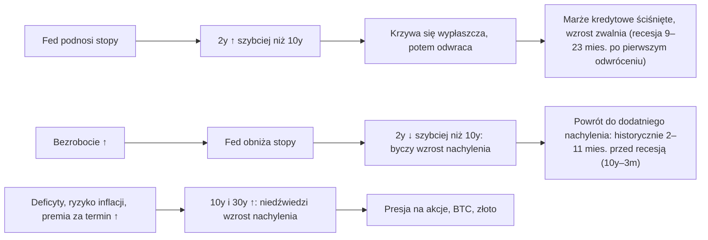

# 03. Obligacje i krzywa rentowności

Fed ustala jedną stopę overnight; całą resztę ustala rynek obligacji. Rentowność 10-letnich obligacji skarbowych USA (Treasuries) jest punktem odniesienia dla kredytów hipotecznych, finansowania firm i stopy dyskontowej stosowanej przy wycenie akcji i kryptowalut. *Kształt* krzywej rentowności (to, jak rentowności krótkoterminowe mają się do długoterminowych) poprzedzał każdą recesję w USA od lat 80., a w latach 2022–2024 dał najgłębsze ostrzeżenie od czterech dekad, po którym — przynajmniej do października 2026 — recesja nie nastąpiła. Benjamin Cowen regularnie wraca do rentowności 10-letnich obligacji i do krzywej, zwłaszcza do idei, że niebezpieczeństwo pojawia się wtedy, gdy odwrócona krzywa *wraca do dodatniego nachylenia*. Ten rozdział wyjaśnia, jak działają rentowności obligacji, jak czytać krzywą i jej spready, co laboratorium makro (macro lab) ustaliło na temat odwróceń krzywej i recesji, dlaczego po sygnale z lat 2022–24 nie nastąpiła (jeszcze) recesja w rozumieniu NBER oraz jak odróżnić byczy wzrost nachylenia od niedźwiedziego. Na koniec omawia wskaźniki, które warto śledzić obok krzywej: premię za termin, rentowności realne, inflację implikowaną, zmienność stóp i spready kredytowe.

**Czego się nauczysz:**
- dlaczego ceny obligacji spadają, gdy rosną rentowności, i dlaczego obligacje długie poruszają się mocniej niż krótkie (przykład liczbowy);
- co mówi każda z rentowności: 3-miesięczna, 2-letnia, 10-letnia i 30-letnia;
- jak czytać spready 10y–2y i 10y–3m oraz co tabele odwróceń z laboratorium mówią o wyprzedzeniu sygnału;
- dlaczego po odwróceniu krzywej z lat 2022–24 do października 2026 nie nastąpiła recesja i co mogłoby to zmienić;
- ramy Cowena dla szoku stóp w 2026 roku: „potrójny ucisk” (triple squeeze), „ryzyko sekwencji” (sequence risk) i jego tabele szczytów rentowności 10-letnich;
- cztery rodzaje ruchów krzywej (byczy/niedźwiedzi wzrost nachylenia i wypłaszczenie) wraz z datowanymi epizodami;
- jak łączą się ze sobą premia za termin, rentowności realne, inflacja implikowana, indeks MOVE i spready kredytowe.

---

## Podstawy obligacji w pięć minut

Obligacja skarbowa płaci stały kupon i zwraca wartość nominalną w dniu wykupu. Jej **rentowność** (yield) to roczny zwrot, który zabezpieczasz, jeśli kupisz ją po dzisiejszej cenie i będziesz trzymać do wykupu. Cena i rentowność poruszają się w przeciwnych kierunkach: gdy nowe obligacje oferują więcej, stare, płacące mniej, muszą stanieć.

**Przykład liczbowy (liczby ilustracyjne).** Obligacja o wartości nominalnej 100 płaci roczny kupon 4%. Gdy rynkowe rentowności wynoszą 4%, jest notowana po 100. Jeśli rentowności skoczą do 5%:

| Termin zapadalności | Cena przy rentowności 4% | Cena przy rentowności 5% | Zmiana |
|---|---|---|---|
| 2 lata | 100,0 | 98,1 | −1,9% |
| 10 lat | 100,0 | 92,3 | −7,7% |
| 30 lat | 100,0 | 84,6 | −15,4% |

Gdyby zamiast tego rentowność obligacji 10-letniej spadła do 3%, jej cena wzrosłaby do około 108,5. Im dłuższy termin zapadalności, tym większe wahanie ceny przy tej samej zmianie rentowności. Tę wrażliwość nazywa się **duracją** (duration). Właśnie dlatego aktywa „o długiej duracji” (długie obligacje, spółki wzrostowe, których zyski leżą daleko w przyszłości, i — przez analogię — bitcoin) cierpią najbardziej, gdy rosną długie rentowności.

**Z czego składa się rentowność.** Długa rentowność to w przybliżeniu: średnia krótkoterminowa stopa polityki pieniężnej, jakiej rynek oczekuje przez cały okres życia obligacji, plus **premia za termin** (term premium), czyli dodatkowa zapłata za zamrożenie pieniędzy i poniesienie ryzyka inflacji i podaży. Długa rentowność może więc rosnąć dlatego, że rynek oczekuje utrzymania wysokich stóp przez Fed, albo dlatego, że inwestorzy żądają wyższej premii za termin, albo z obu powodów naraz. Odróżnienie tych dwóch przyczyn to połowa analizy obligacji.

---

## Rentowności obligacji skarbowych wzdłuż krzywej

Najnowsze odczyty (pulpit laboratorium dla 2y i 10y; badania kursu dotyczące Fed dla 3m i 30y):

| Termin zapadalności | Identyfikator FRED / TradingView | Rentowność, 28.10.2026 | Ścieżka w 2026 |
|---|---|---|---|
| Bon 3-miesięczny | `DGS3MO` / `TVC:US03MO` | 4,18% | przyklejona do polityki (przedział 3,75–4,00%) |
| 2-letnia | `DGS2` / `TVC:US02Y` | 4,67% | 3,52 (sty) → 3,38 (dołek 27 lut) → 4,92 (szczyt 28 wrz) → 4,67 |
| 10-letnia | `DGS10` / `TVC:US10Y` | 5,05% | 4,26 (sty) → 3,97 (lut) → 5,31 (5 paź) → 5,05 |
| 30-letnia | `DGS30` / `TVC:US30Y` | 5,37% | 4,87 (sty) → 5,67 (7 paź) → 5,37 |

Źródła: [raport laboratorium](../../tools/macro-lab/REPORT-2026-10-30.md); FRED. Rok wcześniej rentowność 2-letnia wynosiła 3,47%, a 10-letnia 3,99% (laboratorium).

### Krótki koniec: bon 3-miesięczny i rentowność 2-letnia (DGS3MO, DGS2)

**Co to jest.** Rentowności bonów i obligacji skarbowych z dziennej krzywej rentowności at par publikowanej przez Departament Skarbu około 15:30 czasu wschodnioamerykańskiego (ET) i nigdy nierewidowanej. Rentowność 3-miesięczna to niemal czysta bieżąca polityka pieniężna. Rentowność 2-letnia to oczekiwana przez rynek ścieżka stóp na dwa lata i najbardziej wrażliwy na Fed punkt krzywej.

**Gdzie to znaleźć.** FRED `DGS3MO`, `DGS2` (dziennie), `TB3MS` i `GS2` (miesięcznie, długa historia). TradingView `TVC:US03MO`, `TVC:US02Y`.

**Jak to czytać.** Porównaj rentowność 2-letnią ze stopą funduszy federalnych. 28 października 2026 wynosiła 4,67% wobec efektywnej stopy funduszy federalnych 3,88%: około 80 pb wyżej, więc rynek wyceniał kolejne podwyżki. Gdy rentowność 2-letnia spada wyraźnie poniżej stopy funduszy federalnych, zwykle następują obniżki ([rozdział 02](02-FED-I-STOPY-PROCENTOWE.md#stopa-funduszy-federalnych-a-rentowność-2-letnich-obligacji-fed-goni-2-latki)).

**Jak używa tego Cowen.** „Fed goni rentowność 2-letnią” (The Fed chases the 2-year): nakłada na siebie stopę funduszy federalnych i rentowność 2-letnią i nazywa politykę restrykcyjną, gdy stopa funduszy jest powyżej rentowności 2-letniej (Bankless, 23 grudnia 2025; zob. rozdział 02).

**Powiązania.** Wyprzedza stopę funduszy federalnych o mniej więcej 0–6 miesięcy. W fazach podwyżek rośnie szybciej niż rentowność 10-letnia (niedźwiedzie wypłaszczenie), a w fazach obniżek spada szybciej (byczy wzrost nachylenia).

**Co to oznaczało dla aktywów.** Rosnąca rentowność 2-letnia oznacza mocniejszego dolara i mniejszą płynność, co w świecie kryptowalut najbardziej szkodziło altcoinom. Gwałtownie spadająca rentowność 2-letnia oznaczała albo ulgę (obniżki „ubezpieczeniowe”), albo alarm (obniżki z powodu recesji); który z tych przypadków zachodzi, mówi ci rynek pracy.

**Gdy rentowność 2-letnia przestaje rosnąć.** [Memorandum Cowena „Triple Squeeze” (30 września 2026)](https://benjamincowen.com/reports/the-triple-squeeze-september-2026) stosuje proste potwierdzenie: „when [the 2Y] stops making new highs, the market is signaling that the tightening cycle is largely priced” („gdy [2Y] przestaje wyznaczać nowe szczyty, rynek sygnalizuje, że cykl zacieśniania jest w dużej mierze wyceniony”). Dodaje, że działa to „better as confirmation than as a lead” („lepiej jako potwierdzenie niż jako sygnał wyprzedzający”): w 2018 i 2023 roku rentowności 2-letnia i 10-letnia osiągnęły szczyt razem, a w 2022 roku 10-letnia osiągnęła szczyt kilka tygodni wcześniej. W 2026 roku najwyższy jak dotąd poziom rentowności 2-letniej wyniósł 4,92% (28 września); do 28 października spadła do 4,67%, ale jeden niższy miesiąc nie potwierdza szczytu.

**Wniosek dla inwestora.** Krótki koniec krzywej mówi ci o Fed.

### Rentowność 10-letnich obligacji skarbowych (DGS10, US10Y)

**Co to jest.** Rentowność 10-letniej obligacji skarbowej: oczekiwane średnie stopy krótkoterminowe w horyzoncie dziesięciu lat plus premia za termin. To globalna stopa dyskontowa i kotwica dla oprocentowania 30-letnich kredytów hipotecznych.

**Gdzie to znaleźć.** FRED `DGS10` (dziennie), `GS10` (miesięcznie, od 1953). TradingView `TVC:US10Y`.

**Jak to czytać.** Rozdziel dwa czynniki napędowe: jeśli rentowność 2-letnia rośnie tak samo jak 10-letnia, ruch dotyczy Fed; jeśli 10-letnia rośnie, a 2-letnia stoi w miejscu lub spada, chodzi o premię za termin, ryzyko inflacji albo podaż obligacji związaną z finansami publicznymi. Najczęstszy błąd interpretacyjny to „obniżki Fed oznaczają niższe oprocentowanie kredytów hipotecznych”. Po pierwszej obniżce we wrześniu 2024 rentowność 10-letnia *wzrosła* z 3,63% (16 września 2024) do 4,58% na koniec 2024 roku, bo wzrost gospodarczy się utrzymał, a premia za termin wzrosła. 5 października 2026 rentowność zamknęła się na poziomie 5,31%, najwyższym dziennym zamknięciu od maja 2002 według danych FRED. (Wrześniowe memorandum Cowena z 2026 roku opisywało poziom około 5,29% jako najwyższy od 2007; według dziennych zamknięć z FRED szczyt z 2007 roku wynosił 5,26%, więc 5,29% było już najwyższym poziomem od 2002.)

**Jak używa tego Cowen.** Datowane tezy:
- **4 stycznia 2022** („Bitcoin Vs. 10 Year Treasury Yields”, streszczenie Rosetta): bitcoin na ogół rośnie, gdy rentowność 10-letnia spada, a lokalne *dołki* rentowności wyznaczały trendy wzrostowe bitcoina bardziej wiarygodnie niż szczyty rentowności.
- **11 stycznia 2025** („Bitcoin Responds to the Labor Market”): „good news is bad news” („dobre wiadomości są złymi wiadomościami”): mocne dane z rynku pracy podniosły długie rentowności i zepchnęły bitcoina w dół.
- **Czerwiec 2025**, [na X](https://x.com/benjamincowen/status/1939783091037356302): po obniżkach z 2024 roku „the long end of the yield curve went up” („długi koniec krzywej rentowności poszedł w górę”).
- **30 września 2026** ([The Triple Squeeze](https://benjamincowen.com/reports/the-triple-squeeze-september-2026)): szok stóp w 2026 roku (10-letnia ok. 5,29%, 30-letnia ok. 5,64%) jako jeden z elementów ucisku na aktywa ryzykowne oraz sekwencja do obserwowania: złoto osiąga dołek, potem długi koniec osiąga szczyt, potem pojawiają się napięcia. Przekonuje też, że szczyt długich rentowności niekiedy poprzedzał napięcia w gospodarce lub w systemie finansowym (2000, 2007, 2011).
- **6 października 2026** ([BeInCrypto przez Yahoo Finance](https://finance.yahoo.com/markets/crypto/articles/benjamin-cowen-says-yields-could-050200041.html)): spodziewał się, że rentowność 10-letnia osiągnie szczyt przed połową listopada, powołując się na lata wyborów połówkowych 2018 i 2022, kiedy szczyt przypadał między początkiem października a połową listopada. Za „miękki” cel uznał 5%, dopuszczając 5,4–5,6%. Dwa wcześniejsze przypadki to bardzo mała próba.
- **26 października 2026** ([X](https://x.com/benjamincowen/status/2114535552523612377), według fragmentu z wyszukiwarki): „10Y back to 5.3%” („10Y z powrotem na 5,3%”) to jeden z kroków w jego niedźwiedzim scenariuszu na IV kwartał.

**Powiązania.** Wyprzedza oprocentowanie kredytów hipotecznych niemal jeden do jednego, a aktywność na rynku mieszkaniowym o kilka miesięcy ([rozdział 06](06-WZROST-I-CYKL-KONIUNKTURALNY.md)). Przy szokach stóp porusza się razem z dolarem. Historycznie podążała za relacją miedź/złoto, ale ta zależność załamała się w latach 2022–26 ([rozdział 08](08-AKCJE-ZLOTO-I-INNE-AKTYWA.md)).

**Co to oznaczało dla aktywów.** Rentowność 10-letnia powyżej 5% zbiegła się z napięciami na rynku akcji w 2007 roku i w październiku 2023 (S&P ok. −10%). W 2026 roku S&P 500 ustanawiał rekordy (7 819 pkt 6 października 2026) przy rentowności 10-letniej na poziomie 5,0–5,3%, bo dominowały zyski spółek i inwestycje w AI. Dla bitcoina znak zależności jest zwykle ujemny (wyższe rentowności, niższy BTC), ale jej siła zależy od reżimu rynkowego; zob. rentowności realne poniżej.

**Wniosek dla inwestora.** Rentowność 10-letnia mówi ci o wszystkim poza Fed: o wzroście, ryzyku inflacji, premii za termin i deficytach.

### Rentowność 30-letnia i długi koniec krzywej (DGS30)

**Co to jest.** Rentowność 30-letniej obligacji. Zawiera najwyższą premię za termin i jest najbardziej wrażliwa na podaż obligacji wynikającą z finansów publicznych oraz na długoterminowe obawy inflacyjne.

**Gdzie to znaleźć.** FRED `DGS30`; TradingView `TVC:US30Y`.

**Jak to czytać.** Rentowność 30-letnia rosnąca szybciej niż 10-letnia, przy płaskiej 2-letniej, to znak rozpoznawczy napięć fiskalnych lub związanych z premią za termin. 7 października 2026 osiągnęła 5,67%, najwyższy poziom od lipca 2002 według FRED (memorandum Cowena podawało ok. 5,64%, „highest since 2002” — „najwyżej od 2002”).

**Jak używa tego Cowen.** Głównie w 2026 roku: „steepening from the long end” („wzrost nachylenia od długiego końca”) napędzany premią za termin i podażą obligacji (memorandum „Triple Squeeze”, 30 września 2026).

**Powiązania.** Kwartalne ogłoszenia refinansowania długu przez Departament Skarbu (quarterly refunding: luty, maj, sierpień, listopad) ustalają wielkość aukcji obligacji kuponowych. Słabe aukcje obligacji 10- i 30-letnich (duży „ogon” (tail) ponad rentowność sprzed aukcji, niski wskaźnik bid-to-cover, niski popyt ze strony inwestorów zagranicznych i instytucjonalnych typu real money) często zbiegają się ze skokami długich rentowności. Deficyty USA na poziomie ok. 6% PKB (według doniesień) podtrzymują wątek podaży. Zgłoszone podwojenie skupu obligacji przez Departament Skarbu (buybacks) w sierpniu 2026 było w niektórych relacjach przedstawiane jako czynnik wspierający aktywa ryzykowne (źródło o niskiej wiarygodności).

**Co to oznaczało dla aktywów.** Napięcia na długim końcu podnoszą stopy dyskontowe dla wszystkiego, co ma długą durację, i zwykle wzmacniają dolara.

**Wniosek dla inwestora.** Gdy prowadzi długi koniec, zanim zapytasz o Fed, zapytaj o deficyty i premię za termin.

---

## Gdy długi koniec osiąga szczyt: ramy Cowena dla szoku stóp w 2026 roku

Wrześniowe memorandum Cowena z 2026 roku, [The Triple Squeeze](https://benjamincowen.com/reports/the-triple-squeeze-september-2026), to jego najbardziej szczegółowe pisemne opracowanie na temat obligacji. Tabele są jego autorstwa; tutaj streszczamy je własnymi słowami.

### Cała krzywa jednego dnia

Zamiast pojedynczego spreadu memorandum pokazuje całą krzywą rentowności obligacji skarbowych z 25 września 2026:

| Termin zapadalności | 1 miesiąc | 6 miesięcy | 1 rok | 2 lata | 10 lat | 20 lat | 30 lat |
|---|---|---|---|---|---|---|---|
| Rentowność (w przybliżeniu) | 3,93% | 4,34% | 4,55% | 4,89% | 5,29% | 5,69% | 5,64% |

Jak to odczytał: krzywa nabierała nachylenia „od długiego końca”; najwyższym punktem krzywej była rentowność 20-letnia, nieco powyżej 30-letniej; a rentowności bonów rosnące wraz z terminem (od 3,93% dla 1 miesiąca do 4,55% dla 1 roku, wobec przedziału polityki 3,75–4,00%) oznaczały, że przód krzywej wyceniał kolejne podwyżki. Migawka z jednego dnia pokazuje rzeczy, które ukrywa pojedynczy spread — na przykład ten „garb”.

### „Potrójny ucisk” i jego pętla

**Potrójny ucisk** (triple squeeze) to jego nazwa na sytuację, w której rosnące rentowności, drożejąca ropa i umacniający się dolar działają jak jeden impuls zacieśniający. Opisuje go jako pętlę w sześciu krokach:
1. Ropa drożeje → rośnie inflacja ogólna i **inflacja implikowana** (breakeven).
2. Rentowności podążają za nimi; długi koniec dokłada premię za termin.
3. Dolar umacnia się dzięki względnym stopom realnym.
4. Aktywa, które nie dają odsetek, tracą na wycenie: złoto (koszt alternatywny) i spółki o długiej duracji (stopa dyskontowa).
5. Koszty zaczynają doskwierać: kredyty hipoteczne, kredyty samochodowe, refinansowanie, paliwo.
6. Popyt słabnie.

Zauważył, że ropa zawracała przed rentownością 10-letnią — o mniej więcej 5 tygodni w 2018 roku i o około 4 miesiące w 2022. [Rozdział 13](13-JAK-TO-SIE-LACZY.md) umieszcza całą pętlę na mapie przyczynowej kursu. Jedno zastrzeżenie formułuje sam: szczyt rentowności 10-letniej może odzwierciedlać niższe oczekiwania inflacyjne, oczekiwania wobec Fed, premię za termin lub ucieczkę do bezpiecznych aktywów, „so the signal is not specific to growth” („więc sygnał nie dotyczy wyłącznie wzrostu”). A rentowności spadające „because growth is breaking” („bo wzrost się załamuje”) są gorsze dla aktywów ryzykownych niż rentowności spadające dlatego, że inflacja słabnie.

### „Ryzyko sekwencji”: co działo się po wcześniejszych szczytach rentowności 10-letniej

Tabela 1 memorandum wymienia szczyty rentowności 10-letniej i napięcia, które po nich nastąpiły:

| Szczyt 10y | Poziom | Co nastąpiło potem | Czas po szczycie |
|---|---|---|---|
| paź 2023 | ~5,0% | Brak strachu o wzrost | brak |
| paź 2022 | ~4,3% | Upadek Silicon Valley Bank | ~4,5 miesiąca |
| lis 2018 | ~3,2% | Wyprzedaż już trwała | brak |
| gru 2013 | ~3,0% | Zawirowania na rynkach wschodzących | ~1 miesiąc |
| lut 2011 | ~3,7% | Napięcia w strefie euro i wokół limitu zadłużenia USA | ~2–6 miesięcy |
| cze 2007 | ~5,3% | Napięcia kredytowe | ~2 miesiące; recesja ~6 miesięcy |
| sty 2000 | ~6,8% | Szczyt akcji i spółek technologicznych | ~2 miesiące; recesja ~14 miesięcy |
| lis 1994 | ~8,1% | Kryzys peso meksykańskiego | ~1 miesiąc |

**Ryzyko sekwencji** (sequence risk) to jego określenie kolejności zwrotów, którą obserwuje: najpierw dołek złota, potem szczyt długiego końca, a napięcia zwykle pojawiają się w okolicy szczytu rentowności lub po nim. Sam zaznacza, że tabela to „a hand-picked set of peaks” („ręcznie wybrany zestaw szczytów”), i właśnie tak należy ją czytać: nie ma listy szczytów rentowności 10-letniej, po których napięcia *nie* nastąpiły, a rok 2023 jest wyraźnym pudłem w obrębie samej listy ([rozdział 01](01-JAK-CZYTAC-WYKRESY-MAKRO.md#efekt-przetrwania-i-nadmierne-dopasowanie)).

### Złoto, dolar i rentowność 10-letnia: punkty zwrotne

Tabela 2 memorandum zestawia trzy zwroty w każdym epizodzie:

| Epizod | Szczyt indeksu dolara | Dołek złota | Szczyt 10y | O ile dołek złota wyprzedził szczyt 10y |
|---|---|---|---|---|
| 2023 | ~107 | ~1 810 USD | ~5,0% | ~2 tygodnie |
| 2022 | ~115 | ~1 615 USD | ~4,3% | ~3 tygodnie |
| 2018 | ~97 | ~1 160 USD | ~3,2% | ~12 tygodni |

We wszystkich trzech przypadkach dołek złota wypadł 2–12 tygodni przed szczytem rentowności 10-letniej, w pobliżu szczytu dolara. Sygnałem dołka złota, na który czeka, jest **dywergencja dolara i rentowności**: dolar przestaje wyznaczać nowe szczyty, podczas gdy rentowność 10-letnia wciąż je wyznacza. Trzy epizody to mała próba. Samym złotem zajmuje się [rozdział 08](08-AKCJE-ZLOTO-I-INNE-AKTYWA.md).

### Szczyty rentowności w latach wyborów połówkowych, dołek akcji i Fed

Tabela 3 porównuje lata wyborów połówkowych (midterm):
- **2022:** szczyt rentowności 10-letniej mniej więcej zbiegł się z dołkiem S&P 500; Fed zasygnalizował spowolnienie tempa podwyżek.
- **2018:** od szczytu rentowności do dołka 24 grudnia S&P spadł o ok. 16%; Fed podniósł stopy 19 grudnia, a zacieśnianie ilościowe (QT) szło „on autopilot” („na autopilocie”).
- **2006:** szczyt rentowności mniej więcej zbiegł się z dołkiem akcji po korekcie o ok. 8%; ostatnia podwyżka nastąpiła 29 czerwca, potem przyszła pauza.

Jego wniosek: to nastawienie Fed w okolicy szczytu rentowności decyduje, czy szczyt rentowności wyznacza dołek akcji (2006, 2022), czy poprzedza większą falę spadków (2018), a „2026 currently looks closer to the second case” („2026 obecnie wygląda bliżej drugiego przypadku”). To trzy przypadki, każdy z własną historią; sezonowość lat wyborów połówkowych omawia [rozdział 09](09-SEZONOWOSC-I-CYKLE-POLITYCZNE.md).

### Jak sprawdziły się obligacyjne prognozy memorandum (do 30 października 2026)

- „The long end can still grind higher” („długi koniec może jeszcze powoli piąć się wyżej”): potwierdziło się. Rentowność 10-letnia zamknęła się na 5,31% 5 października (ok. 5,36% w trakcie sesji 7 października, według doniesień), a 30-letnia na 5,67% 7 października; potem 10-letnia cofnęła się do ok. 5,0% do 23 października i 5,05% 28 października. Czy początek października był *tym* szczytem, pozostawało niepotwierdzone.
- Złoto „closer to a low than a high, even if it undercuts prior lows first” („bliżej dołka niż szczytu, nawet jeśli najpierw zejdzie poniżej wcześniejszych dołków”): 23 października złoto było notowane poniżej 4 000 USD (według doniesień); kwestia otwarta.
- Indeks dolara powyżej 101,8 jeszcze bardziej zacieśniłby warunki: 1 października dolar osiągnął nowe szczyty roku 2026 „toward 102” („w okolice 102”) (według doniesień); poziomu z końca października nie zweryfikowano.
- Korekta na S&P jako „growth scare inside an intact cycle” („strach o wzrost wewnątrz nienaruszonego cyklu”; szablon z 2018 roku: korekta, która odrabia straty bez recesji): do 30 października nie doszło do żadnej istotnej korekty.

---

## Krzywa rentowności: spready, odwrócenie i powrót do dodatniego nachylenia

### Spready 10y–2y i 10y–3m (T10Y2Y, T10Y3M)

**Co to jest.** Różnica między rentownością 10-letnią a rentownością krótkoterminową, wyrażona w punktach procentowych. Normalna krzywa jest nachylona w górę (dodatni spread). **Odwrócona** krzywa (inverted) ma rentowności krótkie wyższe od długich (ujemny spread). **Powrót do dodatniego nachylenia** (un-inversion) to powrót spreadu powyżej zera.

**Gdzie to znaleźć.** FRED `T10Y2Y` (dziennie, od 1976) i `T10Y3M` (dziennie, od 1982); dla dłuższej historii użyj `GS10` minus `TB3MS`. TradingView `FRED:T10Y2Y` lub wyrażenie `TVC:US10Y-TVC:US02Y`. 29 października 2026: **10y–2y +0,37 pkt proc., 10y–3m +0,80 pkt proc.** (pulpit laboratorium).

**Jak to czytać.**
- **Który spread?** Własne badania Fed preferują **10y–3m**: ma lepszy dorobek i zasila miesięczny model prawdopodobieństwa recesji Fed z Nowego Jorku ([FAQ NY Fed](https://www.newyorkfed.org/research/capital_markets/ycfaq.html)). Rynki i media śledzą 10y–2y („2s10s”).
- **Dlaczego odwrócenie ma znaczenie.** Odwrócona krzywa mówi, że rynek spodziewa się przyszłych obniżek stóp przez Fed, co zwykle oznacza, że uważa politykę za zbyt restrykcyjną dla gospodarki. Ściska też banki, które pożyczają krótko, a udzielają kredytów długo.
- **To sygnał warunkowy o długich i zmiennych opóźnieniach.** Podnosi prawdopodobieństwo; nie podaje daty.
- **Powrót do dodatniego nachylenia zwykle następuje dlatego, że Fed zaczyna obniżać stopy** w reakcji na słabnącą gospodarkę (byczy wzrost nachylenia, bull steepening). Dlatego to okres *po* powrocie do dodatniego nachylenia był historycznie niebezpieczny.

**Jak używa tego Cowen.** Temat powracający w latach 2022–2024 („Recessions and The Yield Curve”, 17 września 2022; „The Yield Curve & Recessions”, 20 października 2022 i 6 października 2023; „Bitcoin and the Yield Curve”, 14 maja 2023; „S&P 500 ROI After Yield Curve Inversion”, 21 czerwca 2023; wszystkie według [indeksu Rosetta](https://rosetta.to/u/intothecryptoverse)). Jego ujęcie: krzywa odwraca się długo przed recesją; recesja zwykle przychodzi „upon the uninversion rather than during the inversion” („przy powrocie do dodatniego nachylenia, a nie w trakcie odwrócenia”); a akcje mogą rosnąć jeszcze ponad rok po odwróceniu. W październiku 2023 powiedział: „there may be a recession around the corner based on the yield curve” („sądząc po krzywej rentowności, recesja może być tuż za rogiem”) ([Coin Edition](https://coinedition.com/yield-curve-inversion-raises-serious-recession-fears-analyst/), źródło wtórne). Zauważył też ([na X, 2023](https://x.com/benjamincowen/status/1720960708630688249)), że wyszukiwania hasła „recession” w Google osiągają pierwszy szczyt w okolicy odwrócenia, „because people think that inversion means 'recession now'” („bo ludzie myślą, że odwrócenie oznacza »recesję teraz«”), a drugi raz — gdy recesja faktycznie nadchodzi. Na jego platformie są wykresy „Days After Inversion”, „Days After Uninversion” i „ROI (to Low) After Yield Curve Inversion”.

**Powiązania.** Zob. tabele laboratorium poniżej. Poprzedzają go: podwyżki Fed (które wywołują odwrócenie). Po nim następowały, z opóźnieniem od kilku miesięcy do dwóch lat: początek recesji, rosnące bezrobocie i rozszerzające się spready kredytowe.

**Co to oznaczało dla aktywów.** Samo odwrócenie nie miało wiarygodnego wpływu na akcje: rosły po odwróceniach z 2006, 2019 i 2023 roku. Okres po powrocie do dodatniego nachylenia był historycznie gorszy (2001, 2008, 2020), a na początku 2020 roku bitcoin spadał razem z akcjami. Ten wzorzec zawiódł w latach 2024–26 (poniżej).

**Wniosek dla inwestora.** Traktuj odwrócenie jako podwyższone prawdopodobieństwo z długim lontem, a powrót do dodatniego nachylenia jako moment, od którego trzeba uważnie śledzić rynek pracy i spready kredytowe.

### Tabele odwróceń z laboratorium

Obie tabele pochodzą z [raportu laboratorium makro](../../tools/macro-lab/REPORT-2026-10-30.md) kursu (dane FRED, wygenerowane 30 października 2026). Metoda laboratorium: średnie miesięczne; epizod to co najmniej dwa miesiące odwrócenia (jednomiesięczne przerwy są scalane); „powrót do dodatniego nachylenia” to pierwszy miesiąc z powrotem powyżej zera; ujemne opóźnienie oznacza, że recesja zaczęła się, zanim krzywa wróciła do dodatniego nachylenia.

**10y–3m (T10Y3M):**

| pierwsze odwrócenie | powrót do dodatniego nachylenia | dołek (pkt proc.) | początek następnej recesji | miesiące od odwrócenia do recesji | miesiące od powrotu do recesji |
|---|---|---|---|---|---|
| 1989-06 | 1989-09 | -0,16 | 1990-08 | 14 | 11 |
| 1989-11 | 1990-01 | -0,07 | 1990-08 | 9 | 7 |
| 2000-07 | 2001-02 | -0,70 | 2001-04 | 9 | 2 |
| 2006-08 | 2007-06 | -0,52 | 2008-01 | 17 | 7 |
| 2019-05 | 2019-10 | -0,36 | 2020-03 | 10 | 5 |
| 2022-11 | 2024-12 | -1,73 | brak w ciągu 36 mies. | - | - |
| 2025-03 | 2025-09 | -0,06 | jeszcze brak (okno otwarte do 2028-03) | - | - |

**10y–2y (T10Y2Y):**

| pierwsze odwrócenie | powrót do dodatniego nachylenia | dołek (pkt proc.) | początek następnej recesji | miesiące od odwrócenia do recesji | miesiące od powrotu do recesji |
|---|---|---|---|---|---|
| 1978-09 | 1980-05 | -2,14 | 1980-02 | 17 | -3 |
| 1980-09 | 1981-11 | -1,36 | 1981-08 | 11 | -3 |
| 1982-02 | 1982-07 | -0,40 | brak w ciągu 36 mies. | - | - |
| 1989-01 | 1989-10 | -0,32 | 1990-08 | 19 | 10 |
| 2000-02 | 2001-01 | -0,41 | 2001-04 | 14 | 3 |
| 2006-02 | 2006-04 | -0,10 | 2008-01 | 23 | 21 |
| 2006-06 | 2007-06 | -0,15 | 2008-01 | 19 | 7 |
| 2022-07 | 2024-09 | -0,93 | brak w ciągu 36 mies. | - | - |

Źródło: otwartoźródłowy skrypt kursu `macro_lab.py`, serie FRED `T10Y3M`, `T10Y2Y` i `USREC`.

**Jak czytać te tabele.**
- **Wyprzedzenie od pierwszego odwrócenia do recesji:** 9–17 miesięcy dla 10y–3m (1989–2019) i 11–23 miesiące dla 10y–2y. To szerokie okno: wiedza, że recesja „nadchodzi” w ciągu 9–23 miesięcy, niewiele pomaga w wyczuciu momentu.
- **Od powrotu do dodatniego nachylenia do recesji:** 2–11 miesięcy dla 10y–3m. Dla 10y–2y opóźnienie wynosi od −3 miesięcy (1980, 1981: recesja *już trwała*, zanim krzywa wróciła do dodatniego nachylenia, bo Fed luzował politykę w jej trakcie) do +21 miesięcy (2006, krótki wczesny epizod). Teza Cowena o „niebezpieczeństwie przy powrocie do dodatniego nachylenia” najlepiej pasuje do lat 2001, 2008 i 2020.
- **Kilka epizodów odpowiada jednej recesji.** Dwa wiersze z 1989 roku dla 10y–3m i dwa wiersze z 2006 roku dla 10y–2y to jeden sygnał rozdzielony krótkim miesiącem dodatniego spreadu. Seria 10y–3m obejmuje tylko cztery recesje (1990, 2001, 2008, 2020).
- **Fałszywe lub przedwczesne sygnały.** Epizod 10y–2y z 1982 roku wystąpił *w trakcie* recesji z lat 1981–82, więc w ciągu 36 miesięcy nie nastąpiła po nim nowa recesja. Badania kursu dotyczące Fed dodają dwa starsze przypadki: 10y–3m odwrócił się w latach 1966–67, a recesja przyszła dopiero w 1970, około 40 miesięcy później; 2s10s na krótko zszedł poniżej zera w czerwcu 1998, 34 miesiące przed recesją z 2001 roku.
- **Średnie miesięczne a dane dzienne.** Najgłębsze odczyty laboratorium z lat 2022–24 (−1,73 i −0,93 pkt proc.) to średnie miesięczne. Na dziennych zamknięciach skrajności były głębsze: −1,89 pkt proc. dla 10y–3m (4 maja 2023) i −1,08 pkt proc. dla 10y–2y (3 lipca 2023, najgłębiej od 1981). Z tego samego powodu inne źródła podają nieco inne daty i opóźnienia ([rozdział 01](01-JAK-CZYTAC-WYKRESY-MAKRO.md#średnie-miesięczne-a-zamknięcia-dzienne)).
- **Niezamknięte okno.** Epizod 2025-03 jest oznaczony jako „jeszcze brak (okno otwarte do 2028-03)”: do października 2026 minęło tylko ok. 19 miesięcy. Sprawa jest nierozstrzygnięta, a nie przegrana.

### Dlaczego po odwróceniu z lat 2022–24 nie nastąpiła recesja (stan na październik 2026)

**Fakty.** Spread 2s10s na krótko zszedł poniżej zera 1 i 4 kwietnia 2022, odwrócił się na dobre 6 lipca 2022 (dzienne zamknięcia) i trwale wrócił powyżej zera 6 września 2024. Spread 10y–3m po raz pierwszy zamknął się poniżej zera 18 października 2022, pozostawał odwrócony od 25 października 2022, w grudniu 2024 na krótko stał się dodatni, ponownie odwrócił się od lutego do sierpnia 2025 i trwale pozostaje dodatni od 17 października 2025. Pod koniec października 2026 minęło ponad 50 miesięcy od pierwszego odwrócenia 2s10s i ponad 25 miesięcy od powrotu tego spreadu do dodatniego nachylenia — bez recesji w rozumieniu NBER. Na obu spreadach było to najgłębsze i najdłuższe odwrócenie od lat 1980–81, a jego czas trwania przekroczył każde historyczne opóźnienie w tabelach laboratorium.

Zadziałała też część podręcznikowej sekwencji dotycząca rynku pracy: reguła Sahm uruchomiła się w lipcu–sierpniu 2024, bezrobocie wzrosło z 3,4% (kwiecień 2023) do 4,5% (listopad 2025), a Fed obniżył stopy o 175 pb. Potem sekwencja się zatrzymała. Bezrobocie spadło z powrotem do 4,2% (wrzesień 2026), pierwsze wnioski o zasiłek dla bezrobotnych wyniosły 194 tys. (tydzień do 24 października 2026), spready kredytowe obligacji wysokodochodowych pozostały wąskie, na poziomie 3,14 pkt proc., a Fed we wrześniu 2026 ponownie podniósł stopy ([pulpit laboratorium](../../tools/macro-lab/REPORT-2026-10-30.md)).

**Możliwe wyjaśnienia** (z badań kursu dotyczących Fed; żadne nie jest udowodnione i wzajemnie się nie wykluczają):
1. **Odwrócenie przeceniało restrykcyjność polityki.** Lata QE zepchnęły premię za termin poniżej zera (była ujemna przez większość lat 2016–2021). Krzywa z zaniżoną premią za termin jest mechanicznie bardziej płaska, więc część odwrócenia odzwierciedlała „hydraulikę” rynku obligacji, a nie oczekiwaną recesję.
2. **Zablokowane niskie stopy osłabiły transmisję.** Gospodarstwa domowe i firmy refinansowały się w latach 2020–21 po bardzo niskich stałych stopach, więc wyższe stopy polityki pieniężnej docierały do ich przepływów pieniężnych powoli.
3. **Wysokie deficyty budżetowe** nadal wspierały popyt, podczas gdy polityka pieniężna się zacieśniała.
4. **Boom inwestycyjny związany z AI.** 28 października 2026 przewodniczący Warsh opisał nakłady inwestycyjne (capex) jako „a historically high share of GDP” („historycznie wysoki udział w PKB”).
5. **Gwałtowny wzrost podaży pracy.** Imigracja powiększyła siłę roboczą w latach 2023–24, więc bezrobocie wzrosło (i uruchomiło regułę Sahm) bez masowych zwolnień. Gdy imigracja spadła w latach 2025–26, bezrobocie wróciło w dół.

**Dwa zastrzeżenia.**
- **NBER datuje recesje z opóźnieniem**: szczyt z lutego 2020 ogłosił ok. 4 miesiące później, szczyt z marca 2001 ok. 8 miesięcy później, a szczyt z grudnia 2007 — 12 miesięcy później. Recesja, która zaczęłaby się, powiedzmy, w połowie 2026 roku, nie byłaby jeszcze oficjalna. Nic na pulpicie laboratorium (wnioski o zasiłek, bezrobocie, reguła Sahm na 0,00, wąskie spready kredytowe) nie sugeruje, by do października 2026 jakaś się zaczęła, ale „jeszcze nie ma recesji” to stwierdzenie dotyczące ogłoszonych danych.
- **Warto obserwować szablon z lat 1998–2000.** W 1998 roku krzywa nabrała nachylenia w byczy sposób przy obniżkach „ubezpieczeniowych”; w latach 1999–2000 Fed podnosił stopy, krzywa wypłaszczyła się w niedźwiedzi sposób i ponownie się odwróciła, a potem przyszła recesja 2001 roku. W 2026 roku Fed ponownie podniósł stopy, a 2s10s wypłaszczył się w niedźwiedzi sposób z +0,74 pkt proc. (30 stycznia 2026) do +0,37 pkt proc. Ponowne odwrócenie 2s10s byłoby klasycznym następnym krokiem, jeśli podwyżki będą kontynuowane.

**Dorobek Cowena w tej sprawie.** Spodziewał się recesji w USA „late 2023 or early 2024, likely mild” („pod koniec 2023 lub na początku 2024, prawdopodobnie łagodnej”) (13 kwietnia 2023, streszczenie Rosetta) i nazwał odwróconą krzywą „most elevated risk” („najbardziej podwyższonym ryzykiem”) (grudzień 2023). Recesja nie przyszła. Jego teza, że „niebezpieczny jest powrót do dodatniego nachylenia”, nie sprawdziła się w latach 2024–26. Uczciwie trzeba przyznać, że konsekwentnie mówił, iż akcje mogą długo rosnąć po odwróceniu — i tak się stało. Jego pisemne memoranda z 2026 roku zmieniły też sposób, w jaki korzysta z krzywej. W lutym 2026 napisał, że ryzyko recesji rośnie „during re-steepening, not at peak inversion” („w trakcie ponownego wzrostu nachylenia, a nie przy szczycie odwrócenia”), a krzywa „can 'look healthier' while the underlying economy is worsening” („może »wyglądać zdrowiej«, podczas gdy gospodarka pod spodem się pogarsza”) ([Macro Risk Memo Feb 2026](https://benjamincowen.com/reports/macro-risk-memo-feb-2026)). W sierpniu opisał zegar ponownego wzrostu nachylenia jako „unusually mature” („niezwykle dojrzały”; 10y–3m dodatni od końca 2024), ale dający niewielką precyzję czasową, i oparł swoje wyczucie momentu na rynku pracy oraz własnym złożonym wskaźniku recesji ([The Balance of Risks](https://benjamincowen.com/reports/the-balance-of-risks-august-2026)).

---

## Wzrost nachylenia i wypłaszczenie: byczy czy niedźwiedzi

### Ruchy krzywej (byczy/niedźwiedzi wzrost nachylenia i wypłaszczenie)

**Co to jest.** Sposób nazywania tego, *jak* krzywa zmienia kształt — według tego, który jej koniec porusza się mocniej.
- **Byczy wzrost nachylenia** (bull steepening): krótkie rentowności spadają szybciej niż długie (ceny obligacji rosną, stąd „byczy”). Typowy, gdy Fed obniża stopy w reakcji na słabnącą gospodarkę.
- **Niedźwiedzi wzrost nachylenia** (bear steepening): długie rentowności rosną szybciej niż krótkie. Napędzany przez premię za termin, obawy inflacyjne lub podaż obligacji.
- **Niedźwiedzie wypłaszczenie** (bear flattening): szybciej rosną krótkie rentowności. Typowe w okresach podwyżek.
- **Bycze wypłaszczenie** (bull flattening): szybciej spadają długie rentowności. Ucieczka do bezpiecznych aktywów lub strach o wzrost.

**Gdzie to znaleźć.** Nanieś na jeden wykres `DGS2` i `DGS10` razem z `T10Y2Y` albo `DGS3MO` z `T10Y3M` i sprawdź, która „noga” się poruszyła.

**Jak to czytać.** Przykład z 2026 roku: między dołkiem rentowności 2-letniej 27 lutego (3,38%) a 28 października (4,67%) rentowność 2-letnia wzrosła o 129 pb, a 10-letnia o ok. 108 pb (3,97% → 5,05%). Obie rentowności wzrosły (niedźwiedzi ruch), a krótki koniec wzrósł bardziej (wypłaszczenie): to **niedźwiedzie wypłaszczenie** 2s10s. Mierzony względem bonu 3-miesięcznego, przyklejonego do stopy polityki pieniężnej, ten sam okres był *wzrostem nachylenia*: 10y–3m przeszedł z +0,51 pkt proc. (31 grudnia 2025) do +1,09 pkt proc. (30 września 2026; dzienne zamknięcia), bo rentowność 10-letnia wzrosła znacznie bardziej niż rentowność bonu. Ten sam rynek może się „wypłaszczać” na jednym spreadzie i „nabierać nachylenia” na innym, więc zawsze nazywaj spread.

**Epizody:**

| Ruch | Epizody | Co go napędzało | Co nastąpiło potem |
|---|---|---|---|
| Byczy wzrost nachylenia | 2001; 2007–08; sie–wrz 2024; 2025 (obniżki) | Fed obniżający stopy w reakcji na słabość gospodarki lub obniżki „ubezpieczeniowe” | Recesje w 2001 i 2008; brak po latach 2024–25 (stan na paź 2026) |
| Niedźwiedzi wzrost nachylenia | 2023; paź 2024 – sty 2025; 2026 względem bonów | Premia za termin, uporczywa inflacja, deficyty | Cofnięcie na akcjach w paź 2023; 10y do 5,31% w paź 2026 |
| Niedźwiedzie wypłaszczenie | 2022; 2026 (2s10s) | Podwyżki Fed | Rynek niedźwiedzia na akcjach i kryptowalutach w 2022; 2026 — otwarte |
| Bycze wypłaszczenie | 2019 | Strach o wzrost, ucieczka w durację | „Ubezpieczeniowe” obniżki Fed w 2019 |

**Klasyczny szablon i jak lata 2024–26 go złamały.** Podręcznikowa kolejność to niedźwiedzie wypłaszczenie (podwyżki) → odwrócenie → byczy wzrost nachylenia (początek obniżek) → recesja. W latach 2024–26 po byczym wzroście nachylenia (sierpień–wrzesień 2024) nie przyszła recesja, lecz *niedźwiedzi* wzrost nachylenia (od października 2024 do stycznia 2025: brak recesji, uporczywa inflacja, rosnąca premia za termin), potem kolejny byczy wzrost nachylenia, gdy Fed obniżał stopy przez cały 2025 rok, a następnie niedźwiedzie wypłaszczenie w 2026, gdy Fed ponownie zaczął podnosić stopy.

**Jak używa tego Cowen.** Rok 2023 opisał jako *niedźwiedzi* wzrost nachylenia (bear steepener) („The Yield Curve & Recessions”, 6 października 2023, streszczenie Rosetta). W lutym 2026 napisał, że ponowny wzrost nachylenia krzywej „has historically coincided with rising recession probability more often than with growth acceleration” („historycznie częściej zbiegał się z rosnącym prawdopodobieństwem recesji niż z przyspieszeniem wzrostu”) ([Macro Risk Memo, Feb 2026](https://benjamincowen.com/reports/macro-risk-memo-feb-2026)). We wrześniu 2026 opisał „steepening from the long end” („wzrost nachylenia od długiego końca”) napędzany premią za termin i podażą obligacji ([Triple Squeeze](https://benjamincowen.com/reports/the-triple-squeeze-september-2026)).

**Powiązania.** Byczy wzrost nachylenia następuje kilka tygodni po rosnącym bezrobociu i obniżkach Fed. Niedźwiedzi wzrost nachylenia następuje po szokach premii za termin, inflacyjnych niespodziankach i napiętych kalendarzach aukcji. Niedźwiedzie wypłaszczenie następuje niemal natychmiast po jastrzębim przewartościowaniu oczekiwań wobec Fed.

**Co to oznaczało dla aktywów.** Byczy wzrost nachylenia wchodzący w recesję: akcje i bitcoin początkowo w dół, długie obligacje w górę, złoto w górę. Niedźwiedzi wzrost nachylenia: presja na spółki o długiej duracji i kryptowaluty, mocniejszy dolar. W świecie kryptowalut niedźwiedzi wzrost nachylenia napędzany premią za termin i rentownościami realnymi był nieprzyjazny dla bitcoina (ocena z badań kursu).

**Wniosek dla inwestora.** „Krzywa nabiera nachylenia” to pół zdania; zapytaj, czy spada krótki koniec (byczo), czy rośnie długi (niedźwiedzio), bo te dwa przypadki znaczą coś przeciwnego.

---

## Pod rentownością 10-letnią: premia za termin, rentowności realne i oczekiwania inflacyjne

Przydatna tożsamość: **rentowność nominalna ≈ rentowność realna + inflacja implikowana (breakeven).** 28–29 października 2026: nominalna rentowność 10-letnia 5,05% ≈ 10-letnia realna rentowność TIPS 2,67% + 10-letnia inflacja implikowana 2,35% (= 5,02%; niewielka różnica wynika z momentu pomiaru i płynności). Wzrost rentowności 10-letniej może więc wynikać z wyższych stóp realnych, wyższych oczekiwań inflacyjnych albo z obu tych czynników.

### Premia za termin (THREEFYTP10; model ACM NY Fed)

**Co to jest.** Dodatkowa rentowność, jakiej inwestorzy żądają za trzymanie długiej obligacji zamiast rolowania krótkich bonów. Nie da się jej bezpośrednio zaobserwować; pochodzi z modeli: modelu Kim-Wright Rady Gubernatorów Fed (FRED `THREEFYTP10`) i modelu ACM Fed z Nowego Jorku.

**Gdzie to znaleźć.** FRED `THREEFYTP10`; newyorkfed.org (premie za termin ACM, dziennie i miesięcznie).

**Jak to czytać.** Była ujemna przez większość lat 2016–2021 (QE), wynosiła ok. +0,2 pkt proc. w styczniu 2024, osiągnęła 1,08 pkt proc. pod koniec września 2026 i ok. 1,10 pkt proc. 5 października 2026 (najwyżej od kwietnia 2010), a 23 października 2026 wynosiła 0,94 pkt proc. Szacunki modelowe się różnią, więc obserwuj kierunek, a nie miejsca po przecinku.

**Jak używa tego Cowen.** Jako wyjaśnienie wzrostu nachylenia od długiego końca w 2026 roku (memorandum „Triple Squeeze”); brak poświęconych temu filmów.

**Powiązania.** Rosnąca premia za termin wyjaśnia, dlaczego długie rentowności wzrosły po obniżkach z 2024 roku i dlaczego oprocentowanie kredytów hipotecznych nie spadło. Pomaga też wyjaśnić, dlaczego odwrócenie z lat 2022–24 przeceniało restrykcyjność polityki. Rośnie wraz z deficytami, niepewnością inflacyjną, zmiennością stóp i mniejszymi zakupami banku centralnego (QT).

**Co to oznaczało dla aktywów.** Wyższa premia za termin oznacza wyższe stopy dyskontowe dla spółek o długiej duracji i kryptowalut, a krótkie bony stają się względnie atrakcyjniejsze od długich obligacji.

**Wniosek dla inwestora.** Gdy długie rentowności rosną bez udziału Fed, najpierw sprawdź premię za termin.

### Rentowności realne: TIPS (DFII10)

**Co to jest.** Rentowność obligacji skarbowych chronionych przed inflacją (Treasury Inflation-Protected Securities, TIPS), których kapitał rośnie wraz z CPI. To rynkowa realna (po uwzględnieniu inflacji) stopa procentowa.

**Gdzie to znaleźć.** FRED `DFII10` (10-letnia, dziennie od 2003), `DFII5`.

**Jak to czytać.** 2,67% 28 października 2026, wobec 2,41% trzy miesiące wcześniej i 1,71% rok wcześniej (laboratorium); pod koniec września osiągnęła 2,93%, a 5 października 2026 — 2,95%, najwyżej od listopada 2008. Realna rentowność 10-letnia powyżej 2% oznacza najbardziej restrykcyjne realne warunki finansowe od mniej więcej 15 lat.

**Jak używa tego Cowen.** Jako argument pomocniczy: rentowności realne „elevated versus prior expansions” („podwyższone w porównaniu z poprzednimi okresami ekspansji”) (memorandum z lutego 2026). Prawie nigdy nie jest to temat filmu. Stronę stopy polityki pieniężnej omawia [rozdział 02](02-FED-I-STOPY-PROCENTOWE.md#realna-stopa-polityki-pieniężnej-i-realne-stopy-procentowe).

**Powiązania.** Napędzana oczekiwaną realną stopą polityki pieniężnej i premią za termin. Złoto i bitcoin klasycznie poruszają się odwrotnie do rentowności realnych: nie płacą odsetek, więc wyższa rentowność realna podnosi koszt ich trzymania.

**Co to oznaczało dla aktywów.** Odwrotna zależność ze złotem załamała się w latach 2022–24, gdy zakupy banków centralnych podnosiły złoto mimo rosnących rentowności realnych. W przypadku bitcoina tygodniowa korelacja w laboratorium między stopami zwrotu BTC a zmianami realnej rentowności 10-letniej wynosiła −0,06 dla całej próby, −0,36 w 2020 i +0,09 w 2025 ([rozdział 01](01-JAK-CZYTAC-WYKRESY-MAKRO.md#korelacja-krocząca-tabela-laboratorium)). Zależność działa w skali reżimów rynkowych, a nie z tygodnia na tydzień. Złoto spadło o ok. 30% od szczytu z końca stycznia 2026 do końca marca, co badania kursu odczytują jako zgodne z uciskiem ze strony rentowności realnych i dolara ([rozdział 08](08-AKCJE-ZLOTO-I-INNE-AKTYWA.md)).

**Wniosek dla inwestora.** Rentowność realna to najczystsza „cena pieniądza” dla aktywów, które nic nie płacą.

### Inflacja implikowana (T10YIE) i stopa terminowa 5y5y (T5YIFR)

**Co to jest.** Rentowność nominalna minus rentowność TIPS: średnia inflacja CPI wyceniana przez rynek na okres życia obligacji. Pięcioletnia stopa terminowa za pięć lat (5y5y) to oczekiwana inflacja w horyzoncie od pięciu do dziesięciu lat naprzód — miara, którą banki centralne obserwują, oceniając „zakotwiczenie” oczekiwań.

**Gdzie to znaleźć.** FRED `T10YIE`, `T5YIFR` (dziennie).

**Jak to czytać.** 10-letnia inflacja implikowana 2,35% i 5y5y 2,23% 29 października 2026, praktycznie bez zmian w porównaniu z rokiem wcześniej (2,30% i 2,20%), choć w 2026 roku inflacja ogólna CPI wzrosła z 2,4% (styczeń) do ponad 4% (maj). Długoterminowe oczekiwania pozostały zakotwiczone, co jest kluczową różnicą w porównaniu z latami 70. ([rozdział 04](04-INFLACJA.md)). Inflacja implikowana zawiera też premie za płynność i ryzyko, a ankiety konsumenckie (roczne oczekiwania z Uniwersytetu Michigan: 4,6% we wrześniu 2026) są znacznie słabiej zakotwiczone. Wzrost 5y5y powyżej ok. 2,6–2,7% dałby realne wsparcie narracji o „drugiej fali inflacji”; do tego nie doszło.

**Jak używa tego Cowen.** To nie jest nazwany wykres na jego platformie, ale w [The Triple Squeeze (30 września 2026)](https://benjamincowen.com/reports/the-triple-squeeze-september-2026) inflacja implikowana to krok 1 jego pętli ucisku: ropa drożeje, inflacja implikowana jest wyceniana wyżej, a rentowności nominalne podążają za nią (zob. [potrójny ucisk](#potrójny-ucisk-i-jego-pętla)). Poza tym opisuje inflację przez pryzmat odczytów CPI i PCE ([rozdział 04](04-INFLACJA.md)).

**Powiązania.** Najpierw rośnie przy szokach naftowych (inflacja implikowana na krótkim końcu), potem przy obawach o wiarygodność Fed (inflacja implikowana na długim końcu). Przewodniczący Warsh mówił, że jego celem jest utrzymanie na niskim poziomie „inflation compensation in market prices” („rekompensaty za inflację w cenach rynkowych”).

**Co to oznaczało dla aktywów.** Rosnąca inflacja implikowana przy płaskich rentownościach realnych (reflacja) sprzyjała surowcom i złotu; rosnące rentowności realne przy płaskiej inflacji implikowanej (wzorzec z 2026 roku) były nieprzyjazne dla aktywów o długiej duracji.

**Wniosek dla inwestora.** Jeśli inflacja implikowana pozostaje spokojna, gdy CPI skacze, rynek uważa szok za przejściowy.

---

## Wskaźniki napięć obok krzywej

### Indeks MOVE (zmienność obligacji skarbowych)

**Co to jest.** Indeks ICE BofA MOVE: implikowana zmienność jednomiesięcznych opcji na obligacje skarbowe 2-, 5-, 10- i 30-letnie. Obligacyjny odpowiednik indeksu VIX.

**Gdzie to znaleźć.** TradingView `TVC:MOVE`; nie ma go w FRED.

**Jak to czytać.** Szczyty: ok. 260 pod koniec 2008, w okolicach 160–170 w marcu 2020 i ok. 199 w marcu 2023 (upadek Silicon Valley Bank), według podawanych danych. 25 września 2026, w okolicy podwyżki, był powyżej 100 (według doniesień).

**Jak używa tego Cowen.** To nie jest wykres z katalogu na jego platformie; rzadko o nim mówi.

**Powiązania.** Zmienność stóp zmusza inwestorów korzystających z dźwigni do ograniczania pozycji (limity value-at-risk, wezwania do uzupełnienia depozytu), więc zwykle poprzedza szeroką redukcję ryzyka. Rośnie, gdy znika komunikacja banku centralnego o przyszłej polityce — jak przy podejściu Warsha „bez forward guidance”.

**Co to oznaczało dla aktywów.** Wysokie odczyty MOVE zbiegały się z napięciami na akcjach i kryptowalutach w 2008, 2020, 2022 i marcu 2023.

**Wniosek dla inwestora.** Spokojna krzywa przy wysokim MOVE nie jest spokojna.

### Spready kredytowe (BAMLH0A0HYM2, BAMLC0A0CM)

**Co to jest.** Dodatkowa rentowność (spread skorygowany o opcje, OAS) obligacji korporacyjnych ponad obligacje skarbowe: indeksy ICE BofA US High Yield i US Corporate (o ratingu inwestycyjnym), dziennie.

**Gdzie to znaleźć.** FRED `BAMLH0A0HYM2` (wysokodochodowe, high yield) i `BAMLC0A0CM` (o ratingu inwestycyjnym). Z powodów licencyjnych FRED pokazuje teraz tylko ok. trzy lata historii ICE; pełna historia jest dostępna w ICE lub Bloombergu.

**Jak to czytać.** Punkty odniesienia dla OAS obligacji wysokodochodowych: ok. 2,4–2,6 pkt proc. sygnalizuje skrajne samozadowolenie (2007; 2,59 w styczniu 2025); ok. 5 pkt proc. to strefa średniej długoterminowej; ok. 8 pkt proc. lub więcej to terytorium recesji. Szczyty: powyżej 20 pkt proc. w grudniu 2008, ok. 10,9 w marcu 2020, ok. 5,8 w połowie 2022 (według podawanych danych). Szok celny z kwietnia 2025 podniósł go do 4,61. 28 października 2026 spread obligacji wysokodochodowych wynosił **3,14 pkt proc.** (2,87 trzy miesiące wcześniej, 2,82 rok wcześniej; laboratorium), a obligacji o ratingu inwestycyjnym 0,86 pkt proc.: wąsko, bez napięć potwierdzających scenariusz recesji.

**Jak używa tego Cowen.** Jego platforma ma kartę spreadów kredytowych (trzy serie spreadów ICE BofA) na pulpicie Macro Recession Risk, celowo pominiętą w wyniku zbiorczym. Nie znaleźliśmy filmu zbudowanego wokół spreadów kredytowych.

**Powiązania.** Spready zwykle rozszerzają się przed recesjami i w ich trakcie i wyprzedzały bezrobocie o ok. 1–6 miesięcy. *Dołek* spreadów obligacji wysokodochodowych przypadał zwykle 6–18 miesięcy przed recesją (czerwiec 2007 to klasyczny przypadek). Poruszają się razem z VIX i przeciwnie do akcji i bitcoina.

**Co to oznaczało dla aktywów.** Rozszerzające się spready obligacji wysokodochodowych były jednym z bardziej wiarygodnych potwierdzeń prawdziwego spowolnienia: aktywa ryzykowne w dół, obligacje skarbowe w górę, dolar w górę w fazie kryzysowej, złoto w górę.

**Wniosek dla inwestora.** Żadna prognoza recesji nie jest wiarygodna bez rozszerzających się spreadów kredytowych; w październiku 2026 prawie się nie rozszerzały.

---

## Składamy to w całość

1. **Fed podnosi stopy → rentowność 2-letnia rośnie szybciej niż 10-letnia (niedźwiedzie wypłaszczenie, 2022) → krzywa się odwraca (2s10s na dobre od 6 lipca 2022 po krótkim zejściu poniżej zera w kwietniu, 10y–3m od 25 października 2022) → historycznie recesja przychodziła 9–23 miesiące po pierwszym odwróceniu (1989, 2000, 2006, 2019) → ale do października 2026, ponad 50 miesięcy później, żadna nie nadeszła.** Akcje rosły po odwróceniach w 2006, 2019 i 2023, więc samo odwrócenie nigdy nie było sygnałem sprzedaży akcji.
2. **Bezrobocie rośnie (3,4% → 4,2%, od kwietnia 2023 do lipca–sierpnia 2024 w danych zrewidowanych; lipiec pierwotnie podano jako 4,3%) → Fed obniża stopy o 50 pb (wrzesień 2024) → krzywa nabiera nachylenia w byczy sposób i wraca do dodatniego nachylenia (2s10s dodatni od 6 września 2024) → historycznie recesja w ciągu 2–11 miesięcy na 10y–3m (2001, 2008, 2020) → w latach 2024–26 bezrobocie osiągnęło szczyt 4,5% i spadło, wnioski o zasiłek pozostały niskie, spready kredytowe pozostały wąskie → brak recesji.** Brakujące potwierdzenia (wnioski o zasiłek, kredyt) były tu sygnałem ostrzegawczym.
3. **Fed obniża stopy bez recesji → długie rentowności i tak rosną (niedźwiedzi wzrost nachylenia): rentowność 10-letnia wzrosła z 3,63% do 4,58% między wrześniem a grudniem 2024 → oprocentowanie kredytów hipotecznych nie spadło → Cowen sygnalizował wzorzec „długi koniec idzie w górę po obniżkach” (październik 2024, czerwiec 2025).**
4. **Szok naftowy podnosi inflację, a Fed ponownie podnosi stopy (wrzesień 2026) → rentowność 2-letnia rośnie o 129 pb od lutowego dołka, a 10-letnia o ok. 108 pb → 2s10s wypłaszcza się w niedźwiedzi sposób z +0,74 do +0,37 pkt proc. → w szablonie z lat 1999–2000 nastąpiło ponowne odwrócenie i recesja (2001) → obserwuj, czy 2s10s ponownie się odwróci.** Wyjątek jak dotąd: S&P 500 ustanawiał rekordy przy rentowności 10-letniej powyżej 5%.
5. **Premia za termin rośnie (z ok. 0,2 pkt proc. w styczniu 2024 do ok. 1,1 pkt proc. na początku października 2026), a rentowności realne wspinają się do 2,95% → rentowność 10-letnia sięga 5,31%, a 30-letnia 5,67% (październik 2026) → rosną stopy dyskontowe dla aktywów o długiej duracji → złoto spadło o ok. 30% od szczytu ze stycznia 2026 do końca marca, a kryptowaluty pozostały w rynku niedźwiedzia, podczas gdy akcje rosły.** Związek rentowności realnej z bitcoinem jest luźny w ujęciu tygodniowym (korelacja w laboratorium −0,06), więc działa w skali reżimów, a nie dziennych ruchów.
6. **Spready obligacji wysokodochodowych rozszerzają się powyżej ok. 5 pkt proc. przy rosnącej liczbie wniosków o zasiłek dla bezrobotnych → to byłoby potwierdzenie, że ostrzeżenie krzywej w końcu się materializuje → w październiku 2026 spready wynosiły 3,14 pkt proc., a wnioski 194 tys.: brak potwierdzenia.**

---

## Sprawdź się

1. 10-letnia obligacja z kuponem 4% jest notowana po 100. Rentowności rosną do 5%. Co mniej więcej dzieje się z jej ceną i dlaczego obligacja 30-letnia poruszyłaby się mocniej?
2. 28 października 2026 rentowność 10-letnia wynosiła 5,05%, realna rentowność TIPS 2,67%, a inflacja implikowana 2,35%. Co ten rozkład mówi o wzroście rentowności w 2026 roku?
3. Według tabeli 10y–3m z laboratorium: jak długo po pierwszym odwróceniu zaczynały się recesje, a jak długo po powrocie do dodatniego nachylenia?
4. Dlaczego odwrócenia 10y–3m z marca 2025 nie można jeszcze uznać za nieudany sygnał?
5. Podaj trzy możliwe wyjaśnienia, dlaczego po odwróceniu z lat 2022–24 do października 2026 nie nastąpiła recesja.
6. Między 27 lutego a 28 października 2026 rentowność 2-letnia wzrosła o 129 pb, a 10-letnia o ok. 108 pb. Nazwij ten ruch 2s10s. Dlaczego 10y–3m nabrał nachylenia w podobnym okresie?
7. Co Cowen przewidywał dla rentowności 10-letniej w październiku 2026 i jaka jest główna słabość statystyczna tej prognozy?
8. Który wskaźnik z tego rozdziału najwyraźniej potwierdziłby prognozę recesji i jaki miał odczyt pod koniec października 2026?

Odpowiedzi

1. Spada do ok. 92,3 (−7,7%). Obligacja 30-letnia ma dłuższą durację (większa część jej przepływów pieniężnych leży daleko w przyszłości), więc ta sama zmiana rentowności mocniej porusza jej ceną (w przykładzie ok. −15%).
2. Większość rentowności to rentowność realna (2,67%), a inflacja implikowana prawie się nie zmieniła w 2026 roku, więc wzrost wynikał głównie z wyższych stóp realnych i premii za termin, a nie z wyższych długoterminowych oczekiwań inflacyjnych.
3. Recesje zaczynały się 9–17 miesięcy po pierwszym odwróceniu i 2–11 miesięcy po powrocie do dodatniego nachylenia (epizody z lat 1989–2019).
4. 36-miesięczne okno nie zostało zamknięte: do października 2026 minęło tylko ok. 19 miesięcy, dlatego laboratorium oznacza teraz ten epizod jako „jeszcze brak (okno otwarte do 2028-03)”.
5. Dowolne trzy z: zaniżona przez QE premia za termin, przez którą odwrócenie przeceniało restrykcyjność polityki; zablokowane niskie oprocentowanie długu o stałej stopie; wysokie deficyty budżetowe; boom inwestycyjny związany z AI; wywołany imigracją wzrost podaży pracy, który podniósł bezrobocie bez zwolnień.
6. Niedźwiedzie wypłaszczenie (obie rentowności w górę, krótki koniec bardziej). Względem bonu 3-miesięcznego, przyklejonego do stopy polityki pieniężnej i rosnącego mniej, wzrost rentowności 10-letniej zwiększył nachylenie krzywej.
7. 6 października 2026 spodziewał się, że rentowność 10-letnia osiągnie szczyt przed połową listopada (miękki cel 5%, z dopuszczeniem 5,4–5,6%), na podstawie lat wyborów połówkowych 2018 i 2022. Dwa wcześniejsze przypadki to zdecydowanie za mała próba, by miała dużą wagę.
8. Spready kredytowe obligacji wysokodochodowych (razem z wnioskami o zasiłek dla bezrobotnych). 28 października 2026 OAS obligacji wysokodochodowych wynosił 3,14 pkt proc., wąsko, bez potwierdzenia recesji.

---

> Materiał edukacyjny, nie doradztwo finansowe. Historyczne zależności między wskaźnikami mogą przestać działać.

[← 02 Fed i stopy procentowe](02-FED-I-STOPY-PROCENTOWE.md) | [Indeks](00-INDEKS.md) | [04 Inflacja →](04-INFLACJA.md)
