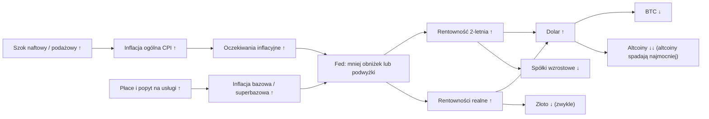

# 04. Inflacja

Inflacja to miejsce, w którym makroekonomia najszybciej spotyka się z twoim portfelem. W dniu publikacji CPI jedna liczba ogłoszona o 8:30 czasu nowojorskiego potrafi w ciągu kilku minut poruszyć rentowność 2-letnich obligacji skarbowych USA, dolara, Nasdaq i bitcoina. W horyzoncie miesięcy inflacja decyduje o tym, jak mocno Rezerwa Federalna (Fed) może obniżyć stopy albo jak mocno musi je podnieść. To z kolei wyznacza cenę pieniądza dla każdego ryzykownego aktywa. Benjamin Cowen od 2022 roku publikuje film niemal przy każdym odczycie CPI („Inflation Rises to 3.8%”, „Inflation Soars to 3.3%”). Jego powracająca teza jest prosta: wysoka inflacja oznacza mniej lub późniejsze obniżki stóp, wyższe rentowności i mocniejszego dolara, a taka mieszanka najbardziej szkodziła altcoinom. Ten rozdział wyjaśnia każdy wskaźnik inflacji, który pokazuje Cowen, to, jak je czytać, nie wpadając w typowe pułapki, oraz to, jak inflacja przenosi się przez Fed, rentowności i dolara na kryptowaluty. Omawia też historię: fale inflacji z lat 70., skok z lat 2021–23, cła z 2025 roku i szok naftowy z 2026 roku.

**Czego się nauczysz**
- Co mierzą CPI, inflacja bazowa CPI, „superbazowa” (supercore), koszty mieszkaniowe (shelter), PCE, bazowy PCE i PPI oraz który z tych wskaźników jest faktycznie celem Fed.
- Jak czytać dane rok do roku (r/r) w porównaniu z danymi miesiąc do miesiąca (m/m) w ujęciu rocznym i jak efekty bazy wprowadzają ludzi w błąd.
- Czym różni się dezinflacja od deflacji.
- Co się wydarzyło podczas fali inflacji z lat 2021–23, strachu przed cłami w 2025 roku i szoku naftowego w 2026 roku — z datami i liczbami.
- Co trafnie oddaje analogia do „drugiej fali” z lat 70., a gdzie się załamuje.
- Jak inflacyjna niespodzianka porusza Fed, potem rentowności, potem dolara, a potem kryptowaluty — i kiedy ten łańcuch zawiódł.

---

## Łańcuch transmisji inflacji w skrócie

Zanim przejdziemy do kart wskaźników, oto łańcuch, do którego cały ten rozdział będzie wracał. Każda strzałka ma znak. „↑” oznacza, że zmienna ma tendencję do wzrostu.

Łańcuch to tendencja, a nie prawo. Sekcja „Gdy łańcuch pęka” poniżej pokazuje wrzesień 2026, kiedy Fed podniósł stopy, dolar się umocnił, a bitcoin mimo to rósł.

---

## Główne miary

### CPI i inflacja bazowa CPI (CPIAUCSL, CPILFESL)

**Co to jest.** Indeks cen konsumpcyjnych dla wszystkich konsumentów miejskich (Consumer Price Index for All Urban Consumers, CPI-U) mierzy cenę stałego koszyka dóbr i usług kupowanych przez gospodarstwa domowe w miastach. Biuro Statystyki Pracy (Bureau of Labor Statistics, BLS) publikuje go co miesiąc, ok. 10–15 dni po zakończeniu miesiąca, o 8:30 czasu wschodnioamerykańskiego (ET). „Ogólny” (headline) CPI obejmuje wszystko. „Bazowy” (core) CPI pomija żywność i energię, dwie najbardziej zmienne kategorie. CPI nie jest rewidowany, z tym wyjątkiem, że co roku w lutym przelicza się czynniki sezonowe za ostatnie pięć lat ([notatki badawcze B](../../research-notes/B-fed-rates-inflation-labor.md)).

**Gdzie to znaleźć.** FRED `CPIAUCSL` (indeks wyrównany sezonowo), `CPIAUCNS` (niewyrównany sezonowo; to z niego pochodzi wskaźnik r/r, który BLS podaje w nagłówkach), `CPILFESL` (bazowy). TradingView `ECONOMICS:USIRYY` (ogólny r/r) i `ECONOMICS:USCIR` (bazowy). Sam komunikat BLS zawiera tabelę wkładów poszczególnych kategorii. Platforma Cowena (ITC) ma wykresy CPI, bazowego CPI i „Inflation YoY per category / contributions” (inflacja r/r według kategorii i wkłady), a także wykresy cen żywności, np. jaj, nabiału i mięsa.

**Jak to czytać.**
- Wskaźnik ogólny jest „zaszumiony”, bo wahają się ceny energii. Inflacja bazowa pokazuje *trwałość*: czy wzrosty cen rozlały się na szeroką gospodarkę.
- Porównaj 3- i 6-miesięczną bazową stopę inflacji w ujęciu rocznym ze stopą r/r. Jeśli stopa krótkoterminowa jest powyżej r/r, inflacja zaczyna rosnąć; jeśli poniżej — słabnie.
- Różnica między inflacją ogólną a bazową mówi ci, z *jakim rodzajem* inflacji masz do czynienia. Duża nadwyżka inflacji ogólnej nad bazową oznacza szok podażowy (energia, żywność). Inflacja bazowa rosnąca sama z siebie oznacza popyt i płace.
- Typowe błędy interpretacyjne: traktowanie jednego gorącego miesiąca jak trendu i uznawanie spadku r/r za „spadek inflacji”, gdy to tylko efekt bazy (zob. [Efekty bazy](#rr-mm-w-ujęciu-rocznym-i-efekty-bazy)).

**Ścieżka w latach 2021–2026** (r/r, dane wyrównane sezonowo, obliczone z FRED `CPIAUCSL` / `CPILFESL`; [notatki badawcze B](../../research-notes/B-fed-rates-inflation-labor.md) i dane FRED w folderze badań):

| Miesiąc | CPI ogólny r/r | CPI bazowy r/r | Co się działo |
|---|---|---|---|
| gru 2020 | 1,3% | – | Pandemiczny dołek; stopy Fed na zerze |
| kwi 2021 | 4,1% | – | Otwieranie gospodarki; efekty bazy z 2020 |
| lis 2021 | 6,9% | – | Fed ogłasza ograniczanie skupu aktywów (taper) 3.11.2021; szczyt BTC 10.11.2021 |
| cze 2022 | **9,0%** | 5,9% | Najwyżej od 40 lat (niewyrównany sezonowo wskaźnik ogólny BLS: 9,1%); szczyt inflacji bazowej 6,6% we wrz 2022 |
| gru 2022 | 6,4% | – | Fed podniósł stopy w ciągu roku o 4,25 pkt proc. |
| cze 2023 | 3,1% | – | Ostatnia podwyżka przychodzi w lipcu 2023 |
| wrz 2024 | 2,4% | – | Pierwsza obniżka (18.09.2024) |
| kwi 2025 | 2,3% | 2,8% | Zapowiedzi ceł |
| wrz 2025 | 3,0% | 3,0% | Fed wznawia obniżki |
| paź 2025 | – | – | Nie opublikowano (paraliż rządu federalnego, 1.10–12.11.2025) |
| sty–lut 2026 | 2,4% | 2,5% | Dołek |
| mar 2026 | 3,3% | 2,6% | Wojna z Iranem; CPI +0,87% w jednym miesiącu |
| maj 2026 | **4,2%** | 2,8% | Szczyt 2026 (wskaźnik ogólny BLS bez wyrównania sezonowego: 4,25%) |
| cze 2026 | 3,5% | 2,6% | Ropa tanieje; CPI −0,42% w jednym miesiącu |
| wrz 2026 | 3,7% | 2,6% | Ropa znów drożeje; ogólny +0,65% m/m, bazowy +0,33% |

**Jak używa tego Cowen.** W większość dni publikacji CPI wypuszcza film zatytułowany liczbą z odczytu: „Inflation Rises to 3%” (13 lutego 2025), „Inflation Rises to 3.0%” (25 października 2025), „Inflation Soars to 3.3%” (10 kwietnia 2026), „Inflation Rises to 3.8%” ([12 maja 2026](https://rosetta.to/u/intothecryptoverse/inflation-rises-to-3-8)). Jego stała teza brzmi: gorący odczyt oznacza mniej lub późniejsze obniżki, wyższe rentowności i mocniejszego dolara, co jest najgorsze dla altcoinów. Rozbija odczyt na kategorie (mieszkanie, żywność, odzież, transport). W 2026 roku nazwał skok inflacji „mostly a supply driven issue” („głównie problemem po stronie podaży”), czyli wynikiem cen energii i geopolityki, a nie przegrzanej gospodarki (streszczenia filmów z [indeksu Rosetta](https://rosetta.to/u/intothecryptoverse)).

**Powiązania.**
- *Co wyprzedza:* niespodzianki CPI w ciągu kilku minut wyprzedzają rentowność 2-letnią i kontrakty terminowe na stopę funduszy federalnych. W horyzoncie miesięcy rosnąca inflacja bazowa wyprzedza politykę Fed (podwyżki lub dłuższą pauzę).
- *Co go wyprzedza:* ropa i benzyna wyprzedzają ogólny CPI o ok. 0–1 miesiąca. PPI wyprzedza CPI dla dóbr o ok. 0–3 miesiące. Rynkowe czynsze wyprzedzają koszty mieszkaniowe w CPI o ok. 12 miesięcy.
- *Mechanizm:* Fed ma cel inflacyjny 2%. Wyższa inflacja oznacza wyższą stopę polityki pieniężnej przez dłuższy czas, co podnosi stopę dyskontową dla każdego aktywa i wspiera dolara.
- *Epizody:* w 2022 roku CPI na poziomie 9,0% wywołał najszybszy od dekad cykl podwyżek (+525 pb w 16 miesięcy, [notatki badawcze B](../../research-notes/B-fed-rates-inflation-labor.md)), a BTC spadł o ok. 77% od szczytu z listopada 2021. W 2026 roku CPI wzrósł z 2,4% do 4,2% w cztery miesiące, a Fed przeszedł od skłonności do luzowania (kwiecień) do podwyżki (16 września 2026).
- *Wyjątek:* w 2026 roku bazowy CPI (2,6%) pozostał daleko poniżej ogólnego, więc szok nie rozlał się na bazowy CPI. Bazowy PCE zachowywał się inaczej (zob. niżej), dlatego Fed mimo wszystko podniósł stopy.

**Co to oznaczało dla aktywów.** Niespodzianka w górę w CPI niezawodnie podnosiła rentowności i dolara oraz uderzała w kryptowaluty i spółki wzrostowe w dniu publikacji ([notatki badawcze B](../../research-notes/B-fed-rates-inflation-labor.md) oceniają wiarygodność tej zależności w ujęciu śróddziennym jako „wysoką”). W horyzoncie miesięcy efekt zależy od reakcji Fed. Inflacja napędzana energią sprzyja spółkom energetycznym i surowcom. Złoto zachowuje się różnie: zwykle rośnie przy strachu przed inflacją, ale spada, gdy rentowności realne gwałtownie rosną.

**Wniosek dla inwestora.** Czytaj inflację ogólną i bazową razem i patrz na krótkoterminową bazową stopę w ujęciu rocznym, a nie tylko na r/r. Rynek reaguje na *niespodziankę* względem oczekiwań i na to, co ta niespodzianka oznacza dla Fed, a nie na sam poziom.

### Inflacja „superbazowa”, koszty mieszkaniowe i OER

**Co to jest.**
- *Koszty mieszkaniowe* (shelter, `CUSR0000SAH1`) to ok. 35% CPI i ok. 44% bazowego CPI. Ich największym składnikiem jest *ekwiwalent czynszu właścicielskiego* (Owners' Equivalent Rent, OER, `CUSR0000SEHC`): przypisany czynsz, który właściciele domów „płacą sami sobie”. Nikt go faktycznie nie płaci, ale BLS szacuje go na podstawie czynszów.
- *Inflacja „superbazowa”* (supercore) to usługi bazowe z wyłączeniem kosztów mieszkaniowych. Są to głównie usługi pracochłonne, takie jak opieka medyczna, ubezpieczenia, transport i rekreacja, więc podąża ona za płacami. W latach 2022–23 była ulubioną miarą Powella. Nie ma jednej serii w FRED. Można ją przybliżyć serią BLS „services less rent of shelter” (usługi bez czynszów mieszkaniowych, `CUSR0000SASL2RS`).

**Gdzie to znaleźć.** Identyfikatory FRED powyżej; tabele komunikatu BLS o CPI.

**Jak to czytać.**
- Koszty mieszkaniowe patrzą wstecz. Opóźniają się względem rynkowych czynszów (Zillow, Apartment List) o ok. 12 miesięcy. Koszty mieszkaniowe r/r osiągnęły szczyt ok. 8% w 2023 roku, a we wrześniu 2026 wynosiły 3,2% ([notatki badawcze B](../../research-notes/B-fed-rates-inflation-labor.md)). Ich powolny spadek był głównym czynnikiem spadku bazowego CPI w latach 2024–25.
- Inflacja „superbazowa” mówi ci, czy napędzana płacami inflacja usług jest uporczywa — a to właśnie tego Fed obawia się najbardziej.
- *Błąd interpretacyjny:* spowolnienie na rynku mieszkaniowym pojawia się w CPI dopiero po ok. roku, więc „koszty mieszkaniowe wciąż są wysokie” w danym miesiącu to często stara wiadomość.

**Jak używa tego Cowen.** W filmach z dni publikacji CPI rozbija kategorie CPI, w tym mieszkanie (2026). Nie prowadzi osobnej serii inflacji „superbazowej”.

**Powiązania.** Rynkowe czynsze → koszty mieszkaniowe w CPI (opóźnienie ok. 12 miesięcy, zależność dodatnia). Płace → inflacja „superbazowa” (dodatnia, krótkie opóźnienie). Oprocentowanie kredytów hipotecznych → popyt na domy → czynsze → koszty mieszkaniowe, z długimi opóźnieniami.

**Co to oznaczało dla aktywów.** W latach 2023–24 spadające koszty mieszkaniowe pozwoliły inflacji bazowej spaść bez recesji, co umożliwiło Fed rozpoczęcie obniżek we wrześniu 2024. To wspierało akcje i BTC w 2024 roku.

**Wniosek dla inwestora.** Gdy porusza się inflacja bazowa, zapytaj, czy to koszty mieszkaniowe (powolne i przewidywalne), czy inflacja „superbazowa” (napędzana płacami i budząca obawy Fed).

### PCE i bazowy PCE — cel Fed (PCEPI, PCEPILFE)

**Co to jest.** Indeks cen wydatków konsumpcyjnych (Personal Consumption Expenditures, PCE) publikowany przez Biuro Analiz Ekonomicznych (Bureau of Economic Analysis, BEA). Ukazuje się razem z danymi o dochodach i wydatkach osobistych (Personal Income and Outlays) ok. czterech tygodni po zakończeniu miesiąca. Cel Fed na poziomie 2% jest zdefiniowany dla *ogólnego* PCE, ale to bazowy PCE jest praktyczną wskazówką. PCE obejmuje więcej wydatków niż CPI, w tym opiekę zdrowotną opłacaną przez pracodawców i państwo. Stosuje wagi łańcuchowe, więc dostosowuje się, gdy ludzie zastępują jedne dobra innymi, a kosztom mieszkaniowym nadaje wagę tylko ok. 15%. W przeciwieństwie do CPI jest rewidowany.

**Gdzie to znaleźć.** FRED `PCEPI`, `PCEPILFE`; BEA. ITC ma PCEPI i bazowy PCEPI.

**Jak to czytać.** Gdy CPI i PCE się rozchodzą, Fed kieruje się PCE. Bazowy PCE osiągnął szczyt 5,6% we wrześniu 2022. We wrześniu 2026 ogólny PCE wynosił 3,65%, a bazowy **3,12%** (FRED; [laboratorium makro](../../tools/macro-lab/REPORT-2026-10-30.md) pokazuje te same 3,12%). Przez większość 2026 roku bazowy PCE był powyżej 3%.

Zwrot akcji w 2026 roku: bazowy PCE (3,1%) był *powyżej* bazowego CPI (2,6%), co jest nietypowe. Prawdopodobne przyczyny ([notatki badawcze B](../../research-notes/B-fed-rates-inflation-labor.md)) to mniejsza waga kosztów mieszkaniowych w PCE (a te słabną) oraz większe wagi usług wrażliwych na ceny energii, takich jak bilety lotnicze i transport, oraz opłat za zarządzanie portfelem, które rosną wraz z cenami akcji. Przewodniczący Kevin Warsh przywołał bazowy PCE na poziomie „about 3.2” („około 3,2”) na konferencji prasowej 16 września 2026, gdy Fed podniósł stopy.

**Jak używa tego Cowen.** PCE pojawia się jako jeden z kroków w jego niedźwiedzim scenariuszu z października 2026: „PCE comes in hot (Oct 29)” („PCE wyjdzie gorący (29 paź)”) (wpis na X z 26 października 2026, według [BeInCrypto przez Yahoo](https://finance.yahoo.com/markets/crypto/articles/bitcoin-falls-below-80-000-032051576.html)). Jego [memorandum „Triple Squeeze”](https://benjamincowen.com/reports/the-triple-squeeze-september-2026) (30 września 2026) przytacza sierpniowy PCE: 3,4% ogólny i 3,0% bazowy.

**Rewizje mogą stworzyć „niespodziankę”: przykład z sierpnia 2026.** W tym samym memorandum zwrócił uwagę, że sierpniowy odczyt PCE (3,4% ogólny, 3,0% bazowy) wypadł wyraźnie poniżej konsensusu 3,7% / 3,3% częściowo z powodu **corocznej rewizji BEA**, która na nowo zmierzyła ceny oprogramowania, usług zarządzania inwestycjami i usług prawnych. Rewizja obniżyła też już opublikowane dane za lipiec z 3,7% / 3,3% do 3,4% / 3,0%. Część pozornego ochłodzenia była więc zmianą miary, a nie zmianą cen. Rynek i tak zareagował: według memorandum prawdopodobieństwo październikowej podwyżki spadło po publikacji z ok. 70% do 35–42%. To lekcja z zakresu czytania danych ([rozdział 01](01-JAK-CZYTAC-WYKRESY-MAKRO.md) omawia kolejne wersje danych, czyli vintages): zanim zinterpretujesz niespodziankę w PCE, sprawdź, czy wcześniejsze miesiące zostały zrewidowane, i porównuj porównywalne dane.

**Powiązania.** PCE jest publikowany po CPI i PPI, więc analitycy szacują go na bieżąco (nowcasting) na podstawie tych dwóch wskaźników. Składniki PPI, takie jak bilety lotnicze, usługi medyczne i zarządzanie portfelem, trafiają bezpośrednio do bazowego PCE. Dlatego publikacja PPI może poruszyć oczekiwania co do stóp nawet wtedy, gdy CPI jest już znany.

**Co to oznaczało dla aktywów.** Niespodzianki w PCE są zwykle mniejsze niż w CPI, bo PCE jest dobrze prognozowany. Wyjątkiem są sytuacje, gdy CPI i PCE się rozchodzą, jak w 2026 roku: spokojny bazowy CPI nie powstrzymał podwyżki, bo bazowy PCE był powyżej 3%.

**Wniosek dla inwestora.** Jeśli chcesz wiedzieć, co zrobi Fed, śledź bazowy PCE. Jeśli chcesz wiedzieć, co poruszy rynkami w dniu publikacji, śledź niespodzianki w CPI.

### PPI — ceny producentów (PPIFIS)

**Co to jest.** Indeks cen producentów (Producer Price Index, PPI) BLS dla popytu finalnego mierzy ceny otrzymywane przez krajowych producentów. Jest publikowany mniej więcej w połowie miesiąca, zwykle po CPI.

**Gdzie to znaleźć.** FRED `PPIFIS` (popyt finalny), `PPIACO` (wszystkie towary). ITC ma PPI i PPIAC.

**Jak to czytać.** PPI to sygnał z „rurociągu” cenowego, a nie cel. Wyprzedza CPI dla dóbr o ok. 0–3 miesiące. We wrześniu 2026 PPI r/r wynosił **6,3%**, w porównaniu z ok. 3% w 2025 roku, głównie za sprawą energii ([notatki badawcze B](../../research-notes/B-fed-rates-inflation-labor.md)).

**Jak używa tego Cowen.** „PPI Surges” (14 sierpnia 2025). W swoim [Macro Risk Memo z maja 2026](https://benjamincowen.com/reports/macro-risk-memo-may-2026) napisał, że ceny producentów i koszty transportu „leading the inflation move” („prowadzą ruch inflacji”).

**Powiązania.** Ropa → energia w PPI → energia i dobra w CPI. Składniki PPI → bazowy PCE. Wskaźnik ISM „Prices Paid” (płacone ceny; 77,9 we wrześniu 2026, zob. [rozdział 06](06-WZROST-I-CYKL-KONIUNKTURALNY.md#ism-manufacturing-pmi-main-street-i-spór-o-sezon-altcoinów)) opowiada tę samą historię o „rurociągu” na podstawie ankiety.

**Co to oznaczało dla aktywów.** Gorący PPI zwiększa szanse, że CPI i PCE pozostaną gorące, więc lekko podbija rentowności. Ma największe znaczenie, gdy potwierdza trend widoczny już w CPI.

**Wniosek dla inwestora.** Traktuj PPI i ISM Prices Paid jako wczesne ostrzeżenia o tym, co ceny konsumpcyjne zrobią w kolejnym kwartale.

### Oczekiwania inflacyjne: ankiety Uniwersytetu Michigan i rynkowa inflacja implikowana

**Co to jest.** Dwie rodziny miar:
- *Ankiety.* Uniwersytet Michigan pyta konsumentów o oczekiwaną inflację w horyzoncie roku (`MICH`) oraz 5–10 lat. Wstępny odczyt pojawia się w połowie miesiąca, a ostateczny pod jego koniec.
- *Wycena rynkowa.* 10-letnia inflacja implikowana (breakeven, `T10YIE`) to nominalna rentowność 10-letnia minus rentowność obligacji chronionych przed inflacją (TIPS). Pięcioletnia stopa terminowa za pięć lat (5y5y, `T5YIFR`) to oczekiwana inflacja w horyzoncie 5–10 lat — ulubiona miara „zakotwiczenia” w Fed. Obie są szczegółowo omówione w [rozdziale 03](03-OBLIGACJE-I-KRZYWA-RENTOWNOSCI.md).

**Jak to czytać.**
- Roczne oczekiwania z ankiety Michigan osiągnęły szczyt **6,6% w maju 2025** na fali strachu przed cłami, a we wrześniu 2026 wynosiły 4,6% ([notatki badawcze B](../../research-notes/B-fed-rates-inflation-labor.md)). Są „zaszumione”, a od 2024 roku także partyjne: odpowiedzi ludzi zależą od tego, kto sprawuje władzę.
- Miary rynkowe w 2026 roku prawie się nie ruszyły: pod koniec października 2026 10-letnia inflacja implikowana wynosiła 2,35%, a 5y5y 2,23% — praktycznie bez zmian, podczas gdy CPI wzrósł z 2,4% do 4,2% (laboratorium i [notatki badawcze B](../../research-notes/B-fed-rates-inflation-labor.md)). Oznacza to, że **długoterminowe oczekiwania są zakotwiczone**. To najważniejsza pojedyncza różnica w porównaniu z latami 70.
- [Notatki badawcze B](../../research-notes/B-fed-rates-inflation-labor.md) proponują praktyczną regułę: gdyby 5y5y przebił ok. 2,6–2,7%, narracja o „drugiej fali” zyskałaby realne wsparcie. Do października 2026 tak się nie stało.

**Jak używa tego Cowen.** Inflacja implikowana nie jest nazwanym wykresem na jego platformie ani tematem filmów. Zamiast tego argumentuje na podstawie zrealizowanych odczytów CPI i PCE.

**Powiązania.** Oczekiwania wpływają na żądania płacowe i ustalanie cen, więc niezakotwiczone oczekiwania sprawiają, że inflacja sama się podtrzymuje. Zakotwiczone oczekiwania pozwalają Fed „przeczekać” szok podażowy (look through) albo podnieść stopy tylko umiarkowanie.

**Wniosek dla inwestora.** Gdy inflacja ogólna skacze, sprawdź 5y5y. Jeśli jest spokojny, rynek wierzy Fed. Jeśli rośnie, ryzyko długiego reżimu inflacyjnego jest realne.

### r/r, m/m w ujęciu rocznym i efekty bazy

**Co to jest.** Trzy sposoby wyrażenia tej samej zmiany cen:
- *Rok do roku (r/r, YoY)*: indeks z tego miesiąca ÷ ten sam miesiąc rok wcześniej, minus 1.
- *Miesiąc do miesiąca (m/m, MoM)*: ten miesiąc ÷ poprzedni miesiąc, minus 1.
- *m/m w ujęciu rocznym*: (1 + m/m)^12 − 1. Miesiąc z inflacją bazową 0,3% to ok. 3,7% w ujęciu rocznym; 0,2% to ok. 2,4%.

**Efekty bazy** (base effects). Stopa r/r spada lub rośnie mechanicznie, gdy duży miesiąc sprzed roku wypada z 12-miesięcznego okna. Skok cen energii z marca–maja 2026 (+0,87%, +0,64%, +0,47% m/m, [notatki badawcze B](../../research-notes/B-fed-rates-inflation-labor.md)) wypadnie z okna r/r w marcu–maju 2027. To mocno obniży ogólną stopę r/r, nawet jeśli ceny po prostu pozostaną wysokie. Czerwcowy spadek z 2026 roku (−0,42%) wypadnie z okna w czerwcu 2027 i podbije r/r. Uwaga scenariuszowa z [notatek badawczych B](../../research-notes/B-fed-rates-inflation-labor.md): „Base effects alone will pull headline YoY down sharply in Mar–May 2027 if oil merely stays flat” („same efekty bazy mocno obniżą ogólną stopę r/r w marcu–maju 2027, jeśli ropa jedynie pozostanie na tym samym poziomie”).

**Pułapka danych przy brakujących miesiącach.** Październikowy CPI z 2025 roku nigdy nie został zebrany z powodu paraliżu rządu, więc w FRED jest pusty miesiąc. Naiwne obliczenie, które cofa się o „12 wierszy” zamiast o „12 miesięcy kalendarzowych”, porównuje wrzesień 2026 z *sierpniem* 2025, czyli mierzy zmianę 13-miesięczną, i daje ok. 4,0% zamiast prawidłowych 3,7% (indeks FRED 336,298 dla września 2026 wobec 324,245 dla września 2025). [Pulpit laboratorium](../../tools/macro-lab/REPORT-2026-10-30.md) dopasowuje daty kalendarzowe i pokazuje 3,72%. Zawsze sprawdzaj datę, z którą porównujesz, zwłaszcza w okolicach luk w danych.

**Błąd interpretacyjny.** „Inflacja spada”, gdy spada tylko stopa r/r z powodu efektów bazy, a miesięczne tempo wciąż jest wysokie. Albo odwrotnie w połowie 2027 roku.

**Wniosek dla inwestora.** Zanim zareagujesz na nagłówek z danymi r/r, spójrz na trzy ostatnie odczyty m/m i na to, co rok temu wypadło z okna.

### Dezinflacja a deflacja

**Dezinflacja** (disinflation) oznacza, że inflacja spada, ale pozostaje dodatnia: ceny rosną wolniej. Lata 2023–24 to dezinflacja (CPI z 9,0% do ok. 2,4%). **Deflacja** (deflation) oznacza, że ceny wprost spadają. W USA zdarza się rzadko: 2009 (ok. −2% r/r dla wskaźnika ogólnego, za sprawą ropy) oraz krótko w 2015 i 2020 roku ([notatki badawcze B](../../research-notes/B-fed-rates-inflation-labor.md)).

To rozróżnienie ma znaczenie, bo dezinflacja przy stabilnym zatrudnieniu to najprzyjaźniejsze tło dla aktywów ryzykownych: Fed może obniżać stopy bez kryzysu. Deflacja zwykle przychodzi razem z recesją i spadającymi zyskami spółek, co jest złe dla akcji i kryptowalut, mimo że stopy spadają. Teza Cowena sprzed 2026 roku zakładała dezinflację w kierunku 2% (2023–25) i ponowne przyspieszenie tylko w wyniku błędu w polityce pieniężnej lub szoku. W 2026 roku szok nadszedł ([notatki badawcze B](../../research-notes/B-fed-rates-inflation-labor.md); [Benzinga, luty 2025](https://benzinga.com/markets/cryptocurrency/25/02/43706856/could-inflation-unemployment-derail-the-bitcoin-bull-run), treść niedostępna).

---

## Ropa i energia: kanał szoku podażowego

### Ropa (WTI, Brent) i spółki energetyczne (DCOILWTICO, DCOILBRENTEU, XLE)

**Co to jest.** Dzienne ceny ropy West Texas Intermediate (WTI, benchmark amerykański) i Brent (benchmark międzynarodowy). Spółki energetyczne śledzi się przez fundusz sektorowy XLE. (Ropa pojawia się też w [rozdziale 08](08-AKCJE-ZLOTO-I-INNE-AKTYWA.md) jako jedna z klas aktywów; tutaj omawiamy ją w pełni, bo jej główny kanał makroekonomiczny to inflacja.)

**Gdzie to znaleźć.** FRED `DCOILWTICO`, `DCOILBRENTEU` (ceny spot, dziennie), `WTISPLC` (miesięcznie od 1946). TradingView `TVC:USOIL`, `TVC:UKOIL`, `AMEX:XLE`. ITC ma wykres „Crude Oil (WTI)”.

**Jak to czytać.**
- Benzyna to duża i widoczna część ogólnego CPI, więc ropa wyprzedza ogólny CPI o kilka tygodni.
- *Tempo* ruchu ma większe znaczenie niż poziom, bo firmy i gospodarstwa domowe nie potrafią szybko się dostosować.
- Skoki wywołane podażą (embargo, wojna, blokada) są groźniejsze niż te wywołane popytem (rozgrzana gospodarka podbijająca cenę ropy).
- Ceny spot i ceny kontraktów terminowych mogą się podczas blokady mocno różnić, więc notowania w wiadomościach bywają różne. W 2026 roku seria Brent spot w FRED i notowania najbliższych kontraktów terminowych podawane w prasie różniły się chwilami o ponad 10 USD.

**Szok naftowy 2026** (średnie miesięczne cen spot z FRED, obliczone; daty wydarzeń z [notatek badawczych A](../../research-notes/A-cowen-inventory.md) i B):

| Miesiąc (2026) | Średnia Brent | Średnia WTI | Wydarzenie |
|---|---|---|---|
| lut | 70,9 USD | 64,5 USD | Amerykańskie i izraelskie uderzenia na Iran, 28 lutego |
| mar | 103,1 USD | 91,4 USD | Zamknięcie Cieśniny Ormuz; WTI 67 → 91 USD w tydzień |
| kwi | 117,3 USD | 100,3 USD | Szczyt Brent spot 138,21 USD 7 kwietnia |
| cze | 85,4 USD | 84,8 USD | Memorandum w sprawie Ormuz 17 czerwca; ceny spadają |
| lip–sie | 83,8–91,1 USD | 80,5–83,9 USD | Wznowienie uderzeń 7 lipca |
| wrz | 114,2 USD | 97,3 USD | Trump odrzuca irański plan ponownego otwarcia Ormuz (28 września, według Al Jazeery) |
| paź (do 27.) | 124,8 USD | 101,4 USD | Brent spot 123,10 USD 27 października |

**Jak używa tego Cowen.**
- „Oil Spikes 35%” (8 marca 2026) opisywał wzrost WTI z 67 do 91 USD w jeden tydzień, „largest weekly rally since 1983” („największy tygodniowy wzrost od 1983 roku”).
- „The Mechanism That Ends Business Cycles” (28 lutego 2026): skoki cen ropy historycznie poprzedzają recesje.
- Spółki energetyczne osiągają szczyt *na końcu* cyklu: energia „topped after the stock market in a late business cycle environment” („osiągała szczyt po rynku akcji w otoczeniu późnej fazy cyklu koniunkturalnego”) (2026, [notatki badawcze B](../../research-notes/B-fed-rates-inflation-labor.md)).
- Jego [wrześniowe memorandum z 2026 roku](https://benjamincowen.com/reports/the-triple-squeeze-september-2026) zauważa, że ropa zawracała przed rentownością 10-letnią — o ok. 5 tygodni w 2018 roku i o ok. 4 miesiące w 2022.
- Ropa po ok. 120 USD to jeden z kroków jego niedźwiedziego scenariusza z października 2026 (26 października 2026).

**Powiązania.**
- *Ropa → ogólny CPI:* zależność dodatnia, opóźnienie kilku tygodni.
- *Ropa → inflacja implikowana → rentowności:* ropa szybko porusza rynkowymi oczekiwaniami inflacyjnymi. W swoim [memorandum „Triple Squeeze”](https://benjamincowen.com/reports/the-triple-squeeze-september-2026) (30 września 2026) Cowen czyni to krokiem 1 sześcioetapowej „pętli ucisku”: ropa w górę → inflacja ogólna i inflacja implikowana wyceniane wyżej → rentowności podążają za nimi, a długi koniec dokłada premię za termin → dolar się umacnia → aktywa niedające odsetek (złoto, spółki o długiej duracji) tracą na wycenie → koszty zaczynają doskwierać (kredyty hipoteczne, samochody, paliwo) → popyt słabnie. Inflację implikowaną wyjaśnia [rozdział 03](03-OBLIGACJE-I-KRZYWA-RENTOWNOSCI.md), a całą pętlę przedstawia [rozdział 13](13-JAK-TO-SIE-LACZY.md). W 2026 roku pierwszy krok był stłumiony: 10-letnia inflacja implikowana prawie się nie ruszyła (2,30% rok wcześniej, 2,35% pod koniec października, [laboratorium](../../tools/macro-lab/REPORT-2026-10-30.md)), a większość wzrostu przypadła na rentowności realne.
- *Ropa → recesja:* James Hamilton ustalił, że 10 z 11 powojennych recesji w USA do 2008 roku poprzedził gwałtowny wzrost cen ropy, podkreślając przy tym, że był to czynnik współprzyczyniający się, a nie jedyna przyczyna ([NBER Reporter 2011](https://www.nber.org/reporter/2011number2/oil-price-shocks)). Własna analiza z [notatek badawczych C](../../research-notes/C-growth-liquidity-crossasset.md) wykazała, że ropa wzrosła o 184% przed recesją z 1973 roku, o 166% przed 1980, o 160% przed 1990, o 205% przed 2001 (z długim opóźnieniem) i o 93% przed początkiem recesji w 2007.
- *Kontrprzykłady:* skoki bez recesji to m.in. 1987, 2017–18, 2021–22 (WTI +113% r/r, 123 USD w czerwcu 2022) i jak dotąd 2026 (+58% r/r w kwietniu). USA są obecnie eksporterem netto ropy i produktów naftowych, więc droższa ropa przesuwa dochód od konsumentów do amerykańskich producentów, a nie za granicę. To łagodzi uderzenie w PKB, choć nadal szkodzi realnym dochodom i nastrojom.
- *Ropa → Fed:* historycznie Fed reagował *luzowaniem*, gdy wzrost się załamywał (1974, 1990, 2008). W 2026 roku Fed zamiast tego podniósł stopy w trakcie szoku.

**Co to oznaczało dla aktywów.** Szoki energetyczne uderzały w kryptowaluty (BTC spadał w I połowie 2026), pomagały spółkom energetycznym, podnosiły najpierw inflację implikowaną, a potem rentowności realne, i wspierały dolara. Złoto najpierw rosło, a potem spadło, gdy rentowności realne gwałtownie wzrosły (od końca stycznia do końca marca 2026 złoto spadło o ok. 30%).

**Wniosek dla inwestora.** Obserwuj tempo ruchów ropy i to, czy są wywołane podażą. Trwały podażowy skok cen w połączeniu z bankiem centralnym, który nie może luzować polityki, to klasyczny przepis na koniec cyklu koniunkturalnego — ale w latach 2021–22 i jak dotąd w 2026 roku sam w sobie nie wystarczył.

---

## Epizody

### Fala inflacji z lat 2021–23

To epizod, który wprowadził makroekonomię do analizy kryptowalut. Do 2021 roku kanał Cowena był niemal wyłącznie techniczny. W 2022 roku 65 tytułów lub streszczeń jego filmów dotyczyło CPI, PCE lub PPI (zliczenie słów kluczowych w indeksie jego filmów).

**Jak narastała.** CPI wzrósł z 1,3% w grudniu 2020 do 4,1% w kwietniu 2021, 6,9% w listopadzie 2021 i **9,0% w czerwcu 2022**. Bazowy CPI osiągnął szczyt 6,6% we wrześniu 2022, a bazowy PCE 5,6%. Część początkowego wzrostu wynikała z efektów bazy po zaniżonych cenach z 2020 roku. Potem popyt po otwarciu gospodarki, wąskie gardła w łańcuchach dostaw, transfery fiskalne i energia (Brent spot sięgnął 133 USD 8 marca 2022) sprawiły, że inflacja stała się szeroka. Fed początkowo nazywał wzrost „przejściowym” (transitory) i utrzymywał stopy na zerze.

**Jak zareagował Fed.** Fed ogłosił ograniczanie skupu obligacji (taper) 3 listopada 2021. Bitcoin osiągnął szczyt cyklu tydzień później, 10 listopada 2021. Pierwsza podwyżka przyszła 16 marca 2022. Następnie Fed podniósł stopy o 525 pb w 16 miesięcy, do przedziału 5,25–5,50% w lipcu 2023, i od czerwca 2022 prowadził zacieśnianie ilościowe (QT). W szczycie CPI stopa funduszy federalnych wynosiła zaledwie ok. 1,2%, daleko za inflacją (tabela z [notatek badawczych B](../../research-notes/B-fed-rates-inflation-labor.md) poniżej).

**Co robiły aktywa.**
- BTC spadł o ok. 77% od szczytu z listopada 2021 do listopada 2022. Jego dzienna korelacja z S&P 500 wzrosła w 2022 roku do 0,56 ([notatki badawcze C](../../research-notes/C-growth-liquidity-crossasset.md)), a tygodniowa korelacja BTC z Nasdaq w laboratorium wynosiła w tym roku 0,44 — najwięcej w jego tabeli ([laboratorium](../../tools/macro-lab/REPORT-2026-10-30.md)).
- S&P 500 spadł o ok. 25% bez recesji; Nasdaq spadł o 33% w roku kalendarzowym 2022 (laboratorium).
- Dolar gwałtownie się umocnił: DXY osiągnął szczyt 28 września 2022 na poziomie 114,78 ([notatki badawcze C](../../research-notes/C-growth-liquidity-crossasset.md)).
- ETH/BTC spadł w 2022 roku o 11%, podczas gdy Fed podniósł swój cel o 4,25 pkt proc. (laboratorium).

**Jak Cowen odczytywał to wtedy.** „Bitcoin Vs. 10 Year Treasury Yields” (4 stycznia 2022): wysoka inflacja zwiększa korelację między klasami aktywów. „S&P 500 Bear Markets with High Inflation” (10 października 2022). W lutym 2022 przekonywał, że pierwsza podwyżka „not necessarily doom and gloom” („niekoniecznie oznacza katastrofę”) dla BTC ([Daily Hodl, 28 lutego 2022](https://dailyhodl.com/2022/02/28/interest-rate-hike-not-necessarily-doom-and-gloom-for-bitcoin-btc-says-analyst-benjamin-cowen-heres-why/)). Od tego czasu przeciwstawia szczyt z 2021 roku, *napędzany inflacją*, szczytowi z IV kwartału 2025, *napędzanemu bezrobociem* ([Bankless, 23 grudnia 2025](https://www.bankless.com/podcast/where-is-crypto-going-in-2026-ben-cowen)).

**Jak się skończyła.** Inflacja spadła do 2,3% do kwietnia 2025 bez recesji w rozumieniu NBER. Dużą część pracy w końcowej fazie wykonała dezinflacja kosztów mieszkaniowych. Ta „niepokalana dezinflacja” (immaculate disinflation) złamała kilka szablonów recesyjnych; zob. [rozdział 05](05-RYNEK-PRACY.md) i [rozdział 13](13-JAK-TO-SIE-LACZY.md).

### Analogia do „fal” z lat 70. i jej granice

**Fakty** (CPI z FRED, [notatki badawcze B](../../research-notes/B-fed-rates-inflation-labor.md)):
1. CPI osiągnął szczyt 6,4% w lutym 1970. Fed obniżył stopę funduszy federalnych z ok. 9% do ok. 3,5% do 1972 roku, a CPI spadł do ok. 3%.
2. Następnie CPI wzrósł do **12,2% w listopadzie 1974**, czemu pomogło embargo OPEC. Pod przewodnictwem **Arthura Burnsa** Fed ponownie luzował politykę, z 12,9% (lipiec 1974) do ok. 4,7% (grudzień 1976), choć inflacja wciąż wynosiła ok. 5%.
3. Potem CPI wspiął się do **14,6% w marcu 1980**. Paul Volcker podniósł stopę funduszy federalnych do ok. 19% (czerwiec 1981), co złamało inflację kosztem podwójnej recesji (double dip). W połowie 1983 roku CPI wynosił ok. 2,5%.

Opracowanie Hoover Institution / Fed (Nelson, 2024) przypisuje dużą część fali z lat 1976–80 luzowaniu z czasów Burnsa ([notatki badawcze B](../../research-notes/B-fed-rates-inflation-labor.md)).

**Szczyty inflacji i reakcja Fed** ([notatki badawcze B](../../research-notes/B-fed-rates-inflation-labor.md)):

| Szczyt CPI | Poziom szczytu | Stopa funduszy federalnych w szczycie | Reakcja Fed | Skutek |
|---|---|---|---|---|
| lut 1970 | 6,4% | 9,0% | Mocne luzowanie (do ~3,5% do 1972) | Recesja 1970; inflacja wróciła (fala 2) |
| lis 1974 | 12,2% | 9,5% (12,9% w lip 1974) | Luzowanie do ~4,7% do 1976 (Burns) | Dołek 5,0% w gru 1976, potem fala 3 |
| mar 1980 | 14,6% | 17,2% | Volcker: obniżka, potem ponowne podwyżki do ~19% | Podwójna recesja 1980 i 1981–82; inflacja złamana |
| paź 1990 | 6,4% | 8,1% | Luzowanie w trakcie recesji wywołanej szokiem naftowym | Recesja 1990–91; inflacja do ~3% |
| lip 2008 | 5,5% | 2,0% | Przeczekanie szoku naftowego; trwały obniżki | Skok cen ropy → kryzys finansowy; deflacja 2009 |
| cze 2022 | 9,0% | 1,2% | +525 pb w 16 miesięcy | Dezinflacja do 2,3% do kwi 2025, bez recesji |
| maj 2026 | 4,2% | 3,6% | Pauza, potem podwyżka we wrz 2026 | W toku |

**Nałożenie lat 2022–26.** CPI osiągnął szczyt 9,0% (czerwiec 2022), dołek 2,3–2,4% (kwiecień 2025 i styczeń 2026) i ponownie wzrósł do 3,7–4,2% w 2026 roku. *Kształt* rymuje się z latami 70.: szczyt, przedwczesne ogłoszenie zwycięstwa, druga fala. Wyzwalacz z 2026 roku, szok naftowy, również przypomina rok 1973.

**Granice analogii** ([notatki badawcze B](../../research-notes/B-fed-rates-inflation-labor.md)):
- *Skala.* Dołek z 1976 roku wynosił 5%; dołek z 2026 roku — 2,4%. Szczyt z 2026 roku (4,2%) to jedna trzecia szczytu z 1974.
- *Oczekiwania.* W latach 70. długoterminowe oczekiwania były niezakotwiczone. W 2026 roku 5y5y utrzymuje się w okolicach 2,2%.
- *Reakcja Fed.* Burns luzował politykę w trakcie szoku podażowego. Fed w 2026 roku w trakcie takiego szoku podniósł stopy, co bardziej przypomina Volckera niż Burnsa. To zmniejsza ryzyko drugiej fali, a zwiększa ryzyko recesji wywołanej błędem w polityce pieniężnej.
- *Struktura.* Związki zawodowe i indeksacja płac są słabsze, gospodarka zużywa mniej energii na dolara produkcji, a USA są obecnie eksporterem netto ropy.
- *Wielkość próby.* Lata 70. były tylko jedne. Analogia z jednym precedensem to opowieść, a nie statystyka.

**Jak używa tego Cowen.** Powracające fale w stylu lat 70. opisywał jako ryzyko, ale nie jako swój scenariusz bazowy (2022–2025, według Benzingi). Filmy to m.in. „S&P 500 Bear Markets with High Inflation” (10 października 2022), „Smoothed Recession Probabilities” (10 stycznia 2023), „Inflation & Bitcoin” (11 grudnia 2024) i „Bitcoin, Stocks, and Inflation” (14 marca 2025). Jego argument jest taki, że okresy inflacyjne wymuszają długotrwałe podwyżki i skupiają recesje. W maju 2026 powiedział: „If inflation were to start another major inflationary wave, that would have negative consequences for the stock market” („gdyby inflacja zapoczątkowała kolejną dużą falę inflacyjną, miałoby to negatywne konsekwencje dla rynku akcji”) ([notatki badawcze B](../../research-notes/B-fed-rates-inflation-labor.md), na podstawie [streszczenia Rosetta](https://rosetta.to/u/intothecryptoverse/inflation-rises-to-3-8)). Porównał też S&P 500 wyceniany w złocie do „the 1970s more than 2000” („bardziej do lat 70. niż do 2000 roku”) (styczeń 2026). Analogia do lat 70. pojawia się w 38 tytułach lub streszczeniach jego filmów z lat 2019–połowa 2026 (zliczenie słów kluczowych w indeksie jego filmów).

**Uczciwa ocena.** Jak dotąd trafna co do kierunku, słaba co do skali ([notatki badawcze B](../../research-notes/B-fed-rates-inflation-labor.md)). Traktuj ją jako scenariusz ryzyka z jasnym testem: obserwuj 5y5y i dynamikę bazowego PCE.

### Cła, 2025

**Co się wydarzyło.** Zapowiedzi ceł z „Dnia Wyzwolenia” (Liberation Day) 2 kwietnia 2025 wywołały:
- skok oczekiwań: roczne oczekiwania z ankiety Michigan sięgnęły 6,5–6,6%;
- skok na rynku kredytowym: spread obligacji wysokodochodowych sięgnął 4,61 pkt proc. 7 kwietnia;
- obsunięcie (drawdown) na rynku akcji o ok. −19% dla S&P 500 od szczytu z lutego 2025 do 8 kwietnia, według [notatek badawczych B](../../research-notes/B-fed-rates-inflation-labor.md). Film Cowena mówił o 20% („The S&P500 Has Dropped 20%”, 8 kwietnia 2025).

Potem nastąpiła 90-dniowa pauza (film Cowena „Trump 90-Day Tariff Pause”, 10 kwietnia 2025). Kwietniowy dołek BTC w 2025 roku wyniósł ok. 74–76 tys. USD, a ETH osiągnął dno w okolicach 1 386 USD 9 kwietnia 2025.

**Przeniesienie na ceny było umiarkowane i powolne.** Ceny dóbr bazowych się umocniły, a bazowy CPI wzrósł z 2,8% (kwiecień) do 3,1% (sierpień 2025). Ogólny CPI wynosił 2,3% w kwietniu i 3,0% we wrześniu 2025. Importerzy wyprzedzali cła, co zniekształciło dane o handlu: PKB za I kwartał 2025 pierwotnie pokazywał spadek, a po rewizjach pokazuje +0,1% ([notatki badawcze C](../../research-notes/C-growth-liquidity-crossasset.md)).

**Jak potraktował to Fed.** Jako jednorazowe przesunięcie poziomu cen. Utrzymywał stopy na poziomie 4,25–4,50% od grudnia 2024 do lipca 2025, a potem obniżył je 17 września 2025, powołując się na „the shift in the balance of risks” („przesunięcie bilansu ryzyk”) w stronę rynku pracy (komunikat FOMC, [notatki badawcze B](../../research-notes/B-fed-rates-inflation-labor.md)).

**Jak wykorzystał to Cowen.** W 2025 roku przedstawiał cła jako ryzyko inflacyjne, które może opóźnić obniżki („S&P 500: What Is Happening?”, 3 kwietnia 2025). Dla S&P posłużył się analogią z 1998 roku: spadek o 20%, a potem nowe szczyty (8 kwietnia i 3 lipca 2025). S&P rzeczywiście odrobił straty i później w 2025 roku ustanowił nowe szczyty.

**Lekcja.** Szok poziomu cen, taki jak cło, podnosi inflację na mniej więcej rok, a potem wygasa, chyba że oczekiwania stracą zakotwiczenie. Fed go przeczekał. Największa reakcja rynku wynikała ze strachu o wzrost, a nie z samej inflacji.

### Szok naftowy 2026 i „szach-mat” dla Fed

**Sekwencja** ([notatki badawcze A](../../research-notes/A-cowen-inventory.md) i B):
1. **Styczeń–luty 2026.** CPI 2,4%, bazowy 2,5%. Fed utrzymuje stopy w przedziale 3,50–3,75% po trzech obniżkach pod koniec 2025. QT zakończyło się 1 grudnia 2025.
2. **28 lutego 2026.** Amerykańskie i izraelskie uderzenia na Iran. Cieśnina Ormuz zostaje zamknięta. Brent średnio 103 USD w marcu i 117 USD w kwietniu.
3. **Marzec–maj.** CPI 3,3% → 3,8% → 4,2%. Bazowy CPI tylko 2,6–2,8%, ale bazowy PCE powyżej 3%. Gwałtowny wzrost PPI i wskaźnika cen ISM.
4. **29 kwietnia.** Ostatnie posiedzenie Powella jako przewodniczącego: utrzymanie stóp ze skłonnością do luzowania i trzy głosy sprzeciwu wobec tej skłonności.
5. **17 czerwca.** Pierwsze posiedzenie Warsha: utrzymanie stóp stosunkiem głosów 12–0 i usunięcie skłonności do luzowania; mediana wykresu kropkowego (dot plot) sugeruje podwyżkę.
6. **29 lipca.** Utrzymanie stóp, 9–3, z trzema głosami sprzeciwu *za* podwyżką.
7. **16 września 2026.** **Podwyżka o 25 pb do 3,75–4,00%**, pierwsza od lipca 2023, 12–0. Rentowność 10-letnich obligacji skarbowych zamknęła się 5 października na poziomie 5,31%, najwyższym od ponad dwóch dekad (FRED, za [notatkami badawczymi B](../../research-notes/B-fed-rates-inflation-labor.md)).
8. **28 października.** Utrzymanie stóp, 10–2, z dwoma głosami sprzeciwu za kolejną podwyżką. CME FedWatch wyceniał prawdopodobieństwo grudniowej podwyżki na ok. 83% ([notatki badawcze B](../../research-notes/B-fed-rates-inflation-labor.md)).

**Ujęcie Cowena: „szach-mat”.** Inflacja napędzana podażą w połączeniu z łagodniejącym rynkiem pracy sprawia, że Fed nie może obniżać stóp (inflacja) ani agresywnie ich podnosić (miejsca pracy). W kwietniu i maju 2026 mówił: „They can defend one weakness, but if you have two weaknesses, the defense breaks down” („Mogą bronić jednej słabości, ale jeśli masz dwie słabości, obrona się załamuje”) oraz „that's how the Federal Reserve ultimately gets checkmated” („i tak właśnie Rezerwa Federalna ostatecznie dostaje szach-mata”) (filmy z 7 kwietnia i 12 maja 2026, według streszczeń Rosetta; to ujęcie przewija się też w „Inflation Soars to 3.3%”, 10 kwietnia 2026, i w [memorandum z maja 2026](https://benjamincowen.com/reports/macro-risk-memo-may-2026)). Przekonuje, że takie połączenie zwykle kończy cykle koniunkturalne. Pełny PDF majowego memorandum nosi tytuł „The Fed's Late Business Cycle Trap: Defending Two Weaknesses” („Pułapka Fed w późnej fazie cyklu: obrona dwóch słabości”, 18 maja 2026). Opisuje odbicie inflacji jako napędzane podażą (energia, transport i koszty producentów), przy czym inflacja bazowa jeszcze nie przyspieszała, zauważa, że „Fed policy tends to follow the direction implied by the front end” („polityka Fed zwykle podąża w kierunku wskazywanym przez przód krzywej”), i zakładało, że rynki zaczną wyceniać wyższe stopy zamiast obniżek. Ta część okazała się trafna: Fed podniósł stopy cztery miesiące później.

**Co faktycznie stało się po stronie rynku pracy.** Nie osłabł on dalej. Bezrobocie spadło z 4,5% (listopad 2025) do 4,1–4,2% (połowa 2026), a pierwsze wnioski o zasiłek dla bezrobotnych wynosiły pod koniec października 2026 194 tys. ([rozdział 05](05-RYNEK-PRACY.md)). Mając jedną słabość zamiast dwóch, Fed zdecydował się podnieść stopy.

### Gdy łańcuch pęka: wrzesień 2026

Podręcznikowy łańcuch z początku tego rozdziału przewiduje: podwyżka → mocniejszy dolar → słabszy BTC. Przed wrześniowym posiedzeniem w 2026 roku Cowen przekonywał, że Fed „really should” („naprawdę powinien”) podnieść stopy i że podwyżka podniesie dolara i zatopi BTC ([Benzinga, wrzesień 2026](https://www.benzinga.com/crypto/cryptocurrency/26/09/61640748/bitcoin-falls-as-analyst-says-the-fed-really-should-raise-rates-this-month)). Fed podniósł stopy 16 września i dolar rzeczywiście się umocnił, ale BTC wzrósł z ok. 76 tys. USD w dniu podwyżki do ok. 86 tys. USD 21 września (Coinbase), przedłużając rajd, który zaczął się w okolicach 63 tys. USD w połowie sierpnia. [Notatki badawcze A](../../research-notes/A-cowen-inventory.md) łączą część rajdu z rozszerzeniem skupu obligacji przez Departament Skarbu w sierpniu (CoinDesk). Cowen publicznie przyznał, że teza „was not rooted in the data” („nie miała oparcia w danych”) i że „None of the data suggests that a rate hike has ever been immediately bearish for Bitcoin” („żadne dane nie sugerują, by podwyżka stóp kiedykolwiek była natychmiast niedźwiedzia dla bitcoina”), po sprawdzeniu grudnia 2015, marca 2022, września 2018 i września 2022 ([Benzinga przez TradingView](https://www.tradingview.com/news/benzinga:45b48150d094b:0-bitcoin-analyst-admits-his-rate-hike-thesis-was-not-rooted-in-the-data/)).

Lekcja nie polega na tym, że łańcuch jest błędny. Polega na tym, że każde jego ogniwo to prawdopodobieństwo, a ostatnie ogniwo (dolar → kryptowaluty) jest najsłabsze. Tygodniowa korelacja w laboratorium między BTC a szerokim indeksem dolara wynosi tylko −0,08 dla wszystkich tygodni i −0,13 dla ostatnich 52 tygodni ([laboratorium](../../tools/macro-lab/REPORT-2026-10-30.md)). W skali pełnych cykli *poziom* stóp realnych i płynności ma większe znaczenie niż jakiekolwiek pojedyncze posiedzenie.

---

## Jak inflacja przenosi się na Fed, rentowności, dolara i kryptowaluty

Ta tabela łączy wskaźniki inflacji z resztą kursu. Znaki pokazują typowe kierunki; „wiarygodność” to ocena zespołu badawczego ([notatki badawcze B](../../research-notes/B-fed-rates-inflation-labor.md), sekcja 8).

| Czynnik inflacyjny | Reakcja Fed | Rentowności 2- / 10-letnie | Dolar | BTC | Altcoiny | Złoto | Wiarygodność |
|---|---|---|---|---|---|---|---|
| Niespodzianka w górę w CPI | Wyceniane mniej obniżek lub podwyżka | 2Y ↑ najmocniej; 10Y ↑ | ↑ | ↓ w dniu publikacji | ↓↓ | ± | Wysoka śróddziennie |
| Bazowy PCE trwale powyżej 3% | Utrzymanie lub podwyżki | ↑ | ↑ | ↓ w horyzoncie miesięcy (2022) | ↓↓ | ↓, jeśli rosną rentowności realne | Średnia |
| Podażowy szok energetyczny | Waha się; 2026: podwyżka | Najpierw inflacja implikowana ↑, potem rentowności realne ↑ | ↑ | ↓ (I poł. 2026) | ↓↓ | ↑ na początku, ↓ przy skoku rentowności realnych | Średnia |
| Dezinflacja przy stabilnym zatrudnieniu | Obniżki („ubezpieczeniowe”) | ↓ (najmocniej przód krzywej) | ↓ | ↑ z opóźnieniem | ↑ tylko przy luzowaniu płynności | ↑ | Średnia |
| Celny szok poziomu cen | Przeczekuje | Mieszane | Mieszane (2025: dolar spadł) | ↓ przy strachu o wzrost | ↓↓ | ↑ | Niska–średnia |

**Związek z dolarem i kryptowalutami krok po kroku.**
1. *Inflacja → Fed.* Fed reaguje na bazowy PCE i na oczekiwania. Rosnąca inflacja bazowa oznacza wyższą oczekiwaną ścieżkę stóp.
2. *Fed → rentowność 2-letnia.* Rentowność 2-letnia to rynkowa prognoza ścieżki stóp na dwa lata. Skrót myślowy Cowena brzmi: „Fed goni rentowność 2-letnią” (the Fed chases the 2-year) ([notatki badawcze B](../../research-notes/B-fed-rates-inflation-labor.md)). Pod koniec października 2026 rentowność 2-letnia wynosiła 4,67% wobec górnej granicy przedziału 4,00% — rynek wyceniał kolejne podwyżki (laboratorium).
3. *Rentowności → rentowności realne.* Jeśli rentowności nominalne rosną szybciej niż oczekiwana inflacja, rosną rentowności realne. Rentowność 10-letnich TIPS osiągnęła 2,93% pod koniec września i 2,95% 5 października 2026, najwyżej od listopada 2008, a pod koniec października wynosiła 2,67% (FRED, laboratorium). Rentowności realne to koszt trzymania aktywa, które nie przynosi dochodu, takiego jak złoto czy BTC.
4. *Rentowności realne → dolar.* Wyższe realne rentowności w USA przyciągają kapitał i wspierają dolara. Wrześniowe memorandum Cowena z 2026 roku opisywało mocniejszego dolara z wyższymi dołkami od lutego jako część „potrójnego ucisku” (triple squeeze) ([memorandum](https://benjamincowen.com/reports/the-triple-squeeze-september-2026)). Zob. [rozdział 07](07-PLYNNOSC-PIENIADZ-I-DOLAR.md).
5. *Dolar i płynność → kryptowaluty.* Mocniejszy dolar zacieśnia globalną płynność dolarową. Cowen przekonuje, że uderza to najmocniej w altcoiny: w jego ujęciu sezon altcoinów (altseason) jest mało prawdopodobny, gdy dolar się umacnia (według wtórnych streszczeń jego filmów o dolarze, np. „The Yield Curve & Bitcoin”, 23 października 2024). Mówi też, że kryptowaluty „is more sensitive to rate cuts and liquidity than the stock market is” („są bardziej wrażliwe na obniżki stóp i płynność niż rynek akcji”) (12 maja 2026, [notatki badawcze B](../../research-notes/B-fed-rates-inflation-labor.md)). Zob. [rozdział 12](12-DOMINACJA-ALTCOINY-I-ROTACJA.md).

---

## Składamy to w całość

1. **Szok podażowy lub szok poziomu cen (ropa, cła) → ogólny CPI ↑ → oczekiwania pozostają zakotwiczone → Fed przeczekuje.** To łagodna wersja. Wydarzyła się w 2025 roku przy cłach: Fed obniżył stopy we wrześniu 2025 przy bazowym CPI na poziomie ok. 3% (3,1% w sierpniu). *Wyjątek:* w 2026 roku bazowy PCE był powyżej 3%, a rynek pracy mocny, więc Fed zamiast tego podniósł stopy (16 września 2026).

2. **Inflacja bazowa i „superbazowa” ↑ przez kilka miesięcy → Fed podnosi stopy szybciej, niż oczekiwano → rentowność 2-letnia rośnie bardziej niż 10-letnia (niedźwiedzie wypłaszczenie) → dolar się umacnia → kryptowaluty spadają razem ze spółkami technologicznymi, altcoiny najmocniej.** Tak było w 2022 roku: CPI 9,0% w czerwcu, +525 pb podwyżek, DXY na poziomie 114,78 we wrześniu, BTC −77% do listopada 2022, ETH/BTC −11% w skali roku. *Wyjątek:* we wrześniu 2026 podwyżce i mocniejszemu dolarowi towarzyszył rajd BTC (z ok. 76 tys. USD w dniu podwyżki do ok. 86 tys. USD 21 września, Coinbase).

3. **Inflacja wraca w kierunku 2% przy stabilnym bezrobociu → Fed obniża stopy „ubezpieczeniowo” → przód krzywej spada → aktywa ryzykowne rosną.** Tak było w 2024 roku: CPI 2,4% we wrześniu 2024, pierwsza obniżka 18 września, a w kolejnych 12 miesiącach Nasdaq +25,6% i BTC +83% (laboratorium). *Zastrzeżenie:* po tej obniżce rentowność 10-letnia wzrosła z ok. 3,6% do ok. 4,8%, a dolar z ok. 100 do ok. 110 do stycznia 2025 — tak jak Cowen przewidywał dla obniżki bez recesji (październik 2024). Dezinflacyjne obniżki obniżają przód krzywej, ale niekoniecznie jej długi koniec.

4. **Druga fala inflacji po przedwczesnym „zwycięstwie” → Fed musi ponownie zacieśnić politykę → cykl kończy się recesją.** Tak było w latach 1972–74 i 1977–80. Nałożenie lat 2026 rymuje się z tym (2,4% → 4,2%), ale w jednej trzeciej skali, przy zakotwiczonych oczekiwaniach i z Fed, który podniósł stopy zamiast luzować. Pod koniec października 2026 recesji nie ma. Test, który warto obserwować, to 5y5y i trzymiesięczny bazowy PCE w ujęciu rocznym.

5. **Efekty bazy wiosną 2027 → ogólna stopa r/r gwałtownie spada, nawet jeśli ropa pozostaje droga → nagłówki „inflacja pokonana” → możliwe gołębie przewartościowanie oczekiwań.** To mechaniczna prognoza *liczby*, a nie zachowania Fed. Jeśli miesięczna inflacja bazowa nadal będzie wynosić 0,3% lub więcej, Fed prawdopodobnie zignoruje spadek wskaźnika ogólnego.

---

## Sprawdź się

1. We wrześniu 2026 ogólny CPI wynosił 3,7%, a bazowy 2,6%. Co ta różnica mówi o rodzaju inflacji i na którym wskaźniku Fed oparł uzasadnienie podwyżki?
2. Dlaczego koszty mieszkaniowe sprawiają, że bazowy CPI jest opóźnionym wskaźnikiem sytuacji na rynku mieszkaniowym?
3. Jakiej mniej więcej stopie w ujęciu rocznym odpowiada odczyt bazowego CPI +0,3% m/m?
4. W FRED brakuje październikowego CPI z 2025 roku. Co idzie nie tak, jeśli obliczysz wrześniową stopę r/r z 2026 roku, cofając się o 12 wierszy, i jaka jest prawidłowa wartość?
5. Wymień trzy powody, dla których analogia do „drugiej fali” z lat 70. jest w 2026 roku słabsza, niż wygląda na wykresie.
6. Co zrobił Fed po celnym szoku z kwietnia 2025 i dlaczego?
7. Opisz łańcuch od gorącego odczytu CPI do altcoinów i wskaż ogniwo, które zawiodło we wrześniu 2026.
8. Czym różni się dezinflacja od deflacji i która z nich jest zwykle przyjaźniejsza dla aktywów ryzykownych?

Odpowiedzi

1. Duża nadwyżka inflacji ogólnej nad bazową oznacza szok podażowy (energia), a nie szeroką inflację napędzaną popytem. Fed wskazywał na bazowy PCE, który był powyżej 3% (Warsh przywołał „about 3.2” 16 września 2026), a nie na bazowy CPI.
2. Koszty mieszkaniowe to ok. 35% CPI i 44% bazowego CPI, a ich główny składnik (ekwiwalent czynszu właścicielskiego) opóźnia się względem rynkowych czynszów o ok. 12 miesięcy. Spowolnienie na rynku mieszkaniowym dociera więc do bazowego CPI z mniej więcej rocznym opóźnieniem.
3. Ok. 3,7% w ujęciu rocznym ((1,003)^12 − 1).
4. Cofnięcie się o 12 wierszy pomija brakujący październik 2025 i ląduje na sierpniu 2025, więc mierzysz zmianę 13-miesięczną (ok. 4,0%). Dopasowanie dat kalendarzowych (wrzesień 2026 wobec września 2025) daje prawidłowe 3,7%, i to właśnie pokazuje pulpit laboratorium (3,72%).
5. Dowolne trzy z: dołek z 2026 roku (2,4%) był znacznie niższy niż dołek z 1976 (5%); długoterminowe oczekiwania są zakotwiczone (5y5y ok. 2,2%); Fed podniósł stopy w trakcie szoku zamiast luzować jak Burns; słabsze związki zawodowe i indeksacja płac; gospodarka mniej energochłonna i USA będące obecnie eksporterem netto ropy; próba licząca jeden przypadek.
6. Utrzymywał stopy na poziomie 4,25–4,50% do lipca 2025, a od 17 września 2025 zaczął je obniżać. Potraktował cła jako jednorazowe przesunięcie poziomu cen, a jego komunikat powoływał się na przesunięcie bilansu ryzyk w stronę rynku pracy.
7. Gorący CPI → rynek wycenia mniej obniżek lub podwyżki → rosną rentowność 2-letnia i rentowności realne → dolar się umacnia → płynność dolarowa się zacieśnia → BTC spada, a altcoiny jeszcze mocniej. We wrześniu 2026 Fed podniósł stopy i dolar wzrósł, ale BTC rósł: zawiodło ogniwo dolar → kryptowaluty.
8. Dezinflacja to spadająca, ale dodatnia inflacja; deflacja to spadające ceny. Dezinflacja przy stabilnym zatrudnieniu jest zwykle przyjaźniejsza, bo Fed może obniżać stopy bez kryzysu. Deflacja zwykle przychodzi razem z recesją i spadającymi zyskami spółek.

---

## Źródła do tego rozdziału

- Pliki badawcze kursu: zestawienie wskaźników Cowena ([notatki badawcze A](../../research-notes/A-cowen-inventory.md)), Fed/stopy/inflacja/rynek pracy ([notatki badawcze B](../../research-notes/B-fed-rates-inflation-labor.md)), wzrost/płynność/inne klasy aktywów ([notatki badawcze C](../../research-notes/C-growth-liquidity-crossasset.md)), pisemne raporty Cowena ([notatki badawcze E](../../research-notes/E-cowen-reports.md)) oraz [raport laboratorium makro](../../tools/macro-lab/REPORT-2026-10-30.md) (dane FRED do 29 października 2026).
- Serie FRED: [CPIAUCSL](https://fred.stlouisfed.org/series/CPIAUCSL), [CPILFESL](https://fred.stlouisfed.org/series/CPILFESL), [PCEPILFE](https://fred.stlouisfed.org/series/PCEPILFE), [PPIFIS](https://fred.stlouisfed.org/series/PPIFIS), [MICH](https://fred.stlouisfed.org/series/MICH), [T5YIFR](https://fred.stlouisfed.org/series/T5YIFR), [DCOILBRENTEU](https://fred.stlouisfed.org/series/DCOILBRENTEU), [DCOILWTICO](https://fred.stlouisfed.org/series/DCOILWTICO).
- Komunikat FOMC z 16 września 2026: <https://www.federalreserve.gov/monetarypolicy/files/monetary20260916a1.pdf>; konferencja prasowa Warsha: <https://www.federalreserve.gov/mediacenter/files/FOMCpresconf20260916.pdf>.
- Memoranda Cowena: [How Risk Cascades Through Markets (marzec 2026)](https://benjamincowen.com/reports/how-risk-cascades-through-markets-march-2026), [Macro Risk Memo May 2026](https://benjamincowen.com/reports/macro-risk-memo-may-2026), [The Triple Squeeze (wrzesień 2026)](https://benjamincowen.com/reports/the-triple-squeeze-september-2026).
- Indeks filmów i streszczenia: <https://rosetta.to/u/intothecryptoverse> (tytuły i daty wiarygodne; streszczenia generowane maszynowo).
- Hamilton, „Oil Price Shocks”, NBER Reporter 2011: <https://www.nber.org/reporter/2011number2/oil-price-shocks>.

> Materiał edukacyjny, nie doradztwo finansowe. Historyczne zależności między wskaźnikami mogą przestać działać.

[← 03 Obligacje i krzywa rentowności](03-OBLIGACJE-I-KRZYWA-RENTOWNOSCI.md) | [Indeks](00-INDEKS.md) | [05 Rynek pracy →](05-RYNEK-PRACY.md)
