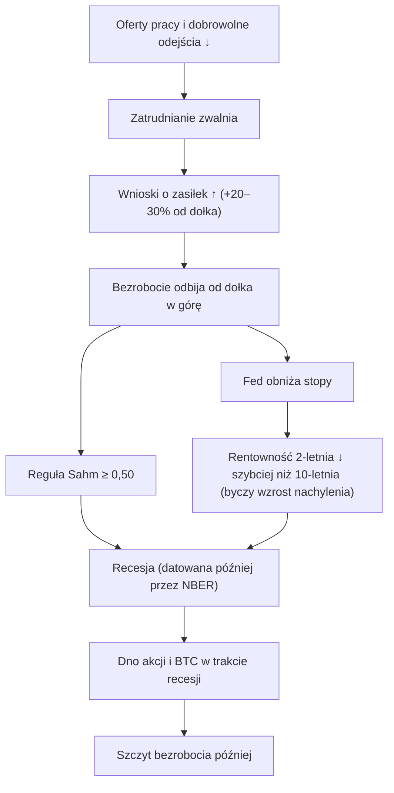

# 05. Rynek pracy

Od 2023 roku stopa bezrobocia jest najważniejszą zmienną makroekonomiczną Benjamina Cowena. Jego rozumowanie jest takie, że recesje to w ostatecznym rozrachunku zdarzenia na rynku pracy. Bezrobocie zwykle osiąga dołek przed recesją, a potem rośnie w sposób samonapędzający się, „nieliniowy”. Fed reaguje obniżkami stóp, a akcje i kryptowaluty osiągają dno *w trakcie* recesji, gdy bezrobocie wciąż rośnie. Szczyt bezrobocia przychodzi dopiero *po* tym, jak rynek już odbił od dna. Ta sekwencja sprawdziła się w każdej recesji w USA od 1969 roku. Spektakularnie zawiodła jednak w latach 2024–26: bezrobocie wzrosło o ponad punkt procentowy, zadziałała reguła Sahm, Fed obniżył stopy o 175 punktów bazowych, a recesja nie nadeszła. Ten rozdział omawia wskaźniki rynku pracy, z których korzysta Cowen, historyczne dane stojące za jego ramą analityczną (z tabelami z laboratorium makro tego kursu) oraz powody, dla których tym razem przestała ona działać.

**Czego się nauczysz**
- Co mierzą U-3, U-6, zatrudnienie poza rolnictwem (payrolls), wnioski o zasiłek dla bezrobotnych, JOLTS i współczynnik aktywności zawodowej oraz jak często te dane są rewidowane.
- Jak działa reguła Sahm (Sahm rule), jaki jest jej pełny dorobek w czasie rzeczywistym i dlaczego w 2024 roku dała fałszywy sygnał.
- Z jakim wyprzedzeniem bezrobocie osiągało dołek przed recesjami i o ile zdążyło wzrosnąć do momentu jej rozpoczęcia.
- Ramę Cowena „bezrobocie rośnie → Fed obniża stopy → aktywa ryzykowne”, z datowanymi cytatami i zestawieniem, kiedy działała, a kiedy nie.
- Dlaczego szok po stronie *podaży* pracy (imigracja, aktywność zawodowa) może podnieść lub obniżyć bezrobocie bez żadnych zwolnień.

---

## Sekwencja na rynku pracy

To podręcznikowa kolejność zdarzeń w późnej fazie cyklu (late cycle), zestawiona w materiałach badawczych B kursu ([notatki badawcze B](../../research-notes/B-fed-rates-inflation-labor.md)) na podstawie historii powojennej. Opóźnienia są przybliżone.

Liczba ofert pracy i dobrowolnych odejść (quits) zaczyna spadać mniej więcej 6–12 miesięcy przed wzrostem bezrobocia. Bezrobocie osiągało dołek średnio (mediana) około 8 miesięcy przed recesją. Reguła Sahm zazwyczaj uruchamiała się 1–3 miesiące *po* rozpoczęciu recesji (tabela z laboratorium poniżej). W cyklach zakończonych recesją bezrobocie osiągało szczyt 9–36 miesięcy po pierwszej obniżce stóp przez Fed ([notatki badawcze B](../../research-notes/B-fed-rates-inflation-labor.md), sekcja 6).

---

## Bezrobocie

### Stopa bezrobocia, U-3 i U-6 (UNRATE, U6RATE)

**Co to jest.** Raport BLS (Biura Statystyki Pracy USA) Employment Situation, oparty na badaniu gospodarstw domowych (Current Population Survey, około 60 000 gospodarstw). Publikowany jest w pierwszy piątek miesiąca o 8:30 czasu nowojorskiego (ET) i dotyczy poprzedniego miesiąca. **U-3** (`UNRATE`) liczy osoby bez pracy, które aktywnie jej szukają, jako odsetek siły roboczej. **U-6** (`U6RATE`) dodaje osoby luźno związane z rynkiem pracy (marginally attached) oraz pracujących w niepełnym wymiarze, którzy chcieliby pracować na pełen etat. Czynniki sezonowe są rewidowane co roku w styczniu, co może zmienić niedawną historię o jedną lub dwie dziesiąte punktu.

**Gdzie to znaleźć.** FRED `UNRATE`, `U6RATE`. TradingView `ECONOMICS:USUR`. Na platformie Cowena (ITC): Unemployment Rate (krajowa, dla poszczególnych stanów, liczba stanów ze wzrostem, mapa globalna), Unemployment Level by Reason, Alternative Measures (U-1 do U-6), Duration oraz Not in Labor Force.

**Jak to czytać.**
- Obserwuj *zmianę od dołka cyklu*, a nie sam poziom. Stopa 4,2% oznacza coś zupełnie innego po spadku z 6%, a coś innego po wzroście z 3,4%.
- Od 1957 roku każda recesja zaczynała się, gdy bezrobocie zdążyło już wzrosnąć o 0,2–1,0 pkt proc. od dołka (tabela z laboratorium poniżej).
- Liczy się podaż pracy. W latach 2023–24 imigracja powiększyła siłę roboczą, więc bezrobocie rosło bez fali zwolnień. W latach 2025–26 imigracja netto gwałtownie spadła, spadła też aktywność zawodowa, więc „progowe” tempo wzrostu zatrudnienia (break-even), potrzebne do utrzymania stabilnego bezrobocia, załamało się — być może do 0–50 tys. miesięcznie ([notatki badawcze B](../../research-notes/B-fed-rates-inflation-labor.md)). Słabe zatrudnianie przestało oznaczać rosnące bezrobocie.
- Ruch o jedną dziesiątą punktu w ciągu jednego miesiąca niewiele znaczy: może to być szum próby w badaniu gospodarstw domowych.

**Ścieżka w latach 2023–26** (FRED `UNRATE`, bieżąca wersja danych, [notatki badawcze B](../../research-notes/B-fed-rates-inflation-labor.md) i [laboratorium makro](../../tools/macro-lab/REPORT-2026-10-30.md)):

| Data | U-3 | Uwagi |
|---|---|---|
| kwiecień 2023 | 3,4% | Dołek cyklu |
| lipiec–sierpień 2024 | 4,2–4,3% | Reguła Sahm uruchamia się na danych za lipiec |
| styczeń 2025 | 4,0% | |
| wrzesień 2025 | 4,4% | Fed wznawia obniżki 17.09.2025 |
| październik 2025 | – | Danych nie zebrano (zamknięcie administracji federalnej) |
| **listopad 2025** | **4,5%** | Szczyt cyklu w bieżących danych; pierwotnie opublikowano **4,6%** |
| styczeń–maj 2026 | 4,3–4,4% | |
| lipiec–sierpień 2026 | 4,1% | |
| wrzesień 2026 | 4,2% | Najnowszy odczyt (BLS, 2.10.2026) |

U-6 osiągnęła szczyt 8,7% w listopadzie 2025 roku, a we wrześniu 2026 roku wynosiła 7,6% ([notatki badawcze B](../../research-notes/B-fed-rates-inflation-labor.md)).

**Uwaga: 4,5% czy 4,6%?** BLS pierwotnie podało stopę bezrobocia za listopad 2025 roku na poziomie 4,6% ([BLS TED](https://www.bls.gov/opub/ted/2025/unemployment-rate-4-6-percent-in-november-2025.htm)). Film Cowena z tamtego miesiąca nosił tytuł „The Unemployment Rate Rises to 4.6%” (17 grudnia 2025), a część omówień powtarza tę liczbę. Bieżąca seria `UNRATE` w FRED, po rewizjach, pokazuje dla listopada 2025 roku **4,5%** i tej wartości używa laboratorium („4.1% → 4.5% (14 m)” w tabeli cykli Fed) oraz ten kurs. Obie liczby są poprawne dla swojej wersji danych (vintage). To dobry przykład tego, dlaczego zawsze warto wiedzieć, z której wersji danych korzysta wykres.

**Jak używa tego Cowen.** Od 2023 roku to jego najważniejszy wykres makro. Pokazuje bezrobocie z zacienionymi okresami recesji i średnią kroczącą. Jego tezy, z datami:
- Bezrobocie osiąga dołek przed recesjami, a następnie rośnie *nieliniowo*. Recesje zaczynają się, gdy ten trend wzrostowy ruszy („Unemployment, Recessions, and Stock Market Bottoms”, 29 września 2022; „When Will The Stock Market Bottom?”, 14 czerwca 2022).
- Dna na rynku akcji i kryptowalut przypadają *w trakcie* recesji, a bezrobocie osiąga szczyt *po* dnie rynku.
- „Gdy bezrobocie rozpocznie nieliniowy trend wzrostowy, zwykle następuje recesja” („Once unemployment begins its nonlinear uptrend, recession typically follows”, [27 marca 2026](https://rosetta.to/u/intothecryptoverse/bitcoin-in-a-late-business-cycle-environment)).
- Szczyt BTC w IV kwartale 2025 roku był napędzany rosnącym bezrobociem, w odróżnieniu od szczytu z 2021 roku, napędzanego inflacją. Długoterminowy byczy scenariusz dla kryptowalut wymaga ponownego spadku bezrobocia, tak jak w latach 2009–2020 ([Bankless, 23 grudnia 2025](https://www.bankless.com/podcast/where-is-crypto-going-in-2026-ben-cowen)).

**Powiązania.**
- *Wyprzedza:* wzrost bezrobocia od dołka wyprzedza obniżki stóp przez Fed (Fed ma mandat maksymalnego zatrudnienia), a następnie byczy wzrost nachylenia krzywej rentowności (bull steepening) ([rozdział 03](03-OBLIGACJE-I-KRZYWA-RENTOWNOSCI.md)).
- *Jest wyprzedzane przez:* oferty pracy i dobrowolne odejścia (6–12 miesięcy), wnioski o zasiłek (0–6 miesięcy), spready kredytowe (1–6 miesięcy, [notatki badawcze B](../../research-notes/B-fed-rates-inflation-labor.md)). Samo bezrobocie przy dnie rynku jest opóźnione względem giełdy.
- *Mechanizm:* zwolnienia obniżają dochody → wydatki spadają → firmy tną kolejne etaty. Ta pętla sprzężenia zwrotnego tłumaczy, dlaczego wzrost o 0,5 pkt proc. historycznie miał tendencję do kontynuacji.
- *Wyjątki:* lata 2024–26 (wzrost o 1,1 pkt proc. od dołka, a potem odwrócenie bez recesji) oraz lata 60. (1962–63 i 1967), gdy bezrobocie przebiło od dołu swoją średnią kroczącą, a recesji nie było ([notatki badawcze B](../../research-notes/B-fed-rates-inflation-labor.md)).

**Co to oznaczało dla aktywów.** W cyklach zakończonych recesją rosnącej stopie bezrobocia towarzyszyły spadki akcji i BTC, spadające rentowności krótkoterminowe, rosnące złoto i niejednoznaczne zachowanie dolara. W cyklach bez recesji (1995, 1998, 2024) umiarkowany wzrost bezrobocia przynosił obniżki stóp, które były *korzystne* dla akcji. Różnica polega na tym, czy wzrost staje się samonapędzający.

**Wniosek dla inwestora.** Śledź wzrost od dołka cyklu i potwierdzaj go wnioskami o zasiłek oraz danymi o zwolnieniach. Wzrost wynikający z tego, że więcej osób szuka pracy, to coś zupełnie innego niż wzrost wynikający ze zwalniania ludzi.

### Struktura bezrobocia: tracący pracę, wchodzący na rynek i młodzież

**Co to jest.** Badanie gospodarstw domowych dzieli bezrobotnych według przyczyny: *trwale tracący pracę* (permanent job losers), czasowo zwolnieni, odchodzący z pracy z własnej woli, powracający na rynek pracy (re-entrants) i nowo wchodzący (new entrants). Podaje też stopy bezrobocia według wieku, w tym dla osób w wieku 16–19 lat.

**Gdzie to znaleźć.** Raport BLS Employment Situation, tabela A-11; serie FRED dla każdej przyczyny (na przykład „Unemployment Level – Permanent Job Losers”). ITC: „Unemployment Level by Reason”.

**Jak to czytać.** Wzrost napędzany przez trwale tracących pracę to ostrzeżenie typowe dla późnej fazy cyklu: to są zwolnienia, a nie osoby wchodzące na rynek pracy. Wzrost napędzany przez nowo wchodzących i powracających to historia o podaży pracy. Bezrobocie wśród młodzieży jest bardzo cykliczne i reaguje jako pierwsze, ale jest zaszumione.

**Jak używa tego Cowen.** Rosnąca liczba trwale tracących pracę to dla niego oznaka późnej fazy cyklu („The Labor Market (and Bitcoin)”, 2 listopada 2024). Bezrobocie wśród młodzieży na poziomie 15,7% w styczniu 2026 roku było „drugorzędnym sygnałem ostrzegawczym” („A Deeply Concerning Chart for Stocks”, 20 stycznia 2026).

**Powiązania.** W prawdziwych spowolnieniach liczba trwale tracących pracę wyprzedza stopę bezrobocia ogółem. W 2024 roku struktura wskazywała na osoby wchodzące na rynek, dlatego sama Claudia Sahm stwierdziła, że jej reguła „prawdopodobnie zawyża” (likely overstating) słabość rynku ([notatki badawcze B](../../research-notes/B-fed-rates-inflation-labor.md)).

**Wniosek dla inwestora.** Gdy bezrobocie rośnie, zanim wyciągniesz wnioski, zapytaj: „rośnie przez kogo?”.

### Rozlewanie się słabości po stanach i reguła Sahm dla poszczególnych stanów

**Co to jest.** Stopy bezrobocia dla każdego z 50 stanów oraz reguła Sahm liczona osobno dla każdego stanu. Analitycy liczą, w ilu stanach widać trend wzrostowy albo uruchomioną regułę.

**Gdzie to znaleźć.** BLS Local Area Unemployment Statistics; serie FRED dla poszczególnych stanów. ITC: Sahm Rule (Per State), Number of States Where Sahm Rule Triggered, Map of States Where Sahm Rule Triggered, bezrobocie w poszczególnych stanach.

**Jak to czytać.** Szerokość zjawiska ujawnia spowolnienie, które średnia krajowa ukrywa. Jeśli bezrobocie rośnie w coraz większej większości stanów, słabość się rozprzestrzenia. Zastrzeżenie: reguła Sahm została zaprojektowana dla danych krajowych, a dane stanowe są bardziej zaszumione.

**Jak używa tego Cowen.** W marcu 2024 roku omawiał uruchamianie się reguły Sahm w rosnącej liczbie stanów, zaznaczając jednocześnie, że reguła nie była projektowana do stosowania na poziomie stanów ([notatki badawcze B](../../research-notes/B-fed-rates-inflation-labor.md)). W swoim [Macro Risk Memo z lutego 2026](https://benjamincowen.com/reports/macro-risk-memo-feb-2026) opisywał „słabość rozlewającą się po stanach” (weakness diffusing across states), podczas gdy dane zagregowane wyglądały stabilnie.

**Wniosek dla inwestora.** Przydatny test szerokości, ale spodziewaj się fałszywych alarmów. To wskaźnik kontekstowy, a nie sygnał do działania.

### Współczynnik aktywności zawodowej (CIVPART)

**Co to jest.** Odsetek ludności cywilnej w wieku 16+ lat, która pracuje albo szuka pracy, według badania gospodarstw domowych. FRED `CIVPART`.

**Jak to czytać.** Spadająca aktywność zawodowa obniża mierzone bezrobocie, bo osoby, które przestają szukać pracy, nie są już liczone jako bezrobotne. Współczynnik aktywności zawodowej wynosił 62,5–62,7% w 2024 roku i **61,8% we wrześniu 2026 roku**, z dołkiem 61,4% w lipcu 2026 roku ([notatki badawcze B](../../research-notes/B-fed-rates-inflation-labor.md)). Przyczyny to starzenie się społeczeństwa i mniejsza imigracja.

**Jak używa tego Cowen.** W sierpniu 2024 roku zauważył, że część wzrostu bezrobocia w 2024 roku wynikała ze wzrostu siły roboczej („The Sahm Rule … has Signaled”, 3 sierpnia 2024). W [memo z sierpnia 2026](https://benjamincowen.com/reports/the-balance-of-risks-august-2026) napisał, że w lipcu 2026 roku z rynku pracy odeszło 264 tys. osób, co „tłumaczy część spadku bezrobocia”.

**Powiązania.** Aktywność zawodowa ↓ → bezrobocie ↓ nawet przy słabym zatrudnianiu. Aktywność zawodowa ↑ (imigracja, powracający na rynek) → bezrobocie ↑ bez zwolnień. W latach 2024–26 zdarzyło się jedno i drugie, w tej właśnie kolejności.

**Wniosek dla inwestora.** W latach 2025–26 aktywność zawodowa upiększała stopę bezrobocia. Obok U-3 sprawdzaj wskaźnik zatrudnienia do liczby ludności (employment-to-population ratio) i dane o zatrudnieniu poza rolnictwem.

### Globalna stopa bezrobocia ważona PKB (ITC)

**Co to jest.** Seria ITC, która waży krajowe stopy bezrobocia 16 największych gospodarek ich nominalnym PKB. Poszczególne kraje różnie definiują bezrobocie, więc poziomu nie da się porównać z amerykańskim U-3; czytaj ją wyłącznie pod kątem *kierunku*.

**Jak używa tego Cowen.** W [The Balance of Risks](https://benjamincowen.com/reports/the-balance-of-risks-august-2026) (15 sierpnia 2026) wynosiła **4,49% i spadała**, co odczytał jako „globalny luz na rynku pracy nie narasta” (global labor slack is not building). Globalne recesje widać w niej jako gwałtowne wzrosty: o około 2,6 punktu w latach 2008–09 i o 3,3 punktu w pierwszej połowie 2020 roku (to samo memo).

**Powiązania.** Zsynchronizowany wzrost w dużych gospodarkach to globalna wersja amerykańskiego „nieliniowego przełomu” opisanego niżej; spadająca stopa globalna przemawia przeciwko ogólnoświatowemu spowolnieniu, tak jak w połowie 2026 roku.

**Wniosek dla inwestora.** Test szerokości w przekroju krajów — międzynarodowy odpowiednik opisanych wyżej wykresów rozlewania się słabości po stanach.

---

## Reguły recesji

### Reguła Sahm (SAHMREALTIME)

**Co to jest.** Reguła opracowana w 2019 roku przez ekonomistkę Claudię Sahm. Uruchamia się, gdy 3-miesięczna średnia stopy bezrobocia U-3 jest co najmniej o **0,50 pkt proc.** wyższa od najniższej 3-miesięcznej średniej z poprzednich 12 miesięcy. FRED publikuje dwie wersje: `SAHMREALTIME`, opartą na danych o bezrobociu *w pierwotnie opublikowanej postaci* (czyli na tym, co można było wiedzieć w danym momencie), oraz `SAHMCURRENT`, opartą na dzisiejszych, zrewidowanych danych.

**Gdzie to znaleźć.** FRED `SAHMREALTIME`, `SAHMCURRENT`. ITC: Sahm Rule Recession Indicator oraz opisane wyżej wykresy dla poszczególnych stanów.

**Jak to czytać.** Reguła Sahm to reguła *datująca*, a nie prognostyczna. Zwykle uruchamia się, gdy recesja już trwa, więc raczej potwierdza, niż przewiduje. Jej odczyt w czasie rzeczywistym wynosił **0,00** we wrześniu 2026 roku, wobec 0,23 rok wcześniej ([laboratorium](../../tools/macro-lab/REPORT-2026-10-30.md)). W listopadzie 2025 roku doszła do 0,43, nie uruchamiając się ([notatki badawcze B](../../research-notes/B-fed-rates-inflation-labor.md)).

**Dotychczasowe wyniki.** Poniższa tabela pochodzi z [raportu laboratorium makro](../../tools/macro-lab/REPORT-2026-10-30.md) tego kursu (dane FRED do 29 października 2026). Uruchomienie to pierwszy miesiąc, w którym wskaźnik w czasie rzeczywistym osiąga 0,50; reguła „uzbraja się” ponownie, gdy spadnie poniżej 0,30. Wartość „miesiące po starcie” większa od zera oznacza, że sygnał pojawił się już po rozpoczęciu recesji.

| miesiąc uruchomienia | wartość | początek recesji (+/-12 mies.) | miesiące po starcie |
|---|---|---|---|
| 1960-12 | 1,30 | 1960-05 | 7 |
| 1969-10 | 0,50 | 1970-01 | -3 |
| 1970-02 | 0,53 | 1970-01 | 1 |
| 1974-03 | 0,50 | 1973-12 | 3 |
| 1976-11 | 0,50 | brak recesji w ciągu 12 mies. | - |
| 1980-04 | 0,67 | 1980-02 | 2 |
| 1981-11 | 0,80 | 1981-08 | 3 |
| 1990-11 | 0,50 | 1990-08 | 3 |
| 2001-06 | 0,53 | 2001-04 | 2 |
| 2008-04 | 0,50 | 2008-01 | 3 |
| 2020-04 | 4,00 | 2020-03 | 1 |
| 2024-07 | 0,53 | brak recesji w ciągu 12 mies. | - |

Uwagi do tabeli:
- Laboratorium skanuje dane od 1960 roku. [Notatki badawcze B](../../research-notes/B-fed-rates-inflation-labor.md), skanując całą serię od grudnia 1959 roku, znajdują pierwsze przekroczenie progu w grudniu 1959 roku (0,77), około pięciu miesięcy *przed* recesją z maja 1960 roku. Wiersz 1960-12 z laboratorium to kolejne uruchomienie po ponownym uzbrojeniu reguły. Źródła różnią się wyłącznie początkiem okna.
- W latach 1969–70 widać dwa uruchomienia, bo wskaźnik między nimi spadł poniżej 0,30.
- Spośród przekroczeń w czasie rzeczywistym dwa były fałszywe: listopad 1976 roku (graniczne 0,50) i lipiec 2024 roku. Wersja w czasie rzeczywistym nie dała żadnego fałszywego sygnału w latach 1977–2023 ([notatki badawcze B](../../research-notes/B-fed-rates-inflation-labor.md)).
- Reguła nigdy nie uruchomiła się wcześniej niż około 3–5 miesięcy przed początkiem recesji, a typowo uruchamiała się 1–3 miesiące po nim.

**Fałszywy sygnał z 2024 roku.** Raport o rynku pracy za lipiec 2024 roku, opublikowany na początku sierpnia 2024 roku, podniósł odczyt reguły Sahm w czasie rzeczywistym do 0,53 (0,57 w sierpniu). Bezrobocie wzrosło z 3,4% (kwiecień 2023) do 4,3%. Rynki były już kruche: w tym samym tygodniu, 5 sierpnia 2024 roku, nastąpiło gwałtowne zamykanie transakcji carry trade na jenie ([rozdział 07](07-PLYNNOSC-PIENIADZ-I-DOLAR.md)). Fed obniżył stopy o 50 pb 18 września 2024 roku. Recesja nie nadeszła. Według stanu na październik 2026 roku NBER wciąż nie stwierdził recesji. Dlaczego reguła zawiodła ([notatki badawcze B](../../research-notes/B-fed-rates-inflation-labor.md)):
- Wzrost wynikał w dużej mierze z *podaży* pracy (imigracja i powracający na rynek pracy), a nie ze zwolnień. Sama Sahm powiedziała w 2024 roku, że reguła „prawdopodobnie zawyża” słabość rynku.
- Wnioski o zasiłek pozostały niskie (maksimum w 2024 roku: 258 tys., obliczone na podstawie FRED `ICSA`), więc fali zwolnień nie było.
- Później spadająca imigracja i aktywność zawodowa sprowadziły bezrobocie z powrotem do 4,1–4,2% w 2026 roku.

**Jak używa tego Cowen.** Nazywa ją dobrym sygnałem recesji, ale mniej przydatnym do wyznaczania momentu dna lub szczytu rynku („Sahm Rule Recession Indicator”, 20 stycznia 2023 i 5 listopada 2023). Gdy reguła się uruchomiła, omówił to („The Sahm Rule Recession Indicator has Signaled”, 3 sierpnia 2024) i zwrócił uwagę na niejednoznaczną historię zachowania aktywów ryzykownych. Według omówień z drugiej ręki opisywał ją jako sygnał „luźniejszej polityki pieniężnej niezależnie od tego, czy recesja jest blisko” i łączył ją ze szczytem dominacji BTC ([notatki badawcze B](../../research-notes/B-fed-rates-inflation-labor.md), źródło wtórne). Reguła Sahm pojawia się tylko w 3 tytułach lub opisach jego filmów, ale jest podstawowym punktem odniesienia na jego platformie (inwentaryzacja, sekcja 1c).

**Powiązania.** Uruchomienia reguły Sahm zbiegały się z luzowaniem polityki przez Fed (1974, 1990, 2001, 2008, 2020, 2024) i z byczym wzrostem nachylenia krzywej. W 2024 roku Fed i tak szykował się już do obniżki.

**Co to oznaczało dla aktywów.** W prawdziwych recesjach akcje zwykle spadały dalej po uruchomieniu reguły (2001, 2008). Po sygnale z 2024 roku Nasdaq wzrósł o 25,6% w ciągu 12 miesięcy od pierwszej obniżki we wrześniu 2024 roku, a BTC o 83% (tabela cykli Fed z laboratorium). Samo uruchomienie reguły nie jest więc niedźwiedzim sygnałem dla aktywów.

**Wniosek dla inwestora.** Traktuj regułę Sahm jako potwierdzenie, a nie prognozę. Zanim jej zaufasz, sprawdź, co napędza wzrost bezrobocia, i pamiętaj, że szok po stronie podaży pracy może wywołać fałszywy sygnał.

### „Bezrobocie osiąga dołek przed recesją”: dowody z laboratorium

To wzorzec stanowiący serce ramy Cowena. Tabela pochodzi z [raportu laboratorium makro](../../tools/macro-lab/REPORT-2026-10-30.md). Dołek to najniższa miesięczna stopa U-3 w ciągu 36 miesięcy przed początkiem recesji, ale po zakończeniu poprzedniej recesji (przy równych wartościach brany jest późniejszy miesiąc).

| początek recesji | dołek bezrobocia | miesiące od dołka do recesji | wzrost do początku recesji | szczyt w ciągu 36 mies. |
|---|---|---|---|---|
| 1960-05 | 1957-08 (4,1%) | 33 | 1,0 pkt proc. | 1961-05 (7,1%) |
| 1970-01 | 1969-05 (3,4%) | 8 | 0,5 pkt proc. | 1970-12 (6,1%) |
| 1973-12 | 1973-10 (4,6%) | 2 | 0,3 pkt proc. | 1975-05 (9,0%) |
| 1980-02 | 1979-05 (5,6%) | 9 | 0,7 pkt proc. | 1982-11 (10,8%) |
| 1981-08 | 1981-07 (7,2%) | 1 | 0,2 pkt proc. | 1982-11 (10,8%) |
| 1990-08 | 1989-03 (5,0%) | 17 | 0,7 pkt proc. | 1992-06 (7,8%) |
| 2001-04 | 2000-04 (3,8%) | 12 | 0,6 pkt proc. | 2003-06 (6,3%) |
| 2008-01 | 2007-05 (4,4%) | 8 | 0,6 pkt proc. | 2009-10 (10,0%) |
| 2020-03 | 2020-02 (3,5%) | 1 | 0,9 pkt proc. | 2020-04 (14,8%) |

**Co pokazuje.**
- Dołek wypadał 1–33 miesiące przed recesją. Mediana to 8 miesięcy.
- Do początku każdej recesji bezrobocie wzrosło już o 0,2–1,0 pkt proc. od dołka.
- Szczyt przychodził znacznie później i był znacznie wyżej: od 2,5 pkt proc. (2001–03) do 11,3 pkt proc. (2020) powyżej dołka.

**Czego nie pokazuje.** Tabela zaczyna od recesji i patrzy wstecz. Nie powie ci, jak często bezrobocie wzrosło o 0,5 pkt proc., a recesja *nie* nastąpiła. [Notatki badawcze B](../../research-notes/B-fed-rates-inflation-labor.md) sprawdziły to przy użyciu innego sygnału (bezrobocie przebija od dołu swoją 12-miesięczną średnią kroczącą po co najmniej 12 miesiącach pod nią): 14 sygnałów od 1962 roku, z których 7 poprzedziło recesje (jedną z nich, w latach 2019–20, wywołała pandemia). Fałszywe alarmy wystąpiły w latach 1962, 1967, 1985, 1995, 1998, 2016 i 2023. Wzrost o ponad 1 pkt proc. w latach 2023–25 bez recesji to największy powojenny kontrprzykład. Wolniejsza wersja Cowena oparta na 24-miesięcznej średniej kroczącej daje według jego wątku z marca 2024 roku mniej fałszywych sygnałów ([ThreadReader](https://threadreaderapp.com/thread/1764301220942868800.html)), ale nie została niezależnie przetestowana.

**Bezrobocie osiąga szczyt po dnie rynku.** Zestawienie szczytów bezrobocia z laboratorium z dołkami S&P 500 z [notatek badawczych C](../../research-notes/C-growth-liquidity-crossasset.md) potwierdza tezę Cowena w każdej recesji od 1969 roku (krótka recesja z 1980 roku, niepokazana w tabeli, też pasuje: dołek S&P 500 27 marca 1980 roku, bezrobocie 7,8% w lipcu 1980 roku):

| Recesja | Dołek S&P 500 | Szczyt bezrobocia | Miesiące od dołka rynku do szczytu bezrobocia |
|---|---|---|---|
| 1969–70 | 26.05.1970 | grudzień 1970 (6,1%) | ~7 |
| 1973–75 | 3.10.1974 | maj 1975 (9,0%) | ~7 |
| 1981–82 | 12.08.1982 | listopad 1982 (10,8%) | ~3 |
| 1990–91 | 11.10.1990 | czerwiec 1992 (7,8%) | ~20 |
| 2001 | 9.10.2002 | czerwiec 2003 (6,3%) | ~8 |
| 2007–09 | 9.03.2009 | październik 2009 (10,0%) | ~7 |
| 2020 | 23.03.2020 | kwiecień 2020 (14,8%) | ~1 |

Praktyczne znaczenie: jeśli z uwierzeniem w ożywienie czekasz na szczyt bezrobocia, historycznie oznaczało to przegapienie dna rynku o całe miesiące.

---

## Dane o przepływach

### Wnioski o zasiłek dla bezrobotnych: pierwszorazowe i kontynuowane (ICSA, CCSA)

**Co to jest.** Cotygodniowe wnioski o zasiłek z ubezpieczenia od bezrobocia, publikowane przez Departament Pracy USA w każdy czwartek o 8:30 czasu nowojorskiego (ET). *Wnioski pierwszorazowe* (initial claims) liczą nowe zgłoszenia. *Wnioski kontynuowane* (continuing claims) liczą osoby nadal pobierające świadczenia i są podawane z tygodniowym opóźnieniem.

**Gdzie to znaleźć.** FRED `ICSA` (pierwszorazowe, wyrównane sezonowo), `CCSA` (kontynuowane), `IC4WSA` (średnia 4-tygodniowa). TradingView `ECONOMICS:USIJC`. ITC: wnioski w poszczególnych stanach, mapy i „liczba stanów ze wzrostem r/r”.

**Jak to czytać.**
- Wnioski o zasiłek to najbardziej *aktualne* twarde dane o rynku pracy: cotygodniowe, z opóźnieniem zaledwie pięciu dni.
- Wzrost wniosków pierwszorazowych o około 20–30% od dołka cyklu poprzedzał recesje o mniej więcej 0–6 miesięcy ([notatki badawcze B](../../research-notes/B-fed-rates-inflation-labor.md)).
- Rosnące wnioski *kontynuowane* przy płaskich *pierwszorazowych* oznaczają, że osoby tracące pracę długo szukają nowej: to rynek „mało zatrudniania, mało zwalniania” (low-hire, low-fire). Właśnie to było sygnałem ostrzegawczym w 2025 roku.
- Sezonowe osobliwości: letnie przezbrajanie fabryk samochodów i styczeń mogą zniekształcać dane wyrównane sezonowo. Cowen zwraca uwagę na letni wzrost wniosków widoczny w latach 2023–2025.

**Historia** (obliczona na podstawie FRED `ICSA` w danych badawczych):

| Epizod | Dołek | Szczyt | Wynik |
|---|---|---|---|
| 2000–01 | 259 tys. (kwiecień 2000) | 517 tys. (wrzesień 2001) | Recesja marzec–listopad 2001 |
| 2006–09 | 282 tys. (styczeń 2006) | 665 tys. (marzec 2009) | Recesja od szczytu w grudniu 2007 do czerwca 2009 |
| 2024 | 195 tys. (styczeń) | 258 tys. (październik) | Brak recesji |
| 2025 | 203 tys. (grudzień) | 259 tys. (wrzesień) | Brak recesji |
| 2026 | 189 tys. (lipiec) | 230 tys. (styczeń) | Ostatni odczyt 194 tys. (tydzień do 24.10) |

Wnioski kontynuowane wynosiły 1,70 mln (tydzień do 17 października 2026), wobec około 1,9–1,97 mln w 2025 roku. 28 października 2026 roku przewodniczący Fed Warsh określił 4-tygodniową średnią wniosków pierwszorazowych jako będącą „na najniższym poziomie od pokoleń” ([notatki badawcze B](../../research-notes/B-fed-rates-inflation-labor.md)).

**Jak używa tego Cowen.** „Nie uważam, że Stany Zjednoczone są w recesji, dopóki nie zobaczymy wniosków pierwszorazowych na poziomie 300 tys.” (kwiecień 2026; powtórzone w maju 2026, [notatki badawcze B](../../research-notes/B-fed-rates-inflation-labor.md)). Rosnące wnioski kontynuowane to dla niego wczesny sygnał ostrzegawczy („Recession Risk in 2024”, 1 grudnia 2023). W [memo z sierpnia 2026](https://benjamincowen.com/reports/the-balance-of-risks-august-2026) opisał zwolnienia jako „stłumione” (subdued), przy wnioskach pierwszorazowych w okolicach 209 tys.

**Powiązania.** Wnioski o zasiłek wyprzedzają stopę bezrobocia o tygodnie lub miesiące. Poruszają się razem ze zwolnieniami ogłaszanymi przy wynikach spółek i ze spreadami kredytowymi. W latach 2024–26 niski poziom wniosków był głównym powodem, dla którego sygnał reguły Sahm nie przerodził się w recesję.

**Co to oznaczało dla aktywów.** Potwierdzony wzrost wniosków (powyżej około 300 tys. albo o +30% od dołka) historycznie szedł w parze ze spadkiem akcji i BTC, spadkiem rentowności krótkoterminowych i byczym wzrostem nachylenia krzywej ([notatki badawcze B](../../research-notes/B-fed-rates-inflation-labor.md), sekcja 8). Niskie i spadające wnioski sprzyjają dniom typu „dobre wiadomości są złymi wiadomościami” (good news is bad news): mocne dane z rynku pracy podnoszą rentowności i mogą szkodzić aktywom ryzykownym, gdy głównym zmartwieniem Fed jest inflacja — tak jak 11 stycznia 2025 roku, gdy Cowen opisywał łańcuch: mocne dane o zatrudnieniu → wyższe rentowności długoterminowe → spadek BTC („Bitcoin Responds to the Labor Market”).

**Wniosek dla inwestora.** Wnioski o zasiłek to pierwsze twarde dane, które pękają w prawdziwym spowolnieniu. W październiku 2026 roku nie pękają.

### Zatrudnienie poza rolnictwem i rewizje (PAYEMS)

**Co to jest.** Liczba miejsc pracy na listach płac pracodawców według badania przedsiębiorstw BLS (establishment survey, około 120 000 firm), publikowana razem ze stopą bezrobocia. `PAYEMS` to poziom; nagłówki gazet tworzy zmiana miesięczna. Przy każdej publikacji rewidowane są dwa poprzednie miesiące. Raz w roku *rewizja benchmarkowa* (benchmark revision) dopasowuje badanie do danych z rejestrów podatkowych (QCEW) za marzec: wstępny szacunek pojawia się w sierpniu lub wrześniu, a ostateczny wraz z raportem styczniowym w lutym.

**Gdzie to znaleźć.** FRED `PAYEMS`. TradingView `ECONOMICS:USNFP`. ITC: Total Nonfarm Employees, zatrudnienie w sektorze prywatnym, pracownicy tymczasowi.

**Jak to czytać.** Używaj średnich 3-miesięcznych i porównuj z wnioskami o zasiłek oraz badaniem gospodarstw domowych. Rewizje bywają duże:

| Rewizja benchmarkowa (12 miesięcy do marca) | Wstępna | Ostateczna |
|---|---|---|
| 2024 | −818 tys. (sierpień 2024) | −598 tys. |
| 2025 | **−911 tys.** (9.09.2025, największa w historii) | −898 tys. (11.02.2026) |
| 2026 | **−79 tys.** (28.08.2026, najmniejsza od 2021) | w toku |

Po raporcie z 1 sierpnia 2025 roku, który zrewidował dane za maj–czerwiec w dół o około 258 tys., prezydent zwolnił szefową BLS, co wywołało debatę o wiarygodności danych. [Notatki badawcze B](../../research-notes/B-fed-rates-inflation-labor.md) oceniają, że rewizje były duże, ale co do kierunku mieściły się w normalnym zachowaniu statystycznym.

**Zmiany miesięczne w 2026 roku** (FRED, bieżąca wersja danych, w tysiącach): +160, −156, +214, +148, +63, +31, −10, +133, +29. To średnio około 68 tys. miesięcznie. Kilka miesięcy było ujemnych, a mimo to bezrobocie *spadło*: to historia o podaży pracy. Zwróć uwagę, że lipiec 2026 roku pierwotnie podano jako −23 tys., z rewizjami poprzednich miesięcy o −103 tys. ([memo Cowena z sierpnia 2026](https://benjamincowen.com/reports/the-balance-of-risks-august-2026)); obecna wartość to −10 tys.

**Jak używa tego Cowen.** Spowolnienie wzrostu zatrudnienia: „wzrost zatrudnienia załamał się do 156 tys. w skali roku” (employment growth collapsed to 156k annually, [27 marca 2026](https://rosetta.to/u/intothecryptoverse/bitcoin-in-a-late-business-cycle-environment)).

**Zatrudnienie r/r poniżej zera: jego linia potwierdzenia recesji.** W pisemnych memo Cowen śledzi *12-miesięczną zmianę procentową* zatrudnienia poza rolnictwem i nazywa ją miarą najważniejszą dla wyczucia momentu w cyklu ([memo z maja 2026](https://benjamincowen.com/reports/macro-risk-memo-may-2026), 18 maja 2026). Jego rozumowanie: przejście wzrostu zatrudnienia rok do roku na wartości ujemne zbiegało się z recesjami, więc spadek poniżej zera to „szczególnie czyste potwierdzenie” (particularly clean confirmation), choć może być opóźniony względem początku recesji ([The Balance of Risks](https://benjamincowen.com/reports/the-balance-of-risks-august-2026), 15 sierpnia 2026). W tym sierpniowym memo odczyt wynosił **+0,20%**: ledwie dodatni, ale jeszcze nie ujemny. Traktuj go jak regułę Sahm: jako linię potwierdzenia, a nie wczesne ostrzeżenie.

**Powiązania.** Zatrudnienie zmienia się wraz z cyklem koniunkturalnym i z podażą pracy. Gdy imigracja spada, spada też przyrost zatrudnienia potrzebny do utrzymania stabilnego bezrobocia. Duże rewizje benchmarkowe w dół (2024, 2025) pokazały po fakcie, że zatrudnianie było słabsze, niż raportowano. Mała rewizja (2026) pokazała coś odwrotnego.

**Co to oznaczało dla aktywów.** Słaby odczyt zwiększa szanse na obniżki stóp przez Fed (spadek rentowności na krótkim końcu krzywej, słabszy dolar), co aktywa ryzykowne przyjmują dobrze, *chyba że* sygnalizuje to recesję. Mocne odczyty w czasie obaw o inflację podnoszą rentowności („dobre wiadomości są złymi wiadomościami”).

**Wniosek dla inwestora.** Pojedynczy odczyt zatrudnienia niewiele znaczy. Patrz łącznie na trend, rewizje i stopę bezrobocia.

### JOLTS: oferty pracy, dobrowolne odejścia, przyjęcia i zwolnienia (JTSJOL, JTSQUR)

**Co to jest.** Badanie BLS Job Openings and Labor Turnover Survey, publikowane co miesiąc z opóźnieniem około pięciu tygodni (dane za sierpień 2026 roku ukazały się w październiku 2026 roku). FRED `JTSJOL` (oferty pracy), `JTSQUR` (stopa dobrowolnych odejść), `JTSHIR` (przyjęcia), `JTSLDR` (zwolnienia).

**Jak to czytać.**
- Liczba ofert pracy osiągnęła szczyt około 12 mln w marcu 2022 roku, a w sierpniu 2026 roku wynosiła **7,08 mln** ([notatki badawcze B](../../research-notes/B-fed-rates-inflation-labor.md)).
- Stopa dobrowolnych odejść na poziomie **1,9%** jest niższa od poziomu sprzed pandemii (około 2,3%). Pracownicy odchodzą z pracy, gdy są pewni, że znajdą lepszą, więc mała liczba odejść oznacza ostrożność: rynek „mało zatrudniania, mało zwalniania”.
- *Liczba ofert pracy na jednego bezrobotnego* w okolicach 1,0 oznacza, że rynek jest zrównoważony.
- Krzywa Beveridge'a (oferty pracy na tle bezrobocia) pokazuje, że normalizacja z lat 2022–24 dokonała się głównie przez spadek liczby ofert, a nie przez wzrost bezrobocia. Na tym opierał się argument członka Rady Gubernatorów Fed Wallera za miękkim lądowaniem ([notatki badawcze B](../../research-notes/B-fed-rates-inflation-labor.md)).

**Jak używa tego Cowen.** „JOLTS” (3 maja 2023), „The Labor Market and Bitcoin” (3 października 2025). Śledzi oferty pracy, dobrowolne odejścia, przyjęcia i zwolnienia jako pierwszą kostkę domina w swojej sekwencji rynku pracy. W memo z sierpnia 2026 roku opisał liczbę ofert na jednego bezrobotnego na poziomie około 1,0 jako „znormalizowaną, a nie załamaną” (normalized rather than collapsed).

**Powiązania.** Oferty pracy i dobrowolne odejścia wyprzedzają bezrobocie o około 6–12 miesięcy. Zwolnienia są niemal równoczesne z wnioskami o zasiłek.

**Wniosek dla inwestora.** JOLTS mówi ci, czy rynek schładza się przez mniejszą liczbę wakatów (łagodny scenariusz), czy przez więcej zwolnień (niebezpieczny scenariusz).

### Zatrudnienie w usługach pracy tymczasowej (TEMPHELPS)

**Co to jest.** Liczba osób zatrudnionych przez agencje pracy tymczasowej — podseria zatrudnienia poza rolnictwem z badania przedsiębiorstw BLS, publikowana razem z miesięcznym raportem o rynku pracy.

**Gdzie to znaleźć.** FRED `TEMPHELPS`. ITC: „temp help” w grupie wykresów rynku pracy.

**Jak to czytać.** Pracowników tymczasowych firma najłatwiej zatrudnia i najłatwiej się ich pozbywa, więc zatrudnienie tymczasowe zwykle zmienia kierunek wcześniej niż zatrudnienie stałe — w obie strony. Utrzymujący się spadek to wczesna, choć zaszumiona, oznaka późnej fazy cyklu; stabilizacja sugeruje, że firmy przestały ciąć zatrudnienie na marginesie.

**Jak używa tego Cowen.** W [memo z maja 2026](https://benjamincowen.com/reports/macro-risk-memo-may-2026) (18 maja 2026) pokazywał zatrudnienie tymczasowe jako miejsce, w którym słabość pojawia się najpierw, bo firmy tną elastyczną siłę roboczą przed stałym personelem. Jego ówczesna ocena: praca tymczasowa „osłabła” (softened), z „niedawną stabilizacją” (recent stabilization). W tym samym memo argumentował, że pracodawcy trzymają się stałych pracowników z powodu utrzymujących się niedoborów siły roboczej.

**Powiązania.** Praca tymczasowa ↓ → wyprzedza całkowite zatrudnienie i zwolnienia; obok ofert pracy i dobrowolnych odejść to jedna z serii „pierwszej kostki domina” w sekwencji z początku tego rozdziału.

**Wniosek dla inwestora.** Przydatny wczesny test trendu zatrudnienia; nie traktuj jednego miesiąca jako sygnału.

### Pomocnicze wskaźniki rynku pracy: KC Fed LMCI, ADP, zatrudnienie w ISM

**Co to jest.**
- **Labor Market Conditions Index** (LMCI) Fed z Kansas City łączy wiele zmiennych rynku pracy w odczyt poziomu i odczyt impetu (momentum).
- **ADP** publikuje szacunek zatrudnienia w sektorze prywatnym dwa dni przed oficjalnym raportem, na podstawie danych ze swoich systemów płacowych.
- Badania ISM dla przetwórstwa przemysłowego i usług zawierają subindeksy **zatrudnienia** (subindeks zatrudnienia ISM dla przemysłu wynosił 52,7 we wrześniu 2026 roku; zob. [rozdział 06](06-WZROST-I-CYKL-KONIUNKTURALNY.md)).

**Jak używa tego Cowen.** Jako pomocniczych testów („Jobs Report”, 6 stycznia 2024; „[Labor Market Holds Steady](https://rosetta.to/u/intothecryptoverse/labor-market-holds-steady)”, 8 maja 2026). KC Fed LMCI (poziom i impet) jest dostępny na jego platformie.

**Wniosek dla inwestora.** Używaj ich do sprawdzania oficjalnych danych, a nie zamiast nich. Miesięczna zgodność ADP z danymi BLS o zatrudnieniu jest luźna.

---

## Rama Cowena: bezrobocie rośnie → Fed obniża stopy → aktywa ryzykowne

### Rama jego własnymi słowami, z datami

| Data | Źródło | Teza |
|---|---|---|
| 14.06.2022 | „When Will The Stock Market Bottom?” | Dna rynku są związane z recesją i rynkiem pracy, a nie z pierwszym złym nagłówkiem |
| 29.09.2022 | „Unemployment, Recessions, and Stock Market Bottoms” | Bezrobocie najpierw osiąga dołek, potem rośnie; akcje osiągają dno w trakcie recesji; bezrobocie osiąga szczyt później |
| 24.01.2023 | „Bitcoin and Interest Rates” | BTC historycznie osiągał dno w pobliżu docelowego, końcowego poziomu stóp Fed (terminal rate); „prawdziwy rynek byka często zaczyna się po ostatniej obniżce, a nie po pierwszej” |
| 13.04.2023 | „Fed Projecting a Mild Recession” | Spodziewał się recesji w USA „pod koniec 2023 lub na początku 2024 roku, prawdopodobnie łagodnej” |
| 3.03.2024 | [wątek na X](https://threadreaderapp.com/thread/1764301220942868800.html) | Bezrobocie „wciąż blisko historycznych minimów”; sygnał oparty na 24-miesięcznej średniej kroczącej „potrzebuje dużo czasu, by się rozegrać” |
| 3.08.2024 | „The Sahm Rule Recession Indicator has Signaled” | Reguła Sahm się uruchomiła; część wzrostu to przyrost siły roboczej; niejednoznaczna historia dla aktywów ryzykownych |
| 19.09.2024 | „The Rate Cutting Cycle Has Begun” | Pierwsza obniżka nie jest najbardziej byczym wydarzeniem; aktywa ryzykowne często osiągają szczyt w okolicach początku obniżek (2000, 2007, 2019) |
| 17.12.2025 | „The Unemployment Rate Rises to 4.6%” | Bezrobocie na szczycie cyklu (pierwszy odczyt) |
| 23.12.2025 | [Bankless](https://www.bankless.com/podcast/where-is-crypto-going-in-2026-ben-cowen) | Szczyt BTC w IV kw. 2025 roku był napędzany bezrobociem; kolejny duży rynek byka na kryptowalutach wymaga spadającego bezrobocia |
| 15.01.2026 | [Crypto Macro Risk Memo Q1 2026](https://benjamincowen.com/reports/crypto-macro-risk-memo-q1-2026) | „Recesje zwykle nie zaczynają się od wolniejszego zatrudniania, lecz wtedy, gdy przyspieszają zwolnienia” |
| 15.02.2026 | [Macro Risk Memo February 2026](https://benjamincowen.com/reports/macro-risk-memo-feb-2026) | Na rynek pracy przenosi się *trwałość* spadków na rynku akcji, a nie ich skala; rynek pracy „schładza się, ale nie nieliniowo” |
| 27.03.2026 | „[Bitcoin in a Late Business Cycle Environment](https://rosetta.to/u/intothecryptoverse/bitcoin-in-a-late-business-cycle-environment)” | „Gdy bezrobocie rozpocznie nieliniowy trend wzrostowy, zwykle następuje recesja”; „To spadający rynek akcji prowadzi do recesji” |
| kwiecień 2026 | film ([notatki badawcze B](../../research-notes/B-fed-rates-inflation-labor.md)) | Nie ma recesji, dopóki wnioski pierwszorazowe nie dojdą do 300 tys. |
| 8.05.2026 | „[Labor Market Holds Steady](https://rosetta.to/u/intothecryptoverse/labor-market-holds-steady)” | Przed szeroką falą zwolnień „muszą przyjść niższe ceny aktywów” |
| 18.05.2026 | [Macro Risk Memo (May 2026)](https://benjamincowen.com/reports/macro-risk-memo-may-2026) | Siedmioetapowa pętla sprzężenia zwrotnego recesji; gospodarka „utknęła we wcześniejszych etapach”; zatrudnienie r/r to miara wyczucia momentu |
| 15.08.2026 | [The Balance of Risks](https://benjamincowen.com/reports/the-balance-of-risks-august-2026) | Rynek „mało zatrudniania, mało zwalniania”; zmiana reżimu wymaga *zbiegu* (cluster) wielu sygnałów |

[Notatki badawcze B](../../research-notes/B-fed-rates-inflation-labor.md) streszczają jego sekwencję późnej fazy cyklu następująco: najpierw spadają zatrudnianie i liczba ofert pracy, potem rosną zwolnienia i wnioski o zasiłek, a następnie bezrobocie; Fed obniża stopy „z niewłaściwych powodów”, a akcje spadają. Jego zwrot z 2026 roku dotyczy przyczynowości: to sam spadający rynek akcji przechyla rynek pracy w stronę recesji, poprzez efekt majątkowy i cięcia kosztów w firmach. W tym ujęciu rynek pracy jest *ostatnią* kostką domina w kaskadzie ryzyka (risk cascade) opisanej w [rozdziale 06](06-WZROST-I-CYKL-KONIUNKTURALNY.md#późna-faza-cyklu-koniunkturalnego-i-kaskada-ryzyka).

### Wersja z pisemnych memo (2026): cztery pojęcia

Pisemne memo Cowena z 2026 roku ([notatki badawcze E](../../research-notes/E-cowen-reports.md), oparte na lekturze pełnych PDF-ów) doprecyzowują filmową wersję ramy o cztery idee, które warto znać z nazwy.

- **Nieliniowy przełom, czyli „najpierw zwolnienia” (nonlinear break, layoffs first).** Bezrobocie może długo powoli dryfować w górę, jak w latach 2023–25, bez recesji. Recesja zaczyna się wtedy, gdy *zwolnienia* przyspieszają i same się napędzają, a nie wtedy, gdy zwalnia zatrudnianie: „Recesje zwykle nie zaczynają się od wolniejszego zatrudniania, lecz wtedy, gdy przyspieszają zwolnienia” (Recessions typically do not begin with slower hiring, they begin when layoffs accelerate; [memo za I kw.](https://benjamincowen.com/reports/crypto-macro-risk-memo-q1-2026), 15 stycznia 2026). Dlatego danymi wyzwalającymi są wnioski pierwszorazowe i kontynuowane oraz seria zwolnień, a potwierdzeniem — zatrudnienie r/r poniżej zera. Memo z lutego 2026 roku podsumowało stan rynku pracy jako „schładzanie, ale nie nieliniowe” (cooling, not nonlinear).
- **Mało zatrudniania, mało zwalniania (low-hiring, low-firing).** Rynek, na którym firmy ani dużo nie zatrudniają, ani dużo nie zwalniają. Bezrobocie może wtedy *spadać*, podczas gdy impet zatrudnienia zamiera, zwłaszcza jeśli ludzie odchodzą z rynku pracy. Tak Cowen opisywał połowę 2026 roku: bezrobocie spadło do 4,1% częściowo dlatego, że z rynku pracy odeszło 264 tys. osób, zatrudnienie za lipiec pierwotnie podano jako −23 tys., a liczba ofert pracy na jednego bezrobotnego spadła z około 2,0 do około 1,0 ([The Balance of Risks](https://benjamincowen.com/reports/the-balance-of-risks-august-2026), 15 sierpnia 2026).
- **Zbieg sygnałów recesji (recession cluster).** Żadna pojedyncza seria nie powinna zmieniać oceny. W memo sierpniowym zmiana reżimu wymagała kilku sygnałów naraz: zatrudnienia r/r poniżej zera, rosnących wniosków o zasiłek, rosnącego bezrobocia, rosnącego złożonego wskaźnika recesji ([rozdział 06](06-WZROST-I-CYKL-KONIUNKTURALNY.md#pulpit-macro-recession-risk-cowena-koncepcja)) oraz warunków finansowych zbliżających się do neutralnych lub przekraczających ten poziom ([rozdział 07](07-PLYNNOSC-PIENIADZ-I-DOLAR.md)). To ta sama lekcja „pulpit, a nie pojedynczy sygnał”, której nauczył sygnał reguły Sahm z 2024 roku.
- **Trwałość spadków na rynku akcji (equity durability).** To, jak *długo* akcje pozostają nisko, ma większe znaczenie niż to, jak głęboko spadną: „Skala korekty ma mniejsze znaczenie niż czas jej trwania” (The magnitude of a correction matters less than its duration; [memo z lutego 2026](https://benjamincowen.com/reports/macro-risk-memo-feb-2026), 15 lutego 2026). Szybkie odbicie (1998) pozostawia plany zatrudnienia nietknięte; utrzymująca się słabość (2000–01) ściska oczekiwania co do zysków i dostępność kredytu, co prowadzi do zwolnień, a potem do nieliniowego wzrostu bezrobocia. Cowen ocenił, że spadek wywołany cłami na początku 2025 roku przypomina rok 1998, a nie 2000, i jak dotąd tak właśnie jest. [Memo z maja 2026](https://benjamincowen.com/reports/macro-risk-memo-may-2026) przekształca to w siedmioetapową **pętlę sprzężenia zwrotnego recesji** (ceny aktywów słabną → warunki finansowe się zacieśniają → spada zaufanie → zatrudnianie zwalnia, a zwolnienia rosną → konsumpcja słabnie → aktywność gospodarcza się kurczy → kolejne zwolnienia), przy czym w maju 2026 roku gospodarka „utknęła we wcześniejszych etapach”. Pętla jest wyjaśniona w [rozdziale 06](06-WZROST-I-CYKL-KONIUNKTURALNY.md#pętla-sprzężenia-zwrotnego-recesji) i rozrysowana w [rozdziale 13](13-JAK-TO-SIE-LACZY.md).

### Co mówią dane

Tabela cykli Fed z laboratorium (częściowo skopiowana z [raportu laboratorium makro](../../tools/macro-lab/REPORT-2026-10-30.md); jako przybliżenie rynku akcji służy Nasdaq Composite) oddziela cykle luzowania zakończone recesją od tych, które się nią nie zakończyły:

| Pierwsza obniżka | Nasdaq +12 mies. | Najgorszy wynik w ciągu 18 mies. | Bezrobocie przy obniżce → szczyt (opóźnienie) | Recesja w ciągu 24 mies. | BTC +12 mies. |
|---|---|---|---|---|---|
| 1995-07-06 | 21,6% | -0,0% | 5,7% -> 5,7% (0 mies.) | nie | - |
| 1998-09-29 | 57,5% | -18,2% | 4,6% -> 5,0% (36 mies.) | nie | - |
| 2001-01-03 | -21,9% | -48,1% | 4,2% -> 6,3% (29 mies.) | 2001-04 | - |
| 2007-09-18 | -20,8% | -52,2% | 4,7% -> 10,0% (25 mies.) | 2008-01 | - |
| 2019-08-01 | 32,5% | -15,4% | 3,6% -> 14,8% (8 mies.) | 2020-03 | 9% |
| 2024-09-19 | 25,6% | -15,2% | 4,1% -> 4,5% (14 mies.) | nie | 83% |

**Jak to odczytać.**
- Gdy bezrobocie dalej rosło i nadchodziła recesja (2001, 2007), akcje spadały o około 50% od pierwszej obniżki. Teza „obniżki są niedźwiedzie” jest prawdziwa *pod warunkiem wystąpienia recesji* ([notatki badawcze B](../../research-notes/B-fed-rates-inflation-labor.md)).
- Gdy bezrobocie wzrosło tylko o kilka dziesiątych punktu (1995, 1998, 2024), po obniżkach przychodziły mocne wzrosty.
- Lata 2019–20 to przypadek szczególny: recesję wywołała pandemia, a nie cykl na rynku pracy.
- Decydującą zmienną jest to, czy wzrost bezrobocia staje się samonapędzający. W momencie pierwszej obniżki nie da się tego wiedzieć.

### Gdzie rama zadziałała, a gdzie zawiodła

**Zadziałała (częściowo).**
- BTC osiągnął szczyt 6 października 2025 roku, w okresie rosnącego bezrobocia (4,4% we wrześniu, 4,5% w listopadzie) i obniżek stóp przez Fed (wrzesień, październik, grudzień 2025). Opis Cowena — szczyt napędzany bezrobociem — do tego pasuje.
- BTC spadł o około 52%, do około 60 tys. USD, do 5–6 lutego 2026 roku, a swój dotychczasowy dołek osiągnął w okolicach 57,7–58,6 tys. USD 30 czerwca 2026 roku ([notatki badawcze A](../../research-notes/A-cowen-inventory.md)).
- Szczyty bezrobocia przychodziły po dołkach rynku w każdej recesji od 1969 roku (tabela wyżej).

**Zawiodła.**
- **Brak recesji.** Cowen spodziewał się recesji „pod koniec 2023 lub na początku 2024 roku, prawdopodobnie łagodnej” (kwiecień 2023); żadna nie nadeszła ([notatki badawcze A](../../research-notes/A-cowen-inventory.md), prognoza nr 7 — chybiona). Reguła Sahm uruchomiła się w lipcu 2024 roku; według stanu na październik 2026 roku recesji nadal nie ma.
- **Bezrobocie zawróciło.** Zamiast rosnąć nieliniowo, spadło z 4,5% (listopad 2025) do 4,1–4,2% (połowa 2026 roku). Wnioski o zasiłek spadły do 189–194 tys.
- **Fed poszedł w przeciwną stronę.** Zamiast obniżać stopy w obliczu rosnącego bezrobocia, we wrześniu 2026 roku je podniósł, bo inflacja ponownie przyspieszyła ([rozdział 04](04-INFLACJA.md)).
- **Dlaczego** ([notatki badawcze B](../../research-notes/B-fed-rates-inflation-labor.md)): szoki imigracyjne i w aktywności zawodowej przesuwały bezrobocie bez zwolnień; gospodarstwa domowe i firmy zablokowały niskie stałe oprocentowanie w latach 2020–21; deficyty budżetowe pozostały duże; a boom inwestycyjny związany z AI podtrzymywał popyt.

**Uczciwy werdykt.** Rama dobrze opisuje, jak przebiegają recesje, gdy już się zaczną, a jej część „bezrobocie osiąga szczyt po dnie rynku” sprawdziła się za każdym razem. Jako *prognoza* momentu rozpoczęcia recesji była przedwczesna, a w latach 2024–26 okazała się błędna. [Notatki badawcze B](../../research-notes/B-fed-rates-inflation-labor.md): „Każdy kurs uczący tej sekwencji powinien przedstawiać ją jako probabilistyczną”.

---

## Składamy to w całość

1. **Bezrobocie rośnie o 0,5 pkt proc. od dołka, a wnioski o zasiłek o 20–30% → uruchamia się reguła Sahm → Fed szybciej obniża stopy → rentowność 2-letnia spada szybciej niż 10-letnia (byczy wzrost nachylenia) → historycznie recesja już trwa albo zaczyna się w ciągu kilku miesięcy → akcje spadają o 35–55% (2001, 2007–09), a BTC spada razem z nimi w pierwszej fazie → bezrobocie rośnie dalej po dnie rynku.** Epizody: 2000–02 (wnioski 259 tys. → 517 tys., najgorszy wynik Nasdaqa po pierwszej obniżce −48%) i 2007–09 (wnioski 282 tys. → 665 tys., Nasdaq −52%). *Wyjątek:* 2024 — reguła Sahm uruchomiła się przy 0,53, Fed obniżył stopy o 50 pb, wnioski o zasiłek osiągnęły szczyt na poziomie zaledwie 258 tys., a Nasdaq wzrósł w kolejnym roku o 25,6%.

2. **Bezrobocie rośnie, bo rośnie podaż pracy, a nie z powodu zwolnień → reguła Sahm może dać fałszywy sygnał → Fed obniża stopy prewencyjnie → aktywa ryzykowne rosną.** Tak było w 2024 roku. Wskazówką były niskie wnioski pierwszorazowe i wzrost napędzany przez osoby wchodzące na rynek pracy, a nie przez trwale tracących pracę.

3. **Bezrobocie spada, bo ludzie odchodzą z rynku pracy → Fed widzi „napięty” rynek pracy → przy inflacji powyżej celu wstrzymuje się albo podnosi stopy → rentowności i dolar się umacniają.** Tak było w 2026 roku: współczynnik aktywności zawodowej spadł w lipcu do 61,4%, bezrobocie do 4,1%, a Fed podniósł stopy 16 września 2026 roku. „Szach-mat” Cowena (checkmate) wymagał dwóch słabości (inflacji *i* rynku pracy); przy tylko jednej Fed wybrał walkę z inflacją.

4. **Mocne dane z rynku pracy w czasie obaw o inflację → „dobre wiadomości są złymi wiadomościami” → rentowności długoterminowe w górę → BTC w dół.** Przykład Cowena: 11 stycznia 2025 roku mocny raport o zatrudnieniu podniósł rentowności długoterminowe i obniżył BTC. *Wyjątek:* gdy inflacja nie jest głównym zmartwieniem Fed, mocne dane o zatrudnieniu są po prostu dobrą wiadomością dla zysków spółek.

5. **Rynek akcji spada o 10–20% → efekt majątkowy i cięcia kosztów w firmach → zwolnienia → wnioski o zasiłek powyżej 300 tys. → recesja.** To przyczynowa opowieść Cowena z 2026 roku (27 marca i 8 maja 2026). Według stanu na koniec października 2026 roku pierwszy krok nie nastąpił: S&P 500 skorygował się o około 9% w lutym–marcu 2026 roku, a potem ustanawiał rekordy (7819 pkt 6 października 2026 roku). W tym cyklu ten łańcuch pozostaje niesprawdzony.

---

## Sprawdź się

1. Czym różni się U-3 od U-6 i ile wynosiły we wrześniu 2026 roku?
2. Dlaczego kurs przyjmuje 4,5%, a nie 4,6% jako szczyt bezrobocia z listopada 2025 roku?
3. Jak oblicza się regułę Sahm i dlaczego nazywa się ją regułą datującą, a nie prognostyczną?
4. Według tabeli z laboratorium: ile wynosi mediana liczby miesięcy od dołka bezrobocia do początku recesji i w jakim przedziale mieścił się wzrost bezrobocia do momentu jej rozpoczęcia?
5. Podaj dwa powody, dla których sygnał reguły Sahm z 2024 roku był fałszywie dodatni.
6. Jaki poziom wniosków o zasiłek Cowen traktuje jako granicę recesji i ile wynosiły wnioski pierwszorazowe pod koniec października 2026 roku?
7. Dlaczego zatrudnienie może być słabe, gdy bezrobocie spada?
8. W każdej recesji od 1969 roku: co było pierwsze — dno rynku akcji czy szczyt bezrobocia? Co to oznacza dla inwestorów?

Odpowiedzi

1. U-3 liczy osoby bez pracy, które aktywnie jej szukają. U-6 dodaje osoby luźno związane z rynkiem pracy oraz osoby pracujące w niepełnym wymiarze wbrew swojej woli. We wrześniu 2026 roku U-3 wynosiła 4,2%, a U-6 7,6%.
2. 4,6% to pierwotnie opublikowana wartość (i tytuł filmu Cowena z 17 grudnia 2025 roku). Bieżąca, zrewidowana seria `UNRATE` w FRED pokazuje 4,5% i tej wartości używa laboratorium. Obie są poprawne dla swojej wersji danych; kurs korzysta z bieżącej wartości z FRED.
3. Uruchamia się, gdy 3-miesięczna średnia stopy bezrobocia jest co najmniej o 0,50 pkt proc. wyższa od najniższej 3-miesięcznej średniej z poprzednich 12 miesięcy. Zwykle uruchamia się 1–3 miesiące po rozpoczęciu recesji, więc raczej potwierdza, niż przewiduje.
4. Mediana wynosi 8 miesięcy (przedział 1–33). Do początku recesji bezrobocie wzrosło o 0,2–1,0 pkt proc. od dołka.
5. Dowolne dwa z: wzrost wynikał z podaży pracy (imigracja, powracający na rynek), a nie ze zwolnień; wnioski pierwszorazowe pozostały niskie (maksimum w 2024 roku: 258 tys.); bezrobocie spadło później z powrotem do 4,1–4,2%, gdy spadły imigracja i aktywność zawodowa; sama Sahm stwierdziła, że reguła prawdopodobnie zawyża słabość rynku.
6. Około 300 tys. wniosków pierwszorazowych (kwiecień i maj 2026). W tygodniu do 24 października 2026 roku wnioski pierwszorazowe wynosiły 194 tys.
7. Bo podaż pracy może się kurczyć. W latach 2025–26 mniejsza imigracja i spadająca aktywność zawodowa sprawiły, że mniej osób szukało pracy, więc progowe tempo wzrostu zatrudnienia spadło, być może do 0–50 tys. miesięcznie. W 2026 roku zatrudnienie rosło średnio o około 68 tys. miesięcznie, a bezrobocie spadało.
8. Najpierw było dno rynku akcji, około 1–20 miesięcy wcześniej (7 miesięcy w 2009 roku, 8 miesięcy w latach 2002–03). Czekanie na szczyt bezrobocia historycznie oznaczało przegapienie dna rynku.

---

## Źródła do tego rozdziału

- Materiały badawcze kursu ([notatki badawcze A](../../research-notes/A-cowen-inventory.md): inwentaryzacja materiałów Cowena; [notatki badawcze B](../../research-notes/B-fed-rates-inflation-labor.md): Fed, stopy procentowe, inflacja, rynek pracy; [notatki badawcze C](../../research-notes/C-growth-liquidity-crossasset.md): wzrost gospodarczy i inne klasy aktywów; [notatki badawcze E](../../research-notes/E-cowen-reports.md): pisemne raporty Cowena) oraz [raport laboratorium makro](../../tools/macro-lab/REPORT-2026-10-30.md) (uruchomienia reguły Sahm, dołki bezrobocia, cykle Fed; dane FRED do 29 października 2026).
- Serie FRED: [UNRATE](https://fred.stlouisfed.org/series/UNRATE), [U6RATE](https://fred.stlouisfed.org/series/U6RATE), [SAHMREALTIME](https://fred.stlouisfed.org/series/SAHMREALTIME), [ICSA](https://fred.stlouisfed.org/series/ICSA), [CCSA](https://fred.stlouisfed.org/series/CCSA), [PAYEMS](https://fred.stlouisfed.org/series/PAYEMS), [JTSJOL](https://fred.stlouisfed.org/series/JTSJOL), [JTSQUR](https://fred.stlouisfed.org/series/JTSQUR), [CIVPART](https://fred.stlouisfed.org/series/CIVPART).
- BLS: [bezrobocie 4,2% we wrześniu 2026](https://www.bls.gov/opub/ted/2026/unemployment-rate-little-changed-at-4-2-percent-in-september-2026.htm); [4,6% w listopadzie 2025 (pierwszy odczyt)](https://www.bls.gov/opub/ted/2025/unemployment-rate-4-6-percent-in-november-2025.htm); [wstępna rewizja benchmarkowa, 28 sierpnia 2026](https://www.bls.gov/news.release/archives/prebmk_08282026.htm).
- Raport błyskawiczny Fed z St. Louis (październik 2026): <https://www.stlouisfed.org/on-the-economy/2026/oct/flash-report-unemployment-rises-slightly-job-growth-slows-september>.
- Cowen: [Bankless, 23 grudnia 2025](https://www.bankless.com/podcast/where-is-crypto-going-in-2026-ben-cowen); memo [Q1 2026 (15 stycznia)](https://benjamincowen.com/reports/crypto-macro-risk-memo-q1-2026), [luty 2026](https://benjamincowen.com/reports/macro-risk-memo-feb-2026), [maj 2026](https://benjamincowen.com/reports/macro-risk-memo-may-2026) i [sierpień 2026](https://benjamincowen.com/reports/the-balance-of-risks-august-2026); indeks filmów <https://rosetta.to/u/intothecryptoverse>.

> Materiał edukacyjny, nie doradztwo finansowe. Historyczne zależności między wskaźnikami mogą przestać działać.

[← 04 Inflacja](04-INFLACJA.md) | [Indeks](00-INDEKS.md) | [06 Wzrost i cykl koniunkturalny →](06-WZROST-I-CYKL-KONIUNKTURALNY.md)
