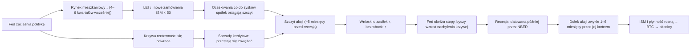
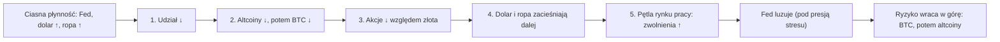

# 06. Wzrost i cykl koniunkturalny

Dane o wzroście mówią ci, w której fazie cyklu koniunkturalnego (business cycle) jest gospodarka: we wczesnym ożywieniu, w ekspansji w połowie cyklu, w późnej fazie cyklu (late cycle) czy w recesji. Ta faza wyznacza tło dla wszystkich aktywów. Filmy Benjamina Cowena z 2026 roku są zbudowane wokół jednej idei: USA są w *późnej fazie cyklu koniunkturalnego*, jak w 2007 i 2019 roku, a późne fazy cyklu kończą się recesjami. Jego zdaniem ryzyko odpływa z rynków w ustalonej kolejności: od altcoinów, przez bitcoina, do akcji, a rynek pracy jest ostatnią kostką domina. Ten rozdział omawia wskaźniki wzrostu, na których opiera się ten pogląd (PKB, GDI, GDPNow, ankiety ISM, wskaźnik wyprzedzający, modele prawdopodobieństwa recesji, rynek mieszkaniowy, nastroje konsumentów, zyski spółek i kredyt), a także jego ramy późnej fazy cyklu i kaskady ryzyka (risk cascade). Omawia też popularną konkurencyjną ideę, która *nie* jest jego: że rosnący indeks ISM dla przemysłu zapowiada sezon altcoinów (altseason). Ta teza przeszła w 2026 roku czysty test poza próbą (out-of-sample) — i go oblała.

**Czego się nauczysz**
- Jak mierzy się i rewiduje PKB, dlaczego „dwa ujemne kwartały” nie są amerykańską definicją recesji i co wnoszą GDI oraz GDPNow.
- Jak czytać indeksy PMI ISM dla przemysłu i usług oraz jak Cowen używa ISM jako miernika „Main Street” (realnej gospodarki).
- Tezę „ISM powyżej 50 → sezon altcoinów”: kto ją głosi, jakie są na nią dowody i jak oblała test w 2026 roku.
- Co mierzą Leading Economic Index, wygładzone prawdopodobieństwa recesji i pulpit ryzyka recesji Cowena oraz jakie fałszywe alarmy dawały.
- Dlaczego liczą się rynek mieszkaniowy, nastroje konsumentów, zyski spółek i kredyt oraz które z nich wyprzedzają, a które są opóźnione.
- Ramy Cowena dotyczące późnej fazy cyklu koniunkturalnego i kaskady ryzyka oraz to, jak dotąd się sprawdzały.

---

## Klasyczna sekwencja późnej fazy cyklu

[Notatki badawcze C](../../research-notes/C-growth-liquidity-crossasset.md) zestawił tę kolejność na podstawie recesji wywołanych spadkiem popytu z lat 1989–91, 2000–01 i 2006–09. Znaki pokazują typowy kierunek; opóźnienia są przybliżone.

Cykl 2024–26 odszedł od scenariusza. Krzywa rentowności się odwróciła i wróciła do dodatniego nachylenia (un-inversion), LEI spadał przez dwa lata, ISM utrzymywał się poniżej 50 przez 26 miesięcy, a Fed obniżył stopy o 175 pb — ale recesja nie nastąpiła ([notatki badawcze B](../../research-notes/B-fed-rates-inflation-labor.md) i C). Pamiętaj o tym przy każdej z poniższych kart.

---

## Produkcja: PKB, GDI i nowcasty

### Realny PKB i datowanie recesji przez NBER (GDPC1, A191RL1Q225SBEA, USREC)

**Co to jest.** Realny produkt krajowy brutto to skorygowana o inflację wartość wszystkich finalnych dóbr i usług wytworzonych w USA. Biuro Analiz Ekonomicznych (Bureau of Economic Analysis, BEA) publikuje go co kwartał jako zmianę wyrównaną sezonowo w ujęciu rocznym (SAAR). Każdy kwartał dostaje trzy szacunki: *wstępny* (advance) mniej więcej cztery tygodnie po końcu kwartału, potem drugi i trzeci, a następnie rewizje roczne i kompleksowe. W latach 1996–2024 średnia bezwzględna rewizja między szacunkiem wstępnym a drugim wynosiła około 0,5 pkt proc. ([notatki badawcze C](../../research-notes/C-growth-liquidity-crossasset.md)).

**Gdzie to znaleźć.** FRED `GDPC1` (poziom) i `A191RL1Q225SBEA` (zmiana %, SAAR). FRED `USREC` to miesięczny wskaźnik recesji NBER (0 lub 1). Platforma Cowena zawiera PKB, GDI, średnią z obu, PNB/DNB (GNP/GNI), PKB per capita i eksport netto.

**Jak to czytać.**
- Patrz na tempo z 2 i 4 kwartałów, a nie na pojedynczy kwartał.
- Zwracaj uwagę na *realną sprzedaż finalną dla prywatnych nabywców krajowych* (real final sales to private domestic purchasers, czyli PKB bez zapasów, wydatków rządowych i handlu zagranicznego), którą wielu ekonomistów traktuje jako „bazowy PKB”. Zapasy i eksport netto mocno wahają wynikiem nagłówkowym.
- **Mit „dwóch ujemnych kwartałów”.** USA *nie* definiują recesji jako dwóch kolejnych kwartałów spadku PKB. Komitet NBER ds. datowania cyklu koniunkturalnego (Business Cycle Dating Committee) ocenia głębokość, zasięg i czas trwania spadku na podstawie wskaźników miesięcznych: realnych dochodów osobistych bez transferów, zatrudnienia poza rolnictwem, zatrudnienia według badania gospodarstw domowych, realnych wydatków konsumpcyjnych, realnej sprzedaży w przemyśle i handlu oraz produkcji przemysłowej. Ogłasza swoje decyzje kilka miesięcy lub nawet rok po fakcie: szczyt z grudnia 2007 roku ogłoszono w grudniu 2008 roku, a szczyt z lutego 2020 roku w czerwcu 2020 roku ([notatki badawcze C](../../research-notes/C-growth-liquidity-crossasset.md)).

**Kluczowe epizody.**
- *I połowa 2022 roku.* Pierwsze opublikowane odczyty PKB za I i II kwartał 2022 roku były ujemne, a mimo to zatrudnienie poza rolnictwem rosło o ponad 400 tys. miesięcznie. NBER nie ogłosił recesji. W dzisiejszych danych FRED I kwartał 2022 roku to −1,0%, a II kwartał 2022 roku zrewidowano do **+0,6%**.
- *I kwartał 2025 roku.* Początkowo podany jako spadek, wywołany importem ściąganym w pośpiechu przed cłami. FRED pokazuje teraz +0,1%.
- *2001 rok.* Recesja z 2001 roku w danych dostępnych w tamtym czasie nigdy nie pokazała dwóch kolejnych ujemnych kwartałów.

**Ostatnia ścieżka** (FRED, % SAAR): 2025 — I kw. +0,1, II kw. +4,0, III kw. +3,9, IV kw. +0,2 (kwartał zamknięcia rządu, shutdown); 2026 — I kw. +2,5, II kw. +2,2, **III kw. +3,4** (szacunek wstępny, 29 października 2026). Realna sprzedaż finalna dla prywatnych nabywców krajowych wzrosła w III kwartale 2026 roku o około 4,9% ([BEA](https://www.bea.gov/news/2026/gdp-advance-estimate-3rd-quarter-2026)). `USREC` wynosił 0 we wrześniu 2026 roku.

**Jak używa tego Cowen.** Rzadko podejmuje decyzje na podstawie odczytów PKB. Używa zacienionych okresów recesji NBER na długich wykresach S&P 500, bezrobocia, rentowności i BTC, żeby argumentować o kolejności zdarzeń. W filmie „Smoothed Recession Probabilities” (10 stycznia 2023) zauważył, że ujemne kwartały PKB w 2022 roku nie były recesją, bo bezrobocie pozostało niskie. Jego powracająca myśl (w odczytaniu [notatek badawczych C](../../research-notes/C-growth-liquidity-crossasset.md), bez jednego datowanego cytatu) jest taka, że recesje rozpoznaje się późno, więc zanim PKB je potwierdzi, aktywa ryzykowne już się poruszyły.

**Powiązania.** PKB jest opóźniony względem indeksów PMI i LEI o 1–2 kwartały i mniej więcej równoczesny z trendami zatrudnienia. Akcje wyprzedzają PKB: w ośmiu recesjach od 1969 do 2020 roku S&P 500 osiągał szczyt średnio około 5 miesięcy przed początkiem recesji według NBER (zakres od −1 do +12 miesięcy), a dołek osiągał 1–6 miesięcy przed jej końcem według NBER w siedmiu z ośmiu przypadków ([notatki badawcze C](../../research-notes/C-growth-liquidity-crossasset.md)).

**Co to oznaczało dla aktywów.** Recesje decydują o tym, jak głębokie są rynki niedźwiedzia na akcjach: S&P 500 spadał średnio o około 36% w ośmiu recesjach od 1969 roku (od 17% w 1980 roku do 57% w latach 2007–09), wobec około 20–25% na rynkach niedźwiedzia bez recesji, takich jak w 2022 roku (−25,4%) ([notatki badawcze C](../../research-notes/C-growth-liquidity-crossasset.md)). Z kryptowalutami jest inaczej: rynki niedźwiedzia BTC z 2018 i 2022 roku (−84% i −77%) wystąpiły bez recesji w USA. Krypto nie ma stabilnego związku z kwartalnym PKB.

**Wniosek dla inwestora.** Traktuj PKB jako potwierdzenie, nie jako sygnał. Mocny odczyt za III kwartał 2026 roku mówi, że gospodarka nie była w recesji latem; niewiele mówi o kolejnych dwóch kwartałach.

### Dochód krajowy brutto, GDI (A261RX1Q020SBEA)

**Co to jest.** GDI (gross domestic income) mierzy tę samą gospodarkę od strony dochodów: płac, zysków, odsetek i czynszów. W teorii PKB i GDI są równe. W praktyce różnią się o „rozbieżność statystyczną” (statistical discrepancy), a BEA publikuje też ich średnią.

**Gdzie to znaleźć.** FRED `A261RX1Q020SBEA` (realny GDI). ITC: „GDI” i „Average of GDP and GDI”.

**Jak to czytać.** Gdy PKB i GDI się rozjeżdżają, prawda często leży pośrodku, a średnia jest lepszym szacunkiem niż każda z miar osobno. Dla większości kwartałów GDI pojawia się miesiąc później niż wstępny szacunek PKB.

**Jak używa tego Cowen.** W filmie „Gross Domestic Income” (2 czerwca 2023) przekonywał, że realny GDI pokazuje spowolnienia wyraźniej niż nagłówkowy PKB.

**Wniosek dla inwestora.** Jeśli PKB wygląda mocno, a GDI słabo, podchodź ostrożnie do narracji o „silnej gospodarce”.

### Atlanta Fed GDPNow (GDPNOW)

**Co to jest.** Oparty na modelu „nowcast” (szacunek bieżący) wzrostu realnego PKB w bieżącym kwartale (SAAR), przygotowywany przez Rezerwę Federalną w Atlancie (Federal Reserve Bank of Atlanta). Aktualizuje się po ważnych publikacjach danych, mniej więcej sześć–siedem razy w miesiącu, aż do wstępnego szacunku BEA. Nie jest to oficjalna prognoza i nie zawiera eksperckich korekt.

**Gdzie to znaleźć.** atlantafed.org/cqer/research/gdpnow; FRED `GDPNOW`.

**Jak to czytać.** Odczyty z początku kwartału są zaszumione, z błędami rzędu kilku punktów, i zbiegają się w miarę napływu danych. Ostatni nowcast przed wstępną publikacją miał błąd średniokwadratowy (RMSE) około 1,2 pkt proc. (dokumentacja Atlanta Fed, za [notatkami badawczymi C](../../research-notes/C-growth-liquidity-crossasset.md)). Trend kolejnych aktualizacji liczy się bardziej niż pojedyncza liczba. Jednorazowe anomalie mogą wprowadzać w błąd: w 2025 roku gwałtowny wzrost importu złota dał bardzo ujemny nowcast za I kwartał, a Atlanta Fed opublikowała później wersję skorygowaną o złoto.

**Najnowsze dane.** Nowcast za III kwartał 2026 roku utrzymywał się w okolicach 4% w sierpniu (około 4,0% 18 sierpnia, około 3,7% 6 października), przed wstępnym odczytem 3,4%. Nowcastu za IV kwartał 2026 roku nie znaleziono na dzień 30 października ([notatki badawcze C](../../research-notes/C-growth-liquidity-crossasset.md)).

**Jak używa tego Cowen.** Nie znaleziono zweryfikowanego filmu zbudowanego wokół GDPNow; nie jest to nazwany wykres na jego platformie.

**Wniosek dla inwestora.** To najlepszy darmowy szacunek bieżącego kwartału w czasie rzeczywistym. Nie prognozuje punktów zwrotnych; historycznie pozostawał dodatni aż do samego początku spadków koniunktury.

---

## Ankiety: menedżerowie zakupów

### ISM Manufacturing PMI: Main Street i spór o sezon altcoinów

**Co to jest.** Comiesięczna ankieta Institute for Supply Management (ISM) wśród menedżerów zakupów w ponad 300 amerykańskich firmach przemysłowych. Publikowana jest pierwszego dnia roboczego miesiąca o 10:00 czasu wschodnioamerykańskiego (ET). Nagłówkowy PMI to *indeks dyfuzji*: odsetek firm zgłaszających poprawę plus połowa tych, które nie zgłaszają zmian, tak że **50 oddziela ekspansję od kurczenia się**. To złożony indeks z równymi wagami pięciu składowych: nowych zamówień (New Orders), produkcji (Production), zatrudnienia (Employment), terminów dostaw (Supplier Deliveries — wolniejsze dostawy dają wyższy wynik) i zapasów (Inventories). ISM podaje, że PMI utrzymujący się powyżej **47,5** jest zgodny ze wzrostem *całej* gospodarki. Czynniki sezonowe są rewidowane co roku w styczniu.

**Gdzie to znaleźć.** Comiesięczne raporty na ismworld.org; TradingView `ISM:MAN_PMI` (u niektórych dostawców danych); tradingeconomics. Nie ma go w FRED (ISM go wycofał). Uwaga: ISM **nie** występuje w katalogu wykresów ITC Cowena, który zamiast tego zawiera OECD „Manufacturing Confidence Index” i „Composite Leading Indicator”; gdy Cowen pokazuje ISM, korzysta z innych źródeł ([notatki badawcze A](../../research-notes/A-cowen-inventory.md), sekcja 1b).

**Jak to czytać.**
- Poziom względem 50 wskazuje kierunek przemysłu.
- Różnica **nowe zamówienia minus zapasy** wyprzedza nagłówkowy indeks o około 3–6 miesięcy (reguła praktyków, [notatki badawcze C](../../research-notes/C-growth-liquidity-crossasset.md)).
- **Ceny płacone (Prices Paid)** są miernikiem inflacji „w rurociągu” ([rozdział 04](04-INFLACJA.md#ppi--ceny-producentów-ppifis)).
- *Błędne odczytanie:* przemysł to tylko około 10% PKB USA. ISM poniżej 50 to nie recesja. Od listopada 2022 do grudnia 2024 roku ISM był poniżej 50 przez 26 miesięcy z rzędu i recesji nie było.

**Historia i najnowsze dane** ([notatki badawcze C](../../research-notes/C-growth-liquidity-crossasset.md)):

| Data | ISM PMI | Kontekst |
|---|---|---|
| 12.2015 | ~48 | Recesja w przemyśle (załamanie ropy i nakładów inwestycyjnych) |
| 08.2018 | 61,3 | Szczyt cyklu |
| 04.2020 | 41,5 | Dołek pandemiczny |
| 03.2021 | **64,7** | Najwyżej od grudnia 1983 |
| 11.2022 – 12.2024 | < 50 | 26 miesięcy kurczenia się, bez recesji |
| 01.2026 | 52,6 | Pierwsza ekspansja od 12 miesięcy; nowe zamówienia 57,1 |
| 09.2026 | **54,5** | 9. miesiąc powyżej 50; nowe zamówienia 55,3; **ceny 77,9**; zatrudnienie 52,7 |

We wrześniu 2026 roku wskaźnik cen płaconych wynosił 77,9, blisko poziomu 78,3 z marca 2026 roku, kiedy zaczęła się wojna z Iranem. Zapasy klientów wynosiły 41,6 („zbyt niskie”), co zwykle dobrze wróży przyszłym zamówieniom ([ISM przez PR Newswire](https://www.prnewswire.com/news-releases/manufacturing-pmi-at-54-5-september-2026-ism-manufacturing-pmi-report-302894520.html)).

**Jak używa tego Cowen: „Main Street”.** Dla Cowena ISM jest miernikiem realnej gospodarki, „Main Street”, w przeciwieństwie do cen aktywów, czyli „Wall Street”. Datowane tezy:
- „Bitcoin and Main Street” (19 listopada 2025): główne szczyty BTC pokrywają się ze szczytami ISM, a ISM poniżej 50 oznacza, że Main Street ma kłopoty — dlatego w tym cyklu nie było euforii inwestorów detalicznych.
- „Bitcoin is not the economy” („Bitcoin to nie gospodarka”, luty 2026): gdy ISM wrócił powyżej 50, a niektórzy komentatorzy kryptowalutowi (Joe Burnett ze Strive, Plan C) ogłosili zwrot w stronę „risk-on”, to była jego cytowana odpowiedź. BTC rósł w 2025 roku, gdy ISM stał w miejscu, i spadał na początku 2026 roku, gdy ISM rósł ([Cointelegraph przez TradingView](https://www.tradingview.com/news/cointelegraph:a453199ce094b:0-ism-manufacturing-pmi-at-highest-since-2022-as-analysts-debate-bitcoin-impact/)).
- „Bitcoin: Simulation Confirmed” (9 marca 2026): „news cycle, ISM, oil and labor reports are irrelevant” („cykl informacyjny, ISM, ropa i raporty z rynku pracy są bez znaczenia”), gdy wykres ceny wciąż pokrywa się ze średnią ścieżką z lat wyborów połówkowych (midterm) ([rozdział 09](09-SEZONOWOSC-I-CYKLE-POLITYCZNE.md)).
- Jego wykres „cyklu koniunkturalnego” (business cycle) to złożenie S&P 500, bezrobocia, stóp procentowych, inflacji i M2, a *nie* sam ISM ([notatki badawcze C](../../research-notes/C-growth-liquidity-crossasset.md); zob. [późna faza cyklu koniunkturalnego](#późna-faza-cyklu-koniunkturalnego-i-kaskada-ryzyka) niżej).

**Konkurencyjna teza: „ISM powyżej 50 → sezon altcoinów” (nie Cowena).** Pogląd, że ISM *napędza* kryptowaluty, a zwłaszcza altcoiny, należy głównie do Raoula Pala (Global Macro Investor, Real Vision). Jego ujęcie ([notatki badawcze C](../../research-notes/C-growth-liquidity-crossasset.md), za [Benzinga](https://benzinga.com/markets/cryptocurrency/23/11/35986621/raoul-pals-insights-on-business-cycle-impact-on-asset-classes-including-blue-chip-cryptos-) i [NewsBTC przez TradingView](https://www.tradingview.com/news/newsbtc:13a8574a9094b:0-raoul-pal-bitcoin-bull-market-could-extend-to-2026-here-s-why/)):
- ISM to „our preferred barometer for the business cycle” („nasz ulubiony barometr cyklu koniunkturalnego”).
- „Bitcoin goes up as the ISM goes up... If the ISM gets up to its normal cycle peak of somewhere between 56 and 65, that will give us the magnitude of the rise.” („Bitcoin rośnie, gdy rośnie ISM… Jeśli ISM dojdzie do swojego zwykłego szczytu cyklu gdzieś między 56 a 65, to da nam skalę wzrostu”).
- Altcoiny radzą sobie lepiej w późnej części wzrostu ISM.
- W latach 2024–25 Pal przekonywał, że rządy wydłużające zapadalność swojego długu rozciągnęły cykl do około pięciu lat, co umieszczało szczyt ISM i kryptowalut w **II kwartale 2026 roku**.

Historyczne dopasowanie wyglądało dobrze:

| Epizod | ISM: dołek → szczyt | Krypto | Dopasowanie |
|---|---|---|---|
| 2016–18 | ~48 (12.2015) → 60,8 (09.2017) / 61,3 (08.2018) | Sezony altcoinów w II kw. 2017 i XII 2017–I 2018; dominacja BTC spadła do ok. 33–35% | Dobre |
| 2020–21 | 41,5 (04.2020) → 64,7 (03.2021) | Sezon altcoinów IV–V 2021; dominacja BTC ok. 40% | Dobre |
| 2022–24 | 26 miesięcy poniżej 50 | Brak sezonu altcoinów; dominacja BTC ok. 40% → ponad 60% | Zgodne |
| **2026 (poza próbą)** | 52,6 (I) → 54,5–54,6 (VIII–IX), najwyżej od 2022 | ETH −24% od początku roku (2 950 USD → 2 250 USD do 29.10); BTC −11% od początku roku; dominacja BTC z powrotem w okolicach 60%; Altcoin Season Index ok. 53 (75+ = sezon altcoinów) | **Nieudane** |

Liczby z laboratorium kursu się zgadzają: ETH/BTC spadł w 2026 roku do końca października o 16% ([laboratorium](../../tools/macro-lab/REPORT-2026-10-30.md)).

**Dlaczego teza zawiodła** (konkurencyjne wyjaśnienia według [notatek badawczych C](../../research-notes/C-growth-liquidity-crossasset.md)):
1. *Struktura wzrostu.* Odbicie z 2026 roku było częściowo efektem szoku podażowego i cen: wskaźnik cen płaconych w okolicach 78 plus odbudowa zapasów przed cłami i zakłóceniami wojennymi. Miało charakter inflacyjny, więc towarzyszyły mu podwyżki stóp przez Fed i 5-procentowa rentowność 10-letnich obligacji, a nie mieszanka spadających stóp i rosnącej płynności z lat 2016–17 i 2020–21.
2. *Betę krypto napędza płynność, nie aktywność gospodarcza.* Dobre epizody zbiegły się z globalnym luzowaniem: stymulacją PBOC, EBC i BOJ w latach 2016–17 oraz luzowaniem ilościowym (QE) Fed i transferami fiskalnymi w latach 2020–21. W 2026 roku Fed podnosił stopy, a bilanse banków centralnych były mniej więcej płaskie ([rozdział 07](07-PLYNNOSC-PIENIADZ-I-DOLAR.md)).
3. *Argument Cowena o apatii.* Sezony altcoinów wyrastały z euforycznych szczytów (2017, 2021). Apatyczne szczyty (2019, 2025) nie przyniosły rotacji: „There's just no one left to sell the altcoins to” („Po prostu nie zostało już nikogo, komu można by sprzedać altcoiny”) ([CryptoAdventure, 18 kwietnia 2026](https://cryptoadventure.com/benjamin-cowen-reveals-why-the-altcoin-season-never-came/)). Zob. [rozdział 12](12-DOMINACJA-ALTCOINY-I-ROTACJA.md).
4. *Podaż.* Dziesiątki milionów tokenów i ciągłe odblokowania (unlocks) sprawiają, że „altcoiny” nie mają już jednej wspólnej bety.
5. *Wielkość próby.* Teza opierała się na dwóch epizodach, które nie pozwalają odróżnić „ISM powoduje sezony altcoinów” od „oba reagują na trzeci czynnik” (globalne luzowanie, cykl halvingowy).

**Powiązania.** ISM wyprzedza wzrost zysków spółek z S&P 500 o około 3–6 miesięcy, a roczne (r/r) stopy zwrotu S&P korelowały z poziomem ISM na poziomie około 0,5–0,6 (badania praktyków, [notatki badawcze C](../../research-notes/C-growth-liquidity-crossasset.md)). ISM ma tendencję do poruszania się razem z rentownością 10-letnich obligacji i relacją miedź/złoto ([rozdział 08](08-AKCJE-ZLOTO-I-INNE-AKTYWA.md)). Dołki ISM często przychodzą 3–9 miesięcy po tym, jak Fed zaczyna luzować politykę i po szczycie dolara.

**Co to oznaczało dla aktywów.** Rosnący ISM sprzyjał akcjom cyklicznym, małym spółkom (small caps), surowcom i wyższym rentownościom, a historycznie także kryptowalutom w trybie risk-on (2016–17, 2020–21). Spadający ISM sprzyja obligacjom i akcjom defensywnym. Wiarygodność dla krypto: słaba do umiarkowanej.

**Wniosek dla inwestora.** ISM to najlepszy pojedynczy miesięczny miernik cyklu w przemyśle. Jeśli śledzisz go pod kątem krypto, pytaj, *dlaczego* rośnie: dezinflacyjne odbicie napędzane luzowaniem historycznie pomagało aktywom ryzykownym i altcoinom; inflacyjne, któremu towarzyszy zacieśnianie, jak w 2026 roku, nie pomogło.

### ISM Services PMI

**Co to jest.** Ankieta ISM wśród firm spoza przemysłu, które odpowiadają za około 75–90% PKB. Publikowana jest trzeciego dnia roboczego miesiąca. Jej nagłówkowy indeks łączy aktywność biznesową (Business Activity), nowe zamówienia, zatrudnienie i terminy dostaw. 50 = ekspansja.

**Najnowsze dane.** **54,9** we wrześniu 2026 roku (sierpień 55,4), 27. miesiąc ekspansji z rzędu. **Ceny 74,0** — najwyżej od lipca 2022 roku i szósty odczyt powyżej 70 w 2026 roku. Respondenci wymieniali koszty paliwa dwa razy częściej niż jakikolwiek inny problem ([First Trust](https://www.ftportfolios.com/Commentary/EconomicResearch/2026/10/5/the-ism-non-manufacturing-index-declined-to-54.9-in-september)).

**Jak to czytać.** Usługi poruszają się razem z zatrudnieniem i konsumpcją. Ceny w usługach wyprzedzają inflację CPI i PCE w usługach o około 3–6 miesięcy. Odczyt dla usług poniżej 50 jest silniejszym ostrzeżeniem przed recesją niż odczyt dla przemysłu poniżej 50, bo usługi dominują w produkcji. Podczas szoku celnego w 2025 roku indeks usług na krótko spadł tuż poniżej 50 (maj 2025, pierwsza publikacja); rewizje czynników sezonowych mogą przesuwać takie graniczne odczyty, więc liczba „kolejnych miesięcy ekspansji” może się różnić od pierwszych publikacji.

**Jak używa tego Cowen.** Zatrudnienie w usługach według ISM to jeden z jego pomocniczych testów rynku pracy ([rozdział 05](05-RYNEK-PRACY.md#pomocnicze-wskaźniki-rynku-pracy-kc-fed-lmci-adp-zatrudnienie-w-ism)).

**Wniosek dla inwestora.** Siła usług przy cenach na poziomie 74 to sygnatura „lekkiej stagflacji” (stagflation-lite): wzrost w porządku, rosnąca presja inflacyjna. To właśnie ta mieszanka skłoniła Fed do podwyżki stóp we wrześniu 2026 roku.

### Indeksy PMI S&P Global i wskaźniki OECD

**Indeksy PMI S&P Global.** Wstępne (flash) indeksy PMI dla przemysłu, usług i złożony (composite) dla USA od S&P Global ukazują się około dziesięć dni przed końcem miesiąca. Używają szerszego panelu i innych wag niż ISM. Wstępny indeks złożony za październik 2026 roku wyniósł **57,6** (wrzesień 58,4), przy przemyśle na poziomie 56,0, najwyżej od 53 miesięcy. Główny ekonomista Chris Williamson powiedział, że gospodarka „continues to boom at the start of the fourth quarter” („nadal przeżywa boom na początku czwartego kwartału”) ([notatki badawcze C](../../research-notes/C-growth-liquidity-crossasset.md), źródło wtórne). Dwie niezależne rodziny ankiet były zgodne, że aktywność w USA *przyspieszała* na wejściu w IV kwartał 2026 roku.

**OECD Composite Leading Indicator i Manufacturing Confidence.** Platforma Cowena zawiera złożony wskaźnik wyprzedzający OECD (Composite Leading Indicator, CLI) i „Manufacturing Confidence Index” OECD zamiast ISM. Przydają się do porównań między krajami. Nie znaleziono datowanej tezy Cowena opartej na nich.

---

## Mierniki recesji

### Leading Economic Index (LEI) Conference Board

**Co to jest.** Złożony indeks dziesięciu wskaźników wyprzedzających, publikowany co miesiąc przez Conference Board za poprzedni miesiąc (2016 = 100): średni tygodniowy czas pracy w przemyśle, nowe wnioski o zasiłek dla bezrobotnych, nowe zamówienia na dobra konsumpcyjne, nowe zamówienia ISM, nowe zamówienia na niewojskowe dobra inwestycyjne bez samolotów, pozwolenia na budowę, S&P 500, Leading Credit Index, spread między rentownością 10-letnich obligacji skarbowych a stopą funduszy federalnych oraz oczekiwania konsumentów.

**Gdzie to znaleźć.** conference-board.org (komunikaty prasowe). `USSLIND` w FRED to *inna* seria Fed z Filadelfii, wycofana w lutym 2020 roku, więc nie jest zamiennikiem.

**Jak to czytać.** Reguła recesji Conference Board to „3D”: półroczny spadek w ujęciu rocznym rzędu −4,1% (głębokość, depth) połączony z indeksem dyfuzji poniżej 50 (zasięg, diffusion).

**Najnowsze dane.** LEI za wrzesień 2026 roku (opublikowany 22 października, z opóźnieniem z powodu wcześniejszego zamknięcia rządu) był **bez zmian na poziomie 99,6** po spadku o 0,1% w sierpniu. Conference Board stwierdził, że **nie ma sygnału recesji** ([notatki badawcze C](../../research-notes/C-growth-liquidity-crossasset.md), źródło wtórne).

**Słynna porażka.** LEI spadał nieprzerwanie przez około 24 miesiące, od początku 2022 do początku 2024 roku, i przez cały okres 2022–23 dawał sygnał „3D”. Recesja nie nastąpiła, a Conference Board w 2024 roku wycofał swoją prognozę recesji. Prawdopodobne przyczyny: indeks jest przeważony w kierunku przemysłu i dóbr, podczas gdy gospodarkę napędzały usługi; składowa krzywej rentowności była zniekształcona po COVID; deficyty fiskalne rzędu 6% PKB wspierały popyt.

**Jak używa tego Cowen.** To nie jest kluczowy wykres Cowena i nie ma go w jego katalogu ([notatki badawcze A](../../research-notes/A-cowen-inventory.md), sekcja 1b).

**Wniosek dla inwestora.** Przydatny do oceny kierunku, ale dawał długie fałszywe alarmy. Czytaj spadający LEI jako „rosnące ryzyko”, a nie jako prognozę z datą.

### Wygładzone prawdopodobieństwa recesji (RECPROUSM156N)

**Co to jest.** Miesięczny szacunek prawdopodobieństwa, że USA są *obecnie* w recesji, z modelu ekonomistów Marcelle Chauvet i Jeremy'ego Pigera. Model analizuje cztery równoczesne serie miesięczne (zatrudnienie poza rolnictwem, produkcję przemysłową, realne dochody osobiste bez transferów oraz realną sprzedaż w przemyśle i handlu) i ocenia, czy ich łączne zachowanie bardziej przypomina ekspansję, czy recesję. Publikowany jest w FRED z opóźnieniem kilku miesięcy.

**Gdzie to znaleźć.** FRED `RECPROUSM156N`. ITC: „Smoothed Recession Probabilities”.

**Jak to czytać.** W okresach ekspansji utrzymuje się blisko zera i skacze, gdy kilka wskaźników równoczesnych słabnie jednocześnie. To *bieżąca* ocena stanu recesji (nowcast), a nie prognoza: potwierdza szybciej niż NBER, który może potrzebować roku na ogłoszenie, ale nie ostrzega z kilkumiesięcznym wyprzedzeniem.

**Jak używa tego Cowen.** „Smoothed Recession Probabilities” (10 stycznia 2023): przedstawił go jako bardziej użyteczny niż czekanie na datowanie przez NBER. Pod koniec 2022 roku wskaźnik wynosił **1,16%**, co wspierało jego tezę, że ujemne odczyty PKB z 2022 roku nie były recesją.

**Powiązania.** Porusza się razem z tymi samymi danymi, których używa NBER, więc po fakcie ściśle zgadza się z datami NBER. Jest równoczesny z regułą Sahm ([rozdział 05](05-RYNEK-PRACY.md#reguła-sahm-sahmrealtime)) i oba są opóźnione względem rynku.

**Wniosek dla inwestora.** Dobre antidotum na nagłówki o „recesji” oparte na jednym odczycie PKB. Nie oczekuj, że ostrzeże cię, zanim ruszy rynek.

### Pulpit Macro Recession Risk Cowena (koncepcja)

**Co to jest.** Pulpit w planie Pro na platformie ITC Cowena. Według jego publicznego opisu pomocy ([notatki badawcze A](../../research-notes/A-cowen-inventory.md), sekcja 1b) grupuje **17 serii z FRED** w cztery kategorie: zatrudnienie (Employment); dochód i produkt narodowy (National Income & Product); produkcja i biznes (Production & Business); stopy procentowe (Interest Rates, waga 0,2). Każda seria jest przekształcana w tempo zmian i oceniana według tego, jak dobrze jej obecna wartość pasuje do historycznych rozkładów obserwowanych w recesjach w porównaniu z ekspansjami od 1947 roku. Wynikiem jest ocena „makroekonomicznego ryzyka recesji” w skali 0–1. Osobna karta pokazuje trzy serie spreadów kredytowych ICE BofA, ale celowo pomija je w wyniku zbiorczym. Szczegóły ważenia są zastrzeżone i nie zostały tu odtworzone.

**Jak używa tego Cowen.** „Recession risk low for now” („ryzyko recesji na razie niskie”; „Recession Risk in 2024”, 1 grudnia 2023). W jego [memo z sierpnia 2026](https://benjamincowen.com/reports/the-balance-of-risks-august-2026) wskaźnik złożony wynosił **0,024**, „near the floor” („blisko dna”).

**Odczytywanie składowych osobno.** Jego pisemne memo pokazują cztery składowe jako osobne podwyniki 0–1: **Employment Risk Indicator** (ryzyko w zatrudnieniu), **National Income and Product Risk Indicator** (ryzyko w dochodzie i produkcie narodowym), **Production and Business Risk Indicator** (ryzyko w produkcji i biznesie) oraz **składową stóp procentowych** (liczby w [memo za I kwartał 2026](https://benjamincowen.com/reports/crypto-macro-risk-memo-q1-2026) z 15 stycznia, w [memo z lutego 2026](https://benjamincowen.com/reports/macro-risk-memo-feb-2026) i w [The Balance of Risks](https://benjamincowen.com/reports/the-balance-of-risks-august-2026) z 15 sierpnia 2026). Jego zasady odczytu z sierpniowego memo:
- Składowa stóp procentowych (krzywa rentowności i stopy polityki pieniężnej) „tends to lead” („zwykle wyprzedza”), ale jest najbardziej zaszumiona i najbardziej podatna na fałszywe sygnały. Zapalała się pod koniec lat 90. i ponownie przez cały okres 2022–26 bez recesji.
- Wolniejsze składowe (zatrudnienie, dochód i produkt, produkcja) potwierdzają. Żadna pojedyncza składowa nie powinna decydować o ocenie reżimu.
- Z tego samego powodu nie używa już krzywej rentowności jako zegara: spread między rentownością 10-letnich obligacji a 3-miesięcznych bonów jest dodatni od końca 2024 roku, więc ponowny wzrost nachylenia jest „unusually mature” („niezwykle dojrzały”), ale daje niewielką precyzję. Wyczucie czasu opiera się zamiast tego na „klastrze recesyjnym” rynku pracy (recession cluster, [rozdział 05](05-RYNEK-PRACY.md#wersja-z-pisemnych-memo-2026-cztery-pojęcia)) i na wolnych składowych tego wskaźnika złożonego.

**Jak to czytać.** To równoczesne lub lekko wyprzedzające podsumowanie twardych danych. Wynik bliski zera oznacza, że dane nie przypominają żadnej przeszłej recesji. Zwróć uwagę na napięcie: w sierpniu 2026 roku pulpit wskazywał wartość bliską zera, podczas gdy narracja Cowena brzmiała „późna faza cyklu”. Jedno z drugim jest spójne tylko wtedy, gdy czytasz pulpit jako „jeszcze nie”.

**Wniosek dla inwestora.** Taki wskaźnik złożony to dobry sposób, żeby nie wybierać wybiórczo jednej słabej serii. Dziedziczy jednak ograniczenia swoich danych wejściowych: jeśli twarde dane jeszcze się nie odwróciły, nie ostrzeże cię.

### Indeksy niepewności i warunki finansowe

**Co to jest.**
- **Economic Policy Uncertainty** (EPU, indeks niepewności polityki gospodarczej oparty na prasie, autorstwa Bakera, Blooma i Davisa; policyuncertainty.com, także w FRED), jego podindeksy kategorii, **World Uncertainty Index** i **Equity Market Volatility tracker**.
- **Warunki finansowe:** Chicago Fed National Financial Conditions Index (FRED `NFCI`) i St. Louis Fed Financial Stress Index (FRED `STLFSI4`). Oba łączą spready, zmienność i miary finansowania.

Wszystkie są na platformie Cowena w grupie „Recessions”, razem ze wskaźnikiem recesji RGDP i Coincident Economic Activity Index (indeksem bieżącej aktywności gospodarczej).

**Jak używa tego Cowen.** Podwyższona niepewność to cecha późnej fazy cyklu („Bitcoin in a Late Business Cycle Environment”, [27 marca 2026](https://rosetta.to/u/intothecryptoverse/bitcoin-in-a-late-business-cycle-environment)). Indeksy warunków finansowych są tylko kontekstem; nie znaleziono filmu zbudowanego wokół nich.

**Wniosek dla inwestora.** Niepewność skacze wokół szoków (cła w kwietniu 2025 roku, wojna w 2026 roku). Indeksy stresu finansowego potwierdzają stres, a nie go przewidują; w październiku 2026 roku spready kredytowe, kluczowa dana wejściowa, były wąskie (spread obligacji high yield 3,14 pkt proc., [laboratorium](../../tools/macro-lab/REPORT-2026-10-30.md)).

### Miękkie, twarde lądowanie i brak lądowania

**Pojęcia.** *Miękkie lądowanie* (soft landing) to spowolnienie, które obniża inflację bez recesji. *Twarde lądowanie* (hard landing) to spowolnienie, które kończy się recesją. *Brak lądowania* (no landing) oznacza, że gospodarka w ogóle nie zwalnia, co zwykle utrzymuje wysoką inflację i wysokie stopy.

**Jak używa tego Cowen.** W filmie „Stocks: Hard or Soft Landing?” (28 sierpnia 2022) naszkicował scenariusze w kategoriach obsunięć (drawdown) S&P 500: około 30% (z powrotem w okolice szczytu sprzed pandemii) przy miękkim lądowaniu i około 50% przy twardym. W filmie „Bitcoin: Hard Landing Vs. Soft Landing” (5 września 2024) zastosował trzy scenariusze do BTC, ze 100-tygodniową średnią kroczącą jako wsparciem w scenariuszach łagodnych. Jego scenariuszem bazowym w lutym 2026 roku było twarde lądowanie w ciągu dwóch–trzech lat (inwentarz, sekcja 1.5).

**Co się wydarzyło.** S&P 500 spadł w 2022 roku o 25,4% bez recesji, bliżej scenariusza miękkiego. Lata 2023–25 wyglądały potem na miękkie lądowanie, a 2026 rok na „brak lądowania” z ponownie przyspieszającą inflacją.

**Uwaga o autorstwie.** Porównania lat 2024–26 z miękkim lądowaniem z 1995 roku są popularne, ale to ujęcie innych analityków. Nie znaleziono filmu ani cytatu Cowena opartego na 1995 roku. Jego analogie z lat 90. to 1996–2000 (S&P wyceniany w M2), 1997 (jedna podwyżka, a po niej długie utrzymanie stóp) i 1998 (spadek o 20%, a po nim nowe szczyty) (inwentarz, sekcja 2, T10).

**Wniosek dla inwestora.** Różnica między miękkim a twardym lądowaniem to w dużej mierze różnica między rynkiem niedźwiedzia na akcjach rzędu −20–25% a rzędu −35–55%. Nie będziesz wiedzieć, w którym jesteś, dopóki nie powiedzą ci tego bezrobocie i kredyt.

---

## Konsument i rynek mieszkaniowy

### Nastroje konsumentów (UMCSENT) i zaufanie konsumentów

**Co to jest.**
- *University of Michigan Consumer Sentiment* (FRED `UMCSENT`, I kw. 1966 = 100). Odczyt wstępny w połowie miesiąca, końcowy na koniec miesiąca. Zawiera oczekiwania inflacyjne na rok oraz na 5–10 lat ([rozdział 04](04-INFLACJA.md#oczekiwania-inflacyjne-ankiety-uniwersytetu-michigan-i-rynkowa-inflacja-implikowana)).
- *Conference Board Consumer Confidence* (1985 = 100), publikowany w ostatni wtorek miesiąca. W większym stopniu opiera się na postrzeganiu rynku pracy; jego różnica „łatwo o pracę minus trudno o pracę” (jobs plentiful minus jobs hard to get) to użyteczne przybliżenie bezrobocia.

**Jak to czytać.** Nastroje są bardzo wrażliwe na ceny benzyny i inflację, a od 2020 roku także na tożsamość partyjną, więc ich poziom słabo koreluje z faktycznymi wydatkami. Skrajne dołki historycznie były *kontrariańskim* pozytywnym sygnałem dla akcji: czerwcowy dołek indeksu Michigan z 2022 roku na poziomie 50,0 wypadł w ciągu kilku dni od przejściowego dołka S&P i cztery miesiące przed jego ostatecznym dołkiem z października 2022 roku.

**Najnowsze dane** (FRED i [notatki badawcze C](../../research-notes/C-growth-liquidity-crossasset.md)):

| Data | Nastroje (Michigan) | Uwaga |
|---|---|---|
| 06.2022 | 50,0 | Szczyt inflacji; blisko przejściowego dołka S&P |
| 02.2026 | 56,6 | Przed wojną |
| **05.2026** | **44,8** | Najniżej w historii danych FRED |
| 09.2026 | 48,1 | |
| 10.2026 | 48,0 końcowy (46,3 wstępny) | |

Indeks Conference Board w październiku 2026 roku wyniósł podobno 91,7, wobec 84,2 wcześniej — według jednego źródła wtórnego, którego nie zweryfikowano z komunikatem.

**Jak używa tego Cowen.** Wskaźnik jest na jego platformie, ale żadne ze streszczeń filmów nie wspomina o nastrojach konsumentów (inwentarz, sekcja 1c). Dla niego to wskaźnik kontekstowy.

**Powiązania.** Benzyna ↑ → nastroje ↓ w ciągu kilku tygodni. Nastroje są słabo powiązane z wydatkami i silnie z odczuwanym bólem inflacji. Rekordowo niskie nastroje przy wzroście PKB o 3,4% w 2026 roku pokazują, że mierzą one *ból inflacji*, a nie produkcję.

**Wniosek dla inwestora.** Czytaj skrajne dołki jako sygnał tego, ile bólu jest już uwzględnione w cenach, a nie jako prognozę recesji.

### Sprzedaż detaliczna, produkcja przemysłowa i wykorzystanie mocy produkcyjnych (RSAFS, INDPRO)

**Sprzedaż detaliczna.** Advance Monthly Retail Trade Report Biura Spisu Ludności (Census Bureau), w połowie miesiąca, w dolarach nominalnych (FRED `RSAFS`; wersja realna `RRSFS`). **Grupa kontrolna** (control group) pomija samochody, benzynę, materiały budowlane i gastronomię i trafia do wyliczeń PKB. Wrzesień 2026: nagłówek +0,8% m/m, ale ponad 70% przebicia oczekiwań pochodziło ze stacji benzynowych; grupa kontrolna wzrosła tylko o 0,1% wobec oczekiwanych 0,3% ([notatki badawcze C](../../research-notes/C-growth-liquidity-crossasset.md), źródło wtórne). Nominalna sprzedaż detaliczna wzrosła o 6,3% r/r przy CPI na poziomie +3,7%, więc realny wzrost wyniósł około 2,5%. Lekcja: przy szoku naftowym nagłówkowa sprzedaż detaliczna zawyża realny popyt.

**Produkcja przemysłowa.** Publikacja G.17 Rezerwy Federalnej, w połowie miesiąca (FRED `INDPRO`, 2017 = 100). Wrzesień 2026: 103,95, **+2,2% r/r**. To jeden z kluczowych wskaźników NBER. Spadek produkcji przemysłowej r/r poniżej zera towarzyszył każdej powojennej recesji, ale także kilku okresom bez recesji (1985–86, 1998, 2015–16, 2019, 2023).

**Wykorzystanie mocy produkcyjnych** (FRED `TCU`) jest podawane w tej samej publikacji i mierzy, jaka część mocy przemysłowych jest w użyciu. Wysokiemu wykorzystaniu zwykle towarzyszy presja cenowa.

**Jak używa tego Cowen.** Wskaźniki są na jego platformie (razem z zapasami przedsiębiorstw, nowymi zamówieniami, relacją zapasów do sprzedaży, sprzedażą pojazdów oraz realną sprzedażą w przemyśle i handlu); nie są tematami filmów.

**Wniosek dla inwestora.** Używaj grupy kontrolnej sprzedaży detalicznej, a nie nagłówka, i koryguj o inflację.

### Rynek mieszkaniowy: rozpoczęte budowy, pozwolenia, oprocentowanie kredytów hipotecznych i ceny

**Co to jest.**
- Rozpoczęte budowy domów (`HOUST`) i pozwolenia na budowę (`PERMIT`) z Census Bureau, około 12. dnia roboczego miesiąca, w tysiącach w ujęciu rocznym.
- Sprzedaż domów z rynku wtórnego (existing home sales) od National Association of Realtors (NAR), około 20. dnia miesiąca.
- Oprocentowanie 30-letniego kredytu hipotecznego o stałej stopie od Freddie Mac, co tydzień w czwartki (`MORTGAGE30US`).
- Krajowy indeks cen domów S&P CoreLogic Case-Shiller (`CSUSHPINSA`), z dwumiesięcznym opóźnieniem.

**Gdzie to znaleźć.** Identyfikatory FRED powyżej. Platforma Cowena ma 19 wykresów nieruchomości, m.in. indeks cen domów oparty wyłącznie na transakcjach kupna (purchase-only), wartości domów według Zillow, obniżki cen, ceny ofertowe, rozpoczęte budowy i mieszkania w budowie, oprocentowanie kredytów hipotecznych, zaległości w spłacie kredytów na nieruchomości, odsetek właścicieli domów, kapitał własny właścicieli, pustostany na rynku najmu, sprzedaż nowych domów, relację domów na sprzedaż do sprzedanych oraz liczbę miesięcy potrzebnych na sprzedaż.

**Dlaczego to ważne.** Praca ekonomisty Edwarda Leamera z konferencji w Jackson Hole w 2007 roku, „Housing IS the Business Cycle” („Rynek mieszkaniowy JEST cyklem koniunkturalnym”), wykazała, że inwestycje mieszkaniowe były głównym czynnikiem osłabienia przed większością powojennych recesji. Pozwolenia wyprzedzają rozpoczęte budowy, rozpoczęte budowy wyprzedzają inwestycje mieszkaniowe, a inwestycje mieszkaniowe wyprzedzają cykl o około 4–6 kwartałów. Oprocentowanie kredytów hipotecznych przenosi długoterminowe rentowności do realnej gospodarki.

**Historia i najnowsze dane** (FRED, obliczenia własne i [notatki badawcze C](../../research-notes/C-growth-liquidity-crossasset.md)):

| Wskaźnik | Punkty odniesienia | Najnowsze |
|---|---|---|
| Kredyt hipoteczny 30-letni | 2,65% (dołek 01.2021); 7,79% (szczyt 26.10.2023); 6,26% (11.2025) | **7,24%** (29.10.2026) |
| Rozpoczęte budowy | Zakres w 2026: 1 182 tys. (05) – 1 522 tys. (03) | **1 221 tys.** (09.2026, −7,4% r/r) |
| Pozwolenia na budowę | 1 923 tys. (01.2022, najwyżej po 2020) | **1 398 tys.** (09.2026, −3,2% r/r) |
| Case-Shiller (krajowy) | −27% od szczytu w 07.2006 do dołka w 02.2012 | **+2,1% r/r** (08.2026) |
| Sprzedaż domów z rynku wtórnego | Podaż ok. 1,6 mln, najwięcej od 11.2019 | **3,99 mln** (09.2026, −2,2% r/r); mediana 417 500 USD |

**Jak to czytać.** Aktywność jest przygaszona, a ceny stoją w miejscu lub lekko rosną. Właściciele, którzy mają zablokowane niskie oprocentowanie kredytów, nie sprzedają, więc podaż jest zamrożona, a ceny nie spadają tak, jak w latach 2007–09. Słabe *wolumeny* bez *przymusowej sprzedaży* to wzorzec lat 2023–26.

**Jak używa tego Cowen.** W filmach rynek mieszkaniowy jest na marginesie: wywiady z inwestorem w nieruchomości Jordanem Wirszem w latach 2022–23 oraz „How to Fix the Real Estate Market” (8 sierpnia 2025). Jego pisemne memo z 2026 roku nadają mu większą wagę i opierają się na stałym zestawie wykresów: krajowy HPI Case-Shiller r/r, indeks cen domów oparty na transakcjach kupna r/r, mieszkania w budowie, mediana cen ofertowych, relacja nowych domów na sprzedaż do sprzedanych (podaż w miesiącach) i mediana ceny nowego domu ([memo z lutego 2026](https://benjamincowen.com/reports/macro-risk-memo-feb-2026); [The Balance of Risks](https://benjamincowen.com/reports/the-balance-of-risks-august-2026), 15 sierpnia 2026). Jego werdykt w obu: rynek mieszkaniowy „slowing rather than breaking” („raczej zwalnia, niż się łamie”). Liczby z sierpniowego memo:
- Krajowy HPI Case-Shiller **+1,6% r/r**, wobec szczytu około 21% w 2022 roku. (Późniejszy sierpniowy odczyt z FRED, użyty w tabeli powyżej, to +2,1%; memo go wyprzedza, więc oba opisują różne miesiące).
- Liczba mieszkań w budowie spadła ze szczytu około **1,7 mln do około 1,26 mln**.
- Podaż nowych domów w miesiącach **9,3**; mediana ceny nowego domu około **398 000 USD**.

Dlaczego „się nie łamie”: bilanse gospodarstw domowych i standardy udzielania kredytów hipotecznych są mocniejsze niż w latach 2006–08, więc przymusowej sprzedaży jest niewiele. Jego zdaniem prawdziwe załamanie rynku mieszkaniowego wymagałoby najpierw szoku na rynku pracy, co w tym cyklu umieszcza rynek mieszkaniowy *za* rynkiem pracy w łańcuchu przyczyn, a nie przed nim, jak w schemacie Leamera.

**Powiązania.** Rentowność 10-letnich obligacji ↑ → oprocentowanie kredytów hipotecznych ↑ (wzrost rentowności 10-latek w 2026 roku z około 4,1% do 5,05–5,31% wypchnął oprocentowanie kredytów hipotecznych z powrotem powyżej 7%) → pozwolenia i rozpoczęte budowy ↓ → inwestycje mieszkaniowe ↓ → wzrost ↓ około 4–6 kwartałów później. Słabość rynku mieszkaniowego historycznie przekładała się na niższe rentowności w ciągu 6–12 miesięcy i poprzedzała luzowanie przez Fed.

**Co to oznaczało dla aktywów.** Załamania rynku mieszkaniowego połączone z przymusową sprzedażą i stratami kredytowymi (2007–09) dały najgłębszy rynek niedźwiedzia na akcjach w epoce nowożytnej. Spadki dotyczące tylko wolumenów (2023–26) tego nie zrobiły.

**Wniosek dla inwestora.** Obserwuj pozwolenia i oprocentowanie kredytów hipotecznych, żeby ocenić kierunek wzrostu na rok naprzód. Długi okres oprocentowania kredytów hipotecznych powyżej 7% podnosi prawdopodobieństwo recesji w 2027 roku ([notatki badawcze C](../../research-notes/C-growth-liquidity-crossasset.md)), ale baza właścicieli z zablokowanym niskim oprocentowaniem sprawia, że załamanie cen w stylu 2008 roku jest mniej prawdopodobne.

---

## Zyski i kredyt

### Zyski spółek

**Co to jest.** Kwartalne zyski spółek z S&P 500, zestawiane przez FactSet („Earnings Insight”, co tydzień, za darmo), S&P Dow Jones Indices i LSEG I/B/E/S.

**Najnowsze dane** ([FactSet, 23 października 2026](https://insight.factset.com/sp-500-earnings-season-update-october-23-2026), wyniki podało 24% spółek): łączony (blended) wzrost zysku na akcję (EPS) za III kwartał 2026 roku **+29,5% r/r**, przychody +12,7%, marża netto 14,9%, szacowany wzrost EPS za cały 2026 rok kalendarzowy +33,1%. Prognozowany wskaźnik C/Z (P/E) na 12 miesięcy 18,7 wobec średniej 5-letniej 19,8. Przyczyniły się do tego podwyżki prognoz w energetyce po szoku naftowym; największy wkład miały Micron i NVIDIA.

**Jak to czytać.** Zyski są procykliczne i opóźnione. W recesjach EPS zwykle spadał o około 15–30% (w 2001 roku około −30% w ujęciu zysków operacyjnych), a w latach 2008–09 znacznie bardziej: operacyjny EPS zmniejszył się mniej więcej o połowę od szczytu z 2007 roku, a raportowany (GAAP) EPS, obciążony odpisami, spadł o ponad 80% ([Cambridge Associates, 2009](https://publishedresearch.cambridgeassociates.com/wp-content/uploads/2014/12/SP-500-Earnings-Gazing-Across-the-Abyss-June-2009.pdf)). To, czy zyski spadają, odróżnia rynek niedźwiedzia rzędu −20% od rynku rzędu −40%. Miary wyceny obecnie sobie przeczą: prognozowany C/Z na poziomie 18,7 wygląda rozsądnie, a CAPE Shillera w okolicach 41 wygląda skrajnie ([rozdział 08](08-AKCJE-ZLOTO-I-INNE-AKTYWA.md)).

**Wniosek dla inwestora.** W 2026 roku akcje niósł niezwykły cykl zysków. Teza o późnej fazie cyklu dla akcji wymaga, żeby rewizje zysków zaczęły spadać.

### Kredyt konsumpcyjny, zaległości w spłacie i upadłości (TOTALSL, DRCCLACBS)

**Co to jest.**
- Kredyt konsumpcyjny według publikacji G.19 Fed (`TOTALSL`, miesięcznie, z opóźnieniem około pięciu tygodni): 5,20 bln USD w sierpniu 2026 roku, +2,7% r/r.
- Household Debt and Credit Report Fed z Nowego Jorku (kwartalnie). II kwartał 2026: całkowite zadłużenie gospodarstw domowych **18,77 bln USD**, o 13 mld USD mniej niż kwartał wcześniej — pierwszy spadek od 2020 roku. **4,73%** długu znajdowało się na jakimś etapie zaległości. Roczny napływ do poważnych zaległości: karty kredytowe 6,97%, kredyty samochodowe 3,00%, kredyty hipoteczne 1,52% (wobec 1,29% rok wcześniej), kredyty studenckie 7,83% (zniekształcone przez ponowne raportowanie) ([NY Fed](https://www.newyorkfed.org/newsevents/news/research/2026/20260811)).
- Zaległości w spłacie kart kredytowych w bankach komercyjnych (`DRCCLACBS`): **2,85%** w ostatnim kwartale w FRED (II kw. 2026), wobec 6,77% na szczycie w 2009 roku i 1,53% na dołku w 2021 roku (obliczone z FRED).
- Upadłości przedsiębiorstw (S&P Global Market Intelligence): **785** w 2025 roku, najwięcej od 2010 roku; **372** w I połowie 2026 roku, najwięcej za pierwsze półrocze od 2010 roku (źródło wtórne).
- Ankieta Fed wśród starszych specjalistów ds. kredytów (Senior Loan Officer Opinion Survey, SLOOS): saldo odsetka banków zaostrzających standardy kredytowe i zgłaszających silniejszy popyt na kredyt. Jest na platformie Cowena.

**Jak to czytać.** Zaległości i upadłości są *opóźnione*: rosną w trakcie recesji i osiągają szczyt po niej. *Spready* kredytowe to wyceniana przez rynek, wyprzedzająca wersja tego samego ([rozdział 03](03-OBLIGACJE-I-KRZYWA-RENTOWNOSCI.md)). Spready obligacji high yield powyżej około 5–6% historycznie towarzyszyły recesjom; pod koniec października 2026 roku wynosiły 3,14% ([laboratorium](../../tools/macro-lab/REPORT-2026-10-30.md)). Zaostrzanie standardów kredytowych w SLOOS zwykle poprzedza spowolnienie wzrostu kredytu.

**Odczyt lat 2025–26.** Podwyższona liczba upadłości przy wąskich spreadach kredytowych: kłopoty skoncentrowane wśród małych kredytobiorców o zmiennym oprocentowaniu, nierozlewające się na cały system ([notatki badawcze C](../../research-notes/C-growth-liquidity-crossasset.md)). Zaległości na kartach kredytowych lekko spadły z 3,22% (II kw. 2024) do 2,85%.

**Jak używa tego Cowen.** Wskaźniki zaległości, kredyt konsumpcyjny, kredyty i SLOOS są na jego platformie, a spready kredytowe to karta na jego pulpicie recesji, pominięta w wyniku. Nie znaleziono filmu zbudowanego wokół spreadów kredytowych (inwentarz, sekcja 1.2).

**Wniosek dla inwestora.** Żadna prognoza recesji nie jest wiarygodna, jeśli kredyt jej nie potwierdza ([notatki badawcze B](../../research-notes/B-fed-rates-inflation-labor.md)). W październiku 2026 roku kredyt jej nie potwierdzał.

---

## Późna faza cyklu koniunkturalnego i kaskada ryzyka

To główne ramy Cowena na 2026 rok. Omawiamy je tutaj, bo to argument o cyklu koniunkturalnym; [rozdział 08](08-AKCJE-ZLOTO-I-INNE-AKTYWA.md) pokazuje stojące za nimi wykresy różnych klas aktywów, a [rozdział 13](13-JAK-TO-SIE-LACZY.md) umieszcza je na pełnej mapie przyczynowej.

### Miara cyklu koniunkturalnego ITC (tylko koncepcja)

W lutym 2026 roku Cowen wprowadził na swojej platformie wykres „cyklu koniunkturalnego” (business cycle): jedną znormalizowaną linię, która łączy S&P 500 ze stopą bezrobocia, inflacją, stopami procentowymi i podażą pieniądza (M2). Chodzi o zmierzenie, jak bardzo „rozciągnięty” jest cykl: jak wysoko są ceny aktywów względem warunków makroekonomicznych, które je uzasadniają. Dokładna konstrukcja należy do niego i nie została tu odtworzona. Filmy: „Visualizing the Business Cycle” (22 lutego 2026), „Business Cycles Ends With Recessions” (25 lutego 2026), „The Mechanism That Ends Business Cycles” (28 lutego 2026), „Oil Spikes 35%” (8 marca 2026), „Bitcoin in a Late Business Cycle Environment” (27 marca 2026).

Jego tezy oparte na tym wykresie:
- Recesje sprowadzają „extended valuations back to baseline” („rozciągnięte wyceny z powrotem do poziomu wyjściowego”).
- Cykle mają coraz większą amplitudę.
- W 2026 roku USA są w „late business cycle like 2007 and 2019” („późnej fazie cyklu koniunkturalnego, jak w 2007 i 2019 roku”).
- Jego scenariuszem bazowym w lutym 2026 roku było twarde lądowanie w ciągu dwóch–trzech lat; w maju 2026 roku napisał, że koniec cyklu jest „plausibly one to two years away” („prawdopodobnie za rok–dwa lata”) ([memo z maja 2026](https://benjamincowen.com/reports/macro-risk-memo-may-2026)).
- „Liquidity conditions also reflect a late business cycle environment” („Warunki płynności również odzwierciedlają środowisko późnej fazy cyklu koniunkturalnego”) ([X, marzec 2026](https://x.com/benjamincowen/status/2036990935075016905)).

W jego słowniku późna faza cyklu koniunkturalnego to napięty rynek pracy, który zaczyna się odwracać, wysokie wyceny i rosnąca niepewność (inwentarz, sekcja 5).

### Kaskada ryzyka

Jego memo [How Risk Cascades Through Markets](https://benjamincowen.com/reports/how-risk-cascades-through-markets-march-2026) („Jak ryzyko przechodzi kaskadowo przez rynki”, 15 marca 2026; PDF dodaje podtytuł „From Speculative Assets to the Real Economy”, „Od aktywów spekulacyjnych do realnej gospodarki”) nazywa to **ITC Risk Cascade Framework** (ramami kaskady ryzyka ITC) i wyznacza pięć etapów (parafraza za [notatkami badawczymi E](../../research-notes/E-cowen-reports.md)):
1. Spada udział spekulacyjny (słabnie uwaga inwestorów detalicznych i szerokość rynku).
2. Słabną aktywa wysoce spekulacyjne: najpierw altcoiny, potem BTC.
3. Tradycyjne aktywa ryzykowne tracą *względem złota* (S&P 500 wyceniany w złocie spada).
4. Warunki finansowe zacieśniają się dalej przez dolara i energię, „even if central banks begin shifting toward easing” („nawet jeśli banki centralne zaczynają przechodzić w stronę luzowania”).
5. Pojawia się pętla sprzężenia zwrotnego na rynku pracy.

Marzec 2026 roku umieścił „between Stage 3 and Stage 4” („między etapem 3 a etapem 4”). W filmie „Business Cycles Ends With Recessions” (25 lutego 2026) podał oczekiwaną kolejność spadków: altcoiny, potem BTC, potem akcje, a energia na końcu. Przy zacieśnianiu ryzyko spływa *w dół* krzywej ryzyka; przy luzowaniu wraca *w górę*. Jego memo z lutego i sierpnia dodają odczytanie tej samej idei jako „drabiny jakości” (quality ladder): kapitał przesuwa się w górę pod względem jakości *w obrębie* każdej klasy aktywów (altcoiny → BTC, małe spółki → duże spółki, spekulacyjny wzrost → spółki generujące przepływy pieniężne), więc rekordy indeksów późno w cyklu mogą być „szczytem drabiny”, a nie oznaką zdrowia ([rozdział 08](08-AKCJE-ZLOTO-I-INNE-AKTYWA.md)).

Skąd taka kolejność? Aktywa najdalej na krzywej ryzyka najbardziej zależą od taniego pieniądza i nowych nabywców, więc tracą wsparcie jako pierwsze. Bitcoin ma więcej inwestorów instytucjonalnych i długoterminowych niż altcoiny. Akcje mogą oprzeć się na zyskach spółek. Złoto i energia korzystają na inflacji i stresie geopolitycznym, które często przynoszą późne fazy cyklu. A miejsca pracy likwiduje się dopiero po spadku zysków i cen aktywów: „It's the stock market going down that leads to the recession” („To spadający rynek akcji prowadzi do recesji”, 27 marca 2026) oraz „You have to have lower asset prices” („Muszą być niższe ceny aktywów”, [8 maja 2026](https://rosetta.to/u/intothecryptoverse/labor-market-holds-steady)).

### Pętla sprzężenia zwrotnego recesji

Etap 5 ma swój własny mechanizm. W [memo z maja 2026](https://benjamincowen.com/reports/macro-risk-memo-may-2026) (18 maja 2026) Cowen opisuje siedmiostopniową **pętlę sprzężenia zwrotnego recesji** (recession feedback loop):

1. Ceny aktywów słabną.
2. Warunki finansowe się zacieśniają.
3. Pogarsza się zaufanie przedsiębiorstw.
4. Zatrudnianie zwalnia, a zwolnienia rosną.
5. Konsumpcja słabnie.
6. Aktywność gospodarcza się kurczy.
7. Kolejne zwolnienia, które wracają do kroku 1.

W maju ocenił, że gospodarka „stuck in the earlier stages” („utknęła na wcześniejszych etapach”). Jego memo z lutego dodaje kluczowy warunek przejścia od kroku 1 do kroku 4: *trwałość spadku akcji* (equity durability), czyli akcje muszą pozostać nisko wystarczająco długo, żeby firmy zaczęły ciąć etaty ([rozdział 05](05-RYNEK-PRACY.md#wersja-z-pisemnych-memo-2026-cztery-pojęcia)). Pętla jest odpowiednikiem kaskady ryzyka po stronie wzrostu gospodarczego; [rozdział 13](13-JAK-TO-SIE-LACZY.md) umieszcza obie na jednej mapie przyczynowej. Historycznie to właśnie ten krok odróżnia „strach o wzrost w nienaruszonym cyklu” (growth scare, 1998, 2018) od recesji (2001, 2008).

### Bilans: od października 2025 do października 2026

| Krok | Czego oczekują ramy | Co się wydarzyło ([notatki badawcze A](../../research-notes/A-cowen-inventory.md) i C) | Werdykt na razie |
|---|---|---|---|
| 1. Altcoiny | Spadają pierwsze i najmocniej | Altcoiny spadły najmocniej w krachu 10.10.2025 (ponad 19 mld USD likwidacji); alt/BTC 0,29 14.10.2025; altcoiny na dołkach z 2022 do lutego 2026 | Zgodne |
| 2. BTC | Spada następny | Szczyt ok. 126,1 tys. USD 6.10.2025; ok. 60 tys. USD 5–6.02.2026 (−52%); dołek ok. 57,7–58,6 tys. USD 30.06.2026; ok. 78 tys. USD 30.10 | Zgodne |
| 3. Akcje względem złota | Akcje słabną względem złota | S&P −9–10% od lutego do końca marca 2026, potem rekordy (7 819 6.10.2026). S&P wyceniany w złocie wzrósł z ok. 1,32 (15.03) do ok. 1,9 (koniec października), bo złoto spadło ze szczytu z końca stycznia w okolicach 5 560 USD. Słaba szerokość rynku (ok. 48% spółek powyżej swojej 200-dniowej średniej we wrześniu) | Odwrócone po marcu |
| 4. Dolar i ropa zacieśniają | Warunki się zacieśniają, nawet jeśli Fed skłania się ku łagodności | DXY wyznaczał coraz wyższe dołki od ok. 96,5 (luty) do ok. 101,35 (30.09); Brent spot 123 USD 27.10; rentowność 10-latek 5,31% (5.10); Fed podniósł stopy zamiast luzować | Zgodne |
| 5. Rynek pracy | Łamie się ostatni | Bezrobocie 4,2%, nowe wnioski o zasiłek 194 tys., reguła Sahm 0,00 | Jeszcze nie |

**Jego prawdopodobieństwa.** W memo z sierpnia 2026 roku ([The Balance of Risks](https://benjamincowen.com/reports/the-balance-of-risks-august-2026)) jego scenariuszem bazowym była ekspansja w późnej fazie cyklu z korektą w roku wyborów połówkowych (65%), korekta wywołana błędem polityki pieniężnej (20%) i przejście w recesję (15%). Każdy stan powiązał z obserwowalnymi warunkami; na przykład stan „korekty wywołanej błędem polityki” (20%) zdefiniował jako ponowne przyspieszenie cen energii, gdy Fed podnosi stopy przy zastygającym rynku pracy — i do końca października warunki jego uruchomienia w dużej mierze się spełniły, ale bez gwałtownego obsunięcia akcji, które ten scenariusz zakładał ([notatki badawcze E](../../research-notes/E-cowen-reports.md), sekcja 5). Koniec cyklu przesunął na „another year or more” („za rok lub więcej”, sierpień), po „one to two years” („rok–dwa lata”) w maju. Wymienił też, co unieważniłoby jego prognozę korekty: odwrócenie w górę relacji Nasdaq-100 z równymi wagami do Nasdaq-100 ważonego kapitalizacją, wyjście ryzyka płynności z jego wąskiego pasma, utrzymywanie się luźnych warunków finansowych, odzyskanie przez BTC dłuższych tygodniowych średnich kroczących i spadek dolara do nowych dołków. W tym samym memo sam ocenił wyniki swoich ram w 2026 roku: szczyt z IV kwartału 2025 roku „confirmed” („potwierdzony”); styczniowe zalecenie ochrony kapitału „confirmed (crypto), mixed (equities)” („potwierdzone dla krypto, mieszane dla akcji”), bo S&P był wtedy 13,7% na plusie od początku roku; uwięziony, jastrzębi Fed „confirmed to date” („potwierdzony jak dotąd”); a etap kaskady akcje kontra złoto „open” („otwarty”). We wrześniu 2026 roku przyznał, że rajd BTC był silniejszy niż w poprzednich latach wyborów połówkowych i że „burden of proof has shifted to the bears” („ciężar dowodu przeszedł na niedźwiedzie”); 24–26 października 2026 roku wrócił do niedźwiedziej mapy drogowej na IV kwartał (inwentarz, sekcje 2 i 3).

**Uczciwa ocena.**
- Kroki wewnątrz rynku krypto (altcoiny przed BTC) pasują dobrze i to w tym obszarze jego ogólny dorobek jest najmocniejszy: dominacja BTC, wykrwawianie się altcoinów względem BTC i granie przeciw sezonowi altcoinów (inwentarz, sekcja 3).
- Kroki makroekonomiczne dają mieszany obraz. Siły etapu 4 rzeczywiście się pojawiły (ropa, mocny dolar, rentowność 10-latek 5,3%, podwyżka stóp). Ale etap 3 się odwrócił: akcje biły rekordy, a złoto spadło, więc po marcu akcje *zyskiwały* względem złota. Etapu 5 nie ma: rynek pracy się zacieśnił. [Notatki badawcze E](../../research-notes/E-cowen-reports.md) ocenia prognozę z marcowego memo jako „częściowo trafną”.
- Próba, na której opierają się ramy, jest mała (2007 i 2019 jako nazwane wzorce), a koniec cyklu w 2019 roku przyszedł z zewnętrznego szoku (pandemii).
- Mapa reżimów z [notatek badawczych C](../../research-notes/C-growth-liquidity-crossasset.md) (poniżej) wspiera główny mechanizm: aktywa wrażliwe na płynność cierpią pierwsze w późnej fazie cyklu w warunkach szoku podażowego, nawet gdy PKB i zyski spółek są mocne.

### Reżimy wzrostu a krypto

Mapa reżimów płynności i wzrostu z [notatek badawczych C](../../research-notes/C-growth-liquidity-crossasset.md):

| Reżim | Płynność netto | Dolar | Rentowności realne | Typowo BTC | Typowo altcoiny | Przykłady |
|---|---|---|---|---|---|---|
| Reflacja | ↑ | ↓ | ↓ | Silne wzrosty | Lepsze wyniki późno (sezon altcoinów) | 2016–17, 2020–21 |
| Zacieśnianie | ↓ | ↑ | ↑ | Rynek niedźwiedzia | Wyraźnie gorsze wyniki | 2018, 2022 |
| Ukryte luzowanie / napędzane przepływami | → | → | → / ↑ | Wzrosty (ETF-y, halving) | Gorsze wyniki (dominacja BTC ↑) | 2023–24 |
| Późna faza cyklu / szok podażowy | → / ↓ | → | ↑ | Rynek niedźwiedzia, bierze na siebie spadki S&P | Gorsze wyniki | 2019 (częściowo), 2025–26 |

**Wariant szoku podażowego** ([notatki badawcze C](../../research-notes/C-growth-liquidity-crossasset.md); 1973–74, 1979–80, 1990, I połowa 2008, częściowo 2022 i 2026): szok naftowy podnosi inflację nagłówkową i miażdży nastroje (rekordowe dołki indeksu Michigan w czerwcu 2022 i maju 2026 roku); bank centralny podnosi stopy lub odkłada obniżki (Fed we wrześniu 2026, EBC w lipcu 2008 roku); dane o wzroście i dane nominalne początkowo wyglądają mocno (ceny w ISM ok. 78, mocne zyski spółek); realne dochody się kurczą, a rynek mieszkaniowy słabnie (kredyty hipoteczne 7,24%); to, czy kończy się to recesją, zależy od długości szoku i reakcji polityki. W latach 1973, 1980 i 1990 się skończyło; w 2022 roku nie; w 2026 roku sprawa jest nierozstrzygnięta.

---

## Składamy to w całość

1. **Oprocentowanie kredytów hipotecznych rośnie powyżej 7% → pozwolenia i rozpoczęte budowy spadają → inwestycje mieszkaniowe spadają → wzrost zwalnia 4–6 kwartałów później → Fed w końcu luzuje politykę → rentowności długoterminowe spadają.** Sekwencja Leamera sprawdziła się przed większością powojennych recesji, w tym w latach 2006–08 (Case-Shiller −27% w latach 2006–2012). *Wyjątek:* lata 2023–25. Oprocentowanie kredytów hipotecznych osiągnęło szczyt na poziomie 7,79% w październiku 2023 roku, a wolumeny się załamały, ale właściciele z zablokowanymi niskimi stopami nie sprzedawali i recesja nie nastąpiła. W październiku 2026 roku oprocentowanie wróciło do 7,24%: test trwa ponownie.

2. **ISM rośnie powyżej 50 → ożywienie w przemyśle → rentowności i surowce rosną → (według tezy Pala) rośnie BTC, a potem altcoiny.** Pasowało to do lat 2016–17 i 2020–21, kiedy globalna płynność również rosła. *Wyjątek:* 2026 rok. ISM wzrósł z 52,6 (styczeń) do 54,5 (wrzesień) przy cenach w okolicach 78, Fed podniósł stopy, rentowność 10-latek doszła do 5,31%, a ETH spadł o 24%, podczas gdy dominacja BTC utrzymywała się w okolicach 60%. Inflacyjne ożywienie zacieśniło politykę pieniężną, zamiast ją poluzować.

3. **Szok naftowy → inflacja nagłówkowa i ceny w ISM ↑, nastroje ↓ → Fed nie może luzować (2026: podniósł stopy) → rentowności realne ↑ → krypto i aktywa o długiej duracji spadają pierwsze → jeśli szok się utrzymuje, pękają realne dochody i rynek mieszkaniowy → recesja.** Lata 1973–74, 1979–80 i 1990 przeszły cały łańcuch. 2022 rok zatrzymał się przed recesją. W 2026 roku wydarzyła się pierwsza połowa łańcucha (Brent z 71 USD do średnio 117 USD w kwietniu, nastroje według Michigan 44,8 w maju, podwyżka stóp we wrześniu, BTC z 87,6 tys. USD na otwarciu roku do zamknięcia na poziomie 58,5 tys. USD na czerwcowym dołku). Druga połowa nie: PKB w III kwartale wzrósł o 3,4%.

4. **Ryzyko spływa kaskadowo w dół krzywej: udział ↓ → altcoiny, potem BTC ↓ → akcje ↓ względem złota → dolar i ropa zacieśniają → pętla rynku pracy → luzowanie przez Fed pod presją stresu → ryzyko wraca w górę.** W latach 2025–26 etapy krypto nastąpiły w kolejności (altcoiny na dołkach z 2022 roku do lutego 2026, BTC −52% w tym samym miesiącu), a zacieśnianie z etapu 4 nadeszło (DXY do ok. 101,35, Brent powyżej 120 USD, podwyżka stóp). Relacja akcji do złota się odwróciła, a rynek pracy do października 2026 roku się nie załamał. Jeśli tak się stanie, historia mówi, że spadek akcji przy recesji jest znacznie większy (średnio ok. −36%) niż bez niej (ok. −20–25%).

5. **Twarde dane wyglądają dobrze (PKB 3,4%, pulpit recesji 0,024, LEI płaski, wnioski o zasiłek 194 tys.), podczas gdy dane ankietowe i cenowe wskazują na stres (nastroje 48, ceny w ISM 78) → późna faza cyklu, a nie recesja.** Takie połączenie historycznie było nieprzyjazne dla aktywów wrażliwych na płynność na długo przed tym, zanim pojawiło się w PKB ([notatki badawcze C](../../research-notes/C-growth-liquidity-crossasset.md)). To również układ, w którym prognozy „recesja tuż-tuż” wielokrotnie zawodziły (LEI w latach 2022–23, prognoza samego Cowena z 2023 roku).

---

## Sprawdź się

1. Dlaczego „dwa ujemne kwartały PKB” nie są amerykańską definicją recesji? Podaj przykład z 2022 roku.
2. Co oznacza PMI ISM na poziomie 50 i dlaczego 26 miesięcy poniżej 50 w latach 2022–24 nie przyniosło recesji?
3. Czyja jest teza „ISM powyżej 50 → sezon altcoinów”, jakie były na nią historyczne dowody i jak wypadła w 2026 roku?
4. Co Cowen rozumie przez „Main Street” i co powiedział, gdy ISM wzrósł powyżej 50 na początku 2026 roku?
5. Czym jest reguła „3D” Conference Board i jaki był słynny fałszywy alarm LEI?
6. Co mierzą wygładzone prawdopodobieństwa recesji i dlaczego nie ostrzegają cię, zanim ruszy rynek?
7. Opisz kolejność kaskady ryzyka według Cowena. Które kroki nastąpiły do października 2026 roku, a które nie?
8. Dlaczego zaległości w spłacie i upadłości są wskaźnikami opóźnionymi i która miara kredytowa wyprzedza?

Odpowiedzi

1. NBER datuje recesje na podstawie szerokiego zestawu wskaźników miesięcznych (dochody, zatrudnienie poza rolnictwem, zatrudnienie według badania gospodarstw domowych, wydatki, sprzedaż, produkcja przemysłowa), oceniając głębokość, zasięg i czas trwania. W I połowie 2022 roku pierwsze odczyty PKB były ujemne przez dwa kwartały, ale zatrudnienie poza rolnictwem rosło o ponad 400 tys. miesięcznie i NBER nie ogłosił recesji; II kwartał 2022 roku zrewidowano później do +0,6%.
2. Poniżej 50 oznacza, że większość firm przemysłowych zgłasza kurczenie się działalności; powyżej 50 — ekspansję. Przemysł to tylko około 10% PKB, usługi się rozwijały, a sam ISM podaje, że cała gospodarka rośnie, gdy PMI utrzymuje się powyżej około 47,5.
3. Głównie Raoula Pala (Global Macro Investor / Real Vision), a nie Cowena. Pasowała do lat 2016–18 i 2020–21, kiedy odbiciom ISM towarzyszyły sezony altcoinów. W 2026 roku ISM wzrósł z 52,6 do 54,5, ale ETH spadł o 24% od początku roku, dominacja BTC pozostała w okolicach 60%, a Altcoin Season Index wynosił około 53: teza zawiodła.
4. „Main Street” to realna gospodarka, w przeciwieństwie do cen aktywów na „Wall Street”. W listopadzie 2025 roku powiązał główne szczyty BTC ze szczytami ISM i stwierdził, że ISM poniżej 50 tłumaczy brak euforii inwestorów detalicznych. W lutym 2026 roku, gdy ISM wzrósł powyżej 50, a inni ogłaszali zwrot w stronę risk-on, odpowiedział: „Bitcoin is not the economy” („Bitcoin to nie gospodarka”).
5. Półroczny spadek w ujęciu rocznym rzędu −4,1% (głębokość) przy indeksie dyfuzji poniżej 50 (zasięg). LEI spadał przez około 24 miesiące, od początku 2022 do początku 2024 roku, i przez cały okres 2022–23 uruchamiał regułę, ale recesja nie nastąpiła.
6. Prawdopodobieństwo, że gospodarka jest *obecnie* w recesji, szacowane na podstawie czterech wskaźników równoczesnych (zatrudnienie poza rolnictwem, produkcja przemysłowa, realne dochody bez transferów, realna sprzedaż w przemyśle i handlu). Ponieważ korzysta z danych równoczesnych publikowanych z opóźnieniem, potwierdza recesję szybko w porównaniu z NBER, ale nie wyprzedza rynku.
7. Pięć etapów z jego memo z marca 2026 roku: spada udział spekulacyjny → słabną aktywa spekulacyjne (altcoiny, potem BTC) → akcje słabną względem złota → dolar i ropa dalej zacieśniają warunki → pętla sprzężenia zwrotnego na rynku pracy; potem luzowanie pod presją stresu pozwala ryzyku wrócić w górę. Do października 2026 roku etapy 1–2 nastąpiły w kolejności, a siły etapu 4 się pojawiły (mocny dolar, ropa powyżej 120 USD, rentowność 10-latek 5,3%, podwyżka stóp); etap 3 się odwrócił (S&P/złoto z ok. 1,32 do ok. 1,9, akcje na rekordach); etap 5 nie nastąpił (bezrobocie 4,2%, wnioski o zasiłek 194 tys.).
8. Rosną w wyniku utraty dochodów i zaostrzenia warunków kredytowych, więc wspinają się w trakcie recesji i osiągają szczyt po niej. Wyprzedzają spready kredytowe, wyceniane codziennie na rynku: spready obligacji high yield powyżej około 5–6% historycznie towarzyszyły recesjom, wobec 3,14% pod koniec października 2026 roku.

---

## Źródła do tego rozdziału

- Notatki badawcze kursu ([notatki badawcze A](../../research-notes/A-cowen-inventory.md): inwentarz Cowena i katalog ITC; [notatki badawcze B](../../research-notes/B-fed-rates-inflation-labor.md): Fed, inflacja, rynek pracy; [notatki badawcze C](../../research-notes/C-growth-liquidity-crossasset.md): wzrost, płynność, różne klasy aktywów; [notatki badawcze E](../../research-notes/E-cowen-reports.md): pisemne raporty Cowena) oraz [raport laboratorium makro](../../tools/macro-lab/REPORT-2026-10-30.md).
- Serie FRED: [GDPC1](https://fred.stlouisfed.org/series/GDPC1), [A191RL1Q225SBEA](https://fred.stlouisfed.org/series/A191RL1Q225SBEA), [USREC](https://fred.stlouisfed.org/series/USREC), [RECPROUSM156N](https://fred.stlouisfed.org/series/RECPROUSM156N), [UMCSENT](https://fred.stlouisfed.org/series/UMCSENT), [RSAFS](https://fred.stlouisfed.org/series/RSAFS), [INDPRO](https://fred.stlouisfed.org/series/INDPRO), [HOUST](https://fred.stlouisfed.org/series/HOUST), [PERMIT](https://fred.stlouisfed.org/series/PERMIT), [MORTGAGE30US](https://fred.stlouisfed.org/series/MORTGAGE30US), [CSUSHPINSA](https://fred.stlouisfed.org/series/CSUSHPINSA), [TOTALSL](https://fred.stlouisfed.org/series/TOTALSL), [DRCCLACBS](https://fred.stlouisfed.org/series/DRCCLACBS).
- BEA, wstępny szacunek PKB za III kwartał 2026: <https://www.bea.gov/news/2026/gdp-advance-estimate-3rd-quarter-2026>.
- Raport ISM dla przemysłu za wrzesień 2026: <https://www.prnewswire.com/news-releases/manufacturing-pmi-at-54-5-september-2026-ism-manufacturing-pmi-report-302894520.html>; ISM za styczeń 2026 (First Trust): <https://www.ftportfolios.com/Commentary/EconomicResearch/2026/2/2/the-ism-manufacturing-index-rose-to-52.6-in-january>.
- NY Fed Household Debt and Credit, II kwartał 2026: <https://www.newyorkfed.org/newsevents/news/research/2026/20260811>; FactSet Earnings Insight, 23 października 2026: <https://insight.factset.com/sp-500-earnings-season-update-october-23-2026>; sprzedaż domów z rynku wtórnego według NAR: <https://www.nar.realtor/newsroom/existing-home-sales-increased-1-5-in-september-according-to-nar-report>.
- Memo Cowena: [Crypto Macro Risk Memo Q1 2026 (styczeń)](https://benjamincowen.com/reports/crypto-macro-risk-memo-q1-2026), [Macro Risk Memo Feb 2026](https://benjamincowen.com/reports/macro-risk-memo-feb-2026), [How Risk Cascades Through Markets (marzec 2026)](https://benjamincowen.com/reports/how-risk-cascades-through-markets-march-2026), [Macro Risk Memo May 2026](https://benjamincowen.com/reports/macro-risk-memo-may-2026), [The Balance of Risks (sierpień 2026)](https://benjamincowen.com/reports/the-balance-of-risks-august-2026); indeks filmów <https://rosetta.to/u/intothecryptoverse>.
- Teza Raoula Pala o ISM: [Benzinga](https://benzinga.com/markets/cryptocurrency/23/11/35986621/raoul-pals-insights-on-business-cycle-impact-on-asset-classes-including-blue-chip-cryptos-), [NewsBTC przez TradingView](https://www.tradingview.com/news/newsbtc:13a8574a9094b:0-raoul-pal-bitcoin-bull-market-could-extend-to-2026-here-s-why/).

> Materiał edukacyjny, nie doradztwo finansowe. Historyczne zależności między wskaźnikami mogą przestać działać.

[← 05 Rynek pracy](05-RYNEK-PRACY.md) | [Indeks](00-INDEKS.md) | [07 Płynność, pieniądz i dolar →](07-PLYNNOSC-PIENIADZ-I-DOLAR.md)
