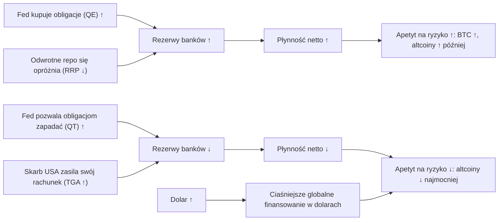

# 07. Płynność, pieniądz i dolar

„Płynność” (liquidity) to najczęściej używane i najgorzej zdefiniowane słowo w komentarzach o kryptowalutach. Czasem oznacza podaż pieniądza (M2). Czasem bilans Rezerwy Federalnej (Fed). Czasem gotówkę, którą banki trzymają w Fed, albo to, jak łatwo pożyczyć dolary w dowolnym miejscu na świecie. To są różne rzeczy. Zmieniają się w różnym tempie i w różnych latach w różny sposób wiązały się z bitcoinem. Ten rozdział rozbiera to słowo na części. Zobaczysz, czym jest każda z miar, jak działa „hydraulika” między nimi (bilans Fed, rachunek gotówkowy Skarbu USA, odwrotne repo, rezerwy banków), gdzie w tym wszystkim mieści się dolar i co dane naprawdę mówią o popularnej tezie, że „bitcoin podąża za płynnością z opóźnieniem”. Krótka odpowiedź: płynność jest realną siłą działającą w tle. Nie jest precyzyjnym narzędziem do wyczucia momentu (timingu), a reżim, w którym działa, ma większe znaczenie niż jakiekolwiek stałe opóźnienie.

**Czego się nauczysz**
- Co mierzą M2 i „globalne M2”, dlaczego tempo zmian rok do roku (r/r) ma większe znaczenie niż poziom i dlaczego globalne M2 liczone w dolarach jest po części wykresem dolara.
- Jak zbudować **płynność netto** (net liquidity: aktywa ogółem Fed − rachunek Skarbu USA w Fed (TGA) − odwrotne repo) i dlaczego działała w latach 2020–22, przestała działać w latach 2023–24 i częściowo wróciła w latach 2025–26.
- Oś czasu luzowania i zacieśniania ilościowego (QE / QT) od 2008 roku do końca QT 1 grudnia 2025 oraz zakupy w ramach zarządzania rezerwami (reserve-management purchases), które nastąpiły potem.
- Jak rezerwy banków, SOFR i rynek repo pokazują, że płynności zaczyna brakować (wrzesień 2019, jesień 2025), i dlaczego luźne *warunki finansowe* (Chicago Fed NFCI) mogą współistnieć z ciasną płynnością wynikającą z *polityki* banku centralnego.
- Z czego składa się indeks DXY, czym różni się od szerokiego indeksu dolara i kiedy odwrotna zależność między dolarem a bitcoinem działała, a kiedy zawiodła.
- Jak 5 sierpnia 2024 roku zwinął się carry trade na jenie i dlaczego podwyżki Banku Japonii w 2026 roku tego nie powtórzyły.
- Jak — z datami — poglądy Benjamina Cowena przesunęły się od M2 do „globalnej płynności netto”.

---

## Hydraulika na jednym obrazku

Czytaj to najpierw jako księgowość, a dopiero potem jako zachowanie. Bilans Fed ma aktywa (obligacje, kredyty) i pasywa (gotówka w obiegu, rezerwy banków, rachunek Skarbu USA, odwrotne repo). Gdy Fed kupuje obligacje, rezerwy rosną. Gdy Skarb USA przenosi gotówkę na swój rachunek w Fed albo gdy fundusze rynku pieniężnego parkują gotówkę w instrumencie odwrotnego repo Fed, ta gotówka przestaje być w systemie bankowym w postaci rezerw. „Płynność netto” to próba policzenia tylko tej części, która zostaje dla rynków.

**Kluczowe odczyty płynności, koniec października 2026**

| Miara | Ostatni odczyt | Data | Co mówi |
|---|---|---|---|
| M2 w USA, rok do roku | +5,71% | wrzesień 2026 | Pieniądz rośnie w normalnym lub solidnym tempie |
| Aktywa ogółem Fed (WALCL) | 6 745,6 mld USD | 28.10.2026 | Nieco powyżej dołka 6,536 bln USD z 3.12.2025 |
| Odwrotne repo overnight (RRPONTSYD) | 0,35 mld USD | 29.10.2026 | Puste; bufor z lat 2022–24 zniknął |
| Rachunek Skarbu USA w Fed (WTREGEN) | ok. 1,0 bln USD | 28.10.2026 | Blisko najwyższego poziomu od 2021 roku (1,006 bln USD 22.04.2026), drenuje rezerwy |
| Płynność netto (WALCL − TGA − RRP) | 5,75 bln USD | 28.10.2026 | Płasko lub w dół; przedział w latach 2025–26: 5,60–5,99 bln USD |
| Rezerwy banków (WRESBAL) | 2,89 bln USD | 28.10.2026 | Blisko dołu przedziału z lat 2024–26 (od 2,85 bln USD 29.10.2025 do 3,63 bln USD w marcu 2024) |
| SOFR a przedział docelowy | 3,94% wobec 3,75–4,00% | koniec października 2026 | Blisko górnej granicy przedziału: finansowanie jest napięte |
| Chicago Fed NFCI | −0,549 | 15.08.2026 (memo Cowena) | Rynkowe warunki finansowe luźniejsze od przeciętnych |
| Szeroki indeks dolara (DTWEXBGS) | 121,32 | 23.10.2026 | W konsolidacji; dołek 2026 roku 117,44 z 29 stycznia |
| DXY | ok. 101,7 | 30.10.2026 | W konsolidacji od początku 2026 roku |
| USDJPY / stopa Banku Japonii | 156,87 / 1,25% | 23.10 / 18.09.2026 | Jen słaby mimo podwyżek |

Źródła: raport laboratorium ([REPORT-2026-10-30](../../tools/macro-lab/REPORT-2026-10-30.md)) dla M2, WALCL, RRP i szerokiego indeksu dolara; serie FRED przeliczone na potrzeby kursu dla TGA, płynności netto, rezerw i SOFR; DXY z Trading Economics (źródło wtórne); Bank Japonii za [CNBC, 18 września 2026](https://www.cnbc.com/2026/09/18/japan-raises-rates-30-year-high-yen-jgb.html).

---

## Podaż pieniądza

### Podaż pieniądza M2 (M2SL)

**Co to jest.** M2 to szeroki zasób pieniądza w rękach społeczeństwa: gotówka, depozyty bieżące i na żądanie, depozyty oszczędnościowe (w tym rachunki depozytowe rynku pieniężnego), małe depozyty terminowe poniżej 100 tys. USD oraz salda detalicznych funduszy rynku pieniężnego. Rezerwa Federalna publikuje je w komunikacie H.6, co miesiąc, mniej więcej w czwarty wtorek, czyli około czterech tygodni po zakończeniu miesiąca. Jednostką są miliardy dolarów, dane są wyrównane sezonowo. Dane tygodniowe przestano publikować w 2021 roku. W maju 2020 roku depozyty oszczędnościowe przeniesiono do M1, co przerwało ciągłość serii M1, ale nie M2. Rewizje są zwykle niewielkie.

**Gdzie to znaleźć.** FRED `M2SL` (miesięcznie, wyrównane sezonowo). TradingView `ECONOMICS:USM2`. Na platformie Cowena to wykres „M2 Money Supply” (poziom Pro).

**Jak to czytać.** Patrz na **tempo wzrostu rok do roku**, a nie na poziom, bo poziom prawie zawsze rośnie. W przybliżeniu nominalny wzrost M2 równa się wzrostowi realnemu plus inflacja plus zmiana szybkości obiegu pieniądza (velocity, czyli tego, jak szybko pieniądz krąży). Szybkość obiegu jest niestabilna, więc związek między M2 a inflacją w krótkich horyzontach jest luźny. Kilka punktów orientacyjnych:
- Wzrost M2 osiągnął szczyt **+26,8% r/r w lutym 2021**, po pandemicznych transferach i QE. Ten skok nastąpił mniej więcej 12–18 miesięcy przed inflacją z lat 2021–22.
- M2 osiągnęło szczyt **21,77 bln USD w marcu 2022** i spadło do **20,71 bln USD w październiku 2023**, czyli o **−4,86%**. Wzrost r/r stał się ujemny w **grudniu 2022**, osiągnął dno **−4,66% w kwietniu 2023** i pozostał ujemny do **lutego 2024**. Był to pierwszy spadek r/r w historii danych FRED, które zaczynają się w 1959 roku, i największy od początku lat 30. XX wieku, gdy zasób pieniądza zmniejszył się o mniej więcej jedną trzecią (dane sprzed 1959 roku opierają się na innej definicji, więc porównanie jest przybliżone).
- M2 odzyskało dawny szczyt w **maju 2025** (21,81 bln USD), a we **wrześniu 2026 wynosiło 23,41 bln USD, +5,7% r/r** (laboratorium: +5,71%).

Najczęstsze błędne odczytanie to „spadek M2 oznacza krach”. W 2023 roku, przy kurczącym się M2, nie było recesji, S&P 500 wzrósł o 24%, a bitcoin o 156%. Gospodarstwa domowe wciąż wydawały duży zapas nadwyżkowych oszczędności zgromadzonych w latach 2020–21.

**Jak używa tego Cowen.** Cowen używa M2 głównie jako **deflatora** („accounting for the money supply”, czyli uwzględnianie podaży pieniądza — następna karta), a w mniejszym stopniu jako sygnału do wyczucia momentu. We wrześniu 2026 roku argumentował, że bitcoin *nie* rośnie niezawodnie razem z M2, wskazując, że M2 było na szczytach w 2014, 2018 i 2022 roku, a bitcoin w każdym z tych lat mocno spadał ([Yahoo Finance / Benzinga, omówienie, wrzesień 2026](https://finance.yahoo.com/markets/crypto/articles/remember-bitcoin-supposed-rise-money-170010779.html)). Sprawdzenie faktów: poziom M2 był na szczytach w 2014 i 2018 roku, ale w 2022 roku M2 osiągnęło szczyt w marcu, a potem spadało, więc przykład z 2022 roku jest prawdziwy tylko dla pierwszego kwartału. Jego ogólniejsza teza — że poziom M2 nie jest narzędziem do wyczucia momentu — się broni. Wzrost M2 jest też jednym z pięciu składników wskaźnika Macro Liquidity Risk na jego platformie (zob. niżej).

**Powiązania.**
- *Wyprzedza:* inflację, luźno, o około 12–18 miesięcy, gdy wzrost jest skrajny (2020–21 → 2021–22). Przy normalnym tempie wzrostu to wyprzedzenie jest bezużyteczne.
- *Jest wyprzedzane przez:* akcję kredytową banków, bilans Fed (QE tworzy depozyty, gdy Fed kupuje obligacje od podmiotów niebankowych) i transfery fiskalne.
- *Znak:* szybszy wzrost M2 wiąże się z rosnącymi cenami aktywów, a później z inflacją. Kurczenie się zacieśnia warunki.
- *Wyjątki:* 2023 (M2 się kurczy, aktywa rosną) i 2026 (M2 rośnie o 5,7%, bitcoin na rynku niedźwiedzia).

**Co to oznaczało dla aktywów.** M2 to wolnozmienna zmienna **reżimu**. Wzrost powyżej trendu (powyżej ok. 7–8%) zbiegał się z mocnymi cenami aktywów: w latach 2020–21 dotyczyło to wszystkiego, łącznie z bitcoinem i altcoinami. Kurczenie się w 2022 roku zbiegło się z rynkiem niedźwiedzia na akcjach, obligacjach i kryptowalutach. Potem ta zależność załamała się w obu kierunkach. Test laboratorium sprawdzający M2 jako wskaźnik wyprzedzający dla bitcoina znajdziesz poniżej; korelacje są niskie.

**Wniosek dla inwestora.** Czytaj M2 jako wzrost rok do roku i traktuj je jak pogodę w tle, a nie jak zegar. Ani jego kurczenie się w 2023 roku, ani wzrost w 2026 roku nie powiedziały ci, co bitcoin zrobi dalej.

### Aktywo ÷ M2: „uwzględnianie podaży pieniądza”

**Co to jest.** Podzielenie ceny aktywa (lub jego kapitalizacji) przez M2 usuwa tę część wzrostu, która wynikała z ekspansji monetarnej. To konstrukcja wykresu, a nie publikowana seria danych.

**Gdzie to znaleźć.** W TradingView możesz wpisać `SP:SPX/ECONOMICS:USM2` albo `BITSTAMP:BTCUSD/ECONOMICS:USM2`. Platforma Cowena pokazuje widoki aktywo ÷ M2 obok wykresów M1 i M2.

**Jak to czytać.** Nowy nominalny szczyt, który *nie* jest nowym szczytem w ujęciu M2, oznacza, że wzrost jest po części monetarny. Iloraz, który przez dekady oscyluje w przedziale, sugeruje, że duża część długoterminowego trendu aktywa to po prostu sama podaż pieniądza.

**Jak używa tego Cowen.**
- **Bitcoin ÷ M2** („Bitcoin: Accounting For The Money Supply”, 29 października 2021 i 18 listopada 2021, według streszczeń filmów): argumentował, że szczyt bitcoina z 2021 roku nie był nowym szczytem po uwzględnieniu M2.
- **S&P 500 ÷ M2** („S&P 500: Accounting For the Money Supply”, 11 października 2022 i 12 lipca 2025): iloraz oscyluje w przedziale od około 30 lat, więc duża część długoterminowego trendu akcji jest monetarna. W grudniu 2025 roku powiedział, że S&P/M2 „przypomina wzorzec z lat 1996–2000”, co odczytał jako mniej więcej jeszcze jeden rok wzrostów ([Bankless, 23 grudnia 2025](https://www.bankless.com/podcast/where-is-crypto-going-in-2026-ben-cowen)). Do **30 marca 2026** („Stocks Have Dropped 9%”) mówił już, że woli iloraz akcji do złota niż S&P/M2. Oba ilorazy omawia rozdział [08](08-AKCJE-ZLOTO-I-INNE-AKTYWA.md).

**Powiązania.** Iloraz spada, gdy M2 rośnie szybciej niż ceny (2020), i rośnie, gdy ceny aktywów wyprzedzają pieniądz (koniec lat 90., 2021, 2024–26). Sam w sobie niczego nie wyprzedza; zmienia jedynie ramę, w której oglądasz poziom.

**Co to oznaczało dla aktywów.** To soczewka wyceny, a nie sygnał. Wysoki odczyt S&P/M2 przez lata nie przeszkadzał akcjom rosnąć dalej (analogia do lat 1996–2000 mówi właśnie o tym).

**Wniosek dla inwestora.** Używaj ilorazu aktywo ÷ M2, by zapytać: „ile z tego ruchu to po prostu więcej pieniądza?”. Nie używaj go do wyczucia momentu.

### Globalne M2 (brak oficjalnej serii)

**Co to jest.** Nie istnieje oficjalne „globalne M2”. Praktycy (skrypty w TradingView oraz analitycy tacy jak Lyn Alden, Raoul Pal, Joe Consorti, CoinGlass i BGeometrics) sumują M2 lub szeroki pieniądz dla USA, strefy euro, Chin, Japonii i Wielkiej Brytanii, czasem także 10–20 innych gospodarek, i przeliczają każdą z nich na dolary po bieżącym kursie walutowym. Międzynarodowe serie M2 w FRED (na przykład `MYAGM2CNM189N`) są nieaktualne; serie oparte na danych MFW kończą się w latach 2017–2019.

**Gdzie to znaleźć.** Zbuduj je w TradingView z `ECONOMICS:USM2`, `ECONOMICS:EUM2`, `ECONOMICS:CNM2`, `ECONOMICS:JPM2` i odpowiednich par walutowych albo użyj skryptu społeczności. Na platformie Cowena nie ma go jako osobnego, nazwanego wykresu.

**Jak to czytać.** Najpierw dwa ostrzeżenia.
1. **To po części wykres dolara.** Ponieważ zasób pieniądza w każdej walucie przelicza się po bieżącym kursie, słabszy dolar mechanicznie podnosi „globalne M2”, nawet jeśli nigdzie nie wykreowano nowego pieniądza. Porównuj je z wersją liczoną przy stałych kursach walut.
2. **Chiny są największym składnikiem** w walucie lokalnej, więc ruchy juana i luzowanie przez Ludowy Bank Chin przesuwają cały agregat.

Ostatni podany odczyt to rekord około **103–104 bln USD w sierpniu 2026**, czyli około +8% r/r w dolarach i około +4,5% przy stałych kursach walut ([cryptorank](https://cryptorank.io/news/feed/44e74-global-money-supply-record-bitcoin-lags), źródło wtórne). W tym samym czasie bitcoin był 35–40% poniżej szczytu z października 2025.

**Jak używa tego Cowen.** Głównie jako obiekt sceptycyzmu. 8 maja 2025 roku napisał: „What if #Bitcoin leads liquidity, rather than lags it? A lot of people show this chart, where they offset global M2 by 3-4 months and show BTC following it. The problem is that in 2021, this offset shows M2 going up for 6 months after BTC topped.” („A co, jeśli #Bitcoin wyprzedza płynność, zamiast za nią podążać? Wiele osób pokazuje ten wykres, na którym przesuwają globalne M2 o 3–4 miesiące i pokazują, że BTC za nim podąża. Problem w tym, że w 2021 roku przy tym przesunięciu M2 rośnie jeszcze przez 6 miesięcy po szczycie BTC”). Podał, że w ostatnich trzech cyklach bitcoin osiągał szczyt **18–30 tygodni przed** globalnym M2 ([wpis na X, 8 maja 2025](https://x.com/benjamincowen/status/1920560445712159145)). Zwracał też uwagę, że siła dolara mechanicznie przesuwa agregaty globalnego M2. W memo z lutego 2026 roku przeszedł od poziomu do **zmiany globalnego M2 rok do roku** (rysunek 4 w [Macro Risk Memo, 15 lutego 2026](https://benjamincowen.com/reports/macro-risk-memo-feb-2026)): aktywa ryzykowne reagują na zmiany *nachylenia*, a nie na szczyt agregatu, a bitcoin „peaked before M2 rolled over and ultimately bottomed shortly after M2 peaked” („osiągnął szczyt, zanim M2 zawróciło, a ostatecznie dno wkrótce po szczycie M2”). Ujęcie rok do roku to uczciwy sposób czytania każdego agregatu pieniężnego, bo poziom globalnego M2 w dolarach rośnie prawie w każdym roku.

**Powiązania.** Globalne M2 w dolarach porusza się odwrotnie do dolara (mechanicznie), a także razem z chińskim kredytem i bilansami banków centralnych. Popularna teza mówi, że wyprzedza bitcoina o około 10–12 tygodni (niektórzy używają 70 lub 90 dni). Zob. test poniżej.

**Co to oznaczało dla aktywów.** Nakładka wyglądała przekonująco w części lat 2023–24 i wyraźnie zawiodła w latach 2025–26, gdy globalne M2 biło rekordy, a bitcoin spadł o ponad połowę od szczytu.

**Wniosek dla inwestora.** Zanim zaufasz wykresowi globalnego M2, zadaj trzy pytania: czy jest liczony przy stałych kursach walut, jakie kraje obejmuje i czy przesunięcie wybrano po obejrzeniu wyniku?

### Sprawdzamy narrację: „bitcoin podąża za M2 z opóźnieniem”

Ta teza ma dwie popularne wersje: wzrost M2 w USA wyprzedza bitcoina o kilka miesięcy, a globalne M2 (lub płynność netto) wyprzedza bitcoina o 10–12 tygodni. Na potrzeby tego kursu przeprowadzono dwa niezależne testy.

**Test 1: laboratorium kursu, dane z USA, cała próba.** [Laboratorium makro](../../tools/macro-lab/REPORT-2026-10-30.md) policzyło korelację wzrostu M2 w USA r/r ze stopą zwrotu bitcoina r/r (dane miesięczne) oraz 13-tygodniowej zmiany płynności netto (WALCL − TGA − RRP) z 13-tygodniową logarytmiczną stopą zwrotu bitcoina (dane tygodniowe), przy różnych wyprzedzeniach.

| M2 r/r wyprzedza BTC r/r o | Korelacja | | Płynność netto (zmiana 13-tyg.) wyprzedza BTC o | Korelacja |
|---|---|---|---|---|
| 0 miesięcy | 0,18 | | 0 tygodni | 0,18 |
| 2 miesiące | 0,22 | | 4 tygodnie | 0,19 |
| 3 miesiące | 0,22 | | 8 tygodni | 0,19 |
| 6 miesięcy | 0,25 | | 12 tygodni | 0,15 |
| 9 miesięcy | 0,22 | | 16 tygodni | 0,11 |
| 12 miesięcy | 0,10 | | 26 tygodni | 0,06 |

Jak to czytać: korelacja 0,25 oznacza, że wzrost M2 „wyjaśnia” około 6% zmienności rocznej stopy zwrotu bitcoina (0,25² ≈ 0,06). Najlepsze wyprzedzenie (6 miesięcy dla M2, 4–8 tygodni dla płynności netto) jest ledwie lepsze niż brak jakiegokolwiek wyprzedzenia. Laboratorium ostrzega też, że nakładające się okna rok do roku zawyżają korelacje, więc te liczby przedstawiają zależność w zbyt korzystnym świetle. Mają charakter opisowy, a nie prognostyczny.

**Test 2: podział na reżimy.** Badania do kursu ([notatki badawcze C](../../research-notes/C-growth-liquidity-crossasset.md)) policzyły ten sam rodzaj zależności w osobnych oknach czasowych, na tygodniowych danych z FRED (`WALCL`, `WTREGEN`, `RRPONTSYD`, `CBBTCUSD`). Na logarytmach *poziomów* korelacja między płynnością netto a bitcoinem wynosiła około **0,81 w latach 2019–2022** (0,78 dla S&P 500) i **−0,26 od 2023 do października 2026** (−0,54 dla S&P). Innymi słowy: w pierwszym reżimie obie serie poruszały się razem, a w drugim w przeciwnych kierunkach, bo zarówno bitcoin, jak i akcje rosły, podczas gdy płynność netto szła w bok lub w dół. Szczegółowy profil opóźnień:

| Okno | Miara | opóźn. 0 | 4 tyg. | 8 tyg. | 10 tyg. | 12 tyg. | 16 tyg. | 20 tyg. |
|---|---|---|---|---|---|---|---|---|
| 2016–paźdz. 2026 | poziomy | 0,78 | 0,78 | 0,78 | 0,77 | 0,77 | 0,77 | 0,76 |
| 2016–paźdz. 2026 | zmiany 13-tyg. | 0,15 | 0,17 | 0,17 | 0,17 | 0,16 | 0,11 | 0,07 |
| 2020–2022 | poziomy | 0,80 | 0,81 | 0,80 | 0,79 | 0,78 | 0,77 | 0,77 |
| 2020–2022 | zmiany 13-tyg. | 0,24 | 0,26 | 0,24 | 0,22 | 0,18 | 0,11 | 0,10 |
| 2023–paźdz. 2026 | poziomy | −0,26 | −0,18 | −0,13 | −0,09 | −0,06 | 0,01 | −0,01 |
| 2023–paźdz. 2026 | zmiany 13-tyg. | 0,18 | 0,20 | 0,29 | 0,30 | 0,29 | 0,24 | 0,07 |
| 2025–paźdz. 2026 | poziomy | 0,26 | 0,44 | 0,60 | 0,65 | 0,66 | 0,74 | 0,72 |
| 2025–paźdz. 2026 | zmiany 13-tyg. | −0,05 | 0,09 | 0,27 | 0,35 | 0,36 | 0,41 | 0,35 |

**Co mówią oba testy razem.**
- **Korelacje poziomów w długich oknach (0,77–0,81) są zawyżone przez wspólne trendy.** Dwie serie, które obie rosną przez dekadę, będą skorelowane niezależnie od tego, czy jedna napędza drugą. Sygnałem ostrzegawczym jest to, że korelacja w długim oknie prawie nie zmienia się wraz z opóźnieniem. Prawdziwe wyprzedzenie dałoby wyraźny szczyt przy jednym konkretnym opóźnieniu.
- **Na zmianach, czyli w uczciwym teście, moc wyjaśniająca jest mała:** r ≈ 0,15–0,4, a więc R² ≈ 2–17%.
- **„Najlepsze” opóźnienie dryfuje:** około 4 tygodni w latach 2020–22, około 10 tygodni w latach 2023–26, około 16 tygodni w latach 2025–26. Opóźnienie, które tak wędruje, to typowy objaw nadmiernego dopasowania (overfitting). Jeśli wybierzesz przesunięcie pasujące do ostatnich dwóch lat, prawdopodobnie nie będzie pasować do kolejnych dwóch.
- **Rozjazd z lat 2023–24 miał konkretne przyczyny:** popyt na spotowe ETF-y na bitcoina (zatwierdzone w styczniu 2024), halving z kwietnia 2024 i opróżnianie odwrotnego repo, które równoważyło QT. S&P niosły zyski spółek związanych z AI.
- **Ponowne sprzężenie w latach 2025–26 jest prawdziwe, ale krótkie.** Płynność netto spadła z 6,25 bln USD (kwiecień 2025) do 5,60 bln USD (grudzień 2025) przez odbudowę gotówki Skarbu USA i końcową fazę QT; bitcoin osiągnął szczyt w październiku 2025 i do 30 czerwca 2026 spadł do ok. 57,7–58,6 tys. USD (zależnie od źródła). S&P całkowicie zignorował ten spadek.

**Wniosek.** Płynność jest istotnym czynnikiem *w tle*: jej kierunek w horyzoncie 3–6 miesięcy przechyla szanse, zwłaszcza w przypadku kryptowalut. Stałe wyprzedzenie o 10–12 tygodni nie jest wiarygodną regułą prognostyczną. Traktuj je jako hipotezę o umiarkowanym poparciu w danych i pamiętaj, że sam Cowen w maju 2025 roku argumentował, że na szczytach bitcoin *wyprzedzał* globalne M2.

---

## Bilans Fed i hydraulika systemu

### Aktywa ogółem Fed (WALCL) i oś czasu QE/QT

**Co to jest.** Aktywa ogółem Rezerwy Federalnej: obligacje skarbowe USA (Treasuries), papiery zabezpieczone hipotekami (MBS), kredyty (okno dyskontowe, program Bank Term Funding Program z 2023 roku) i repo. Publikowane w komunikacie H.4.1 w każdy czwartek o 16:30 czasu wschodnioamerykańskiego (ET), z wartościami na środę. Jednostki w FRED: miliony dolarów. **QE** (luzowanie ilościowe) oznacza, że Fed kupuje obligacje i bilans rośnie. **QT** (zacieśnianie ilościowe) oznacza, że Fed pozwala obligacjom zapadać bez zastępowania ich nowymi i bilans się kurczy. Mechanikę i decyzje dotyczące polityki omawia rozdział [02](02-FED-I-STOPY-PROCENTOWE.md); ta karta dotyczy strony płynnościowej.

**Gdzie to znaleźć.** FRED `WALCL`. TradingView `FRED:WALCL`. Na platformie Cowena: „FED Total Assets” oraz wykres „QT Ending Bear Markets”.

**Jak to czytać.** Kierunek i struktura mają większe znaczenie niż poziom. Bilans rosnący z powodu kredytów awaryjnych (marzec 2023) to sygnał kryzysu, a nie luzowania. Płaski bilans przy opróżniającym się odwrotnym repo (2023–24) wciąż może dodawać rezerw. A koniec QT to nie QE: bilans przestaje się kurczyć, ale nie zaczyna rosnąć.

**Oś czasu do końca QT (i po nim).**

| Okres | Polityka | WALCL | Kontekst rynkowy |
|---|---|---|---|
| 11.2008–10.2014 | QE1, QE2, Operacja Twist, QE3 | ok. 0,9 bln USD (przed kryzysem, połowa 2008) → ok. 4,5 bln USD | Pokryzysowy rynek byka |
| 10.2017–07.2019 | QT1 (limity do 50 mld USD miesięcznie) | ok. 4,5 bln USD → ok. 3,76 bln USD | IV kw. 2018: S&P −19,8%; BTC −73% w 2018 |
| 09–10.2019 | Skok na rynku repo (SOFR powyżej 5%), potem od października 2019 zakupy bonów skarbowych „to nie QE” | rośnie | Rezerwy zbyt skąpe przy ok. 1,4–1,5 bln USD |
| 03.2020–03.2022 | Nieograniczone QE, ograniczanie zakupów (taper) od listopada 2021 | 4,17 bln USD (luty 2020) → szczyt 8,965 bln USD (13.04.2022) | „Hossa na wszystkim” (everything rally) w latach 2020–21 |
| 06.2022 | Start QT2 (limit 47,5 mld USD, od września 2022 95 mld USD) | spada | Rynek niedźwiedzia 2022 |
| 03.2023 | Bank Term Funding Program (12 marca) i okno dyskontowe po upadku SVB | ok. +390 mld USD w kilka tygodni | BTC +70% w I kw. 2023 |
| 06.2024 | Spowolnienie QT: limit dla obligacji skarbowych 60 mld USD → 25 mld USD | spada wolniej | |
| 04.2025 | Limit dla obligacji skarbowych → 5 mld USD | spada bardzo wolno | |
| 1.12.2025 | Koniec QT; spłaty MBS reinwestowane w bony skarbowe | dołek 6,536 bln USD (3.12.2025) | BTC już ok. −25% od szczytu |
| 12.2025–połowa 2026 | Zakupy bonów skarbowych w ramach zarządzania rezerwami, ok. 40 mld USD miesięcznie, zmniejszone do ok. 10 mld USD do czerwca 2026, wstrzymane w sierpniu–wrześniu 2026 (według doniesień, niezweryfikowane niezależnie) | 6 745,6 mld USD (28.10.2026) | Rynek niedźwiedzia na BTC; Fed podnosi stopy 16.09.2026 |

Komunikat FOMC z 29 października 2025 roku mówił: „The Committee decided to conclude the reduction of its aggregate securities holdings on December 1” („Komitet postanowił zakończyć redukcję łącznego portfela papierów wartościowych 1 grudnia”). QT2 zmniejszyło bilans z około 8,97 bln USD do około 6,54–6,57 bln USD (źródła nieco się różnią co do dokładnego dołka). Lipcowy raport Fed o polityce pieniężnej (Monetary Policy Report) z 2026 roku szacował zakupy bonów od początku stycznia 2026 na około 250 mld USD, z czego około 160 mld USD stanowiły zakupy w ramach zarządzania rezerwami. Przewodniczący Kevin Warsh, który objął stanowisko w maju 2026 roku, od dawna twierdzi, że bilans jest zbyt duży, i powołał zespół zadaniowy ds. polityki bilansowej; do konferencji prasowej 28 października 2026 roku nie zapadła żadna decyzja ([First Trust, sierpień 2026](https://www.ftportfolios.com/Commentary/EconomicResearch/2026/8/13/can-warsh-shrink-the-feds-balance-sheet)). Ponowna próba zmniejszania bilansu byłaby dla płynności wiatrem w oczy, którego rynki nie musiały wyceniać od 2025 roku.

**Jak używa tego Cowen.** QT i QE są centralne dla jego ram analizy kryptowalut, bardziej dla *względnych* wyników niż dla cen:
- „Last cycle the transition from QT to QE marked the top for BTC dominance” („W poprzednim cyklu przejście od QT do QE wyznaczyło szczyt dominacji BTC”) oraz „I expect the Fed to transition from QT to QE next year” („Spodziewam się, że Fed przejdzie od QT do QE w przyszłym roku”) ([Cointelegraph Magazine, 19 listopada 2024](https://cointelegraph.com/magazine/bitcoin-dominance-crypto-predictions-bull-run-benjamin-cowen-hall-of-flame/)). A także: „My base case right now for Bitcoin dominance is that it will likely go higher until quantitative tightening is over” („Mój scenariusz bazowy dla dominacji Bitcoina jest taki, że prawdopodobnie będzie rosła, dopóki nie skończy się zacieśnianie ilościowe”) ([Benzinga, listopad 2024](https://www.benzinga.com/markets/cryptocurrency/24/11/41850110/federal-reserve-cuts-interest-ratesbitcoin-dominance-may-rise-as-a-result)).
- W obu cyklach bitcoin osiągnął szczyt *przed* końcem QT: około 5 tygodni wcześniej w 2019 roku (szczyt 26 czerwca, koniec QT 1 sierpnia 2019) i około 8 tygodni wcześniej w 2025 roku (szczyt 6 października, koniec QT 1 grudnia 2025). W filmach zaokrąglał oba przypadki do „około dwóch miesięcy” („Bitcoin and the End of Quantitative Tightening”, 1 grudnia 2025; Bankless, 23 grudnia 2025); liczby 5 i 8 tygodni pochodzą z jego [Bitcoin Cycle Memo z 15 lipca 2026](https://benjamincowen.com/reports/bitcoin-cycle-memo-july-2026). Jego memo ze stycznia 2026 roku uogólnia tę obserwację: bitcoin „often leads liquidity cycles” („często wyprzedza cykle płynności”), a płynność „tends to respond to macro stress” („zwykle reaguje na stres makroekonomiczny”) ([Crypto Macro Risk Memo Q1 2026, 15 stycznia 2026](https://benjamincowen.com/reports/crypto-macro-risk-memo-q1-2026)).
- Koniec QT to nie to samo co rosnący bilans. W 2026 roku nie nastąpiło QE, a Fed we wrześniu podniósł stopy, więc jego reguła „QT→QE wyznacza szczyt dominacji” nie została w tym cyklu sprawdzona. Stronę dominacji omawia rozdział [12](12-DOMINACJA-ALTCOINY-I-ROTACJA.md).
- Jego memo z 2026 roku idą o krok dalej: nawet *rosnący* bilans nie wystarcza. Zakupy bonów przez Fed po grudniu 2025 roku wyglądały na „reserve management, funding operations, and financial-system stabilization” („zarządzanie rezerwami, operacje finansujące i stabilizację systemu finansowego”), a nie na kryzysowe QE, a kryptowaluty potrzebują **płynności spekulacyjnej** (speculative liquidity), czyli kapitału, który jest „both abundant and willing to take risk” („zarówno obfity, jak i skłonny do podejmowania ryzyka”) (memo za I kw., 15 stycznia 2026). W tym ujęciu rynki byka na kryptowalutach pojawiały się wtedy, gdy płynność rosła *w odpowiedzi na* stres gospodarczy lub finansowy (2019–20, 2020–21), a nie wtedy, gdy zacieśnianie po prostu się kończyło.

**Powiązania.**
- *QE → niższe rentowności realne, słabszy dolar, wyższe ceny akcji, kryptowalut i złota* (2009–13, 2020–21). Opóźnienie: od tygodni do miesięcy.
- *QT → wyższe premie za termin, ciaśniejsza płynność, najbardziej cierpią aktywa o wysokiej becie* (2018, 2022). Ale *tempo* QT ma mniejsze znaczenie niż to, co dzieje się z rezerwami, które zależą także od TGA i odwrotnego repo (kolejne karty).
- *Zwroty w bilansie dwukrotnie zbiegły się z dołkami ETH/BTC:* 6 września 2019 (pięć tygodni po pierwszej obniżce i końcu QT) i 21 kwietnia 2025 (trzy tygodnie po tym, jak QT zwolniło do minimum). Dwa przypadki to sugestia, a nie wiarygodna reguła.

**Co to oznaczało dla aktywów.** BTC: reżimy QE zbiegały się z rynkami byka (2020–21), reżimy QT z rynkami niedźwiedzia (2018, 2022), ale QT w latach 2023–24 zbiegło się z rynkiem byka, bo opróżniało się odwrotne repo. Altcoiny: najbardziej wrażliwe; w czasie QT w latach 2018–19 ani 2023–25 nie było sezonu altcoinów (altseason). Akcje: QE wspiera; QT było wiatrem w oczy w 2018 i 2022 roku, ale nie w latach 2023–25. Złoto: QE wspiera przez niższe rentowności realne.

**Wniosek dla inwestora.** Obserwuj kierunek bilansu razem z rezerwami. „Koniec QT” jest w opowieści Cowena warunkiem mniej więcej koniecznym siły altcoinów, ale nie wystarczającym: w 2019 i w 2026 roku nastąpiła po nim dalsza słabość, a nie rotacja.

### Odwrotne repo overnight (RRPONTSYD)

**Co to jest.** Instrument odwrotnego repo overnight Fed (overnight reverse repurchase facility). Fundusze rynku pieniężnego i agencje sponsorowane przez rząd pożyczają Fed gotówkę na jedną noc pod zastaw obligacji skarbowych, po stopie ON RRP, która jest dolną granicą przedziału stopy funduszy federalnych. Dane dzienne, w miliardach dolarów.

**Gdzie to znaleźć.** FRED `RRPONTSYD`. Platforma Cowena: „Overnight Reverse Repurchase Agreements (ON RRP)”.

**Jak to czytać.** Gotówka w RRP to bezczynna gotówka, której *nie ma* w systemie bankowym w postaci rezerw. Gdy RRP spada, bo fundusze pieniężne przenoszą się do bonów skarbowych, ta gotówka wraca do systemu prywatnego. Dlatego *spadające* RRP to *zastrzyk* płynności, nawet jeśli Fed prowadzi QT.
- Bliskie zera do marca 2021.
- Rekordowe **2,554 bln USD 30 grudnia 2022**: nadmiar płynności z QE i transferów fiskalnych, który nie miał dokąd pójść.
- Opróżnione do około 0,4–0,5 bln USD do 2024 roku i niemal do zera od końca 2025 roku: **0,35 mld USD 29 października 2026** (laboratorium; rok wcześniej 19,50 mld USD).

**Jak używa tego Cowen.** Głównie jako składnika płynności netto, a nie jako osobnego tematu filmów („Net Liquidity”, 30 czerwca 2023).

**Powiązania.** „Paradoks płynności” z lat 2023–24 przebiegał przez RRP. Po porozumieniu w sprawie limitu zadłużenia w czerwcu 2023 roku Skarb USA wyemitował zalew bonów skarbowych; fundusze pieniężne wycofały gotówkę z RRP, by je kupić; rezerwy banków *wzrosły* z 2,83 bln USD (styczeń 2023) do ponad 3,5 bln USD (grudzień 2023), mimo że Fed zmniejszał bilans. QT trwało, a BTC i akcje i tak rosły.

**Co to oznaczało dla aktywów.** Opróżniające się RRP amortyzowało QT dla aktywów ryzykownych w latach 2023–24. Teraz, gdy RRP jest puste, tej amortyzacji już nie ma: każde dalsze zmniejszanie bilansu lub odbudowa TGA idzie prosto z rezerw banków.

**Wniosek dla inwestora.** Duże RRP to bufor; puste oznacza, że system nie ma zapasowej gotówki, by wchłonąć kolejny drenaż.

### Rachunek Skarbu USA w Fed (WTREGEN)

**Co to jest.** Rachunek gotówkowy Departamentu Skarbu USA w Fed (Treasury General Account, TGA). Jest pasywem Fed, więc gdy saldo Skarbu rośnie, rezerwy banków — przy pozostałych czynnikach bez zmian — spadają. Dane tygodniowe w FRED (miliony dolarów); dzienne w Daily Treasury Statement na fiscaldata.treasury.gov.

**Gdzie to znaleźć.** FRED `WTREGEN`. Platforma Cowena: „Treasury Deposits With Federal Reserve Banks”.

**Jak to czytać.** Spory o limit zadłużenia obniżają TGA (gotówka wypływa do gospodarki: zastrzyk płynności). Ich rozwiązanie ponownie je zasila (drenaż płynności). Skoki powodują też terminy podatkowe.
- 2023: po porozumieniu w sprawie limitu zadłużenia w czerwcu 2023 roku TGA odbudowano o około 0,7 bln USD.
- 2025: TGA spadł do **296 mld USD 16 lipca 2025**, a następnie po lipcowym podniesieniu limitu zadłużenia odbudowano go do **958 mld USD do 29 października 2025**. Ten drenaż rzędu 660 mld USD zbiegł się z napięciami w finansowaniu (kolejne karty) oraz ze szczytem i spadkiem bitcoina w październiku 2025 roku.
- Obecnie: około **1,0 bln USD (28 października 2026)**, blisko poziomu z kwietnia 2026 roku (1,006 bln USD), najwyższego od 2021 roku.

**Jak używa tego Cowen.** Jako składnika płynności netto, a nie jako osobnego tematu.

**Powiązania.** TGA ↑ → rezerwy ↓ → płynność netto ↓, zwykle w ciągu tygodni. Efekt jest najsilniejszy, gdy RRP jest puste, bo nic go nie równoważy.

**Co to oznaczało dla aktywów.** Odbudowa z 2025 roku to najwyraźniejszy niedawny przypadek, w którym zasilenie TGA zbiegło się ze szczytem na kryptowalutach, ale ta zbieżność to jeden epizod, a działały też inne siły (kaskada likwidacji z 10 października 2025, faza cyklu).

**Wniosek dla inwestora.** Śledź kalendarze limitu zadłużenia. Duża odbudowa TGA przy pustym RRP to drenaż płynności, który warto zauważyć.

### Płynność netto (WALCL − TGA − RRP)

**Co to jest.** Konstrukcja praktyków, spopularyzowana przez Maxa Andersona i innych około 2022 roku: aktywa ogółem Fed minus rachunek Skarbu USA w Fed minus odwrotne repo overnight. To **nie** jest oficjalna miara Fed. Chodzi o policzenie tej części bilansu Fed, która jest dostępna dla banków i rynków.

**Gdzie to znaleźć.** Zbuduj ją sam z danych FRED. Uważaj na jednostki: `WALCL` i `WTREGEN` są w milionach, `RRPONTSYD` w miliardach (pomnóż przez 1000). Używaj wartości środowych. W TradingView: `FRED:WALCL-FRED:WTREGEN-FRED:RRPONTSYD*1000`. Liczy ją skrypt [laboratorium makro](../../tools/macro-lab/REPORT-2026-10-30.md).

**Jak to czytać.** Patrz na jej trend w horyzoncie 3–6 miesięcy i na punkty zwrotne. Historia:

| Data | Płynność netto | BTC | S&P 500 |
|---|---|---|---|
| 18.03.2020 | 4,31 bln USD | 5,4 tys. USD | 2 398 |
| 15.09.2021 (szczyt) | 7,14 bln USD | 48,1 tys. USD | 4 481 |
| 10.11.2021 (szczyt BTC) | 6,96 bln USD | 64,9 tys. USD | 4 647 |
| 28.09.2022 (dołek) | 5,74 bln USD | 19,4 tys. USD | 3 719 |
| 23.11.2022 (tydzień dołka BTC) | 6,07 bln USD | 16,6 tys. USD | 4 027 |
| 15.03.2023 (BTFP) | 6,35 bln USD | 24,4 tys. USD | 3 892 |
| 13.03.2024 | 6,25 bln USD | 73,1 tys. USD | 5 165 |
| 18.12.2024 | 5,99 bln USD | 97,4 tys. USD | 5 872 |
| 9.04.2025 | 6,25 bln USD | 79,6 tys. USD | 5 457 |
| 8.10.2025 (tydzień szczytu BTC) | 5,78 bln USD | 121,7 tys. USD | 6 754 |
| 3.12.2025 (dołek) | 5,60 bln USD | 93,2 tys. USD | 6 850 |
| 1.07.2026 (tydzień dołka BTC) | 5,84 bln USD | 59,9 tys. USD | 7 483 |
| 28.10.2026 | 5,75 bln USD | 81,2 tys. USD | 7 744 |

**Epizody.**
- **2020–21:** płynność netto +66% (marzec 2020 → wrzesień 2021); BTC ×12, S&P ×1,9. Szczyt płynności netto (wrzesień 2021) przyszedł około dwóch miesięcy przed szczytem BTC (listopad 2021) i około czterech miesięcy przed szczytem S&P (styczeń 2022). To ten epizod uczynił wskaźnik sławnym.
- **2022:** płynność netto −20% (styczeń → wrzesień 2022); w całym roku BTC −64%, S&P −19,4%. Płynność netto osiągnęła dno we wrześniu 2022 roku, około dwóch miesięcy przed dołkiem BTC (listopad, po upadku FTX) i około dwóch tygodni przed dołkiem S&P (12 października 2022).
- **2023–24:** płynność netto mniej więcej płaska (5,8–6,35 bln USD), podczas gdy BTC wzrósł mniej więcej sześciokrotnie, a S&P o około 50%. **Narracja się załamała.** Czynniki: zyski spółek związanych z AI, napływy do ETF-ów, halving, deficyty budżetowe.
- **2025–26:** płynność netto spadła z 6,25 bln USD (kwiecień 2025) do 5,60 bln USD (grudzień 2025) i umiarkowanie odbiła do około 5,99 bln USD (lipiec 2026). BTC osiągnął szczyt w październiku 2025 roku, dno w czerwcu 2026 roku i odbił do około 86 tys. USD na początku października. Dopasowanie znów się poprawiło (r ≈ 0,74 przy 16-tygodniowym opóźnieniu na poziomach). S&P zignorował spadek.

**Jak używa tego Cowen.** W latach 2023–24 nagrał na ten temat krótką serię („Net Liquidity”, 30 czerwca 2023; „Net Liquidity: S&P 500 and Bitcoin”, 28 lipca 2023; „Bitcoin: Net Liquidity”, 8 lutego 2024, według streszczeń filmów). Jego tezy: płynność netto koreluje z S&P i jest bardziej przydatna do oceny **względnych** wyników (aktywa bardziej ryzykowne wobec mniej ryzykownych) niż cen w dolarach. W późnej fazie cyklu i w czasie QT altcoiny radzą sobie gorzej niż bitcoin. Jego poglądy z 2026 roku przesunęły się ku wersji *globalnej* (zob. sekcję po następnej).

**Powiązania.** Płynność netto ← bilans Fed (+), TGA (−), RRP (−). Luźno wyprzedza aktywa ryzykowne w reżimach zdominowanych przez płynność (2020–22: w punktach zwrotnych od kilku tygodni do dwóch miesięcy), a wcale — w reżimach zdominowanych przez zyski spółek lub przepływy (2023–24).

**Co to oznaczało dla aktywów.** BTC i altcoiny: najsilniejszy związek w latach 2020–22 i 2025–26. Akcje: odłączyły się pierwsze, w 2023 roku, i pozostały odłączone. Złoto i dolar: brak stabilnego związku.

**Wniosek dla inwestora.** Płynność netto to właściwa *koncepcja* (ile gotówki ma system). Jako *model* działa w niektórych reżimach, a w innych nie, i dopiero po fakcie wiesz, w którym reżimie byłeś.

### Rezerwy banków, SOFR i napięcia na rynku repo (WRESBAL, SOFR)

**Co to jest.** Rezerwy banków to gotówka, którą banki trzymają w Fed (FRED `WRESBAL`, dane tygodniowe). SOFR (Secured Overnight Financing Rate) to koszt pożyczenia gotówki na jedną noc pod zastaw obligacji skarbowych (Fed z Nowego Jorku, dane dzienne, FRED `SOFR`). IORB to oprocentowanie, które Fed płaci od rezerw — stopa administrowana działająca podobnie do sufitu. Stały instrument repo (Standing Repo Facility, SRF) pozwala uprawnionym instytucjom pożyczać od Fed pod zastaw obligacji skarbowych; dane o jego wykorzystaniu są na stronie Fed z Nowego Jorku.

**Gdzie to znaleźć.** FRED `WRESBAL`, `SOFR`, `IORB` oraz `DFEDTARU`/`DFEDTARL` dla przedziału docelowego.

**Jak to czytać.** Gdy rezerwy są „wystarczające” (ample), SOFR notowana jest kilka punktów bazowych *poniżej* IORB. Gdy rezerwy zbliżają się do poziomu „skąpego” (scarce), SOFR notowana jest *powyżej* IORB, stopy repo skaczą na koniec miesiąca, kwartału i w terminach podatkowych, a Fed musi dodawać rezerw. Dwa epizody:
- **Wrzesień 2019:** SOFR doszła do 5,25% przy rezerwach około 1,4 bln USD. Fed zaczął kupować bony skarbowe w październiku 2019 roku i nazwał to „not QE” („to nie QE”).
- **Wrzesień–grudzień 2025:** po odbudowie TGA SOFR była notowana powyżej IORB, a SRF odnotował rekordowe wykorzystanie: około 50 mld USD 31 października 2025 i około 75 mld USD 31 grudnia 2025 (według doniesień, niezweryfikowane niezależnie z danymi Fed z Nowego Jorku). QT zakończyło się 1 grudnia 2025 roku i ruszyły zakupy w ramach zarządzania rezerwami.

Obecnie: rezerwy **2,89 bln USD (28 października 2026)**, przy przedziale z lat 2024–26 od 2,85 bln USD (29 października 2025) do 3,63 bln USD (marzec 2024) i szczycie 4,28 bln USD w grudniu 2021 roku. SOFR **3,94%** przy przedziale 3,75–4,00%, czyli blisko górnej granicy: finansowanie jest napięte, częściowo dlatego, że TGA wynosi 1 bln USD.

**Bank Term Funding Program** (12 marca 2023, po upadku Silicon Valley Bank) udzielał kredytów na okres do roku pod zastaw obligacji skarbowych i MBS wycenianych **po wartości nominalnej** (at par), co usuwało ryzyko przymusowej sprzedaży z powodu niezrealizowanych strat. Wykorzystanie osiągnęło szczyt około 165–168 mld USD na początku 2024 roku; nowych kredytów przestano udzielać 11 marca 2024 roku. Skok bilansu o około 390 mld USD w marcu 2023 roku i wzrost płynności netto o 0,55 bln USD w trzy tygodnie zbiegły się z rajdem bitcoina z około 20 tys. USD do około 28 tys. USD i z narracją o „bitcoinie jako zabezpieczeniu przed kryzysem bankowym”.

**Jak używa tego Cowen.** Rezerwy pojawiają się na jego platformie jako część danych monetarnych; nie są tematem filmów.

**Powiązania.** Rezerwy spadają, gdy rośnie TGA, gdy RRP jest puste i trwa QT. Napięcia na rynku repo zwykle *kończą* QT (2019, 2025). Reakcja Fed (zakupy bonów, instrumenty awaryjne) dodaje wtedy płynności, z opóźnieniem rzędu tygodni.

**Co to oznaczało dla aktywów.** Napięcia w finansowaniu uderzają najpierw w pozycje lewarowane. W 2019 roku skok na rynku repo przypadł w środku osuwania się BTC od czerwcowego szczytu; pod koniec 2025 roku nałożył się na krach po szczycie.

**Wniosek dla inwestora.** Rezerwy w okolicy 2,9 bln USD, puste RRP i TGA na poziomie 1 bln USD oznaczają, że system ma mniej więcej tak mały zapas, jak podczas jesiennego ścisku w finansowaniu w 2025 roku, i mniejszy niż niemal kiedykolwiek od 2020 roku. Zakłócenie na rynku finansowania jest wiarygodnym kanałem ryzyka dla lewarowanych pozycji na kryptowalutach, ale to kanał do obserwowania, a nie prognoza.

### Warunki finansowe: Chicago Fed NFCI (NFCI)

**Co to jest.** National Financial Conditions Index Fed z Chicago: tygodniowe podsumowanie warunków dotyczących ryzyka, kredytu i dźwigni na rynkach pieniężnych, rynkach długu i akcji oraz w systemie bankowym, zbudowane z około stu wskaźników. Jest wyskalowany tak, że **0 to średnia historyczna**; wartości ujemne oznaczają warunki *luźniejsze* od przeciętnych, dodatnie — ciaśniejsze. Publikowany w każdą środę; wcześniejsze wartości są rewidowane w miarę napływu nowych danych.

**Gdzie to znaleźć.** FRED `NFCI` (także `ANFCI`, wersja skorygowana o cykl koniunkturalny). Platforma Cowena ma go jako „National Financial Conditions Index (NFCI)”, a jego memo nazywają go też „Chicago Financial Conditions Index”.

**Jak to czytać.** Znak i kierunek mają większe znaczenie niż miejsca po przecinku. Warunki finansowe to to, ile rynki faktycznie liczą sobie za kredyt i ryzyko; płynność wynikająca z polityki (stopa banku centralnego, bilans, dolar) to to, co robi bank centralny. Te dwie rzeczy mogą się rozjeżdżać przez długi czas.

**Jak używa tego Cowen.** Jako przeciwwagę dla swojego wskaźnika płynności. W sierpniu 2026 roku zestawił **luźne warunki rynkowe (NFCI −0,549)** z **ciasną płynnością wynikającą z polityki (jego Liquidity Risk score 0,813)** i nazwał „restrictive policy alongside loose financial conditions” („restrykcyjną politykę przy luźnych warunkach finansowych”) „hallmark of a mature expansion” („znakiem rozpoznawczym dojrzałej ekspansji”), która może trwać, ale sprawia, że „the eventual turn abrupt” („ostateczny zwrot jest gwałtowny”). Przejście NFCI powyżej zera byłoby „the early warning” („wczesnym ostrzeżeniem”), a „financial conditions staying loose” („utrzymywanie się luźnych warunków finansowych”) to jedna z obserwacji, które obaliłyby jego prognozę korekty ([The Balance of Risks, 15 sierpnia 2026](https://benjamincowen.com/reports/the-balance-of-risks-august-2026); także rysunek 15 w [memo z lutego 2026](https://benjamincowen.com/reports/macro-risk-memo-feb-2026)). NFCI to jedna z obserwowalnych wielkości, które definiują jego trzy stany scenariuszowe (rozdział [13](13-JAK-TO-SIE-LACZY.md)).

**Powiązania.** Warunki finansowe zacieśniają się *po* polityce, gdy coś pęka: spready kredytowe się rozszerzają, akcje spadają, zmienność skacze (spready kredytowe omawia rozdział [03](03-OBLIGACJE-I-KRZYWA-RENTOWNOSCI.md)). Luźne warunki przy ciasnej polityce zwykle odzwierciedlają mocne zyski spółek i apetyt na ryzyko, jak w 2026 roku, gdy S&P był na rekordach, a spready obligacji wysokodochodowych (high yield) w okolicy 3%.

**Co to oznaczało dla aktywów.** Ujemny i spadający NFCI idzie w parze z rosnącymi akcjami i wąskimi spreadami kredytowymi. Przejścia powyżej zera towarzyszyły epizodom stresu (2008, marzec 2020, 2022). W przypadku kryptowalut luźne warunki *rynkowe* nie zapobiegły rynkowi niedźwiedzia w latach 2025–26 — i właśnie o tym mówi Cowen, odróżniając płynność zagregowaną od płynności spekulacyjnej.

**Wniosek dla inwestora.** Czytaj płynność wynikającą z polityki i warunki finansowe obok siebie. Gdy się rozjeżdżają, pytanie brzmi, która strona ustąpi pierwsza.

### Od M2 do „globalnej płynności netto”: jak zmieniały się poglądy Cowena

Ujęcie płynności przez Cowena zmieniało się kilka razy. Każde „Cowen uważa X” na temat płynności wymaga daty:

| Data | Co powiedział lub zrobił | Źródło |
|---|---|---|
| 29 października i 18 listopada 2021 | Bitcoin ÷ M2: szczyt z 2021 roku nie był nowym szczytem w ujęciu M2 | „Bitcoin: Accounting For The Money Supply” (streszczenia filmów) |
| 11 października 2022 | S&P ÷ M2 w przedziale od około 30 lat | „S&P 500: Accounting For the Money Supply” (streszczenie filmu) |
| czerwiec 2023–luty 2024 | Płynność netto w USA (aktywa Fed − TGA − RRP) podąża za S&P; bardziej przydatna do oceny wyników względnych niż bezwzględnych | „Net Liquidity” 30.06.2023; „Net Liquidity: S&P 500 and Bitcoin” 28.07.2023; „Bitcoin: Net Liquidity” 8.02.2024 (streszczenia filmów) |
| 8 maja 2025 | Wykresy z przesuniętym globalnym M2 wprowadzają w błąd; w ostatnich trzech cyklach bitcoin osiągał szczyt 18–30 tygodni *przed* globalnym M2 | [wpis na X](https://x.com/benjamincowen/status/1920560445712159145) |
| grudzień 2025 | S&P ÷ M2 przypomina lata 1996–2000 | [Bankless, 23 grudnia 2025](https://www.bankless.com/podcast/where-is-crypto-going-in-2026-ben-cowen) |
| 15 stycznia 2026 | Bitcoin „often leads liquidity cycles” („często wyprzedza cykle płynności”); wzrost bilansu Fed to zarządzanie rezerwami, a nie QE; kryptowaluty potrzebują płynności **spekulacyjnej** | [Crypto Macro Risk Memo Q1 2026](https://benjamincowen.com/reports/crypto-macro-risk-memo-q1-2026) |
| 15 lutego 2026 | **Kierunek** płynności a jej **poziom**; **stabilizacja** a **impuls**; globalne M2 czytane jako zmiana r/r (nachylenie), a nie poziom | [Macro Risk Memo, luty 2026](https://benjamincowen.com/reports/macro-risk-memo-feb-2026) |
| 20 lutego 2026 | „Why Alt Season Never Happened” („Dlaczego sezon altcoinów nigdy nie nadszedł”): ciasna płynność (jego Macro Liquidity Risk score) wymusza rotację w stronę bezpieczniejszych aktywów | streszczenie filmu |
| marzec 2026 | „Liquidity conditions also reflect a late business cycle environment” („Warunki płynnościowe odzwierciedlają też otoczenie późnej fazy cyklu koniunkturalnego”) | [wpis na X](https://x.com/benjamincowen/status/2036990935075016905) |
| 30 marca 2026 | Woli iloraz akcji do złota niż S&P ÷ M2 | „Stocks Have Dropped 9%” (streszczenie filmu) |
| 15 kwietnia 2026 | Pokazuje **przybliżenie globalnej płynności** (global liquidity proxy): „major central bank balance sheets adjusted for RRP and TGA” („bilanse głównych banków centralnych skorygowane o RRP i TGA”) | [Crypto Risk Memo Q2 2026](https://benjamincowen.com/reports/crypto-risk-memo-q2-2026) |
| sierpień 2026 | „Liquidity risk falls out of its tight band” („ryzyko płynności wychodzi z ciasnego pasma”) wymienione jako sygnał unieważniający jego scenariusz spadkowy | [memo Balance of Risks, 15 sierpnia 2026](https://benjamincowen.com/reports/the-balance-of-risks-august-2026) |
| wrzesień 2026 | Bitcoin podąża za **globalną płynnością netto** (bilanse głównych banków centralnych minus drenaże takie jak TGA i RRP), a nie za M2. Ocenił ją na około **25 bln USD wobec około 30 bln USD na szczycie z lat 2021–22** i stwierdził, że to wyjaśnia, dlaczego bitcoin zostawał w tyle za akcjami; najbliższa analogia to 2019 rok (M2 rośnie, akcje na szczytach, BTC spada) | [Yahoo Finance / Benzinga, wrzesień 2026](https://finance.yahoo.com/markets/crypto/articles/remember-bitcoin-supposed-rise-money-170010779.html) (źródło wtórne) |

Badania do kursu nie znalazły publicznej serii odpowiadającej jego liczbie 25 bln USD, więc traktuj ją jako jego szacunek, a nie wielkość niezależnie zweryfikowaną. Kierunek zmiany jest jasny: od deflatora opartego na podaży pieniądza (2021–22), przez miarę „hydrauliki” w USA (2023–24) i sceptycyzm wobec globalnego M2 (2025), do globalnej miary bilansowej pomniejszonej o drenaże (w jego memo od kwietnia 2026). Ta zmiana pasuje też do danych z powyższej tabeli z podziałem na reżimy: M2 rosło dalej w latach 2025–26, a miary pomniejszone o drenaże — nie.

### Poziom, kierunek i impuls płynności (słownik Cowena z 2026 roku)

Trzy rozróżnienia z jego memo z lutego 2026 roku ([Macro Risk Memo, 15 lutego 2026](https://benjamincowen.com/reports/macro-risk-memo-feb-2026)) warto przyjąć niezależnie od tego, czyimi ramami analizy się posługujesz:
- **Poziom a kierunek.** „Mniej ciasno” to nie to samo co „luźno”. W lutym 2026 roku jego Liquidity Risk score był w górnym kwartylu, w reżimie od „ciasnego” do „bardzo ciasnego”, mimo że zacieśnianie się skończyło (koniec QT, obniżki stóp pod koniec 2025 roku). Spadek wskaźnika z wysokiego poziomu to zmiana *kierunku*, a nie zmiana *poziomu*.
- **Stabilizacja a impuls.** Zakończenie QT, wstrzymanie podwyżek czy dodawanie rezerw ze względów „hydraulicznych” *stabilizuje* płynność. Trwała ekspansja na aktywach ryzykownych historycznie wymagała *impulsu*: wyraźnej, często wywołanej stresem ekspansji (obniżki w 2019 roku plus zakupy bonów, potem QE w 2020 roku). W tamtym memo wymienił „liquidity stabilization vs liquidity impulse” („stabilizacja płynności a impuls płynności”) jako jeden z pięciu czynników ryzyka.
- **Płynność zagregowana a spekulacyjna.** Akcje i metale mogą być dobrze zaopatrzone w płynność, podczas gdy kryptowaluty nie (jego argument o „segmentation of capital”, czyli segmentacji kapitału, ze stycznia 2026 roku, rozdział [08](08-AKCJE-ZLOTO-I-INNE-AKTYWA.md)). W przypadku kryptowalut obserwuje nachylenie płynności, a nie jej poziom.

Te pojęcia wyjaśniają, dlaczego w jego interpretacji koniec QT 1 grudnia 2025 roku i późniejsze zakupy bonów nie powstrzymały rynku niedźwiedzia w 2026 roku.

### ITC Macro Liquidity Risk score (koncepcja)

**Co to jest.** Wskaźnik w skali 0–1 na platformie Cowena (poziom Pro) mierzący, jak ciasna jest płynność w dolarze amerykańskim. Według publicznego tekstu pomocy platformy łączy pięć miesięcznych składników (efektywną stopę funduszy federalnych, rentowność 2-letnich obligacji skarbowych, indeks dolara, zmianę aktywów ogółem Fed m/m i zmianę M2 m/m) w jeden czynnik (pierwszą składową główną), wygładza go w horyzoncie sześciu miesięcy i przedstawia jako percentyl od stycznia 2003 roku. Wysoka wartość oznacza ciasno. Jego memo z marca i lipca 2026 roku opisują składniki nieco inaczej („policy rates, yields, dollar strength, central bank liquidity, and funding stress proxies”, czyli stopy banków centralnych, rentowności, siła dolara, płynność banków centralnych i przybliżenia napięć w finansowaniu), więc opublikowane opisy nie zgadzają się dokładnie. Opisujemy tu tylko koncepcję; dokładna implementacja jest jego.

**Jak używa tego Cowen.** „Why Alt Season Never Happened” (20 lutego 2026): ciasna płynność wymusza rotacje w stronę jakości (flight to quality): altcoiny → bitcoin → akcje → złoto. Kolejny sezon altcoinów wymaga wyraźnie luźniejszej polityki, być może w latach 2027–2029. Odczyty z jego memo: górny kwartyl („ciasno” do „bardzo ciasno”) w lutym 2026 roku, **0,809** 15 lipca 2026 i **0,813** 15 sierpnia 2026 (około 0,80 trzy miesiące wcześniej). W sierpniu 2026 roku wymienił „liquidity risk falls out of its tight band” („ryzyko płynności wychodzi z ciasnego pasma”) jako jeden z sygnałów, które unieważniłyby jego niedźwiedzi pogląd.

**Powiązania i wniosek.** Zwróć uwagę, co jest w środku: dwie miary stóp i dolar oraz dwie zmiany bilansu/pieniądza. Podwyżka stóp przez Fed, mocniejszy dolar i płaski bilans (wszystko to obecne jesienią 2026 roku) utrzymują taki wskaźnik na ciasnym poziomie. Każdy wskaźnik złożony jest tak pouczający jak jego składniki; sprawdzaj je pojedynczo.

### Inne banki centralne: Bank Japonii i Ludowy Bank Chin

Należą one głównie do rozdziału [02](02-FED-I-STOPY-PROCENTOWE.md), ale wpływają na globalną płynność.
- **Bank Japonii:** 0,25% (31 lipca 2024), 0,5% (styczeń 2025), 0,75% (grudzień 2025), 1,0% (16 czerwca 2026), **1,25% (18 września 2026)** — najwyżej od 1995 roku ([CNBC](https://www.cnbc.com/2026/09/18/japan-raises-rates-30-year-high-yen-jgb.html)). Cowen wskazywał podwyżki Banku Japonii jako ryzyko dla bitcoina w czerwcu 2026 roku („Bitcoin Falls to the 200W Moving Average”, 5 czerwca 2026, streszczenie filmu). Zob. kartę o carry trade poniżej.
- **Ludowy Bank Chin:** w 2026 roku zapowiedział „umiarkowanie luźną” politykę, w styczniu 2026 roku obniżył stopy strukturalnego refinansowania o 25 pb do 1,25% i prowadził duże operacje kredytowe średnioterminowe; dalszych obniżek głównych stóp w 2026 roku nie udało się zweryfikować. Chiny mają znaczenie dla arytmetyki globalnego M2 i dla popytu na surowce (miedź, ropa). Ich bezpośredni związek z kryptowalutami osłabł od zakazu kopania i handlu z 2021 roku, choć chińskie impulsy kredytowe pomogły w reflacjach z lat 2016–17 i 2019.

---

## Dolar

### DXY, indeks dolara amerykańskiego (TVC:DXY)

**Co to jest.** Indeks dolara wobec sześciu walut liczony ze średnią geometryczną ważoną, publikowany przez ICE, z wagami niezmienionymi od wprowadzenia euro w 1999 roku. Baza: marzec 1973 = 100. Notowany niemal 24 godziny na dobę, pięć dni w tygodniu.

| Waluta | Waga w DXY |
|---|---|
| Euro (EUR) | 57,6% |
| Jen japoński (JPY) | 13,6% |
| Funt brytyjski (GBP) | 11,9% |
| Dolar kanadyjski (CAD) | 9,1% |
| Korona szwedzka (SEK) | 4,2% |
| Frank szwajcarski (CHF) | 3,6% |

**Gdzie to znaleźć.** TradingView `TVC:DXY` (indeks) i `ICEUS:DX1!` (kontrakty terminowe). **Nie ma go w FRED.** Na platformie Cowena: „DXY” oraz „BTC vs. DXY”.

**Jak to czytać.** Przy udziale euro bliskim 58% DXY to w większości odwrotność EURUSD. Pomija juana chińskiego, peso meksykańskie i wona koreańskiego, więc zaniża ruchy dolara istotne z punktu widzenia handlu. Poziom powyżej 100 często nazywa się „silnym”; ruchy o ponad 10% w ciągu 12 miesięcy są „gwałtowne”. Kluczowe daty:
- 2022: około +19% od stycznia do września, największy ruch od dekad, ze szczytem **114,78 28 września 2022**.
- Po pierwszej obniżce stóp przez Fed 18 września 2024: od około 100 do około 110 do połowy stycznia 2025.
- **I połowa 2025: −10,8%, najgorsze pierwsze półrocze od 1973 roku** ([Yahoo Finance / Business Insider](https://finance.yahoo.com/news/dollar-posted-worst-first-half-153518559.html)).
- 2026: dołek w okolicach końca stycznia–lutego (około 96,5 według wrześniowego memo Cowena; szeroki indeks osiągnął dno 29 stycznia), potem coraz wyższe dołki: 99,9 15 sierpnia, około 101,35 30 września (przy lipcowym szczycie w okolicy 101,8), zgłaszane „nowe szczyty 2026 roku” w okolice 102 1 października (źródło wtórne) i około **101,7 30 października 2026** (Trading Economics, źródło wtórne).

**Jak używa tego Cowen.** To jeden z jego najczęściej przywoływanych wykresów makro (ponad 200 tytułów lub streszczeń filmów wspomina dolara, głównie z lat 2020–2022):
- „Bitcoin bear markets have tended to correlate with the Dollar Index's sharp moves to the upside and vice versa” („Rynki niedźwiedzia na bitcoinie zwykle korelowały z gwałtownymi wzrostami indeksu dolara i odwrotnie”) (przypisywane mu przez Daily Hodl i Informer Post, źródła wtórne).
- Kwiecień 2022: „The parabolic rally by DXY does not bode well for risk-on assets like stocks and Bitcoin. Until the rally cools off, playing defense is the way to go” („Paraboliczny rajd DXY nie wróży dobrze aktywom ryzykownym, takim jak akcje i Bitcoin. Dopóki rajd nie ostygnie, należy grać defensywnie”) ([Cointelegraph](https://cointelegraph.com/news/bitcoin-rejects-40k-as-us-dollar-strength-hits-20-year-high)).
- Ostrzegał też, że *sama* słabość dolara nie jest powodem, by nastawić się byczo do bitcoina ([Informer Post](https://theinformerpost.beehiiv.com/p/bitcoin-bulls-shouldnt-be-fooled-by-weakening-us-dollar-according-to-crypto-analyst-benjamin-cowen), bez daty).
- Październik 2024 („The Yield Curve & Bitcoin”, 23 października 2024): po pierwszej obniżce, o ile recesja nie jest tuż za rogiem, dolar i długoterminowe rentowności zwykle rosną. Sprawdziło się to w okresie od października 2024 do stycznia 2025. W lipcu 2025 roku („Is DXY Nearing A Low?”, 7 lipca 2025) zauważył, że po tym przewidzianym rajdzie dolar się załamał.
- „Sezon altcoinów jest mało prawdopodobny, dopóki dolar się umacnia”. Odwrotna korelacja BTC–DXY załamuje się przy wysokiej inflacji („Bitcoin vs. DXY”, 10 grudnia 2022).
- Memo z 2026 roku: w lutym wskazywał ryzyko wzrostu dolara „similar to 2018” („podobnego do 2018 roku”; ponowne umocnienie dolara zacieśnia globalną płynność nawet bez QT); w marcu zauważył, że DXY „above 100” („powyżej 100”) przypomina początek 2018 roku. Oba spostrzeżenia potwierdziły się w postaci wyższych dołków od około 96,5 do około 101,35. W sierpniu dodał analogię z kadencją prezydencką (DXY przeliczony od dnia każdego zaprzysiężenia, rozdział [09](09-SEZONOWOSC-I-CYKLE-POLITYCZNE.md)) i nazwał ją „deliberately the lightest evidentiary leg” („celowo najsłabiej udokumentowanym filarem”) swojego poglądu ([Balance of Risks](https://benjamincowen.com/reports/the-balance-of-risks-august-2026)).
- Wrzesień 2026 ([memo Triple Squeeze](https://benjamincowen.com/reports/the-triple-squeeze-september-2026)): mocniejszy dolar z wyższymi dołkami od lutego był jednym z filarów jego „potrójnego ścisku” (triple squeeze); obserwował, czy dolar wybije się powyżej około 101,8, i mówił, że „a dollar breaking to new lows” („dolar spadający na nowe dołki”) unieważniłby niedźwiedzi pogląd. Później w tym samym miesiącu bitcoin wzrósł *razem z* dolarem po podwyżce stóp przez Fed, a on stwierdził, że „something clearly changed” („coś wyraźnie się zmieniło”) (doniesienie z drugiej ręki).

**Powiązania.**
- *Napędzany przez:* różnice w stopach banków centralnych (Fed wobec EBC i Banku Japonii), różnice we wzroście i popyt na bezpieczną przystań w kryzysach (marzec 2020, jesień 2022).
- *Wyprzedza:* globalne warunki finansowe, stres na rynkach wschodzących, zyski amerykańskich koncernów międzynarodowych (około 40% przychodów spółek z S&P pochodzi z zagranicy).
- *Znak wobec aktywów ryzykownych:* zwykle odwrotny; kiedy to działało, a kiedy zawiodło — zob. kartę o bitcoinie poniżej.
- *Wyjątki:* przy globalnej ucieczce od ryzyka (risk-off) zarówno dolar, jak i amerykańskie akcje mogą rosnąć względem reszty świata; złoto w latach 2022–26 chwilami rosło przy silnym dolarze, bo dominowały zakupy banków centralnych.

**Co to oznaczało dla aktywów.** BTC i altcoiny: reżimy silnego dolara najbardziej szkodziły altcoinom (2018, 2022). Akcje: gwałtowny rajd dolara zacieśnia warunki (2022). Złoto: zwykle zależność odwrotna, od 2022 roku chwilami zerwana. Obligacje: rajdom dolara często towarzyszą rosnące rentowności w USA.

**Wniosek dla inwestora.** DXY to przebrany wykres euro. Używaj go do śledzenia rynkowych komentarzy i ruchów napędzanych przez EURUSD; do oceny, jak ciasne są warunki dolarowe dla świata, używaj szerokiego indeksu dolara.

### Szeroki indeks dolara ważony handlem (DTWEXBGS)

**Co to jest.** Nominal Broad US Dollar Index Fed: dolar wobec 26 walut ważonych udziałem w handlu (Chiny około 13–15%, a także Meksyk, Kanada, strefa euro, Japonia i inne). Dane dzienne, styczeń 2006 = 100. Istnieją też wersje realne (skorygowane o inflację).

**Gdzie to znaleźć.** FRED `DTWEXBGS`.

**Jak to czytać.** Przez większość czasu w tym samym kierunku co DXY, ale z większą wagą rynków wschodzących i Chin. Szczyty: **128,45 (26 września 2022)** i **130,04 (13 stycznia 2025)**. Dołek 2026 roku: **117,44 (29 stycznia 2026)**. Ostatni odczyt: **121,32 (23 października 2026)** (laboratorium; rok wcześniej 120,95).

**Jak używa tego Cowen.** W filmach używa DXY, a nie szerokiego indeksu; laboratorium kursu używa szerokiego indeksu, bo jest w FRED.

**Powiązania i wniosek.** Używaj szerokiego indeksu do oceny wpływu na warunki finansowe świata i rynków wschodzących. Oba indeksy mogą się rozjeżdżać, gdy euro i juan poruszają się różnie.

### Dolar a bitcoin: kiedy odwrotna zależność działa, a kiedy zawodzi

**Mechanizm.** (1) Silny dolar zacieśnia *globalne* warunki finansowe, bo mniej więcej połowa kredytu transgranicznego jest w dolarach. (2) Aktywa wyceniane w dolarach mechanicznie tanieją, gdy dolar rośnie. (3) Silny dolar zwykle odzwierciedla względnie ciaśniejszą politykę Fed albo popyt na bezpieczną przystań w czasie ucieczki od ryzyka.

**Korelacje, liczone na dwa sposoby.** Laboratorium policzyło korelację *tygodniowej* logarytmicznej stopy zwrotu bitcoina z tygodniową logarytmiczną stopą zwrotu szerokiego indeksu dolara; badania do kursu zrobiły to samo na stopach *dziennych*.

| Rok | Tygodniowo (laboratorium) | Dziennie (badania do kursu) |
|---|---|---|
| 2015 | — | 0,00 |
| 2016 | −0,00 | 0,05 |
| 2017 | 0,19 | 0,03 |
| 2018 | −0,14 | −0,01 |
| 2019 | −0,01 | −0,01 |
| 2020 | −0,28 | −0,30 |
| 2021 | −0,20 | −0,15 |
| 2022 | −0,23 | −0,29 |
| 2023 | −0,07 | −0,10 |
| 2024 | −0,08 | 0,03 |
| 2025 | −0,09 | −0,14 |
| 2026 | −0,11 | −0,22 |
| Wszystkie tygodnie / ostatnie 52 tygodnie (laboratorium) | −0,08 / −0,13 | — |

Odwrotna zależność jest prawdziwa, ale **umiarkowana** i **zależna od reżimu**. Była najsilniejsza w latach zdominowanych przez makro (2020, 2022, a na danych dziennych 2026) i nie występowała przed wejściem instytucji (2015–19). W 2017 roku na danych tygodniowych była nawet dodatnia. Korelacja −0,3 oznacza, że dolar wyjaśnia mniej niż 10% tygodniowych ruchów bitcoina.

**Szczyty dolara a dołki cyklu bitcoina.**

| Epizod | Szczyt dolara | Dołek BTC | BTC wobec dolara | Uwagi |
|---|---|---|---|---|
| 2015 | DXY ok. 100,4 (13.03.2015) | 14.01.2015 (zamknięcie ok. 170 USD) | BTC ok. 2 miesiące *wcześniej* | Skok dolara z lat 2014–15 nałożył się na rynek niedźwiedzia; rynek byka BTC z lat 2016–17 zbiegł się ze szczytem DXY (103,8, grudzień 2016/styczeń 2017) i jego spadkiem o ok. 10% w 2017 roku |
| 2018–19 | Brak szczytu: DXY wzrósł z 88 (luty 2018) do ok. 97–98 (koniec 2018), ok. 99 (październik 2019) i 103 (marzec 2020) | 15.12.2018 (ok. 3,2 tys. USD) | Brak szczytu dolara w pobliżu dołka | Kontrprzykład: BTC osiągnął dno i w 2019 roku wzrósł mniej więcej czterokrotnie przy *rosnącym* dolarze |
| 03.2020 | DXY 102,99 (19–20.03.2020, pęd do gotówki, dash for cash) | 12–13.03.2020 (ok. 3,8–4,9 tys. USD) | BTC ok. 1 tydzień wcześniej | Sprzedawano wszystko za dolary, potem linie swapowe i QE |
| 2022 | DXY 114,78 (28.09.2022); szeroki 128,45 (26.09) | 21.11.2022 (ok. 15,5 tys. USD) | BTC ok. 8 tygodni *później* | Dołek S&P 12.10.2022, dwa tygodnie później; BTC opóźniony przez FTX. Najczystszy przypadek potwierdzający |
| 2025–26 | DXY ok. 110 (13.01.2025); szeroki 130,04 | Lokalny dołek 7.04.2025 (ok. 75–76 tys. USD); ATH październik 2025 | BTC rósł, gdy dolar spadał, potem spadł o 53% (październik 2025–czerwiec 2026) przy płaskim lub słabszym dolarze | Kontrprzykład: słaby dolar nie zapobiegł rynkowi niedźwiedzia |

**Werdykt.** „Szczyt dolara → dno bitcoina w ciągu około 0–3 miesięcy” pasuje do 2020 i 2022 roku, zawodzi w 2018 roku i jest niejednoznaczne w 2015 roku. Spadający dolar pomaga, ale nie wystarcza: w latach 2025–26 bitcoin spadał mimo niego. A we wrześniu 2026 roku bitcoin wzrósł o około 30% (mniej więcej z 63 tys. USD do 83 tys. USD) po podwyżce stóp przez Fed, która podniosła dolara — odwrotnie niż w podręczniku. Czytaj dolara jako jeden ze składników warunków finansowych, obok rentowności realnych i płynności.

### USDJPY i carry trade na jenie (DEXJPUS)

**Co to jest.** USDJPY to liczba jenów za jednego dolara. *Carry trade* polega na pożyczaniu w walucie o niskim oprocentowaniu (przez lata był to jen) i inwestowaniu w aktywa o wyższej rentowności (obligacje USA, akcje, rynki wschodzące, kryptowaluty). Opłaca się, dopóki waluta finansująca jest stabilna lub słabnie. Gdy waluta finansująca nagle się umacnia, pożyczona kwota rośnie w przeliczeniu na dolary, straty wymuszają sprzedaż, a zwijanie pozycji samo się napędza.

**Gdzie to znaleźć.** FRED `DEXJPUS` (kurs kupna z południa w Nowym Jorku, dane dzienne). TradingView `FX:USDJPY`.

**Jak to czytać.** Poziom stóp w Japonii ma mniejsze znaczenie niż **zmiana różnicy stóp między USA a Japonią** i **tempo** umacniania się jena. Sygnałem niebezpieczeństwa było umocnienie jena o 5–10% w ciągu kilku tygodni.

**Zwinięcie z 5 sierpnia 2024 roku krok po kroku.**
1. USDJPY osiągnął szczyt **161,73 10 lipca 2024**, czyli najsłabszy jen od 38 lat. Japońskie Ministerstwo Finansów interweniowało 11–12 lipca.
2. **Bank Japonii podniósł stopę do 0,25% 31 lipca 2024** i zasygnalizował kolejne podwyżki. Fed tego samego dnia utrzymał stopy.
3. 2 sierpnia raport o zatrudnieniu w USA był słaby i zadziałała reguła Sahm (rozdział [05](05-RYNEK-PRACY.md)). Rynki wyceniły szybkie obniżki stóp przez Fed. Różnica stóp zamykała się teraz **z obu stron** ([BIS Bulletin 90](https://www.bis.org/publ/bisbull90.pdf)).
4. **5 sierpnia 2024:** Nikkei spadł o **12,4%**, najmocniej od 1987 roku. VIX doszedł w ciągu sesji do około 65,7 (zamknięcie 38,57). USDJPY spadł do **143,95**, około −11% w cztery tygodnie. Bitcoin spadł z około 66,8 tys. USD (29 lipca) do **54,0 tys. USD 5 sierpnia** według dziennego zamknięcia na Coinbase (około −19%), z dołkiem w ciągu dnia w okolicy 49 tys. USD. S&P 500 zamknął się na 5 186 punktach, −8,5% od szczytu z 16 lipca.
5. **Odbicie:** S&P ustanowił nowe szczyty w ciągu około sześciu tygodni. Bitcoinowi wybicie zajęło czas do listopada 2024 roku (wybory w USA).

**Jak używa tego Cowen.** Przytaczano jego wypowiedź porównującą późniejsze układy z zacieśnianiem przez Bank Japonii do lipca 2024 roku („the Fed cut rates while the BOJ raised rates, leading to the unwind of the carry trade”, czyli „Fed obniżył stopy, a BOJ je podniósł, co doprowadziło do zwinięcia carry trade”); źródłem jest agregator bez daty, więc traktuj to jako wypowiedź przypisywaną, a nie zweryfikowaną. W czerwcu 2026 roku wskazywał podwyżki Banku Japonii jako ryzyko dla bitcoina.

**Powiązania.** Podwyżki Banku Japonii + oczekiwane obniżki Fed → jen ↑ szybko → wymuszone delewarowanie → VIX ↑, aktywa o wysokiej becie ↓ (kryptowaluty, Nikkei, Nasdaq) w ciągu kilku dni. W tym epizodzie dolar spada *wobec jena*, choć jest to zdarzenie typu risk-off, co pokazuje, że „dolar w górę = ucieczka od ryzyka” to nie jest prawo.

**Dlaczego 2026 rok był inny.** Bank Japonii podniósł stopę do 1,0% (16 czerwca 2026) i 1,25% (18 września 2026), a mimo to jen *osłabł*: USDJPY doszedł do **163,86 29 lipca 2026**, co skłoniło USA i Japonię do skoordynowanej interwencji, a 23 października 2026 roku wynosił **156,87**. Fed też podnosił stopy (16 września 2026), więc różnica stóp nie zapadła się z obu stron. Krach z 2024 roku wymagał obu nóg jednocześnie.

**Co to oznaczało dla aktywów.** Zwinięcie carry trade to krótkie, gwałtowne delewarowanie. W 2024 roku przyniosło największy w roku jednodniowy stres na akcjach i ruch bitcoina o −19% w tydzień, nie zmieniając dłuższego trendu na akcjach.

**Wniosek dla inwestora.** Obserwuj kierunek różnicy stóp między USA a Japonią i tempo ruchu jena, a nie poziom stopy Banku Japonii. Szkodziła kombinacja szybkiego umocnienia jena przy jednoczesnym gołębim zwrocie Fed.

---

## Składamy to w całość

1. **Skarb USA zasila swój rachunek + QT + puste odwrotne repo → rezerwy spadają → SOFR rośnie powyżej IORB, skoki na rynku repo → Fed kończy QT i dodaje rezerw.** Wrzesień 2019: rezerwy około 1,4 bln USD, SOFR 5,25%, zakupy bonów od października 2019. Jesień 2025: TGA z 296 mld USD (16 lipca) do 958 mld USD (29 października), rekordowe wykorzystanie instrumentu repo, koniec QT 1 grudnia 2025, zakupy w ramach zarządzania rezerwami od grudnia. Za każdym razem bitcoin osiągnął szczyt jeszcze przed końcem QT (26 czerwca 2019, około 5 tygodni wcześniej; 6 października 2025, około 8 tygodni wcześniej) i potem dalej słabł. *Wyjątek:* ani razu po końcu QT nie przyszedł szybki rynek byka; w 2019 roku niższe szczyty trwały do 2020 roku, a w 2026 roku Fed zamiast luzować podniósł stopy.
2. **Odwrotne repo się opróżnia → gotówka wraca do banków → rezerwy rosną nawet w czasie QT → płynność netto płaska → aktywa ryzykowne i tak rosną.** 2023–24: RRP spadło z 2,55 bln USD (grudzień 2022) w stronę 0,4–0,5 bln USD, rezerwy wzrosły w 2023 roku z 2,83 bln USD do ponad 3,5 bln USD, a bitcoin poszedł z około 16,5 tys. USD do 100 tys. USD, podczas gdy płynność netto szła w bok. *Wyjątek na przyszłość:* przy RRP na poziomie 0,35 mld USD (29 października 2026) ta przeciwwaga już nie istnieje.
3. **Fed ciaśniejszy niż reszta świata → dolar ↑ szybko → ciaśniejsze globalne finansowanie w dolarach → najpierw spadają akcje, najmocniej kryptowaluty, najgorzej altcoiny.** 2022: DXY +19% od stycznia do szczytu 114,78 28 września; S&P osiągnął dno 12 października, bitcoin 21 listopada (osiem tygodni po szczycie dolara, z opóźnieniem przez FTX). *Wyjątki:* w 2019 roku bitcoin wzrósł czterokrotnie przy rosnącym dolarze; w latach 2025–26 spadł o 53% przy płaskim lub słabszym dolarze; we wrześniu 2026 roku wzrósł razem z dolarem po podwyżce stóp.
4. **Bank Japonii podnosi stopy, gdy oczekuje się obniżek w Fed → różnica stóp USA–Japonia zamyka się z obu stron → jen skacze → zwijanie carry trade → wymuszona sprzedaż aktywów o wysokiej becie w ciągu kilku dni.** 31 lipca–5 sierpnia 2024: USDJPY 161,73 → 143,95, Nikkei −12,4% w jeden dzień, bitcoin −19% w tydzień, S&P −8,5% od szczytu, potem nowe szczyty S&P w ciągu sześciu tygodni. *Wyjątek:* w 2026 roku Bank Japonii podniósł stopy dwukrotnie, ale Fed też je podniósł; jen osłabł do 163,86 i do zwinięcia nie doszło.
5. **Wzrost pieniądza staje się ujemny → ciasny pieniądz → według podręcznika aktywa spadają.** 2022 pasował: M2 osiągnęło szczyt w marcu 2022 roku, a akcje, obligacje i kryptowaluty spadały. *Wyjątek:* w 2023 roku, przy M2 −4,66% r/r w kwietniu, nie było recesji, S&P zyskał 24%, a bitcoin 156%. A w 2026 roku M2 rosło o 5,7%, podczas gdy bitcoin był na rynku niedźwiedzia. M2 wyznacza tło; nie wskazuje momentów zwrotnych.
6. **Pierwsza obniżka stóp przez Fed bez recesji → długoterminowe rentowności i dolar rosną, a nie spadają.** Prognoza Cowena z października 2024 roku: po obniżce z 18 września 2024 roku rentowność 10-letnich obligacji wzrosła z około 3,6% do około 4,8%, a DXY z około 100 do około 110 do połowy stycznia 2025 roku. Bitcoin i tak wzrósł w tym okresie powyżej 100 tys. USD, co pokazuje, że teza dotyczyła rentowności i dolara, a nie bitcoina. Cykl obniżek omawia rozdział [02](02-FED-I-STOPY-PROCENTOWE.md); rozdział [13](13-JAK-TO-SIE-LACZY.md) zbiera te łańcuchy w jedną mapę.

---

## Sprawdź się

1. Dlaczego M2 należy czytać jako tempo zmian rok do roku, a nie jako poziom, i co działo się z aktywami ryzykownymi podczas kurczenia się M2 w 2023 roku?
2. Zapisz wzór na płynność netto. Jakich serii z FRED potrzebujesz i jaką pułapkę związaną z jednostkami musisz naprawić?
3. Fed prowadził QT w 2023 roku, a mimo to rezerwy banków wzrosły. Jak to możliwe?
4. Podaj dwa powody, dla których wykres „globalnego M2” może rosnąć, nawet jeśli żaden bank centralny nie kreuje nowego pieniądza.
5. W laboratorium wzrost M2 w USA wyprzedzał roczną stopę zwrotu bitcoina z najlepszą korelacją 0,25 przy sześciu miesiącach. Jaką część zmienności to stanowi i dlaczego laboratorium nazywa ten wynik opisowym?
6. Która waluta dominuje w DXY i co to oznacza, gdy czytasz wykres DXY?
7. Podaj jeden epizod, w którym szczyt dolara zbiegł się z dołkiem bitcoina, i jeden, w którym tak nie było.
8. Jakie dwa warunki razem doprowadziły do zwinięcia carry trade 5 sierpnia 2024 roku i dlaczego podwyżki Banku Japonii w 2026 roku tego nie powtórzyły?

Odpowiedzi

1. Poziom prawie zawsze rośnie, więc tylko tempo wzrostu mówi ci, czy pieniądz się zacieśnia, czy luzuje. W 2023 roku M2 się kurczyło (−4,66% r/r w kwietniu 2023), a mimo to nie było recesji, S&P wzrósł o 24%, a bitcoin o 156%.
2. Płynność netto = WALCL − WTREGEN − RRPONTSYD. WALCL i WTREGEN są w milionach dolarów; RRPONTSYD w miliardach, więc trzeba go pomnożyć przez 1000. Używaj wartości środowych.
3. Fundusze rynku pieniężnego przeniosły gotówkę z instrumentu odwrotnego repo do nowo emitowanych bonów skarbowych (po porozumieniu w sprawie limitu zadłużenia z czerwca 2023). Opróżnianie RRP zwracało gotówkę do systemu bankowego szybciej, niż QT ją usuwało, więc rezerwy wzrosły w 2023 roku z 2,83 bln USD do ponad 3,5 bln USD.
4. (a) Słabszy dolar mechanicznie podnosi dolarową wartość zagranicznych zasobów pieniądza. (b) Agregat zależy od tego, jakie kraje obejmuje, oraz od chińskiego kredytu i juana; poza tym przesunięcie stosowane w nakładkach zwykle wybiera się po obejrzeniu dopasowania.
5. 0,25² ≈ 0,06, czyli około 6%. Nakładające się okna rok do roku zawyżają korelacje, a najlepsze wyprzedzenie jest ledwie lepsze niż jego brak, więc wynik nie uzasadnia reguły prognostycznej.
6. Euro, z wagą 57,6%. Wykres DXY to w dużej mierze odwrócony wykres EURUSD i zaniża ruchy wobec Chin, Meksyku i innych partnerów handlowych; uwzględnia je szeroki indeks dolara (DTWEXBGS).
7. Potwierdzający: 2022 (szczyt DXY 28 września, dołek bitcoina 21 listopada; także marzec 2020). Zawodzący: 2018–19 (bitcoin osiągnął dno w grudniu 2018 roku i wzrósł mniej więcej czterokrotnie, podczas gdy dolar dalej rósł) albo 2025–26 (bitcoin spadł o 53% przy płaskim lub słabszym dolarze).
8. Bank Japonii podniósł stopy (31 lipca 2024) w tym samym czasie, gdy słabe dane z USA sprawiły, że rynki zaczęły oczekiwać szybkich obniżek w Fed, więc różnica stóp zamknęła się z obu stron, a jen gwałtownie się umocnił. W 2026 roku Fed również podnosił stopy (16 września 2026), więc różnica się nie zapadła; jen w lipcu 2026 roku wręcz osłabł do 163,86.

---

> Materiał edukacyjny, nie doradztwo finansowe. Historyczne zależności między wskaźnikami mogą przestać działać.

[← 06 Wzrost i cykl koniunkturalny](06-WZROST-I-CYKL-KONIUNKTURALNY.md) | [Indeks](00-INDEKS.md) | [08 Akcje, złoto i inne aktywa →](08-AKCJE-ZLOTO-I-INNE-AKTYWA.md)
