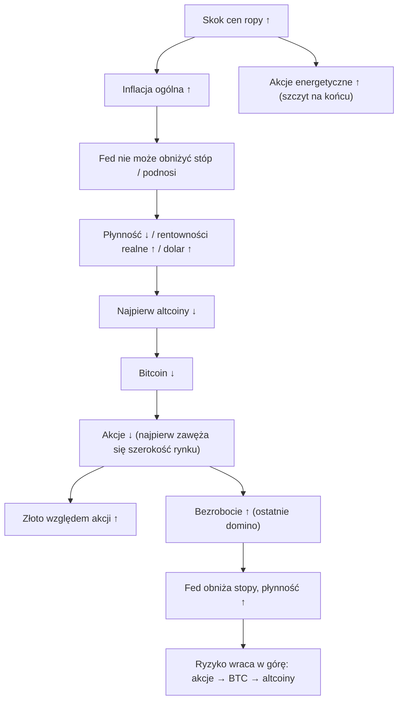

# 08. Akcje, złoto i inne aktywa

Bitcoin nie funkcjonuje w próżni. Na co dzień najsilniej wpływa na niego z zewnątrz amerykański rynek akcji, a w skali całego cyklu ślady zostawiają na nim także dolar, rentowności realne, złoto i ropa. W filmach Benjamina Cowena wątek nieustannie przeskakuje między bitcoinem a tymi rynkami: S&P 500 w porównaniach rynków niedźwiedzia, S&P podzielony przez złoto, złoto i srebro w jego serii „Dubious Speculation” („wątpliwe spekulacje”), ropa w 2026 roku oraz współczynniki korelacji pokazujące, jak ściśle kryptowaluty są powiązane z całą resztą. Ten rozdział omawia indeksy akcji i to, co dzieje się w ich wnętrzu (szerokość rynku, zmienność, wycena), metale i ropę, wskaźniki porównujące jeden rynek z drugim oraz to, co dane mówią o korelacjach bitcoina. Główna lekcja: zależności między klasami aktywów są realne, ale niestabilne. Zacieśniają się w rynkach niedźwiedzia napędzanych makroekonomią, a luzują w spokojnych latach lub w latach, gdy rządzą przepływy kapitału — a lata 2024–26 złamały kilka starych schematów.

**Czego się nauczysz**
- Jak czytać S&P 500, Nasdaq, Russell 2000, indeks równoważony (equal weight) i szerokość rynku (breadth) oraz jak zwykle zachowują się akcje w okolicach recesji.
- Co mierzą VIX, wskaźnik CAPE Shillera, wskaźnik Buffetta i prognozowany wskaźnik C/Z (forward P/E) oraz dlaczego w 2026 roku dają sprzeczne sygnały.
- Jak działają wskaźniki S&P ÷ M2, S&P ÷ złoto, BTC ÷ złoto i miedź/złoto oraz gdzie zawiodły.
- Co napędza złoto i srebro oraz co się stało przy ich szczycie i krachu w styczniu 2026 roku.
- Historię zależności między ropą a recesjami od 1973 do 2026 roku i dlaczego 2026 rok jest jak dotąd żywym kontrprzykładem.
- Co roczne korelacje z laboratorium kursu mówią o bitcoinie w zestawieniu z akcjami, dolarem i rentownościami realnymi.
- Kolejność „kaskady ryzyka” (risk cascade) według Cowena i jak sprawdziła się w latach 2025–26.

---

## Jak ryzyko przemieszcza się między rynkami

To kolejność, którą Cowen nazywa „kaskadą ryzyka” (risk cascade; memo z [15 marca 2026](https://benjamincowen.com/reports/how-risk-cascades-through-markets-march-2026)), narysowana z odgałęzieniem szoku naftowego, który zdominował 2026 rok. Traktuj ją jako tendencję, a nie prawo: sekcja o kaskadzie poniżej pokazuje, które kroki wystąpiły w latach 2025–26, a które nie.

**Odczyty z różnych rynków, koniec października 2026**

| Rynek | Ostatni odczyt | Data | Kontekst |
|---|---|---|---|
| S&P 500 | 7 743,98 | 28.10.2026 | Rekord 7 818,93 z 6.10; dołek 2026 roku 6 343,72 z 30.03 (−9,1%); od początku roku +13,1% |
| Nasdaq 100 | 29 402,51 | 29.10.2026 | Rekord 31 224,69 z 6.10 (−5,8%) |
| Russell 2000 | rekord ok. 3 068 | połowa sierpnia 2026 | +22,7% od początku roku na 12.08 |
| RSP/SPY (indeks równoważony ÷ ważony kapitalizacją) | rekordowe minimum 0,2710 | 7.10.2026 | 10 największych spółek to ok. 39% S&P |
| VIX | 16,91 | 28.10.2026 | Najwyższe zamknięcie 2026 roku 31,05 (27.03) |
| CAPE Shillera | ok. 40,7–41,2 | sierpień–październik 2026 | Wyżej był tylko w latach 1999–2000 |
| Prognozowany C/Z (FactSet) | 18,7 | 23.10.2026 | Poniżej średniej 5-letniej (19,8) i 10-letniej (19,1) |
| Złoto | ok. 4 024 USD | 29–30.10.2026 | Ok. −28% od szczytu kontraktów terminowych z końca stycznia |
| Srebro / wskaźnik złoto–srebro | ok. 51–52 USD / ok. 77 | 29–30.10.2026 | Rekord kontraktów na srebro 121,79 USD z 29.01.2026 |
| WTI / Brent | 103,37 USD / 123,10 USD | 27.10.2026 | Premia wojenna od 28.02.2026 |
| Bitcoin | 77 939 USD | 29.10.2026 | −37,5% od szczytu zamknięcia tygodniowego 124 720 USD (5.10.2025) |

Źródła: FRED na podstawie badań do kursu oraz [raport laboratorium](../../tools/macro-lab/REPORT-2026-10-30.md) dla S&P, Nasdaq 100, VIX, ropy i bitcoina; FactSet dla prognozowanego C/Z; Trading Economics i Investing.com (źródła wtórne) dla metali; pozostałe wiersze zgodnie ze źródłami podanymi w kartach.

---

## Indeksy akcji

### S&P 500 (SP:SPX, FRED SP500)

**Co to jest.** 500 największych spółek amerykańskich, ważonych kapitalizacją rynkową skorygowaną o akcje w wolnym obrocie (free float), prowadzony przez S&P Dow Jones Indices. Notowany w czasie rzeczywistym w godzinach sesji. Seria `SP500` w FRED obejmuje tylko ostatnie dziesięć lat danych dziennych.

**Gdzie to znaleźć.** TradingView `SP:SPX`; ETF-y SPY, VOO, IVV; FRED `SP500`. Na platformie Cowena: „ROI During S&P 500 Bear Markets” (stopa zwrotu w rynkach niedźwiedzia S&P 500), „ROI During S&P 500 Bull Markets” (stopa zwrotu w rynkach byka S&P 500), „S&P 500 Risk” (ryzyko S&P 500) i „S&P 500 Time in Risk Bands” (czas spędzony w pasmach ryzyka).

**Jak to czytać.** Spadek o 10% od szczytu umownie nazywa się korektą, a o 20% — rynkiem niedźwiedzia (bessą). Głębokość obsunięcia (drawdown) w dużej mierze zależy od tego, czy nadejdzie recesja i czy spadną zyski spółek:

| Recesja według NBER | Szczyt S&P | Szczyt względem początku recesji | Dołek | Spadek | Dołek względem końca recesji |
|---|---|---|---|---|---|
| grudzień 1969–listopad 1970 | 29.11.1968, 108,4 | 12 miesięcy przed | 26.05.1970, 69,3 | −36% | 6 miesięcy przed |
| listopad 1973–marzec 1975 | 11.01.1973, 120,2 | 10 miesięcy przed | 3.10.1974, 62,3 | −48% | 5 miesięcy przed |
| styczeń–lipiec 1980 | 13.02.1980, 118,4 | 1 miesiąc po | 27.03.1980, 98,2 | −17% | 4 miesiące przed |
| lipiec 1981–listopad 1982 | 28.11.1980, 140,5 | 8 miesięcy przed | 12.08.1982, 102,4 | −27% | 3 miesiące przed |
| lipiec 1990–marzec 1991 | 16.07.1990, 369,0 | ten sam miesiąc | 11.10.1990, 295,5 | −20% | 5 miesięcy przed |
| marzec–listopad 2001 | 24.03.2000, 1 527 | 12 miesięcy przed | 9.10.2002, 776,8 | −49% | 11 miesięcy po |
| grudzień 2007–czerwiec 2009 | 9.10.2007, 1 565 | 2 miesiące przed | 9.03.2009, 676,5 | −57% | 3 miesiące przed |
| luty–kwiecień 2020 | 19.02.2020, 3 386 | ten sam miesiąc | 23.03.2020, 2 237 | −34% | 1 miesiąc przed |

Tabelę zestawiono w ramach badań do kursu na podstawie standardowej historii S&P (Motley Fool, First Trust, Kathmere); inne badania, obejmujące dłuższe okresy, szacują średnie na ok. 7 miesięcy wyprzedzenia i spadek od −26% do −32%. W tym zestawie średni spadek wynosi ok. −36%, a szczyt przypadał średnio ok. 5 miesięcy przed początkiem recesji (rozrzut: od 1 miesiąca po do 12 miesięcy przed). Dołek wypadał 1–6 miesięcy *przed* końcem recesji w siedmiu z ośmiu przypadków; wyjątkiem są lata 2001–02.

Rynki niedźwiedzia **bez** recesji są płytsze: 1962 (−28%), 1966 (−22%), 1987 (−34%, krach), 1998 (−19%), 2011 (−19%), 2018 (−19,8%), 2022 (−25,4%), średnio mniej więcej od −20% do −25%.

Ostatnia ścieżka: S&P spadł o ok. 20% do **8 kwietnia 2025** (szok celny), odrobił straty do nowych szczytów, spadł o **9,1%** z 6 978,6 (27 stycznia 2026) do 6 343,72 (30 marca 2026, dołek po szoku wojny z Iranem), a potem ustanawiał rekordy, ostatni na poziomie **7 818,93 6 października 2026**.

**Jak używa tego Cowen.** S&P to jeden z jego najczęstszych tematów (ok. 240 tytułów lub streszczeń):
- Bitcoin „tops earlier and bottoms earlier than stocks” („osiąga szczyt i dołek wcześniej niż akcje”). Weryfikacja: prawda dla szczytu z 2021 roku (bitcoin 10 listopada 2021, S&P w styczniu 2022) i szczytu z 2025 roku (bitcoin 6 października 2025, S&P wciąż rosnący rok później); nieprawda dla dołka z 2022 roku (S&P 12 października, bitcoin 21 listopada po upadku FTX).
- Spadek S&P o 20% to dla niego granica między korektą a bessą recesyjną; w kwietniu 2025 roku posłużył się analogią z 1998 roku (spadek o 20%, a po nim nowe szczyty) („The S&P500 Has Dropped 20%”, 8 kwietnia 2025). Ta analogia się sprawdziła.
- „Stocks to 10% Drop Soon?” („Akcje wkrótce spadną o 10%?”, 3 lutego 2026): S&P spadł o ok. 9% do końca marca, a potem ustanowił nowe szczyty. Trafienie co do korekty; większy spadek, którego oczekiwał później, do października nie nastąpił.
- Poważna dalsza fala spadków bitcoina „would likely need a 10–20% equity selloff” („prawdopodobnie wymagałaby wyprzedaży akcji o 10–20%”), a wcześniejsze dołki bitcoina w latach wyborów połówkowych przychodziły razem z korektami na akcjach ([CoinMarketCap Academy, wrzesień 2026](https://coinmarketcap.com/academy/article/benjamin-cowen-puts-65percent-odds-on-lower-bitcoin-price-still-ahead), źródło wtórne). Dołki S&P w latach wyborów połówkowych (często w październiku, czasem w maju lub grudniu) wykorzystuje do wyznaczania dołka bitcoina w cyklu czteroletnim (rozdział [09](09-SEZONOWOSC-I-CYKLE-POLITYCZNE.md)).
- Historią S&P z lat 1962–1982 argumentuje, że cichy, „apatyczny” szczyt nie wyklucza rynku niedźwiedzia.
- Miękkie i twarde lądowanie zdefiniowane przez obsunięcia S&P omawia rozdział [06](06-WZROST-I-CYKL-KONIUNKTURALNY.md).

**Powiązania.**
- *Wyprzedza:* recesje, średnio o ok. 5 miesięcy w przypadku szczytu (powyżej); S&P wchodzi w skład wskaźnika wyprzedzającego Conference Board.
- *Jest wyprzedzany przez:* oczekiwania co do zysków spółek, rentowności realne, płynność (luźno, zob. rozdział [07](07-PLYNNOSC-PIENIADZ-I-DOLAR.md)) i spready kredytowe.
- *Znak korelacji z bitcoinem:* dodatni od 2020 roku, najsilniejszy w bessach napędzanych makroekonomią (zob. kartę o korelacjach).
- *Wyjątki:* lata 2023–26, gdy płynność netto szła w bok lub spadała, a S&P rósł na zyskach związanych z AI (wzrost zysku na akcję S&P w 2026 roku ok. 30%).

**Co to oznaczało dla aktywów.** Bessy na akcjach z recesją: od −17% do −57%, średnio ok. −36%. Bez recesji: od −20% do −25%. Bessy bitcoina z 2018 (−84%) i 2022 roku (−77%) przebiegły *bez* recesji w USA; cykle kryptowalut nie są napędzane przede wszystkim recesjami. W fazach odbicia prowadzą małe spółki, spółki cykliczne i aktywa o wysokiej becie (bitcoin ok. +306% w 2020 roku).

**Wniosek dla inwestora.** Pytaj, czy zyski spółek spadają: to, bardziej niż skala pierwszego spadku, decydowało o głębokości bess na akcjach. I nie zakładaj, że bitcoin potrzebuje spadku akcji, by przejść własny rynek niedźwiedzia; lata 2018, 2022 i 2025–26 pokazują coś innego.

### Nasdaq 100, Russell 2000 i analogie wykresowe

**Co to jest.** **Nasdaq 100** to 100 największych spółek niefinansowych notowanych na Nasdaq, ważonych zmodyfikowaną kapitalizacją, z przewagą technologii (FRED `NASDAQ100`; TradingView `NASDAQ:NDX`; ETF QQQ). Laboratorium kursu używa szerszego **Nasdaq Composite** (FRED `NASDAQCOM`), bo jest to najdłuższy darmowy dzienny indeks w FRED. **Russell 2000** obejmuje małe spółki z miejsc 1001–3000 w Russell 3000 (TradingView `TVC:RUT`; ETF IWM). To najbardziej wrażliwy na stopy procentowe i warunki kredytowe indeks w USA ze względu na zadłużenie o zmiennym oprocentowaniu i nierentowne firmy.

**Jak to czytać.** Nasdaq ma wyższą betę niż S&P; laboratorium używa go jako przybliżenia rynku akcji w korelacjach z bitcoinem. Russell to termometr szerokości rynku i warunków kredytowych. W 2026 roku małe spółki zrobiły coś nietypowego: **prowadziły** w roku *podwyżek* stóp, z rekordowym zamknięciem ok. 3 068 w połowie sierpnia (+22,7% od początku roku na 12 sierpnia wobec +13,2% dla S&P), prawdopodobnie dlatego, że podążają za ożywieniem w przemyśle (ISM powyżej 50 przez dziewięć miesięcy), energetyką i przemysłem oraz przychodami krajowymi w świecie ceł. We wrześniu memo Cowena odnotowało, że indeks małych spółek S&P 600 był ok. 9% poniżej szczytu z połowy sierpnia.

**Jak używa tego Cowen.** Głównie jako **analogii**: start spotowych ETF-ów porównywał z historią QQQ po jego debiucie w 1999 roku („Bitcoin Market Cycles”, 21 listopada 2024); ścieżkę obsunięcia ETH — ze ścieżką Tesli (grudzień 2025, Bankless); a wzorce wybicia i cofnięcia z palladu, Hang Seng i wcześniejszej dominacji bitcoina zastosował do dominacji stablecoinów w 2026 roku („Bitcoin: An Unfortunate Pattern”, 7 stycznia 2026; rozdział [12](12-DOMINACJA-ALTCOINY-I-ROTACJA.md)). W lutym 2026 roku omawiał też „Dow 50,000”. To porównania kształtu wykresów, a nie mechanizmy; jedna analogia dobrana po fakcie niewiele dowodzi.

**Wniosek dla inwestora.** Używaj Nasdaq do oceny bety, a Russell — do oceny szerokości rynku i wrażliwości na warunki kredytowe. Analogie wykresowe traktuj jako hipotezy o kształcie, nigdy jako dowód.

### Indeks równoważony i szerokość rynku (RSP/SPY, S5TH)

**Co to jest.** Indeks S&P 500 Equal Weight daje każdemu członkowi wagę 0,2% i jest rebalansowany kwartalnie (TradingView `SP:SPXEW`; ETF RSP). **Wskaźnik RSP/SPY** pokazuje, czy „przeciętna spółka” wygrywa z megaspółkami. Narzędzia szerokości rynku: odsetek spółek z S&P powyżej ich 200-dniowej średniej kroczącej (TradingView `INDEX:S5TH`), linia wzrostów i spadków (advance–decline) NYSE, nowe szczyty minus nowe dołki oraz Russell 2000 względem S&P. Platforma Cowena ma wykresy „Advance Decline Ratios”, „Advance Decline Index (ADI)” i „Absolute Breadth Index (ABI)” oraz ich wersje dla kryptowalut (monety powyżej lub poniżej średnich kroczących).

**Jak to czytać.** Wąskie przywództwo (RSP/SPY spada, a indeks rośnie) często nazywa się niezdrowym i historycznie poprzedzało korekty, np. w latach 1999–2000 i 2021. Koncentracja może jednak trwać latami, co pokazały lata 2023–2026. Szeroki udział spółek, z linią wzrostów i spadków na nowych szczytach, historycznie przemawiał przeciwko dużemu szczytowi w ciągu najbliższych miesięcy.

Ostatnie dane: indeks równoważony prowadził przez większość 2026 roku, a w połowie września prowadzenie się odwróciło. **RSP/SPY osiągnął rekordowe minimum 0,2710 7 października 2026**, ok. 31% poniżej szczytu z 2015 roku. Licząc całkowitą stopę zwrotu, od początku roku do 21 października oba szły mniej więcej łeb w łeb (RSP +14,4%, SPY +14,3%). 10 największych spółek stanowiło 30 września 2026 ok. **39%** S&P.

**Jak używa tego Cowen.** Zawężająca się szerokość rynku oznacza późną fazę cyklu. We wrześniu 2026 roku zauważył, że S&P był +12,5% od początku roku przy zaledwie ok. **48%** spółek powyżej 200-dniowej średniej — kombinacja „last seen around 1998 to 2000” („ostatnio widziana mniej więcej w latach 1998–2000”) — a „breadth broadens materially” („istotne poszerzenie się szerokości rynku”) wymienia wśród sygnałów, które obaliłyby jego scenariusz niedźwiedzi ([Triple Squeeze, 30 września 2026](https://benjamincowen.com/reports/the-triple-squeeze-september-2026)). Tę samą ideę stosuje do kryptowalut („Measuring The Breadth of Crypto Rallies”, 14 maja 2025): rajd prowadzony przez samego bitcoina, przy opóźnionych altcoinach, to rajd wąski. Dwa uzupełnienia z jego memo z 2026 roku:
- **Nasdaq-100 równoważony ÷ ważony kapitalizacją (NDXE/NDX).** Nazywa go akcyjnym odpowiednikiem dominacji bitcoina: spadający wskaźnik oznacza, że zyski skupiają się w megaspółkach. Spadł z ok. 0,50 w 2020 roku do ok. **0,35** w sierpniu 2026 (ok. 0,34 trzy miesiące wcześniej), a „equal-weight to cap-weight ratio turning up” („odwrócenie w górę wskaźnika indeksu równoważonego do ważonego kapitalizacją”) należy do jego zestawu sygnałów obalających prognozę korekty ([Balance of Risks, 15 sierpnia 2026](https://benjamincowen.com/reports/the-balance-of-risks-august-2026)). TradingView: `NASDAQ:NDXE/NASDAQ:NDX`.
- **Drabina jakości.** Przy zacieśnianiu kapitał przesuwa się *w górę drabiny jakości w obrębie każdej klasy aktywów*: altcoiny → bitcoin, małe spółki → duże spółki, spekulacyjne spółki wzrostowe → biznesy generujące gotówkę. Rajd przy napiętej płynności i zawężającym się przywództwie to **rynek byka ucieczki do jakości** (flight-to-quality bull market; jego przykłady: 2006–07 i 2023–25). Rekordy indeksu wyznaczają wtedy, jak to ujmuje, „the top of the ladder” („szczyt drabiny”), „not the edge of a cliff” („a nie krawędź urwiska”) ([Macro Risk Memo, 15 lutego 2026](https://benjamincowen.com/reports/macro-risk-memo-feb-2026); memo z sierpnia 2026). W ten sposób godzi pogląd o restrykcyjnej płynności z rekordami S&P.

**Powiązania.** W klasycznych późnych fazach cyklu (1999–2000, 2007, 2021) szerokość rynku zawęża się przed szczytem indeksu, z wyprzedzeniem rzędu miesięcy. Po dołkach bessy jako pierwsza się poszerza, a prowadzą małe spółki.

**Co to oznaczało dla aktywów.** Rekordowa koncentracja sprawia, że S&P jest w praktyce zakładem na zyski AI i megaspółek; wycenę na poziomie indeksu dominuje ok. dziesięciu firm. W przypadku kryptowalut wąskiej szerokości rynku akcji towarzyszył późnocykliczny, awersyjny wobec ryzyka nastrój, w którym rośnie dominacja bitcoina.

**Wniosek dla inwestora.** Sprawdzaj, czy nowe szczyty indeksu dzieli większość spółek. Wąskie szczyty to żółta flaga o słabym wyczuciu czasu.

### Małe spółki jako sygnał wyprzedzający: S&P 600 względem S&P 500

**Co to jest.** Względna ścieżka indeksu małych spółek S&P 600 (TradingView `SP:SP600`; ETF IJR) wobec S&P 500. Małe spółki mają więcej długu o zmiennym oprocentowaniu i mniejszą siłę cenową, więc jako pierwsze odczuwają zacieśnianie.

**Jak używa tego Cowen.** Jako sygnał wyprzedzający na szczytach ([Triple Squeeze, 30 września 2026](https://benjamincowen.com/reports/the-triple-squeeze-september-2026), wykresy 9–10). W **2018** roku małe spółki osiągnęły szczyt pod koniec sierpnia, a S&P załamał się ok. **4–5 tygodni później**; oba osiągnęły dołek 24 grudnia 2018. W **2026** roku S&P 600 był ok. −9% od szczytu z połowy sierpnia, podczas gdy S&P pozostawał w pobliżu rekordów; Cowen nazwał to „warning” („ostrzeżeniem”) i stwierdził, że rynek jest „six weeks past” („sześć tygodni po”) szczycie małych spółek. Jego zadeklarowany test: jeśli S&P podąży w dół za S&P 600, analogia z 2018 roku się wzmocni; odbicie małych spółek ją rozbroi. Pod koniec października Russell 2000 nieco odbił, a S&P był blisko rekordów (doniesienia, źródło wtórne), co przechyla szalę ku „rozbrojeniu”, choć prognoza wciąż pozostawała otwarta.

**Powiązania.** Najpierw małe spółki ↓ → szerokość rynku się zawęża → indeks osiąga szczyt kilka tygodni później (2018). Na dołkach odwrotnie: małe spółki prowadzą odbicie.

**Wniosek dla inwestora.** Jeden czysty precedens (2018) czyni z tego hipotezę. Obserwuj go razem z szerokością rynku i spreadami kredytowymi, a nie w oderwaniu od nich.

### Akcje zagraniczne względem amerykańskich

**Co to jest.** Względne wyniki indeksów akcji spoza USA wobec indeksów amerykańskich (na przykład TradingView `AMEX:VEU/AMEX:VTI` lub `AMEX:EFA/AMEX:SPY`).

**Jak używa tego Cowen.** W lutym 2026 roku argumentował, że wysoka niepewność co do polityki gospodarczej USA w połączeniu ze słabszym dolarem sprzyja akcjom zagranicznym względem amerykańskich, a rajd dolara w stylu 2018 roku odwróciłby tę zależność ([Macro Risk Memo, 15 lutego 2026](https://benjamincowen.com/reports/macro-risk-memo-feb-2026)). W ramach badań do kursu nie udało się zweryfikować, jak ta względna pozycja radziła sobie do października 2026 roku.

**Powiązania.** Dolar ↓ → zagraniczne stopy zwrotu ↑ w przeliczeniu na dolary i łatwiejsze globalne finansowanie → akcje zagraniczne ↑ względem USA. Coraz wyższe dołki dolara od lutego 2026 roku (rozdział [07](07-PLYNNOSC-PIENIADZ-I-DOLAR.md)) działały na niekorzyść tej pozycji.

**Wniosek dla inwestora.** Pytanie „zagranica czy USA” to w dużej mierze pytanie o dolara; czytaj je razem z DXY.

### VIX (VIXCLS, TVC:VIX)

**Co to jest.** Indeks zmienności Cboe (Cboe Volatility Index): 30-dniowa zmienność implikowana opcji na S&P 500, w procentach w ujęciu rocznym. Liczony w czasie rzeczywistym. VIX ÷ 16 to w przybliżeniu oczekiwana przez rynek dzienna zmiana S&P w procentach (16 ≈ √256 dni sesyjnych).

**Gdzie to znaleźć.** FRED `VIXCLS`; TradingView `TVC:VIX`. **Nie** jest to nazwany wykres na platformie Cowena.

**Jak to czytać.** Poniżej ok. 13–15 sygnalizuje samozadowolenie; powyżej ok. 30 — stres. Rekordy: zamknięcie **82,69 16 marca 2020** i 80,86 20 listopada 2008; w trakcie sesji 89,53 24 października 2008. Ostatnie skoki: **5 sierpnia 2024** w trakcie sesji ok. 65,7, zamknięcie 38,57 (zwijanie carry trade na jenie, rozdział [07](07-PLYNNOSC-PIENIADZ-I-DOLAR.md)); **8 kwietnia 2025** zamknięcie 52,33 (cła); najwyższe zamknięcie 2026 roku **31,05 27 marca** (wojna z Iranem). Ostatni odczyt **16,91 (28 października 2026)**. Gdy VIX jest powyżej swojego 3-miesięcznego odpowiednika (VIX3M), struktura terminowa jest odwrócona, co jest oznaką ostrego stresu.

**Jak używa tego Cowen.** Rzadko i nie jako wykresu z platformy; gdy zmienność pojawia się w jego filmach, korzysta ze źródeł zewnętrznych.

**Powiązania.** Skoki VIX wracają do średniej i częściej zbiegają się z dołkami na akcjach, niż je przewidują. Kupno S&P po zamknięciu VIX powyżej 30 historycznie w większości przypadków dawało dodatnie stopy zwrotu w horyzoncie 6–12 miesięcy, z wyjątkiem 2008 roku (statystyka praktyków, źródło wtórne). Bitcoin spadał podczas skoków VIX: w marcu 2020, sierpniu 2024 i kwietniu 2025.

**Co to oznaczało dla aktywów.** Wysoki VIX: akcje i kryptowaluty w dół, obligacje skarbowe USA (Treasuries) i jen w górę, dolar różnie. Niski VIX przy Brencie powyżej 120 USD i podnoszącym stopy Fedzie, jak w październiku 2026 roku, wygląda na samozadowolenie w stosunku do ryzyka makro; zmienność implikowana zwykle pozostaje niska, dopóki coś się nie zepsuje.

**Wniosek dla inwestora.** VIX mówi, jak bardzo boją się teraz nabywcy opcji, a nie co nastąpi dalej. Skrajne odczyty lepiej oznaczały szczyty stresu, niż je przewidywały.

---

## Wycena

### CAPE Shillera i nadwyżkowa stopa zysku CAPE

**Co to jest.** Cyklicznie skorygowany wskaźnik cena/zysk (C/Z): realna cena S&P podzielona przez 10-letnią średnią realnych zysków. Dane Roberta Shillera sięgają 1871 roku (econ.yale.edu/~shiller/data.htm; multpl.com publikuje dzienny szacunek). **Nadwyżkowa stopa zysku CAPE** (excess CAPE yield) to w przybliżeniu stopa zysku z CAPE (1 ÷ CAPE) minus realna rentowność 10-letnich obligacji: o ile więcej akcje „przynoszą” niż obligacje chronione przed inflacją.

**Gdzie to znaleźć.** multpl.com, GuruFocus, arkusz Shillera. Na platformie Cowena: „Shiller PE/CAPE Ratio”, „Total Return CAPE Ratio”, „Excess CAPE Yield”.

**Jak to czytać.** Średnia długoterminowa to ok. 17. Szczyt z 1929 roku wynosił ok. 32, **rekord z grudnia 1999 roku 44,2**, szczyt z listopada 2021 roku ok. 38. Październik 2026: **ok. 40,7** (dzienny odczyt multpl ok. 41,6 8 października; źródła różnią się o mniej więcej punkt). Wysoki CAPE prognozuje *niskie 10-letnie realne stopy zwrotu* (historycznie R² ok. 0,4–0,5) i jest niemal bezużyteczny do wyczucia momentu w horyzoncie roku: CAPE powyżej 30 utrzymywał się przez większość lat 2017–2026. Krytycy wskazują na zmiany w rachunkowości, które zaniżały dawne zyski, strukturalnie wyższe marże i udział technologii oraz niższe stopy realne. Kontrargument w 2026 roku: stopy realne nie są niskie — rentowność 10-letnich TIPS wynosiła 28 października 2026 2,67% (laboratorium).

**Jak używa tego Cowen.** Rzadko i raczej jako „poduszki” niż wyzwalacza. Jego memo z sierpnia 2026 roku podawało CAPE na poziomie **41,2**, „second-highest in a century after 2000” („drugi najwyższy w stuleciu po 2000 roku”), obok **historycznego C/Z (trailing P/E) ok. 28** i **stopy zysku 3,56%** (odwrotność C/Z), i argumentowało, że CAPE na poziomie 41 „reached on positive earnings growth is a less fragile animal” („osiągnięty przy rosnących zyskach to mniej kruche zwierzę”) niż taki, który osiągnięto przy spadających zyskach ([Balance of Risks, 15 sierpnia 2026](https://benjamincowen.com/reports/the-balance-of-risks-august-2026)). Jedno zastrzeżenie co do definicji: **nadwyżkowa stopa zysku CAPE** na jego platformie wynosiła ok. **0,97%**, podczas gdy publikowana wersja Shillera — wówczas ok. **1,4%**. Wersja ITC odejmuje rentowność realną ex post; wersja Shillera używa jego własnej konstrukcji rentowności realnej. Ta sama nazwa, inna liczba: zawsze sprawdzaj, której wersji używa wykres. Platforma Cowena ma też wykresy „Trailing PE Ratio”, „Earnings Yield” i „Dividend Yield”.

**Powiązania.** CAPE spada w recesjach, bo ceny spadają szybciej niż 10-letnie zyski („recessions bring extended valuations back to baseline” — „recesje sprowadzają wygórowane wyceny do poziomu bazowego”, jego ujęcie cyklu koniunkturalnego z 2026 roku, rozdział [06](06-WZROST-I-CYKL-KONIUNKTURALNY.md)). Rośnie, gdy spadają rentowności realne.

**Co to oznaczało dla aktywów.** Startowy CAPE powyżej 40 (2000) poprzedził straconą dekadę dla akcji amerykańskich. Niewiele mówi o najbliższych 12 miesiącach na akcjach i nic bezpośrednio o bitcoinie.

**Wniosek dla inwestora.** CAPE to szacunek stóp zwrotu w długim horyzoncie, a nie sygnał sprzedaży. Niska nadwyżkowa stopa zysku CAPE oznacza, że akcje oferują niewielką dodatkową rekompensatę w porównaniu z obligacjami realnymi.

### Wskaźnik Buffetta (kapitalizacja ÷ PKB)

**Co to jest.** Łączna kapitalizacja amerykańskiego rynku akcji (Wilshire 5000 albo akcje przedsiębiorstw niefinansowych z rachunków Z.1 Fed) podzielona przez PKB lub PNB. Warren Buffett (Fortune, 2001) nazwał go „probably the best single measure” („prawdopodobnie najlepszą pojedynczą miarą”) wyceny i stwierdził, że zbliżanie się do 200% to „playing with fire” („igranie z ogniem”).

**Gdzie to znaleźć.** GuruFocus i inne serwisy śledzące; można go zbudować w FRED z serii akcji z Z.1 i `GDP`.

**Jak to czytać.** **Odczyty bardzo się różnią w zależności od konstrukcji.** W październiku 2026 roku GuruFocus pokazywał **ok. 234–236%**, a inne serwisy **ok. 288–301%**. Wszystkie to rekordowe poziomy, wyższe niż w 2000 roku (ok. 140–150%) i 2021 roku (ok. 200%). Zastrzeżenie: rosnący udział przychodów zagranicznych i wyższe marże sprawiają, że kapitalizacja w relacji do *krajowego* PKB strukturalnie dryfuje w górę, więc „normalny” poziom prawdopodobnie wzrósł.

**Jak używa tego Cowen.** Nie jest to jego regularny wykres; uwzględniono go, bo pojawia się w większości debat o wycenie.

**Wniosek dla inwestora.** Przy każdym odczycie wskaźnika Buffetta podawaj źródło i konstrukcję; ten sam miesiąc może dać 235% albo 300%.

### Prognozowany C/Z (forward P/E)

**Co to jest.** Cena podzielona przez konsensusowy operacyjny zysk na akcję w perspektywie najbliższych 12 miesięcy (FactSet, LSEG).

**Jak to czytać.** **18,7 23 października 2026** (FactSet), *poniżej* średniej 5-letniej (19,8) i 10-letniej (19,1), bo zyski w 2026 roku rosły o ok. 30% (łączny wzrost w III kwartale 2026 +29,5% r/r). LSEG podawał ok. 19,1.

**Rozbieżność.** CAPE ok. 41 mówi: „bardzo drogo przy znormalizowanych zyskach”. Prognozowany C/Z 18,7 mówi: „uczciwie, jeśli prognozy się sprawdzą”. Oba da się pogodzić tylko wtedy, gdy skok zysków w 2026 roku (nakłady inwestycyjne na AI, energetyka, rekordowe marże) okaże się trwały. Prognozy zysków są procykliczne, więc prognozowany C/Z zwykle wygląda najtaniej tuż *przed* załamaniem zysków, jak w 2000 i 2007 roku.

**Wniosek dla inwestora.** Gdy CAPE i prognozowany C/Z się nie zgadzają, pytanie dotyczy trwałości bieżących zysków, a na to nie odpowie żaden wskaźnik.

---

## Wskaźniki: akcje względem pieniądza i złota

### S&P 500 ÷ M2

Konstrukcję i datowane zastosowania tego wskaźnika przez Cowena (2022: „range-bound for about 30 years” — „w przedziale od ok. 30 lat”; grudzień 2025: „przypomina lata 1996–2000, ok. jeszcze jeden rok wzrostów”; marzec 2026: preferencja dla relacji akcji do złota) opisuje rozdział [07](07-PLYNNOSC-PIENIADZ-I-DOLAR.md). W przypadku akcji sprawa jest prosta: gdy wskaźnik S&P ÷ M2 jest wysoki, ceny wyprzedziły podaż pieniądza, ale wysoki odczyt niczego nie zatrzymał w latach 1996–2000. To narzędzie do postawienia pytania „ile z tego rajdu ma podłoże monetarne?”, a nie zegar.

### S&P 500 ÷ złoto

**Co to jest.** Poziom indeksu S&P 500 podzielony przez cenę złota w dolarach za uncję: ile uncji złota „kupuje jeden S&P”. Usuwa dolara z porównania, więc pokazuje, czy prowadzą aktywa realne, czy finansowe.

**Gdzie to znaleźć.** TradingView `SP:SPX/TVC:GOLD`.

**Jak to czytać.** Rosnący wskaźnik oznacza, że akcje wygrywają ze złotem (wzrost przy dezinflacji, spadające rentowności realne przy silnych zyskach; 1980–2000, 2009–2021). Spadający oznacza, że wygrywa złoto (stagflacja, kryzysy; lata 70., 2000–2011). W 2026 roku wzrósł z ok. **1,32 15 marca** (6 632 ÷ 5 018) do ok. **1,91 23 października** (7 624 ÷ ok. 3 990), według obliczeń z badań do kursu na poziomach z memo Cowena i raportów rynkowych.

**Jak używa tego Cowen.** Stał się jednym z jego głównych wykresów w 2026 roku:
- Styczeń 2026 („A Deeply Concerning Chart for Stocks”, 20 stycznia; „Gold and the Rotation Trap”, 21 stycznia; „Gold Breaks out against Stocks!”, 22 stycznia 2026): przebicie poniżej ok. **1,4** poprzedziło duże spadki w **1973 i 2008 roku**; złoto zyskało **46%** względem akcji od 2021 roku; wykres wygląda „more like the 1970s than 2000” („bardziej jak lata 70. niż rok 2000”). „Pułapka rotacji” (rotation trap) to sprzedawanie zwycięzcy (złota), by kupić maruderów (akcje lub kryptowaluty) w oparciu o narrację o rotacji.
- Do 30 marca 2026 roku stwierdził, że woli relację akcji do złota od S&P ÷ M2.
- W jego modelu kaskady ryzyka „traditional risk assets deteriorate relative to gold” („tradycyjne aktywa ryzykowne słabną względem złota”) to etap 3. W lutym 2026 roku napisał, że odpływ wartości akcji względem złota odzwierciedla „the same hierarchy of risk compression” („tę samą hierarchię kompresji ryzyka”) co odpływ altcoinów względem bitcoina ([Macro Risk Memo, 15 lutego 2026](https://benjamincowen.com/reports/macro-risk-memo-feb-2026)).

**Jak to się potoczyło.** Prognoza ze stycznia 2026 roku przyszła na szczycie złota. Złoto potem gwałtownie spadło (jego film z 23 marca 2026 roku nosił tytuł „Gold Drops Nearly 30%”, choć jego własne memo z 15 marca wciąż podawało cenę złota w pobliżu 5 018 USD, ok. 10% poniżej szczytu, więc skala spadku pod koniec marca nie jest niezależnie zweryfikowana), S&P ustanawiał rekordy, a wskaźnik wzrósł z ok. 1,3–1,4 do ok. 1,9 pod koniec października. Jego własne podsumowanie z sierpnia 2026 roku określało transmisję „akcje względem złota” jako „open” („otwartą”). Rejestr trafności kursu ocenia ją jako krótkoterminowe pudło. Precedensy z 1973 i 2008 roku to wciąż tylko dwie obserwacje.

**Powiązania.** Wskaźnik spada, gdy spadają rentowności realne i rosną obawy przed inflacją (złoto w górę) lub gdy zyski się załamują (akcje w dół). Rośnie, gdy rentowności realne rosną, a zyski idą w górę, jak w 2026 roku po styczniu.

**Co to oznaczało dla aktywów.** Długie spadki wskaźnika (lata 70., lata 2000.) były słabymi dekadami dla akcji w ujęciu realnym. Krótkie przebicia dawały zaszumione sygnały.

**Wniosek dla inwestora.** S&P ÷ złoto to przydatny wykres reżimu dla pytania „inflacja czy zyski”. Pojedyncze przebicie okrągłej liczby to słaby dowód.

### Bitcoin ÷ złoto

**Co to jest.** Cena bitcoina w uncjach złota (TradingView `BITSTAMP:BTCUSD/TVC:GOLD`). Usuwa dolara z wyceny bitcoina i pyta, czy „cyfrowe złoto” wygrywa ze złotem.

**Jak to czytać.** W późnej fazie cyklu i przy napiętej płynności twarde aktywa zwykle wygrywały ze spekulacyjnymi, więc wskaźnik spada; w rynkach byka napędzanych płynnością rośnie.

**Jak używa tego Cowen.** Jako prognozy względnej: „Bitcoin to Drop Another 30% against Gold?” („Bitcoin spadnie o kolejne 30% względem złota?”, 3 kwietnia 2026), gdzie stwierdził, że bitcoin może spaść o kolejne 30–40% *względem złota* — jako pogląd względny, a nie cel cenowy w dolarach. Powiedział też, że jego ulepszona metryka ryzyka społecznego (social risk) podąża za BTC ÷ złoto („Bitcoin: An Improved Social Risk Metric”, 31 marca 2026; rozdział [11](11-ON-CHAIN-I-SENTYMENT.md)).

**Wniosek dla inwestora.** Wycena bitcoina w złocie oddziela pytanie „bitcoin względem twardego pieniądza” od pytania „bitcoin względem dolara”. Odpowiedzi mogą się różnić przez wiele miesięcy.

---

## Metale i surowce

### Złoto (TVC:GOLD, XAUUSD)

**Co to jest.** Cena spot jednej uncji trojańskiej złota w dolarach. Wzorcem jest cena z aukcji LBMA; FRED usunął swoją serię LBMA w 2022 roku.

**Gdzie to znaleźć.** TradingView `TVC:GOLD`, `OANDA:XAUUSD`; kontrakty terminowe COMEX `GC1!`. Platforma Cowena wymienia złoto wśród aktywów tradycyjnych finansów (TradFi), z widokami ryzyka i Google Trends.

**Jak to czytać.** Cztery czynniki, mniej więcej w kolejności, w jakiej historycznie działały:
1. **Rentowności realne** (zależność odwrotna; silna w latach 2006–2021). Złoto nic nie płaci, więc wyższe rentowności realne podnoszą koszt jego trzymania.
2. **Dolar** (zależność odwrotna).
3. **Zakupy banków centralnych.** Przyspieszyły po zamrożeniu rezerw Rosji w 2022 roku i od 2022 roku zerwały zależność od rentowności realnych: złoto rosło, mimo że rentowności realne też rosły.
4. **Strach i poszukiwanie bezpiecznej przystani oraz obawa przed dewaluacją pieniądza (debasement).**

**Przebieg w ostatnim czasie.**
- 2025: ok. 3 300 USD (kwiecień), 3 600 USD (wrzesień), 3 900 USD (6 października), 4 200 USD (16 października 2025).
- Powyżej 4 800 USD 21 stycznia 2026, potem paraboliczny szczyt pod koniec stycznia. Źródła się różnią: kontrakty terminowe COMEX dotarły do ok. **5 627 USD 29 stycznia 2026** i następnego dnia spadły o ponad 880 USD (rozliczenie na 4 745 USD); podawane rekordy ceny spot wahają się od ok. 4 970 do 5 600 USD w zależności od źródła; Cowen w swoich materiałach przyjmował ok. 5 560 USD.
- Gwałtowny wiosenny spadek (film Cowena „Gold Drops Nearly 30%”, 23 marca 2026; dokładny poziom z końca marca nie jest niezależnie zweryfikowany, a jego memo z 15 marca wciąż podawało cenę złota w pobliżu 5 018 USD); dołek pod koniec czerwca ok. **3 970 USD**; ok. 4 210–4 370 USD w sierpniu–wrześniu; ok. **4 024 USD 29–30 października 2026**, ok. 28% poniżej szczytu kontraktów — *w czasie wojny*.

Ten ostatni punkt ma znaczenie. Spadek z 2026 roku pasuje do **rosnących rentowności realnych** (10-letnie TIPS z 1,71% rok wcześniej do 2,67% 28 października 2026 według laboratorium; nominalna rentowność 10-latek 5,0–5,3%; Fed podnoszący stopy) oraz do rozładowania zatłoczonej paraboli. Nie jest to dowód, że „bezpieczna przystań zawiodła”.

**Jak używa tego Cowen.** W latach 2025–26 złoto przeszło u niego od tematu okazjonalnego do częstego (pojawia się w 31 ze 116 filmów opublikowanych między 1 stycznia a 11 czerwca 2026, według liczenia słów kluczowych w ramach kursu; indeks filmów kończy się 11 czerwca). Jego cykliczna seria scenariuszy „Gold: Dubious Speculation” trwała przez cały 2026 rok (np. 6 lutego i 27 października 2026). Datowane tezy:
- Styczeń 2026: nie rotować ze złota; ryzyko załamania S&P ÷ złoto (powyżej). Krótkoterminowe pudło: prognoza przyszła na szczycie.
- Lipiec 2026: złoto rosło, gdy bitcoin spadał, więc „a single real-rate or liquidity story does not explain both” („jedna narracja o stopach realnych lub płynności nie wyjaśnia obu”) ([Bitcoin Cycle Memo, 15 lipca 2026](https://benjamincowen.com/reports/bitcoin-cycle-memo-july-2026)).
- Sierpień 2026: krótkoterminowa słabość z możliwym ponownym testem dołka z końca czerwca w okolicach 3 970 USD ([Balance of Risks](https://benjamincowen.com/reports/the-balance-of-risks-august-2026)). 23 października złoto notowano w trakcie sesji w okolicach 3 990 USD, „below $4,000 for the first time since July” („poniżej 4 000 USD po raz pierwszy od lipca”, źródło wtórne), więc ponowny test nastąpił; nie zweryfikowano, czy cena zeszła poniżej 3 970 USD.
- Wrzesień 2026: „gold bottoms first, then the long end tops” („najpierw dołek złota, potem szczyt rentowności na długim końcu krzywej”), a następnie stres. Jego tabela trzech epizodów (2018, 2022, 2023) pokazuje pierwszy dołek złota 2–12 tygodni przed szczytem rentowności 10-latek i w pobliżu szczytu dolara; sygnał, którego wypatruje, to dolar nieustanawiający nowych szczytów, podczas gdy rentowność 10-latek wciąż je ustanawia. Ocenił, że złoto jest „likely closer to a low than a high, even if it undercuts prior lows first” („prawdopodobnie bliżej dołka niż szczytu, nawet jeśli najpierw zejdzie poniżej wcześniejszych dołków”) ([Triple Squeeze memo](https://benjamincowen.com/reports/the-triple-squeeze-september-2026)). Stronę rentowności tej sekwencji opisuje rozdział [03](03-OBLIGACJE-I-KRZYWA-RENTOWNOSCI.md); okno dołka złota w roku wyborów połówkowych — rozdział [09](09-SEZONOWOSC-I-CYKLE-POLITYCZNE.md).
- Mówi, że posiada metale i uran (Bankless, 23 grudnia 2025).

**Powiązania.** Złoto ← rentowności realne (−), dolar (−), popyt banków centralnych (+), kryzysy (+, zwykle po początkowym spadku, jak w marcu 2020 i w 2008 roku, gdy wszystko sprzedawano za dolary). Złoto a bitcoin: 30-dniowa korelacja spadła do **−0,88 w marcu 2026** (CryptoQuant), po czym 90-dniowa korelacja wzrosła do **ok. 0,5–0,86 na początku września 2026**, mniej więcej najwyżej od sześciu lat, bo oba aktywa spadały razem ([The Block, 3 września 2026](https://www.theblock.co/news/markets/2026-09-03-bitcoin-gold-correlation-hits-six-year-high-but-analysts-question-whether-equity-decoupling-will-last-413437)). W długich oknach jest bliska zera i niestabilna.

**Co to oznaczało dla aktywów.** Złoto w wielu późnych fazach cyklu było ostatnim bastionem w trybie ucieczki od ryzyka (risk-off) i mocno rosło w 2025 roku, gdy bitcoin osiągał szczyt. W 2026 roku gwałtownie spadło, gdy wzrosły rentowności realne. „Cyfrowe złoto” to narracja, a nie stabilna własność statystyczna; jak mówi Cowen: „Bitcoin has never traded like gold” („Bitcoin nigdy nie zachowywał się jak złoto”; Bankless, 23 grudnia 2025).

**Wniosek dla inwestora.** Złoto czytaj najpierw na tle rentowności realnych i popytu banków centralnych. Paraboliczny ruch „bezpiecznego” aktywa może się rozładować równie gwałtownie jak ruch spekulacyjny.

### Srebro, wskaźnik złoto/srebro i inne metale

**Co to jest.** Srebro jest po części metalem monetarnym, a po części surowcem przemysłowym (panele słoneczne, elektronika). **Wskaźnik złoto/srebro** to liczba uncji srebra za uncję złota (TradingView `TVC:GOLD/TVC:SILVER`).

**Jak to czytać.** Historyczny zakres to ok. 30–125 (125 w marcu 2020). Wysokie odczyty oznaczają strach i deflację; niskie — reflację i spekulacyjne przegrzanie. Srebro zwykle wygrywa ze złotem w późnej fazie hossy na metalach i przegrywa w fazach krachu.

Przebieg: srebro ustanawiało rekordy wszech czasów od października do grudnia 2025 roku; kontrakty terminowe dotarły do rekordowych **121,79 USD 29 stycznia 2026** i dzień później rozliczyły się na **78,53 USD**; „Silver Drops 38%” („Srebro spada o 38%”, film Cowena, 31 stycznia 2026). Obecnie ok. **51–52 USD**, wskaźnik złoto/srebro ok. **77** (29–30 października 2026).

**Jak używa tego Cowen.** Analogie wskaźnika złoto/srebro (1973, 1987, 1998, 2006, 2011): w lutym 2026 roku argumentował, że srebro prawdopodobnie osiągnęło szczyt, podczas gdy złoto mogło jeszcze ustanowić nowe maksima, i pisał, że w późnej fazie cyklu srebro często osiąga szczyt przed złotem (1973–74, 2011) ([Macro Risk Memo, 15 lutego 2026](https://benjamincowen.com/reports/macro-risk-memo-feb-2026)). Srebro rzeczywiście osiągnęło szczyt; złoto do października nowych maksimów nie ustanowiło. W tej samej serii omawia też pallad, platynę, miedź i uran, a wzorzec wybicia i cofnięcia palladu wykorzystuje jako analogię dla wykresów kryptowalut.

**Wniosek dla inwestora.** Srebro to złoto z dźwignią i doczepionym cyklem przemysłowym. Wskaźnik złoto/srebro to miernik nastrojów dla całego kompleksu metali, z szerokimi historycznymi wahaniami.

### Wskaźnik miedź/złoto a rentowność 10-latek

**Co to jest.** Cena miedzi (USD za funt) podzielona przez cenę złota (USD za uncję). Miedź reprezentuje cykliczny popyt, złoto — bezpieczną przystań. Rosnący wskaźnik sygnalizuje reflację i wzrost. Jeffrey Gundlach spopularyzował go jako wskazówkę dla „wartości godziwej” rentowności 10-letnich obligacji skarbowych USA. TradingView `COMEX:HG1!/COMEX:GC1!` na tle `TVC:US10Y`.

**Jak to czytać.** Mniej więcej od 2000 do 2021 roku wskaźnik i rentowność 10-latek poruszały się ściśle razem (60-dniowa korelacja wynosiła średnio ok. 0,85). **Zależność ta załamała się w latach 2022–2026.** Zakupy złota przez banki centralne obniżały wskaźnik, a rentowności rosły z powodu inflacji, deficytów i premii za termin; 60-dniowa korelacja wynosiła ok. 0,08 od początku do połowy 2026 roku, a rentowność 10-latek była powyżej poziomu implikowanego przez wskaźnik. Gundlach podobno uznał model za porażkę i obecnie woli ropę i dolara. Sama miedź ustanawiała rekordy, ok. 6,4 USD za funt w połowie 2026 roku, +36% r/r.

**Jak używa tego Cowen.** To nie jest jeden z jego wykresów; uwzględniono go, bo często pojawia się w filmach o makroekonomii.

**Wniosek dla inwestora.** Zerwana zależność między rynkami sama w sobie jest informacją. Rentowność 10-latek na poziomie 5,05% (28 października 2026, laboratorium) odzwierciedla bardziej inflację, podaż obligacji skarbowych i premię za termin niż wzrost gospodarczy; omawia je rozdział [03](03-OBLIGACJE-I-KRZYWA-RENTOWNOSCI.md).

### Ropa: WTI i Brent (DCOILWTICO, DCOILBRENTEU)

**Co to jest.** Ropa West Texas Intermediate (wzorzec amerykański) i Brent (wzorzec międzynarodowy), w dolarach za baryłkę. Dzienne serie FRED `DCOILWTICO` i `DCOILBRENTEU`; miesięczna WTI od 1946 roku jako `WTISPLC`. TradingView `TVC:USOIL`, `TVC:UKOIL`. Platforma Cowena: „Crude Oil (WTI)”. Ropę jako składnik *inflacji* omawia rozdział [04](04-INFLACJA.md); ta karta dotyczy ropy i cyklu koniunkturalnego.

**Jak to czytać.** Obserwuj **tempo** ruchu i jego przyczynę. Szok podażowy (embargo, wojna), który podwaja ceny w ciągu roku, działa inaczej niż powolny wzrost napędzany popytem.

**Historia.** James Hamilton ustalił, że 10 z 11 powojennych recesji w USA do 2008 roku poprzedził gwałtowny wzrost cen ropy, zaznaczając jednak, że ropa była czynnikiem współprzyczyniającym się, a nie jedyną przyczyną ([NBER Reporter, 2011](https://www.nber.org/reporter/2011number2/oil-price-shocks)). W ramach badań do kursu sprawdzono to na miesięcznych danych WTI z FRED (cena maksymalna w okresie od 18 miesięcy przed do 3 miesięcy po początku recesji, w porównaniu z minimum z poprzednich 24 miesięcy):

| Początek recesji | Wzrost cen ropy przed recesją | Werdykt |
|---|---|---|
| grudzień 1969 | +12% | Brak skoku |
| listopad 1973 | +184% (embargo OPEC) | Tak |
| styczeń 1980 | +166% (rewolucja w Iranie) | Tak |
| lipiec 1981 | ten sam skok z lat 1979–80 | Częściowo |
| lipiec 1990 | +160% (inwazja Iraku na Kuwejt, sierpień 1990) | Tak, równocześnie |
| marzec 2001 | +205% (odbicie z lat 1999–2000) | Tak, z dużym opóźnieniem |
| grudzień 2007 | +93% do marca 2008, potem 133 USD (średnia miesięczna z lipca 2008) | Tak |
| luty 2020 | +57% (2017–18) | Nie (pandemia) |

Pięć z ostatnich ośmiu początków recesji nastąpiło po mniej więcej podwojeniu się cen ropy w ciągu dwóch lat lub zbiegło się z nim. **Skoki bez recesji** (zmiana 12-miesięczna o +50% lub więcej): 1987, 1999 (ok. 19 miesięcy przed 2001), 2002–05, 2009–10 (odbicie), 2017–18, **2021–22** (+113% r/r; WTI 123 USD w czerwcu 2022) i **2026** (+58% r/r w kwietniu).

**2026 jak dotąd.** Brent kosztował ok. 72 USD przed amerykańsko-izraelskimi uderzeniami na Iran 28 lutego 2026. WTI wzrosła z **67 do 91 USD w ciągu jednego tygodnia** na początku marca. Średnia miesięczna Brentu: 71 USD (luty) → 103 USD (marzec) → 117 USD (kwiecień); doniesienia o wiosennym szczycie wahają się od ok. 118 do 138 USD w zależności od źródła i kontraktu. Po memorandum w sprawie Ormuz z 17 czerwca Brent spadł do **69,63 USD (24 czerwca)**, a potem 23 lipca znów przekroczył 100 USD po wznowieniu ataków 7 lipca. Średnia Brentu we wrześniu wyniosła 114 USD, a w październiku ok. 125 USD; **według FRED Brent kosztował 27 października 2026 123,10 USD, a WTI 103,37 USD**. A jednak: realny PKB wzrósł o **3,4% w ujęciu rocznym w III kwartale 2026**, ISM dla przemysłu wynosił we wrześniu 54,5, a do października recesji nie było.

**Dlaczego 2026 rok (jeszcze) nie poszedł według schematu.** USA są obecnie eksporterem netto ropy i produktów naftowych, więc droższa ropa przesuwa dochody od konsumentów do producentów *wewnątrz* USA (inwestycje w energetyce, Teksas), a nie za granicę. Łagodzi to cios dla PKB, choć nadal uderza w realne dochody i nastroje: wskaźnik nastrojów Uniwersytetu Michigan spadł w maju 2026 roku do rekordowo niskiego poziomu 44,8 przy silnym PKB. Większym kanałem recesyjnym jest **reakcja polityki pieniężnej**: podwyżki stóp przez Fed i 5-procentowe rentowności, jak w latach 1973–74, 1979–81 i 2008.

**Jak używa tego Cowen.** W 2026 roku ropa przeszła u niego od tematu rzadkiego do centralnego („The Mechanism That Ends Business Cycles”, 28 lutego 2026; „Oil Spikes 35%”, 8 marca 2026; „FOMC: The End of an Era”, 29 kwietnia 2026; „Oil Prices Keep Rising, Is a Market Correction Coming”, 19 października 2026):
- Skoki cen ropy historycznie poprzedzają recesje; *tempo* ruchu ma większe znaczenie niż jego poziom (marcowy tydzień 2026 roku nazwał największym tygodniowym rajdem od 1983 roku).
- Akcje energetyczne osiągają szczyt jako ostatnie w cyklu; energetyka to ostatni etap jego kaskady ryzyka.
- Ropa zawróciła przed rentownością 10-latek w 2018 (o ok. 5 tygodni) i 2022 roku (o ok. 4 miesiące).
- Kwiecień 2026: inflacja napędzana podażą plus słabnący rynek pracy stawiają Fed w sytuacji „checkmate” („szach-mat”) — nie może ani obniżyć stóp, ani agresywnie ich podnieść („Inflation Soars to 3.3%”, 10 kwietnia 2026). Fed następnie podniósł stopy 16 września 2026 (rozdział [02](02-FED-I-STOPY-PROCENTOWE.md)).
- Jego niedźwiedzia mapa drogowa z 26 października 2026 roku zawierała ropę w okolicach 120 USD jako jeden z kroków ([Yahoo Finance / BeInCrypto](https://finance.yahoo.com/markets/crypto/articles/bitcoin-falls-below-80-000-032051576.html), źródło wtórne).

**Powiązania.** Ropa ↑ → inflacja ogólna ↑ w ciągu 1–2 miesięcy → inflacja implikowana (breakeven) ↑ → banki centralne podnoszą stopy lub opóźniają obniżki → rentowności realne ↑ → wzrost gospodarczy zwalnia z opóźnieniem liczonym w kwartałach. W punktach zwrotnych ropa zwykle zawracała przed rentownościami długoterminowymi.

**Co to oznaczało dla aktywów.** Akcje energetyczne w górę; szeroki rynek akcji różnie (w 2026 roku podtrzymywany przez zyski spółek); kryptowaluty słabe w czasie szoku (bitcoin spadł z ok. 68 tys. USD 1 marca do coraz niższych dołków do czerwca 2026, choć działały też inne siły); złoto na początku w górę, w dół przy skoku rentowności realnych; dolar różnie.

**Wniosek dla inwestora.** Skoki cen ropy to częsty składnik recesji, ale nie przyczyna wystarczająca. Pytaj, czy szok jest podażowy i jak zareaguje bank centralny; lata 2021–22 i, jak dotąd, 2026 to skoki, które nie wywołały recesji.

### Akcje energetyczne (XLE) i zasada „energetyka na szczycie jako ostatnia”

**Co to jest.** Fundusz Energy Select Sector SPDR (ticker XLE), standardowe przybliżenie amerykańskich akcji energetycznych (TradingView `AMEX:XLE`).

**Jak używa tego Cowen.** Od dawna mówi, że akcje energetyczne osiągają szczyt jako ostatnie w cyklu. Jego memo z sierpnia 2026 roku podało daty ([Balance of Risks, 15 sierpnia 2026](https://benjamincowen.com/reports/the-balance-of-risks-august-2026), tabela 1):

| Szczyt cyklu S&P 500 | Szczyt energetyki (XLE) | Opóźnienie energetyki |
|---|---|---|
| marzec 2000 | maj 2001 | ok. 14 miesięcy |
| październik 2007 | maj 2008 | ok. 7 miesięcy |

Jego wniosek: skoro w połowie 2026 roku energetyka ustanawiała nowe szczyty *razem* z S&P, cykl „still has room to run” („wciąż ma przestrzeń do kontynuacji”), bo historycznie energetyka osiągała szczyt po indeksie. Dwa przypadki na dwa nazywa „tendencją”, a nie regułą. W lutym 2026 roku zauważył też, że w latach wyborów połówkowych energetyka historycznie wypadała lepiej niż aktywa o wysokiej becie. Wynik jak dotąd: sektor energetyczny ustanowił rekord 23 października 2026 (doniesienie, źródło wtórne), więc kolejność „energetyka na końcu” utrzymała się do października.

**Powiązania.** Inflacja i szoki podażowe w późnej fazie cyklu podnoszą zyski energetyki, a wyższe stopy szkodzą spółkom wzrostowym o długiej duracji; energetyka spada, gdy załamuje się popyt (2001, 2008).

**Wniosek dla inwestora.** Przywództwo energetyki w późnej fazie cyklu jest częste; dwa datowane precedensy dają przybliżone opóźnienie 7–14 miesięcy po szczycie indeksu, co jest opisem, a nie zegarem.

---

## Bitcoin na tle innych aktywów

### Korelacje bitcoina z akcjami, dolarem i rentownościami realnymi

**Co to jest.** Współczynnik korelacji mierzy, jak ściśle dwie serie stóp zwrotu poruszają się razem, w skali od −1 do +1. Korelacja *krocząca* (rolling) jest przeliczana w przesuwającym się oknie (30, 90, 365 dni). Metodę wyjaśnia rozdział [01](01-JAK-CZYTAC-WYKRESY-MAKRO.md); platforma Cowena ma wykres „Correlation Coefficients” (kroczący, 365-dniowy).

**Roczna tabela z laboratorium.** [Laboratorium makro](../../tools/macro-lab/REPORT-2026-10-30.md) skorelowało *tygodniową* logarytmiczną stopę zwrotu bitcoina z tygodniową logarytmiczną stopą zwrotu Nasdaq Composite, tygodniową logarytmiczną stopą zwrotu szerokiego indeksu dolara oraz tygodniową zmianą realnej rentowności 10-latek (TIPS, `DFII10`):

| Okres | BTC a Nasdaq | BTC a szeroki indeks dolara | BTC a zmiana realnej rentowności 10-latek |
|---|---|---|---|
| Wszystkie tygodnie (2015–2026) | 0,21 | −0,08 | −0,06 |
| Ostatnie 52 tygodnie | 0,32 | −0,13 | −0,03 |
| 2016 | 0,05 | −0,00 | 0,06 |
| 2017 | −0,03 | 0,19 | −0,09 |
| 2018 | 0,14 | −0,14 | −0,08 |
| 2019 | −0,09 | −0,01 | 0,11 |
| 2020 | 0,30 | −0,28 | −0,36 |
| 2021 | 0,34 | −0,20 | 0,01 |
| 2022 | 0,44 | −0,23 | −0,07 |
| 2023 | 0,18 | −0,07 | −0,11 |
| 2024 | 0,20 | −0,08 | −0,11 |
| 2025 | 0,41 | −0,09 | 0,09 |
| 2026 | 0,30 | −0,11 | −0,06 |

**Drugie spojrzenie: dane dzienne (badania do kursu).** Dzienne logarytmiczne stopy zwrotu we wspólne dni sesyjne, bitcoin z Coinbase względem S&P 500 i Nasdaq 100, plus wartość tygodniowa liczona od środy do środy:

| Rok | BTC–S&P dziennie | BTC–Nasdaq 100 dziennie | BTC–S&P tygodniowo | Stopa zwrotu BTC | Stopa zwrotu S&P |
|---|---|---|---|---|---|
| 2017 | 0,06 | 0,05 | 0,20 | +1324% | +19,4% |
| 2018 | 0,07 | 0,07 | 0,21 | −73% | −6,2% |
| 2019 | −0,11 | −0,09 | −0,09 | +94% | +28,9% |
| 2020 | 0,43 | 0,43 | 0,59 | +306% | +16,3% |
| 2021 | 0,26 | 0,25 | 0,30 | +59% | +26,9% |
| 2022 | 0,56 | 0,58 | 0,71 | −64% | −19,4% |
| 2023 | 0,16 | 0,19 | −0,16 | +156% | +24,2% |
| 2024 | 0,28 | 0,24 | 0,39 | +123% | +23,3% |
| 2025 | −0,02 | 0,00 | 0,44 | −7% | +16,4% |
| 2026 od początku roku | 0,44 | 0,42 | 0,32 | −11% | +13,1% |

**Jak czytać obie tabele razem.**
- **Związek stał się istotny dopiero około 2020 roku**, wraz z udziałem instytucji i reżimem napędzanym makroekonomią. Wcześniej był bliski zera.
- **Osiąga maksimum w rynkach niedźwiedzia napędzanych makroekonomią i w szokach stóp procentowych:** 2022 (tygodniowo 0,44 z Nasdaq w laboratorium, 0,71 z S&P w tygodniowej wartości z badań) i 2026.
- **Wybory metodologiczne mają znaczenie.** W 2025 roku dzienna korelacja z S&P wyniosła −0,02, a tygodniowe 0,41–0,44. Bitcoin jest notowany 24/7, a dzienny znacznik czasu Coinbase nie jest zsynchronizowany z zamknięciem w Nowym Jorku o 16:00, co zaniża dzienne korelacje w kierunku zera. Różne punkty odcięcia tygodnia (laboratorium a tydzień od środy do środy) również dają różne liczby, jak pokazuje 2023 rok (0,18 wobec −0,16). Przy 52 obserwacjach tygodniowych korelację w granicach ok. ±0,27 od zera (dwa błędy standardowe, 2 ÷ √52) trudno odróżnić od szumu. Wartości z pojedynczych lat traktuj jako przybliżone.
- **Korelacja nic nie mówi o względnych wynikach.** W latach 2025–26 bitcoin był dodatnio skorelowany z akcjami, a mimo to w każdym z tych lat wypadł gorzej od S&P o mniej więcej 23–24 punkty procentowe (2025: −7% wobec +16,4%; 2026 do tej pory: −11% wobec +13,1%).
- **Związek jest asymetryczny.** Beta bitcoina względem dni *spadkowych* S&P wobec dni *wzrostowych* wynosiła **1,90 wobec 1,12 w 2022 roku** i **1,68 wobec 1,20 w 2026 roku** (2024: 1,30 wobec 1,27, symetrycznie). W 2026 roku bitcoin zmieniał się średnio o −1,04% w dni spadkowe S&P i o +0,88% w dni wzrostowe, podczas gdy sam S&P był 13% na plusie. Mówiąc prosto: bitcoin brał od akcji spadki bez wzrostów.
- **90-dniowa krocząca korelacja BTC–S&P** wahała się od maksimum **0,62 (13 lipca 2022)** do minimum **−0,33 (18 sierpnia 2025)** i wynosiła **0,38 28 października 2026**.
- **Dolar i rentowności realne:** w większości lat obie korelacje ujemne, ale niewielkie. Epizody opisuje karta dolara w rozdziale [07](07-PLYNNOSC-PIENIADZ-I-DOLAR.md). Związek z rentownościami realnymi był najsilniejszy w 2020 roku (−0,36), a poza tym słaby.

**Jak używa tego Cowen.** Regularnie nakłada bitcoina na S&P, by argumentować, że bitcoin to aktywo ryzykowne o wysokiej becie. W grudniu 2025 roku przytoczył kroczące 365-dniowe korelacje łącznej kapitalizacji rynku kryptowalut ze złotem na poziomie **0,23** i z S&P na poziomie **0,61** ([Bankless, 23 grudnia 2025](https://www.bankless.com/podcast/where-is-crypto-going-in-2026-ben-cowen)). W styczniu 2022 roku argumentował, że wysoka inflacja podnosi korelację między klasami aktywów („Bitcoin Vs. 10 Year Treasury Yields”, 4 stycznia 2022), co rok 2022 potem pokazał. We wrześniu 2026 roku sugerował, że spotowe ETF-y mogły zacieśnić związek bitcoina z tradycyjnymi finansami (Benzinga, źródło wtórne). Opóźnienie bitcoina wobec akcji w latach 2025–26 przypisuje temu, że globalna płynność nie rosła, a S&P niosły zyski z AI. Dwa powiązane wykresy z jego memo z 2026 roku:
- **Mapa cieplna korelacji i „segmentacja kapitału”** (segmentation of capital; styczeń 2026): macierz kroczących korelacji między kryptowalutami, akcjami i metalami. Słaba korelacja kryptowalut z akcjami przy metalach podążających za aktywami makro mówiła mu, że płynność wspierająca akcje i metale nie jest tą samą płynnością, która napędza kryptowaluty; kapitał płynął zamiast tego do złota, srebra, miedzi i platyny. To samo rozprzężenie widział w 2019 roku ([Crypto Macro Risk Memo Q1 2026, 15 stycznia 2026](https://benjamincowen.com/reports/crypto-macro-risk-memo-q1-2026)).
- **Nakładka BTC/SPX** (luty 2026): bitcoin wyceniony w jednostkach S&P, z S&P narysowanym na wierzchu. W 2019 roku bitcoin osłabł względem akcji, *zanim* akcje pokazały oznaki stresu, co Cowen odczytuje jako dowód, że ryzyko najpierw opuszcza najbardziej spekulacyjne aktywa ([Macro Risk Memo, 15 lutego 2026](https://benjamincowen.com/reports/macro-risk-memo-feb-2026)). TradingView: `BITSTAMP:BTCUSD/SP:SPX`.

**Co to oznaczało dla aktywów.** W reżimach wysokiej korelacji bitcoin zachowywał się w spadkach jak lewarowany Nasdaq. W reżimach niskiej korelacji (2019, 2023, 2025 na danych dziennych) dominowały siły wewnętrzne rynku kryptowalut (halving, ETF-y, cykle dźwigni).

**Wniosek dla inwestora.** Nie traktuj zdania „bitcoin jest skorelowany z akcjami” jak stałej. Sprawdzaj okno i częstotliwość danych i pamiętaj o asymetrii: w 2022 i 2026 roku bitcoin uczestniczył w spadkach akcji bardziej niż w ich wzrostach.

### Kaskada ryzyka (kolejność według Cowena)

**Co to jest.** Model Cowena z lat 2025–26 (formalnie „ITC Risk Cascade Framework”) opisujący, jak ryzyko opuszcza rynki i na nie wraca. Przy zacieśnianiu ryzyko spływa *w dół* krzywej: altcoiny → bitcoin → akcje → złoto, a energetyka trzyma się najdłużej. Przy luzowaniu płynie *w górę*. Rynek pracy to ostatnie domino. Jego memo z marca 2026 roku ujmowało to tak: „crypto speculation unwinds first → risk spreads to equities (stocks weaken vs gold) → dollar and oil tighten conditions → the labor market is the final stage” („najpierw rozładowuje się spekulacja na kryptowalutach → ryzyko rozlewa się na akcje (akcje słabną względem złota) → dolar i ropa zacieśniają warunki → rynek pracy to etap końcowy”) ([How Risk Cascades Through Markets, 15 marca 2026](https://benjamincowen.com/reports/how-risk-cascades-through-markets-march-2026); także „Business Cycles Ends With Recessions”, 25 lutego 2026).

**Pięć etapów w brzmieniu z memo z marca 2026 roku.**
1. Spada udział spekulacyjny.
2. Słabną aktywa wysoce spekulacyjne.
3. Tradycyjne aktywa ryzykowne słabną względem złota.
4. Warunki finansowe zacieśniają się dalej przez dolara i energię, „even if central banks begin shifting toward easing” („nawet jeśli banki centralne zaczną skręcać w stronę luzowania”).
5. Pojawia się pętla sprzężenia zwrotnego na rynku pracy.

15 marca 2026 roku umieścił rynek „between Stage 3 and Stage 4” („między etapem 3 a etapem 4”). Pełny łańcuch, z pętlami rynku pracy i recesji, przedstawia rozdział [13](13-JAK-TO-SIE-LACZY.md).

**Jak sprawdziła się do końca października 2026.**

| Etap | Co się wydarzyło | Zgodność |
|---|---|---|
| 1. Spada udział spekulacyjny | Zainteresowanie w mediach społecznościowych na poziomie „ghost town” („miasta duchów”; styczeń 2026); nowe wyświetlenia na głównych kanałach kryptowalutowych na YouTube o rząd wielkości niższe niż w 2021 roku (lipiec 2026) | Tak |
| 2. Słabną aktywa spekulacyjne | Altcoiny spadły najmocniej w krachu z 10.10.2025 i do lutego 2026 wróciły do dołków z 2022 roku; BTC −53% od szczytu z października 2025 do dołka z 30.06.2026 | Tak |
| 3. Aktywa ryzykowne słabną względem złota | S&P −9,1% (styczeń–marzec 2026), potem rekordy; S&P ÷ złoto wzrósł z ok. 1,32 (15.03) do ok. 1,91 (23.10), bo złoto spadło o ok. 28% | Odwrócone po marcu |
| 4. Dolar i energia zacieśniają warunki | Brent powyżej 120 USD; coraz wyższe dołki DXY od ok. 96,5 do ok. 101,35; rentowność 10-latek ok. 5,3%; Fed podniósł stopy 16.09 | Tak |
| 5. Pętla na rynku pracy | Bezrobocie 4,2% (wrzesień 2026), w dół z 4,5% w listopadzie 2025 (pierwotnie podane jako 4,6%); złożony wskaźnik recesji 0,024 (sierpień) | Jeszcze nie |

Jego własne podsumowanie z sierpnia 2026 roku oceniało ogniwo „akcje względem złota” jako „open” („otwarte”). Podręcznikowa kolejność mówi też, że energetyka trzyma się najdłużej; tak było (rekord sektora energetycznego 23 października 2026, źródło wtórne), natomiast złoto, często wymieniane jako ostatni bastion, się nie utrzymało.

**Powiązania.** Kaskada to opowieść o płynności i dźwigni: najbardziej spekulacyjne aktywa, generujące najmniej gotówki, jako pierwsze tracą krańcowych nabywców. Pasuje do zachowania „ucieczki do jakości” z lat 2018 i 2022 oraz do rosnącej dominacji bitcoina w latach 2023–25 (rozdział [12](12-DOMINACJA-ALTCOINY-I-ROTACJA.md)).

**Wniosek dla inwestora.** Ta kolejność dobrze opisywała kryptowalutowy koniec krzywej. To, czy nastąpią kroki dotyczące akcji i rynku pracy, zależy od zysków spółek i Fed, które w 2026 roku się nie załamały.

### Przepływy do spotowych ETF-ów na bitcoina

**Co to jest.** Dzienne kreacje i umorzenia netto w amerykańskich spotowych ETF-ach na bitcoina, które wystartowały **11 stycznia 2024** (IBIT, FBTC i inne). Serwisy śledzące: Farside Investors, SoSoValue, Bitbo, TFTC. Platforma Cowena ma wykresy „Crypto ETF Flows” i „Crypto Treasuries”. Stronę on-chain i stanów posiadania omawia rozdział [11](11-ON-CHAIN-I-SENTYMENT.md); ta karta dotyczy roli makro.

**Jak to czytać.** Skumulowane napływy netto od startu przekraczają 55 mld USD. Przepływy w 2026 roku (TFTC i inne, źródła wtórne): ok. −5,6 mld USD od początku roku do końca lipca, z czerwcem ok. −4,5 mld USD w okolicach dołka bitcoina; sierpień +3,5 mld USD; wrzesień +2,6 mld USD; październik mieszany, z napływem +665 mln USD do IBIT 19 października, największym dziennym od października 2025. Stan posiadania amerykańskich spotowych ETF-ów osiągnął dołek ok. 1,22 mln BTC 13 lipca 2026 i wynosił ok. 1,29 mln BTC pod koniec września; aktywa IBIT wynosiły 29 października ok. 67 mld USD.

**Jak używa tego Cowen.** Stany posiadania ETF-ów „absorbed supply on the way up but have rolled over” („absorbowały podaż podczas wzrostów, ale zawróciły”; memo z lipca 2026, [Bitcoin Cycle Memo](https://benjamincowen.com/reports/bitcoin-cycle-memo-july-2026)); narracje o ETF-ach i spółkach skarbcowych (treasury companies) „did not prevent Bitcoin from losing roughly half its value” („nie zapobiegły utracie przez bitcoina mniej więcej połowy wartości”) i są zawodnymi narzędziami do wyczucia momentu („Bitcoin: The Structure of a Bear Market”, 10 marca 2026).

**Powiązania.** Przepływy do ETF-ów to *kanał transmisji* makroekonomicznego apetytu na ryzyko do bitcoina (doradcy, platformy zarządzania majątkiem, transakcje bazowe funduszy hedgingowych), a nie niezależny czynnik napędowy. Są procykliczne: odpływy skupiły się w pobliżu dołka z czerwca 2026, tak jak na początku 2025 roku. Część przepływów to transakcja bazowa cash-and-carry (długa pozycja w ETF, krótka w kontraktach CME), która zależy od stóp finansowania (funding) i bazy kontraktów terminowych, więc jest po części transakcją na *stopach procentowych*. W 2024 roku popyt na ETF-y to główny powód, dla którego bitcoin rósł przy płaskiej płynności netto (rozdział [07](07-PLYNNOSC-PIENIADZ-I-DOLAR.md)).

**Wniosek dla inwestora.** Czytaj przepływy do ETF-ów jako termometr instytucjonalnego apetytu na ryzyko. Częściej podążały za ceną, niż ją wyprzedzały.

### Reżimy polityczne i stopy zwrotu według partii

**Co to jest.** Stopy zwrotu z rynku pogrupowane według tego, która partia kontroluje Biały Dom i Kongres. Platforma Cowena ma narzędzie „Political Market Regimes” i ok. 30 wykresów politycznych (stopy zwrotu, obsunięcia i wskaźniki Sharpe'a według reżimu, ścieżki kadencji prezydenckich, analiza zdarzeń wokół zaprzysiężenia).

**Jak używa tego Cowen.** „Market Returns by Political Party” („Stopy zwrotu z rynku według partii politycznej”, 13 maja 2026, streszczenie filmu): rynki rosną przy każdej partii; średnie i mediany różnią się w zależności od reżimu, a próby są małe.

**Wniosek dla inwestora.** Różnice w stopach zwrotu według partii opierają się na garstce administracji i dominuje w nich to, co w danym czasie robiły gospodarka i Fed. Kalendarzową wersję tej idei, cykl prezydencki, omawia rozdział [09](09-SEZONOWOSC-I-CYKLE-POLITYCZNE.md).

---

## Składamy to w całość

1. **Płynność się zacieśnia, a rentowności realne rosną → najpierw spadają altcoiny → za nimi bitcoin → akcje się trzymają, jeśli rosną zyski → złoto spada, jeśli rentowności realne rosną szybciej niż strach.** Październik 2025–czerwiec 2026: altcoiny z powrotem na dołkach z 2022 roku do lutego 2026, bitcoin −53% do 30 czerwca 2026, S&P tylko −9,1% (27 stycznia–30 marca), a potem rekordy przy ok. 30-procentowym wzroście zysków, złoto −28–30% od styczniowego szczytu, gdy rentowności 10-letnich TIPS rosły w kierunku 2,7%. *Wyjątek od podręcznikowej kaskady:* akcje i złoto nie zachowały się zgodnie z oczekiwaniami.
2. **Ropa podwaja cenę w szoku podażowym → inflacja ogólna ↑ → bank centralny podnosi stopy mimo to → realne dochody spadają → recesja w ciągu ok. 0–18 miesięcy.** 1973 (+184%), 1979–80 (+166%), 1990 (+160%), 2007–08 (+93%, potem 133 USD w lipcu 2008). *Wyjątki:* 2021–22 (+113%, bez recesji) i 2026 jak dotąd (WTI +58% r/r w kwietniu; Brent 123,10 USD 27 października; PKB w III kwartale +3,4%). Główne wyjaśnienia to pozycja USA jako eksportera netto ropy i siła zysków spółek.
3. **Nadchodzi recesja → zyski spadają → bessa na akcjach się pogłębia (średnio ok. −36%, do −57%) → akcje osiągają dołek 1–6 miesięcy przed końcem recesji → odbicie prowadzą małe spółki i aktywa o wysokiej becie.** 1973–74, 2000–02, 2007–09, 2020 (dołek S&P 23 marca 2020, bitcoin ok. +306% w tym roku). *Wyjątki:* 2001–02, gdy dołek przyszedł 11 miesięcy *po* końcu recesji; oraz kryptowaluty, których bessy −77% i −84% (2018, 2022) nie potrzebowały żadnej recesji.
4. **Wyprzedaż napędzana makroekonomią (szok stóp procentowych, inflacja) → korelacje między klasami aktywów skaczą → bitcoin zachowuje się w spadkach jak lewarowany Nasdaq.** 2022: tygodniowa BTC–Nasdaq 0,44 (laboratorium), BTC–S&P tygodniowo 0,71, beta w spadkach 1,90 wobec 1,12 w dni wzrostowe. 2026: dzienna BTC–S&P 0,44, beta w spadkach 1,68. *Wyjątek:* w 2025 roku dzienna korelacja wyniosła −0,02, a 90-dniowy odczyt spadł do −0,33 (18 sierpnia 2025), gdy bitcoin ustanawiał szczyt.
5. **Złoto wybija się względem akcji (S&P ÷ złoto spada w kierunku 1,4) → analogia z 1973 i 2008 roku → spadki na akcjach.** Odczyt Cowena ze stycznia 2026 roku. *Wyjątek:* złoto osiągnęło szczyt w ciągu kilku dni (ok. 5 560–5 627 USD pod koniec stycznia 2026), gwałtownie spadało do wiosny i pod koniec października było ok. 28% poniżej szczytu, a S&P ustanawiał rekordy aż do października. Dwa historyczne precedensy nie wystarczyły, by sygnał był wiarygodny.
6. **Indeks rośnie, a szerokość rynku się zawęża (RSP/SPY na rekordowym minimum 0,2710 7 października 2026; ok. 48% spółek powyżej 200-dniowej średniej we wrześniu) → ostrzeżenie późnej fazy cyklu.** Pasuje do lat 1999–2000 i 2021. *Wyjątek:* koncentracja trwała przez większość lat 2023–2026, a indeks nadal rósł; ostrzeżenia oparte na szerokości rynku mają słabe wyczucie czasu.

---

## Sprawdź się

1. Dlaczego bessy na akcjach z recesją są zwykle głębsze niż bez niej? Podaj przybliżone średnie.
2. W październiku 2026 roku CAPE wynosił ok. 41, a prognozowany C/Z 18,7. Co musi być prawdą, by oba wskaźniki „miały rację”?
3. Podaj dwa powody, dla których dzienne i tygodniowe korelacje bitcoina z S&P mogą się tak bardzo różnić w tym samym roku (na przykład w 2025).
4. Co prostymi słowami oznacza „asymetryczna beta” bitcoina w 2022 i 2026 roku?
5. Który czynnik zerwał tradycyjną odwrotną zależność złota od rentowności realnych po 2022 roku i jak rosnące rentowności realne wpłynęły na złoto w 2026 roku?
6. Dlaczego szok naftowy z 2026 roku mógł do października 2026 nie wywołać recesji, w przeciwieństwie do lat 1973, 1980 i 1990?
7. Podaj jeden etap kaskady ryzyka Cowena, który wystąpił w latach 2025–26, i jeden, który nie wystąpił.
8. Dlaczego przy odczycie wskaźnika Buffetta zawsze należy podawać źródło?

Odpowiedzi

1. Recesje obniżają zyski spółek, więc ceny spadają zarówno z powodu niższych zysków, jak i niższych mnożników. Z recesją S&P spadał średnio o ok. −36% (osiem recesji, 1969–2020; od −17% do −57%); rynki niedźwiedzia bez recesji to średnio mniej więcej od −20% do −25%.
2. Skok zysków w 2026 roku (ok. +30%, napędzany nakładami na AI, energetyką i marżami) musi okazać się trwały. Prognozowany C/Z opiera się na oczekiwanych zyskach, które są procykliczne i zwykle wyglądają najtaniej tuż przed załamaniem zysków (2000, 2007).
3. Bitcoin jest notowany 24/7, a dzienne zamknięcie Coinbase nie jest zsynchronizowane z zamknięciem w Nowym Jorku o 16:00, co zaniża dzienne korelacje w kierunku zera; wartości tygodniowe zależą od wybranego punktu odcięcia tygodnia; a przy ok. 52 obserwacjach tygodniowych korelację w granicach mniej więcej ±0,27 od zera trudno odróżnić od szumu.
4. Bitcoin poruszał się mocniej w dni spadkowe rynku akcji niż w dni wzrostowe (2022: 1,90 wobec 1,12; 2026: 1,68 wobec 1,20). Brał od akcji spadki bez wzrostów, więc mógł spadać, podczas gdy S&P wzrósł w 2026 roku o 13%.
5. Zakupy złota przez banki centralne, które przyspieszyły po zamrożeniu rezerw Rosji w 2022 roku. W 2026 roku, gdy rentowności 10-letnich TIPS rosły (z 1,71% rok wcześniej do 2,67% 28 października), a Fed podnosił stopy, złoto spadło o ok. 28% od styczniowego szczytu mimo wojny.
6. USA są obecnie eksporterem netto ropy i produktów naftowych, więc droższa ropa przesuwa dochody wewnątrz USA do producentów i inwestycji w energetyce, a nie za granicę; zyski spółek i nakłady inwestycyjne (AI) rosły w szybkim tempie; PKB w III kwartale wzrósł o 3,4%. Głównym kanałem ryzyka recesji jest reakcja polityki pieniężnej (podwyżki stóp, 5-procentowe rentowności), która działa z opóźnieniem.
7. Wystąpił: najpierw i najmocniej spadły altcoiny, potem bitcoin (−53% do czerwca 2026); energetyka się utrzymała. Nie wystąpił: akcje nie osłabły znacząco (rekordy w październiku), złoto spadło zamiast się utrzymać, a rynek pracy się nie załamał (bezrobocie 4,2% we wrześniu 2026).
8. Konstrukcje się różnią (źródło danych o kapitalizacji, PKB czy PNB), a w październiku 2026 roku odczyty wahały się od ok. 234–236% (GuruFocus) do ok. 288–301% (inne serwisy).

---

> Materiał edukacyjny, nie doradztwo finansowe. Historyczne zależności między wskaźnikami mogą przestać działać.

[← 07 Płynność, pieniądz i dolar](07-PLYNNOSC-PIENIADZ-I-DOLAR.md) | [Indeks](00-INDEKS.md) | [09 Sezonowość i cykle polityczne →](09-SEZONOWOSC-I-CYKLE-POLITYCZNE.md)
