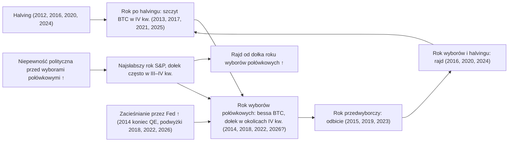

# 09. Sezonowość i cykle polityczne

Kalendarze kuszą. „Wrzesień to najgorszy miesiąc”, „rok wyborów połówkowych jest najsłabszy”, „Uptober” czy „rok przedwyborczy jest najmocniejszy” łatwo zapamiętać i łatwo pokazać na wykresie. W 2026 roku kalendarz stał się jednym z głównych narzędzi w filmach Benjamina Cowena: około 30% jego filmów opublikowanych między 1 stycznia a 11 czerwca 2026 (35 ze 116) dotyczyło cyklu wyborów połówkowych (midterm) lub cyklu prezydenckiego, a ścieżkę bitcoina z początku 2026 roku nazwał „simulation confirmed” („symulacja potwierdzona”), bo tak wiernie odtwarzała średnią z poprzednich lat wyborów połówkowych. Ten rozdział wyjaśnia cykl prezydencki na amerykańskim rynku akcji, miesięczną sezonowość (seasonality) akcji i bitcoina oraz to, jak lata wyborów połówkowych pokrywały się z rynkami niedźwiedzia na bitcoinie. Wyjaśnia też, dlaczego tę zbieżność tak trudno zinterpretować: zegar halvingów bitcoina, zegar wyborczy w USA i — jak dotąd w każdym przypadku — faza zacieśniania polityki przez Fed szły ze sobą w parze, a do testów mamy tylko trzy pełne cykle bitcoina. Sezonowość to słaba wiedza wstępna (prior). Przydaje się jako kontekst, a jako reguła jest niebezpieczna.

**Czego się nauczysz**
- Jak wygląda cykl prezydencki na Nasdaqu od 1972 roku (laboratorium kursu) i na S&P 500 od 1950 roku (opublikowane szacunki) oraz dlaczego średnia i mediana opowiadają różne historie.
- Jak w szczegółach wyglądały lata wyborów połówkowych: obsunięcia (drawdown), moment wystąpienia dołków i późniejsze odbicie.
- Efekty „sell in May”, wrześniowy i czwartego kwartału na rynku akcji oraz to, jak słabe są statystycznie.
- Miesięczną sezonowość bitcoina i to, dlaczego dwie starannie zbudowane tabele oparte na różnych danych dają różne odpowiedzi.
- Szablon Cowena dla roku wyborów połówkowych z „oknem słabości” (window of weakness), jego nakładki od początku roku i od zaprzysiężenia (także dla złota, dolara i rentowności 10-letnich obligacji) oraz to, jak 2026 rok najpierw podążał za szablonem, a potem się z niego wyłamał.
- Dlaczego trzy cykle nie pozwalają oddzielić efektu wyborów połówkowych od cyklu halvingowego.

---

## Trzy zegary, które tykają razem

Zegar bitcoina (halvingi), zegar polityczny (wybory w USA co dwa lata, kadencje prezydenckie co cztery) i — jak dotąd — faza zacieśniania przez Fed przypadały na te same lata. Gdy trzy rzeczy poruszają się razem, wykres pokazujący, że jedna z nich „działa”, nie mówi ci, która z nich naprawdę wykonuje pracę.

**Czteroletni kalendarz w zestawieniu**

| Rok kadencji prezydenckiej | Rok cyklu bitcoina | Typowe zachowanie bitcoina | Typowe zachowanie akcji | Przykłady |
|---|---|---|---|---|
| Powyborczy (rok 1) | Po halvingu | Szczyt cyklu w IV kw. | Zwykle w porządku | 2013, 2017, 2021, 2025 |
| Wyborów połówkowych (rok 2) | Rok bessy | Rynek niedźwiedzia; dołek w okolicach IV kw. | Średnio najsłabszy rok; dołek często w III–IV kw. | 2014, 2018, 2022, 2026 |
| Przedwyborczy (rok 3) | Przed halvingiem / odbicie | Odbicie (2015, 2019 +94%, 2023 +156%) | Średnio najmocniejszy rok | 2015, 2019, 2023 |
| Wyborczy (rok 4) | Rok halvingu | Rajd przed wyborami i po nich | Powyżej średniej | 2016, 2020, 2024 |

Źródła: [notatki badawcze C](../../research-notes/C-growth-liquidity-crossasset.md), sekcja 5.6, oraz badania kryptowalutowe kursu w zakresie stóp zwrotu bitcoina. Dla kryptowalut mamy cztery punkty danych, więc prawe kolumny traktuj jako opis, a nie reguły.

---

## Cykl prezydencki na rynku akcji

### Cykl prezydencki (czteroletni cykl na amerykańskim rynku akcji)

**Co to jest.** Teza, że stopy zwrotu z akcji systematycznie różnią się w zależności od roku kadencji prezydenta USA: powyborczego (rok 1), wyborów połówkowych (rok 2), przedwyborczego (rok 3) i wyborczego (rok 4). Spopularyzował ją Yale Hirsch w *Stock Trader's Almanac* od 1967 roku. To kalendarzowe pogrupowanie stóp zwrotu, a nie publikowany wskaźnik.

**Gdzie to znaleźć.** Zbuduj go samodzielnie z rocznych stóp zwrotu indeksów (FRED `NASDAQCOM` lub `SP500`, długie dane S&P Shillera). [Laboratorium makro](../../tools/macro-lab/REPORT-2026-10-30.md) liczy wersję dla Nasdaqa. Platforma Cowena ma grupę „Presidential Cycles”: „Annual Returns by Presidential Cycle”, „Presidential Term Return Paths”, „Inauguration Event Study” i inne.

**Jak to czytać.** Tabela z laboratorium wykorzystuje stopy zwrotu Nasdaq Composite w latach kalendarzowych od 1972 roku (Nasdaq to najdłuższy darmowy dzienny indeks w FRED). Obliczenia: laboratorium makro kursu, uruchomione 30 października 2026.

| Rok cyklu | Lata w próbie | Średnia | Mediana | Lata wzrostowe |
|---|---|---|---|---|
| Rok wyborczy | 14 | 10,3% | 15,7% | 11/14 |
| Rok powyborczy | 14 | 13,8% | 19,8% | 11/14 |
| Rok wyborów połówkowych | 13 | −0,5% | 7,4% | 7/13 |
| Rok przedwyborczy | 13 | 30,5% | 29,8% | 11/13 |

Trzy rzeczy, na które warto zwrócić uwagę:
1. **Lata wyborów połówkowych są najsłabsze, a rok przedwyborczy najmocniejszy** — zgodnie z rynkowym folklorem.
2. **Średnia (−0,5%) i mediana (+7,4%) dla lat wyborów połówkowych się rozjeżdżają.** Kilka bardzo złych lat (1974 −35,1%, 2002 −31,5%, 2022 −33,1%, 1990 −17,8%) ciągnie średnią w dół. *Typowy* rok wyborów połówkowych był lekko na plusie; *średnią* zepchnęły pod kreskę krachy. Tylko 7 z 13 takich lat zakończyło się wzrostem, wobec 11 z 13 lub 14 w pozostałych trzech typach lat.
3. **Próby są małe**: 13–14 obserwacji na grupę, nakładających się na konkretne wydarzenia (bańka z 1999 roku przypada na rok przedwyborczy, krach z 2008 roku na rok wyborczy).

Dla **S&P 500 od 1950 roku** często przytaczane średnie (stopy zwrotu cenowe, przybliżone i różniące się w zależności od źródła) wynoszą: rok 1 ok. +6–7%, **rok 2 ok. +4–5% (najsłabszy)**, **rok 3 ok. +16–17% (najmocniejszy)**, rok 4 ok. +7% (podsumowania Almanac, CFRA i LPL). Badania kursu zrekonstruowały średnią dla roku wyborów połówkowych na ok. +4,6% na podstawie opublikowanych rocznych stóp zwrotu z lat 1950–2022 i oznaczyły ją jako **szacunek do weryfikacji**; nie znaleziono tabeli ze źródła pierwotnego. Liczby dla S&P traktuj jako przybliżone, a liczby z laboratorium dla Nasdaqa jako te, które da się odtworzyć.

**Proponowane mechanizmy.** (1) Administracje wprowadzają bolesne decyzje na początku kadencji, a przed reelekcją stymulują gospodarkę. (2) Niepewność przed wyborami połówkowymi: rynki nie lubią nie wiedzieć, która partia będzie kontrolować Kongres. (3) Po wyborach połówkowych impas polityczny jest już wyceniony, a niepewność znika. Dowody na mechanizm *przyczynowy* są słabe; wzorzec opiera się na ok. 19 cyklach od 1950 roku.

**Jak używa tego Cowen.** Traktuje rok wyborów połówkowych jako najsłabszy z czterech, zarówno dla S&P, jak i dla bitcoina („The midterm year is typically the worst year” — „Rok wyborów połówkowych jest zwykle najgorszy”, [Bankless, 23 grudnia 2025](https://www.bankless.com/podcast/where-is-crypto-going-in-2026-ben-cowen)). W grudniu 2023 argumentował, że w latach przedwyborczych zwykle dochodzi do korekty w III kwartale („S&P 500 Outlook”, 15 grudnia 2023, streszczenie filmu). W jego notatce z sierpnia 2026 wrzesień jest najsłabszym miesiącem w ok. 24 latach wyborów połówkowych od 1930 roku, a ostatnie obsunięcia S&P w takich latach oszacował na ok. 7% (2014), 20% (2018) i 25% (2022) ([Balance of Risks, 15 sierpnia 2026](https://benjamincowen.com/reports/the-balance-of-risks-august-2026)). Napisał też, że „The SPX would often bottom in October, but occasionally it would occur earlier (May) and sometimes later (December)” („SPX często osiągał dołek w październiku, ale czasem wcześniej (maj), a czasem później (grudzień)”; [wpis na X, 2026](https://x.com/benjamincowen/status/2101053560720863561), tekst z fragmentu wyników wyszukiwania) — i wykorzystuje to do wyznaczania w czasie dołka czteroletniego cyklu bitcoina.

**Powiązania.** Słabość roku wyborów połówkowych → dołek najczęściej w III–IV kwartale → silny rajd w roku przedwyborczym. Recesje *nie* zaczynały się równomiernie w trakcie kadencji; zobacz tabelę początków recesji poniżej.

**Co to oznaczało dla aktywów.** Akcje: średnio słabszy rok 2, mocniejszy rok 3. Bitcoin: lata wyborów połówkowych 2014, 2018 i 2022 były jego latami bessy (niżej). Obligacje, dolar, złoto: badania nie wykazały ugruntowanego wzorca cyklu prezydenckiego.

**Wniosek dla inwestora.** Cykl prezydencki to stwierdzenie o średnich z kilkudziesięciu obserwacji. Lekko przechyla oczekiwania; nie mówi ci, jak zachowa się konkretny rok — co pokazał 2026.

### Rok wyborów połówkowych w szczegółach

Tabela laboratorium dla lat wyborów połówkowych (Nasdaq Composite) pokazuje, jak „najsłabszy rok” wygląda w praktyce:

| Rok | Stopa zwrotu w roku kalendarzowym | Maks. obsunięcie w roku | Data rocznego dołka | Dołek → +12 miesięcy |
|---|---|---|---|---|
| 1974 | −35,1% | −43,2% | 3.10.1974 | +37,6% |
| 1978 | +12,3% | −20,4% | 11.01.1978 | +23,9% |
| 1982 | +18,7% | −18,7% | 13.08.1982 | +88,2% |
| 1986 | +7,4% | −16,4% | 9.01.1986 | +17,8% |
| 1990 | −17,8% | −30,7% | 16.10.1990 | +66,2% |
| 1994 | −3,2% | −13,7% | 24.06.1994 | +35,3% |
| 1998 | +39,6% | −29,5% | 8.10.1998 | +103,4% |
| 2002 | −31,5% | −45,9% | 9.10.2002 | +70,5% |
| 2006 | +9,5% | −14,8% | 21.07.2006 | +33,0% |
| 2010 | +16,9% | −17,3% | 2.07.2010 | +34,6% |
| 2014 | +13,4% | −8,4% | 3.02.2014 | +18,3% |
| 2018 | −3,9% | −23,6% | 24.12.2018 | +44,6% |
| 2022 | −33,1% | −35,5% | 28.12.2022 | +47,8% |

Co mówi tabela (nasze obliczenia na liczbach z laboratorium):
- **W każdym roku wyborów połówkowych wystąpiło obsunięcie o co najmniej 8%**; mediana na Nasdaqu wyniosła ok. 20%. Nawet mocne lata (1998 +39,6%) miały w trakcie roku głęboki spadek.
- **Dołek przypadł na drugie półrocze w 9 z 13 lat**, najczęściej w październiku (1974, 1990, 1998, 2002). Ale cztery dołki wypadły w pierwszym półroczu, w tym trzy w styczniu lub lutym, więc stwierdzenie „dołek jest zawsze w październiku” jest nieprawdziwe.
- **Rajd od dołka roku wyborów połówkowych był dodatni we wszystkich 13 przypadkach**, od +17,8% (1986) do +103,4% (1998), z medianą ok. +38%. Haczyk to wiedza po fakcie: najniższe zamknięcie roku znamy dopiero później.

**Statystyki S&P 500 (opublikowane, wtórne).** Przeciętne obsunięcie od szczytu do dołka w trakcie roku wyborów połówkowych szacowano na ok. 17,5% od 1950 roku (Carson za Plain Economy), ok. 16,7% (Dreyer Wealth, 1950–2022), ok. 19% (Longview, 25 cykli od 1926 roku) i ok. 20% (First Trust). Przyjmij „ok. 17–20%”; w pozostałych latach średnia to mniej więcej 13%. W ciągu 12 miesięcy od najniższego zamknięcia roku wyborów połówkowych S&P zyskiwał od 1950 roku średnio ok. **+32%**, z wynikiem dodatnim w 19 na 19 przypadków (Silvia Insights za [Plain Economy](https://plaineconomy.com/stock-market-after-midterm-elections/)); First Trust i MoneyFlows podają ok. +36% ([First Trust](https://www.ftportfolios.com/Commentary/Insights/2024/4/8/midterm-election-client-resource-kit---march-2024)). Licząc od **dnia wyborów**, S&P był wyżej 12 miesięcy później po wszystkich 19 wyborach połówkowych od 1950 roku, średnio o ok. 15%. Typowe dołki S&P w latach wyborów połówkowych: 1962 (czerwiec/październik), 1966, 1974, 1990, 2002 i 2022 (wszystkie w październiku); 2010 (lipiec), 2014 (mini-dołek w październiku), 2018 (grudzień).

**Dotychczasowy przebieg 2026 roku.** Obsunięcie S&P w roku wyborów połówkowych wyniosło tylko ok. **9,1%** (27 stycznia, 6978,6 → 30 marca, 6343,72) — mniej niż przeciętnie — po czym indeks ustanowił nowe szczyty (7818,93 6 października). Od połowy sierpnia do końca września S&P stał mniej więcej w miejscu (7708 19 sierpnia, 7704 24 września), więc „słaby wrzesień” okazał się płaski, a nie słaby. Albo ból roku wyborów połówkowych przyszedł wcześnie i był łagodny, albo wzorzec sezonowy przykrył boom zysków spółek rzędu ok. 30%. Wybory połówkowe odbędą się **3 listopada 2026**; Fed utrzymał stopy 28 października, a przewodniczący Warsh stwierdził, że polityka nie odgrywała „żadnej roli” („no role”).

### Początki recesji według roku kadencji

Platforma Cowena zawiera wykresy „Recession Starts by Presidential Cycle” i „Recession Start Timing by Presidential Term”. Na podstawie miesięcy rozpoczęcia recesji według NBER wymienionych w [raporcie z laboratorium](../../tools/macro-lab/REPORT-2026-10-30.md) dziewięć recesji od 1960 roku rozkłada się następująco (nasza klasyfikacja według roku kalendarzowego):

| Rok kadencji | Początki recesji od 1960 | Lata |
|---|---|---|
| Powyborczy | 3 | 1973, 1981, 2001 |
| Wyborów połówkowych | 2 | 1970, 1990 |
| Przedwyborczy | 0 | — |
| Wyborczy | 4 | 1960, 1980, 2008, 2020 |

W tej próbie żadna recesja nie zaczęła się w roku przedwyborczym, co pasuje do opowieści o „stymulowaniu przed reelekcją”, ale przy dziewięciu zdarzeniach, z których jedno to pandemia (2020), jest to ciekawostka, a nie dowód. Zauważ też, że słabość rynku w roku wyborów połówkowych zwykle nie wynikała z recesji: spośród trzynastu takich lat w tabeli Nasdaqa z laboratorium (1974–2022) recesja zaczęła się tylko w 1990.

### Nakładki od początku roku na tle poprzednich lat wyborów połówkowych

**Co to jest.** Cena każdego aktywa podzielona przez jego cenę z 1 stycznia, wykreślana dzień po dniu i nałożona na tę samą krzywą z wcześniejszych lat (Cowen używa głównie 2018 i 2022 lub średniej z lat wyborów połówkowych z pasmem ±1 odchylenia standardowego). Na jego wykresach jest to opisane jako „ROI”, ale to **znormalizowany stosunek cen**, a nie procent: 1,137 oznacza +13,7% od początku roku, 0,714 oznacza −28,6% (konwencję wyjaśnia [Bitcoin Cycle Memo, 15 lipca 2026](https://benjamincowen.com/reports/bitcoin-cycle-memo-july-2026)). Rozdział [01](01-JAK-CZYTAC-WYKRESY-MAKRO.md) omawia ogólnie nakładki z przeskalowaniem do wspólnej bazy.

**Jak używa tego Cowen.** Od lutego 2026 stosował nakładkę lat wyborów połówkowych do bitcoina i S&P („Bitcoin YTD ROI vs Midterm Years”, „S&P 500 YTD vs Average Midterm Year”, [Macro Risk Memo, 15 lutego 2026](https://benjamincowen.com/reports/macro-risk-memo-feb-2026)), a we wrześniu rozszerzył ją na **rentowność 10-letnich obligacji i złoto** ([Triple Squeeze, 30 września 2026](https://benjamincowen.com/reports/the-triple-squeeze-september-2026)). Odczyty z jego notatek:

| Aktywo | Stosunek od początku roku | Data | Jego interpretacja |
|---|---|---|---|
| S&P 500 | 1,137 | 15.08.2026 | Mocny rok mimo wyborów połówkowych; „okno” korekty roku wyborów połówkowych „się zbliża” („window approaching”) |
| Bitcoin | 0,714 | 15.08.2026 | Podąża za niedźwiedzią średnią lat wyborów połówkowych |
| Złoto | 1,010 | 15.08.2026 | Płasko po styczniowym skoku i krachu |
| Rentowność 10-latek | ok. 1,27 (+27%) | 30.09.2026 | „Zbiegła się ze ścieżką z 2018 roku” („Converged on the 2018 path”) |

**Okno dołka złota w roku wyborów połówkowych.** Średnio dołek złota w roku wyborów połówkowych przypadał latem; w 2018 roku pod koniec lata, a w 2022 we wrześniu–listopadzie. W sierpniu 2026 Cowen napisał, że 2026 „may still prove to be a reset year” („może jeszcze okazać się rokiem resetu”), podobnie jak 2022 ([Balance of Risks, 15 sierpnia 2026](https://benjamincowen.com/reports/the-balance-of-risks-august-2026)). Dołek złota z końca czerwca w okolicach 3970 USD został przetestowany ponownie w okolicach 3990 USD 23 października (doniesienie wtórne).

**Wniosek dla inwestora.** Nakładki z samej konstrukcji upodabniają jeden rok do drugiego, bo wszystkie startują od 1,0 tego samego dnia. Dwa czy trzy lata-analogie to zabieg narracyjny; zanim cokolwiek wyczytasz z pozycji bieżącego roku, sprawdź, jak szeroki jest rozrzut między analogiami.

### Aktywa przeskalowane od każdego zaprzysiężenia prezydenta

**Co to jest.** Ta sama idea przeskalowania, ale zakotwiczona w dniu każdego zaprzysiężenia zamiast 1 stycznia, tak aby każda czteroletnia kadencja startowała od 100. Platforma Cowena ma „Presidential Term Return Paths” i „Inauguration Event Study”.

**Jak używa tego Cowen.**
- **Dolar.** W sierpniu 2026 pokazał DXY przeskalowany do 100 w dniu każdego zaprzysiężenia. Kadencja z 2025 roku powtórzyła spadek z pierwszego roku kadencji 2017, a zwrot oczekiwany w drugim roku był „spóźniony” („late”), przy indeksie ok. 91,5 na przeskalowanej skali. Nazwał to „deliberately the lightest evidentiary leg” („celowo najsłabszą dowodowo nogą”) swojego poglądu na dolara; jako czynnik falsyfikujący wskazał zdecydowane przebicie do nowych dołków kadencji ([Balance of Risks, 15 sierpnia 2026](https://benjamincowen.com/reports/the-balance-of-risks-august-2026)). DXY tworzył potem coraz wyższe dołki aż do października (rozdział [07](07-PLYNNOSC-PIENIADZ-I-DOLAR.md)).
- **Bitcoin.** W lipcu 2026 pokazał bitcoina przeskalowanego od każdego zaprzysiężenia: w poprzednich kadencjach dołek przychodził „near the midterm elections” („w okolicach wyborów połówkowych”). Sam zauważył, że to powtórzenie soczewki wyborów połówkowych, a „not fresh evidence” („nie nowy dowód”) ([Bitcoin Cycle Memo, 15 lipca 2026](https://benjamincowen.com/reports/bitcoin-cycle-memo-july-2026)).

**Wniosek dla inwestora.** Ponowne zakotwiczenie tych samych danych w innej dacie nie dodaje obserwacji. Nakładki od zaprzysiężenia traktuj jako inne spojrzenie na cykl prezydencki, a nie niezależne potwierdzenie.

---

## Sezonowość kalendarzowa na rynku akcji

### „Sell in May”, słabość września i siła IV kwartału

**Co to jest.** Średnie stopy zwrotu pogrupowane według miesięcy lub pór roku, zwykle dla S&P 500 od 1950 roku. Źródła: *Stock Trader's Almanac* i liczne podsumowania.

**Gdzie to znaleźć.** Widok „Seasonality” w TradingView dla `SP:SPX`; dowolny arkusz z miesięcznymi zamknięciami.

**Jak to czytać.**
- **Sell in May („sprzedaj w maju”) / sześć najlepszych miesięcy.** Od 1950 roku okres listopad–kwiecień przyniósł większość cenowych zysków S&P (średnio ok. +7%) wobec okresu maj–październik (ok. +2%). Bouman i Jacobsen (2002, *American Economic Review*) znaleźli „efekt Halloween” w 36 z 37 krajów. Od czasu publikacji efekt jest słabszy, a okres maj–październik wciąż jest średnio na plusie. Działanie na jego podstawie oznacza rezygnację z dodatniej oczekiwanej stopy zwrotu oraz płacenie podatków i kosztów transakcyjnych.
- **Wrzesień** był od 1950 roku najgorszym miesiącem dla S&P, ze średnią ok. −0,5% do −0,7% i wynikiem dodatnim tylko w ok. 44% przypadków ([Stock Trader's Almanac](https://stocktradersalmanac.com/Alert/20240815_1.aspx); [Motley Fool](https://www.fool.com/research/september-effect-statistics)).
- **Siła IV kwartału.** Okres październik–grudzień, zwłaszcza listopad–grudzień i „rajd Świętego Mikołaja” (Santa Claus rally — ostatnie pięć sesji roku plus dwie pierwsze sesje kolejnego), był sezonowo mocny. Okres od IV kwartału roku wyborów połówkowych do II kwartału roku przedwyborczego bywa nazywany „sweet spot” („najsłodszym punktem”) czteroletniego cyklu.

**Jak używa tego Cowen.** Głównie w odniesieniu do bitcoina (niżej). Dla akcji jego notatka z sierpnia 2026 zestawiła **miesięczne stopy zwrotu S&P 500 w każdym roku wyborów połówkowych od 1930 roku** (ok. dwa tuziny lat, ze średnią i odchyleniem standardowym dla każdego miesiąca). Wrzesień jest najsłabszym miesiącem; **październik i listopad zamykają się jako dwa najmocniejsze**, choć to w październiku często pojawia się dołek w trakcie miesiąca, jak w 2014 i 2022 roku ([Balance of Risks, 15 sierpnia 2026](https://benjamincowen.com/reports/the-balance-of-risks-august-2026)). To giełdowa wersja kształtu roku wyborów połówkowych: „dołek jesienią, potem rajd”.

**Powiązania.** Efekty sezonowe są małe w porównaniu z normalną zmiennością pojedynczego miesiąca i giną pod wpływem decyzji Fed, zysków spółek i szoków. Średnie −0,6% we wrześniu przy miesięcznych ruchach rzędu kilku procent to szept, a nie sygnał.

**Co to oznaczało dla aktywów.** Akcje: lekkie przechylenie. Bitcoin: własna, dużo bardziej zaszumiona sezonowość (następna sekcja). Inne aktywa: badania nie wykazały solidnego efektu kalendarzowego.

**Wniosek dla inwestora.** Średnie sezonowe opisują przeszły rozkład z kilkudziesięciu lat. Są powodem, by nie dziwić się słabemu wrześniowi, a nie powodem, by na tej podstawie działać.

---

## Sezonowość bitcoina

### Miesięczne stopy zwrotu bitcoina

**Co to jest.** Średnia, mediana i odsetek trafień (udział lat z wynikiem dodatnim) bitcoina według miesiąca kalendarzowego, liczone z zamknięć na koniec kolejnych miesięcy.

**Gdzie to znaleźć.** Mapy cieplne w CoinGlass, Bitcoin Magazine Pro i widok „Seasonality” w TradingView; platforma Cowena ma „Monthly Returns”, „Quarterly Returns”, „Monthly Average ROI” i „Historical Monthly Average ROI”.

**Jak to czytać.** Badania kursu zbudowały dwie tabele na podstawie różnych danych i okresów. Ich porównanie to najcenniejsza lekcja tej sekcji:

| Miesiąc | Mediana 2013–2025 | Średnia 2013–2025 | Lata wzrostowe 2013–2025 | Mediana 2015–wrz 2026 | Średnia 2015–wrz 2026 | Lata wzrostowe 2015–wrz 2026 |
|---|---|---|---|---|---|---|
| Sty | +0,9% | +4,4% | 7/13 | −0,3% | −1,7% | 5/12 |
| Lut | +12,3% | +13,2% | 10/13 | +12,4% | +10,6% | 9/12 |
| Mar | −2,1% | +12,9% | 6/13 | +2,2% | +0,7% | 6/12 |
| Kwi | +8,2% | +12,2% | 8/13 | +12,2% | +10,3% | 8/12 |
| Maj | +9,0% | +10,0% | 7/13 | +9,1% | +7,7% | 6/12 |
| Cze | +1,8% | −0,7% | 7/13 | 0,0% | −0,3% | 6/12 |
| Lip | +8,1% | +7,9% | 9/13 | +8,1% | +8,9% | 9/12 |
| Sie | −8,4% | +1,0% | 4/13 | −5,0% | +2,3% | 4/12 |
| Wrz | −2,9% | −3,2% | 5/13 | +2,8% | −1,2% | 6/12 |
| Paź | +14,8% | +19,9% | 10/13 | +14,4% | +19,1% | 9/11 |
| Lis | +8,9% | +41,4% | 8/13 | +6,6% | +6,7% | 6/11 |
| Gru | −3,4% | +4,0% | 5/13 | +0,3% | +9,7% | 6/11 |

Pierwsze trzy kolumny opierają się na dziennych zamknięciach referencyjnych Coin Metrics (badania kryptowalutowe kursu); ostatnie trzy na zamknięciach Coinbase z FRED (`CBBTCUSD`; [notatki badawcze C](../../research-notes/C-growth-liquidity-crossasset.md)). Różnice wynikają z roku początkowego (2013 wobec 2015), źródła danych i dodatkowych miesięcy 2026 roku.

Co się utrzymuje w obu tabelach: **luty i październik były mocne**, **sierpień słaby według mediany**, a **czerwiec płaski**. Co się nie utrzymuje: mediana marca zmienia znak; mediana września zmienia znak; średnia listopada spada z +41,4% (zawyżonej przez listopad 2013) do +6,7%. Jeśli dodanie dwóch lat lub zmiana dostawcy danych odwraca znak danego miesiąca, ten miesiąc nie niesie wiarygodnej informacji sezonowej. Przy 11–13 obserwacjach na miesiąc i zmienności bitcoina średnia żadnego pojedynczego miesiąca nie jest istotna statystycznie na zwyczajowych poziomach.

**2026 miesiąc po miesiącu (Coin Metrics, do 29 października):** styczeń −10,1%, luty −14,9%, marzec +1,9%, kwiecień +11,9%, maj −3,5%, czerwiec −20,5%, lipiec +7,4%, sierpień +24,9%, wrzesień +6,4%, październik −6,4%. Zauważ, że luty (historycznie mocny) był bardzo słaby, a sierpień i wrzesień (historycznie słabe) były mocne.

**Jak używa tego Cowen.** Miesięczna sezonowość to powracający motyw: coroczne filmy „Wake Me Up When September Ends” (2021–2025) oraz „Bitcoin Monthly Returns” (18 sierpnia 2024, 7 sierpnia 2025), według streszczeń filmów. Jego tezy: wrzesień daje bitcoinowi średnio ok. −5%; sierpień–wrzesień to najsłabsza para miesięcy; w latach po halvingu po zielonym lipcu–sierpniu zwykle następuje czerwony wrzesień, a potem szczyt w IV kwartale. Dla lat wyborów połówkowych wskazywał przeciętny sierpień na ok. −10% (doniesienie wtórne). Wersję pierwotną zawiera jego notatka z lipca 2026 — tabela **miesięcznych stóp zwrotu bitcoina w latach wyborów połówkowych** (2014, 2018, 2022, 2026): sierpień i wrzesień były ujemne we wszystkich trzech wcześniejszych latach wyborów połówkowych, przy sierpniu ok. −18%, −15% i −15%, podczas gdy lipiec zwykle był zielony ([Bitcoin Cycle Memo, 15 lipca 2026](https://benjamincowen.com/reports/bitcoin-cycle-memo-july-2026)). Spodziewał się tego samego w 2026. W ujęciu miesięcy kalendarzowych to się nie sprawdziło: sierpień 2026 przyniósł +24,9%, a wrzesień +6,4%. Licząc od połowy do połowy miesiąca, sierpień wyglądał bliżej szablonu (65,3 tys. USD 15 lipca, ok. 63 tys. USD 15 sierpnia), co pokazuje, jak wiele zależy od wybranego okna. Różnica między jego „ok. −5%” a średnimi −1,2% do −3,2% w tabeli powyżej to kolejna ilustracja zależności od próby: wynik zależy od tego, które lata i które dane się weźmie.

**Powiązania.** Miesięczny wzorzec bitcoina odzwierciedla głównie to, *na który rok cyklu* przypadał dany miesiąc. Siła października wynika w dużej mierze z lat hossy (2013, 2021, 2023). Miesięczna sezonowość i cykl czteroletni nie są niezależnymi efektami.

**Co to oznaczało dla aktywów.** Tylko bitcoin; altcoiny go wzmacniają. Sezonowość akcji i sezonowość bitcoina nie pokrywają się miesiąc po miesiącu.

**Wniosek dla inwestora.** Mapę cieplną sezonowości bitcoina czytaj jako podsumowanie kilkunastu lat zależnych od fazy cyklu. Sprawdzaj medianę i odsetek trafień, nie tylko średnią, oraz to, czy wzorzec przetrwa zmianę źródła danych.

### IV kwartał: „Uptober”, szczyty w IV kwartale po halvingu i spadki w IV kwartale roku wyborów połówkowych

Czwarty kwartał bitcoina według lat (Coinbase, badania kursu): 2015 +81%, 2016 +60%, 2017 +220%, **2018 −44%**, 2019 −14%, 2020 +169%, 2021 +5%, **2022 −15%**, 2023 +57%, 2024 +55%, **2025 −26%** (Coin Metrics podaje −23% dla 2025; źródła nieco się różnią).

| IV kwartał… | Rok | Stopa zwrotu w IV kw. | Uwagi |
|---|---|---|---|
| Rok po halvingu | 2013 | +479% | Szczyt 4.12.2013 |
| Rok po halvingu | 2017 | +221% | Szczyt 17.12.2017 |
| Rok po halvingu | 2021 | +6% | Szczyt 10.11.2021 |
| Rok po halvingu | 2025 | −23% | Szczyt 6.10.2025, pierwszego dnia IV kw. |
| Rok wyborów połówkowych | 2014 | −17,6% | Dołek cyklu 14.01.2015 |
| Rok wyborów połówkowych | 2018 | −44,2% | Dołek cyklu 15.12.2018 |
| Rok wyborów połówkowych | 2022 | −15,0% | Dołek cyklu 21.11.2022 |

Źródło: badania kryptowalutowe kursu (dzienne zamknięcia Coin Metrics).

Dwa wzorce. Po pierwsze, „Uptober” jest w próbie realny, ale napędzają go lata hossy; we wszystkich trzech latach wyborów połówkowych, dla których mamy dane, IV kwartał był *ujemny* i kończył się w pobliżu dołka cyklu. Po drugie, szczyt w IV kwartale roku po halvingu z każdym cyklem przesuwał się wcześniej (4 grudnia → 17 grudnia → 10 listopada → 6 października), a w 2025 roku „szczyt w IV kwartale” przypadł na pierwszy dzień IV kwartału, a nie był efektem rajdu w IV kwartale. 2025 był pierwszym „rokiem szczytu” po halvingu, który zakończył się na minusie (−6,3% w roku kalendarzowym).

**Szablon Cowena dla roku po halvingu.** „The Pattern That Historically Ended The Bull Market” (12 sierpnia 2025): w latach 2013, 2017 i 2021 po rajdzie w lipcu–sierpniu następowało wrześniowe cofnięcie do pasa wsparcia rynku byka (bull market support band, BMSB), a potem szczyt w IV kwartale, przy malejących procentowych zwrotach. W 2025 roku bitcoin spadł pod koniec września, ustanowił nowy szczyt 6 października i załamał się od 10 października. Ta prognoza się sprawdziła. Sam pas wsparcia wyjaśnia rozdział [10](10-CYKLE-I-MODELE-WYCENY-BITCOINA.md).

### Letni zastój i otwarcie roku

- **Letni zastój.** Cowen opisuje letnie konsolidacje (chop) jako coś normalnego; szczyty mogą nadal przyjść później w roku („Bitcoin: Bull Market Support Band”, 19 maja 2025, streszczenie filmu). Tabele powyżej zgadzają się z tym tylko luźno: lipiec był dodatni w 9 z 12–13 lat, czerwiec płaski, sierpień słaby według mediany.
- **Otwarcie roku i stopa zwrotu od początku roku według roku cyklu.** Cowen porównuje ścieżkę każdego roku od ceny z 1 stycznia. Lata przed halvingiem były mniej więcej w połowie wzrostowe, w połowie spadkowe, więc „bulls and bears both get wrecked” („obrywają zarówno byki, jak i niedźwiedzie”); lata odbicia (2015, 2019, 2023) pokazują mieszankę zielonych i czerwonych miesięcy („Bitcoin Monthly Returns”, 6 stycznia 2023; seria „Pre-Halving Year Returns”, 2023). W latach wyborów połówkowych śledzi odległość od otwarcia roku: średnio na początku marca bitcoin był ok. −15% poniżej otwarcia. Dla porządku stopy zwrotu w latach kalendarzowych (Coin Metrics): 2013 +5286%, 2014 −56%, 2015 +34%, 2016 +126%, 2017 +1337%, 2018 −74%, 2019 +94%, 2020 +305%, 2021 +60%, 2022 −64%, 2023 +156%, 2024 +121%, 2025 −6,3%, 2026 do 29 października −10,7%.

---

## Lata wyborów połówkowych a rynki niedźwiedzia na bitcoinie

### Szablon Cowena dla roku wyborów połówkowych i „okno słabości”

**Co to jest.** Przeciętna ścieżka bitcoina w roku amerykańskich wyborów połówkowych, zbudowana z lat 2014, 2018 i 2022. Jak opisywał ją Cowen na początku 2026 roku: **dołek w lutym**, **rajd na początku marca** (ze szczytem ok. 2–5 marca), **słabość w kwietniu–czerwcu**, **lipcowy wyskok**, **słaby sierpień–wrzesień** i **ostateczny dołek w IV kwartale**. Średnio na początku marca bitcoin był ok. −15% poniżej otwarcia roku. „Okna słabości” (windows of weakness) to okresy, w których zwykle wypadały dołki roku wyborów połówkowych: luty, koniec marca–kwiecień, czerwiec oraz wrzesień–październik. W 2026 roku przytaczał też liczby dni (dołek ok. 56. dnia roku, rajd do ok. 62. dnia).

**Skąd to pochodzi.** „Bitcoin: Midterm Year Returns” (26 lutego 2026); „…Are We In A Simulation?” (5 marca 2026); „Bitcoin: Simulation Confirmed” (9 marca 2026); „The Window of Weakness is Open” (28 marca 2026); „The Window of Weakness” (29 maja 2026), według streszczeń filmów; a także [notatka o cyklu z lipca 2026](https://benjamincowen.com/reports/bitcoin-cycle-memo-july-2026). „We live in a simulation” („żyjemy w symulacji”) to jego ironiczny skrót na sytuację, w której cena podąża za średnią historyczną. Motyw zdominował jego kanał: 35 ze 116 filmów opublikowanych między 1 stycznia a 11 czerwca 2026 pasowało do słów kluczowych związanych z wyborami połówkowymi, prezydenckimi lub wyborami w ogóle.

**Jego ujęcie.** „The midterm year is typically the worst year. Buying from mid-to-late midterm year is historically a good time to accumulate” („Rok wyborów połówkowych jest zwykle najgorszy. Kupowanie od połowy do końca tego roku było historycznie dobrym momentem na akumulację”; Bankless, 23 grudnia 2025). Pod koniec maja 2026 powiedział, że inwestorom historycznie lepiej wychodziła ostrożność wobec bitcoina w pierwszej połowie roku wyborów połówkowych i szukanie okazji w drugiej połowie (29 maja 2026, streszczenie filmu). To jego obserwacje historyczne i tak je tu relacjonujemy; nie są to rekomendacje kursu.

**Jak 2026 podążał za szablonem.**

| Krok szablonu | 2026 | Zgodność |
|---|---|---|
| Dołek w lutym | Krach do ok. 60 tys. USD 5–6 lutego (−52% od szczytu) | Tak |
| Rajd na początku marca, odrzucony | Odbicie do ok. 68 tys. USD do 1 marca po spadku do 63 tys. USD przy uderzeniach na Iran 28 lutego; rajd odrzucony | Tak („Simulation Confirmed”, 9 marca) |
| Słabość w kwietniu–czerwcu | Rajd do ok. 82–83 tys. USD odrzucony w kwietniu–maju; odrzucenie na 200-dniowej średniej 19 maja; dotknięcie 200-tygodniowej średniej 5 czerwca; dołek na zamknięciu 58,5 tys. USD 30 czerwca (57,7 tys. USD w trakcie sesji, 1 lipca) | Tak, ale z dołkiem wcześniej niż w IV kw. |
| Lipcowy wyskok | Lipiec +7,4% | Tak |
| Słaby sierpień–wrzesień | Sierpień +24,9%, wrzesień +6,4%; pod koniec września powyżej majowego szczytu i 50-tygodniowej średniej; 85 453 USD 6 października | **Nie** |
| Ostateczny dołek w IV kw. | Przebicie 82 tys. USD 22 października; ok. 78 tys. USD 30 października; brak niższego dołka niż w czerwcu na 30 października | Otwarte |

We wrześniu 2026 Cowen przyznał, że rajd był silniejszy niż w poprzednich latach wyborów połówkowych (ok. 50% wobec mniej więcej 40% w 2018 i 2022 roku, a do tego wyższy szczyt zamiast niższego) i napisał, że „the burden of proof has shifted to the bears” („ciężar dowodu przesunął się na niedźwiedzie”; [Triple Squeeze, 30 września 2026](https://benjamincowen.com/reports/the-triple-squeeze-september-2026); porównanie 50% wobec 40% pochodzi z doniesienia wtórnego). 24–26 października 2026 wrócił do niedźwiedziej mapy drogowej na IV kwartał, pod warunkiem że bitcoin pozostanie poniżej 83 tys. USD ([Yahoo Finance / BeInCrypto, 26 października 2026](https://finance.yahoo.com/markets/crypto/articles/bitcoin-falls-below-80-000-032051576.html)). Powiedział też, że jeśli do końca października lub do końca roku nie pojawi się niższy dołek, scenariusz niedźwiedzi osłabnie, a on spodziewa się „to be a bull again going into 2027” („znowu być bykiem, wchodząc w 2027 rok”).

Dwa zastrzeżenia z jego własnych notatek są ważne dla odczytywania szablonu. Po pierwsze, w kwietniu 2026 napisał, że sezonowość roku wyborów połówkowych ma znaczenie tylko wtedy, gdy **zbiega się z makroekonomią późnej fazy cyklu**, oraz że „multiple crypto cycles can occur within a single broader business cycle” („w ramach jednego szerszego cyklu koniunkturalnego może wystąpić kilka cykli kryptowalutowych”; [Crypto Risk Memo Q2 2026, 15 kwietnia 2026](https://benjamincowen.com/reports/crypto-risk-memo-q2-2026)); kalendarz jest soczewką pomocniczą, a nie siłą napędową. Po drugie, w lipcu 2026 przedłużył w przyszłość przeciętny spadek z lat wyborów połówkowych jako *ilustrację*: wynikał z niego stosunek na koniec roku ok. 0,49 ceny z 1 stycznia, czyli ok. **43 800 USD** przy kotwicy z 1 stycznia w okolicach 89 300 USD — poniżej ceny zrealizowanej (realized price). Przedstawił to jako to, co sugerowałaby ścieżka sezonowa, a nie jako cel, i napisał, że ta seria „has been better on direction than on level” („lepiej sprawdzała się co do kierunku niż poziomu”; [Bitcoin Cycle Memo, 15 lipca 2026](https://benjamincowen.com/reports/bitcoin-cycle-memo-july-2026)). Przy bitcoinie w okolicach 78 tys. USD 30 października taka ścieżka wydawała się mało prawdopodobna.

**Powiązania.** Miesiące dołków w szablonie pokrywają się z miesiącami dołków S&P w latach wyborów połówkowych (często III–IV kwartał). Cowen spodziewa się też, że dołkom bitcoina w roku wyborów połówkowych będzie towarzyszyć obsunięcie akcji o 10–20%; w 2026 roku obsunięcie S&P wyniosło tylko 9,1% i przyszło wcześnie (styczeń–marzec).

**Wniosek dla inwestora.** Średnia z trzech ścieżek zawsze będzie wyglądać gładko i zawsze dopasuje się do niektórych miesięcy czwartego roku. Test z 2026 roku pokazuje obie strony: uderzające dopasowanie w lutym–czerwcu i wyraźne wyłamanie w sierpniu–wrześniu.

### Zachowanie w roku wyborów połówkowych z podwyżką stóp

Węższy wzorzec z 2026 roku. W dwóch wcześniejszych latach wyborów połówkowych, w których Fed podnosił stopy (2018 i 2022), bitcoin utrzymywał się w pobliżu poziomu z dnia podwyżki przez ok. siedem tygodni, po czym przebijał się w dół ([notatka Triple Squeeze, wrzesień 2026](https://benjamincowen.com/reports/the-triple-squeeze-september-2026)). Wrześniowa notatka Cowena pokazała ścieżkę bitcoina w roku po wrześniowej podwyżce w każdym roku wyborów połówkowych (2018, 2022, 2026) i umieściła prawdopodobne przebicie w okolicach 50. dnia, czyli na początku listopada 2026; spadek jak w 2022 roku, o ok. 15%, sprowadziłby bitcoina w okolice 64 tys. USD, a spadek jak w 2018 roku, o ok. 50%, w okolice 38 tys. USD. W tej samej notatce zaproponował drugą, szerszą soczewkę — bitcoin po *pierwszej* podwyżce w cyklu zacieśniania: po grudniu 2015 spadł o ok. 20% w dwa miesiące, a potem wzrósł o ok. 70% w ciągu dwunastu; po marcu 2022 wzrósł o ok. 12% w dwa tygodnie, a potem spadł o ponad 60% (rozdział [10](10-CYKLE-I-MODELE-WYCENY-BITCOINA.md)). W październiku 2026 opisał wzorzec podwyżki w roku wyborów połówkowych jako „Bitcoin typically flat ~50 days, then drops” („bitcoin zwykle stoi w miejscu ok. 50 dni, potem spada”) i umieścił bitcoina w ok. 43. dniu po podwyżce z 16 września 2026 (Benzinga, za fragmentem wyników wyszukiwania). Dwa wcześniejsze przypadki to anegdota, nie statystyka; a jego własny przegląd dat podwyżek z września 2026 (grudzień 2015, marzec 2022, wrzesień 2018, wrzesień 2022) doprowadził do wniosku, że „none of the data suggests that a rate hike has ever been immediately bearish for Bitcoin” („żadne dane nie wskazują, by podwyżka stóp kiedykolwiek była natychmiast niedźwiedzia dla bitcoina”; doniesienie wtórne). Samą podwyżkę omawia rozdział [02](02-FED-I-STOPY-PROCENTOWE.md).

### Testujemy tezę: lata wyborów połówkowych 2014, 2018, 2022 i 2026

| Rok wyborów połówkowych | Stopa zwrotu BTC w roku kalendarzowym | Szczyt poprzedniego cyklu | Dołek cyklu | Dołek w roku wyborów połówkowych? | S&P w tym roku |
|---|---|---|---|---|---|
| 2010 | Duży wzrost (era sprzed rynku: ok. 0,06 USD w lipcu 2010 do ok. 0,30 USD) | nd. | nd. | Brak bessy | +12,8% |
| 2014 | −56% do −58% (źródła się różnią) | 4.12.2013 (ok. 1135 USD na zamknięciu) | 14.01.2015 (ok. 176 USD na zamknięciu) | Nie (dwa tygodnie później); ponowny test w sierpniu 2015 | +11,4% |
| 2018 | −73% do −74% | 17.12.2017 (ok. 19,6 tys. USD na zamknięciu) | 15.12.2018 (ok. 3,2 tys. USD) | Tak | −6,2% |
| 2022 | −64% | 10.11.2021 (ok. 67,5 tys. USD na zamknięciu; ok. 69 tys. USD w trakcie sesji) | 21.11.2022 (ok. 15,5 tys. USD w trakcie sesji) | Tak | −19,4% |
| 2026 | od −10,7% do −11,1% od początku roku (do 29 października) | 6.10.2025 (ok. 124,7–124,8 tys. USD na zamknięciu; ok. 126 tys. USD w trakcie sesji) | Jak dotąd 30.06.2026 (58,5 tys. USD na zamknięciu, −53%) | Do ustalenia | +13,1% od początku roku |

Źródła: [notatki badawcze C](../../research-notes/C-growth-liquidity-crossasset.md) i [D](../../research-notes/D-crypto-cycles-onchain-alts.md) (dane Coin Metrics i Coinbase; ceny z 2014 roku ze źródeł wtórnych).

**Werdykt.**
1. **Opisowo prawdziwe.** Lata 2014, 2018 i 2022 były dla bitcoina latami bessy. Dwa z trzech dołków cyklu przypadły w roku wyborów połówkowych, a trzeci dwa tygodnie po nim. Notatka Cowena z lipca 2026 ujęła to tak: „two of the three prior cycles bottomed in that quarter” („dwa z trzech poprzednich cykli osiągnęły dno w tym kwartale”).
2. **S&P nie zawsze był w tych latach słaby:** +11,4% w 2014 roku, jak dotąd +13% w 2026. Straty bitcoina w latach wyborów połówkowych (od −56% do −74%) były dużo większe, niż wynikałoby z efektu wyborów połówkowych na rynku akcji.
3. **2026 pasuje pod względem ceny, ale jeszcze nie pod względem czasu.** Był to rok bessy z obsunięciem o −53%, ale dotychczasowy dołek wypadł 30 czerwca, ok. trzy miesiące przed październikowym oknem Cowena. 24/7 Wall St. nazwał próbę trzech cykli „a narrow and potentially unreliable basis” („wąską i potencjalnie zawodną podstawą”; [6 października 2026](https://247wallst.com/investing/cryptocurrency/2026/10/06/benjamin-cowen-said-the-cycle-would-bottom-bitcoin-near-60000-in-october-did-benjamin-cowen-predict-the-bitcoin-bottom-correctly/)).

### Dlaczego trzy cykle nie pozwalają oddzielić efektu wyborów połówkowych od cyklu halvingowego

**1. Zegary są w fazie.** Halvingi przypadły 28 listopada 2012, 9 lipca 2016, 11 maja 2020 i 20 kwietnia 2024. Bitcoin osiągał szczyt 371, 525, 546 i 534 dni później, zawsze w IV kwartale następnego roku, który zawsze jest rokiem powyborczym. Rynek niedźwiedzia wypełnia potem kolejny rok, który zawsze jest rokiem wyborów połówkowych. Wykres mówiący „lata wyborów połówkowych są złe dla bitcoina” i wykres mówiący „drugi rok po halvingu jest zły dla bitcoina” to *ten sam wykres*. Żadna obserwacja w próbie ich nie rozróżnia.

**2. Obok tyka trzeci zegar.** W każdym roku wyborów połówkowych w historii bitcoina Fed w jakiejś formie zacieśniał politykę (nasza obserwacja na podstawie osi czasu z kursu): 2014 był rokiem zakończenia skupu obligacji przez Fed (QE3, październik 2014); w 2018 były podwyżki stóp i QT; w 2022 najszybsze od dekad podwyżki i QT; a w 2026 Fed podniósł stopy 16 września. Wyjaśnienie oparte na płynności pasuje więc do tych samych lat.

**3. Próba liczy trzy, może cztery przypadki.** Przy n = 3 zakończonych cyklach pasować będzie niemal każdy czteroletni wzorzec, jaki przyjdzie ci do głowy. Statystyki dotyczące rytmu cykli bitcoina są zwarte (od dołka do szczytu 1067, 1059 i 1062 dni), ale ta regularność jest tak samo zgodna z halvingiem, z refleksyjnym pozycjonowaniem (wszyscy spodziewają się cyklu, więc on następuje) albo z cyklem płynności, jak z amerykańską polityką.

**4. Mechanizmy są różne i tylko luźno powiązane.** Halving to szok podażowy po stronie górników, który geometrycznie maleje: w 2024 roku cięcie emisji wyniosło ok. 450 BTC dziennie (wówczas ok. 30 mln USD) — niewiele w porównaniu z przepływami do ETF-ów, które czasem przekraczały 1 mld USD dziennie. Efekt wyborów połówkowych dotyczy niepewności politycznej. To, że oba nadal pokrywają się w latach 2025–26, sugeruje, że cykl może być teraz napędzany w równym stopniu oczekiwaniami i kalendarzem makro, co podażą — i tak też opisywał to Cowen: halvingi z czasem tracą znaczenie, a „BTC does not have a monopoly on the four-year cycle” („BTC nie ma monopolu na cykl czteroletni”; [wpis na X, 6 lutego 2026](https://x.com/benjamincowen/status/2019835733503255006), za fragmentem wyników wyszukiwania).

**5. Następny test też ich nie rozdzieli.** Kolejny halving szacuje się na ok. kwiecień 2028, czyli rok wyborczy, więc powyborczy 2029 i rok wyborów połówkowych 2030 znów pokryją się z oboma zegarami. Jeden ciekawy szczegół: dołki cyklu wypadały 542, 513 i 528 dni przed kolejnym halvingiem. Jeśli czerwiec 2026 okaże się ostatecznym dołkiem, odstęp do halvingu w 2028 roku wyniesie ok. 655 dni, poza wzorcem; dołek w IV kwartale 2026 wróciłby do wzorca (ok. 540 dni). To jeden z ilościowych powodów, dla których Cowen wciąż szukał dołka w IV kwartale.

**Wniosek dla inwestora.** Wzorzec roku wyborów połówkowych na bitcoinie to rzetelny opis trzech cykli i nieudowodnione wyjaśnienie. Traktuj go jako jedną z kilku nakładających się czteroletnich opowieści, z których żadnej nie da się przetestować osobno, dopóki zegary się nie rozejdą.

### Powiązane narzędzia cykliczne (omówione w rozdziale 10)

Te koncepcje wyznaczania rytmu cyklu pojawiają się w filmach Cowena obok sezonowych; pełne omówienie znajdziesz w rozdziale [10](10-CYKLE-I-MODELE-WYCENY-BITCOINA.md):
- **Cykl czteroletni (halvingowy):** szczyty w IV kwartale roku po halvingu (2013, 2017, 2021, 2025), dołki mniej więcej rok później, w okolicach IV kwartału roku wyborów połówkowych. „The cycle is primarily about the timing of lows, not exact prices” („Cykl dotyczy przede wszystkim momentu wystąpienia dołków, a nie dokładnych cen”; 26 maja 2026, streszczenie filmu); „The Four Year Cycle Did Not Die” (12 marca 2026). 6 lutego 2026 napisał, że najbardziej prawdopodobny dołek przypadnie w październiku 2026, a być może już w maju.
- **Liczenie dni.** Okres od dołka do szczytu wynosił ok. 1060 dni w każdym z trzech ostatnich cykli. Opracowania jego liczb są niespójne (ok. 1062 wobec 1059 i 1067 w grudniu 2025; 1162 wobec 1059 i 1168 w opracowaniu z maja 2026), więc opieraj się na wartościach policzonych samodzielnie. Źródło pierwotne rozstrzyga sprawę: jego notatka z lipca 2026 liczy od dołka z 21 listopada 2022 (dzień 1332 przypada na 15 lipca 2026), umieszcza szczyt obecnego cyklu w dniu 1050 wobec 1061 i 1068 wcześniej, a dwa poprzednie dna w dniach **1424 i 1432**, co odpowiada ok. 15–23 października 2026. Notatka wyjaśnia też, że wcześniejsza wersja błędnie zakotwiczała się w dołku po upadku FTX z 9 listopada 2022 — stąd wzięły się niespójne liczby ([Bitcoin Cycle Memo, 15 lipca 2026](https://benjamincowen.com/reports/bitcoin-cycle-memo-july-2026)). 15 sierpnia 2026 opublikował wpis „day 1363 of the cycle” („dzień 1363 cyklu”). Czerwcowy dołek z 2026 roku wypadł w dniu 1317. Jego analogia z 2019 roku osiągnęła dno w 261. dniu po szczycie; notatka z lipca 2026 umieściła obecny cykl w 282. dniu „without the flush” („bez gwałtownego wypłukania”).
- **Cykle przesunięte w prawo i w lewo (right- / left-translated):** szczyt, który przychodzi wcześnie (w lewo) lub późno (w prawo) względem środka cyklu; czynniki makro, takie jak inflacja czy bezrobocie, mogą przyspieszyć szczyt („Right Translated or Left Translated?”, 7 marca 2025; „Bitcoin: Market Cycles”, 7 marca 2024).
- **Trzy psychologiczne etapy rynku niedźwiedzia** (7 czerwca 2026): niedowierzanie (październik 2025–luty 2026), częściowa akceptacja (luty–czerwiec 2026), powszechna akceptacja (być może czerwiec–październik 2026); zwroty zwykle przychodzą, gdy ok. 75–80% uczestników jest nastawionych niedźwiedzio.
- **Reżimy polityczne** (stopy zwrotu według partii rządzącej) omawia rozdział [08](08-AKCJE-ZLOTO-I-INNE-AKTYWA.md).

---

## Składamy to w całość

1. **Rok wyborów połówkowych → niepewność polityczna i (jak dotąd) zacieśnianie przez Fed → obsunięcie S&P średnio o ok. 17–20% → dołek najczęściej w III–IV kwartale → rajd o ok. 30–36% w kolejnych 12 miesiącach.** 2002 (dołek Nasdaqa 9 października, +70,5% rok później), 2022 (dołek Nasdaqa 28 grudnia, +47,8%; dołek S&P 12 października). *Wyjątki:* 2014 (obsunięcie Nasdaqa tylko 8,4%, dołek w lutym) i 2026 (obsunięcie S&P 9,1%, dołek 30 marca, potem rekordy przy wzroście zysków spółek o ok. 30%).
2. **Halving → szczyt bitcoina w IV kwartale roku po halvingu → bessa w roku wyborów połówkowych → dołek w okolicach IV kwartału tego roku.** Halving 9 lipca 2016 → szczyt 17 grudnia 2017 → dołek 15 grudnia 2018; halving 11 maja 2020 → szczyt 10 listopada 2021 → dołek 21 listopada 2022; halving 20 kwietnia 2024 → szczyt 6 października 2025 → dotychczasowy dołek 30 czerwca 2026. *Wyjątki:* dołek z lat 2014–15 przesunął się na styczeń 2015, a dołek z 2026 roku (jak dotąd) wypadł w czerwcu, mniej więcej 100–115 dni przed oknem wynikającym z liczenia dni (poprzednie dna w dniach 1424 i 1432).
3. **Rok po halvingu: rajd w lipcu–sierpniu → wrześniowe cofnięcie do pasa wsparcia → szczyt w IV kwartale.** 2013, 2017, 2021 i 2025 (spadek pod koniec września 2025, szczyt 6 października, krach od 10 października). *Wyjątek:* skala ruchu w IV kwartale malała z każdym cyklem (+479%, +221%, +6%, −23%), a w 2025 roku szczyt przypadł na pierwszy dzień IV kwartału.
4. **Średnia sezonowa mówi „słaby sierpień–wrzesień” → ale szoki płynnościowe i polityczne mają pierwszeństwo.** W sierpniu 2026 bitcoin wzrósł o 24,9% (zamknięcia Coinbase: 62 887 USD 31 lipca → 78 603 USD 31 sierpnia), w miesiącu, w którym Departament Skarbu USA rozszerzył program odkupu obligacji (według CoinDesk; związek przyczynowy nie został ustalony), a wrzesień dodał 6,4% mimo podwyżki stóp przez Fed 16 września. *Lekcja:* sezonowe przechylenie o kilka procent jest małe w porównaniu z impulsem makro lub przepływowym.
5. **Rok wyborów połówkowych + podwyżka stóp przez Fed → bitcoin stoi w miejscu przez ok. siedem tygodni, potem spada (2018, 2022).** W 2026 roku, ok. 43 dni po podwyżce z 16 września, bitcoin kosztował 30 października ok. 78 tys. USD — poniżej szczytu z początku października (85 453 USD), ale wyraźnie powyżej czerwcowego dołka. Dwa wcześniejsze przypadki; w chwili pisania wynik wciąż był otwarty.

---

## Sprawdź się

1. W tabeli Nasdaqa z laboratorium średnia dla roku wyborów połówkowych to −0,5%, a mediana +7,4%. Co wyjaśnia tę różnicę?
2. Dlaczego dwie tabele sezonowości bitcoina z kursu różnią się co do marca i września i co ci to mówi?
3. W ilu z 13 lat wyborów połówkowych na Nasdaqu dołek roku przypadł w drugim półroczu, a w ilu rajd od dołka był dodatni?
4. Podaj dwa powody, dla których nie da się odróżnić tez „lata wyborów połówkowych są złe dla bitcoina” i „drugi rok po halvingu jest zły dla bitcoina”.
5. Które kroki szablonu Cowena dla roku wyborów połówkowych pasowały do 2026 roku, a które wyraźnie zawiodły?
6. Dlaczego średni rajd S&P o +32% od dołka roku wyborów połówkowych zawyża to, co inwestor mógłby faktycznie zarobić?
7. W którym roku kadencji prezydenckiej od 1960 roku nie zaczęła się żadna recesja w USA i dlaczego jest to słaby dowód?

Odpowiedzi

1. Kilka bardzo złych lat wyborów połówkowych (1974 −35,1%, 2002 −31,5%, 2022 −33,1%, 1990 −17,8%) ciągnie średnią w dół. Typowy (mediana) rok wyborów połówkowych był lekko na plusie; tylko 7 z 13 zakończyło się wzrostem.
2. Wykorzystują różne lata początkowe (2013 wobec 2015), różne dane (Coin Metrics wobec Coinbase), a jedna z tabel obejmuje 2026 rok. Jeśli takie zmiany odwracają znak mediany danego miesiąca, ten miesiąc nie niesie wiarygodnego sygnału sezonowego; 11–13 obserwacji na miesiąc to za mało przy zmienności bitcoina.
3. Dołek przypadł w drugim półroczu w 9 z 13 lat (w czterech z nich w październiku), a rajd w kolejnych 12 miesiącach był dodatni we wszystkich 13, od +17,8% do +103,4%.
4. (a) Halving, szczyt po halvingu i rok bessy w roku wyborów połówkowych zawsze przypadały na te same lata kalendarzowe, więc żadna obserwacja ich nie rozdziela. (b) Trzeci czynnik, zacieśnianie przez Fed (2014 koniec QE, 2018 i 2022 podwyżki i QT, 2026 podwyżka), również zbiegał się z każdym rokiem bessy w roku wyborów połówkowych; a zakończone cykle są tylko trzy.
5. Pasowały: dołek w lutym (5–6 lutego), odrzucony rajd na początku marca, słabość w kwietniu–czerwcu zakończona czerwcowym dołkiem, lipcowy wyskok. Zawiodły: słaby sierpień–wrzesień (sierpień +24,9%, wrzesień +6,4%), a dołek przyszedł w czerwcu, a nie w IV kwartale (na 30 października brak niższego dołka).
6. Jest liczony od *najniższego zamknięcia* roku, które znamy dopiero po fakcie. Licząc od dnia wyborów, średni zysk w ciągu 12 miesięcy wyniósł ok. 15%.
7. W roku przedwyborczym: żadna z dziewięciu recesji od 1960 roku nie zaczęła się w takim roku. Przy dziewięciu zdarzeniach, z których jedno to pandemia, wzorzec może łatwo być dziełem przypadku.

---

> Materiał edukacyjny, nie doradztwo finansowe. Historyczne zależności między wskaźnikami mogą przestać działać.

[← 08 Akcje, złoto i inne aktywa](08-AKCJE-ZLOTO-I-INNE-AKTYWA.md) | [Indeks](00-INDEKS.md) | [10 Cykle i modele wyceny bitcoina →](10-CYKLE-I-MODELE-WYCENY-BITCOINA.md)
