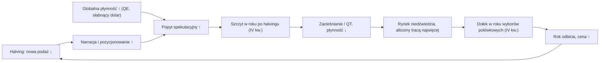

# 10. Cykle i modele wyceny bitcoina

Większość typowego filmu Benjamina Cowena nie dotyczy Fed ani inflacji. Dotyczy tego, w którym miejscu własnego cyklu znajduje się bitcoin: ile dni minęło od ostatniego dołka, jak daleko cena jest powyżej lub poniżej „wartości godziwej” (fair value), czy cena jest nad pasem wsparcia rynku byka (bull market support band, BMSB), co robi 200-tygodniowa średnia krocząca i jak zwroty w tym cyklu wypadają na tle trzech poprzednich. Te narzędzia opierają się wyłącznie na cenie. Nie potrzebują żadnych danych ekonomicznych i to właśnie do nich ostatecznie prowadzą rozdziały makroekonomiczne. Ten rozdział objaśnia każde z nich, pokazuje liczby dla każdego cyklu od 2011 roku do października 2026 i uczciwie mówi, które narzędzia działały nadal, gdy cykl 2025–26 okazał się znacznie mniejszy od poprzednich. W skrócie: regularności dotyczące *czasu* utrzymały się zadziwiająco dobrze, a niemal każdy z góry ustalony próg *poziomu ceny* przestał się uruchamiać.

**Czego się nauczysz**
- czym jest halving, jak datuje się cykl czteroletni oraz pełną tabelę szczytów, dołków, czasów trwania, obsunięć i mnożników dla każdego cyklu;
- co w liczbach oznaczają „malejące zwroty” (diminishing returns) i dlaczego Cowen po 2021 roku porzucił teorię „wydłużających się cykli”;
- jak dopasowuje się „wartość godziwą” z regresji logarytmicznej, dlaczego dwa uczciwe dopasowania dają różne wyniki oraz co wnoszą lub w czym się mylą prawo potęgowe (power law), model stock-to-flow i wachlarz kwantylowy z 2026 roku;
- jak ogólnie buduje się „metrykę ryzyka” w skali 0–1 (nie autorską formułę Cowena) i jakie są jej pułapki;
- jak czytać pas wsparcia rynku byka, średnie 20W/21W/50W/100W/200W/200D, złoty krzyż i krzyż śmierci, Mayer Multiple, wskaźnik Pi Cycle, RSI i dywergencje, poziomy Fibonacciego oraz zamknięcia tygodniowe;
- jak szczyt z 2025 roku i rynek niedźwiedzia z 2026 roku wyglądały we wszystkich tych narzędziach oraz jak na dzień 30 października 2026 wypada prognoza Cowena, wskazująca październik 2026 jako termin dołka.

> **Uwaga o liczbach.** O ile nie zaznaczono inaczej, statystyki cykli zostały obliczone w ramach badań do tego kursu na podstawie dziennych referencyjnych cen zamknięcia Coin Metrics (UTC), więc nieco różnią się od śróddziennych szczytów i dołków na giełdach; tam, gdzie ma to znaczenie, podajemy oba warianty. Własny [raport laboratorium makro](../../tools/macro-lab/REPORT-2026-10-30.md) kursu przelicza średnie kroczące i regresję na podstawie serii Coinbase z FRED (`CBBTCUSD`, dane do 29 października 2026). Notowania z konkretnych giełd (na przykład dokładny szczyt wszech czasów z października 2025, podawany jako 126 080, 126 198 lub 126 296 USD w zależności od platformy) nie zostały niezależnie zweryfikowane. Podstawy skal logarytmicznych, średnich kroczących, regresji i z-score znajdziesz w [rozdziale 01](01-JAK-CZYTAC-WYKRESY-MAKRO.md).

---

## 1. Zegar halvingu i cykl czteroletni

### Halvingi bitcoina (wysokość bloku; mempool.space)

**Co to jest.** Co 210 000 bloków, mniej więcej co cztery lata, nagroda wypłacana górnikom za każdy nowy blok zmniejsza się o połowę. Do tej pory były cztery halvingi: blok 210 000 dnia 28 listopada 2012 (50 → 25 BTC), blok 420 000 dnia 9 lipca 2016 (25 → 12,5), blok 630 000 dnia 11 maja 2020 (12,5 → 6,25) oraz blok 840 000 dnia 20 kwietnia 2024 o 00:09 UTC (19 kwietnia w obu Amerykach; 6,25 → 3,125). Następny, przy bloku 1 050 000, szacuje się na około kwiecień 2028. Data nie jest z góry ustalona; zależy od tego, jak szybko pojawiają się bloki.

**Gdzie to znaleźć.** Wysokość bloku na [mempool.space](https://mempool.space) lub blockchain.com. Długa historia cen: TradingView `INDEX:BTCUSD` lub `BITSTAMP:BTCUSD`; FRED `CBBTCUSD` (Coinbase, od grudnia 2014).

**Jak to czytać.** Halving zmniejsza nową podaż, a nie istniejącą. Jego bezpośredni wpływ za każdym razem był mniejszy. W 2024 roku cięcie wyniosło około 450 BTC dziennie, czyli w ówczesnych cenach około 30 mln USD dziennie, podczas gdy przepływy do spotowych ETF-ów potrafiły przekroczyć 1 mld USD w ciągu jednego dnia. Halving najlepiej więc traktować jako *zegar*, z którym rynek nauczył się synchronizować, a nie jako szok podażowy, który mechanicznie podnosi cenę.

**Jak używa tego Cowen.** Zakotwicza swój cykl czteroletni w halvingach, a jeszcze bardziej w dołkach cyklu. Mówił, że halvingi z czasem tracą na znaczeniu i że cykl może być napędzany w równym stopniu przez płynność i cykl koniunkturalny (lata wyborów połówkowych, termin zacieśniania ilościowego). W marcu 2026 ujął to dosadnie: „Bitcoin tops when it always tops, like every cycle, it tops in the fourth quarter” (bitcoin osiąga szczyt wtedy, kiedy zawsze — jak w każdym cyklu, w czwartym kwartale) ([Cointelegraph Magazine, 6 marca 2026](https://cointelegraph.com/magazine/bitcoin-four-year-cycle-dead-debate-bear-market-2026-benjamin-cowen)).

**Powiązania.** Od halvingu do szczytu mijało 371 dni (2013), 525 dni (2017), 546 dni (2021) i 534 dni (2025): trzy ostatnie wartości mieszczą się w wąskim przedziale 525–546 dni i stąd wzięła się praktyczna reguła „12–18 miesięcy po halvingu”. Kalendarz halvingów jest też zgrany w fazie z amerykańskim kalendarzem politycznym: lata 2013, 2017, 2021 i 2025 były latami powyborczymi, a 2014, 2018, 2022 i 2026 latami wyborów połówkowych (midterm) (zob. [rozdział 09](09-SEZONOWOSC-I-CYKLE-POLITYCZNE.md)). Globalne cykle płynności dokładają trzeci zegar. Mając trzy lub cztery cykle, nie da się stwierdzić, który z tych zegarów faktycznie działa.

**Co to oznaczało dla aktywów.** Dla BTC: szczyt 12–18 miesięcy po każdym z trzech ostatnich halvingów. Altcoiny zwykle osiągały szczyt w okolicach szczytu BTC lub po nim w tych cyklach, w których był sezon altcoinów (2017–18, 2021), a w 2025 roku wcale (rozdział [12](12-DOMINACJA-ALTCOINY-I-ROTACJA.md)). Brak wiarygodnego wpływu na akcje, obligacje, dolara czy złoto.

**Wniosek dla inwestora.** Traktuj halving jako znacznik w kalendarzu, który rynek obserwuje, a nie jako przyczynę, którą da się zmierzyć. Jego efekt podażowy jest dziś mały w porównaniu z przepływami do ETF-ów i kapitałem instytucjonalnym.

### Cykl czteroletni (rok przed halvingiem, rok halvingu, rok po halvingu i rok wyborów połówkowych)

**Co to jest.** Obserwacja, że bitcoin poruszał się mniej więcej czteroletnimi falami: rok odbicia, rok halvingu, rok po halvingu kończący się szczytem kulminacyjnym (blow-off top, zwykle w IV kwartale), a następnie rok bessy. Etykiety Cowena to: rok przed halvingiem (2023), rok halvingu (2024), rok po halvingu (2025, rok szczytu) i rok wyborów połówkowych (2026, rok bessy).

**Gdzie to znaleźć.** Dowolny długi wykres BTC w skali logarytmicznej; wykresy ITC „ROI After Halving”, „ROI After Cycle Bottom” i „ROI After Cycle Peak” pokazują nałożone na siebie cykle.

**Jak to czytać.** Cykl to opis czterech minionych fal, a nie prawo. Czytaj go jako zestaw *założeń wstępnych co do czasu* (timing priors): mniej więcej kiedy zwykle pojawiały się szczyty i dołki. Poziomy cen zmieniają się w każdym cyklu.

**Jak używa tego Cowen.** To jego nadrzędna rama. Szczyty wypadają w IV kwartale roku po halvingu (2013, 2017, 2021, 2025), a dołki mniej więcej rok później, w okolicach amerykańskich wyborów połówkowych. „The cycle is primarily about the timing of lows, not exact prices” (cykl dotyczy przede wszystkim terminu dołków, a nie dokładnych cen) (film z 26 maja 2026, według [indeksu filmów rosetta.to](https://rosetta.to/u/intothecryptoverse)). Jego filmy z 2026 roku „The Four Year Cycle Did Not Die” (12 marca 2026) i „…Is Not Dead” (26 maja 2026) broniły tej ramy przed popularną tezą, że ETF-y ją zabiły. 6 lutego 2026 napisał, że „the most likely low for BTC is October 2026, based on the 4 year cycle. Under some circumstances it could happen as early as May” (najbardziej prawdopodobny dołek BTC to październik 2026, na podstawie cyklu czteroletniego; w pewnych okolicznościach mógłby nastąpić już w maju) ([wpis na X, 6 lutego 2026](https://x.com/benjamincowen/status/2019835733503255006), tekst z fragmentu wyników wyszukiwania).

**Powiązania.** Poniższa tabela jest kręgosłupem całego rozdziału.

| Cykl | Poprzedni dołek | Halving | Szczyt (zamknięcie dzienne; śróddziennie) | Halving → szczyt | Dołek → szczyt | Następny dołek (zamknięcie dzienne; śróddziennie) | Szczyt → dołek | Dołek → dołek | Obsunięcie | Mnożnik dołek → szczyt |
|---|---|---|---|---|---|---|---|---|---|---|
| 2011–15 | 18.11.2011, ~2 USD | 28.11.2012 | 4.12.2013, 1135 USD (~1150–1160 USD Bitstamp) | 371 d | 747 d | 14.01.2015, 176 USD (~152–170 USD) | 406 d | 1153 d | −84,5% (≈−86/−87% śróddziennie) | 539× |
| 2015–18 | 14.01.2015 | 9.07.2016 | 16–17.12.2017, 19 641 USD (~19,8 tys. USD; CMC ~20,1 tys. USD) | 525 d | 1067 d | 15.12.2018, 3185 USD (~3122 USD) | 364 d | 1431 d | −83,8% | 112× |
| 2018–22 | 15.12.2018 | 11.05.2020 | 8–10.11.2021, 67 542 USD (~69,0 tys. USD 10.11) | 546 d | 1059 d | 9.11.2022, 15 758 USD; dołek śróddzienny 21.11.2022, ~15,5 tys. USD | 366 d | 1425 d (1437 do 21.11) | −76,7% (−77,5% śróddziennie) | 21× |
| 2022–26 | 9 / 21.11.2022 | 20.04.2024 | 6.10.2025, 124 824 USD (~126,1–126,3 tys. USD) | 534 d | 1062 d (1050 od 21.11) | Na razie: 30.06.2026, 58 525 USD; śróddziennie 57 748 USD (podawane dla 1.07; niektóre źródła podają 30.06) | na razie 267 d | na razie 1329 d | na razie −53,1% (−54,2% śróddziennie) | 7,9× |

Źródło: badania do kursu na podstawie dziennych zamknięć Coin Metrics; poziomy śróddzienne to przybliżone notowania z giełd lub CoinMarketCap. Dołek z 2011 roku i mnożniki dla szczytu z 2013 roku pochodzą z bardzo płytkiego wczesnego rynku i należy je traktować z dużą rezerwą.

Wyróżniają się trzy regularności. Czas od dołka do szczytu był w trzech ostatnich cyklach niezwykle stabilny: 1067, 1059 i 1062 dni (rozrzut około czterech dni). Od szczytu do dołka przed 2026 rokiem mijało 406, 364 i 366 dni. Każdy szczyt wypadł w IV kwartale roku po halvingu. Jedna regularność się załamała: amplituda. Rynek niedźwiedzia z 2026 roku jest jak dotąd najpłytszy w historii.

**Co to oznaczało dla aktywów.** BTC: trzy zakończone cykle skończyły się obsunięciami od −77% do −85%; czwarty jak dotąd −53%. Altcoiny: większe wahania w obu kierunkach w 2017 i 2021 roku oraz szeroka porażka w latach 2024–26 (rozdział [12](12-DOMINACJA-ALTCOINY-I-ROTACJA.md)). Akcje: S&P 500 nie podążał ściśle za czteroletnim rytmem BTC; wzrósł w 2014 roku (+11,4%) i był na plusie o około 13% od początku 2026 roku, podczas gdy BTC spadał (zob. [rozdział 08](08-AKCJE-ZLOTO-I-INNE-AKTYWA.md) i [rozdział 09](09-SEZONOWOSC-I-CYKLE-POLITYCZNE.md)).

Sam Cowen zastrzega tę ramę: w swoim [Crypto Risk Memo z 15 kwietnia 2026](https://benjamincowen.com/reports/crypto-risk-memo-q2-2026) napisał, że sezonowość roku wyborów połówkowych ma znaczenie tylko w połączeniu z makroekonomią późnej fazy cyklu oraz że „multiple crypto cycles can occur within a single broader business cycle” (w ramach jednego szerszego cyklu koniunkturalnego może wystąpić kilka cykli kryptowalutowych).

**Wniosek dla inwestora.** Cykl czteroletni to trzy lub cztery obserwacje. Jego wyczucie czasu było bardziej wiarygodne niż poziomy cen, ale halving, amerykański kalendarz wyborczy i globalna płynność są ze sobą splątane, więc nikt nie potrafi powiedzieć, co go napędza ani czy się powtórzy.

### Liczenie dni: dołek → szczyt, szczyt → dołek, dołek → dołek

**Co to jest.** Liczenie dni kalendarzowych między punktami zakotwiczenia cyklu (poprzedni dołek, halving, szczyt, następny dołek) i porównywanie bieżącego cyklu z poprzednimi.

**Gdzie to znaleźć.** Policz to sam na podstawie dziennych zamknięć; wykresy ITC „ROI After Cycle Bottom” i „ROI After Cycle Peak” przedstawiają tę samą ideę.

**Jak to czytać.** Liczba dni jest tylko tak dobra jak punkt zakotwiczenia. Wybór zamknięcia albo dołka śróddziennego, czy 9 zamiast 21 listopada 2022, przesuwa wynik o 12 dni. Podchodź podejrzliwie do wyliczeń podawanych bez punktu zakotwiczenia.

**Jak używa tego Cowen.** W wywiadzie dla Bankless z 23 grudnia 2025 przytoczył około 1062 dni od dołka do szczytu w tym cyklu wobec około 1059 i 1067 wcześniej, mówiąc, że szczyt z 2025 roku nastąpił „within one week of when it historically tops” (w ciągu tygodnia od momentu, w którym historycznie wypadał szczyt) ([Bankless, 23 grudnia 2025](https://www.bankless.com/podcast/where-is-crypto-going-in-2026-ben-cowen)). Majowe (2026) [opracowanie CoinMarketCap Academy](https://coinmarketcap.com/academy/article/%20bitcoin-4-year-cycle-october-2026) podało inne liczby (1162 wobec 1059 i 1168). Tych dwóch zestawów nie da się pogodzić; własne obliczenia kursu zgadzają się z liczbami z Bankless, więc liczby CMC to zapewne inny punkt zakotwiczenia albo błąd przy przepisywaniu. Jego pisemne [Bitcoin Cycle Memo z 15 lipca 2026](https://benjamincowen.com/reports/bitcoin-cycle-memo-july-2026) podaje poprawione wyliczenie. Przy zakotwiczeniu w dołku śróddziennym z 21 listopada 2022 dzień 15 lipca 2026 był dniem 1332; dwa poprzednie cykle osiągnęły dno w dniach 1424 i 1432 swoich własnych liczników, co umieszcza analogiczny dołek na 15–23 października 2026, „roughly ninety to one hundred days out” (mniej więcej za dziewięćdziesiąt do stu dni); ten cykl osiągnął szczyt w dniu 1050 wobec dni 1061 i 1068 wcześniej. Memo stwierdza, że wcześniejsza wersja błędnie przyjmowała za punkt zakotwiczenia dołek po upadku FTX z 9 listopada 2022, co jest prawdopodobnym źródłem niespójnych wyliczeń w niektórych opracowaniach. (Własne wyliczenie kursu na zamknięciach dziennych daje 1062 / 1059 / 1067 dni od dołka do szczytu; różnice kilku dni wynikają z zakotwiczenia w zamknięciu lub w wartości śróddziennej). 15 sierpnia 2026 napisał „#BTC is now on day 1363 of the cycle” (#BTC jest teraz w 1363. dniu cyklu), przy tym samym zakotwiczeniu. To samo memo zauważało, że analogia z 2019 roku osiągnęła dno w 261. dniu po szczycie, podczas gdy ten cykl był w dniu 282 „without the flush” (bez gwałtownej wyprzedaży).

**Powiązania.** Od dołka cyklu do następnego halvingu mijało 542, 513 i 528 dni. Jeśli 30 czerwca 2026 to ostateczny dołek, odstęp do halvingu w kwietniu 2028 wyniósłby około 655 dni, co wypada poza wzorcem; dołek w IV kwartale 2026 przywróciłby go w okolice 540 dni. To jeden z ilościowych powodów, dla których Cowen nadal szukał dołka w IV kwartale nawet po czerwcu. Dołek z 30 czerwca wypadł w dniu 1317 jego licznika, około 115 dni „za wcześnie”.

**Co to oznaczało dla aktywów.** Liczba dni od dołka do szczytu była najlepszym narzędziem do wyczucia szczytu w cyklu 2025; skrajne wartości wycen nie były (sekcja 3 i [rozdział 11](11-ON-CHAIN-I-SENTYMENT.md)).

**Wniosek dla inwestora.** Czas od dołka do szczytu ma w trzech cyklach rozrzut około czterech dni, co jest uderzające, ale to n = 3, a punkty zakotwiczenia wybierano z perspektywy czasu. Traktuj to jako założenie wstępne do aktualizowania, a nie datę, na którą można stawiać.

### Cykle przesunięte w lewo i w prawo oraz szablon roku po halvingu

Cykl jest **przesunięty w prawo** (right-translated), gdy szczyt przychodzi późno (po punkcie środkowym między dwoma dołkami), a **przesunięty w lewo** (left-translated), gdy przychodzi wcześnie. Cowen rozważał, czy makroekonomia (inflacja, bezrobocie) może przyspieszyć szczyt, w filmach „Right Translated or Left Translated?” (7 marca 2025) i „Bitcoin: Market Cycles” (7 marca 2024), według [indeksu filmów](https://rosetta.to/u/intothecryptoverse). W „The Pattern That Historically Ended The Bull Market” (12 sierpnia 2025) przedstawił szablon roku po halvingu widoczny w 2013, 2017 i 2021 roku: letni wzrost, wrześniowa korekta do pasa wsparcia rynku byka, a potem szczyt w IV kwartale, za każdym razem z malejącymi procentowymi zwrotami. W 2025 roku ta sekwencja się zrealizowała: BTC spadł pod koniec września, ustanowił szczyt wszech czasów 6 października i załamał się od 10 października. Data szczytu przesuwa się coraz wcześniej w ramach IV kwartału (4.12.2013 → 17.12.2017 → 10.11.2021 → 6.10.2025), a zwroty z IV kwartału w latach po halvingu skurczyły się z +479% (2013) i +221% (2017) do +6% (2021) i −23% (2025). W 2025 roku „szczyt w IV kwartale” przypadł na pierwsze dni kwartału, a nie był wynikiem wzrostów w IV kwartale. Sezonowość miesięczną i szablon roku wyborów połówkowych omawia [rozdział 09](09-SEZONOWOSC-I-CYKLE-POLITYCZNE.md).

### Trzy psychologiczne etapy rynku niedźwiedzia

W filmie „Bitcoin Enters the 3rd Stage of the Bear Market” (7 czerwca 2026, [transkrypcja przez rosetta.to](https://rosetta.to/u/intothecryptoverse/bitcoin-enters-the-3rd-stage-of-the-bear-market)) Cowen opisał rynek niedźwiedzia w trzech etapach: niedowierzanie (niewielu przyjmuje do wiadomości, że to bessa; od października 2025 do lutego 2026), częściowa akceptacja (mniej więcej połowa; od lutego do czerwca 2026) i szeroka akceptacja (większość; być może od czerwca do października 2026). Powiedział, że odwrócenia zwykle następują, gdy mniej więcej 75–80% uczestników jest nastawionych niedźwiedzio. To rama oparta na sentymencie, a nie mierzalny wskaźnik; jej mierzalnych krewnych (Fear & Greed, ryzyko społeczne) omawia [rozdział 11](11-ON-CHAIN-I-SENTYMENT.md).

---

## 2. Malejące zwroty i teoria, którą Cowen porzucił

### Malejące zwroty

**Co to jest.** Szczyt każdego cyklu jest mniejszą wielokrotnością punktu wyjścia niż w poprzednim cyklu, a obsunięcie w każdym rynku niedźwiedzia jest (jak dotąd) również mniejsze. To najlepiej udokumentowana regularność w historii ceny bitcoina.

**Gdzie to znaleźć.** ITC „ROI Bands”, „ROI After Cycle Bottom”, „Price Drawdown From ATH”; za darmo: policz z dowolnej długiej historii BTC.

**Jak to czytać.**

| Miara | Cykl 2013 | Cykl 2017 | Cykl 2021 | Cykl 2025 |
|---|---|---|---|---|
| Szczyt jako wielokrotność poprzedniego dołka cyklu | 539× | 112× | 21× | 7,9× |
| Szczyt jako wielokrotność wartości godziwej log-log | 11× | 6,6× | 3,0× | 1,23× |
| Reszta regresji w szczycie | +3,47σ | +2,72σ | +1,57σ | +0,29σ |
| Obsunięcie, szczyt → następny dołek (zamknięcie) | −84,5% | −83,8% | −76,7% | −53,1% (na razie) |
| Cena ÷ 200-tygodniowa SMA w szczycie | b.d. | 16,9× | 3,95× | 2,33× |

Mnożnik każdego cyklu wynosił mniej więcej od 1/2,7 do 1/5 mnożnika poprzedniego. Tymczasem dna utrzymywały się w dość stałej strefie około 0,42–0,59× wartości godziwej log-log. Innymi słowy, *sufit* zbliżał się do linii trendu znacznie szybciej niż *podłoga*. Ta asymetria tłumaczy, dlaczego stałe progi szczytu zawiodły w 2021 i 2025 roku, podczas gdy strefy dna pozostały względnie stabilne.

**Jak używa tego Cowen.** Malejące zwroty są centralnym elementem jego ramy od 2019 roku i zachował je po porzuceniu teorii wydłużających się cykli (następna karta). Jego opracowanie z 2026 roku „Asymmetric Tail Curvature in Bitcoin Price Quantiles” (29 maja 2026) formalizuje tę samą obserwację: górny ogon rozkładu kurczy się z cyklu na cykl, a dolne wsparcie pozostaje blisko prawa potęgowego ([raport](https://benjamincowen.com/reports/asymmetric-tail-curvature-in-bitcoin-price-quantiles)).

**Powiązania.** Malejące zwroty to powód, dla którego każdy „stały” wskaźnik w tym rozdziale z czasem słabnie: Mayer Multiple w szczytach (5,71 → 3,78 → 1,48 → 1,18), MVRV w szczytach (4,72 → 4,43 → 2,85 → 2,29, [rozdział 11](11-ON-CHAIN-I-SENTYMENT.md)), przecięcie Pi Cycle (w latach 2024–25 nie było go wcale). Wiarygodne mechanizmy: większa kapitalizacja wymaga znacznie więcej pieniędzy, by zmienić się o ten sam procent; zmienność stale spada; a baza posiadaczy przesunęła się w stronę ETF-ów i skarbców korporacyjnych, które trzymają aktywa trwalej niż lewarowani inwestorzy detaliczni.

**Co to oznaczało dla aktywów.** BTC: mniejsze szczyty, a w 2026 roku znacznie płytsza bessa. Altcoiny: malejące zwroty liczone w BTC były jeszcze dotkliwsze (większość altcoinów nigdy nie odzyskała szczytów z 2021 roku, [rozdział 12](12-DOMINACJA-ALTCOINY-I-ROTACJA.md)).

**Wniosek dla inwestora.** Każdy model, którego górne pasmo nie kurczy się z czasem, będzie zawyżał przyszłe szczyty. Spodziewaj się mniejszych mnożników na obu krańcach, a szczególnie na górze.

### Teoria wydłużających się cykli (porzucona)

**Co to jest.** Popularna w latach 2019–2021 teoria, że każdy cykl rozciąga się w czasie, więc szczyt w 2021 roku miał nastąpić później, niż wynikałoby z rytmu czteroletniego.

**Jak używał tego Cowen.** Był jednym z jej najbardziej znanych zwolenników („Bitcoin Lengthening Cycles And Diminishing Returns”, 19 lipca 2021). W listopadzie 2021 powiedział, że cykl rynkowy „has now *unofficially* lengthened” (właśnie *nieoficjalnie* się wydłużył) („Market Cycle Has Now *Unofficially* Lengthened”, 19 listopada 2021) i przekonywał raczej do ponownej akumulacji niż paraboli w IV kwartale 2021 („Bitcoin Re-accumulation”, 23 listopada 2021) (tytuły według [indeksu filmów](https://rosetta.to/u/intothecryptoverse)).

**Co się stało.** BTC osiągnął szczyt już 10 listopada 2021 i spadł o 77% do listopada 2022. Szczyt przyszedł zgodnie z harmonogramem czteroletnim, podobnie jak szczyt z 2025 roku. Cowen powiedział później, że malejące zwroty i wydłużające się cykle „are not mutually exclusive” (nie wykluczają się wzajemnie) oraz że szczyt na poziomie 64 tys. USD w 2021 roku oznaczał „diminishing returns without lengthening cycles” (malejące zwroty bez wydłużających się cykli) ([podsumowanie The Informer Post](https://theinformerpost.beehiiv.com/p/bitcoins-bull-market-different-from-previous-cycles-says-analyst-benjamin-cowen-heres-why)). Od 2023 roku wrócił do czteroletniego harmonogramu. Hasło „diminishing returns” pojawia się w 114 tytułach lub opisach filmów, z czego 98 pochodzi z lat 2019–22.

**Wniosek dla inwestora.** Gdy w starym filmie usłyszysz o „wydłużających się cyklach”, pamiętaj, że sam Cowen porzucił tę teorię. Nie przypisuj jej jego obecnym poglądom.

### Obsunięcie od szczytu wszech czasów

**Co to jest.** Procent poniżej bieżącego szczytu wszech czasów (ATH). ITC: „Price Drawdown From ATH”; za darmo: TradingView lub dowolny arkusz kalkulacyjny.

**Jak to czytać.** Poprzednie bessy kończyły się na −84,5%, −83,8% i −76,7% na zamknięciach dziennych. Bessa z 2026 roku sięgnęła −53,1% na zamknięciach (−54,2% śróddziennie) do 30 czerwca – 1 lipca 2026. Według ostatniego zamknięcia tygodniowego w laboratorium (77 939 USD, tydzień kończący się 1 listopada 2026, niepełny) BTC był 37,5% poniżej najwyższego zamknięcia tygodniowego na poziomie 124 720 USD (5 października 2025), według [raportu laboratorium](../../tools/macro-lab/REPORT-2026-10-30.md).

**Jak używa tego Cowen.** Film „Bitcoin Percentage Drawdown from the All Time High” (22 listopada 2022) przekonywał, że bessy utrzymują się na poziomach obsunięcia 60–70%, zanim osiągną dno. W 2026 roku opisywał BTC jako „~50% down” (około 50% w dół), a rynek niedźwiedzia jako „not over” (niezakończony).

**Powiązania.** Głębokość obsunięcia odzwierciedlała to, jak bardzo szczyt przestrzelił wartość godziwą: szczyt z 2025 roku wynosił zaledwie 1,23× wartości godziwej, więc spadek o 53% sprowadził cenę do około 0,45× wartości godziwej, czyli do tej samej względnej strefy co poprzednie dna.

**Wniosek dla inwestora.** Nie oczekuj, że powtórzy się stałe obsunięcie (na przykład „−80%”). Porównanie obsunięcia z odległością od linii trendu mówi więcej niż sam procent.

### Ujęcia ROI: ROI cyklu, kroczące ROI, pasma ROI, ROI po halvingu / dołku / szczycie

**Co to jest.** Porównania zwrotów między cyklami od stałych punktów zakotwiczenia: od dołka cyklu, od halvingu, od szczytu. „Kroczące ROI” (running ROI; na przykład zwrot z ostatniego roku) pokazuje momentum w czasie. ITC ma około 20 wykresów ROI („ROI After Cycle Bottom”, „ROI After Halving”, „ROI After Cycle Peak”, „ROI Bands”, „Year-To-Date ROI”, „Running ROI”).

**Jak to czytać.** Nałożenie cykli na siebie pokazuje, czy obecny przebiega „gorąco” czy „chłodno” w porównaniu z historią przy tej samej liczbie dni. Używaj skali logarytmicznej.

| Dni po dołku cyklu | Od dołka ze stycznia 2015 | Od dołka z grudnia 2018 | Od dołka z listopada 2022 |
|---|---|---|---|
| Dzień 1000 | 27,0× | 14,1× | 7,5× |
| Dzień 1400 | 31,7× | 6,0× | 5,5× |
| Dzień 1432 | 18,2× | 5,2× | 5,1× |

Mniej więcej od dnia 1300 cykl 2022–26 ściśle podąża za cyklem 2018–22 w ujęciu kroczącego ROI.

**ROI na wykresach Cowena to iloraz, a nie procent.** Jego memo definiują ROI jako „bieżąca cena podzielona przez podaną cenę odniesienia”: ROI 0,520 liczone od szczytu oznacza −48%, a ROI od początku roku 0,731 oznacza −26,9% ([memo z lipca 2026](https://benjamincowen.com/reports/bitcoin-cycle-memo-july-2026)). Tak właśnie czyta się każdą nakładkę ITC (zob. też [rozdział 01](01-JAK-CZYTAC-WYKRESY-MAKRO.md)). Jego memo z sierpnia 2026 szacowało ROI BTC od dołka cyklu na około 4,0×, w dół z około 5,0× trzy miesiące wcześniej, a mnożnik szczytu cyklu na około 8× od dołka wobec około 22× w poprzednim cyklu ([The Balance of Risks](https://benjamincowen.com/reports/the-balance-of-risks-august-2026)); obliczone w kursie 7,9× i 21× są z tym zgodne.

**Nakładka obsunięcia od szczytu sprzed końca QT (2019 vs 2025).** Główny wykres jego analogii z 2019 rokiem zestawia spadek BTC od szczytu z czerwca 2019 ze spadkiem od szczytu z października 2025 — oba szczyty wypadły krótko przed zakończeniem QT: około pięciu tygodni wcześniej (26.06 → 1.08.2019) i około ośmiu tygodni wcześniej (6.10 → 1.12.2025). Ścieżka z 2019 roku kończy się dołkiem krachu covidowego w 261. dniu, na poziomie około 0,29 szczytu; ścieżka z 2025 roku była w połowie lipca 2026, w 282. dniu, na poziomie około 0,52 ([memo z I kw. 2026](https://benjamincowen.com/reports/crypto-macro-risk-memo-q1-2026); [memo z II kw. 2026](https://benjamincowen.com/reports/crypto-risk-memo-q2-2026); [memo z lipca 2026](https://benjamincowen.com/reports/bitcoin-cycle-memo-july-2026)). Jego interpretacja: oba szczyty przyszły w atmosferze apatii, bez trwałej rotacji do altcoinów; pierwszy, około 50-procentowy spadek w bessie 2019 roku wynikał z zacieśniania płynności, a głębsza wyprzedaż wymagała szoku zewnętrznego (COVID). Bez takiego katalizatora spodziewał się „a reset completed through time rather than through a comparable flush” (resetu dokonanego w czasie, a nie przez porównywalną gwałtowną wyprzedaż). Słabość tej analogii jako szablonu dna polega właśnie na tym, że wymaga szoku, który może nie nadejść.

Zwroty w latach kalendarzowych (od zamknięcia do zamknięcia): 2013 +5286%, 2014 −56%, 2015 +34%, 2016 +126%, 2017 +1337%, 2018 −74%, 2019 +94%, 2020 +305%, 2021 +60%, 2022 −64%, 2023 +156%, 2024 +121%, 2025 −6,3%, 2026 do 29 października −10,7%. Rok 2025 był pierwszym „rokiem szczytu” po halvingu, który zakończył się na minusie.

**Jak używa tego Cowen.** Filmy „Bitcoin Market Cycle ROI” (wiele odcinków) i „Bitcoin: ROI After Halving” (14 lipca 2025) zestawiają obecny cykl z poprzednimi i pokazują malejące mnożniki. Hasło „ROI” pojawia się w 167 tytułach lub opisach filmów.

**Powiązania.** ROI od dołka to najczystszy sposób, by zobaczyć malejące zwroty; ROI po szczycie to sposób, w jaki porównywał bessę 2026 roku z latami 2014, 2018 i 2022. Mapy cieplne zwrotów miesięcznych i kwartalnych należą do [rozdziału 09](09-SEZONOWOSC-I-CYKLE-POLITYCZNE.md).

**Wniosek dla inwestora.** Nakładki ROI mówią ci, jak nietypowa jest obecna ścieżka, a nie gdzie się skończy. Najbardziej przydają się do zauważenia, kiedy cykl wyraźnie odrywa się od poprzedników, jak w 2026 roku pod względem głębokości spadku.

### BTC po pierwszej podwyżce w cyklu zacieśniania (oraz soczewka podwyżki w roku wyborów połówkowych)

**Co to jest.** Cena BTC podzielona przez jego cenę z dnia podwyżki stóp, śledzona przez kolejne miesiące: nakładka ROI zakotwiczona w decyzjach Fed, a nie w dołkach cyklu. Cowen używa dwóch wersji: po *pierwszej* podwyżce w cyklu zacieśniania (grudzień 2015, marzec 2022, wrzesień 2026) oraz po *wrześniowej podwyżce w roku wyborów połówkowych* (2018, 2022, 2026).

**Gdzie to znaleźć.** Policz na podstawie dowolnej dziennej serii BTC i dat decyzji Fed (FRED `DFEDTARU`; [rozdział 02](02-FED-I-STOPY-PROCENTOWE.md)).

**Jak to czytać.** Soczewka pierwszej podwyżki daje duży rozrzut: po grudniu 2015 BTC spadł o około 20% w ciągu dwóch miesięcy, a potem wzrósł o około 70% w ciągu dwunastu; po marcu 2022 wzrósł o około 12% w dwa tygodnie, a potem spadł o ponad 60% ([The Triple Squeeze, 30 września 2026](https://benjamincowen.com/reports/the-triple-squeeze-september-2026)). Dwa przypadki wskazujące przeciwne kierunki oznaczają, że sama podwyżka niewiele wyjaśnia; więcej wyjaśnia faza cyklu, w której następuje.

**Jak używa tego Cowen.** Przed posiedzeniem FOMC 16 września 2026 przekonywał, że Fed „really should” (naprawdę powinien) podnieść stopy i że podwyżka zepchnie BTC niżej za pośrednictwem dolara. Fed podniósł stopy do 3,75–4,00%, dolar się umocnił, ale BTC wzrósł z około 76 tys. USD w dniu podwyżki do około 86 tys. USD 21 września (Coinbase), przedłużając odbicie, które zaczęło się w okolicach 63 tys. USD w połowie sierpnia; Cowen przyznał, że ta teza „not rooted in the data” (nie miała oparcia w danych), i powiedział, że „none of the data suggests that a rate hike has ever been immediately bearish for Bitcoin” (żadne dane nie wskazują, by podwyżka stóp kiedykolwiek natychmiast działała niedźwiedzio na bitcoina) ([Benzinga przez TradingView](https://www.tradingview.com/news/benzinga:45b48150d094b:0-bitcoin-analyst-admits-his-rate-hike-thesis-was-not-rooted-in-the-data/)). Jego wrześniowe memo przedstawiało podwyżkę jako *wznowienie* istniejącego cyklu (jak w 1999 roku po „ubezpieczających obniżkach” z 1998 roku), a nie start z niskich stóp jak w 2015 czy 2022 roku, i stwierdzało, że w soczewce pierwszej podwyżki rok 2026 przypomina początek 2022 roku. W soczewce podwyżki w roku wyborów połówkowych BTC utrzymywał się w 2018 i 2022 roku w pobliżu poziomu z dnia podwyżki przez około siedem tygodni, zanim przebił się w dół; w odniesieniu do 2026 roku wskazywało to na przełamanie około 50. dnia po 16 września (początek listopada), przy czym spadek o 15% jak w 2022 roku oznaczałby około 64 tys. USD, a spadek o 50% jak w 2018 roku około 38 tys. USD. 30 października 2026, w 44. dniu, BTC kosztował około 78 tys. USD; okno jeszcze nie nadeszło.

**Powiązania.** Podwyżki działają na BTC za pośrednictwem dolara, rentowności realnych i apetytu na ryzyko ([rozdział 07](07-PLYNNOSC-PIENIADZ-I-DOLAR.md)). W 2022 roku podwyżce towarzyszyły QT i obawy przed recesją; w 2015 i 2026 roku nastąpiła bez QT. Sam Cowen w 2022 roku również uważał, że podwyżka to „not necessarily doom and gloom” (niekoniecznie katastrofa) ([Daily Hodl, 28 lutego 2022](https://dailyhodl.com/2022/02/28/interest-rate-hike-not-necessarily-doom-and-gloom-for-bitcoin-btc-says-analyst-benjamin-cowen-heres-why/)).

**Wniosek dla inwestora.** Dwa lub trzy epizody podwyżek o przeciwnych skutkach to nie wzorzec. Traktuj nakładki ROI zakotwiczone w wydarzeniach jako sposób na ramowanie scenariuszy, a nie jako prognozę.

---

## 3. Modele regresji: wartość godziwa, pasma i prawo potęgowe

### Pasma regresji logarytmicznej i wartość godziwa

**Co to jest.** Linia najlepszego dopasowania logarytmu ceny względem logarytmu czasu (dni od bloku genesis bitcoina z 3 stycznia 2009). Ponieważ obie osie są logarytmiczne, jest to prawo potęgowe: cena ∝ dni^b. Dopasowaną linię nazywa się „wartością godziwą”; pasma rysuje się w stałych wielokrotnościach lub odchyleniach standardowych reszt. „Bitcoin Rainbow Chart” (Blockchaincenter, na podstawie regresji z bitcointalk z 2014 roku) to jej kolorowa wersja. „Wartość godziwa z regresji logarytmicznej” Cowena jest dopasowywana wyłącznie do danych „spoza baniek”.

**Gdzie to znaleźć.** ITC: „(Legacy) Logarithmic Regression” (wersja darmowa), „(Legacy) Fair Value Logarithmic Regression”, „(Legacy) Logarithmic Regression Rainbow”; za darmo: Bitcoin Magazine Pro „Rainbow Price Chart”, blockchaincenter.net, skrypty społeczności TradingView, takie jak „Logarithmic Regression Fib Deviation Bands” czy „Bitcoin Power Law Bands”. [Laboratorium makro](../../tools/macro-lab/REPORT-2026-10-30.md) kursu dopasowuje własną regresję do danych FRED.

**Jak to czytać.** Dwa dopasowania na uczciwych danych, obok siebie:

| | Dopasowanie do pełnej historii (badania kursu) | Dopasowanie laboratorium makro |
|---|---|---|
| Dane | Dzienne zamknięcia Coin Metrics od sierpnia 2010 | Tygodniowe zamknięcia FRED `CBBTCUSD` (Coinbase) od grudnia 2014 |
| Równanie | log10(P) = −16,305 + 5,628 · log10(dni) | nachylenie b = 5,84 |
| Rozrzut reszt (1σ) | 0,301 jednostki log10 (czynnik ~2,0) | ≈ 0,24 jednostki log10 (wynika z jego z-score) |
| Wartość godziwa, koniec października 2026 | ≈ 144 tys. USD (±1σ: 72–288 tys. USD) | 147 386 USD |
| Cena ÷ wartość godziwa | ≈ 0,54 | 0,53 |
| Z-score reszty | −0,88σ | −1,17σ |

Oba dopasowania umieszczają wartość godziwą w okolicach 145 tys. USD, a cenę na poziomie nieco ponad połowy tej wartości. Różnią się w ocenie, jak *nietypowe* to jest, ponieważ okno laboratorium zaczyna się po szalonych latach 2010–2014. Jego reszty są mniejsze, więc ten sam iloraz 0,53 wygląda na głębsze niedowartościowanie (−1,17σ zamiast −0,88σ). Lekcja dla każdego wykresu regresji czy z-score: data początkowa dopasowania zmienia nachylenie, szerokość pasma, a więc i sygnał. Żadne z tych dopasowań nie jest „tą jedyną” wartością godziwą; raport laboratorium mówi, że jego własne dopasowanie służy „to learn the method, not as the canonical fair value” (nauce metody, a nie jako kanoniczna wartość godziwa).

Dopasowanie do pełnej historii wyraźnie pokazuje też asymetrię malejących zwrotów. Reszty w szczytach: +3,47σ (2013), +2,72σ (2017), +1,57σ (2021), +0,29σ (2025). Reszty w dołkach: −0,88σ (2015), −0,76σ (2018), −1,14σ (2022), −1,15σ (czerwiec 2026). Szczyty zbiegają się w kierunku linii, a dołki trzymają się stabilnej strefy od −0,8σ do −1,15σ. Wartości rzutowane z krzywej (około 152 tys. USD na koniec 2026, 206 tys. USD na koniec 2027 i 275 tys. USD na koniec 2028 przy dopasowaniu do pełnej historii) to arytmetyka krzywej, a nie prognozy.

Częste błędy interpretacji: traktowanie wartości godziwej jako docelowej ceny; zakładanie symetrycznych pasm (model z symetrycznym σ już nigdy nie da sygnału w szczycie); zapominanie, że dopasowanie przesuwa się wraz z napływem nowych danych; oraz używanie logarytmu ceny względem *liniowego* czasu, co implikuje wzrost wykładniczy i zawyża przyszłą wartość godziwą.

**Jak używa tego Cowen.** Regresja logarytmiczna to jedno z jego najczęściej używanych narzędzi (277 tytułów lub opisów filmów, 2019–26); przewija się przez jego filmy „Bitcoin Logarithmic Regression” (25 sierpnia 2021, 16 czerwca 2022) i „Ethereum: Logarithmic Regression” (31 grudnia 2025). Opisuje wartość godziwą jako „where price tends to return” (miejsce, do którego cena ma tendencję wracać), a rok bessy spędzony poniżej wartości godziwej nazywa „kapitulacją w czasie” (time-based capitulation), a nie kapitulacją cenową. W okresie marzec–czerwiec 2022 przekonywał, że wartość godziwa spoza baniek i 200-tygodniowa SMA wskazują na około 20 tys. USD; BTC spadł do 17,6 tys. USD w czerwcu i 15,5 tys. USD w listopadzie 2022. W grudniu 2025 powiedział, że dla ETH „fair value log regression could be near $2,100 in 2026” (wartość godziwa z regresji logarytmicznej może w 2026 roku wynosić około 2100 USD) ([Bankless](https://www.bankless.com/podcast/where-is-crypto-going-in-2026-ben-cowen)). Aplikacja ITC oznacza teraz swoje klasyczne wykresy regresji jako „(Legacy)” i promuje opisany niżej wachlarz kwantylowy.

**Powiązania.** Cena wracała do wartości godziwej lub schodziła poniżej niej w okolicach halvingów i w dołkach bessy; szczyty przypadały w górnych pasmach, które z każdym cyklem się zwężają. Reszty regresji poruszają się wraz z cyklem płynności (lata QE wypychają cenę nad linię, lata QT ściągają ją pod nią), ale ta zależność jest luźna.

**Co to oznaczało dla aktywów.** Dla BTC przyzwoita mapa tego, gdzie wypadały dołki cykli, i słaba wskazówka co do tego, jak wysoko sięgnie szczyt. Ta sama metoda zastosowana do ETH czy całkowitej kapitalizacji rynku kryptowalut jest znacznie mniej stabilna, bo historia jest krótsza.

**Wniosek dla inwestora.** Używaj regresji jako długoterminowej mapy z asymetrycznymi pasmami, które z czasem się zwężają. Zawsze pytaj, na jakim oknie czasowym ją dopasowano.

### Całkowita kapitalizacja rynku kryptowalut a jej linia trendu („The Beauty of Mathematics”)

Ta sama idea regresji logarytmicznej zastosowana do całego rynku kryptowalut. Comiesięczna seria Cowena „The Beauty of Mathematics” doszła do części 71 dnia 9 czerwca 2026 (odcinek upamiętniający milion subskrybentów kanału). ITC udostępnia ją za darmo jako „Total Crypto Market Cap & Trendline” i „Total Crypto Valuation vs. Trendline”. Mierzy, jak bardzo rozciągnięty jest cały rynek. W filmie „Why I DO NOT think we are close to a market cycle peak” (20 lutego 2021) użył jej, by przekonywać, że rynek „not close to a peak” (nie jest blisko szczytu); rynek dalej rósł i osiągnął szczyt w listopadzie 2021 — badania kursu oceniają tę prognozę jako trafioną. Ograniczenia: całkowita kapitalizacja obejmuje stablecoiny i tysiące nowych tokenów, więc jej skład zmienia się w czasie w sposób, którego pojedyncza linia trendu nie uchwyci. Ticker w TradingView: `CRYPTOCAP:TOTAL` ([rozdział 12](12-DOMINACJA-ALTCOINY-I-ROTACJA.md)).

### Prawo potęgowe

**Co to jest.** Ta sama postać funkcyjna co regresja log-log, spopularyzowana przez Giovanniego Santostasiego oraz, jako „korytarz prawa potęgowego” (power law corridor), przez Harolda Burgera: cena ∝ dni^~5,7–5,8. Dopasowanie kursu do pełnej historii daje wykładnik 5,63, a dopasowanie laboratorium od 2014 roku 5,84, co pokazuje, jak bardzo wykładnik zależy od daty początkowej i okna.

**Jak to czytać.** Dołki respektowały dolną granicę korytarza: czerwiec 2026 wypadł na poziomie około 0,45× wartości godziwej, tak samo jak listopad 2022. Szczyt z 2025 roku ledwie przekroczył linię środkową.

**Powiązania.** Zgodne z malejącymi zwrotami. Długoterminowe projekcje jego zwolenników (typu „1 mln USD do 2033 roku”) zależą od tego, czy wykładnik pozostanie stały, czego nie sprawdzono.

**Wniosek dla inwestora.** Prawo potęgowe to użyteczny opis podłogi. Podchodź sceptycznie do każdej liczby na dekadę naprzód wyprowadzonej z tego modelu.

### Asymetryczny wachlarz regresji kwantylowej (2026)

**Co to jest.** Opracowanie robocze opublikowane przez Cowena 29 maja 2026, „Asymmetric Tail Curvature in Bitcoin Price Quantiles” ([raport i PDF](https://benjamincowen.com/reports/asymmetric-tail-curvature-in-bitcoin-price-quantiles); film z 30 maja 2026). Zamiast jednej linii „wartości godziwej” przez środek danych dopasowuje osobną linię dla każdego *kwantyla* ceny: linia 1% to krzywa, poniżej której wypada tylko 1% dni, linia 50% to mediana, a linia 99% to krzywa, powyżej której wypada tylko 1% dni. W ITC występuje jako „Asymmetric Quantile Regression Fan” (wersja darmowa).

**Jak jest zbudowany, prostymi słowami.** Opracowanie wykonuje regresję logarytmu ceny względem logarytmu czasu z członem krzywoliniowym (kwadratowym) i pozwala, by kwantyle górnego ogona i dolnego ogona miały *różną* krzywiznę. Krok „przestawienia” (rearrangement) zapobiega przecinaniu się linii kwantylowych. Niepewność szacuje się *bootstrapem blokowym*: historię próbkuje się ponownie w fragmentach po 14–90 dni, tak by zachować silną zależność cen z dnia na dzień. Trafność poza próbą testuje się *rozszerzającym się oknem* (dopasowanie do daty granicznej, ocena kolejnych lat, powtórzenie) z użyciem *check-loss* (zwanej też pinball loss), standardowej miary błędu dla prognoz kwantylowych. Dane to 5788 obserwacji dziennych z lat 2010–2026.

**Co ustalono.** Górny ogon wyraźnie wygina się w dół (jego krzywizna jest ujemna i istotna statystycznie, bootstrapowe p ≈ 0,012), natomiast krzywizny dolnego ogona nie da się odróżnić od zera: podłoga jest bliska prostemu prawu potęgowemu. Błędy dopasowania górnego ogona zmniejszyły się o około 27–29% w porównaniu z prostoliniowym kwantylowym prawem potęgowym. Dla porównania: zwykłe prawo potęgowe skalibrowane na 2018 rok przeszacowało cenę w 77,2% późniejszych dni (średni błąd +32,1% w latach 2019–2026); stock-to-flow przeszacował w 94,9% dni (+294,5%); S2FX o około +1699%. Opracowanie wymienia wcześniejsze prace: prawo potęgowe Santostasiego, regresję logarytmiczną „Trolololo”, S2F/S2FX PlanB oraz modele kwantylowe „Plan C”.

**Proponowany mechanizm: składnik strukturalny a spekulacyjny.** Cena jest modelowana jako składnik *strukturalny* — popyt wynikający ze stopniowej monetyzacji, który daje prostą podłogę prawa potęgowego — pomnożony przez *spekulacyjny* mnożnik, który słabnie wraz ze wzrostem kapitalizacji („malejąca refleksyjność”, diminishing reflexivity). To formalna wersja malejących zwrotów. Autorzy nazywają to argumentem „sufficiency, not uniqueness” (wystarczalności, a nie jedyności): wyjaśnia dane, ale mogą je wyjaśniać również inne mechanizmy.

**Zastrzeżenia, które podaje.** To „not a forecast, a price floor, or a measure of portfolio loss risk” (nie prognoza, nie podłoga cenowa i nie miara ryzyka straty portfela). Krzywiznę identyfikuje się wyłącznie na pełnej próbie, a wyniki zależą od wyborów takich jak przyjęta data genesis.

**Jak używa tego Cowen.** Jego memo z lipca 2026 umieszczało cenę „essentially on” (praktycznie na) paśmie 1. percentyla (około 65,5 tys. USD), z medianą w okolicach 116 tys. USD i 99. percentylem w okolicach 202 tys. USD ([memo z lipca 2026](https://benjamincowen.com/reports/bitcoin-cycle-memo-july-2026)). Zauważało, że pasmo 1% było już wcześniej przebijane: o 12,2% pod koniec 2010 roku i przez 40 dni w okresie upadku FTX. Cena później wzrosła wyraźnie powyżej niego (około 78–86 tys. USD we wrześniu–październiku 2026).

**Wniosek dla inwestora.** Regresja kwantylowa to formalna odpowiedź na problem „symetryczne pasma już nigdy nie dadzą sygnału w szczycie”: pozwala sufitowi się kurczyć, a podłodze pozostać na miejscu. Opisuje, gdzie cena była w stosunku do czasu; nie mówi, dokąd cena musi pójść.

### Stock-to-flow (S2F) i dlaczego zawiódł

**Co to jest.** Model opublikowany przez pseudonimowego analityka PlanB w marcu 2019, który wykonywał regresję logarytmu kapitalizacji względem logarytmu wskaźnika stock-to-flow (stock = istniejąca podaż; flow = roczna nowa emisja). Ponieważ flow zmniejsza się o połowę przy każdym halvingu, S2F się podwaja, a model przewidywał skokowy wzrost „wartości godziwej” po każdym halvingu. Rozszerzenie S2FX (kwiecień 2020) zakładało średnio około 288 tys. USD w latach 2020–24, a model powszechnie odczytywano jako zapowiedź około 100 tys. USD do końca 2021 roku.

**Gdzie to znaleźć.** ITC „Stock to Flow (S2F)”; różne darmowe strony.

**Co się stało.** Cykl 2021 osiągnął szczyt na poziomie 69 tys. USD. Cykl 2025 osiągnął szczyt na poziomie około 126 tys. USD, podczas gdy wartości S2F w latach 2024–25 sugerowały kilkaset tysięcy dolarów. W październiku 2026 BTC notowano w okolicach 78–80 tys. USD. Raport kwantylowy Cowena z 2026 roku szacuje średni błąd S2F od momentu publikacji na +295%, a S2FX na +1699%.

**Dlaczego zawiódł.**
1. To regresja dwóch serii z trendem (podaż i cena rosną), czyli podręcznikowy przepis na korelację pozorną.
2. Nie zawiera w ogóle zmiennej popytu ani płynności.
3. Test poza próbą był znikomy: dwa halvingi.
4. W miarę jak emisja spada do zera, flow przestaje mieć znaczenie; po 2024 roku dzienna emisja jest znikoma wobec przepływów do ETF-ów i spółek skarbcowych (treasury companies).

**Jak używa tego Cowen.** Omawiał go z PlanB w latach 2021–22 („…Stock-To-Flow, Lengthening Cycles…”, 11 sierpnia 2021) jako jedną z kilku teorii i długo był sceptykiem, argumentując za malejącymi zwrotami tam, gdzie S2F zakładał przyspieszające zwroty.

**Wniosek dla inwestora.** Model bez zmiennej popytu i z eksplodującą prognozą to narracja, a nie wycena. S2F to przestroga dla każdego modelu, który dobrze pasuje do kilku cykli.

---

## 4. Znormalizowane skale ryzyka

### Koncepcja metryki ryzyka (skala 0–1)

**Co to jest.** Pojedyncza liczba od 0 do 1, która mówi, gdzie cena znajduje się na własnej historycznej „drabinie”: blisko 0, gdy cena była historycznie nisko względem swojego trendu, blisko 1, gdy była mocno rozciągnięta. Wersja Cowena, oznaczana kolorami od niebieskiego (nisko) do czerwonego (wysoko) i dostępna dla poszczególnych aktywów oraz w różnych denominacjach (w USD, w BTC, w ETH), jest autorska i niejawna. Opisujemy tu tylko ogólną koncepcję.

**Gdzie to znaleźć.** ITC „Historical Risk Levels”, „Current Risk Levels”, „Price Color-Coded By Risk”, „Time In Risk Bands” (płatne pakiety). W TradingView są skrypty społeczności przedstawiające się jako uproszczone wersje metryki Cowena; ich autorzy zaznaczają, że to przybliżenia, a nie jego formuła.

**Jak buduje się taką metrykę, ogólnie.** Podobny wynik daje każdy z kilku przepisów:
1. Wybierz punkt odniesienia (kotwicę): długą średnią kroczącą (350-dniową, 400-dniową, 50-tygodniową, 200-tygodniową) albo wartość godziwą z regresji logarytmicznej.
2. Zmierz rozciągnięcie: x(t) = ln(cena ÷ kotwica).
3. Skoryguj o malejące zwroty: przeskaluj x(t) czynnikiem czasowym albo podziel przez słabnącą obwiednię, dobraną tak, by wcześniejsze szczyty osiągały podobną wysokość.
4. Znormalizuj do 0–1: skalowanie min–max po całej historii albo ranga percentylowa skorygowanej serii.
5. Opcjonalnie wygładź wynik lub uśrednij go z innymi podmetrykami (on-chain, społecznymi).

**Jak to czytać.** To pozycja na skali historycznej, a nie prawdopodobieństwo; mówi o tym nawet tekst pomocy ITC. „Pasma ryzyka” o szerokości 0,1 pozwalają zobaczyć, jak długo cena historycznie przebywała w każdej strefie. Wysokie odczyty były historycznie rzadkie i krótkotrwałe.

**Jak używa tego Cowen.** To jego sztandarowe narzędzie od 2019 roku („Bitcoin: Validating the risk model”, 21 grudnia 2019; „Bitcoin Risk Analysis – Have a plan!”, 7 maja 2020; seria „Bitcoin Risk Metric” w latach 2021–24). Opisuje je jako oparte na cenie, uwzględniające czas, zmienność i malejące zwroty, i używa go do ramowania „dynamicznego DCA” (dynamic DCA): większej akumulacji w pasmach niskiego ryzyka i stopniowego wychodzenia z pozycji w pasmach wysokiego ryzyka, zamiast prób trafienia dokładnych szczytów i dołków. „High-risk levels are historically rare and brief” (wysokie poziomy ryzyka są historycznie rzadkie i krótkotrwałe; 6 czerwca 2024). „No model is perfect” (żaden model nie jest doskonały). Jego memo z lipca 2026 stwierdzało, że ryzyko jest „in the low zone historically associated with accumulation” (w niskiej strefie, historycznie kojarzonej z akumulacją) ([memo](https://benjamincowen.com/reports/bitcoin-cycle-memo-july-2026)). Zastosowania w procesie zarządzania portfelem omawia [rozdział 14](14-RAMY-COWENA-I-DEKODER-FILMOW.md).

**Powiązania.** Metryka ryzyka oparta na cenie to przekształcona wersja reszty regresji, więc dziedziczy jej zależność od okna dopasowania. Porusza się równocześnie z ceną BTC; nie wyprzedza jej.

**Pułapki.**
- **Przemalowywanie (repainting).** Normalizacja min–max jest dopasowywana na nowo z perspektywy czasu, więc wcześniejsze odczyty zmieniają się, gdy pojawiają się nowe skrajności.
- **Dopasowanie parametrów.** Parametr słabnięcia w czasie jest w praktyce dobierany tak, by stare szczyty się wyrównały, co gwarantuje ładnie wyglądającą historię.
- **Zbyt słaby sygnał przy małych szczytach.** W prostych wersjach szczyt z 2025 roku na poziomie 1,23× wartości godziwej przekłada się tylko na około 0,6–0,7, a nie wartość bliską 1 (własne szacunki kursu dla naiwnej skali).

**Wniosek dla inwestora.** Skala ryzyka 0–1 to zwięzłe podsumowanie pytania „jak bardzo cena jest rozciągnięta względem trendu po uwzględnieniu malejących zwrotów”. Wiedz, jaka kotwica i jaka korekta kryją się w każdej wersji, której używasz, i pamiętaj, że jej historię dopasowano z perspektywy czasu.

### Złożone („całkowite”) ryzyko wskaźników

„Crypto Indicator Risk Dashboard” w ITC uśrednia trzy cząstkowe oceny, każdą w skali 0–1 i z równą wagą: metryki cenowe, metryki on-chain i metryki społeczne, zbudowane z około dwóch tuzinów wskaźników ocenianych według ich położenia między dolnym a górnym pasmem w skali logarytmicznej. Cowen przedstawił ten wskaźnik złożony w filmach „Bitcoin Total Indicator Risk” (29 listopada 2022, 22 grudnia 2022, 8 lutego 2023) i przekonywał, że łączenie ich chroni przed fałszywymi dołkami pojedynczych wskaźników: pod koniec 2022 roku ryzyko społeczne powstrzymało wskaźnik złożony przed pokazaniem „strefy głębokiej wartości” (deep value zone), mimo że ryzyko cenowe było niskie. Składniki on-chain i społeczne omawia [rozdział 11](11-ON-CHAIN-I-SENTYMENT.md).

### Ryzyko krótkoterminowej bańki

Rozciągnięcie ceny powyżej jej 20-tygodniowej SMA, używane do sygnalizowania lokalnego przegrzania w trakcie rynku byka. Cowen używał go w filmach „Bitcoin: Short-Term Bubble Risk” (29 marca 2023, 23 stycznia 2024), wskazując epizody takie jak grudzień 2021 i styczeń 2024. ITC: „Short Term Bubble Risk” (pakiet Basic). To ta sama idea co Mayer Multiple (niżej), ale na krótszej, tygodniowej kotwicy.

### Korytarz Cowena (Cowen Corridor)

Pasmo zbudowane z ilorazu dwóch średnich kroczących i jego nachylenia na wykresie tygodniowym, dające górną i dolną granicę. Jest dostępne w ITC (pakiet Standard) i rzadko omawiane w filmach. Odtworzenia społeczności w [TradingView](https://www.tradingview.com/scripts/cowen/) opisują się jako przybliżone.

### Cena terminalna i cena zrównoważona (pasma cenowe on-chain)

To pasma cenowe wyprowadzane z danych on-chain: cena terminalna (terminal price) historycznie wyznaczała strefę sufitu szczytów cyklu, a cena zrównoważona (balanced price) podłogę głębokiej wartości. Cowen podał cenę terminalną na poziomie około 188 tys. USD w filmie „Bitcoin: Terminal Price” (4 grudnia 2024); w 2025 roku nie została osiągnięta, co przypisuje temu, że szczyt nastąpił „on apathy” (w atmosferze apatii). Pasmo rośnie wraz z podstawą kosztową: jego memo z lipca 2026 umieszczało je w okolicach 320 000 USD ([memo](https://benjamincowen.com/reports/bitcoin-cycle-memo-july-2026)). Zauważa, że każda bessa przebijała cenę zrównoważoną, która w 2026 roku wynosiła około 37,7–40 tys. USD. Jak się je oblicza i dlaczego nie były testowane od 2022 roku, wyjaśnia [rozdział 11](11-ON-CHAIN-I-SENTYMENT.md#balanced-price-terminal-price-i-cvdd).

### Niszowe wykresy platformy: Cycles Deviation, prawo Benforda, przekroczenia progów cenowych

ITC udostępnia też edukacyjne lub niszowe wykresy cenowe: „Cycles Deviation” (jak bardzo bieżący cykl odbiega od poprzednich), „Benford's Law” (rozkład pierwszych cyfr w danych cenowych) oraz „Price Milestone Crossings” („Ile razy BTC przekroczył 100 tys. USD?”; filmy z 3 marca 2025 i 13 listopada 2025). Rzadko są centralnym elementem argumentacji. Jeśli któryś pojawia się w filmie, zwykle ilustruje, jak cena zachowuje się wokół okrągłych liczb lub jak nietypowy jest bieżący cykl.

---

## 5. Średnie kroczące i reżim trendu

Średnia krocząca (MA) to średnia z ostatnich N zamknięć; wykładnicza średnia krocząca (EMA) przypisuje większą wagę ostatnim zamknięciom. Ogólną mechanikę omawia [rozdział 01](01-JAK-CZYTAC-WYKRESY-MAKRO.md). Ta sekcja dotyczy konkretnych średnich, których używa Cowen, i tego, jak zachowywały się w latach 2025–26.

| Poziom (koniec października 2026) | Laboratorium makro (FRED Coinbase, tygodniowo) | Badania kursu (Coin Metrics) | Cena ≈ 78 tys. USD jest… |
|---|---|---|---|
| 20-tygodniowa SMA (dolna granica BMSB) | 72 965 USD | 72,4 tys. USD | powyżej |
| 21-tygodniowa EMA (górna granica BMSB) | 76 677 USD | 76,5 tys. USD | tuż powyżej |
| 50-tygodniowa SMA | b.d. | 76,0 tys. USD (Pintu: 75,8 tys. USD) | tuż powyżej |
| 200-tygodniowa SMA | 67 497 USD | 67,1 tys. USD (Pintu: 67,49 tys. USD) | ~15–17% powyżej |
| 200-tygodniowa EMA | b.d. | 69,6 tys. USD | powyżej |
| 200-dniowa SMA | b.d. | 73,1 tys. USD | powyżej (Mayer 1,07) |
| 50-dniowa SMA | b.d. | 81,9 tys. USD | poniżej |
| 111-dniowa SMA vs 2 × 350-dniowa SMA | b.d. | 74,9 tys. USD vs 152,2 tys. USD | daleko od przecięcia Pi Cycle |

Niewielkie różnice między kolumnami wynikają ze źródła danych (Coinbase vs referencyjny kurs z wielu giełd) i konwencji zamknięcia tygodnia. Tam, gdzie się różnią, kurs podaje wartości laboratorium oparte na FRED.

### Pas wsparcia rynku byka (BMSB: 20-tygodniowa SMA + 21-tygodniowa EMA)

**Co to jest.** Strefa między 20-tygodniową prostą średnią kroczącą a 21-tygodniową wykładniczą średnią kroczącą z tygodniowych zamknięć. Nazwę tę ukuł i spopularyzował Cowen.

**Gdzie to znaleźć.** TradingView: dodaj SMA(20) i EMA(21) do tygodniowego wykresu `BTCUSD`. ITC: „Bull Market Support Band (BMSB)” (pakiet Basic). Oblicza go też [laboratorium makro](../../tools/macro-lab/REPORT-2026-10-30.md).

**Jak to czytać.** Na rynku byka tygodniowe zamknięcia utrzymują się powyżej pasa, a korekty do niego działają jak wsparcie. Utrata pasa na zamknięciach tygodniowych i nieudany retest wyznaczały początek bessy. Na rynku niedźwiedzia ten sam pas staje się oporem. To filtr reżimu, a nie precyzyjny poziom: na rynku bocznym wielokrotnie zmienia stan i generuje fałszywe sygnały (whipsaw; lipiec–wrzesień 2024).

**Jak używa tego Cowen.** To jego najczęstszy pojedynczy wykres: 307 tytułów lub opisów filmów wspomina o pasie, a około 500 o średnich 20W/21W; od 2020 roku prowadzi cotygodniową serię „Bitcoin: Bull Market Support Band”, ostatnio 22 października 2026. Kluczowe tezy: „A bear market for Bitcoin is weekly closes below the 20-week SMA” (rynek niedźwiedzia na bitcoinie to tygodniowe zamknięcia poniżej 20-tygodniowej SMA; 22 czerwca 2021); systematyczne odrzucenia od pasa to sygnał ostrzegawczy (7 marca 2022); „two consecutive weekly closes” (dwa kolejne zamknięcia tygodniowe) potwierdzają przełamanie; BTC „tends to break below it on the first retest” (ma tendencję do przebicia go w dół przy pierwszym reteście). W latach po halvingu pas często jest tracony i odzyskiwany we wrześniu. Pod koniec 2025 roku przekonywał, że w tym cyklu „prawdziwym” wsparciem rynku byka była 50-tygodniowa SMA.

**Powiązania.** Zmiany stanu na zamknięciach tygodniowych (badania kursu):

| Rok | Zdarzenie |
|---|---|
| 2021 | Utrata w maju 2021, odzyskanie w sierpniu 2021, utrata 5.12.2021 (bessa potwierdzona) |
| 2023 | Odzyskanie 15.01.2023 (nowy cykl potwierdzony) |
| 2024 | Wielokrotna utrata i odzyskanie w lipcu–wrześniu 2024, konsolidacja poprzedzająca wybicie w IV kw. 2024 |
| 2025 | Utrata 9.03, odzyskanie 27.04, utrata 19.10 i ponownie 2.11.2025 (potwierdzenie szczytu) |
| 2026 | Krótkie odzyskanie 26.04, ponowna utrata 31.05, odzyskanie 23.08.2026; od tego czasu powyżej (pas obecnie ~73–77 tys. USD) |

Niektóre opracowania datują odzyskanie pasa w 2026 roku na wrzesień–październik; dane z zamknięć tygodniowych wskazują na 23 sierpnia. 22 października 2026 BTC spadł poniżej 82 tys. USD, ale na dzień 30 października cena (~78 tys. USD) pozostawała nad pasem.

**Co to oznaczało dla aktywów.** BTC: utrata pasa potwierdzała bessy z lat 2021–22 i 2025–26 w ciągu kilku tygodni od szczytu; jego odzyskanie potwierdziło odbicie w 2023 roku. Altcoiny po utracie pasa zwykle spadają mocniej niż BTC.

**Wniosek dla inwestora.** Pas to opóźniona, tygodniowa etykieta reżimu. Potwierdza, a nie przewiduje, a na rynku bocznym generuje fałszywe sygnały.

### Pas oporu rynku niedźwiedzia (Bear Market Resistance Band)

Ten sam pas 20W/21W widziany od dołu w trakcie rynku niedźwiedzia. Odbicia do niego to zwykle niższe szczyty, które zostają odrzucone; ponowna utrata pasa po krótkim odzyskaniu potwierdza bessę. Cowen używał tej nazwy w filmach „Bitcoin Bear Market Resistance Band Update” (24 stycznia 2022), „Bitcoin Rallies to the Bear Market Resistance Band” (20 kwietnia 2026) i „Bitcoin Closes Below the Bear Market Resistance Band” (1 czerwca 2026, [lista transkrypcji](https://rosetta.to/u/intothecryptoverse)). W kwietniu–maju 2026 pas znajdował się w okolicach 82–83 tys. USD i odrzucił BTC; tygodniowe zamknięcie z 31 maja sprowadziło cenę z powrotem pod niego. Odzyskanie pasa 23 sierpnia było pierwszym sygnałem, że bessa 2026 roku słabnie.

### 50-tygodniowa SMA

**Co to jest.** Średnia z ostatnich 50 zamknięć tygodniowych, czyli mniej więcej z roku notowań.

**Gdzie to znaleźć.** TradingView, SMA(50) na wykresie tygodniowym.

**Jak to czytać.** W sekwencji bessy według Cowena cena najpierw traci 50W, potem 100W, a potem 200W. Nieudane odbicie *do* 50W to klasyczny niższy szczyt. Opadającą 50W łatwiej odzyskać niż rosnącą i nie oznacza to tego samego.

**Jak używa tego Cowen.** „The Importance of the 50 Week Moving Average” (6 lipca 2025); „Bitcoin Falls Below the 50 Week Moving Average” (17 listopada 2025), co uznał za punkt zwrotny. W grudniu 2025 oczekiwał odbicia do 50W (około 100–102 tys. USD), które potwierdziłoby bessę: „Bitcoin historically rallies to the 50-week moving average to confirm a bear market” (bitcoin historycznie odbija do 50-tygodniowej średniej kroczącej, potwierdzając rynek niedźwiedzia) ([Bankless, 23 grudnia 2025](https://www.bankless.com/podcast/where-is-crypto-going-in-2026-ben-cowen)). Do tego odbicia nie doszło; zamiast tego BTC spadł do około 60 tys. USD 5–6 lutego 2026. Jego memo z lipca 2026 precyzyjnie wyznaczyło poprzeczkę: niedźwiedzia rama pozostaje w mocy, chyba że BTC zanotuje dwa kolejne zamknięcia tygodniowe powyżej 50W (wtedy około 86,5 tys. USD), co nazwał mocniejszym potwierdzeniem niż jakiekolwiek odzyskanie 200W ([memo](https://benjamincowen.com/reports/bitcoin-cycle-memo-july-2026)). Od tego czasu 50W spadła do około 76 tys. USD, w miarę jak wysokie ceny z 2025 roku wypadały z okna, a BTC odzyskał ją mniej więcej w tygodniu 20 września 2026; jego wrześniowe memo nazwało to odzyskanie „a clear point for the bulls” (wyraźnym punktem dla byków) ([The Triple Squeeze](https://benjamincowen.com/reports/the-triple-squeeze-september-2026)). Nie zweryfikowano, czy dwa kolejne zamknięcia tygodniowe utrzymały się powyżej pierwotnego poziomu ~86,5 tys. USD.

**Wniosek dla inwestora.** Ruchome cele się poruszają. Odzyskanie opadającej 50W to słabszy sygnał niż takie samo odzyskanie rosnącej.

### 200-tygodniowa SMA (oraz 100-tygodniowa i 300-tygodniowa)

**Co to jest.** Średnia z ostatnich 200 zamknięć tygodniowych, czyli z około 3,8 roku, mniej więcej jednego pełnego cyklu. 200-tygodniowa EMA przypisuje większą wagę najnowszym danym i w trendach wzrostowych leży wyżej.

**Gdzie to znaleźć.** TradingView, SMA(200) na interwale 1W; Bitcoin Magazine Pro „200 Week Moving Average Heatmap”; ITC „Moving Averages”; [laboratorium makro](../../tools/macro-lab/REPORT-2026-10-30.md) (67 497 USD na ostatnim zamknięciu tygodniowym).

**Jak to czytać.** Z zaskakującą precyzją wyznaczała strefę wartości w dołkach cykli, ale nie jest podłogą.

| Dołek cyklu | Cena ÷ 200W SMA |
|---|---|
| Styczeń 2015 | 0,92 |
| Grudzień 2018 | 1,00 |
| Listopad 2022 (kapitulacja po FTX) | 0,66 |
| Czerwiec 2026 | 0,94 |

Zamknięcia tygodniowe poniżej 200W: sierpień–wrzesień 2015 (5 tygodni), 15.03.2020 (1), czerwiec 2022 – marzec 2023 (36), połowa/koniec 2023 (11), 28.06.2026 (59 517 USD wobec około 62 433 USD) oraz marginalne zamknięcia 2 i 16 sierpnia 2026. W szczytach mnożnik spadł z 16,9× (2017) do 3,95× (2021) i 2,33× (2025).

**Jak używa tego Cowen.** Spotkanie ceny z 200W nazywa „a date with destiny” (randką z przeznaczeniem; filmy z 2022, 2025 i 2026 roku). W listopadzie 2025: „I think Bitcoin has a date with destiny (200 week moving average) in 2026, probably around $60k–$70k” (myślę, że bitcoin ma w 2026 roku randkę z przeznaczeniem — z 200-tygodniową średnią kroczącą — prawdopodobnie w okolicach 60–70 tys. USD) ([X, 17 listopada 2025](https://x.com/intocryptoverse/status/1990511167538954667)). W grudniu 2025: „Accumulation for BTC in the midterm year is typically near the 200-week moving average” (akumulacja BTC w roku wyborów połówkowych odbywa się zwykle w pobliżu 200-tygodniowej średniej kroczącej) (Bankless). BTC dotknął jej 5 czerwca 2026 („Bitcoin Falls to the 200W Moving Average”), zamknął tydzień poniżej niej, a 29 czerwca Cowen napisał: „The four year cycle strikes again. Bitcoin just had a weekly close below the 200W moving average. The first time it closed below the 200W moving average in 2022 was also in June” (cykl czteroletni znów uderza. Bitcoin właśnie zamknął tydzień poniżej 200-tygodniowej średniej kroczącej. W 2022 roku pierwsze zamknięcie poniżej tej średniej również przypadło na czerwiec) ([X, czerwiec 2026](https://x.com/benjamincowen/status/2071633906118402321)). Używa też opóźnionego sygnału szczytu: moment, w którym 200W przecina od dołu szczyt wszech czasów z *poprzedniego* cyklu, pokrywał się ze szczytami cykli („Bitcoin: An Indicator For Market Cycle Tops”, 12 czerwca 2025). SMA 100W i 300W pojawiają się jako poziomy pośredni i głęboki. Gdy w lipcu 2026 BTC wrócił nad 200W, jego memo ostrzegało, że odzyskanie 200W to „not a bottom signal” (nie sygnał dna): w 2022 roku cena przebiła ją w dół, odzyskała, a potem znów przebiła w dół ([memo z lipca 2026](https://benjamincowen.com/reports/bitcoin-cycle-memo-july-2026)).

**Powiązania.** 200W rośnie w czasie (około 62,4 tys. USD pod koniec czerwca 2026, około 67,5 tys. USD pod koniec października), więc czas spędzony w jej pobliżu ma takie samo znaczenie jak samo dotknięcie. W większości dołków bessy pokrywa się ze strefą ceny zrealizowanej ([rozdział 11](11-ON-CHAIN-I-SENTYMENT.md)); w 2026 roku dzieliło je około 8–9 tys. USD, a cena nigdy nie dotarła do ceny zrealizowanej.

**Co to oznaczało dla aktywów.** BTC: każdy dołek cyklu od 2015 roku wypadał w przedziale około 0,66–1,0× 200W. Altcoiny nie mają podobnie wiarygodnego odpowiednika, bo większości brakuje wystarczająco długiej historii.

**Wniosek dla inwestora.** 200W to *strefa* wartości, a nie linia: w 2022 roku cena zeszła o jedną trzecią poniżej niej. Jest jednym ze stabilniejszych znaczników dna właśnie dlatego, że porusza się powoli.

### 200-dniowa SMA (oraz 50-dniowa, 100-dniowa i 8-tygodniowa)

**Co to jest.** Średnia z ostatnich 200 zamknięć dziennych; standardowa granica między trendem byka a niedźwiedzia na wszystkich rynkach. Cowen obserwuje też 50D i 100D oraz 8-tygodniową SMA, której utrata zwykle prowadzi do testu BMSB.

**Jak to czytać.** Na rynku byka jest wsparciem; na rynku niedźwiedzia często oporem. Opadająca 200D, której cena nie potrafi odzyskać, to klasyczny sygnał bessy.

**Jak używa tego Cowen.** 200D była oporem w bessach 2018, 2022 i 2026 roku; film „Bitcoin Rejected off the 200D” (19 maja 2026) oznaczał koniec wiosennego odbicia z 2026 roku, po którym BTC spadł pod koniec maja do około 73 tys. USD.

**Powiązania.** Cena ÷ 200D to Mayer Multiple; przecięcie 200D przez 50D to złoty krzyż lub krzyż śmierci. Oba omówiono niżej.

**Wniosek dla inwestora.** 200D to najkrótsza z „dużych” średnich, więc najszybciej zmienia reżim i generuje więcej fałszywych sygnałów.

### Złoty krzyż i krzyż śmierci (50-dniowa vs 200-dniowa SMA)

**Co to jest.** Złoty krzyż (golden cross) to przecięcie 200-dniowej SMA przez 50-dniową od dołu; krzyż śmierci (death cross) to sytuacja odwrotna. ITC: „Golden/Death Crosses”.

**Jak to czytać.** Oba są z natury opóźnione (wymagają tygodni ruchu ceny, by w ogóle nastąpić). Od 2017 roku (badania kursu):

| Krzyże śmierci | Złote krzyże |
|---|---|
| 30.03.2018 | 23.04.2019 |
| 26.10.2019 | 18.02.2020 |
| 26.03.2020 | 21.05.2020 |
| 19.06.2021 | 15.09.2021 |
| 15.01.2022 | 7.02.2023 |
| 11.09.2023 | 30.10.2023 |
| 10.08.2024 | 28.10.2024 |
| 7.04.2025 | 22.05.2025 |
| 16.11.2025 | 8.09.2026 |

Kilka krzyży (2019, 2021, 2024, 2025) pojawiło się w pobliżu lokalnych ekstremów, po czym rynek się odwrócił, więc działają kontrariańsko mniej więcej równie często, jak potwierdzają trend.

**Jak używa tego Cowen.** Głównie jako krótkoterminowego sygnału kontrariańskiego: „The Death Cross Rally” (22 kwietnia 2025), „Bitcoin: Upcoming Golden Cross” (20 maja 2025), „The Golden Cross Dump” (23 maja 2025). „Metric Analyzer” w ITC stosuje tę samą logikę przecięć do dowolnej metryki.

**Wniosek dla inwestora.** Krzyż opisuje to, co już się stało. To etykieta reżimu, a nie sygnał.

### Mayer Multiple (cena ÷ 200-dniowa SMA)

**Co to jest.** Cena podzielona przez jej 200-dniową SMA, zaproponowana przez Trace'a Mayera około 2017 roku. Wykres prowadzi Bitcoin Magazine Pro.

**Jak to czytać.** Klasyczne progi (powyżej 2,4 = „bańka”, poniżej 1 = „tanio”) osłabły wraz z malejącymi zwrotami. W szczytach: 5,71 (2013), 3,78 (2017), 1,48 (2021), 1,18 (2025); w kwietniu 2013 było to 8,26, a w kwietniu 2021 1,97. W dołkach: 0,40, 0,51, 0,67, 0,78 (2026). Koniec października 2026: 1,07. Spadające odczyty w szczytach i rosnące w dołkach oznaczają, że oscylator się kurczy, tak samo jak zmienność.

**Jak używa tego Cowen.** Nie jest to jedno z jego nazwanych, regularnie używanych narzędzi; pojawia się tutaj, bo to standardowa, darmowa wersja idei „rozciągnięcia względem długiej średniej”, na której opierają się ryzyko krótkoterminowej bańki i metryki ryzyka.

**Wniosek dla inwestora.** Stałe progi Mayera przegapiłyby zarówno szczyt z 2021, jak i z 2025 roku. Jeśli z niego korzystasz, porównuj odczyty z tym samym punktem poprzednich cykli, a nie ze stałą liczbą.

### Pi Cycle Top (111-dniowa SMA vs 2 × 350-dniowa SMA) i Pi Cycle Bottom

**Co to jest.** Sygnał szczytu stworzony przez Philipa Swifta w 2019 roku: uruchamia się, gdy 111-dniowa SMA przecina od dołu podwojoną 350-dniową SMA. Wariant dna używa innej pary średnich. ITC: „Pi Cycle Bottom/Top”; Bitcoin Magazine Pro: „Pi Cycle Top Indicator”.

**Jak to czytać.** Przecięcia: 6.04.2013, 5.12.2013 (dzień po szczycie), 16.12.2017 (dzień szczytu) i 12.04.2021 (kwietniowy szczyt w połowie cyklu, a nie listopadowy szczyt). W latach 2024–25 przecięcia nie było: 111D osiągnęła szczyt wyraźnie poniżej 2 × 350D. Koniec października 2026: 74,9 tys. USD wobec 152,2 tys. USD.

**Jak używa tego Cowen.** „The Pi Cycle Top Has Signaled” (12 kwietnia 2021); temat wracał w „Bitcoin: Pi Cycle Top Indicator” (22 marca, 21 sierpnia, 26 listopada 2024). To rzadki temat (10 filmów).

**Powiązania.** Problemem jest stały mnożnik 2×: amplituda cyklu maleje, a mnożnik nie. To podręcznikowy przykład zderzenia stałego progu z malejącymi zwrotami.

**Wniosek dla inwestora.** Brak sygnału Pi Cycle nie jest dowodem braku szczytu (listopad 2021, październik 2025).

### Hipoteza „utrzymania linii” („hold the line”)

Pomysł Cowena z 2022 roku: jeśli BTC w trakcie cyklu utrzymał swoją 20-tygodniową SMA jako wsparcie, nie wraca już do tego poziomu. Testował ją przy około 40 tys. USD w filmie „Bitcoin: The 'Hold The Line' Conjecture” (20 stycznia 2022); w tym samym miesiącu BTC stracił 40 tys. USD i hipoteza upadła, podczas gdy jego szersza teza „poniżej pasa = bessa” okazała się słuszna. To dobry przykład tego, jak publikuje regułę dającą się przetestować, a potem informuje, że zawiodła.

---

## 6. Momentum, poziomy i struktura wykresu

### RSI (dzienny, tygodniowy, miesięczny) i dywergencje

**Co to jest.** Wskaźnik siły względnej (Relative Strength Index, domyślnie 14 okresów) porównuje średnie wzrosty ze średnimi spadkami i skaluje wynik w przedziale 0–100. Powyżej 70 umownie oznacza „wykupienie” (overbought), poniżej 30 „wyprzedanie” (oversold). ITC: „Relative Strength Index (RSI)”.

**Jak to czytać.** Na tygodniowych i miesięcznych wykresach BTC: miesięczny RSI powyżej około 90 wyznaczał szczyty z 2013 i 2017 roku, około 80–85 szczyt z 2021 roku, a w latach 2024–25 odczyty były niższe (przybliżone wartości ze źródeł wtórnych). Rynki niedźwiedzia kończyły się przy tygodniowym RSI w okolicach 25–30 (2015, 2018, 2022), który później wracał powyżej 50. **Dywergencja niedźwiedzia** (bearish divergence) to wyższy szczyt ceny przy niższym szczycie RSI; pojawiała się na wykresach tygodniowych i miesięcznych w drodze zarówno do szczytu z 2021, jak i z 2025 roku. Dywergencja byka to jej lustrzane odbicie w dołkach.

**Jak używa tego Cowen.** Do porównywania korekt w kontekście: „Bitcoin Correction In Context (Relative Strength Index)” (11 kwietnia 2022) i „Bitcoin Relative Strength Index” (9 listopada 2025), a także filmy typu „Bearish Divergence”. RSI pojawia się w 63 tytułach lub opisach filmów.

**Powiązania.** Szczyty RSI podlegały malejącym zwrotom jak wszystko inne, więc „miesięczny RSI powyżej 90” nie jest już użytecznym znacznikiem szczytu. Dywergencje mogą utrzymywać się miesiącami.

**Wniosek dla inwestora.** Dywergencja RSI to ostrzeżenie, że momentum słabnie, a nie zegar. Porównuj odczyty z tym samym etapem poprzednich cykli.

### 180-dniowa zmienność zrealizowana

**Co to jest.** Odchylenie standardowe dziennych stóp zwrotu z ostatnich 180 dni (zwykle w ujęciu rocznym): jak gwałtownie poruszała się cena. ITC „Volatility”; łatwo ją policzyć z dowolnej serii dziennej.

**Jak to czytać.** Zmienność bitcoina z cyklu na cykl spada, co jest „zmiennościową” stroną malejących zwrotów. W ramach cyklu niska zmienność w pobliżu szczytów oznacza, że rynek jest spokojny, a nie że jest bezpieczny.

**Jak używa tego Cowen.** „Low volatility at cycle highs is not stability, but rather fragility” (niska zmienność w szczytach cyklu to nie stabilność, lecz kruchość) ([Crypto Macro Risk Memo Q1 2026, 15 stycznia 2026](https://benjamincowen.com/reports/crypto-macro-risk-memo-q1-2026)). Przekonuje, że po okresie kompresji następuje albo gwałtowna zmiana wyceny, albo długa stagnacja, i wśród warunków, które zmieniłyby jego niedźwiedzie nastawienie, wymienia *konstruktywny* ponowny wzrost zmienności (zmienność rosnąca razem z ceną, a nie przeciw niej). Kompresja zmienności to także motyw jego „Bitcoin Letters” z 2020 roku, które opisuje jako identyfikację „reżimów ryzyka” (risk regimes), a nie wyznaczanie cen docelowych, zauważając, że „marginal return per unit of risk declined” (krańcowy zwrot na jednostkę ryzyka spadł) ([Bitcoin Letters 2020](https://benjamincowen.com/reports/bitcoin-letters-2020); pełny PDF jest dostępny po podaniu adresu e-mail i nie został przeczytany w ramach badań do kursu).

**Powiązania.** Zmienność jest jednym z wejść indeksu Fear & Greed (25%, [rozdział 11](11-ON-CHAIN-I-SENTYMENT.md#crypto-fear--greed-index-alternativeme)) i większości znormalizowanych skal ryzyka. Wzrosty o niskiej zmienności zdominowane przez przepływy do ETF-ów (2024–25) dały mniejsze szczyty.

**Wniosek dla inwestora.** Traktuj niską zmienność jako zmagazynowaną energię o nieznanym kierunku, a nie jako oznakę stabilności.

### MACD, wstęgi Bollingera, Supertrend i świece Heikin-Ashi

Są dostępne na platformie ITC („Moving Average Convergence Divergence (MACD)”, „Bollinger Bands”, „Supertrend”) i rzadko omawiane w filmach. MACD to różnica między dwiema średnimi EMA (zwykle 12- i 26-okresową) z linią sygnału; wstęgi Bollingera to średnia krocząca plus i minus dwa odchylenia standardowe; Supertrend to linia krocząca oparta na zmienności. Świece Heikin-Ashi uśredniają każdą świecę z poprzednią, by wygładzić obraz trendu; Cowen użył ich w filmie „Bitcoin: Heikin-Ashi Candles” (26 kwietnia 2026). Wszystkie cztery opisują trend i zmienność, które już widać w cenie; żadne nie wnosi niezależnej informacji.

### Zniesienia Fibonacciego

**Co to jest.** Poziome linie w stałych ułamkach (0,236, 0,382, 0,5, 0,618, 0,786) poprzedniego ruchu, rysowane od lokalnego dołka do lokalnego szczytu lub odwrotnie.

**Jak używa tego Cowen.** Sporadycznie, jako poziomy odniesienia. W listopadzie 2024: „BTC dominance has retraced to the 0.618 Fib (60%), which marked the top for dominance last cycle” (dominacja BTC cofnęła się do zniesienia 0,618 Fibonacciego (60%), które w poprzednim cyklu wyznaczyło szczyt dominacji) (wpis na X, według badań kursu). W grudniu 2025 wskazał na ETH/BTC 0,053 jako zarówno zniesienie 0,5, jak i dołek sprzed Merge (Bankless). W maju 2026 zauważył, że odbicia BTC na rynku niedźwiedzia zwykle zatrzymują się w okolicach zniesienia 0,382 („Bitcoin: Dubious Speculation”, 14 maja 2026).

**Jak to czytać.** Za samymi proporcjami nie stoi żaden mechanizm; mają znaczenie, o ile w ogóle, dlatego że wielu traderów obserwuje te same poziomy. Wyniki zależą od wyboru punktów zwrotnych.

**Wniosek dla inwestora.** Traktuj poziomy Fibonacciego jako wspólne słownictwo dla „częściowego cofnięcia”, a nie jako siły działające na cenę.

### Struktura rynku: niższe szczyty, niższe dołki, odbicia przeciwne do trendu i fałszywe wybicia

Rynek niedźwiedzia na wykresie tygodniowym to sekwencja niższych szczytów i niższych dołków; **odbicie przeciwne do trendu** (counter-trend rally) to wzrost w trakcie bessy, który zatrzymuje się na oporze (BMSB, 200D, 50W); **fałszywe wybicie** (fakeout) to przebicie poziomu, które szybko się odwraca. Cowen opisuje bessy, które „trend up for weeks before sharp breakdowns” (rosną przez tygodnie przed gwałtownym załamaniem) („Bitcoin: The Structure of a Bear Market”, 10 marca 2026) i sporadycznie używa formacji harmonicznych („Ethereum: The Butterfly Effect”, 4 marca 2025). Jego mapa drogowa z końca października 2026 uwzględniała „fakeout” z 25 października jako jeden z kroków. To opisy; to, czy szczyt jest „niższy”, wiadomo dopiero po kolejnym wahnięciu.

### Zamknięcia tygodniowe, miesięczne, dzienne i 3-dniowe

**Co to jest.** Ostatnia cena w okresie danej świecy. Większość wykresów kryptowalut zamyka tydzień w niedzielę o 24:00 / poniedziałek o 00:00 UTC; giełdy się różnią, a kontrakty futures na CME dodają luki weekendowe.

**Jak to czytać.** Zamknięcie odfiltrowuje szum śróddzienny i knoty wywołane likwidacjami. Poziom jest „stracony”, gdy świeca zamyka się za nim, najlepiej na dwóch kolejnych zamknięciach tygodniowych.

**Jak używa tego Cowen.** „Wicks don't matter, closes do” (knoty nie mają znaczenia, zamknięcia tak) („An Important Weekly Close”, 17 października 2021). Warunki jego map drogowych formułowane są jako zamknięcia: pod koniec października 2026 kierował się niedźwiedzią mapą drogową na IV kwartał, której pierwszym warunkiem było „a weekly close below $83k” (zamknięcie tygodniowe poniżej 83 tys. USD) i która według niego traciła ważność, gdyby BTC wrócił powyżej 83 tys. USD ([BeInCrypto przez Yahoo Finance, 26 października 2026](https://finance.yahoo.com/markets/crypto/articles/bitcoin-falls-below-80-000-032051576.html)). Czerwcowa (2026) „utrata” 200W była zamknięciem tygodniowym (28 czerwca), a nie śróddziennym knotem.

**Wniosek dla inwestora.** Gdy ktoś mówi, że poziom „został przebity”, zapytaj: na zamknięciu jakiego interwału i na danych której giełdy?

---

## 7. Szczyt z 2025 roku i bessa z 2026 roku w świetle tych narzędzi

| Data | Zdarzenie | Co mówiły narzędzia |
|---|---|---|
| 21.01.2025 | Nowy ATH powyżej 100 tys. USD | Trwa rok po halvingu |
| 9.03 – 27.04.2025 | Utrata, a potem odzyskanie BMSB; kwietniowy dołek po szoku celnym ~74–76 tys. USD | Krzyż śmierci 7.04 („death cross rally”); złoty krzyż 22.05 |
| 6.10.2025 | **Szczyt cyklu**: zamknięcie 124 824 USD; śróddziennie ~126,1–126,3 tys. USD | Dzień 1062 od dołka (zgodnie z harmonogramem); 534 dni po halvingu; tylko 1,23× wartości godziwej (+0,29σ); Mayer 1,18; brak przecięcia Pi Cycle; Fear & Greed osiągnął szczyt na poziomie zaledwie 74 |
| 10.10.2025 | Krach z raportowanymi likwidacjami derywatów na ok. 19 mld USD (niezweryfikowane niezależnie) | Złamanie struktury rynku cztery dni po szczycie |
| 2.11.2025 | Utrata BMSB na zamknięciu tygodniowym | Szczyt potwierdzony |
| 16–17.11.2025 | Krzyż śmierci; utrata 50W SMA | Cowen: punkt zwrotny |
| 5–6.02.2026 | Krach do ~60 tys. USD (−52% od ATH) | Bez wcześniejszego odbicia do 50W, wbrew jego grudniowym oczekiwaniom |
| IV–V 2026 | Odbicie odrzucone na pasie oporu rynku niedźwiedzia (~82–83 tys. USD) i na 200D (19.05) | Klasyczne odbicie przeciwne do trendu |
| 5.06.2026 | Dotknięcie 200W SMA; lutowy dołek przebity 6.06 | „A date with destiny” |
| 28.06.2026 | Zamknięcie tygodniowe na poziomie 59 517 USD, poniżej 200W (ok. 62,4 tys. USD) | Ten sam miesiąc co pierwsze zamknięcie poniżej 200W w 2022 roku |
| 30.06 – 1.07.2026 | **Dotychczasowy dołek**: zamknięcie 58 525 USD; śróddziennie 57 748 USD | −53% / −54%; 0,94× 200W; ~0,45× wartości godziwej; ~10% powyżej ceny zrealizowanej |
| 23.08.2026 | Odzyskanie BMSB na zamknięciu tygodniowym | Pierwsza poprawa reżimu |
| 8.09.2026 | Złoty krzyż | Opóźnione potwierdzenie |
| ~20.09.2026 | Odzyskanie 50W SMA (teraz opadającej, ~76 tys. USD) | Cowen: „burden of proof has shifted to the bears” (ciężar dowodu przeszedł na niedźwiedzie; wrzesień 2026) |
| 6.10.2026 | 85 453 USD (−32% r/r) | Rok po szczycie |
| 22–30.10.2026 | Poniżej 82 tys. USD, zamknięcie tygodniowe poniżej 83 tys. USD, ~78 tys. USD 30.10 | Nadal powyżej BMSB (~73–77 tys. USD) i 200W (~67,5 tys. USD) |

**Szczyt z „wyczerpania popytu”.** W swoim memo z I kwartału 2026 (15 stycznia 2026) Cowen opisał szczyt z 2025 roku jako szczyt *wyczerpania popytu* (demand exhaustion), a nie *przegrzania*: jego model on-chain nigdy nie osiągnął poziomów euforii, długoterminowi posiadacze sprzedawali we wzrosty, a rynek odwrócił się, gdy wyczerpała się wąska pula kupujących instytucjonalnych i systematycznych ([memo](https://benjamincowen.com/reports/crypto-macro-risk-memo-q1-2026)). Szczytom z 2017 i 2021 roku towarzyszyły natomiast skrajne odczyty wyceny, sentymentu i wskaźników społecznych. Jego wniosek był wówczas taki, że wzrosty po takim szczycie będą „tactical rather than structural” (taktyczne, a nie strukturalne). Stronę sentymentu omawia [rozdział 11](11-ON-CHAIN-I-SENTYMENT.md#apatia-a-euforia-na-szczycie).

**Otwarte pytanie: prognoza Cowena wskazująca październik 2026 jako termin dołka.** Fakty na dzień 30 października 2026:
- **Prognoza.** Od końca 2025 roku jego scenariuszem bazowym był dołek cyklu w IV kwartale 2026, „probably October” (prawdopodobnie w październiku), na podstawie cyklu czteroletniego i dołków w latach wyborów połówkowych (IV kw. 2014 aż do stycznia 2015, grudzień 2018, listopad 2022). W grudniu 2025 oczekiwał dołków na poziomie „60–70K by May/June 2026” (60–70 tys. do maja/czerwca 2026) i dna w październiku 2026, jeśli październik 2025 był szczytem. W memo z lipca 2026 nazwał IV kwartał 2026 „primary bottom window” (głównym oknem dna), z możliwym przesunięciem na styczeń (precedens z 2015 roku), i stwierdził, że do dołka „most likely a matter of months rather than weeks away” (najprawdopodobniej pozostały raczej miesiące niż tygodnie). Zauważył, że prawdziwy reset on-chain (MVRV-Z poniżej zera) wymaga ceny poniżej ceny zrealizowanej (~53 tys. USD), więc sam reset „w czasie” by go nie spełnił, i pokazał przykładową sezonową ścieżkę kończącą rok przy ROI około 0,49, czyli mniej więcej 43 800 USD ([memo](https://benjamincowen.com/reports/bitcoin-cycle-memo-july-2026)).
- **Co się stało.** Dotychczasowy dołek przypadł na 30 czerwca – 1 lipca 2026, około trzech miesięcy przed jego październikowym oknem. Dołek (57,7–58,5 tys. USD) wypadł nieco poniżej przedziału 60–70 tys. USD, który wskazywał na maj/czerwiec; termin zgadzał się z tym wcześniejszym oczekiwaniem, a nie z październikowym scenariuszem bazowym.
- **Jego stanowisko we wrześniu.** Ocenił na 65% szanse, że dołek cyklu jest wciąż przed nami, i powiedział: „If no lower low through October, odds shift to bulls” (jeśli do końca października nie będzie niższego dołka, szanse przesuną się na korzyść byków). Powiedział też, że spodziewa się „be a bull again going into 2027” (wejść w 2027 rok znów jako byk) (według doniesień z września 2026; zob. [CoinMarketCap Academy](https://coinmarketcap.com/academy/article/benjamin-cowen-puts-65percent-odds-on-lower-bitcoin-price-still-ahead)).
- **Jego stanowisko pod koniec września.** W części „Bitcoin: Where We Were Wrong” swojego memo z 30 września napisał: „We did not think BTC would take out its May high, and it has” (nie sądziliśmy, że BTC przebije majowy szczyt, a jednak to zrobił) oraz że „burden of proof has shifted to the bears” (ciężar dowodu przeszedł na niedźwiedzie). Dodał, że utrzymanie się powyżej około 83 tys. USD podtrzymuje wybicie, natomiast zamknięcie tygodniowe z powrotem poniżej tego obszaru „would materially weaken the breakout case” (istotnie osłabiłoby scenariusz wybicia) ([The Triple Squeeze](https://benjamincowen.com/reports/the-triple-squeeze-september-2026)). To zamknięcie tygodniowe poniżej 83 tys. USD nastąpiło 25 października.
- **Jego stanowisko pod koniec października.** 24–26 października 2026 opublikował niedźwiedzią mapę drogową na IV kwartał (zamknięcie tygodniowe poniżej 83 tys. USD, fałszywe wybicie, brak podwyżki stóp przez Fed 28 października, wysoki odczyt PCE, ropa w okolicach 120 USD, rentowność 10-latek z powrotem w okolicach 5,3%, a następnie spadki akcji i BTC w IV kwartale), nieaktualną powyżej 83 tys. USD ([BeInCrypto przez Yahoo Finance](https://finance.yahoo.com/markets/crypto/articles/bitcoin-falls-below-80-000-032051576.html)). Fed rzeczywiście utrzymał stopy 28 października.
- **Gdzie jest cena.** 30 października 2026 BTC kosztował około 78 tys. USD, mniej więcej o jedną trzecią powyżej czerwcowego dołka. Niższy dołek się nie pojawił. Według jego własnego liczenia dni historyczne okno (dni 1424–1432 w memo z lipca, czyli 15–23 października) właśnie minęło; 30 października to dzień 1439. Soczewka podwyżki w roku wyborów połówkowych (sekcja 2) wskazywała na przełamanie w okolicach początku listopada, które jeszcze nie nastąpiło.
- **Stan.** Nierozstrzygnięte. IV kwartał trwa do 31 grudnia. Niższy dołek w dalszej części IV kwartału pasowałby do modelu pełnego cyklu; brak niższego dołka oznaczałby, że cykl osiągnął dno wcześniej, co według jego własnego wrześniowego testu przesuwa szanse na korzyść byków. Kurs nie opowiada się po żadnej ze stron.

---

## Składamy to w całość

1. **Rok po halvingu → szczyt w IV kwartale → utrata pasa → bessa.** Około 1060 dni po dołku cyklu (i 525–546 dni po halvingu) → cena osiąga szczyt w IV kwartale roku po halvingu → w ciągu kilku tygodni tygodniowe zamknięcia poniżej BMSB, a potem 50W → następuje krzyż śmierci → bessa trwa około roku. Epizody: grudzień 2017 → krzyż śmierci w marcu 2018 → dołek w grudniu 2018; listopad 2021 → utrata BMSB 5.12.2021, krzyż śmierci w styczniu 2022 → dołek w listopadzie 2022; październik 2025 → utrata BMSB 2.11, krzyż śmierci 16.11.2025 → dołek (na razie) w czerwcu 2026. Wyjątek: w 2021 roku Pi Cycle dał sygnał przy kwietniowym szczycie w połowie cyklu, a nie przy listopadowym szczycie.
2. **Mniejszy szczyt → płytsza bessa.** Szczyt tylko umiarkowanie powyżej wartości godziwej (2025: 1,23×, +0,29σ) → obsunięcie mniejsze niż historycznie (−53% wobec od −77% do −85%) → dołek wypada w podobnej strefie *względnej* (≈0,45× wartości godziwej, ≈0,9–1,0× 200W), a nie przy stałym procencie. Wyjątek: w 2022 roku cena zeszła o jedną trzecią poniżej 200W z powodu upadku FTX.
3. **Stały próg + malejące zwroty → przegapiony szczyt.** Wskaźnik szczytu ze stałym progiem (Pi Cycle 2×, Mayer 2,4, miesięczny RSI 90, S2F) → zadziałał w 2013 i 2017 roku → dał zbyt słaby sygnał w 2021 → w 2025 roku nie zadziałał wcale. Wskaźniki dna, które porównują cenę z wolno poruszającymi się kotwicami (200W, cena zrealizowana), nadal działały lepiej.
4. **Odbicie w bessie → opór → niższy szczyt.** Na rynku niedźwiedzia cena odbija do BMSB / 200D / 50W → zostaje odrzucona → tworzy niższy szczyt. 2022 (odrzucenia od pasa), kwiecień–maj 2026 (odrzucenie przy ~82–83 tys. USD i na 200D 19 maja). Wyjątek: w sierpniu–wrześniu 2026 BTC odzyskał pas i (opadającą) 50W, tworząc wyższy szczyt, który według Cowena przesunął ciężar dowodu.
5. **Okno dołka w roku wyborów połówkowych → strefa akumulacji.** Lata wyborów połówkowych (2014, 2018, 2022) → dołki w okolicach IV kwartału, blisko 200W → historycznie dobre długoterminowe strefy wejścia. Rok 2026 złamał ten harmonogram: dołek przyszedł w czerwcu. Czy w IV kwartale 2026 pojawi się niższy dołek, to otwarte pytanie opisane wyżej.

---

## Sprawdź się

1. Dlaczego bezpośredni efekt podażowy halvingu miał w 2024 roku mniejsze znaczenie niż w 2012?
2. Która regularność cyklu czteroletniego ściśle utrzymała się w 2025 roku, a która się załamała?
3. Regresja na pełnej historii i regresja laboratorium dają niemal tę samą wartość godziwą, ale różne z-score (−0,88σ wobec −1,17σ). Dlaczego?
4. Wymień trzy wskaźniki, które dały sygnał w szczycie z 2013 lub 2017 roku, ale nie w szczycie z 2025 roku, oraz wspólną przyczynę.
5. Jakie są główne kroki budowy ogólnej metryki ryzyka 0–1 i czym jest „przemalowywanie” (repainting)?
6. Co Cowen twierdził w ramach teorii „wydłużających się cykli” i co się wydarzyło?
7. Dlaczego odzyskanie 50-tygodniowej SMA we wrześniu 2026 to słabszy sygnał, niż byłby w 2023 roku?
8. Co na dzień 30 października 2026 wydarzyło się, a co nie, w odniesieniu do prognozy Cowena wskazującej październik 2026 jako termin dołka?

Odpowiedzi

1. Halving z 2024 roku zmniejszył emisję tylko o około 450 BTC dziennie (≈30 mln USD), co jest niewiele wobec przepływów do ETF-ów, które czasem przekraczały 1 mld USD w ciągu jednego dnia. W 2012 roku nowa emisja stanowiła znacznie większą część dziennej podaży i popytu.
2. Utrzymał się harmonogram: szczyt nastąpił 1062 dni po dołku (wobec 1059 i 1067) i w IV kwartale roku po halvingu. Załamała się amplituda: szczyt wyniósł tylko 7,9× poprzedniego dołka i 1,23× wartości godziwej, a bessa sięgnęła zaledwie −53% zamiast od −77% do −85%.
3. Laboratorium dopasowuje tylko dane od grudnia 2014, co wyklucza bardzo zmienne lata 2010–2014. Rozrzut jego reszt jest węższy (≈0,24 wobec 0,30 jednostki logarytmicznej), więc ten sam iloraz ceny do wartości godziwej (~0,53) oznacza więcej odchyleń standardowych poniżej linii. Okno dopasowania zmienia nachylenie, szerokość pasma i sygnał.
4. Na przykład: przecięcie Pi Cycle, Mayer Multiple powyżej 2,4, MVRV-Z powyżej 7, miesięczny RSI powyżej 90, reszta regresji powyżej +2σ. Wspólna przyczyna: progi są stałe, a mnożnik szczytu każdego cyklu się kurczy (malejące zwroty).
5. Wybierz kotwicę (długą MA lub wartość godziwą z regresji), oblicz logarytmiczne rozciągnięcie względem niej, skoryguj o malejące zwroty czynnikiem czasowym, znormalizuj do 0–1 (min–max lub percentyl), opcjonalnie wygładź lub połącz z innymi. Przemalowywanie: ponieważ normalizacja wykorzystuje zakres z całej historii, historyczne odczyty zmieniają się, gdy pojawiają się nowe skrajności.
6. Że cykle rozciągają się w czasie, więc szczyt w 2021 roku nastąpi później i nie będzie paraboli w IV kwartale 2021. BTC osiągnął szczyt już 10 listopada 2021, zgodnie z harmonogramem czteroletnim. Cowen porzucił tę teorię i zachował malejące zwroty.
7. W 2026 roku 50W opadała (z około 86,5 tys. USD w lipcu do około 76 tys. USD), w miarę jak wysokie ceny z 2025 roku wypadały z okna, więc cena mogła ją „odzyskać” bez większego wzrostu. Odzyskanie rosnącej średniej wymaga prawdziwej siły.
8. Wydarzyło się: dołek 30 czerwca – 1 lipca 2026 (~57,7–58,5 tys. USD), nieco poniżej jego przedziału 60–70 tys. USD i około trzech miesięcy przed październikiem; minęło jego historyczne okno z liczenia dni (15–23 października według memo z lipca); brak niższego dołka na 30 października (~78 tys. USD); Fed utrzymał stopy 28 października, tak jak zakładała jego mapa drogowa. Nie wydarzyło się: niższy dołek ani szeroka wyprzedaż akcji. Prognoza pozostaje otwarta do końca roku; według jego własnego wrześniowego testu brak niższego dołka do końca października przesuwa szanse na korzyść byków.

> Materiał edukacyjny, nie doradztwo finansowe. Historyczne zależności między wskaźnikami mogą przestać działać.

[← 09 Sezonowość i cykle polityczne](09-SEZONOWOSC-I-CYKLE-POLITYCZNE.md) | [Indeks](00-INDEKS.md) | [11 On-chain i sentyment →](11-ON-CHAIN-I-SENTYMENT.md)
