# 11. On-chain i sentyment

Narzędzia oparte na cenie ([rozdział 10](10-CYKLE-I-MODELE-WYCENY-BITCOINA.md)) wiedzą tylko, co robiła cena. Publiczna księga bitcoina wie więcej: po jakiej cenie każda moneta ostatnio się przemieściła, jak długo posiadacze trzymają swoje monety, czy monety są sprzedawane z zyskiem, czy ze stratą, oraz ile zarabiają górnicy. Dane o sentymencie (sentiment) dokładają drugą warstwę: ile osób w ogóle zwraca uwagę na rynek, jak mocno lewarowani są spekulanci i ile nowych pieniędzy czeka w stablecoinach albo płynie przez ETF-y. Cowen opiera się na kilku z tych wskaźników (cena zrealizowana, MVRV-Z, podaż w zysku a podaż w stracie, ryzyko społeczne), żeby ocenić, czy rynek niedźwiedzia „się zresetował”, a bessa 2026 roku dała nietypowy obraz: sentyment spadł do rekordowo niskich poziomów, podczas gdy najgłębsze sygnały kapitulacji on-chain nigdy się nie pojawiły. Ten rozdział wyjaśnia każdy wskaźnik, jego zachowanie na dawnych szczytach i dołkach oraz to, co pokazywał w latach 2025–26.

**Czego się nauczysz**
- jak działają metryki on-chain oparte na „koszcie nabycia” (cost basis): cena zrealizowana, koszt nabycia krótko- i długoterminowych posiadaczy, MVRV i MVRV-Z, NUPL, podaż w zysku a podaż w stracie, SOPR;
- czym są pasma głębokiej wartości i sufitu (balanced price, terminal price, CVDD), metryki górnicze (Puell, hash ribbons, thermocap), metryki wieku monet i salda na giełdach;
- jak Fear & Greed, ryzyko społeczne (social risk), Google Trends, wyświetlenia na YouTube i rankingi aplikacji mierzą zainteresowanie rynkiem i dlaczego szczyt w 2025 roku przyszedł „na apatii”;
- jak stopy finansowania (funding), otwarte pozycje (open interest), przepływy do ETF-ów, podaż stablecoinów i wskaźnik podaży stablecoinów (SSR) mierzą lewar i świeży pieniądz;
- jak Risk Scorecard Cowena porównuje cały pulpit odczytów w skali 0–1 z tym samym punktem poprzedniego cyklu;
- które sygnały pojawiły się na każdym zwrocie cyklu od 2013 roku, a których zabrakło w 2026.

> **Uwagi o danych.** Wartości on-chain różnią się o kilka procent między dostawcami (Glassnode, CryptoQuant, Coin Metrics, Bitcoin Magazine Pro) z powodu innego grupowania adresów w podmioty i innych źródeł cen. Wartości historyczne podane niżej zostały obliczone w ramach badań do kursu na podstawie Coin Metrics Community API, chyba że zaznaczono inaczej; wartości cytowane z wiadomości lub opracowań analityków są oznaczone jako „raportowane”. Pozycje, których badania do kursu nie zdołały zweryfikować, są w tekście wyraźnie oznaczone.

---

## Jak działają dane on-chain, w jednym akapicie

Księga bitcoina zapisuje każdy ruch każdej monety. Dla każdej niewydanej monety można sprawdzić cenę z dnia, w którym ostatnio się przemieściła; traktuje się ją jako koszt nabycia jej posiadacza. Suma tych wartości daje łączny koszt nabycia całej sieci (kapitalizację zrealizowaną, realized cap). Podział monet według tego, jak dawno się ruszały, daje kohorty: **krótkoterminowych posiadaczy** (STH, monety przesunięte w ciągu mniej więcej 155 dni) i **długoterminowych posiadaczy** (LTH, monety starsze). Porównanie bieżącej ceny z tymi kosztami nabycia mówi, jaki papierowy zysk lub stratę mają posiadacze, a to z kolei wpływa na to, jak chętnie sprzedają. Ograniczenia: przesunięcie monety między dwoma własnymi portfelami jednej osoby wygląda jak sprzedaż; giełdy i kustosze ETF-ów łączą monety wielu właścicieli; a duża część obrotu ETF-ami i kontraktami terminowymi w ogóle nie dotyka łańcucha.

```mermaid
flowchart LR
    R["Szok stóp / zacieśnianie ↑"] --> L["Czyszczenie lewara: funding < 0, OI ↓"]
    L --> S["Skrajny sentyment: Fear & Greed < 15"]
    S --> C["Cena ≤ koszt nabycia STH; podaż w zysku ↓"]
    C --> Z["MVRV-Z ≤ 0; cena ≤ cena zrealizowana"]
    Z --> M["Stres górników: hash ribbons, Puell < 0,7"]
    M --> B["Dołek cyklu"]
    B --> ST["Wzrost podaży stablecoinów ↑, napływy do ETF ↑"]
    ST --> U["Odbicie: BMSB odzyskany"]
```

Powyższy łańcuch to typowa kolejność z 2022 roku i, częściowo, z lat 2025–26. W 2026 roku krok „MVRV-Z ≤ 0 / cena poniżej ceny zrealizowanej” nigdy nie nastąpił (sekcja 8).

---

## 1. Rodzina wskaźników kosztu nabycia

### Cena zrealizowana i kapitalizacja zrealizowana

**Co to jest.** Kapitalizacja zrealizowana (realized cap) to suma, po wszystkich monetach, cen, po których każda z nich ostatnio się przemieściła: łączny koszt nabycia całej sieci. Cena zrealizowana (realized price) to kapitalizacja zrealizowana podzielona przez podaż w obiegu. Słowami Cowena: „Cena zrealizowana to w zasadzie po prostu kapitalizacja zrealizowana bitcoina podzielona przez podaż w obiegu” („Bitcoin: The Cost Basis of the Network”, 11 czerwca 2026, [transkrypcja przez rosetta.to](https://rosetta.to/u/intothecryptoverse/bitcoin-the-cost-basis-of-the-network)). Aktualizowana codziennie; rośnie powoli, gdy monety zmieniają właścicieli po wyższych cenach.

**Gdzie to znaleźć.** Glassnode Studio, checkonchain.com, Bitcoin Magazine Pro, NewHedge, CryptoQuant; Coin Metrics Community API (kapitalizacja zrealizowana = kapitalizacja rynkowa ÷ `CapMVRVCur`).

**Jak to czytać.** Cena poniżej ceny zrealizowanej oznacza, że przeciętny posiadacz jest pod kreską. Historycznie BTC notował poniżej ceny zrealizowanej przez dłuższe okresy tylko pod koniec rynków niedźwiedzia: 304 dni (październik 2014 – październik 2015), 134 dni (listopad 2018 – kwiecień 2019) i 179 dni (czerwiec 2022 – styczeń 2023). W 2026 roku: zero dni. Dołek z 30 czerwca 2026 (zamknięcie na 58,5 tys. USD) utrzymał się około 10% powyżej ceny zrealizowanej. Cena zrealizowana wynosiła od czerwca do września 2026 około 53–54 tys. USD; pod koniec października około 54,1 tys. USD według Coin Metrics i 52,5 tys. USD według crypto.news (24 października). Memo Cowena z lipca 2026 przyjmowało około 53 000 USD ([memo](https://benjamincowen.com/reports/bitcoin-cycle-memo-july-2026)).

**Jak używa tego Cowen.** Nazywa ją „kosztem nabycia sieci” i podkreśla, że każda wcześniejsza bessa kończyła się dołkiem *poniżej* niej (2011, 2014–15, 2018, krach w 2020, 2022), ale „nie spędza tam dużo czasu”. W czerwcu 2026 zaznaczył, że niedotarcie do niej „zepsułoby niektóre modele”. Ponieważ poziom ten wciąż nie został przetestowany, we wrześniu 2026 utrzymywał 65% prawdopodobieństwa, że dołek cyklu jest jeszcze przed nami, a cenę zrealizowaną (~53 tys. USD) wskazywał jako poziom do obserwacji, gdyby przyszedł niższy dołek ([memo z lipca 2026](https://benjamincowen.com/reports/bitcoin-cycle-memo-july-2026); [CoinMarketCap Academy](https://coinmarketcap.com/academy/article/benjamin-cowen-puts-65percent-odds-on-lower-bitcoin-price-still-ahead)).

**Powiązania.** Cena zrealizowana i 200-tygodniowa SMA zwykle leżą blisko siebie na dołkach bessy; w 2026 roku dzieliło je około 8–9 tys. USD, a cena zatrzymała się w pobliżu 200W (około 0,94× jej wartości na czerwcowym dołku), powyżej ceny zrealizowanej. Cena zrealizowana jest opóźniona względem ceny (to średnia skumulowana), więc potwierdza strefy wartości, a nie je przewiduje. Tempo jej wzrostu odzwierciedla kapitał napływający do sieci.

**Co to oznaczało dla aktywów.** BTC: czas spędzony poniżej ceny zrealizowanej był jedną z najlepszych długoterminowych stref akumulacji w jego historii. Dla altcoinów nie ma stabilnego odpowiednika, bo ich dane on-chain są słabiej porównywalne.

**Wniosek dla inwestora.** Rynek niedźwiedzia, który nigdy nie zszedł poniżej ceny zrealizowanej, świadczy albo o płytszym cyklu (bardziej „lepkiej” bazie posiadaczy w postaci ETF-ów i spółek skarbcowych), albo o niedokończonej kapitulacji. Na koniec października 2026 dane nie rozstrzygnęły, która wersja jest prawdziwa.

### Cena zrealizowana i podaż krótko- i długoterminowych posiadaczy (STH / LTH)

**Co to jest.** To samo obliczenie kosztu nabycia dla dwóch kohort: cena zrealizowana STH to średni koszt monet, które przemieściły się w ciągu mniej więcej 155 dni; cena zrealizowana LTH obejmuje monety starsze. Podaż LTH to ilość monet w rękach starszej kohorty. Podział ten spopularyzował Glassnode.

**Gdzie to znaleźć.** Glassnode Studio („STH realized price”, „STH-MVRV”), NewHedge, checkonchain.

**Jak to czytać.** Koszt nabycia STH to linia, której byki muszą bronić na rynku byka, i sufit na rynku niedźwiedzia. STH-MVRV (cena ÷ cena zrealizowana STH) oscyluje wokół 1: powyżej 1 niedawni kupujący są na plusie, poniżej 1 są pod kreską. Podaż LTH rośnie w bessie (akumulacja, „HODLowanie”) i spada w kierunku szczytów (dystrybucja).

**Jak używa tego Cowen.** Najczęściej odwołuje się do ceny zrealizowanej całej sieci oraz do podaży w zysku a podaży w stracie; metryki STH pojawiają się częściej u Glassnode lub Checkmate'a. Są kontekstem dla jego ram, a nie jednym z jego nazwanych narzędzi.

**Powiązania.** Pod koniec 2026 roku raportowany koszt nabycia STH wahał się od około 69 tys. USD (crypto.news, 24 października) do około 73,5–74,6 tys. USD (21Shares, koniec września; NewHedge, 20 października): źródła się różnią. STH-MVRV raportowano na poziomie 1,15 pod koniec września 2026 (najwyżej od listopada 2025) i około 0,96 24 października. Przy cenie około 78–80 tys. USD kohorta była blisko progu rentowności. Dystrybucja LTH była silna w latach 2024–25, w tym raportowana sprzedaż około 80 000 BTC z ery Satoshiego przez Galaxy w lipcu 2025, wchłonięta w dużej mierze przez ETF-y (raportowane; niezweryfikowane niezależnie).

**Wniosek dla inwestora.** Koszt nabycia STH to przydatna linia „kto jest pod kreską” na najbliższe kilka miesięcy; podaż LTH mówi, czy starzy posiadacze dystrybuują, czy akumulują.

### MVRV i MVRV Z-score

**Co to jest.** MVRV = kapitalizacja rynkowa ÷ kapitalizacja zrealizowana (Murad Mahmudov i David Puell, 2018). MVRV-Z = (kapitalizacja rynkowa − kapitalizacja zrealizowana) ÷ odchylenie standardowe kapitalizacji rynkowej z całej historii (sformułowanie z 2019 roku). MVRV = 1 oznacza, że cena równa się cenie zrealizowanej.

**Gdzie to znaleźć.** ITC „Market Value to Realized Value (MVRV)” i „MVRV Z-Score”; Glassnode, Bitcoin Magazine Pro, checkonchain; Coin Metrics `CapMVRVCur`.

**Jak to czytać.** Klasyczne reguły brzmiały: „MVRV-Z powyżej 7 = strefa szczytu, poniżej 0 = strefa dołka”. W tym cyklu zawiodły na obu końcach:

| Punkt | MVRV | MVRV-Z |
|---|---|---|
| Szczyt, kwi 2013 | 5,64 | 10,7 |
| Szczyt, gru 2013 | 4,72 | 7,7 |
| Szczyt, gru 2017 | 4,43 | 9,4 |
| Szczyt pośredni, kwi 2021 | 3,43 | 5,4 |
| Szczyt, lis 2021 | 2,85 | 3,5 |
| **Szczyt, paź 2025** | **2,29** | **2,5** |
| Dołek, sty 2015 | 0,56 | −0,6 |
| Dołek, gru 2018 | 0,69 | −0,5 |
| Dołek, lis 2022 | 0,75 | −0,4 |
| **Dołek, cze 2026** | **1,10** | **+0,18** |
| **Koniec paź 2026** | **1,45** | **~0,8** |

Źródło: badania do kursu na podstawie danych Coin Metrics; wartości Glassnode nieznacznie się różnią. Pokrewną „średnią cenę MVRV” (mean MVRV price) raportowano na poziomie około 97 tys. USD (21Shares).

**Jak używa tego Cowen.** Spadek poniżej zera wyznacza strefę akumulacji i dołki cyklu („Bitcoin On-Chain Analysis: MVRV Z-Score”, 2022–24; „Bitcoin: MVRV Z-Score”, 22 stycznia 2025). W memo z lipca 2026 zauważył, że „MVRV Z-Score odbija, zamiast zresetować się poniżej zera”, co odczytał jako niepełny reset i jeden z argumentów za swoim scenariuszem niższego dołka w IV kwartale ([memo](https://benjamincowen.com/reports/bitcoin-cycle-memo-july-2026)).

W lipcowym memo rozpisał też zależność arytmetyczną: „MVRV Z-Score nie może zresetować się poniżej zera, dopóki cena utrzymuje się powyżej ceny zrealizowanej”, więc bessa, która jedynie mieli się w bok („kapitulacja czasowa”, time-based capitulation), sama nie może dokończyć resetu on-chain. Własny odczyt MVRV-Z w ITC wynosił 0,395 w połowie lipca 2026 ([memo](https://benjamincowen.com/reports/bitcoin-cycle-memo-july-2026)); wartości dostawców różnią się od podanych w tabeli wartości kursu opartych na Coin Metrics.

**Powiązania.** MVRV to po prostu cena ÷ cena zrealizowana, więc porusza się razem z ceną i z powolnym dryfem kosztu nabycia. Jego szczytowe odczyty kurczyły się w rytm malejących zwrotów (rozdział 10), dlatego sztywny próg „Z > 7” przestał działać. Wersja STH (STH-MVRV) reaguje szybciej i w bessie 2026 roku spadła poniżej 1.

**Co to oznaczało dla aktywów.** Odczyty bliskie 1 lub niższe (Z ≤ 0) zbiegały się z każdym dołkiem cyklu BTC przed 2026 rokiem. Odczyty MVRV powyżej około 3,5 zbiegły się ze szczytami 2013 i 2017 oraz, przy 3,43, ze szczytem pośrednim z kwietnia 2021; szczyt z listopada 2021 osiągnął tylko 2,85.

**Wniosek dla inwestora.** Czytaj MVRV względem jego własnych wartości z poprzednich cykli, a nie względem sztywnych progów. W 2026 roku osiągnął dołek na poziomie 1,10, najwyższym dołkowym odczycie w historii.

### NUPL (Net Unrealized Profit/Loss)

**Co to jest.** (Kapitalizacja rynkowa − kapitalizacja zrealizowana) ÷ kapitalizacja rynkowa, co równa się 1 − 1/MVRV: udział wartości rynkowej, który stanowi niezrealizowany zysk. Umowne strefy: poniżej 0 kapitulacja, 0–0,25 nadzieja/strach, 0,25–0,5 optymizm, 0,5–0,75 wiara/chciwość, powyżej 0,75 euforia. ITC „Net Unrealized Profit/Loss (NUPL)”.

**Jak to czytać.** Szczyty: powyżej 0,75 w 2013 i 2017; około 0,65–0,7 w 2021; około 0,56 w październiku 2025 (1 − 1/2,29). Dołki: −0,43 (2018), −0,31 (2022) i +0,09 w 2026 (raportowane przez Pintu i spójne z MVRV 1,10).

**Jak używa tego Cowen.** Głównie w swojej serii edukacyjnej z lat 2020–23; w latach 2025–26 tylko jako kontrola w tle.

**Wniosek dla inwestora.** NUPL opowiada tę samą historię co MVRV, tylko w innych jednostkach. Bessa 2026 roku nigdy nie weszła w strefę „kapitulacji” (poniżej zera), a szczyt z 2025 roku nigdy nie dotarł do „euforii”.

### Podaż w zysku a podaż w stracie

**Co to jest.** Odsetek podaży w obiegu, którego cena z ostatniego ruchu jest niższa (w zysku) lub wyższa (w stracie) od bieżącej ceny. ITC „Supply In Profit Or Loss”; Glassnode.

**Jak to czytać.** Na rynku byka ponad 90% podaży może być w zysku. Dołkom rynku niedźwiedzia historycznie towarzyszyło tylko około 35–50% podaży w zysku (notatki badawcze podają 35–45% według Cowena i mniej więcej 40–50% według innych analiz: źródła się różnią) oraz spadek linii zysku poniżej linii straty.

**Jak używa tego Cowen.** To jedno z jego głównych narzędzi do wyznaczania dołka w 2026 roku („Bitcoin: Timing Cycle Bottoms”, 19 stycznia 2026; „Bitcoin: A Beautiful Chart”, 10 czerwca 2026). Dołki cyklu przychodziły mniej więcej 1–4 miesiące po przecięciu się linii zysku i straty (2011, 2014, 2018, 2022). W memo z lipca 2026 zauważył, że linie przecięły się na dołku z początku lata 2026, i podkreślił, że przecięcie „wyznacza okno, w którym historycznie formowały się dołki”, a nie sam dołek; fałszywe sygnały i powroty wokół 50% są typowe. W połowie lipca wskaźnik pokazywał 56,83% podaży w zysku i 43,15% w stracie ([memo](https://benjamincowen.com/reports/bitcoin-cycle-memo-july-2026)). Według jego reguły 1–4 miesięcy okno to obejmowało mniej więcej okres od lipca do października 2026 (wniosek kursu z jego wypowiedzi).

**Powiązania.** Podaż w zysku to „rozkładowa” wersja MVRV: to samo porównanie ceny z kosztem nabycia, ale liczone w monetach, a nie w dolarach. Porusza się razem z ceną, a opóźnienie 1–4 miesięcy opiera się na czterech epizodach.

**Wniosek dla inwestora.** Przecięcie linii zysku i straty było niezbędną cechą dawnych dołków, a nie zegarem. W 2026 roku przecięcie nastąpiło na czerwcowym dołku; wyznaczane przez nie okno sięga października.

### SOPR (Spent Output Profit Ratio)

**Co to jest.** Dla monet przesuniętych danego dnia stosunek ich wartości w momencie wydania do wartości w momencie nabycia (Renato Shirakashi, 2019). Wartość powyżej 1 oznacza, że monety są średnio przesuwane z zyskiem. aSOPR wyklucza wyjścia (outputs) młodsze niż jedna godzina. ITC „Spent Output Profit Ratio (SOPR)”.

**Jak to czytać.** Na rynku niedźwiedzia SOPR poniżej 1 oznacza kapitulację (ludzie sprzedają ze stratą), a odbicia z powrotem do 1 napotykają opór ze strony posiadaczy sprzedających na progu rentowności. Na rynku byka poziom 1 działa jak wsparcie.

**Jak używa tego Cowen.** Temat edukacyjny („SOPR”, 9 stycznia 2022), a nie bieżące kluczowe narzędzie.

**Powiązania.** W 2026 roku 90-dniowy SOPR osiągnął dołek na poziomie 0,993 wobec 0,987 na poprzednim dołku cyklu (raportowane przez Pintu): łagodniejsza kapitulacja niż w 2022 roku.

**Wniosek dla inwestora.** SOPR pokazuje, czy rynek w tej chwili realizuje straty, czy zyski; poziom 1,0 jest jego najbardziej użytecznym punktem odniesienia.

---

## 2. Pasma głębokiej wartości i sufitu

### Balanced price, terminal price i CVDD

**Co to jest.** Trzy pasma cenowe on-chain zbudowane na „zniszczonych dniach monet” (coin days destroyed: liczba monet × dni od ich ostatniego ruchu, liczone w chwili ich wydania):
- **CVDD** (Willy Woo): skumulowane zniszczone dni wartości (cumulative value-days destroyed) podzielone przez (wiek rynku × 6 milionów). Historycznie dotykało absolutnych dołków (2015, 2018, knot z 2020, 2022).
- **Balanced price** („cena zrównoważona”, David Puell): cena zrealizowana minus „cena transferowa” (transferred price, średnia zbudowana na zniszczonych dniach monet). Podłoga głębokiej wartości.
- **Terminal price** („cena końcowa”): cena transferowa × 21. Historyczny obszar sufitu dla szczytów.

**Gdzie to znaleźć.** ITC „Terminal Price”; Bitcoin Magazine Pro, Glassnode, checkonchain.

**Jak to czytać.** Te podłogi rosną powoli razem z kosztem nabycia. Żadna z nich nie została przetestowana od 2022 roku.

**Jak używa tego Cowen.** Szczyty przychodzą w pobliżu terminal price: około 188 tys. USD w „Bitcoin: Terminal Price” (4 grudnia 2024). W 2025 roku nie została osiągnięta, co Cowen przypisuje temu, że szczyt przyszedł „na apatii”. Każda bessa przebijała balanced price, która w 2026 roku wynosiła około 37,7–40 tys. USD („How low will Bitcoin go?”, 12 lutego 2026; [memo z lipca 2026](https://benjamincowen.com/reports/bitcoin-cycle-memo-july-2026)). W czerwcu 2026 analizę terminal price przywoływano jako model „wskazujący, że dołek jeszcze nie nastąpił” (raportowane). Ponieważ oba pasma rosną razem z kosztem nabycia, ich poziomy się przesuwają: memo z lipca 2026 umieszczało balanced price w okolicach 37 700 USD, a terminal price w okolicach 320 000 USD, wobec około 188 tys. USD dla terminal price w grudniu 2024.

**Wniosek dla inwestora.** W cyklu o mniejszej amplitudzie te podłogi głębokiej wartości mogą już nigdy nie zostać przetestowane. Traktuj je jako kontekst najgorszego scenariusza, a nie jako cele. (Do tych samych pasm odwołuje się [rozdział 10](10-CYKLE-I-MODELE-WYCENY-BITCOINA.md).)

---

## 3. Metryki górnicze

### Puell Multiple

**Co to jest.** Dzienna wartość w dolarach USA nowo wyemitowanych monet podzielona przez jej 365-dniową średnią (David Puell). ITC „Puell Multiple”; Bitcoin Magazine Pro.

**Jak to czytać.** Wartości powyżej około 4 historycznie oznaczały „euforię górników”, poniżej około 0,5 „kapitulację górników”. Obliczone wartości (średnia 7-dniowa, w przybliżeniu): szczyty 8,65 (2013), 5,84 (2017), 1,55 (2021), 1,17 (2025); dołki 0,44, 0,35, 0,59 i 0,68 (czerwiec 2026); około 1,1 pod koniec października 2026. Zastrzeżenie: każdy halving mechanicznie obcina licznik, więc rok po halvingu daje niskie odczyty niezależnie od warunków. To kolejny powód, dla którego sztywne progi tracą ważność.

**Jak używa tego Cowen.** „Puell Multiple (Identifying Macro Bottoms)” (26 listopada 2022) to część jego serii o wyznaczaniu dołków z lat 2020–23; w latach 2025–26 to kontrola w tle.

**Wniosek dla inwestora.** Podobnie jak MVRV, Puell Multiple pokazuje malejące zwroty na szczytach i powoli podnoszącą się podłogę. Porównuj go z poprzednimi cyklami na tym samym etapie po halvingu.

### Hash rate i hash ribbons

**Co to jest.** Hash rate to łączna moc obliczeniowa zabezpieczająca sieć (szacowana na podstawie czasu bloków, więc wartości dzienne są zaszumione). **Hash Ribbons** (Charles Edwards, 2019) sygnalizują kapitulację górników, gdy 30-dniowa średnia hash rate spada poniżej 60-dniowej; „odbicie” następuje, gdy 30-dniowa wraca powyżej. ITC „Hash Rate”, „Hash Ribbons”, „Hash Rate Divided By Price”, „Miner Revenue”.

**Jak to czytać.** Główne kapitulacje: październik 2018 – styczeń 2019; marzec–kwiecień 2020 (COVID); maj/czerwiec – sierpień 2021 (chiński zakaz kopania); czerwiec–sierpień 2022; listopad 2022 – styczeń 2023; maj–lipiec 2024 (po halvingu). W 2026 roku: 6 stycznia – 26 lutego, 27 marca – 10 maja oraz 8 czerwca – 26 sierpnia (najdłuższa). 30-dniowy hash rate osiągnął szczyt na poziomie około 1111 EH/s 11 listopada 2025, spadł do około 896 EH/s 28 lipca 2026 (−19%, największe obsunięcie od chińskiego zakazu w 2021) i do końca października odbił do około 1022 EH/s. Odbicia na wstęgach (ribbons) przychodziły w pobliżu punktów zwrotnych z 2019, 2020, połowy 2021, 2023 i sierpnia 2026.

**Jak używa tego Cowen.** „Hash Ribbons” (23 kwietnia 2022), część serii edukacyjnej; nie jest to bieżące kluczowe narzędzie.

**Powiązania.** Ekonomia górników to cena BTC × nagroda za blok ÷ hash rate (tzw. „hashprice”) minus koszt energii. Wysokie ceny energii (ropa powyżej 100 USD we wrześniu 2026) i ściśnięcie nagrody po halvingu obciążają górników, a przekształcanie kopalni w centra danych AI odciągnęło w latach 2025–26 część mocy wydobywczych (raportowane). Makro dociera więc do hash rate przez koszty energii (ropę omawia [rozdział 08](08-AKCJE-ZLOTO-I-INNE-AKTYWA.md)).

**Wniosek dla inwestora.** Odbicia hash ribbons to opóźnione potwierdzenie, że stres górników się kończy, a nie sygnał szczytu.

### Wskaźniki thermocap (MCTC, mCTC, RCTC)

**Co to jest.** Thermocap to skumulowana wartość w dolarach USA wszystkich monet, jakie kiedykolwiek wypłacono górnikom: miara łącznych wydatków na bezpieczeństwo sieci. ITC pokazuje trzy wskaźniki: **MarketCap to ThermoCap (MCTC)**, **MinerCap to ThermoCap (mCTC)** i **Realized MarketCap to ThermoCap (RCTC)**. Wysoka kapitalizacja rynkowa w stosunku do tego, ile wydano na bezpieczeństwo, historycznie oznaczała przegrzanie; niska oznaczała okazję.

**Jak używa tego Cowen.** „MinerCap To ThermoCap Ratio” (16 maja 2025) jako temat edukacyjny. W jego Risk Scorecard z lipca 2026 (sekcja 5) ryzyko miner cap do thermocap wynosiło 0,054, wobec 0,777 rok wcześniej, a market cap do thermocap 0,148 ([memo](https://benjamincowen.com/reports/bitcoin-cycle-memo-july-2026)). Market cap do thermocap to jeden z nazwanych składników jego złożonego wskaźnika on-chain ([memo z sierpnia 2026](https://benjamincowen.com/reports/the-balance-of-risks-august-2026)).

**Wniosek dla inwestora.** Kolejny sposób normalizowania ceny wolno zmieniającą się wielkością fundamentalną. Ma ten sam dryf malejących zwrotów co MVRV.

### Opłaty transakcyjne (fee risk)

**Co to jest.** Opłaty, jakie użytkownicy płacą za umieszczenie transakcji w blokach, w BTC lub USD; ITC „Transaction Fees”. Po znormalizowaniu do skali ryzyka 0–1 w ITC staje się to „ryzykiem opłat” (fee risk).

**Jak to czytać.** Opłaty rosną, gdy popyt na miejsce w blokach jest wysoki, co historycznie zdarzało się w okresach spekulacyjnej manii (koniec 2017, 2021 oraz zrywy przy nowych modach na tokeny czy inskrypcje). Niskie opłaty oznaczają małą aktywność on-chain. W miarę jak nagroda za blok się połowi, opłaty mają coraz większe znaczenie dla dochodów górników i długoterminowego budżetu bezpieczeństwa sieci.

**Jak używa tego Cowen.** Jako wiersz w jego Risk Scorecard z lipca 2026: ryzyko opłat wynosiło 0,000 (dół historycznego zakresu), wobec 0,106 rok wcześniej i 0,183 cztery lata wcześniej ([memo](https://benjamincowen.com/reports/bitcoin-cycle-memo-july-2026)). Czytane razem z wierszami dotyczącymi zainteresowania poniżej, to kolejna oznaka bardzo niskiego udziału uczestników rynku.

**Wniosek dla inwestora.** Opłaty to tania, publiczna miara popytu on-chain. Ponieważ ETF-y i giełdy obsługują dużą część obrotu poza łańcuchem, niskie opłaty zaniżają łączny popyt, ale wciąż mówią, że spekulacyjnego tłumu nie ma.

---

## 4. Wiek monet, giełdy i wieloryby

### HODL waves, RHODL, coin days destroyed i dormancy

**Co to jest.** **HODL waves** (fale HODL) kolorują podaż według tego, jak dawno każda moneta się ruszała; **RHODL** waży te pasma wartością zrealizowaną i porównuje monety młode ze starymi. **Coin days destroyed (CDD**, zniszczone dni monet) sumuje monety × dni od ostatniego ruchu dla każdej wydanej monety, więc skacze, gdy ruszają się stare monety; binarne CDD, CDD skorygowane o podaż i **dormancy** (uśpienie: CDD na wydaną monetę) to warianty. ITC: „HODL Waves”, „RHODL Waves”, „RHODL Ratio”, „Coin Days Destroyed”, „90D Coin Days Destroyed”, „Dormancy”, „Liveliness”.

**Jak to czytać.** Skoki CDD oznaczają, że ruszają się stare monety, zwykle dlatego, że długoterminowi posiadacze dystrybuują; skupiały się w pobliżu szczytów w 2017, 2021 i 2024–25 (z dużymi sprzedażami starych wielorybów). Rosnący udział starych monet w falach HODL oznacza akumulację w bessie.

**Jak używa tego Cowen.** „Bitcoin HODL Waves” (9 lipca 2025) i seria edukacyjna z lat 2020–23; w styczniu 2026 użył fal HODL, by argumentować, że długoterminowi posiadacze dystrybuowali monety w siłę w pobliżu szczytu ([memo za I kwartał 2026](https://benjamincowen.com/reports/crypto-macro-risk-memo-q1-2026)); RHODL to jeden ze wskaźników „bez wagi” (wyświetlanych, ale nieważonych) na pulpicie ryzyka ITC.

**Wniosek dla inwestora.** Wskaźniki kontekstowe. Przy ETF-ach duża część obrotu odbywa się poza łańcuchem i nigdy nie pojawia się w wieku monet.

### Salda na giełdach (podaż na giełdach)

**Co to jest.** BTC trzymane na adresach oznaczonych jako należące do giełd (Glassnode, CryptoQuant). ITC: „Supply Held By Exchanges”, „Supply Flow To Exchanges”, „Exchange Whale Ratio” i inne wykresy przepływów giełdowych.

**Jak to czytać.** Idea: monety trafiające na giełdy mogą zostać sprzedane; monety z nich wychodzące mogą być trzymane. Od 2020 roku saldo latami spadało w miarę rozwoju ETF-ów, kustoszy i samodzielnego przechowywania (self-custody); według jednego raportu rezerwy giełd spadły o około 28 000 BTC w ostatnim tygodniu września 2026 (21Shares). Zastrzeżenia: błędy w oznaczaniu adresów, a portfele kustoszy ETF-ów zacierają granicę tego, co liczy się jako „giełda”.

**Jak używa tego Cowen.** Głównie jako wykres na platformie; nie jest to powracająca teza jego filmów. (Raportowany atak hakerski na Binance na około 6 mld USD pod koniec października 2026 pojawił się w nagłówkach; badania do kursu nie zweryfikowały go niezależnie).

**Wniosek dla inwestora.** Salda na giełdach mówią więcej o strukturze rynku niż o szczytach i dołkach.

### Obserwowanie wielorybów

„Whale Watching Dashboard” w ITC łączy 25 danych wejściowych z Santiment i CryptoQuant w „Whale Activity Score” (wynik aktywności wielorybów) i pokazuje pozycjonowanie dużych traderów na Hyperliquid przez CoinGlass; pokrewne wykresy to m.in. „Whale Transactions” i „Address Count by Balance”. Cowen traktuje dane o wielorybach jako tło, a nie jako samodzielny sygnał.

---

## 5. Złożone ryzyko on-chain

ITC ocenia każdy wskaźnik on-chain w skali od 0 do 1 według jego położenia między dolnym a górnym pasmem na skali logarytmicznej i uśrednia je we wskaźnik **ryzyka on-chain** (on-chain risk), który zasila łączne ryzyko wskaźników (razem z ryzykiem cenowym i społecznym, [rozdział 10](10-CYKLE-I-MODELE-WYCENY-BITCOINA.md#złożone-całkowite-ryzyko-wskaźników)). Cowen publikuje filmy „Bitcoin On-Chain Risk” od listopada 2022 (najnowszy w indeksie filmów z notatek badawczych: 8 grudnia 2025); jego memo z sierpnia 2026 podawało wartość 0,181 ([The Balance of Risks, sierpień 2026](https://benjamincowen.com/reports/the-balance-of-risks-august-2026)). Memo to wymienia składniki: MVRV, MVRV-Z, Puell Multiple, RHODL, market cap do thermocap oraz podaż w zysku. (Pulpit ryzyka na platformie wymienia RHODL oraz podaż w zysku/stracie jako wskaźniki wyłącznie wyświetlane, bez wagi, więc wskaźnik złożony z memo i ważenie na pulpicie mogą nie być identyczne). Memo lipcowe podawało 0,188. Szczegóły konstrukcji należą do Cowena; koncepcyjnie to podsumowanie metryk z sekcji 1–4, z tymi samymi problemami malejących zwrotów.

### Risk Scorecard (koncepcja)

**Co to jest.** Tabela w memo Cowena z lipca 2026, która wymienia około 22 wskaźników, każdy przełożony na skalę ryzyka ITC 0–1, i pokazuje każdy z nich obecnie, sześć miesięcy temu, rok temu i cztery lata temu ([Bitcoin Cycle Memo, lipiec 2026](https://benjamincowen.com/reports/bitcoin-cycle-memo-july-2026)). Zamienia pulpit w porównanie „przed i po”. Wybór opublikowanych przez niego wierszy:

| Odczyt ryzyka (0–1) | lip 2026 | 6 miesięcy wcześniej | rok wcześniej | 4 lata wcześniej (lip 2022) |
|---|---|---|---|---|
| Ryzyko bitcoina (cenowe) | 0,311 | 0,317 | 0,582 | 0,197 |
| Ryzyko kroczącego ROI | 0,349 | 0,385 | 0,674 | 0,329 |
| Ryzyko on-chain | 0,188 | 0,193 | 0,584 | 0,119 |
| MVRV Z-Score | 0,200 | 0,205 | 0,530 | 0,101 |
| Złożone ryzyko podaży w zysku/stracie | 0,226 | 0,165 | 0,989 | 0,240 |
| Miner cap do thermocap | 0,054 | 0,068 | 0,777 | 0,146 |
| Opłaty transakcyjne | 0,000 | 0,000 | 0,106 | 0,183 |
| Ryzyko społeczne (złożone) | 0,237 | 0,293 | 0,529 | 0,000 |
| Fear & Greed | 0,024 | 0,000 | 0,617 | 0,000 |
| Wyświetlenia na YouTube | 0,059 | 0,154 | 0,352 | 0,547 |
| Ranking aplikacji (Coinbase) | 0,256 | 0,271 | 0,828 | 0,536 |

Źródło: Cowen, memo z lipca 2026 (wybrane wiersze; pełna tabela obejmuje też łączną kapitalizację rynku, MVRV, RHODL, Puell, terminal price, market cap do thermocap, Cowen Corridor, Google Trends, obserwujących na X i wyświetlenia stron Wikipedii).

**Jak to czytać.** *Ryzyko kroczącego ROI* (running ROI risk) to stopa zwrotu za ostatni okres (memo podaje 365-dniowe kroczące ROI równe 0,555, czyli cenę na poziomie 55,5% wartości sprzed roku) umieszczona na skali 0–1. *Złożone ryzyko podaży w zysku/stracie* łączy szeregi podaży w zysku i podaży w stracie w jeden wynik ryzyka. Zwróć uwagę na załamanie w ujęciu rocznym niemal wszędzie: szerokie ograniczanie ryzyka od szczytu.

**Jak używa tego Cowen.** Porównuje bieżącą kolumnę z lipcem 2022, czyli analogicznym punktem poprzedniej bessy. Odczyty wyceny i on-chain były *powyżej* poziomów z lipca 2022, a odczyty zainteresowania *poniżej* nich, więc rynek „nie był jeszcze tak przeciążony wyceną” jak w połowie 2022 roku, ale przyciągał znacznie mniej uwagi. Ten rozjazd nazywa „sygnaturą apatii wyrażoną w kategoriach porównawczych”. Wiersze z obserwującymi na X oznacza jako zaszumione i „o niskim stopniu pewności”.

**Wniosek dla inwestora.** Porównanie całego pulpitu z tym samym etapem poprzedniego cyklu mówi więcej niż jakikolwiek pojedynczy odczyt. Konkretne liczby to wyniki jego modelu i nie da się ich odtworzyć bez jego formuł.

---

## 6. Sentyment i zainteresowanie

### Crypto Fear & Greed Index (alternative.me)

**Co to jest.** Dzienny indeks w skali 0–100 publikowany od lutego 2018: zmienność 25%, momentum i wolumen 25%, media społecznościowe 15%, ankiety 15% (wstrzymane), dominacja BTC 10%, Google Trends 10%. Istnieją inne wersje (CoinMarketCap, CoinGlass), więc wartości różnią się w zależności od źródła.

**Gdzie to znaleźć.** [alternative.me](https://alternative.me/crypto/fear-and-greed-index/) (darmowe API pod `api.alternative.me/fng/`); ITC „Fear & Greed Index” (darmowy pakiet).

**Jak to czytać.** Kontrariański na skrajnościach, ale skrajności grupują się i utrzymują.

| Epizod | Zakres Fear & Greed |
|---|---|
| Dołek, gru 2018 | 10–27 |
| Krach, mar 2020 | 8–17 |
| Lut 2021 | 95 (rekord wszech czasów) |
| Szczyt pośredni, kwi 2021 | 70–79 |
| Szczyt, lis 2021 | 71–84 |
| Cze 2022 | 6–14 |
| Dołek, lis 2022 | 20–40 |
| Mar 2024 | 75–90 |
| **Szczyt, paź 2025** | **49–74** (brak „skrajnej chciwości” na szczycie) |
| Lut 2026 | **5** (najniżej w historii, 12 i 23 lutego) |
| Dołek, cze 2026 | 11–23 |

W 2026 roku indeks był na poziomie 20 lub niżej przez 98 dni; jego tegoroczne maksimum wyniosło 78 (22 września); 30 października wskazywał 30 („Strach”), wobec około 50 tydzień wcześniej. 21 listopada 2025, na dołku ~81–82 tys. USD po szczycie, wskazywał 11 (raportowane).

**Jak używa tego Cowen.** Jako regularny punkt kontrolny („Bitcoin: Fear & Greed”, 28 stycznia 2025 i 12 listopada 2025): skrajny strach sam w sobie nie oznacza dołka.

**Powiązania.** Indeks zawiera w sobie momentum ceny i zmienność, więc częściowo kręci się w kółko: raportuje to, co cena już zrobiła. Odczyty strachu mogą utrzymywać się miesiącami (2022 i 2026), zanim przyjdzie dołek. Luty 2026 z odczytem 5 nie był dołkiem; czerwiec był niżej cenowo przy mniej skrajnym odczycie.

**Co to oznaczało dla aktywów.** Odczyty poniżej 10 pojawiały się w ciągu kilku miesięcy od głównych dołków BTC (marzec 2020, czerwiec 2022, luty–czerwiec 2026), ale nie dokładnie na dołku.

**Wniosek dla inwestora.** Skrajny strach był niemal warunkiem koniecznym dołka, ale nigdy wystarczającym. Szczyt z 2025 roku przy odczycie zaledwie 74 to najwyraźniejszy znak, że temu szczytowi brakowało euforii.

### Ryzyko społeczne (koncepcja)

**Co to jest.** Złożony wskaźnik Cowena mierzący zainteresowanie inwestorów detalicznych, w skali 0–1, zbudowany z subskrypcji i wyświetleń kanałów kryptowalutowych na YouTube oraz liczby obserwujących na X analityków, giełd i projektów warstwy 1 (Layer-1). „Ulepszona” wersja z 2026 roku dodaje Google Trends i ranking aplikacji Coinbase („An Improved Social Risk Metric”, 31 marca 2026). Formuła należy do niego; tu opisana jest tylko koncepcja.

**Gdzie to znaleźć.** Wykresy społecznościowe w ITC: „YouTube Subscribers”, „YouTube Views”, „X Followers (Analysts / Exchanges / Layer 1s)”, „X Posts”, „Google Trends (Bitcoin)”, „Wikipedia Page Views”, „App Ranking (Coinbase)”, „Social Volume”, „Social Dominance”, „Sentiment Metrics”. Darmowe zamienniki: Google Trends i publiczne statystyki YouTube.

**Jak to czytać.** To przybliżenie udziału inwestorów detalicznych i świeżej płynności, jaką ze sobą wnoszą. Szczytom w 2017 i 2021 towarzyszyło bardzo wysokie zainteresowanie w mediach społecznościowych; dołki przychodzą w apatii.

**Jak używa tego Cowen.** Wprowadził go w „Bitcoin: Social Risk” (13 listopada 2022). Jego memo ze stycznia 2026 opisuje wskaźnik złożony zbudowany z „konsumpcji treści, aktywności na giełdach i dyskusji o kryptowalutach w mediach społecznościowych” ([memo za I kwartał 2026](https://benjamincowen.com/reports/crypto-macro-risk-memo-q1-2026)). Opisywał ryzyko społeczne jako będące w trendzie spadkowym od maja 2021 (czerwiec 2023) oraz od listopada 2024 i argumentował, że sezony altcoinów wymagają jego odwrócenia w górę ([rozdział 12](12-DOMINACJA-ALTCOINY-I-ROTACJA.md)). Kluczowe odczyty:
- styczeń 2026: krypto było „miastem duchów”, a zainteresowanie w mediach społecznościowych wynosiło około 16% poziomów z 2021 roku („Crypto Ghost Town”, 13 stycznia 2026); wyświetlenia kryptowalutowego YouTube'a były najniższe od stycznia 2021 ([Forklog](https://forklog.com/en/youtube-cryptocurrency-content-views-plummet-to-lowest-since-2021/)).
- lipiec 2026: zainteresowanie społeczne około 0,25, „ten sam poziom co w 2018”, i poniżej około 0,5 z bessy 2022; wyświetlenia głównych kanałów na YouTube około 358 tys. dziennie, mniej więcej 91% poniżej 2021 roku. „Szczerze mówiąc, zostało nas już tylko kilkudziesięciu” ([Sahm Capital, 23 lipca 2026](https://www.sahmcapital.com/news/content/there-are-dozens-of-us-left-analyst-says-as-bitcoin-social-interest-crashes-to-2018-levels-2026-07-23)).
- memo z lipca 2026: nowe ryzyko społeczne 0,237. Nowe wyświetlenia w koszyku głównych kryptowalutowych kanałów na YouTube wynosiły około 389 000, wobec około 4 milionów na szczycie w 2021 roku, czyli „o rząd wielkości” mniej ([memo](https://benjamincowen.com/reports/bitcoin-cycle-memo-july-2026)). (Podawane wyżej ~358 tys. dziennie pochodzi z doniesienia prasowego z inną datą i być może z innym koszykiem kanałów).
- sierpień 2026: około 0,2, tyle co w sierpniu 2018 (według transkrypcji).
- Spodziewał się, że zainteresowanie społeczne będzie spadać przez 6–12 miesięcy po szczycie, a osobno argumentował, że „strukturalny problem z reputacją” (oszustwa, memecoiny) może tłumić zainteresowanie inwestorów detalicznych niezależnie od cyklu ([BeInCrypto](https://beincrypto.com/cowen-crypto-scam-reputation-interest/)).

**Powiązania.** Niskie ryzyko społeczne idzie w parze z wysoką dominacją BTC i brakiem rotacji w altcoiny (2019, 2025–26). Jego ulepszona metryka, jak twierdzi, podąża za relacją BTC/złoto. Pod koniec 2022 roku ryzyko społeczne powstrzymywało jego złożony wskaźnik ryzyka przed sygnalizowaniem głębokiej wartości, nawet gdy ryzyko cenowe było niskie.

**Zastrzeżenia.** Jako sygnał szczytu dane społecznościowe są dziś opóźnione, bo inwestorzy detaliczni nigdy nie wrócili w dużej skali. Własny kanał Cowena jest częścią próby, co wprowadza błąd doboru, a ekspozycja na ETF-y przez aplikacje maklerskie nie pojawia się w danych o aplikacjach kryptowalutowych ani na YouTube.

**Wniosek dla inwestora.** Metryki społecznościowe mogą nadal wyznaczać dołki (dołki apatii zbiegły się z dołkami z 2015, 2018 i 2022), choć nie zdołały wyznaczyć szczytu z 2025 roku.

### Apatia a euforia na szczycie

**Co to jest.** Rozróżnienie Cowena między szczytami, którym towarzyszy mania inwestorów detalicznych (2017, 2021), a szczytami bez niej (2019, 2025).

**Jak używa tego Cowen.** „Kiedy szczyt przychodzi na apatii, jak w 2019, nie dostajesz tej rotacji… po prostu nie ma już nikogo, komu można by sprzedać altcoiny” (wypowiedź raportowana przez [Cointelegraph Magazine](https://cointelegraph.com/magazine/why-bitcoin-setup-looks-more-like-2019-benjamin-cowen), na podstawie fragmentu z wyszukiwarki; sama teza o szczycie na apatii jest wyłożona w jego [Crypto Macro Risk Memo, I kwartał 2026](https://benjamincowen.com/reports/crypto-macro-risk-memo-q1-2026)). „Szczyt na apatii nie oznacza, że nie będzie rynku niedźwiedzia” (maj 2026, raportowane przez 24/7 Wall St.). Argumentuje, że bessy napędzane apatią są bardziej poszarpane, z powtarzającymi się odbiciami wbrew trendowi, i niekoniecznie głębsze.

**Powiązania.** Dowody z 2025 roku: Fear & Greed osiągnął szczyt na poziomie 74, Coinbase zajmował około 260. miejsca w amerykańskim App Store we wrześniu 2025, Google Trends pozostawało stłumione, ETH/BTC wynosił 0,03–0,04 zamiast 0,08–0,15 i nie było szerokiego sezonu altcoinów. André Dragosch z Bitwise podsumował to słowami „inwestorów detalicznych prawie nigdzie nie widać” (raportowane).

**Wniosek dla inwestora.** Rodzaj szczytu ma znaczenie dla tego, co nastąpi potem: po euforycznych szczytach przychodziły gwałtowne wystrzały sezonu altcoinów i głębsze załamania; po dwóch szczytach na apatii nie było rotacji w altcoiny.

### Google Trends („bitcoin”, cały świat)

**Co to jest.** Zainteresowanie wyszukiwaniami znormalizowane do 0–100 w obrębie każdego zapytania i okna czasowego ([trends.google.com](https://trends.google.com)); ITC „Google Trends (Bitcoin)”.

**Jak to czytać.** Rekord wszech czasów przypadł na grudzień 2017; skoki z maja 2021 i listopada 2024 były wyraźnie niższe, a zainteresowanie pozostało stłumione przy szczytach z 2025 roku (te względne szczyty są raportowane, a nie niezależnie zweryfikowane). Metodologia zmieniła się w 2022 roku, a wartości są porównywalne tylko w obrębie jednego pobrania danych.

**Wniosek dla inwestora.** Przybliżona miara zainteresowania inwestorów detalicznych. Porównuj podobne z podobnym i nie sklejaj różnych pobrań.

### Wyświetlenia na YouTube, obserwujący na X i wyświetlenia stron Wikipedii

To surowe dane wejściowe ryzyka społecznego: wyświetlenia i przyrost subskrypcji głównych kanałów kryptowalutowych, liczba obserwujących na X analityków, giełd i projektów warstwy 1 oraz wyświetlenia strony „Bitcoin” w Wikipedii. Rosną razem z ceną w okresach manii i spadają przez kolejne miesiące po szczytach. Ich główne słabości to zmiany na platformach (przestawienia algorytmów, czystki botów) oraz dobór kanałów, które się liczy.

### Ranking aplikacji Coinbase

**Co to jest.** Pozycja aplikacji Coinbase w amerykańskim Apple App Store ([ITC „App Ranking (Coinbase)”](https://app.intothecryptoverse.com/); płatne narzędzia śledzące, takie jak Sensor Tower czy appfigures).

**Jak to czytać.** Raportowane 1. miejsce w klasyfikacji ogólnej w grudniu 2017 i w 2021 roku (dokładne daty nie zostały niezależnie zweryfikowane). W listopadzie 2024 aplikacja skoczyła z 55. na 3. miejsce, następnie spadła na 137. miejsce w lipcu 2025 i około 260. we wrześniu 2025, w trakcie historycznych szczytów cenowych ([The Block](https://www.theblock.co/post/370698/coinbase-app-store-ranking-suggests-retail-still-on-sidelines-despite-crypto-rally)).

**Zastrzeżenie.** ETF-y przeniosły dużą część ekspozycji inwestorów detalicznych do aplikacji maklerskich, więc pozycja aplikacji giełdy kryptowalutowej zaniża dziś faktyczny udział w rynku.

### Memecoiny i błędna alokacja kapitału

Cowen argumentował w „The Misallocation of Capital in Crypto (Memecoins)” (12 lutego 2025) i „Investors Should Rebuke Memecoins” (18 lutego 2025), że oszustwa na memecoinach i pompowanie przez influencerów wyssały kapitał i dobrą wolę inwestorów detalicznych, a branża potrzebuje prawdziwych modeli przychodowych (także w [Bankless](https://www.bankless.com/podcast/where-is-crypto-going-in-2026-ben-cowen)). Łączy się to z jego wyjaśnieniem słabego zainteresowania w latach 2025–26 „strukturalnym problemem z reputacją”. To argument jakościowy, a nie wskaźnik.

---

## 7. Lewar, przepływy i świeży pieniądz

### Stopy finansowania, otwarte pozycje i likwidacje

**Co to jest.** Wieczyste kontrakty terminowe (perpetual futures) nie mają daty wygaśnięcia; okresowa **stopa finansowania** (funding rate) utrzymuje ich cenę blisko ceny spot. Dodatni funding oznacza, że pozycje długie płacą krótkim (tłok po stronie długiej); ujemny, że krótkie płacą długim. **Otwarte pozycje (open interest, OI)** to łączna wartość otwartych kontraktów pochodnych. Likwidacje to przymusowe zamknięcia pozycji, gdy kończy się depozyt zabezpieczający.

**Gdzie to znaleźć.** CoinGlass, Coinalyze, Velo; funding na TradingView `BTCUSDT.P`. ITC ma wykresy „Open Interest Of Crypto Futures”, „Open Interest Of Crypto Options” i stosunku pozycji długich do krótkich (long/short ratio), ale nie ma osobnego wykresu stopy finansowania.

**Jak to czytać.** Uporczywie wysoki dodatni funding przy rosnącym OI oznacza zatłoczony lewar i ryzyko likwidacji; ujemny funding w trendzie spadkowym często wyznacza lokalne dołki (po nim przychodzą wyciskania krótkich pozycji, short squeeze).

**Kluczowe wydarzenia.**
- 10–11 października 2025: raportowany rekord około 19 mld USD likwidacji po szoku celnym USA–Chiny, cztery dni po historycznym szczycie. Wielu analityków uznaje to za moment pęknięcia struktury rynku w tym cyklu. Łączna kwota jest szeroko raportowana, ale nie została sprawdzona z surowymi danymi giełd.
- 5 lutego 2026: około 2,65 mld USD likwidacji w ciągu jednego dnia (raportowane).
- 21 września 2026: wyciśnięcie krótkich pozycji z likwidacją około 650 mln USD shortów; funding „na krótko zrobił się ujemny” po tym wydarzeniu (21Shares).
- 24–25 października 2026: około 191 mln USD likwidacji pozycji długich, gdy BTC spadł poniżej 80 tys. USD (raportowane).

**Jak używa tego Cowen.** Rzadko jako główny sygnał; czyszczenie lewara traktuje jako szum wewnątrz ram cyklu.

**Powiązania.** Czyszczenie lewara to zwykle pierwszy krok po szoku makro (łańcuch na diagramie mermaid powyżej). Szoki stóp procentowych i dolara podnoszą koszt utrzymania pozycji (carry) i wywołują wezwania do uzupełnienia depozytu (margin calls).

**Wniosek dla inwestora.** Funding i OI mówią, jak kruche jest pozycjonowanie, a nie w którą stronę pójdzie trend.

### Udziały i przepływy spotowych ETF-ów

**Co to jest.** Dzienne kreacje i umorzenia netto amerykańskich spotowych ETF-ów na bitcoina (uruchomionych 11 stycznia 2024; IBIT, FBTC i inne) oraz ich łączne zasoby BTC. Dane: [Farside Investors](https://farside.co.uk), SoSoValue; ITC „Crypto ETF Flows”, „Crypto Treasuries”.

**Jak to czytać.** Skumulowane napływy netto od uruchomienia przekraczają 55 mld USD (Glassnode za 21Shares). W 2026 roku: −5,6 mld USD od początku roku do końca lipca (−4,5 mld USD w samym czerwcu, w okolicach dołka), następnie +3,5 mld USD w sierpniu i +2,6 mld USD we wrześniu (w tym dni po około 1 mld USD 21–22 września); październik był mieszany, a +665 mln USD dla IBIT 19 października było jego największym dniem od października 2025 (raportowane). Zasoby osiągnęły dołek na poziomie 1,22 mln BTC 13 lipca 2026 i do końca września doszły do około 1,29 mln BTC (ponad 6% podaży).

**Jak używa tego Cowen.** Udziały ETF-ów „wchłaniały podaż w drodze w górę, ale się odwróciły” ([memo z lipca 2026](https://benjamincowen.com/reports/bitcoin-cycle-memo-july-2026)). Narracje o ETF-ach i spółkach skarbcowych „nie powstrzymały bitcoina przed utratą mniej więcej połowy wartości” i są „zawodnymi narzędziami do wyczucia momentu” („The Structure of a Bear Market”, 10 marca 2026). „Udawać, że tym razem jest inaczej z powodu jakiejś narracji z Wall Street…” ([CoinMarketCap Academy](https://coinmarketcap.com/academy/article/%20bitcoin-4-year-cycle-october-2026)): ETF-y nie znoszą cyklu. We wrześniu 2026 sugerował, że ETF-y mogły zacieśnić powiązanie BTC z tradycyjnymi finansami (Benzinga, raportowane). Jego pisemne memo liczbowo opisują zmianę roli: zasoby ETF-ów wzrosły z około 640 000 BTC do szczytu powyżej 1,25 mln pod koniec 2025 roku i w kwietniu 2026 osiągnęły 6,77% całkowitej podaży (jego miara; 6,77% z mniej więcej 20 mln BTC to około 1,35 mln, więcej niż podawane wcześniej 1,22–1,29 mln dla amerykańskich spotowych ETF-ów, więc zakres uwzględnionych funduszy prawdopodobnie się różni), ale przestały rosnąć, przechodząc „od motoru wzrostu ceny do elementu stabilizującego” ([Crypto Risk Memo Q2 2026, 15 kwietnia 2026](https://benjamincowen.com/reports/crypto-risk-memo-q2-2026); [memo z lipca 2026](https://benjamincowen.com/reports/bitcoin-cycle-memo-july-2026)).

**Powiązania.** Przepływy są procykliczne: gonią cenę i wzmacniają trendy, a odpływy skupiły się w pobliżu dołka z czerwca 2026, podobnie jak na początku 2025. Część przepływów to transakcja arbitrażowa na bazie (cash-and-carry: długa pozycja w ETF, krótka w kontraktach CME), która zależy od kosztów finansowania (SOFR) i bazy kontraktów terminowych, więc częściowo jest to zakład na stopy procentowe. Od 2024 roku ETF-y dominują w popycie krańcowym, co pomaga wyjaśnić zarówno wyższe dołki (lepcy posiadacze), jak i stłumione szczyty (mniej lewara inwestorów detalicznych). Stronę makro omawia [rozdział 08](08-AKCJE-ZLOTO-I-INNE-AKTYWA.md).

**Wniosek dla inwestora.** Przepływy do ETF-ów to kanał transmisji makroekonomicznego apetytu na ryzyko do BTC, a nie niezależny motor. Podążają za ceną co najmniej w takim samym stopniu, w jakim ją wyprzedzają.

### Zasoby bitcoina spółek publicznych (spółki skarbcowe)

**Co to jest.** BTC trzymane w bilansach spółek giełdowych („bitcoinowe spółki skarbcowe”, bitcoin treasury companies). ITC „Crypto Treasuries”; publiczne narzędzia śledzące agregują raporty spółek.

**Jak to czytać.** Zakupy spółek przychodzą skokowo i są często finansowane emisją akcji lub długu, więc zależą od apetytu rynku akcji na te papiery.

**Jak używa tego Cowen.** W kwietniu 2026 zauważył, że zasoby spółek wciąż rosły, podczas gdy zasoby ETF-ów się wypłaszczyły, i traktował je jako „popyt strukturalny”: „fundament stabilności”, a nie katalizator ([Crypto Risk Memo Q2 2026](https://benjamincowen.com/reports/crypto-risk-memo-q2-2026)). Wcześniej, w marcu 2026, nazwał narracje o ETF-ach i spółkach skarbcowych „zawodnymi narzędziami do wyczucia momentu”, które nie powstrzymały BTC przed utratą około połowy wartości. Badania do kursu nie zweryfikowały łącznych zasobów spółek w 2026 roku.

**Powiązania.** Podobnie jak ETF-y, spółki skarbcowe skupiają popyt na BTC, a nie na altcoinach ([rozdział 12](12-DOMINACJA-ALTCOINY-I-ROTACJA.md)), i mogą pomóc wyjaśnić, dlaczego bessa 2026 roku nigdy nie zeszła poniżej ceny zrealizowanej.

**Wniosek dla inwestora.** Posiadacze strukturalni mogą podnieść podłogę, nie podnosząc sufitu; zmieniają raczej kształt cyklu niż jego kierunek.

### Podaż stablecoinów (wzrost)

**Co to jest.** Łączna wartość rynkowa stablecoinów dolarowych (USDT, USDC i innych). Dane: [DefiLlama](https://defillama.com/stablecoins); TradingView `CRYPTOCAP:USDT`.

**Jak to czytać.** Wzrost podaży stablecoinów to wewnętrzne „M2” krypto: dolary, które weszły na kryptowalutowe tory i mogą zostać użyte. 90-dniowe tempo wzrostu ma większe znaczenie niż poziom. Historia: +125% w 90 dni w boomie z kwietnia 2021; szczyt 188 mld USD 2 kwietnia 2022; skurczenie do dołka 123 mld USD 19 sierpnia 2023 w czasie podwyżek stóp Fed i QT; ponowna ekspansja do 300,8 mld USD na szczycie z października 2025 (+18,7% w 90 dni, ale ze spowolnieniem); następnie płasko na poziomie około 300–310 mld USD przez całą bessę 2026 (−1,6% w 90 dni na czerwcowym dołku, +0,6% pod koniec października). Niektóre media raportowały wyższe sumy (na przykład około 320 mld USD w maju 2026); zakres danych różni się między dostawcami.

**Jak używa tego Cowen.** Raczej przez dominację stablecoinów i SSR (poniżej i [rozdział 12](12-DOMINACJA-ALTCOINY-I-ROTACJA.md)) niż bezpośrednio przez wzrost podaży.

**Powiązania.** Zatrzymanie wzrostu podaży zbiegało się z fazami bessy (2022–23, 2026); ponowne przyspieszenie poprzedziło odbicie w latach 2023–24. Wzrost podaży stablecoinów reaguje na płynność dolarową i na popyt na dolary on-chain ([rozdział 07](07-PLYNNOSC-PIENIADZ-I-DOLAR.md)).

**Wniosek dla inwestora.** Obserwuj 90-dniowe tempo wzrostu. Płaska podaż stablecoinów w 2026 roku oznaczała, że płynność natywna dla krypto się nie rozszerzała, a cenę krańcową wyznaczały przepływy do ETF-ów.

### Stablecoin Supply Ratio (SSR) i jego oscylator

**Co to jest.** Kapitalizacja rynkowa BTC podzielona przez kapitalizację rynkową stablecoinów. Niski SSR oznacza, że stablecoiny są duże w stosunku do BTC: więcej „suchego prochu”, który mógłby kupować. Wersja oscylatora go normalizuje (na przykład jako z-score wokół średniej kroczącej). ITC „Stablecoin Supply Ratio (SSR)”.

**Jak używa tego Cowen.** „Bitcoin: Stablecoin Supply Ratio (Oscillator)” (filmy z lat 2023–2025) jako miara siły nabywczej stablecoinów względem wielkości BTC.

**Powiązania.** Gdy BTC spada, a podaż stablecoinów stoi w miejscu (2026), SSR mechanicznie spada. Niski SSR jest byczy tylko wtedy, gdy ten suchy proch faktycznie zostaje użyty, a to zależy od apetytu na ryzyko.

**Wniosek dla inwestora.** SSR to miernik energii potencjalnej, a nie spust.

---

## 8. Co zadziałało na każdym zwrocie cyklu

| Epizod | Najwcześniejsze ostrzeżenia (wyprzedzające) | Równoczesne | Opóźnione potwierdzenie |
|---|---|---|---|
| Szczyt, gru 2013 | MVRV ~4,7, Mayer 5,7; przecięcie Pi Cycle 5 gru (dzień później) | Wiadomości o Mt Gox / zakazie PBoC (5 gru 2013) | Poniżej BMSB na początku 2014; upadek Mt Gox w lut 2014 |
| Dołek, sty 2015 | MVRV < 1 od paź 2014; cena < cena zrealizowana; Puell ~0,4 | Kapitulacja 14 sty | Odzyskanie 200W; odzyskanie ceny zrealizowanej w paź 2015 |
| Szczyt, gru 2017 | Podwyżki Fed i ogłoszenie QT (wrz 2017); szczyt ETH/BTC w cze 2017; szczyt Google Trends; Coinbase na 1. miejscu | Przecięcie Pi Cycle w dniu szczytu; MVRV-Z 9,4 | Krzyż śmierci w mar 2018; dołek dominacji BTC w sty 2018 |
| Dołek, gru 2018 | Kapitulacja hash ribbons od 30 paź; MVRV < 1 od 19 lis | Podwyżka Fed 19 gru, potem zwrot (pivot) w sty 2019; Fear & Greed ~10 | Koniec QT w sie 2019; dołek ETH/BTC we wrz 2019 |
| Szczyty, kwi / lis 2021 | Kwi: Pi Cycle, MVRV-Z 5,4, F&G 70–79, indeks altcoinów 98. Lis: niedźwiedzia dywergencja tygodniowego RSI, niższy szczyt MVRV (2,85) | Ogłoszenie ograniczania zakupów przez Fed (taper) 3 lis 2021; CPI 6,2% | Utrata BMSB 5 gru 2021; krzyż śmierci w sty 2022; pierwsza podwyżka w mar 2022 |
| Dołek, lis 2022 | Kapitulacja hash ribbons; cena < cena zrealizowana od cze 2022; kurcząca się podaż stablecoinów | Upadek FTX (8–11 lis); MVRV 0,75; F&G ~20 | Odzyskanie BMSB 15 sty 2023; złoty krzyż w lut 2023 |
| Szczyt, paź 2025 | ~1060 dni od dołka; słaba szerokość rynku (ETH/BTC 0,03–0,04, indeks altcoinów nigdy ≥75 w IV kw.); apatyczne dane społecznościowe; Coinbase ~260. miejsce; spowalniający wzrost podaży stablecoinów; niższy szczyt MVRV (2,29) | Kaskada likwidacji ~19 mld USD (10 paź, raportowane); Fed obniża stopy; ogłoszenie końca QT 29 paź | Utrata BMSB 2 lis; krzyż śmierci 16 lis; skrajny strach w połowie lis; krach w lut 2026 |
| Dołek, cze/lip 2026 (wstępnie) | Rekordowo niski F&G 5 (lut); zainteresowanie społeczne na poziomach z 2018; kapitulacja hash ribbons od 8 cze; przecięcie linii podaży w zysku/stracie | Tygodniowe zamknięcie poniżej 200W (28 cze); dołek zasobów ETF-ów 13 lip | Odbicie hash ribbons 26 sie; odzyskanie BMSB 23 sie; złoty krzyż 8 wrz. **Zabrakło:** MVRV < 1, testu ceny zrealizowanej, luzowania przez Fed (Fed podniósł stopy we wrz 2026) |

Źródło: zestawienie z badań do kursu na podstawie Coin Metrics, alternative.me, FRED i doniesień prasowych.

**Prawidłowości.** Skrajne odczyty wyceny (MVRV-Z, Mayer, Pi Cycle, Puell) zadziałały w parabolicznych cyklach 2013 i 2017, w 2021 dały słabszy sygnał, a w 2025 zawiodły; sygnały czasowe i szerokości rynku sprawdziły się lepiej na szczycie z 2025 roku. Dołki najlepiej sygnalizowała *kombinacja*: cena zrealizowana lub MVRV w pobliżu 1, dotknięcie 200W, kapitulacja hash ribbons, Fear & Greed poniżej 15 przez wiele tygodni i apatia w mediach społecznościowych. W 2026 roku pojawiła się większość tej kombinacji, ale dwóch najgłębszych warunków on-chain zabrakło.

---

## Składamy to w całość

1. **Szok makro → czyszczenie lewara → skrajny sentyment → kapitulacja on-chain → dołek.** 2022: szczyt CPI i podwyżki o 75 pb (czerwiec 2022) → Fear & Greed 6 → cena poniżej ceny zrealizowanej (13 czerwca) i kapitulacja hash ribbons (9 czerwca) → ostateczny dołek po szoku FTX (listopad 2022). 2025–26: szok celny i likwidacje ~19 mld USD (październik 2025, raportowane) → Fear & Greed 5 (luty 2026) → kapitulacja hash ribbons (czerwiec) → tygodniowe zamknięcie poniżej 200W (28 czerwca) → dołek (30 czerwca – 1 lipca). Wyjątek: podwyżka stóp przez Fed 16 września 2026 *nie* przyniosła nowego dołka; wrzesień zamknął się wzrostem o 6,4%.
2. **Apatyczny szczyt → brak rotacji w altcoiny → poszarpana bessa.** Niskie zainteresowanie społeczne na szczycie (2019, 2025) → Fear & Greed osiąga maksimum tylko w okolicach 70–79, aplikacja Coinbase na pozycjach w setkach → brak sezonu altcoinów, dominacja BTC pozostaje wysoka ([rozdział 12](12-DOMINACJA-ALTCOINY-I-ROTACJA.md)) → bessa jest poszarpana, z odbiciami wbrew trendowi, zamiast jednego załamania.
3. **Płytszy cykl → wyższe podłogi on-chain.** Mniejszy szczyt (MVRV 2,29) → mniejsze obsunięcie (drawdown) → dołek MVRV na 1,10 zamiast 0,56–0,75, NUPL na +0,09 zamiast wartości ujemnych, zero dni poniżej ceny zrealizowanej. Albo baza posiadaczy jest bardziej lepka (ETF-y, spółki skarbcowe; zasoby ETF-ów wzrosły po lipcu z 1,22 mln do 1,29 mln BTC), albo reset jest niedokończony. Memo Cowena z lipca 2026 skłaniało się ku „niedokończonemu”; zachowanie ceny do października tego nie rozstrzygnęło.
4. **Wzrost podaży stablecoinów staje → popyt natywny dla krypto staje → cenę wyznaczają przepływy do ETF-ów.** 90-dniowy wzrost podaży stablecoinów zwalniał w drodze do szczytu z października 2025 i przez cały 2026 rok pozostawał bliski zera → wewnętrzna płynność krypto się nie rozszerzała → BTC poruszał się razem z przepływami do ETF-ów (−4,5 mld USD w czerwcu, +3,5 mld USD w sierpniu) → ponowne przyspieszenie podaży stablecoinów byłoby pierwszym znakiem świeżego pieniądza natywnego dla krypto, jak w 2023 roku.
5. **Przecięcie linii podaży w zysku/stracie → dołek w ciągu 1–4 miesięcy (reguła Cowena).** Przecięcie na czerwcowym dołku 2026 → jego okno od lipca do października 2026 → brak niższego dołka do 30 października. Otwarte pozostaje, czy przecięcie wyznaczyło sam dołek (jak przy „wczesnym” dnie), czy niższy dołek przyjdzie jeszcze później w IV kwartale.

---

## Sprawdź się

1. Czym jest cena zrealizowana i czym 2026 rok różnił się pod względem tej metryki od każdej wcześniejszej bessy?
2. Dlaczego reguła „MVRV-Z powyżej 7 = szczyt” zawiodła w 2021 i 2025 roku?
3. Co oznacza odczyt STH-MVRV na poziomie około 0,96 (24 października 2026)?
4. Dlaczego Puell Multiple jest zniekształcony w roku po halvingu?
5. Fear & Greed Index spadł w lutym 2026 do rekordowo niskiego poziomu 5. Czy był to dołek ceny? Co to mówi o tym wskaźniku?
6. Podaj trzy dowody na to, że szczyt z października 2025 przyszedł „na apatii”.
7. Dlaczego przepływy do ETF-ów nazywa się procyklicznymi i jaka ich część jest w istocie zakładem na stopy procentowe?
8. Których dwóch klasycznych warunków kapitulacji on-chain zabrakło w 2026 roku?

Odpowiedzi

1. Kapitalizacja zrealizowana (suma cen z ostatniego ruchu każdej monety) podzielona przez podaż: średni koszt nabycia w sieci. Każda wcześniejsza bessa notowała poniżej niej przez wiele miesięcy (304, 134 i 179 dni); w 2026 roku cena ani razu nie zamknęła się poniżej, utrzymując się na czerwcowym dołku około 10% wyżej.
2. Szczytowe odczyty MVRV kurczyły się z każdym cyklem w rytm malejących zwrotów (4,43 w 2017, 2,85 w listopadzie 2021, 2,29 w październiku 2025), więc sztywny próg 7 nigdy nie został osiągnięty. MVRV-Z osiągnął szczyty na poziomie 3,5 i 2,5.
3. Cena była około 4% poniżej średniego kosztu monet, które przemieściły się w ciągu ostatnich ~155 dni: niedawni kupujący byli lekko pod kreską, blisko progu rentowności.
4. Jego licznik (dzienna emisja w dolarach) jest przez halving mechanicznie obcinany o połowę, a 365-dniowa średnia wciąż obejmuje emisję sprzed halvingu, więc przez mniej więcej rok odczyty są zaniżone niezależnie od warunków rynkowych.
5. Nie. Cena zeszła niżej w czerwcu 2026 (przy Fear & Greed na poziomie 11–23). Skrajności grupują się i utrzymują, a indeks zawiera w sobie momentum ceny; skrajny strach był niemal warunkiem koniecznym dołka, ale nie wystarczającym.
6. Na przykład: Fear & Greed osiągnął szczyt na poziomie zaledwie 74; aplikacja Coinbase zajmowała we wrześniu 2025 około 260. miejsca; Google Trends pozostawało stłumione; wyświetlenia kryptowalutowego YouTube'a dalej spadały; ETH/BTC wynosił tylko 0,03–0,04 i nie było sezonu altcoinów.
7. Gonią cenę: napływy po wzrostach, odpływy w pobliżu dołków (czerwiec 2026), co wzmacnia trendy. Część przepływów to transakcja na bazie (długa pozycja w ETF, krótka w kontraktach CME), której atrakcyjność zależy od kosztów finansowania, takich jak SOFR, oraz od bazy kontraktów terminowych.
8. MVRV poniżej 1 (cena poniżej ceny zrealizowanej) i NUPL poniżej zera. (Zabrakło też kroku luzowania przez Fed, często obecnego na dawnych dołkach; Fed podniósł stopy).

> Materiał edukacyjny, nie doradztwo finansowe. Historyczne zależności między wskaźnikami mogą przestać działać.

[← 10 Cykle i modele wyceny bitcoina](10-CYKLE-I-MODELE-WYCENY-BITCOINA.md) | [Indeks](00-INDEKS.md) | [12 Dominacja, altcoiny i rotacja →](12-DOMINACJA-ALTCOINY-I-ROTACJA.md)
