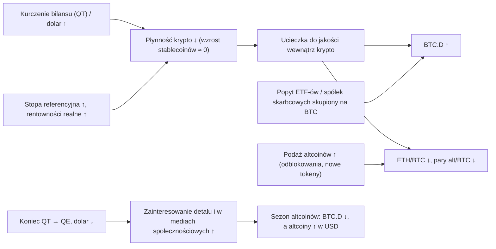

# 12. Dominacja, altcoiny i rotacja

Dla każdego, kto trzyma coś więcej niż bitcoina, najważniejsze pytanie często nie brzmi „czy krypto pójdzie w górę?”, tylko „czy reszta krypto pobije bitcoina, czy będzie się wobec niego wykrwawiać?”. Najlepiej udokumentowane trafne prognozy Cowena dotyczą właśnie tego obszaru: dominacja bitcoina rosnąca w stronę 60%, a potem 65%, ETH „wracający do domu” (going home) na swoją bazę 1500–1600 USD w kwietniu 2025 (w tym samym miesiącu pojawił się dołek ETH/BTC) oraz brak sezonu altcoinów (altseason) w latach 2024–25, gdy większość rynku się go spodziewała. Ten rozdział wyjaśnia wykresy dominacji i relacji cenowych, których używa, historię każdego sezonu altcoinów i każdego okresu wykrwawiania, mechanizmy sprawiające, że altcoiny bardziej cierpią przy zacieśnianiu polityki, oraz dowody dotyczące jego centralnej tezy, że dla rotacji ważniejszy jest *bilans* Fed (QT vs QE) niż *stopa* procentowa — łącznie z przypadkami, w których ta teza się nie sprawdziła.

**Czego się nauczysz**
- co mierzą BTC.D, ETH.D, USDT.D, TOTAL, TOTAL2, TOTAL3, OTHERS i OTHERS.D oraz dlaczego dominacja BTC liczona ze stablecoinami i bez nich może opowiadać różne historie;
- historię dominacji BTC i ETH/BTC od 2017 roku do października 2026, w tym tabelę ETH/BTC w podziale na lata z laboratorium makro;
- jak czytać pary alt/BTC, stosunek kapitalizacji altcoinów do kapitalizacji BTC i Altcoin Season Index oraz co Cowen rozumie przez „sezon altcoinów” i „ostateczną rotację” (final rotation);
- dlaczego altcoiny zwykle wykrwawiają się względem BTC, gdy płynność się zacieśnia;
- co mówi historia o bilansie Fed vs stopach procentowych, wraz z kontrprzykładami z lat 2017, 2019, 2024 i 2026.

> **Uwagi o danych.** Poziomy dominacji różnią się o 1–2 punkty między CoinMarketCap, CoinGecko i TradingView, bo serwisy te uwzględniają różne zestawy monet. Wartości skrajne z lat 2017–2019 najbardziej różnią się w zależności od dostawcy i nie zostały niezależnie zweryfikowane. Wartości ETH/BTC wyliczono z Coin Metrics (badania kursu) lub z serii Coinbase w FRED ([laboratorium makro](../../tools/macro-lab/REPORT-2026-10-30.md)); notowania na giełdach mogą się nieco różnić.

---

## 1. Tickery

| Ticker (TradingView) | Co mierzy | Koniec października 2026 |
|---|---|---|
| `CRYPTOCAP:BTC.D` | Kapitalizacja BTC ÷ całkowita kapitalizacja rynku krypto (łącznie ze stablecoinami) | 59,37% (CoinGecko, 30 października); 59,5–60,1% w raportach opartych na CoinMarketCap |
| Dominacja BTC bez stablecoinów | BTC ÷ (całość − stablecoiny) | ok. 67% (Cowen, luty i sierpień 2026) |
| `CRYPTOCAP:ETH.D` | Kapitalizacja ETH ÷ całość | 10,34% (CoinGecko) |
| `CRYPTOCAP:USDT.D`, `USDC.D`, `STABLE.C.D` | Kapitalizacja stablecoinów ÷ całość | USDT.D 6,79%, USDC.D 2,68% |
| `CRYPTOCAP:TOTAL` | Całkowita kapitalizacja rynku krypto | ok. 2,67 bln USD (30 października, według doniesień) |
| `CRYPTOCAP:TOTAL2` | Całość bez BTC | |
| `CRYPTOCAP:TOTAL3` | Całość bez BTC i ETH | |
| `CRYPTOCAP:OTHERS`, `OTHERS.D` | Monety spoza pierwszej dziesiątki i ich udział | |
| `BINANCE:ETHBTC`, `SOLBTC`, … | Cena altcoina wyrażona w BTC | ETH/BTC 0,0289 (29 października) |
| Altcoin Season Index (blockchaincenter.net, CoinMarketCap) | % monet z top 50 (lub top 100), które w ciągu 90 dni pobiły BTC | ok. 45–53, „mieszany” (według doniesień) |

Odpowiedniki w ITC: „Dominance” (plan darmowy), „Altcoin Market Capitalizations”, „Altcoin Season Index”, „Total Crypto Valuation vs. Trendline”, syntetyczny „Total Market Cap excl. BTC, ETH and stables”, „Market Cap Hypotheticals”, „Flippening Index” oraz metryki ryzyka dla TOTAL i BTC.D traktowanych jak syntetyczne aktywa.

---

## 2. Dominacja

### Dominacja bitcoina (CRYPTOCAP:BTC.D) ze stablecoinami i bez nich

**Co to jest.** Udział BTC w całkowitej kapitalizacji rynku kryptowalut. Ponieważ stablecoiny wchodzą w skład „całego krypto”, wzrost ich kapitalizacji mechanicznie obniża BTC.D, nawet jeśli w relacji BTC do altcoinów nic się nie zmienia. Dlatego Cowen pokazuje ją zarówno ze stablecoinami, jak i bez nich.

**Gdzie to znaleźć.** TradingView `CRYPTOCAP:BTC.D`; [CoinGecko](https://www.coingecko.com/en/charts/bitcoin-dominance); CoinMarketCap; „Dominance” w ITC.

**Jak to czytać.** Rosnąca dominacja oznacza, że BTC wypada lepiej niż reszta rynku — niezależnie od tego, czy cały rynek rośnie, czy spada. Spadająca dominacja może oznaczać, że altcoiny rosną szybciej (sezon altcoinów), albo że na spadającym rynku rośnie udział stablecoinów (risk-off, ucieczka od ryzyka). Zawsze sprawdzaj, który przypadek zachodzi.

| Data | BTC.D (łącznie ze stablecoinami) | Kontekst |
|---|---|---|
| Przed 2017 | ok. 80–95% | Niewiele alternatyw |
| Cze 2017 | ok. 37–38% | Boom ICO; historyczny szczyt ETH/BTC |
| Sty 2018 | 32,4% (CMC, 14 stycznia); 31,1% (CoinGecko) | Historyczny dołek, miesiąc po szczycie BTC z grudnia 2017 |
| Wrz 2019 | ok. 70–73% | Szczyt ok. 10 września; QT zakończone 1 sierpnia 2019 |
| Sty 2021 | ok. 70% | Początek sezonu altcoinów 2021 |
| Maj 2021 | ok. 39–40% (39,3% 19 maja) | Dołek w sezonie altcoinów, w czasie QE i zerowych stóp |
| Koniec 2022 | ok. 38–40% | Dołek dominacji w czasie bessy |
| 30.10.2024 | 60% | Osiągnięty długo utrzymywany cel Cowena |
| Początek maja 2025 | ok. 65% (64,98–65,2%) | Najwyżej od początku 2021; szczyt cyklu w czerwcu 2025 |
| Lip–sie 2025 | ok. 57–61% | Rajd ETH w stronę historycznego szczytu |
| 2026 | ok. 58–61% (szczyt ok. 60,6% 5 maja) | Wskaźnik nagłówkowy stanął, bo rósł udział stablecoinów; bez stablecoinów ok. 67% |
| 30.10.2026 | 59,37% (CoinGecko) | |

**Jak używa tego Cowen.** To jeden z jego najczęściej pokazywanych wykresów (281 tytułów lub streszczeń filmów) i źródło kilku jego najlepszych prognoz:
- Od połowy 2023 roku celował w 60% (np. 23 sierpnia i 8 października 2023), spodziewając się tego poziomu „by end of summer or September” („do końca lata lub we wrześniu”; maj 2024), a potem „September or December” („we wrześniu lub w grudniu”; [Benzinga, sierpień 2024](https://benzinga.com/markets/cryptocurrency/24/08/40402971/bitcoin-market-dominance-in-final-stretch-will-peak-at-60-until-december-analyst-says)). Dominacja osiągnęła 60% 30 października 2024 („Bitcoin Dominance Hits 60%!”). W listopadzie 2024 zauważył, że dominacja „retraced to the 0.618 Fib (60%), which marked the top for dominance last cycle” („cofnęła się do zniesienia Fibonacciego 0,618 (60%), które w poprzednim cyklu wyznaczyło szczyt dominacji”; wpis na X, według doniesień).
- Jego scenariusz bazowy zakładał, że dominacja „will likely go higher until quantitative tightening is over” („prawdopodobnie będzie rosła, dopóki nie skończy się zacieśnianie ilościowe”; [Benzinga, listopad 2024](https://www.benzinga.com/markets/cryptocurrency/24/11/41850110/federal-reserve-cuts-interest-ratesbitcoin-dominance-may-rise-as-a-result)), oraz że „last cycle the transition from QT to QE marked the top for BTC dominance” („w poprzednim cyklu przejście z QT do QE wyznaczyło szczyt dominacji BTC”; [Cointelegraph Magazine, 19 listopada 2024](https://cointelegraph.com/magazine/bitcoin-dominance-crypto-predictions-bull-run-benjamin-cowen-hall-of-flame/)).
- W listopadzie 2024 spodziewał się, że dominacja „go down in 2025” („spadnie w 2025”). Zamiast tego wzrosła, a 25 lutego 2025 przesunął cel na 66% („The Bitcoin Dominance Train (To 66%?)”). Dominacja przebiła 65% 6 maja 2025 („Bitcoin Dominance Breaks 65%!”) i osiągnęła szczyt cyklu 22 czerwca 2025.
- Argumentuje, że rosnąca dominacja „is not inherently negative” („nie jest z natury czymś złym”), że zachodzi niezależnie od tego, czy BTC/USD rośnie, czy spada, oraz że portfel z przewagą BTC dawał lepsze stopy zwrotu skorygowane o ryzyko w okresach rosnącej dominacji.
- W 2026 roku wskazywał na dominację bez stablecoinów, by pokazać, że BTC nadal zyskiwał względem altcoinów, mimo że wskaźnik nagłówkowy stał w miejscu: ok. 67% 15 lutego, 66,8% w notatce lipcowej (wobec ok. 40% w dołku z 2021 roku) i 67,37% w [notatce z sierpnia 2026](https://benjamincowen.com/reports/the-balance-of-risks-august-2026). W kwietniu napisał, że pozorna stabilność wskaźnika nagłówkowego na poziomie 58–60% wprowadza w błąd, bo wzrósł udział stablecoinów ([Crypto Risk Memo Q2 2026](https://benjamincowen.com/reports/crypto-risk-memo-q2-2026)).
- **„Trwała rotacja” (durable rotation).** Jego notatka z lipca 2026 definiuje warunek, który musiałby zobaczyć, zanim ogłosi prawdziwą rotację w bardziej ryzykowne krypto: „a sustained decline in Bitcoin dominance excluding stablecoins, persisting over months rather than weeks” („utrzymujący się spadek dominacji bitcoina bez stablecoinów, trwający miesiące, a nie tygodnie”; [notatka](https://benjamincowen.com/reports/bitcoin-cycle-memo-july-2026)). Pojedyncze rajdy altcoinów, takie jak wzrosty ETH w lipcu–sierpniu 2025, się nie liczą. Ani po szczycie z 2019, ani po szczycie z 2025 roku nie nastąpiła trwała rotacja.

**Powiązania.** Dominacja podążała za reżimami płynności: spadała w czasie globalnego QE / boomu ICO w 2017 roku i QE z lat 2020–21 (z ok. 70% do ok. 39–40%), a rosła w czasie podwyżek i QT (2018–19: z ok. 33% do ponad ok. 70%; 2022–25: z ok. 40% do ok. 65%). Od 2024 roku popyt ETF-ów i spółek trzymających BTC w skarbcu (corporate treasury) koncentruje się na BTC, co dodaje strukturalną podłogę. Sekcje 4 i 5 szczegółowo testują związek z QT.

**Co to oznaczało dla aktywów.** Rosnąca dominacja oznaczała słabsze wyniki altcoinów względem BTC — zarówno we wzrostach, jak i w spadkach. Spadająca dominacja przy rosnących cenach altcoinów zdarzała się tylko w czasie boomów płynnościowych (2017, 2021) i krótkich zrywów.

**Wniosek dla inwestora.** Dominacja to miernik względnych wyników, a nie sygnał cenowy. Czytaj ją ze stablecoinami i bez nich, bo inaczej pomylisz ucieczkę od ryzyka do stablecoinów z rotacją w altcoiny.

### Dominacja stablecoinów (USDT.D, USDC.D, STABLE.C.D)

**Co to jest.** Kapitalizacja stablecoinów ÷ całkowita kapitalizacja rynku krypto.

**Jak to czytać.** Rośnie, gdy ceny krypto spadają (kurczy się mianownik) oraz gdy pieniądze są parkowane w stablecoinach, więc porusza się odwrotnie do `TOTAL`. Przebicia wsparcia lub oporu na USDT.D służą jako potwierdzenie nastroju risk-on / risk-off. W 2026 roku rosła w trakcie obsunięcia, bo podaż stablecoinów stała w miejscu (ok. 300–310 mld USD, [rozdział 11](11-ON-CHAIN-I-SENTYMENT.md#podaż-stablecoinów-wzrost)), a kapitalizacja rynku krypto spadała; pod koniec października USDT.D wynosiła 6,79%, a USDC.D 2,68%.

**Jak używa tego Cowen.** „Stablecoin Dominance” (26 stycznia 2024), a w 2026 roku „niefortunny wzorzec” (unfortunate pattern): dominacja stablecoinów wybiła się z wieloletniej bazy i cofnęła, podobnie jak wcześniejsze wybicia dominacji BTC, indeksu Hang Seng i palladu, co odczytał jako niedźwiedzi sygnał dla krypto („Bitcoin: An Unfortunate Pattern”, 7 stycznia 2026, z aktualizacjami 18 marca i 20 maja 2026). Celował w 14–15% w dalszej części 2026 roku. Na 30 października 2026 USDT.D plus USDC.D wynosiły według danych CoinGecko ok. 9,5%; nie zweryfikowano, czy jego cel dotyczył tej samej miary, więc kurs traktuje tę prognozę jako otwartą. BTC rósł od lipca do początku października 2026. Rosnąca dominacja stablecoinów to również jego wyjaśnienie, dlaczego nagłówkowa BTC.D stanęła w 2026 roku.

**Wniosek dla inwestora.** Dominacja stablecoinów to w większości odwrócony indeks cen krypto plus trend podaży stablecoinów. Czytaj ją jako miarę apetytu na ryzyko wewnątrz krypto.

### Dominacja ETH (CRYPTOCAP:ETH.D)

Udział ETH w całkowitej kapitalizacji rynku krypto: ok. 10,34% pod koniec października 2026 (CoinGecko), wobec szczytów ok. 20–22% w 2021 roku i krótko ponad 30% w 2018 (według doniesień). Porusza się razem z ETH/BTC i z udziałem ETH w rynku altcoinów. Cowen omawia ETH głównie przez pryzmat ETH/BTC (następna sekcja), co usuwa wpływ ogólnego kierunku rynku.

---

## 3. ETH/BTC i wskaźniki relacji altcoinów

### ETH/BTC (BINANCE:ETHBTC)

**Co to jest.** Cena jednego etheru wyrażona w bitcoinie. Cowen nazywa ETH „indeksem altcoinów” (the altcoin index): to największy i najbardziej płynny altcoin, którego relacja do BTC zwykle wyprzedza lub podsumowuje zachowanie reszty (2023, według Coin Bureau).

**Gdzie to znaleźć.** TradingView `BINANCE:ETHBTC`; możesz to policzyć z FRED jako `CBETHUSD` ÷ `CBBTCUSD`.

**Jak to czytać.** Rosnąca relacja oznacza, że ETH (i zwykle altcoiny) wypada lepiej niż BTC. Kluczowa historia (badania kursu na danych Coin Metrics):
- historyczny szczyt 0,146 12 czerwca 2017 (ok. 0,15 w trakcie sesji); drugi szczyt ok. 0,113 w styczniu–lutym 2018;
- wykrwawianie w czasie QT do 0,0164 6 września 2019;
- 0,0255 na koniec 2020, potem 0,0877 8 grudnia 2021; 0,0847 w okolicach Merge (7 września 2022);
- długie wykrwawianie do 0,0181 21 kwietnia 2025, najniżej od 2019 roku (na niektórych giełdach ok. 0,0177);
- odbicie do 0,0422 24 sierpnia 2025, gdy ETH ustanowił nominalny historyczny szczyt ok. 4950 USD w trakcie sesji, podczas gdy relacja pozostała daleko poniżej poziomów z 2017 i 2021 roku;
- 0,0352 (6 stycznia 2026) → 0,0257 (6 czerwca 2026) → 0,0327 (13 września, według doniesień) → 0,0289 (29 października 2026).

[Laboratorium makro](../../tools/macro-lab/REPORT-2026-10-30.md) mierzy relację w latach kalendarzowych na tle zmian stóp przez Fed:

| Rok | ETH/BTC w pierwszym tygodniu | W ostatnim tygodniu | Zmiana | Zmiana stopy docelowej Fed w roku | Reżim bilansu (kontekst) |
|---|---|---|---|---|---|
| 2017 | 0,0082 | 0,0535 | +549% | +0,75 pp | QT ogłoszone we wrześniu, start w październiku; globalne QE i boom ICO |
| 2018 | 0,0691 | 0,0362 | −48% | +1,00 pp | QT |
| 2019 | 0,0386 | 0,0182 | −53% | −0,75 pp | QT do 1 sierpnia, potem koniec QT |
| 2020 | 0,0184 | 0,0262 | +42% | −1,50 pp | Nieograniczone QE od marca |
| 2021 | 0,0298 | 0,0800 | +169% | 0,00 pp | QE (ograniczanie skupu, czyli taper, ogłoszone w listopadzie) |
| 2022 | 0,0810 | 0,0724 | −11% | +4,25 pp | QT od czerwca |
| 2023 | 0,0722 | 0,0539 | −25% | +1,00 pp | QT |
| 2024 | 0,0506 | 0,0362 | −28% | −1,00 pp | QT (spowolnione w czerwcu) |
| 2025 | 0,0361 | 0,0336 | −7% | −0,75 pp | QT spowolnione do minimum w kwietniu; zakończone 1 grudnia |
| 2026 | 0,0343 | 0,0289 | −16% (do końca października) | +0,25 pp | Brak QT; zakupy bonów skarbowych w ramach zarządzania rezerwami |

Jeśli spojrzysz tylko na kolumnę „stopy”, związek wygląda na słaby albo odwrotny: 2017 był najlepszym rokiem ETH/BTC przy *rosnących* stopach, a 2019 i 2024, oba lata obniżek, należały do najgorszych. Dodaj kolumnę bilansu, a wzorzec się poprawia: dwa duże lata wzrostów (2017, 2020–21) zbiegły się z obfitą płynnością globalną lub z Fed, a większość lat spadków — z QT. Rok 2022 jest częściowym wyjątkiem: relacja spadła tylko o 11% mimo +4,25 pp podwyżek i rozpoczęcia QT; jednym z prawdopodobnych powodów jest narracja wokół Merge, która wyniosła ETH/BTC do 0,0847 we wrześniu 2022. Sekcja 5 idzie dalej.

**Jak używa tego Cowen.** To jeden z jego najczęściej pokazywanych wykresów (146 tytułów lub streszczeń filmów).
- Wcześniejsze prognozy: „ETH/BTC could crash to 0.032” („ETH/BTC może runąć do 0,032”; Benzinga, wrzesień 2023); cel 0,03–0,04 i „all BTC pairs to 0.25” („wszystkie pary z BTC do 0,25”; 25 października 2024). W listopadzie 2024 napisał: „For the 1st time in 3 years, there is an actual chance that ETH/BTC has bottomed… 0.03465” („Po raz pierwszy od 3 lat istnieje realna szansa, że ETH/BTC osiągnął dno… 0,03465”; [X, listopad 2024](https://x.com/benjamincowen/status/1855065310186889454)). To było przedwczesne: relacja spadła o kolejne ok. 48% w ciągu pięciu miesięcy.
- Jego kotwica QT z 2019 roku: „ETH/BTC bottomed when QT ended” („ETH/BTC osiągnął dno, gdy skończyło się QT”) oraz „In 2019, ETH/BTC bottomed about 5 weeks after the 1st rate cut” („W 2019 roku ETH/BTC osiągnął dno ok. 5 tygodni po pierwszej obniżce stóp”); brak wyraźnego powodu, by zakładać, że wykrwawianie się skończyło, „until quantitative tightening ends” („dopóki nie skończy się zacieśnianie ilościowe”; [Daily Hodl, 6 lutego 2025](https://dailyhodl.com/2025/02/06/benjamin-cowen-warns-ethereum-could-continue-bleeding-against-bitcoin-says-one-factor-to-determine-bottom/); [13 marca 2025](https://dailyhodl.com/2025/03/13/welcome-to-pain-analyst-benjamin-cowen-says-ethereum-mirroring-2019-market-cycles-playbook/)).
- Wiosna 2025: „Welcome Home, Ethereum” (7 kwietnia 2025) — ETH z powrotem na swojej bazie 1500–1600 USD. Dołek ETH wypadł ok. 1386 USD 9 kwietnia 2025. Cowen mówi, że kupił ETH w kwietniu 2025 i że wtedy ETH/BTC osiągnął dno ([Bankless, 23 grudnia 2025](https://www.bankless.com/podcast/where-is-crypto-going-in-2026-ben-cowen)). ETH wzrósł ok. 3,5-krotnie do sierpniowego historycznego szczytu, a ETH/BTC do ok. 0,042.
- Grudzień 2025: możliwy cel ETH/BTC w okolicach 0,053 (zniesienie Fibonacciego 0,5 i dołek sprzed Merge); „wartość godziwa z regresji logarytmicznej” ETH „could be near $2,100 in 2026” („może być w okolicach 2100 USD w 2026”); ruch do 5 tys. USD na początku 2026 roku byłby prawdopodobnie pułapką na byki (bull trap). ETH „does best when the fed funds rate is at or below the 2-year yield” („radzi sobie najlepiej, gdy stopa funduszy federalnych jest na poziomie rentowności 2-letnich obligacji lub poniżej”; Bankless). W lutym 2026 ETH znów był „w domu” („Welcome Back Home, Ethereum!”, 9 lutego 2026), a pod koniec października 2026 kosztował ok. 2230–2260 USD.

**Powiązania.** Dołki ETH/BTC pojawiały się w pobliżu zwrotów w polityce bilansowej: 6 września 2019 (pięć tygodni po pierwszej obniżce 31 lipca i zakończeniu QT 1 sierpnia) oraz 21 kwietnia 2025 (trzy tygodnie po tym, jak 1 kwietnia ograniczono do minimum wygaszanie obligacji skarbowych w ramach QT). W obu przypadkach odbicie wygasło, gdy zaczął się rynek niedźwiedzia na BTC. Altcoiny osiągają też dno w ujęciu BTC później niż sam BTC: dołek ETH/BTC z 2019 roku przyszedł dziewięć miesięcy po dołku BTC z grudnia 2018, a dołek z 2025 roku ponad dwa lata po dołku BTC z listopada 2022.

Jego „Ethereum Letters” z 2020 roku (streszczenie na stronie z datą 20 lutego 2020; plik PDF jest dostępny po wypełnieniu formularza e-mailowego) już wtedy argumentowały, że ETH jest „fundamentally different from Bitcoin” („fundamentalnie różny od bitcoina”), a nie tylko bardziej zmiennym (higher-beta) BTC, oraz że „ETH/BTC dynamics … often provide more actionable information than absolute price levels” („dynamika ETH/BTC … często dostarcza informacji bardziej przydatnych do działania niż bezwzględne poziomy cen”; [Ethereum Letters 2020](https://benjamincowen.com/reports/ethereum-letters-2020)).

**Wniosek dla inwestora.** ETH/BTC to najczystszy pojedynczy miernik tego, czy rynek nagradza ryzyko wewnątrz krypto. Oba z dwóch dołków przypadły w pobliżu zwrotu w polityce bilansowej — to sugestywne, ale nie stanowi dowodu.

### Pary alt/BTC i stosunek kapitalizacji altcoinów do kapitalizacji BTC

**Co to jest.** Dowolny altcoin wyceniony w BTC (`SOLBTC`, `ADABTC`, …) oraz zagregowana wersja Cowena: kapitalizacja altcoinów podzielona przez kapitalizację BTC.

**Jak to czytać.** Większość wykresów alt/BTC od 2021 roku to długie trendy spadkowe przerywane gwałtownymi, krótkimi rajdami.

**Jak używa tego Cowen.** „Altcoins are oscillators at best and bleeders at worst” („Altcoiny to w najlepszym razie oscylatory, a w najgorszym — aktywa, które się wykrwawiają”; sierpień 2024). Jego zdaniem sezon altcoinów wymaga, by altcoiny najpierw skapitulowały do historycznych dołków zakresu względem BTC („all bitcoin pairs to range lows” — „wszystkie pary z bitcoinem do dołków zakresu”), przy zagregowanym stosunku w okolicach 0,25. Śledził go w filmach „Altcoins Hit 0.32 / 0.31 / 0.29” (14 czerwca, 4 lipca, 14 października 2025): 0,32 w czerwcu 2025, 0,31 w lipcu i 0,29 w październiku, kiedy stwierdził, że poziom 0,25 jest „already reached” („już osiągnięty”), jeśli uwzględni się USDC. Do lutego 2026 altcoiny były „back at 2022 lows” („z powrotem na dołkach z 2022 roku”). Zobacz też „SOL/BTC: Dealing With Emotions” (27 lutego 2025) i „Bitcoin Dominance: The Final Stretch” (12 sierpnia 2024).

**Wniosek dla inwestora.** Wycena altcoinów w BTC usuwa ogólny kierunek rynku i pokazuje, czy trzymanie ich zamiast BTC się opłaciło. Dla większości altcoinów od 2021 roku się nie opłaciło.

### TOTAL, TOTAL2, TOTAL3, OTHERS i OTHERS.D

**Co to jest.** `TOTAL` to kapitalizacja całego rynku krypto; `TOTAL2` pomija BTC; `TOTAL3` pomija BTC i ETH; `OTHERS` to wszystko poza pierwszą dziesiątką, a `OTHERS.D` — jego udział w całości. ITC dodaje syntetyczny „Total Market Cap excl. BTC, ETH and stables” i traktuje TOTAL jak aktywo z własną metryką ryzyka („Total Cryptocurrency Market Capitalization Risk Metric”, 5 października 2021).

**Jak to czytać.** To mierniki „długiego ogona altcoinów”. OTHERS.D od 2021 roku w każdym cyklu tworzył coraz niższe szczyty, a TOTAL3 przez większość lat 2024–26 nie zdołał w ujęciu realnym przekroczyć szczytu z 2021 roku. Cykl 2024–26 jest pierwszym, w którym BTC ustanowił zdecydowane nowe szczyty, a mediana altcoinów nigdy nie odzyskała szczytu z 2021 roku: to „wąska” hossa na krypto, podobna do koncentracji na megaspółkach na rynku akcji w USA (interpretacja kursu). Narzędzia szerokości rynku (breadth), takie jak kryptowalutowe wykresy „Advance Decline” w ITC i „Coins Above/Below Moving Average”, mierzą tę samą wąskość; szerokość rynku akcji omawia [rozdział 08](08-AKCJE-ZLOTO-I-INNE-AKTYWA.md).

**Wniosek dla inwestora.** Zanim uwierzysz, że „krypto” jest na rynku byka, sprawdź TOTAL3 i OTHERS.D: w latach 2024–25 BTC był, ale większość rynku — nie.

### Altcoin Season Index i definicja sezonu altcoinów

**Co to jest.** [Indeks blockchaincenter.net](https://www.blockchaincenter.net/en/altcoin-season-index/) to odsetek monet z top 50 (bez stablecoinów i tokenów opakowanych, wrapped), które w ciągu ostatnich 90 dni wypadły lepiej niż BTC; 75 lub więcej oznacza „sezon altcoinów”, 25 lub mniej — „sezon bitcoina”. CoinMarketCap publikuje wersję dla top 100. ITC ma „Altcoin Season Index” (plan Basic).

**Jak to czytać.** Szczyt — 98 — osiągnął 16 kwietnia 2021. W IV kwartale 2025 nigdy nie doszedł do 75, a pod koniec października 2026 wskazywał ok. 45–53 („mieszany”). Ponieważ opiera się na oknach 90-dniowych, krótkie zrywy mogą go podbić bez trwałej zmiany trendu.

**Jak używa tego Cowen.** Definiuje sezon altcoinów jako **spadającą dominację BTC przy jednoczesnym wzroście altcoinów w USD** (spadek dominacji w czasie krachu się nie liczy). „Bitcoin Season Vs. Altcoin Season” (11 grudnia 2022) porównuje 90-dniowe ROI BTC z top 50. Wymienia trzy warunki prawdziwego sezonu altcoinów: „(1) looser monetary policy, (2) high retail social interest, (3) Bitcoin topping on euphoria rather than apathy” („(1) luźniejsza polityka pieniężna, (2) duże zainteresowanie inwestorów detalicznych w mediach społecznościowych, (3) szczyt bitcoina w euforii, a nie w apatii”; 22 grudnia 2025). Żaden z nich nie wystąpił w latach 2024–25, więc prognozował brak sezonu altcoinów („Why Has Alt Season Not Happened Yet?”, 7 lutego 2025 i część 2, 27 czerwca 2025; „Why ALT Season Has Not Happened”, 4 listopada 2025; „Why So Many People Were Wrong About Altcoins”, 22 grudnia 2025; [Benzinga, lipiec 2025](https://www.benzinga.com/crypto/cryptocurrency/25/07/46217148/heres-why-altcoin-season-for-xrp-eth-sol-has-not-happened-yet)). W lutym 2026 powiedział, że następny sezon altcoinów nadejdzie „only when monetary conditions become significantly looser, potentially in 2027–2029” („dopiero gdy warunki monetarne staną się znacząco luźniejsze, potencjalnie w latach 2027–2029”; według doniesień). Badania oceniają to jako jedną z jego najwyraźniej trafionych prognoz: utrzymywał ją wbrew tłumowi przez ok. dwa lata.

**Wniosek dla inwestora.** Odczyt indeksu to migawka; trzy warunki Cowena opisują reżim, który w przeszłości dawał trwałe sezony altcoinów.

### „Ostateczna rotacja”

**Co to jest.** Nazwa, jaką Cowen nadaje powrotowi kapitału z altcoinów do BTC w późnej fazie cyklu, w roku po halvingu: dominacja znów rośnie we wrześniu–październiku, a altcoiny oddają zyski.

**Jak używa tego Cowen.** „Bitcoin Dominance: The Final Rotation” (31 sierpnia, 29 września, 10 października, 21 października, 26 października 2025) i „Bitcoin Dominance To Surge Into December” (listopad 2025). Gdy w trakcie rajdu ETH w lipcu–sierpniu 2025 dominacja spadła do ok. 57–58%, spodziewał się jej ponownego wzrostu jesienią. Altcoiny spadły najmocniej w krachu z 10 października 2025, a stosunek alt/BTC doszedł do 0,29 14 października; badania oceniają tę prognozę jako trafioną.

**Wniosek dla inwestora.** W późnej fazie cyklu rajdy altcoinów niepoparte trzema powyższymi warunkami zwykle kończyły się odwrotem kapitału do BTC.

### Flippening Index i hipotetyczne kapitalizacje

To raczej narzędzia platformy niż tematy filmów. „Flippening Index” śledzi kapitalizację ETH jako odsetek kapitalizacji BTC („flippening” oznaczałby wyprzedzenie BTC przez ETH); „Market Cap Hypotheticals” pokazuje, jaką cenę miałaby moneta przy kapitalizacji innej monety. Oba przydają się głównie do konfrontowania narracji z rzeczywistością.

---

## 4. Dlaczego altcoiny wykrwawiają się względem bitcoina, gdy płynność się zacieśnia

Poniższe mechanizmy to synteza kursu, zgodna z ujęciem Cowena:

1. **Wyższa beta, dłuższa duration.** Altcoiny są bardziej ryzykowne i słabiej zakotwiczone w przepływach pieniężnych. Rosnąca stopa dyskontowa (wyższe rentowności realne) najmocniej obniża bieżącą wartość odległych, niepewnych korzyści.
2. **Krańcowy kupujący znika jako pierwszy.** Zacieśnianie kurczy płynność spekulacyjną: dźwignię, wzrost stablecoinów i napływy od inwestorów detalicznych. To właśnie oni kupują małe projekty.
3. **Podaż wciąż rośnie.** Odblokowania tokenów i nowe notowania nieustannie zwiększają podaż altcoinów, podczas gdy podaż BTC jest niemal stała. Dziesiątki milionów tokenów rozdrabniają popyt na altcoiny („rozwodnienie indeksu”, index dilution).
4. **Popyt instytucjonalny stawia BTC na pierwszym miejscu.** W latach 2024–26 popyt spotowych ETF-ów i spółek trzymających kryptowaluty w skarbcu koncentrował się na BTC. Spotowe ETF-y na ETH (lipiec 2024) przyciągnęły znacznie mniej — aż do mody na spółki-skarbce ETH (ETH-treasury companies) w połowie 2025 roku.
5. **Ucieczka do jakości wewnątrz krypto.** W fazach risk-off posiadacze krypto przenoszą się z altcoinów do BTC lub stablecoinów, zanim całkiem opuszczą rynek krypto. Cowen nazywa to **drabiną jakości** (quality ladder): przy zacieśnianiu kapitał wspina się w stronę jakości w obrębie każdej klasy aktywów (altcoiny → BTC, małe spółki → duże spółki, spekulacyjny wzrost → przepływy pieniężne), więc rekordy na szczycie drabiny mogą współistnieć ze słabością niżej ([notatka z sierpnia 2026](https://benjamincowen.com/reports/the-balance-of-risks-august-2026); strona akcyjna w [rozdziale 08](08-AKCJE-ZLOTO-I-INNE-AKTYWA.md)).

Cowen opisuje to jako **kaskadę ryzyka** (risk cascade): przy zacieśnianiu ryzyko wycofuje się od zewnętrznego końca krzywej ryzyka do środka — najpierw altcoiny, potem BTC, potem akcje, a złoto i energia trzymają się najdłużej — i wraca w odwrotnej kolejności przy luzowaniu. Etapowe ramy przedstawia jego [notatka How Risk Cascades Through Markets (15 marca 2026)](https://benjamincowen.com/reports/how-risk-cascades-through-markets-march-2026); wyraźna kolejność aktywów pochodzi z jego filmu „Business Cycles Ends With Recessions” (25 lutego 2026, według streszczenia filmu). Wersję obejmującą wszystkie klasy aktywów omawia [rozdział 13](13-JAK-TO-SIE-LACZY.md). Argumentuje też, że „altcoin rotations have historically followed stock market sell-offs that prompted Fed easing. The Fed doesn't rescue crypto directly” („rotacje w altcoiny historycznie następowały po wyprzedażach na giełdzie, które skłaniały Fed do luzowania. Fed nie ratuje krypto bezpośrednio”; Bankless, 23 grudnia 2025).

**Sezony altcoinów i okresy wykrwawiania — epizod po epizodzie**

| Epizod | BTC.D | ETH/BTC | Tło makro | Co się stało |
|---|---|---|---|---|
| Maj–cze 2017 oraz gru 2017–sty 2018 | 38% → 32% | Historyczny szczyt 0,146 (cze 2017) | Fed podnosił stopy, ale globalne QE i mania ICO | Sezon altcoinów; altcoiny osiągnęły szczyt po BTC (szczyt ETH/USD 13.01.2018) |
| 2018–2019 | ok. 33% → ponad ok. 70% | 0,146 → 0,0164 (wrz 2019) | Podwyżki do gru 2018; QT paź 2017–lip 2019 | Długie wykrwawianie; ETH/BTC osiągnął dno po zakończeniu QT |
| I–II kw. 2021 | ok. 70% → ok. 40% | 0,0255 → 0,0877 (gru 2021) | QE 120 mld USD miesięcznie, zerowe stopy | Sezon altcoinów; indeks 98 16.04.2021 |
| 2022–kwi 2025 | ok. 40% → ok. 65% | 0,085 → 0,0181 | Podwyżki do lip 2023, QT od cze 2022; obniżki od wrz 2024, ale QT trwało | Długie wykrwawianie mimo obniżek w 2024 |
| Lut 2024; lis–gru 2024 | krótkie spadki | krótkie odbicia | Optymizm po wyborach | Krótkie zrywy, bez zmiany reżimu |
| Lip–sie 2025 | 65% → ok. 57–58% | 0,0181 → 0,0422 | QT spowolnione (kwi), spółki-skarbce ETH | Rajd pod przewodem ETH; wygasł w „ostatecznej rotacji” |
| 2026 | ok. 58–61% (bez stablecoinów ok. 67%) | 0,0352 → 0,0257 → 0,0289 | Brak QT, ale podwyżka 16 wrz; 10-latki > 5%; ropa > 100 USD | Brak sezonu altcoinów; altcoiny z powrotem na dołkach z 2022 do lut 2026 |

---

## 5. Bilans Fed vs stopa procentowa: co pokazuje historia

Teza Cowena dotyczy *bilansu Fed*: dominacja BTC rośnie w czasie QT i osiąga szczyt w okolicach przejścia QT → QE, a ETH/BTC osiąga dno w pobliżu końca QT. *Stopa* procentowa ma znaczenie drugorzędne. Tabela poniżej (badania kursu na podstawie FRED `DFEDTARU` i `WALCL`, Coin Metrics i raportów o dominacji) sprawdza to reżim po reżimie.

| Reżim Fed (daty) | BTC.D | ETH/BTC | Czy pasuje do „zacieśnianie → BTC.D w górę, ETH/BTC w dół”? |
|---|---|---|---|
| Podwyżki gru 2015 → gru 2018 (górna granica 0,25% → 2,50%); QT paź 2017 → lip 2019 | 2017: spadek do 32% mimo podwyżek; 2018–19: wzrost do ok. 70% w czasie QT | 0,146 (cze 2017) → 0,0164 (wrz 2019) | 2017 przeczy; 2018–19 pasuje |
| Obniżki 31 lip, 18 wrz, 30 paź 2019; QT zakończone 1.08.2019 | Szczyt ok. wrz 2019 | Dno 6.09.2019, pięć tygodni po pierwszej obniżce | Pasuje (przypadek-kotwica Cowena) |
| Awaryjne obniżki w mar 2020 do 0–0,25%; nieograniczone QE (aktywa Fed ok. 4,2 bln USD → ok. 8,9 bln USD do 2022) | ok. 70% (sty 2021) → ok. 39–40% (maj 2021) | 0,023 (mar 2020) → 0,0877 (gru 2021) | Pasuje bardzo dobrze; altcoiny reagowały na QE z opóźnieniem ok. 9–12 miesięcy |
| Taper ogłoszony 3.11.2021; podwyżki mar 2022 → lip 2023 (do 5,50%); QT od 1.06.2022 | ok. 40% → 54% (2023) → ok. 57–60% (2024) | 0,085 (wrz 2022) → 0,038 (wrz 2024) | Pasuje |
| Obniżki 18 wrz, 7 lis, 18 gru 2024 (do 4,50%); QT trwa (limit dla obligacji skarbowych obniżony w cze 2024) | Dalszy wzrost do ok. 60–62% | Dalszy spadek (0,0385 przy pierwszej obniżce) | Same obniżki stóp **nie** odwróciły trendu; QT trwało |
| QT spowolnione 1.04.2025 (limit wygaszania obligacji skarbowych ok. 5 mld USD miesięcznie) | Powyżej 65% od początku maja 2025; szczyt cyklu 22.06.2025 | Dno 21.04.2025 (0,0181) → 0,0422 (24 sie) | Pasuje do wersji „bilans ważniejszy niż stopy” |
| Obniżki 17 wrz, 29 paź, 10 gru 2025 (do 3,50–3,75%); QT zakończone 1.12.2025 | ok. 57–61% | 0,032–0,036 (gru 2025–sty 2026) | BTC osiągnął szczyt 6.10.2025, ok. 8 tygodni przed końcem QT (2019: szczyt 26 cze, koniec QT 1 sie, ok. 5 tygodni) |
| Pauzy sty–lip 2026; podwyżka 16.09.2026 (do 3,75–4,00%); pauza 28 paź; 10-latki > 5,2%, Brent > 100 USD (wrz) | ok. 58–61% | 0,0257 (cze) → ok. 0,029 | Zgodne z brakiem sezonu altcoinów przy ponownym zacieśnianiu |

**Co się broni.**
- Dominacja i ETH/BTC reagowały bardziej na *płynność netto* (bilans Fed, rezerwy, dolar, wzrost stablecoinów) niż na poziom stopy procentowej.
- Najczystsze sygnały dały koniec QT w 2019 roku i spowolnienie QT w kwietniu 2025: w obu przypadkach ETH/BTC osiągnął dno w ciągu ok. 0–6 tygodni od zwrotu w polityce bilansowej. To dwa przypadki.
- Zarówno w 2019, jak i w 2025 roku BTC osiągnął szczyt na krótko przed końcem QT — według jego notatki z lipca 2026 ok. pięć tygodni wcześniej (26 czerwca → 1 sierpnia 2019) i ok. osiem tygodni wcześniej (6 października → 1 grudnia 2025). Cowen podkreśla ten wzorzec i odczytuje go jako „Bitcoin often leads liquidity cycles” („bitcoin często wyprzedza cykle płynności”; [Crypto Macro Risk Memo Q1 2026, 15 stycznia 2026](https://benjamincowen.com/reports/crypto-macro-risk-memo-q1-2026); zobacz też „Bitcoin and the End of QT”, 1 grudnia 2025; [CryptoAdventure, 18 kwietnia 2026](https://cryptoadventure.com/benjamin-cowen-reveals-why-the-altcoin-season-never-came/)).

**Kontrprzykłady i ograniczenia.**
- **2017:** największy w historii sezon altcoinów nastąpił w trakcie cyklu podwyżek Fed, przy QT startującym w październiku. Globalne QE (EBC, BOJ, PBOC) i mania ICO przeważyły nad Fed.
- **2019:** koniec QT i trzy obniżki nie wywołały rotacji w altcoiny; ETH/BTC spadał dalej aż do 2020 roku i odwrócił się dopiero przy QE w 2020.
- **2024:** trzy obniżki nie zatrzymały wykrwawiania ETH/BTC, bo QT trwało dalej.
- **2025:** kwietniowy dołek ETH/BTC i sierpniowe odbicie przyszły *przed* obniżką z września 2025; QT zakończyło się 1 grudnia 2025, ale nie nastąpiło po nim QE, więc reguła Cowena „przejście QT → QE wyznacza szczyt dominacji” nie została w tym cyklu przetestowana. Jego prognoza z listopada 2024, że dominacja spadnie w 2025 roku, była chybiona.
- **2026:** Fed podniósł stopy, a dominacja utrzymywała się w okolicach 58–61% bez sezonu altcoinów. To zgodne z ramami analizy, ale z ramami, które w większości reżimów przewidują „brak sezonu altcoinów”, łatwo się zgodzić.
- **Struktura może teraz przeważać nad płynnością.** Instytucjonalna preferencja dla BTC i nieustanna inflacja podaży tokenów mogą utrzymywać wysoką dominację nawet w cyklu luzowania. Tego jeszcze nie przetestowano.

**Teza ISM → sezon altcoinów nie pochodzi od Cowena.** Popularny konkurencyjny pogląd (Raoul Pal / Real Vision) wiąże sezony altcoinów ze wzrostem indeksu ISM dla przetwórstwa przemysłowego powyżej 50. ISM wzrósł powyżej 50 w styczniu 2026 i do sierpnia–września doszedł do ok. 54–55, a mimo to ETH spadł od początku roku o ok. 24% i sezonu altcoinów nie było. Cowen nigdy tej tezy nie poparł („Bitcoin is not the economy” — „bitcoin to nie gospodarka”). Test znajdziesz w [rozdziale 06](06-WZROST-I-CYKL-KONIUNKTURALNY.md).

**Wniosek dla inwestora.** Związek polityki pieniężnej z wynikami altcoinów jest realny, ale luźny. Działa bardziej przez płynność (QT/QE, dolar, wzrost stablecoinów) niż przez stopę procentową, opiera się na bardzo niewielu cyklach i może słabnąć, w miarę jak popyt instytucjonalny koncentruje się na BTC.

---

## Składamy to w całość

1. **QT włączone → dominacja w górę → altcoiny się wykrwawiają.** Bilans Fed się kurczy → płynność dolarowa i wzrost stablecoinów zamierają → spekulacyjni kupujący najpierw opuszczają altcoiny → BTC.D rośnie, ETH/BTC spada, niezależnie od tego, czy BTC/USD rośnie (2023–24), czy spada (2018, 2022). Epizody: 2018–19 (BTC.D z ok. 33% do ok. 70%), 2022–25 (z ok. 40% do ok. 65%). Wyjątek: 2017, gdy globalne QE i mania ICO wywołały sezon altcoinów mimo podwyżek Fed i rozpoczęcia QT.
2. **Zwrot w polityce bilansowej → dołek ETH/BTC w ciągu kilku tygodni → odbicie wygasa, jeśli zaczyna się bessa na BTC.** QT się kończy (1 sierpnia 2019) lub zwalnia do minimum (1 kwietnia 2025) → ETH/BTC osiąga dno w ciągu ok. 0–6 tygodni (6 września 2019; 21 kwietnia 2025) → gwałtowne odbicie (2025: z 0,0181 do 0,0422 do sierpnia) → ale gdy zaczyna się bessa na BTC (II połowa 2019; październik 2025), relacja znów zawraca w dół. n = 2.
3. **Obniżki stóp bez luzowania bilansu → brak rotacji.** Pierwsza obniżka przy trwającym QT (wrzesień 2024) → rosną rentowności długoterminowe i dolar (10-latki z ok. 3,6% do ok. 4,8%, DXY z ok. 100 do ok. 110 do stycznia 2025) → BTC rośnie dzięki napływom do ETF-ów, altcoiny zostają w tyle → BTC.D rośnie do 60% (październik 2024) i 65% (maj 2025). Obniżki pomagają altcoinom tylko wtedy, gdy płynność faktycznie się zwiększa.
4. **Apatyczny szczyt → nie ma komu sprzedać altcoinów → ostateczna rotacja do BTC.** Niskie zainteresowanie w mediach społecznościowych na szczycie (2019, 2025) → rajdy altcoinów są krótkie i wąskie (ETH w lipcu–sierpniu 2025) → pod koniec roku po halvingu dominacja znów rośnie (wrzesień–październik 2025) → altcoiny spadają najmocniej w krachu (10 października 2025) → do lutego 2026 altcoiny wracają na dołki z 2022 roku.
5. **Ponowne zacieśnianie w późnej fazie cyklu → udział stablecoinów w górę → nagłówkowa dominacja stoi, ale dominacja bez stablecoinów rośnie.** 2026: podwyżka Fed (16 września), 10-latki powyżej 5%, ropa powyżej 100 USD → krypto spada, podaż stablecoinów stoi w miejscu → USDT.D i USDC.D rosną → nagłówkowa BTC.D utknęła w okolicach 58–61%, podczas gdy udział BTC bez stablecoinów utrzymuje się na poziomie ok. 67%. Na październik 2026 warunki Cowena dla kolejnego sezonu altcoinów (luźniejsza polityka, powrót inwestorów detalicznych, euforyczny szczyt) nie były spełnione.

---

## Sprawdź się

1. Dlaczego Cowen pokazuje dominację bitcoina zarówno ze stablecoinami, jak i bez nich?
2. Czy według definicji Cowena spadek dominacji BTC w czasie krachu na rynku krypto to sezon altcoinów? Dlaczego tak lub nie?
3. Które lata w tabeli ETH/BTC w podziale na lata z laboratorium przeczą prostej tezie, że „obniżki stóp pomagają altcoinom, a podwyżki im szkodzą”?
4. Co stało się z ETH/BTC w ciągu kilku tygodni od zakończenia QT w 2019 roku i od spowolnienia QT w kwietniu 2025 oraz dlaczego nie jest to dowód?
5. Wymień trzy mechanizmy, przez które altcoiny wykrwawiają się względem BTC przy zacieśnianiu.
6. Jakie są trzy warunki sezonu altcoinów według Cowena i które z nich wystąpiły w 2025 roku?
7. Co TOTAL3 i OTHERS.D pokazały na temat hossy na krypto w latach 2024–26?
8. Które prognozy Cowena dotyczące dominacji w latach 2024–25 były trafione, a która chybiona?

Odpowiedzi

1. Stablecoiny wchodzą w skład całkowitej kapitalizacji, więc gdy rośnie ich udział (często na spadającym rynku), nagłówkowa BTC.D spada, nawet jeśli BTC nadal wypada lepiej niż altcoiny. W 2026 roku nagłówkowa dominacja stała w okolicach 58–61%, podczas gdy dominacja bez stablecoinów wynosiła ok. 67%.
2. Nie. Sezon altcoinów oznacza spadek dominacji BTC *przy jednoczesnym wzroście altcoinów w USD*. W czasie krachu dominacja może spadać, bo pieniądze przenoszą się do stablecoinów — to ucieczka od ryzyka (risk-off), a nie rotacja w altcoiny.
3. 2017 (ETH/BTC +549%, choć Fed podniósł stopy o 0,75 pp), 2019 (−53% mimo obniżek o 0,75 pp), 2024 (−28% mimo obniżek o 1,00 pp) i 2025 (−7% mimo obniżek o 0,75 pp). Nietypowy jest też 2022: tylko −11% mimo +4,25 pp. Reżim bilansu Fed wyjaśnia kilka z tych przypadków lepiej niż stopa procentowa.
4. ETH/BTC osiągnął dno 6 września 2019 (ok. pięć tygodni po zakończeniu QT 1 sierpnia) i 21 kwietnia 2025 (ok. trzy tygodnie po spowolnieniu QT 1 kwietnia). To dwie obserwacje, a w obu przypadkach odbicie wygasło, gdy zaczął się rynek niedźwiedzia na BTC.
5. Dowolne trzy z: wyższa beta i dłuższa duration (większe szkody od rosnących stóp dyskontowych); spekulacyjny krańcowy kupujący odchodzi jako pierwszy; nieustanna inflacja podaży tokenów i rozwodnienie indeksu; popyt instytucjonalny skoncentrowany na BTC; ucieczka do jakości wewnątrz krypto.
6. Luźniejsza polityka pieniężna, duże zainteresowanie inwestorów detalicznych w mediach społecznościowych i szczyt BTC w euforii, a nie w apatii. W 2025 roku żaden nie był wyraźnie spełniony: QT trwało do grudnia, zainteresowanie w mediach społecznościowych było niskie, a październikowy szczyt przyszedł w apatii.
7. Że była wąska: BTC ustanowił zdecydowane nowe szczyty, podczas gdy TOTAL3 nie zdołał w ujęciu realnym przekroczyć szczytu z 2021 roku, a OTHERS.D wciąż tworzył coraz niższe szczyty; mediana altcoinów nigdy nie odzyskała szczytu z 2021 roku.
8. Trafione: BTC.D do 60% (osiągnięte 30 października 2024), ruch do 66% (przebicie 65% 6 maja 2025), brak sezonu altcoinów, „powrót do domu” ETH na 1500–1600 USD (kwiecień 2025) i „ostateczna rotacja” do października 2025. Chybiona: prognoza z listopada 2024, że dominacja spadnie w 2025 roku (oraz przedwczesne ogłoszenie dna ETH/BTC na 0,0347 w listopadzie 2024).

> Materiał edukacyjny, nie doradztwo finansowe. Historyczne zależności między wskaźnikami mogą przestać działać.

[← 11 On-chain i sentyment](11-ON-CHAIN-I-SENTYMENT.md) | [Indeks](00-INDEKS.md) | [13 Jak to się łączy →](13-JAK-TO-SIE-LACZY.md)
