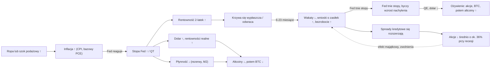
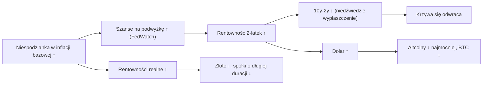
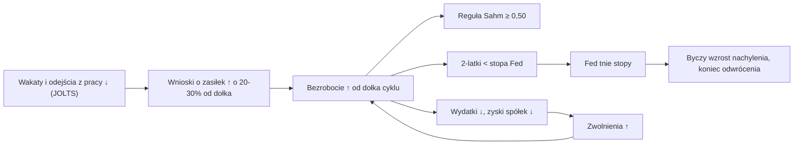
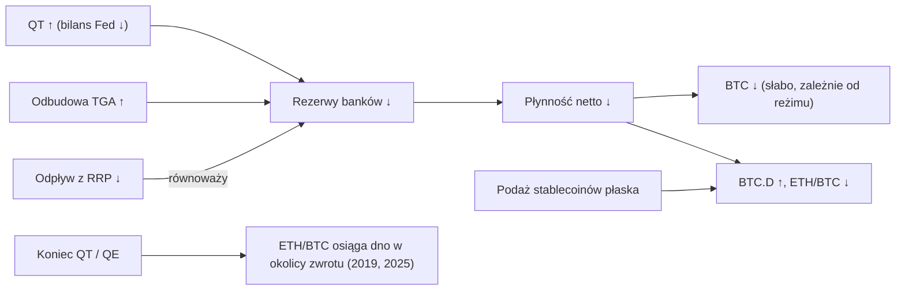
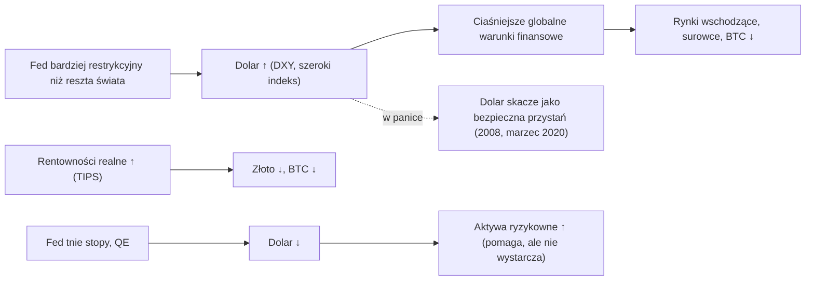
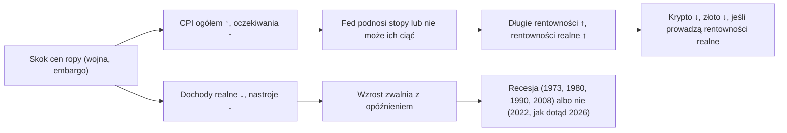
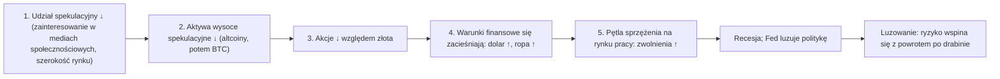
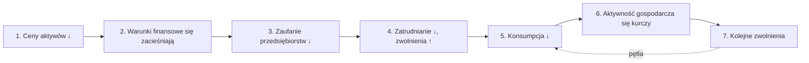
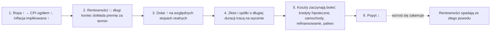

# 13. Jak to wszystko się łączy

**Dlaczego ten rozdział jest ważny.** Rozdziały od 02 do 12 opisują po jednym wskaźniku naraz. Rynki nie poruszają się po jednym wskaźniku naraz. Typowy łańcuch wygląda tak: inflacja rośnie, potem Fed podnosi stopy, potem rentowność 2-latek rośnie szybciej niż 10-latek, potem zatrudnianie zwalnia, potem bezrobocie zaczyna rosnąć, potem Fed tnie stopy, potem krzywa staje się bardziej stroma i dopiero wtedy ceny akcji i bitcoina pokazują, jakie to było zakończenie. Ten rozdział układa elementy w kolejności. Daje mapę przyczynową, typowe sekwencje z ich opóźnieniami i datowanymi epizodami, tabelę reżimów mówiącą, co każdy ważny wskaźnik i każde aktywo zwykle robi w każdej fazie, macierz zależności, liczby z kursowego laboratorium makro, kontrprzykłady (lata 2024–26 złamały kilka schematów), listę kontrolną do odróżniania w czasie rzeczywistym miękkiego lądowania od twardego oraz rzeczowy opis tego, gdzie byliśmy 30 października 2026.

**Czego się nauczysz**
- główną mapę przyczynową cyklu w USA i siedem mniejszych map jego podsystemów, w tym kaskadę ryzyka (risk cascade) Cowena, pętlę recesyjną i pętlę ściskania (squeeze loop);
- kanoniczne sekwencje „późna faza cyklu → pierwsza obniżka → miękkie lądowanie albo recesja → ożywienie”, z typowymi opóźnieniami, oraz to, jak przebiegały w latach 1995, 1998, 2001, 2007–08, 2019–20, 2024–25 i 2026;
- co każdy wskaźnik i każda klasa aktywów zwykle robiły w każdej fazie cyklu;
- które zależności są silne, które słabe, a które ostatnio się załamały;
- ramy Benjamina Cowena dotyczące późnej fazy cyklu koniunkturalnego i „kaskady ryzyka”, tak jak je sformułował, z datami, oraz ich niezależną ocenę;
- jak oceniać w czasie rzeczywistym, czy spowolnienie przechodzi w recesję;
- gdzie znajdowały się wskaźniki 30 października 2026.

---

## 1. Wersja skrócona

Większość kursu mieści się w jednym akapicie. Przeczytaj go powoli, a potem wykorzystaj resztę rozdziału, żeby sprawdzić każde ogniwo.

> Inflacja rośnie (albo podbija ją szok podażowy) → Fed podnosi stopy → rentowność **2-latek** rośnie szybciej niż **10-latek**, więc krzywa przechodzi **niedźwiedzie wypłaszczenie i się odwraca** → dolar się umacnia, rentowności realne rosną, płynność się zacieśnia → aktywa spekulacyjne (najpierw altcoiny, potem bitcoin) słabną, podczas gdy akcje mogą dalej rosnąć dzięki zyskom spółek → liczba wakatów i odejść z pracy zaczyna spadać, potem **wnioski o zasiłek** i **bezrobocie** odbijają w górę od dołka → rentowność 2-latek spada poniżej stopy polityki pieniężnej, a Fed przestaje podnosić stopy, a potem je **obniża** → krótkie rentowności spadają szybciej niż długie, więc krzywa przechodzi **byczy wzrost nachylenia i wraca do dodatniego nachylenia** → jeśli bezrobocie dalej rośnie (o około 0,5 pkt proc., reguła Sahm) i **spready kredytowe** się rozszerzają, w ciągu kilku miesięcy przychodzi **recesja**, akcje spadają średnio o około 36% (17–57% od szczytu do dołka w ośmiu recesjach od 1969 roku), a Fed mocno tnie stopy i wznawia QE → płynność rośnie, dolar słabnie → akcje osiągają dno 1–6 miesięcy przed końcem recesji (wyjątkiem były lata 2001–02), bitcoin zwykle wcześniej, altcoiny na końcu → zaczyna się nowa ekspansja. Jeśli zamiast tego bezrobocie się stabilizuje, a spready pozostają wąskie, był to cykl „ubezpieczeniowy” (**miękkie lądowanie**), akcje rosną o 11–29% w roku po pierwszej obniżce, a kolejnym ryzykiem jest ponowne przyspieszenie gospodarki, które zmusi Fed do kolejnych podwyżek.

Każda strzałka w tym akapicie ma wyjątki. Odwrócenie krzywej rentowności w latach 2022–24 było najgłębsze od 1981 roku, a recesja nie nastąpiła. Reguła Sahm zadziałała w lipcu 2024 roku, a recesja nie nastąpiła. M2 skurczyła się w 2023 roku po raz pierwszy w danych od 1959 roku, a bitcoin wzrósł w tym roku o 156%. Sekcje 5, 6 i 9 pokazują, jak wiarygodne było każde ogniwo. Szczegóły każdego wskaźnika znajdziesz w jego własnym rozdziale: [02 Fed](02-FED-I-STOPY-PROCENTOWE.md), [03 obligacje](03-OBLIGACJE-I-KRZYWA-RENTOWNOSCI.md), [04 inflacja](04-INFLACJA.md), [05 rynek pracy](05-RYNEK-PRACY.md), [06 wzrost](06-WZROST-I-CYKL-KONIUNKTURALNY.md), [07 płynność i dolar](07-PLYNNOSC-PIENIADZ-I-DOLAR.md), [08 różne klasy aktywów](08-AKCJE-ZLOTO-I-INNE-AKTYWA.md), [10 cykle bitcoina](10-CYKLE-I-MODELE-WYCENY-BITCOINA.md), [12 dominacja i altcoiny](12-DOMINACJA-ALTCOINY-I-ROTACJA.md).

---

## 2. Główna mapa przyczynowa

Strzałki pokazują zwykły kierunek wpływu. Znak mówi, czy wzrost w pierwszym polu zwykle podnosi (↑), czy obniża (↓) drugie. Przerywane strzałki to pętle sprzężenia zwrotnego.

Jak czytać tę mapę:
- **Silnikiem jest stopa procentowa w relacji do inflacji.** Fed bezpośrednio porusza krótkim końcem krzywej. Wszystko dalej w łańcuchu (dolar, rentowności realne, rezerwy, kredyt) reaguje na to, dokąd według rynku zmierza stopa polityki pieniężnej, i dlatego rentowność 2-latek ma większe znaczenie niż sama decyzja ([rozdział 02](02-FED-I-STOPY-PROCENTOWE.md)).
- **Są dwa pasy transmisyjne.** Jeden jest *finansowy*: dolar, rentowności realne, płynność i spready. Działa w ciągu dni lub miesięcy i najpierw uderza w krypto. Drugi to *gospodarka realna*: zatrudnianie, zwolnienia, wydatki i zyski spółek. Działa z opóźnieniem roku lub dłuższym i decyduje o tym, jak głęboki będzie rynek niedźwiedzia na akcjach.
- **Rynek pracy zamyka pętlę.** To rosnące bezrobocie sprawia, że Fed przechodzi od podwyżek do obniżek, a spadające ceny aktywów mogą zwrotnie napędzać zwolnienia (przerywana strzałka). Cowen podkreśla to sprzężenie: „It's the stock market going down that leads to the recession” („to spadek giełdy prowadzi do recesji”) (["Bitcoin in a Late Business Cycle Environment", 27 marca 2026](https://rosetta.to/u/intothecryptoverse/bitcoin-in-a-late-business-cycle-environment), streszczenie filmu).
- **Szoki podażowe wchodzą z lewej strony.** Skok cen ropy podnosi inflację i jednocześnie szkodzi wzrostowi, co stawia Fed w trudnym położeniu. To wariant z lat 1973–74, 1979–80, 1990 i 2026 (mapa 3.5).

---

## 3. Mniejsze mapy podsystemów

### 3.1 Inflacja → Fed → krzywa

Epizody: 2022 (CPI 9,0% w czerwcu, +525 pb podwyżek w 16 miesięcy, 10Y–2Y odwrócona od lipca 2022) oraz 2026 (CPI wzrósł z 2,4% w styczniu–lutym do szczytu w maju, rentowność 2-latek wzrosła o około 130 pb od dołka 3,38% z 27 lutego, a 10-latek o około 108 pb, więc 10Y–2Y przeszła niedźwiedzie wypłaszczenie z +0,74 30 stycznia do +0,37 29 października). Dane: [notatki badawcze B, FRED](https://fred.stlouisfed.org/series/T10Y2Y). Kontrprzykład: w 2026 roku bitcoin *wzrósł* po podwyżce Fed 16 września, z około 76 tys. USD w dniu decyzji do około 86 tys. USD 21 września (Coinbase przez [FRED](https://fred.stlouisfed.org/series/CBBTCUSD)), przedłużając rajd, który zaczął się w okolicach 63 tys. USD w połowie sierpnia, a szeroki indeks dolara rósł razem z nim (sekcja 9).

### 3.2 Pętla rynku pracy

Bezrobocie ma bezwładność: kiedy wzrośnie o około 0,5 pkt proc., zwolnienia ograniczają wydatki, co powoduje kolejne zwolnienia. Dlatego reguła Sahm działa jako *potwierdzenie* recesji (w [raporcie laboratorium](../../tools/macro-lab/REPORT-2026-10-30.md) w większości przypadków od 1970 roku zadziałała 1–3 miesiące po początku recesji). W 2024 roku sygnał nie uruchomił tej pętli, bo wzrost bezrobocia wynikał z rosnącej siły roboczej (imigracja, osoby wracające na rynek pracy), a nie ze zwolnień ([rozdział 05](05-RYNEK-PRACY.md)).

### 3.3 Hydraulika płynności → krypto

Płynność netto to bilans Fed minus rachunek gotówkowy Skarbu USA w Fed (TGA) minus instrument odwrotnego repo (RRP). W latach 2023–24 RRP odpłynęło z rekordowych 2,554 bln USD (30 grudnia 2022) w stronę zera i zrównoważyło QT, więc rezerwy rosły, mimo że Fed zmniejszał bilans. To jest „paradoks płynności” z lat 2023–24: QT trwało, a bitcoin i akcje i tak rosły ([rozdział 07](07-PLYNNOSC-PIENIADZ-I-DOLAR.md)). 29 października 2026 RRP wynosiło 0,35 mld USD, więc tego bufora już nie ma.

### 3.4 Dolar i rentowności realne → wszystko, co wyceniane jest w dolarach

Ta zależność jest prawdziwa, ale umiarkowana. W laboratorium korelacja tygodniowych stóp zwrotu bitcoina z szerokim indeksem dolara wyniosła −0,08 dla wszystkich tygodni od 2015 roku, −0,28 w 2020 i −0,11 w 2026 ([raport laboratorium](../../tools/macro-lab/REPORT-2026-10-30.md)). Słabnący dolar pomaga, ale nie wystarcza: w pierwszym półroczu 2025 dolar miał najgorsze pierwsze półrocze od 1973 roku (−10,8%), a mimo to bitcoin osiągnął szczyt w październiku 2025 i stracił połowę wartości ([notatki badawcze C](https://finance.yahoo.com/news/dollar-posted-worst-first-half-153518559.html)).

### 3.5 Wariant szoku podażowego (ryzyko stagflacji)

Pięć z ostatnich ośmiu początków recesji w USA (1973, 1980, 1990, 2001, 2008) nastąpiło po mniej więcej dwukrotnym wzroście ceny ropy w ciągu dwóch lat albo zbiegło się z nim. Skok z lat 2021–22 (+113% rok do roku) i skok z 2026 roku (+58% r/r w kwietniu) do października 2026 nie wywołały recesji ([notatki badawcze C, FRED `WTISPLC`](https://fred.stlouisfed.org/series/WTISPLC)). USA są obecnie eksporterem netto ropy i produktów naftowych, więc skok cen ropy częściowo przesuwa dochód od konsumentów do amerykańskich producentów zamiast za granicę.

### 3.6 Kaskada ryzyka (pięć etapów Cowena)

To kolejność według Cowena, przedstawiona w jego memorandum ["How Risk Cascades Through Markets"](https://benjamincowen.com/reports/how-risk-cascades-through-markets-march-2026) (15 marca 2026; podtytuł PDF to „From Speculative Assets to the Real Economy”). Nazywa to ITC Risk Cascade Framework.

W marcowym memorandum umieścił gospodarkę „between Stage 3 and Stage 4” („między etapem 3 a etapem 4”) i napisał, że etap 4 może nastąpić „even if central banks begin shifting toward easing” („nawet jeśli banki centralne zaczną skręcać w stronę luzowania”). W obrębie każdej klasy aktywów opisuje ten sam ruch jako **drabinę jakości**: przy zacieśnianiu kapitał przechodzi z altcoinów do bitcoina, z małych spółek do dużych i ze spekulacyjnych spółek wzrostowych do firm generujących przepływy pieniężne. Rekordy indeksów w tej fazie są, według jego memorandum z sierpnia 2026, „what the late stage of the ladder looks like” („tak wygląda późny etap drabiny”): dowodem na zawężające się przywództwo, a nie na szeroką kondycję rynku, choć same w sobie nie są też „the edge of a cliff” („krawędzią urwiska”). Sekcja 8 konfrontuje pięć etapów z tym, co wydarzyło się później.

### 3.7 Recesyjna pętla sprzężenia zwrotnego (siedem kroków)

Z jego memorandum z maja 2026, ["The Fed's Late Business Cycle Trap"](https://benjamincowen.com/reports/macro-risk-memo-may-2026) (18 maja 2026). To łańcuch „spada jedno, potem drugie” dla gospodarki realnej.

W maju 2026 ocenił, że gospodarka „stuck in the earlier stages” („utknęła na wcześniejszych etapach”). Dwa doprecyzowania z jego memorandum z lutego 2026 mają znaczenie przy czytaniu tej pętli. Po pierwsze, **trwałość spadków na akcjach**: „the magnitude of a correction matters less than its duration” („wielkość korekty ma mniejsze znaczenie niż czas jej trwania”). Krótki, ostry spadek, po którym rynek się odbudowuje (1998 i, w jego interpretacji, początek 2025), nie dochodzi do kroku 4; uporczywa słabość (2000–01) ściska oczekiwania co do zysków i kredyt, a za tym idą zwolnienia. Po drugie, **recesje zaczynają zwolnienia, a nie wolniejsze zatrudnianie** (memorandum ze stycznia 2026): bezrobocie może długo powoli rosnąć, gdy firmy po prostu mniej zatrudniają („low-hiring, low-firing”, czyli „mało przyjęć, mało zwolnień”, jak w latach 2024–26); **nieliniowe załamanie** przychodzi, gdy zwolnienia przyspieszają i wracają przez kroki 5–7. Za linię potwierdzenia uznaje spadek zatrudnienia poza rolnictwem rok do roku poniżej zera, ostrzegając zarazem, że ten sygnał może się spóźniać (memorandum z sierpnia 2026).

### 3.8 Pętla ściskania (sześć kroków)

Z jego memorandum z września 2026, ["The Triple Squeeze"](https://benjamincowen.com/reports/the-triple-squeeze-september-2026) (30 września 2026; podtytuł „Rising Yields, Rising Oil and a Firming Dollar Into Q4”). To podażowa wersja zacieśniania, która działa nawet bez podwyżek Fed.

Memorandum dodaje **sekwencję** do obserwowania, którą nazywa ryzykiem sekwencji (sequence risk): złoto zwykle najpierw osiąga dołek, w okolicy szczytu dolara i 2–12 tygodni przed szczytem rentowności 10-latek (około 12 tygodni w 2018, około 3 w 2022, około 2 w 2023); następnie szczyt osiąga długi koniec; napięcia pojawiają się zwykle w okolicy szczytu rentowności lub po nim (jego tabela szczytów 10-latek od 1994 roku, którą sam określa jako „a hand-picked set”, czyli „starannie dobrany zestaw”). Sygnałem dołka złota jest według niego **rozbieżność między dolarem a rentownościami**: dolar nie robi już nowych szczytów, a 10-latki wciąż tak. Ropa zawróciła przed 10-latkami o około 5 tygodni w 2018 roku i o około 4 miesiące w 2022. Ostrzega też, że gdy rentowności spadają „primarily because growth is breaking” („głównie dlatego, że wzrost się załamuje”), jest to gorsze dla aktywów ryzykownych niż spadek rentowności dlatego, że inflacja słabnie.

---

## 4. Kanoniczne sekwencje, z opóźnieniami i datami

### 4.1 Krok po kroku

Tabela łączy prawidłowości z [notatek badawczych B](../../research-notes/B-fed-rates-inflation-labor.md) (§6.5) i C (§6.1) z [raportem laboratorium](../../tools/macro-lab/REPORT-2026-10-30.md). „Opóźnienie” mierzone jest do początku recesji według NBER, chyba że zaznaczono inaczej.

| Krok | Co się dzieje | Typowe opóźnienie | Zakres i dowody | Nie zadziałało w |
|---|---|---|---|---|
| 1 | Fed podnosi stopy; rentowność 2-latek rośnie powyżej 10-latek (niedźwiedzie wypłaszczenie → odwrócenie) | odwrócenie 10Y–3M wyprzedza recesję o 9–17 miesięcy | Laboratorium: 14, 9, 9, 17, 10 miesięcy (1989–2019); 10Y–2Y 11–23 miesiące | 1966–67, 1998 (krótko), 2022–24 |
| 2 | Liczba wakatów i odejść z pracy zaczyna spadać | ok. 6–12 miesięcy przed zwrotem bezrobocia | szczyt wakatów w 2022 ok. 12 mln → 7,08 mln (sie 2026) | 2022–24 (wakaty spadły, bezrobocie prawie nie wzrosło) |
| 3 | Spready high-yield osiągają dołek | 6–18 miesięcy przed recesją | HY OAS ok. 2,4–2,6 w dołkach z 2007 i ze stycznia 2025 | 2025–26 (jak dotąd bez recesji) |
| 4 | Bezrobocie osiąga dołek cyklu | mediana ok. 8 miesięcy przed recesją | Laboratorium: 33, 8, 2, 9, 1, 17, 12, 8, 1 miesięcy (1960–2020) | dołek 3,4% w 2023 (bez recesji) |
| 5 | Rentowność 2-latek spada poniżej stopy funduszy federalnych; ostatnia podwyżka; pauza | pauza ok. 4–18 miesięcy, średnio ok. 10 | 1995: 5 mies.; 1998: 18 mies.; 2001: 7,5 mies.; 2007: 14,5 mies.; 2024: 14 mies. | brak wiarygodnego związku między długością pauzy a wynikiem |
| 6 | Wnioski o zasiłek +20–30% od dołka; bezrobocie +0,5 pkt proc. (Sahm) | mniej więcej równocześnie z początkiem recesji | Sahm zadziałała 1–3 miesiące po początku w latach 1980–2020 (laboratorium) | fałszywe sygnały w 1976 i 2024 |
| 7 | Pierwsza obniżka; byczy wzrost nachylenia i koniec odwrócenia krzywej | 2–11 miesięcy przed recesją (laboratorium); 0–7 miesięcy według dziennego datowania z [notatek badawczych B](../../research-notes/B-fed-rates-inflation-labor.md) | Laboratorium, 10Y–3M: 11 i 7 (dwa epizody z lat 1989–90), 2, 7, 5 miesięcy | 2024–25 (koniec odwrócenia, bez recesji) |
| 8 | Szczyt na akcjach | średnio ok. 5 miesięcy przed recesją (od 12 miesięcy przed do 1 miesiąca po) | szczyty S&P: mar 2000, paź 2007 (3 tygodnie po pierwszej obniżce), lut 2020 | krach z 1987 i rynek niedźwiedzia z 2022 bez recesji |
| 9 | Zaczyna się recesja (NBER datuje ją ok. 4–12 miesięcy później) | — | NBER ogłosił szczyt z grudnia 2007 w grudniu 2008 | — |
| 10 | Szczyt bezrobocia; dno na akcjach | szczyt bezrobocia 9–36 miesięcy po pierwszej obniżce (mediana ok. 20); dno na akcjach 1–6 miesięcy przed końcem recesji | wyjątkiem są lata 2001–02: dołek przyszedł 11 miesięcy po dnie recesji | — |
| 11 | Płynność rośnie; BTC, potem altcoiny odrabiają straty | miesiące | 2020–21: QE, BTC +306% w 2020, sezon altcoinów kwi–maj 2021 | 2019: po końcu QT nie przyszedł sezon altcoinów |

Dwie liczby są kotwicą całej tabeli. W cyklach z recesją od 1970 roku S&P 500 był średnio ok. +3% dwanaście miesięcy po pierwszej obniżce, w przedziale od −15% do +22%, z obsunięciami (drawdown) sięgającymi −55% (2007–09). W cyklach bez recesji średnio ok. +18% (od +11% do +29%) ([notatki badawcze B §6.1](https://raw.githubusercontent.com/datasets/s-and-p-500/main/data/data.csv)). Teza „obniżki stóp są niedźwiedzie” jest więc prawdziwa tylko *pod warunkiem recesji*, a w momencie pierwszej obniżki nikt nie wie, jaki to rodzaj cyklu.

### 4.2 Miękkie lądowania i cykle ubezpieczeniowe

| Epizod | Ostatnia podwyżka → pierwsza obniżka | Krzywa | Bezrobocie | Akcje po pierwszej obniżce | Krypto | Wynik |
|---|---|---|---|---|---|---|
| **1995** | 1.02.1995 → 6.07.1995 (5 miesięcy; szczyt 6,00%) | brak epizodu odwrócenia w tabelach laboratorium | 5,7% przy obniżce, bez dalszego wzrostu | Nasdaq +21,6% po 12 miesiącach, najgorsze zamknięcie 0% (laboratorium); S&P +16% po 12 miesiącach, +66% po 24 miesiącach | — | Podręcznikowe miękkie lądowanie |
| **1998** | 25.03.1997 → 29.09.1998 (18 miesięcy; szczyt 5,50%); obniżki po kryzysie LTCM | krótkie zejście 10Y–2Y poniżej zera w czerwcu 1998 | 4,6%, płasko | Nasdaq +57,5% po 12 miesiącach, najgorzej −18,2% (laboratorium); S&P +29% | — | Obniżki ubezpieczeniowe; potem Fed ponownie podnosił stopy w latach 1999–2000, krzywa znów się odwróciła w 2000, a po tym przyszła recesja z 2001 |
| **2019** | 19.12.2018 → 31.07.2019 (7 miesięcy; szczyt 2,50%) | 10Y–3M odwrócona w maju 2019, koniec odwrócenia w październiku 2019 (laboratorium) | 3,6% przy obniżce | Nasdaq +32,5% po 12 miesiącach, najgorzej −15,4% (laboratorium) | BTC osiągnął szczyt 26.06.2019, przed obniżką i ok. 5 tygodni przed końcem QT 1.08.2019 (memorandum Cowena z lipca 2026 szacuje ten odstęp w 2025 na ok. 8 tygodni); BTC +9% po 12 miesiącach; dołek ETH/BTC 0,0164 6.09.2019 | Cykl ubezpieczeniowy przerwany szokiem zewnętrznym: recesja covidowa od marca 2020 |
| **2024–25** | 26.07.2023 → 18.09.2024 (14 miesięcy; szczyt 5,50%); 175 pb obniżek do grudnia 2025 | koniec odwrócenia 10Y–2Y 6.09.2024; 10Y–3M trwale dodatnia od 17.10.2025 | 4,1% przy obniżce → szczyt 4,5% w listopadzie 2025 (początkowo podany jako 4,6%); Sahm zadziałała w lipcu 2024 | Nasdaq +25,6% po 12 miesiącach, najgorzej −15,2% (laboratorium); S&P −11% w dołku taryfowym z kwietnia 2025, potem rekordy | BTC +83% po 12 miesiącach (laboratorium); BTC.D 60% 30.10.2024, ok. 65% w maju 2025; dołek ETH/BTC 0,0181 21.04.2025; szczyt BTC 6.10.2025 | Brak recesji do października 2026; ponowna podwyżka 16.09.2026 |

Co łączy miękkie lądowania: bezrobocie wzrosło po pierwszej obniżce niewiele albo wcale (od 0 do +0,4 pkt proc.), spready kredytowe pozostały wąskie, a akcje rosły. Co ich *nie* łączy: krzywa (brak odwrócenia w 1995, głębokie odwrócenie w latach 2022–24), długość pauzy (od 5 do 18 miesięcy) i zachowanie krypto (w 2019 szczyt przed obniżką; w 2024 rajd po niej). Szczegół z 2024 roku: po pierwszej obniżce 18 września 2024 rentowność 10-latek *wzrosła* z 3,63% do 4,58% do końca 2024 roku, a DXY poszedł z około 100 do około 110 do połowy stycznia 2025. Cowen argumentował w październiku 2024, że bez recesji długi koniec krzywej i dolar rosną po pierwszej obniżce (["The Yield Curve & Bitcoin", 23 października 2024](https://rosetta.to/u/intothecryptoverse/the-yield-curve-bitcoin)). Ta prognoza okazała się trafna.

### 4.3 Recesje

| Epizod | Ostatnia podwyżka → pierwsza obniżka | Krzywa | Bezrobocie | Akcje | Inne rynki | Recesja |
|---|---|---|---|---|---|---|
| **2001** | 16.05.2000 → 3.01.2001 (7,5 miesiąca; szczyt 6,50%) | 10Y–3M odwrócona w lipcu 2000, koniec odwrócenia w lutym 2001, 2 miesiące przed recesją (laboratorium) | dołek 3,8% w kwietniu 2000, 12 miesięcy wcześniej; 4,2% przy obniżce → 6,3% w czerwcu 2003 | S&P osiągnął szczyt 24.03.2000; −42% od pierwszej obniżki do 9.10.2002; Nasdaq najgorzej −48,1% w ciągu 18 miesięcy (laboratorium) | ropa +205% w latach 1999–2000 | mar/kwi–lis 2001; Sahm zadziałała w czerwcu 2001 |
| **2007–08** | 29.06.2006 → 18.09.2007 (14,5 miesiąca; szczyt 5,25%) | 10Y–3M odwrócona w sierpniu 2006, koniec odwrócenia w czerwcu 2007, 7 miesięcy przed (laboratorium) | dołek 4,4% w maju 2007, 8 miesięcy wcześniej; 4,7% → 10,0% w październiku 2009 | S&P ustanowił historyczny szczyt 3 tygodnie *po* pierwszej obniżce (9.10.2007), potem −55% do 9.03.2009 | ropa do 133 USD (lipiec 2008, średnia miesięczna); spready HY powyżej 20 pkt proc. (grudzień 2008); VIX na zamknięciu 80,86 (20.11.2008) | gru 2007/sty 2008–cze 2009; Sahm zadziałała w kwietniu 2008 |
| **2020** | (obniżki ubezpieczeniowe od sierpnia 2019) → awaryjne obniżki 3 i 15 marca 2020 | koniec odwrócenia kilka miesięcy wcześniej | dołek 3,5% w lutym 2020 → 14,8% w kwietniu 2020 | S&P −34% (19.02 → 23.03.2020); dołek mniej więcej tydzień po ostatniej obniżce | rekordowe zamknięcie VIX 82,69 (16.03); DXY 102,99 (19–20.03); dołek BTC 12–13.03.2020 (ok. 3,8–4,9 tys. USD), potem +306% w 2020 | lut/mar–kwi 2020; nieograniczone QE podniosło bilans Fed z 4,17 bln USD do 8,965 bln USD (kwiecień 2022) |

Co łączy recesje: w chwili rozpoczęcia recesji bezrobocie było już o 0,5–0,9 pkt proc. powyżej dołka (laboratorium: 0,6 pkt proc. w 2001, 0,6 pkt proc. w 2008, 0,9 pkt proc. w 2020), Fed obniżał stopy *w trakcie* tego wzrostu, krzywa wróciła do dodatniego nachylenia krótko wcześniej, a akcje spadały jeszcze długo po pierwszej obniżce. W 2008 i 2020 roku dolar najpierw gwałtownie wzrósł jako bezpieczna przystań, a dopiero potem spadł. Bitcoin istniał tylko podczas ostatniej z tych recesji; w marcu 2020 spadł razem ze wszystkim innym, a potem prowadził odbicie, gdy Fed zalał system płynnością.

### 4.4 Reżim 2026: szok naftowy i ponowna podwyżka

Rok 2026 nie pasuje dobrze do żadnego ze schematów. Sekwencja, w całości z datami:

| Data | Zdarzenie | Źródło |
|---|---|---|
| gru 2025 | trzecia obniżka Fed w 2025, do 3,50–3,75%; QT zakończyło się 1.12.2025 | [komunikaty Fed](https://www.federalreserve.gov/newsevents/pressreleases/monetary20251210a.htm) |
| sty 2026 | CPI 2,4%; 10Y–2Y osiąga szczyt +0,74 (30.01); ISM Manufacturing powyżej 50 (52,6) po raz pierwszy od 12 miesięcy; złoto osiąga szczyt w okolicy 5 560 USD (koniec stycznia) | [notatki badawcze B](../../research-notes/B-fed-rates-inflation-labor.md), C |
| 5–6.02 | BTC załamuje się do ok. 60 tys. USD (−52% od ATH); indeks Fear & Greed spada do historycznego minimum 5 (12 i 23.02) | [notatki badawcze A](../../research-notes/A-cowen-inventory.md), D |
| 28.02 | amerykańsko-izraelskie uderzenia na Iran; WTI rośnie z 67 do 91 USD w ciągu tygodnia na początku marca | [notatki badawcze A](../../research-notes/A-cowen-inventory.md) |
| mar–maj | CPI 3,3% (marzec), 3,8% (kwiecień), szczyt w maju; Brent średnio 117 USD w kwietniu; S&P spada o 9,1% do 6 343,72 (30.03), potem odrabia straty; rekordowo niski wskaźnik nastrojów Uniwersytetu Michigan 44,8 (maj) | [notatki badawcze B](../../research-notes/B-fed-rates-inflation-labor.md), C |
| 15.05 | koniec kadencji Powella jako przewodniczącego (jego ostatnie posiedzenie odbyło się 29.04); zastępuje go Kevin Warsh, który przewodniczy od posiedzenia czerwcowego | [notatki badawcze A](../../research-notes/A-cowen-inventory.md), B |
| 30.06 | jak dotąd dołek BTC: ok. 58,5 tys. USD na zamknięciu, 57,7 tys. USD w ciągu dnia | [notatki badawcze D](../../research-notes/D-crypto-cycles-onchain-alts.md) |
| 29.07 | Fed utrzymuje stopy przy głosowaniu 9–3; trzy zdania odrębne *za podwyżką* | [Fed](https://www.federalreserve.gov/newsevents/pressreleases/monetary20260729a.htm) |
| 16.09 | **Fed podnosi stopy o 25 pb do 3,75–4,00%**, pierwsza podwyżka od 2023 | [komunikat Fed](https://www.federalreserve.gov/monetarypolicy/files/monetary20260916a1.pdf) |
| 5–7.10 | 10Y zamyka się na 5,31% (najwyżej od maja 2002); 30Y 5,67%; rekord S&P 7 818,93 (6.10); BTC 85 453 USD (6.10) | [notatki badawcze B](../../research-notes/B-fed-rates-inflation-labor.md), C |
| 28.10 | Fed utrzymuje stopy przy głosowaniu 10–2, dwa zdania odrębne za kolejną podwyżką; FedWatch ok. 83% na podwyżkę w grudniu | [Fed](https://www.federalreserve.gov/newsevents/pressreleases/monetary20261028a.htm) |
| 29.10 | realny PKB za III kwartał +3,4% w ujęciu rocznym (szacunek wstępny) | [BEA](https://www.bea.gov/news/2026/gdp-advance-estimate-3rd-quarter-2026) |

Najbliższy historyczny kształt to **1998 → 2000** (memorandum Cowena z września 2026 przeprowadza to samo porównanie, nazywając podwyżkę „wznowieniem” (resumption), jak w 1999): obniżki ubezpieczeniowe (1998), ponowne przyspieszenie, wznowione podwyżki (1999–2000), ponowne odwrócenie krzywej, a potem recesja w 2001. [Notatki badawcze B](../../research-notes/B-fed-rates-inflation-labor.md) wymieniają też jako scenariusze, a nie prognozy, dwa inne schematy: **1990** (szok naftowy plus podnoszący stopy Fed spychają zwalniającą gospodarkę w krótką recesję) oraz **ponowne miękkie lądowanie** (ropa zawraca, efekty bazy obniżają inflację ogółem wiosną 2027, Fed kończy po jednej lub dwóch podwyżkach). Strukturalna różnica wobec lat 70.: długoterminowe oczekiwania inflacyjne pozostały zakotwiczone (5y5y forward 2,23% 29 października 2026), a Fed podnosił stopy w odpowiedzi na szok, zamiast luzować politykę ([rozdział 04](04-INFLACJA.md)).

---

## 5. Tabela reżimów: co wskaźniki i aktywa zwykle robią w każdej fazie

Ta tabela jest syntezą plików badawczych, a nie prawem. Fazy się nakładają (późna faza cyklu i zacieśnianie często biegną razem), a lata 2024–26 dają jednocześnie mieszane odczyty z kilku kolumn. Podajemy przykładowe okresy, żebyś mógł sprawdzić każdą komórkę na wykresie.

### 5.1 Wskaźniki makro według fazy

| Wskaźnik | Wczesne ożywienie | Ekspansja | Późna faza cyklu | Zacieśnianie / QT | Pierwsze obniżki | Recesja | Ponowne przyspieszenie |
|---|---|---|---|---|---|---|---|
| Przykładowe okresy | 2009–10, połowa 2020–21 | 2013–17, 1996–97 | 1999–2000, 2006–07, 2018–19 | 2018, 2022–23 | 1995, 1998, 2001, 2007, 2019, 2024 | 2001, 2008–09, 2020 | 1999, 2025–26 |
| Stopa funduszy federalnych | blisko zera, QE | bez zmian lub powolne podwyżki | na szczycie lub blisko niego, potem pauza | podwyżki; trwa QT | obniżki o 25–50 pb | szybkie obniżki, QE | pauza, potem ponowna podwyżka (1999, wrzesień 2026) |
| Rentowność 2-latek | niska, płaska | powoli rośnie | osiąga szczyt; potem spada poniżej stopy funduszy federalnych | szybko rośnie | spada, poniżej stopy funduszy federalnych | załamuje się | wraca powyżej stopy funduszy federalnych (4,67% wobec 3,88% EFFR, październik 2026) |
| Rentowność 10-latek | rośnie od dołka | rośnie | często osiąga szczyt przed napięciami (2000, 2007) | rośnie, mniej niż 2-latki | spada mniej niż 2-latki; może rosnąć (wrzesień 2024 → styczeń 2025) | spada (ucieczka do bezpieczeństwa) | rośnie (premia za termin; 5,31% 5.10.2026) |
| Krzywa (10Y–2Y, 10Y–3M) | stroma | wypłaszcza się | płaska lub odwrócona | niedźwiedzie wypłaszczenie → odwrócenie | byczy wzrost nachylenia → koniec odwrócenia | stroma i coraz bardziej stroma | znów niedźwiedzie wypłaszczenie (10Y–2Y +0,74 → +0,37 w 2026) |
| Bezrobocie | wysokie, osiąga szczyt, potem spada | spada | na dołku cyklu | niskie | rośnie od dołka | rośnie o 2–5 pkt proc. | stabilne lub spada (4,5% → 4,2%, listopad 2025 → wrzesień 2026) |
| Wnioski o zasiłek | spadają po skoku | niskie | na wieloletnich minimach | niskie | +20–30% od dołka (przy recesji) | skok | niskie (194 tys., tydzień do 24.10.2026) |
| CPI | niski lub spada | blisko 2% | rośnie | wysoki, osiąga szczyt | spada, chyba że jest szok podażowy | spada | ponownie przyspiesza |
| ISM Manufacturing | poniżej 50, szybko rośnie | powyżej 50 | osiąga szczyt; nowe zamówienia słabną | spada | zwykle poniżej 50 | dołek (41,5 w kwietniu 2020) | znów powyżej 50 (54,5 we wrześniu 2026) |
| M2 / płynność | gwałtownie rośnie (M2 +26,8% r/r, luty 2021) | rośnie | wzrost zwalnia | kurczy się (M2 −4,86% od szczytu do dołka, 2022–23) | odbija, gdy kończy się QT | QE, gwałtowny wzrost | płasko do wzrostu |
| Dolar (DXY, szeroki indeks) | słabnie po skoku kryzysowym | różnie | umacnia się | rośnie (DXY 114,78, 28.09.2022) | osiąga szczyt, potem słabnie | skacze w panice, potem słabnie | mocny, w konsolidacji |
| Spready kredytowe HY | zawężają się z wysokich poziomów | wąskie | bardzo wąskie (dołki ok. 2,4–2,6) | powoli się rozszerzają | rozszerzają się przy recesji | bardzo szerokie (8+; ok. 20 w grudniu 2008) | wąskie (3,14, 28.10.2026) |
| VIX | spada z wysokiego poziomu | niski | niski, samozadowolenie | rośnie | podwyższony | powyżej 30; skoki do 80+ | niski (16,91, 28.10.2026) |

### 5.2 Aktywa według fazy

| Aktywo | Wczesne ożywienie | Ekspansja | Późna faza cyklu | Zacieśnianie / QT | Pierwsze obniżki | Recesja | Ponowne przyspieszenie |
|---|---|---|---|---|---|---|---|
| S&P 500 | silny rajd; prowadzą małe spółki i spółki cykliczne | trend wzrostowy | wciąż rośnie dzięki zyskom spółek; szerokość rynku się zawęża; często osiąga szczyt | korekta lub rynek niedźwiedzia (2022 −25,4%, bez recesji) | +11–29%, jeśli nie ma recesji; spadek przy recesji | średnio ok. −36% (od −17% do −57%); dno 1–6 miesięcy przed końcem recesji | wzrost napędzany zyskami (rekord 7 818,93 6.10.2026) |
| Bitcoin | najsilniejsza faza (2020–21, +306% w 2020) | zależy od cyklu halvingowego | zwykle wcześnie osiąga szczyt (czerwiec 2019, listopad 2021, październik 2025) | rynek niedźwiedzia (2018 −73%, 2022 −64%) | różnie: szczyt przed obniżką w 2019; +83% po obniżce w 2024 | najpierw spada razem z akcjami, potem prowadzi odbicie (2020) | słaby w 2026 (−37,5% od ATH na zamknięciu tygodniowym 29.10.2026, laboratorium) |
| Altcoiny (ETH/BTC, BTC.D) | sezon altcoinów pod koniec tej fazy przy QE (BTC.D ok. 70% → 40%, styczeń–maj 2021) | różnie | BTC.D rośnie, altcoiny się wykrwawiają | BTC.D w górę, ETH/BTC w dół (2022–24) | ETH/BTC osiąga dno w okolicy zwrotów w bilansie Fed (wrzesień 2019, kwiecień 2025) | spadają najmocniej | brak sezonu altcoinów; BTC.D ok. 58–61%, ETH/BTC ok. 0,029 (2026) |
| Złoto | rośnie, gdy spadają rentowności realne | różnie | silne pod koniec (2006–07, 2025) | zwykle słabe przy rosnących rentownościach realnych; lata 2022–24 złamały ten wzorzec (zakupy banków centralnych) | rośnie | spada podczas wymuszonych wyprzedaży, potem rośnie (2008, marzec 2020) | uderzone przez rosnące rentowności realne: ok. −28% od szczytu kontraktów terminowych ze stycznia 2026 |
| Obligacje skarbowe USA (długie) | rajd, potem wyprzedaż | różnie | wyprzedaż | najgorsza faza (2022) | najmocniej rośnie krótki koniec | długie obligacje mocno rosną | wyprzedaż na długim końcu (30Y 5,67% 7.10.2026) |

Dwa zastrzeżenia. Po pierwsze, komórki dotyczące krypto opierają się na bardzo małej liczbie cykli (lata 2015–2026 obejmują trzy cykle bitcoina i jedną recesję). Po drugie, najgłębsze rynki niedźwiedzia bitcoina (2018 −84%, 2022 −77%) wystąpiły *bez* recesji w USA. Cykle krypto były napędzane co najmniej w tym samym stopniu przez płynność, dźwignię i kalendarz halvingów, co przez cykl koniunkturalny ([rozdział 10](10-CYKLE-I-MODELE-WYCENY-BITCOINA.md)).

---

## 6. Macierz zależności między wskaźnikami

„Znak” to kierunek drugiej zmiennej, gdy pierwsza rośnie. „Wiarygodność” to ocena na podstawie dowodów z plików badawczych i laboratorium: **wysoka** (sprawdzała się w większości epizodów, ze znanymi wyjątkami), **średnia** (sprawdzała się często, ale z istotnymi porażkami), **niska** (mała próba albo niedawne załamanie).

| Zależność (A → B) | Znak | Typowe opóźnienie | Wiarygodność | Mechanizm | Dowody i wyjątki |
|---|---|---|---|---|---|
| Niespodzianka w inflacji bazowej → oczekiwana ścieżka stóp / rentowność 2-latek | + | od tego samego dnia do 3 miesięcy | wysoka | funkcja reakcji Fed | 2022; 2026: jastrzębie zdania odrębne przeciw łagodnemu nastawieniu w kwietniu i za podwyżką w lipcu, na posiedzeniu przed wrześniową podwyżką |
| Stopa funduszy federalnych / 2-latki ↑ → spread 10Y–2Y | − | równocześnie | wysoka | krótki koniec porusza się bardziej niż długi | 2022, niedźwiedzie wypłaszczenie w 2026 |
| Odwrócenie 10Y–3M → początek recesji | wyprzedza | 9–17 miesięcy (laboratorium) | średnia | rynek oczekuje obniżek, bo polityka jest zbyt restrykcyjna | lata 1966–67 i 2022–26: odwrócenie bez recesji |
| Koniec odwrócenia przez byczy wzrost nachylenia → początek recesji | wyprzedza | 2–11 miesięcy w laboratorium (0–7 według dziennego datowania z [notatek badawczych B](../../research-notes/B-fed-rates-inflation-labor.md)) | średnia | Fed tnie stopy, gdy gospodarka słabnie | koniec odwrócenia w latach 2024–25, bez recesji |
| Dołek bezrobocia w cyklu → początek recesji | wyprzedza | mediana ok. 8 miesięcy (laboratorium: 1–33) | wysoka jako sekwencja, ale dołek znany jest dopiero po fakcie | najpierw zamiera zatrudnianie | dołek 3,4% w 2023, bez recesji |
| Reguła Sahm ≥ 0,50 → recesja | potwierdza | zwykle 1–3 miesiące *po* początku (zakres w laboratorium od −3 do +7) | wysoka | bezwładność bezrobocia | fałszywe sygnały w 1976 i lipcu 2024 |
| Wnioski o zasiłek +20–30% od dołka → recesja | wyprzedza | 0–6 miesięcy | średnia do wysokiej | zwolnienia są pierwszymi twardymi danymi | październik 2026: 194 tys., w pobliżu minimów z wielu dekad |
| Rosnące bezrobocie → pierwsza obniżka Fed | + | ok. 4–17 miesięcy od dołka (2007 ok. 4–6, 2024 ok. 17) | wysoka | podwójny mandat | obniżki z 1998 (LTCM) i 2019 (ubezpieczenie na czas wojny handlowej) przyszły przy bezrobociu wciąż na dołku lub w jego pobliżu |
| Pierwsza obniżka Fed → S&P 12 miesięcy później | warunkowy | 12 miesięcy | wysoka, *pod warunkiem recesji* | zyski spółek spadają tylko w recesjach | bez recesji: od +11% do +29%; z recesją: ok. od −15% do +22% z głębokimi obsunięciami |
| Pierwsza obniżka bez recesji → rentowność 10-latek i dolar | + | 0–4 miesiące | średnia | wzrost się utrzymuje, premia za termin rośnie | wrzesień 2024 → styczeń 2025: 10Y ok. 3,6% → 4,8%, DXY ok. 100 → 110 |
| Spready HY się rozszerzają → bezrobocie rośnie | wyprzedza | 1–6 miesięcy | wysoka jako potwierdzenie | racjonowanie kredytu, niewypłacalności | żadna prognoza recesji nie jest wiarygodna bez szerszych spreadów; 3,14 w październiku 2026 |
| Ropa mniej więcej się podwaja → recesja | wyprzedza | 0–18 miesięcy | średnia | ściśnięcie dochodów realnych plus reakcja polityki pieniężnej | 5 z ostatnich 8 recesji; skoki bez recesji w latach 2021–22 i jak dotąd w 2026 |
| Rentowności realne ↑ → złoto i BTC | − | równocześnie | średnia | koszt alternatywny aktywów bez odsetek | związek ze złotem załamał się w latach 2022–24; tygodniowa korelacja BTC w laboratorium −0,06 ogółem, −0,36 w 2020 |
| Dolar ↑ → BTC | − | równocześnie | niska do średniej | ciaśniejsze warunki globalne | laboratorium −0,08 ogółem; w latach 2018–19 BTC osiągnął dno i rósł, gdy dolar się umacniał |
| Płynność netto ↑ → BTC | + | 0–12 tygodni | niska (zależnie od reżimu) | rezerwy finansują podejmowanie ryzyka | zmiany 13-tygodniowe w laboratorium: r = 0,15–0,19; w latach 2023–24 BTC ×6 przy płaskiej płynności netto |
| M2 USA r/r → BTC r/r | + | 2–9 miesięcy | niska | wzrost podaży pieniądza podnosi ceny aktywów | najlepsze r w laboratorium = 0,25 przy 6 miesiącach, zawyżone przez nakładające się okna; skurczenie M2 w 2023 przy BTC +156% |
| QT / kurczenie bilansu → BTC.D i ETH/BTC | BTC.D +, ETH/BTC − | przez okres QT | średnia do niskiej (n = 2–3) | najpierw kurczy się spekulacyjny kupujący krańcowy | dołki ETH/BTC 6.09.2019 i 21.04.2025 w pobliżu zwrotów w bilansie; sezon altcoinów w 2017 w trakcie podwyżek (globalne QE) |
| Obsunięcie S&P → BTC | + (BTC spada mocniej) | równocześnie | średnia, zależnie od reżimu | wspólny apetyt na ryzyko | tygodniowa korelacja z Nasdaq w laboratorium 0,21 od 2015, 0,44 w 2022; beta BTC w dni spadków S&P 1,90 (2022) i 1,68 (2026) wobec 1,12 i 1,20 w dni wzrostów |
| Skok VIX → BTC | − | równocześnie | wysoka, krótkoterminowo | wymuszone delewarowanie | marzec 2020, 5.08.2024 (BTC −19%), kwiecień 2025 |
| ISM rośnie powyżej 50 → sezon altcoinów (teza innych analityków, nie Cowena) | + | miesiące | niska | aktywa o wysokiej becie podążają za cyklem koniunkturalnym | pasowało do 2017 i 2021; zawiodło w 2026 (ISM 54,5, ETH −24% od początku roku, brak sezonu altcoinów) |
| Spadające ceny akcji → zwolnienia (argument Cowena o sprzężeniu zwrotnym) | + | miesiące | średnia | efekt majątkowy, cięcia inwestycji i zatrudnienia | szczyty S&P wyprzedzały recesje średnio o ok. 5 miesięcy; ale krach z 1987 i rynek niedźwiedzia z 2022 obyły się bez recesji |

Źródła: [notatki badawcze B](../../research-notes/B-fed-rates-inflation-labor.md) §6 i §8, [notatki badawcze C](../../research-notes/C-growth-liquidity-crossasset.md) §2–4 i §6, [notatki badawcze D](../../research-notes/D-crypto-cycles-onchain-alts.md) §7 oraz [raport laboratorium](../../tools/macro-lab/REPORT-2026-10-30.md).

---

## 7. Liczby z laboratorium

Kursowe [laboratorium makro](../../tools/macro-lab/README.md) przelicza te tabele na podstawie bezpłatnych danych FRED. Użyty tu zrzut to [REPORT-2026-10-30.md](../../tools/macro-lab/REPORT-2026-10-30.md) (dane do 29 października 2026). Liczby najważniejsze dla tego rozdziału:

| Test | Wynik | Co to oznacza |
|---|---|---|
| Odwrócenie 10Y–3M → recesja (5 epizodów, 1989–2019) | 9–17 miesięcy od pierwszego odwrócenia; 2–11 miesięcy od końca odwrócenia | długie i zmienne wyprzedzenie; po epizodzie z lat 2022–24 recesja nie przyszła w ciągu 36 miesięcy, a okno dla epizodu z 2025 jest wciąż otwarte (do marca 2028) |
| Odwrócenie 10Y–2Y → recesja (1978–2007) | 11–23 miesiące; w 1980 i 1981 krzywa wróciła do dodatniego nachylenia 3 miesiące *po* początku recesji | w erze Volckera Fed luzował politykę już w trakcie recesji |
| Reguła Sahm (w czasie rzeczywistym) od 1960 | raz zadziałała przed początkiem (1969, −3 miesiące), poza tym 1–7 miesięcy po; fałszywe sygnały w 1976 i 2024 | reguła datowania, a nie prognoza |
| Dołek bezrobocia → recesja | 1–33 miesiące; wzrost o 0,2–1,0 pkt proc. do początku recesji | dołek to najwcześniejszy sygnał z rynku pracy, ale widoczny dopiero z perspektywy czasu |
| Cykle Fed: Nasdaq 12 miesięcy po pierwszej obniżce | bez recesji w ciągu 24 miesięcy: +12,3% (1984), +19,6% (1987), +21,6% (1995), +57,5% (1998), +25,6% (2024); z recesją: +3,8% (1989), −21,9% (2001), −20,8% (2007), +32,5% (2019, COVID) | wynik zależy od tego, czy przyjdzie recesja |
| Tygodniowa korelacja BTC z Nasdaq | 0,21 dla wszystkich tygodni; 0,44 (2022), 0,41 (2025), 0,30 (2026); −0,09 (2019) | istotna dopiero od 2020 |
| 13-tygodniowa zmiana płynności netto wyprzedzająca BTC | r = 0,18–0,19 przy 0–8 tygodniach, 0,06 przy 26 tygodniach | słaba i krótka |
| M2 USA r/r wyprzedzająca BTC r/r | najlepsze r = 0,25 przy 6-miesięcznym wyprzedzeniu | słaba, zawyżona przez nakładające się okna |
| ETH/BTC w poszczególnych latach a zmiana docelowej stopy Fed | spadek w 2019 (−53%), 2024 (−28%) i 2025 (−7%) mimo obniżek; wzrost w 2017 (+549%) mimo podwyżek | sama *stopa* procentowa nie wyjaśnia wyników altcoinów |

Osiem recesji i trzy cykle bitcoina to maleńkie próby. Czytaj każdy wiersz jako „co się wydarzyło”, a nie „co się wydarzy”.

---

## 8. Ramy Cowena dotyczące późnej fazy cyklu i kaskady ryzyka

Ta sekcja ma dwie części. Najpierw jego ramy, tak jak je sformułował, z datami. Potem niezależna ocena. Kurs nie jest z nim powiązany; cytaty pochodzą z jego publicznych memorandów i streszczeń filmów, podlinkowanych w tekście.

### 8.1 Jego ramy, jego słowami

**Cykl koniunkturalny jako zegar nadrzędny (luty 2026).** W serii filmów z końca lutego 2026, ["Visualizing the Business Cycle"](https://rosetta.to/u/intothecryptoverse/visualizing-the-business-cycle) (22 lutego), ["Business Cycles Ends With Recessions"](https://rosetta.to/u/intothecryptoverse/business-cycles-ends-with-recessions) (25 lutego) i ["The Mechanism That Ends Business Cycles"](https://rosetta.to/u/intothecryptoverse/the-mechanism-that-ends-business-cycles) (28 lutego), przedstawił swoją metrykę cyklu koniunkturalnego ITC. Koncepcyjnie mierzy ona, jak bardzo rozciągnięty jest rynek akcji względem rynku pracy, inflacji, stóp procentowych i podaży pieniądza; dokładna konstrukcja jest zastrzeżona i nie jest tu odtwarzana ([rozdział 06](06-WZROST-I-CYKL-KONIUNKTURALNY.md)). Jego tezy według streszczeń filmów: recesje sprowadzają „extended valuations back to baseline” („rozciągnięte wyceny z powrotem do poziomu bazowego”); cykle mają coraz większą amplitudę; rok 2026 to „late business cycle like 2007 and 2019” („późna faza cyklu koniunkturalnego jak w 2007 i 2019”); a jego scenariuszem bazowym w lutym 2026 było twarde lądowanie w ciągu dwóch–trzech lat. Argumentował też, że skoki cen ropy poprzedzają recesje (28 lutego 2026).

**Etykieta reżimu (styczeń–marzec 2026).** Jego memoranda od stycznia do marca 2026 opisują ten okres jako **restrykcyjne trawienie** (restrictive digestion, „post-cycle digestion phase”, czyli „pocykliczna faza trawienia”): Fed przestał zacieśniać, ale warunki wciąż były restrykcyjne, więc nadwyżka z rajdu z lat 2023–25 była wchłaniana powoli, a nie gwałtownie wypłukiwana. Nagłówek marcowego memorandum brzmi „Late-cycle restrictive digestion with emerging supply-driven pressures” („restrykcyjne trawienie w późnej fazie cyklu z narastającą presją podażową”). Oddziela on *poziom* płynności od jej *kierunku*: mniejsze zacieśnianie to nie luzowanie, a wzrost bilansu Fed po grudniu 2025 był w jego interpretacji zarządzaniem rezerwami, a nie QE (memoranda ze stycznia i lutego 2026, [memorandum za I kwartał](https://benjamincowen.com/reports/crypto-macro-risk-memo-q1-2026), [memorandum lutowe](https://benjamincowen.com/reports/macro-risk-memo-feb-2026)). Rynki byka mogą trwać przy ciasnej płynności, ale jako **rynki byka ucieczki do jakości** (flight-to-quality) z zawężającym się przywództwem (2006–07, 2023–25) — i w ten sposób godzi on ciasną płynność z rekordami S&P.

**Kolejność kaskady (luty–marzec 2026).** 25 lutego 2026 opisał oczekiwaną kolejność spadków: altcoiny, potem bitcoin, potem akcje, a energia na końcu. Jego memorandum z 15 marca 2026, ["How Risk Cascades Through Markets"](https://benjamincowen.com/reports/how-risk-cascades-through-markets-march-2026), sformalizowało to jako pięć etapów z mapy 3.6 i umieściło gospodarkę „between Stage 3 and Stage 4” („między etapem 3 a etapem 4”). Przy luzowaniu przepływ się odwraca i wspina się z powrotem po krzywej ryzyka.

**Wyzwalacz na rynku pracy (marzec–maj 2026).** „Once unemployment begins its nonlinear uptrend, recession typically follows” („Gdy bezrobocie zaczyna swój nieliniowy trend wzrostowy, zwykle następuje recesja”) (["Bitcoin in a Late Business Cycle Environment"](https://rosetta.to/u/intothecryptoverse/bitcoin-in-a-late-business-cycle-environment), 27 marca 2026). „It's the stock market going down that leads to the recession” („To spadek giełdy prowadzi do recesji”) (ten sam film). „You have to have lower asset prices” („Muszą być niższe ceny aktywów”) przed szerokimi zwolnieniami (["Labor Market Holds Steady"](https://rosetta.to/u/intothecryptoverse/labor-market-holds-steady), 8 maja 2026). Wyznaczył praktyczną granicę dla wniosków o zasiłek: „I do not think the United States is in a recession until we are looking at initial claims printing 300K” („Nie uważam, że Stany Zjednoczone są w recesji, dopóki wnioski o zasiłek nie pokażą 300 tys.”) (kwiecień 2026, streszczenie filmu). Jego majowe memorandum przekształciło to w siedmiostopniową pętlę recesyjną z mapy 3.7 i oceniło, że gospodarka „stuck in the earlier stages” („utknęła na wcześniejszych etapach”).

**„Szach-mat” dla Fed (kwiecień–maj 2026).** Inflacja napędzana podażą plus słabnący rynek pracy oznaczają, że Fed „can't cut, can't hike aggressively” („nie może ciąć, nie może agresywnie podnosić”): „They can defend one weakness, but if you have two weaknesses, the defense breaks down” („Mogą bronić jednej słabości, ale jeśli masz dwie słabości, obrona się sypie”) (["Inflation Soars to 3.3%"](https://rosetta.to/u/intothecryptoverse/inflation-soars-to-3-3), 10 kwietnia 2026, oraz maj 2026). Łączy to ze sposobem, w jaki kończą się cykle koniunkturalne, i zauważył, że energia „topped after the stock market in a late business cycle environment” („osiągnęła szczyt po rynku akcji w otoczeniu późnej fazy cyklu koniunkturalnego”).

**Terminy i prawdopodobieństwa (maj–wrzesień 2026).** Jego memorandum makro z maja 2026 umieściło koniec cyklu „plausibly one to two years away” („prawdopodobnie za rok do dwóch lat”) ([Macro Risk Memo, May 2026](https://benjamincowen.com/reports/macro-risk-memo-may-2026)). Jego sierpniowe memorandum, ["The Balance of Risks"](https://benjamincowen.com/reports/the-balance-of-risks-august-2026) (15 sierpnia 2026), powtórzyło to jako „another year or more” („jeszcze rok lub dłużej”) i podało rozkład scenariuszy, z każdym stanem powiązanym z obserwowalnymi zjawiskami. Wagi nazywa „subjective base rates” („subiektywnymi częstościami bazowymi”).

| Stan (sierpień 2026) | Waga | Jak to wygląda | Obserwowalne warunki, które wymienił |
|---|---|---|---|
| Korekta w roku wyborów połówkowych (midterm), potem odbicie: **strach o wzrost w ramach nienaruszonego cyklu** (schemat z 2018) | ok. 65% | korekta na akcjach zaczynająca się pod koniec III kwartału z dnem między wrześniem a IV kwartałem; dołek BTC tworzący się *w trakcie* tej korekty (obserwacja dna w okolicy 63 tys. USD) | złożony wskaźnik recesji nisko (0,024, „near the floor”, czyli „blisko dna”); wnioski o zasiłek nisko (209 tys.); bezrobocie 4,1%; zatrudnienie poza rolnictwem wciąż +0,20% r/r |
| **Korekta z powodu błędu polityki pieniężnej** | ok. 20% | głębsze obsunięcie | energia ponownie przyspiesza, a Fed podnosi stopy przy zamierającym rynku pracy |
| Przejście w recesję | ok. 15% | uruchamia się pętla rynku pracy z mapy 3.7 | **klaster recesyjny**: zatrudnienie poza rolnictwem ujemne r/r, rosnące wnioski o zasiłek, rosnące bezrobocie i rosnący złożony wskaźnik recesji; osobno jako wczesne ostrzeżenie wskazał przejście indeksu warunków finansowych Fed z Chicago (NFCI, wówczas −0,549) powyżej zera |

Dwie dalsze idee z tego samego memorandum: **restrykcyjna polityka pieniężna plus luźne warunki finansowe** (ciasne ryzyko płynności ITC na poziomie 0,813 obok luźnego NFCI) to „the hallmark of a mature expansion” („znak rozpoznawczy dojrzałej ekspansji”), który sprawia, że ostateczny zwrot jest gwałtowny; a składowa stóp procentowych w złożonym wskaźniku recesji „tends to lead” („zwykle wyprzedza”), ale jest najbardziej zaszumiona, z fałszywymi sygnałami pod koniec lat 90. i w latach 2022–26. Memorandum wymieniało też klaster obalający prognozę korekty: odbicie w górę relacji indeksu równoważonego do indeksu ważonego kapitalizacją, wyjście ryzyka płynności z ciasnego pasma, utrzymywanie się luźnych warunków finansowych, odzyskanie przez bitcoina dłuższych tygodniowych średnich kroczących oraz wybicie dolara na nowe minima.

Jego wrześniowe memorandum, ["The Triple Squeeze"](https://benjamincowen.com/reports/the-triple-squeeze-september-2026) (30 września 2026), wskazywało na rentowność 10-latek w okolicy 5,29% („highest since 2007”, czyli „najwyżej od 2007”, w jego sformułowaniu; według dziennych zamknięć z FRED 5,31% z 5 października było najwyższym poziomem od maja 2002), 30-latki w okolicy 5,64%, dolar robiący coraz wyższe dołki oraz ropę, i przedstawiało sześciostopniową pętlę ściskania oraz ryzyko sekwencji z mapy 3.8 („gold bottoms first, then the long end tops, then stress”, czyli „najpierw dno złota, potem szczyt długiego końca, potem napięcia”; wzrost nachylenia krzywej „from the long end”, czyli „od długiego końca”). Podwyżkę z 16 września odczytał jako **podwyżkę wznawiającą** (resumption hike), „similar to 1999 after the 1998 insurance cuts” („podobną do 1999 po ubezpieczeniowych obniżkach z 1998”), a nie start od zera jak w 2015 czy 2022. Argumentował, że to nastawienie Fed w momencie szczytu rentowności decyduje o wyniku na akcjach: w 2022 i 2006 szczyt rentowności mniej więcej zbiegł się z dołkiem na akcjach, bo Fed zasygnalizował zwolnienie tempa lub pauzę; w 2018 Fed dalej podnosił stopy, a S&P spadł o kolejne 16% po szczycie rentowności. „2026 currently looks closer to the second case” („rok 2026 wygląda obecnie bliżej drugiego przypadku”). Zwrócił też uwagę na małe spółki: w 2018 S&P załamał się 4–5 tygodni po szczycie S&P 600, a w 2026 S&P 600 spadł o około 9% od szczytu z połowy sierpnia.

**Warstwa krypto.** Łączy kaskadę z krypto przez płynność: altcoiny wykrwawiają się względem bitcoina w ciasnych warunkach, a sezon altcoinów wymaga „significantly looser” („znacznie luźniejszej”) polityki, „potentially in 2027–2029” („potencjalnie w latach 2027–2029”) (["Why Alt Season Never Happened"](https://rosetta.to/u/intothecryptoverse/why-alt-season-never-happened), 20 lutego 2026). „Altcoin rotations have historically followed stock market sell-offs that prompted Fed easing. The Fed doesn't rescue crypto directly” („Rotacje do altcoinów historycznie następowały po wyprzedażach na giełdzie, które skłaniały Fed do luzowania. Fed nie ratuje krypto bezpośrednio”) ([Bankless, 23 grudnia 2025](https://www.bankless.com/podcast/where-is-crypto-going-in-2026-ben-cowen)).

**Gdzie stał pod koniec października 2026.** 24–26 października 2026 opublikował niedźwiedzią „mapę drogową” na IV kwartał: tygodniowe zamknięcie poniżej 83 tys. USD, fałszywe wybicie, brak podwyżki Fed 28 października, wysoki odczyt PCE, ropa w okolicy 120 USD, rentowność 10-latek z powrotem na 5,3%, a potem spadki akcji i bitcoina w IV kwartale, przy czym mapa drogowa jest „void above $83k” („nieważna powyżej 83 tys. USD”) ([BeInCrypto przez Yahoo, 26 października 2026](https://finance.yahoo.com/markets/crypto/articles/bitcoin-falls-below-80-000-032051576.html)). We wrześniu mówił też, że jeśli do końca października nie pojawi się niższy dołek, szanse przesuną się na korzyść byków i że spodziewa się „be a bull again going into 2027” („znów być bykiem na wejściu w 2027”) ([CoinMarketCap Academy](https://coinmarketcap.com/academy/article/benjamin-cowen-puts-65percent-odds-on-lower-bitcoin-price-still-ahead)). Rozdział [14](14-RAMY-COWENA-I-DEKODER-FILMOW.md) śledzi, jak te poglądy zmieniały się w 2026 roku.

### 8.2 Niezależna ocena

**Jak potoczyły się marcowe etapy i sierpniowe stany (do 30 października 2026).** Siły etapu 4 rzeczywiście się pojawiły po marcu: skok cen ropy, mocniejszy dolar (DXY z ok. 96,5 w lutym do ok. 101,35 30 września, według jego własnego wrześniowego memorandum) i rentowność 10-latek najwyższa od 2002 roku. Etap 3 się odwrócił: relacja S&P do złota wzrosła z ok. 1,32 15 marca do ok. 1,9 pod koniec października (wyliczenie z [notatek badawczych E](../../research-notes/E-cowen-reports.md) na podstawie raportowanych cen). Etap 5 nie nastąpił. W swojej sierpniowej samoocenie oznaczył nogę „akcje względem złota” jako „open” („otwartą”). Spośród sierpniowych stanów wystąpiły warunki energetyczne i dotyczące Fed z 20-procentowego stanu błędu polityki (ropa powyżej 100 USD, podwyżka 16 września), choć rynek pracy nie zamierał, natomiast obsunięcie na akcjach nie nastąpiło: największe cofnięcie S&P po połowie sierpnia wyniosło tylko ok. 2–3%, a 6 października indeks ustanowił rekord.

**Co potwierdzają dane z lat 2025–26.**
- *Krypto zaczęło się zwijać pierwsze, a w obrębie krypto pierwsze były altcoiny.* Relacja kapitalizacji altcoinów do bitcoina spadła do 0,29 w październiku 2025, altcoiny wróciły do swoich dołków z 2022 roku do lutego 2026, a bitcoin osiągnął szczyt 6 października 2025, podczas gdy S&P 500 doszedł do rekordu 6 października 2026. To kolejność kaskady, którą opisał.
- *Energia trzymała się najdłużej.* Brent kosztował 123,10 USD 27 października 2026 ([FRED](https://fred.stlouisfed.org/series/DCOILBRENTEU)), niewiele poniżej kwietniowego szczytu z 2026 roku w okolicy 138 USD ([notatki badawcze B](../../research-notes/B-fed-rates-inflation-labor.md)), a spółki energetyczne ustanawiały rekordy w październiku.
- *Diagnoza „szach-mata” pasuje do zachowania Fed.* Fed nie obniżył stóp w 2026 roku i podniósł je 16 września przy inflacji napędzanej energią.

**Czego dane (jeszcze) nie potwierdzają.**
- *Słabnięcia akcji względem złota.* W 2026 roku stało się odwrotnie: złoto spadło o ok. 28% od styczniowego szczytu kontraktów terminowych, podczas gdy S&P ustanawiał nowe rekordy. Jego ostrzeżenie przed „pułapką rotacji” (rotation trap) ze stycznia 2026 przyszło na szczycie złota (skuteczność prognoz, rozdział 14).
- *Etapu rynku pracy.* Bezrobocie wynosiło 4,2% we wrześniu 2026, mniej niż 4,5% w listopadzie 2025; wnioski o zasiłek wyniosły 194 tys. pod koniec października, daleko od jego granicy 300 tys.; odczyt reguły Sahm w czasie rzeczywistym wynosił 0,00 ([raport laboratorium](../../tools/macro-lab/REPORT-2026-10-30.md)).
- *Kredytu.* Spready high-yield wynosiły 3,14 pkt proc. 28 października 2026. Słowami [notatek badawczych B](../../research-notes/B-fed-rates-inflation-labor.md): żadna prognoza recesji nie jest wiarygodna bez szerszych spreadów kredytowych.

**Krytyka metody.**
- Ta kolejność jest *opisowa* i opiera się na niewielu czystych cyklach (2000, 2007, 2019 dla akcji; 2018, 2022, 2025–26 dla krypto). Mówi, co obserwować i w jakiej kolejności. Nie mówi, kiedy.
- Teza o sprzężeniu zwrotnym („spadające akcje powodują recesję”) jest częściowo potwierdzona: szczyty S&P wyprzedzały recesje średnio o ok. 5 miesięcy. Ale krach z 1987 (−34%) i rynek niedźwiedzia z 2022 (−25%) obyły się bez recesji, więc spadający rynek nie wystarcza.
- W latach 2024–26 działało kilka sił wydłużających cykl, których nie zawierają analogie z 2007 i 2019: duży boom inwestycyjny związany z AI, deficyty budżetowe rzędu 6% PKB, wyższa szacowana stopa neutralna (długoterminowa kropka Fed wzrosła do 3,2% do września 2026) oraz wahnięcie podaży pracy napędzane imigracją, które pozwoliło bezrobociu rosnąć i spadać bez zwolnień. To te same siły, które [notatki badawcze B](../../research-notes/B-fed-rates-inflation-labor.md) wymieniają jako możliwe powody, dla których sygnał krzywej z lat 2022–24 zawiódł.
- „Twardego lądowania w ciągu dwóch–trzech lat” (luty 2026) nie da się ocenić przed latami 2028–29. Jego ujęcie probabilistyczne (65/20/15 w sierpniu) łatwiej uczciwie ocenić niż prognozy jednej ścieżki, a do tego opublikował jawne poziomy unieważnienia.

**Podsumowanie.** Jako mapa *sekwencji* te ramy są przydatne i w dużej mierze zgodne z historią z sekcji 4. Jako narzędzie do *wyczucia momentu* mają tę samą słabość co wszystkie ramy późnej fazy cyklu w latach 2024–26: gospodarka uparcie się nie załamywała. Używaj ich jako listy kontrolnej kostek domina i sprawdzaj każdą kostkę na danych, a nie jako kalendarza.

---

## 9. Kontrprzykłady: kiedy łańcuch się zerwał

| Rok | Co mówił schemat | Co się stało | Lekcja |
|---|---|---|---|
| 1966–67 | krzywa 10Y–3M się odwróciła, więc recesja | brak recesji aż do 1970, ok. 40 miesięcy później | odwrócenie krzywej nie ma stałego zegara |
| 1987 | krach o 34% oznacza recesję | brak recesji | krachy na akcjach nie zawsze docierają do gospodarki realnej |
| 1998 | spread 2s10s zszedł poniżej zera, kryzys LTCM | trzy obniżki ubezpieczeniowe, Nasdaq +57,5% w 12 miesięcy | obniżki bez recesji są bycze |
| 2017 | Fed podnosi stopy, ogłoszono QT, więc altcoiny cierpią | sezon altcoinów, ETH/BTC osiągnął szczyt 0,146 w czerwcu 2017 | globalne QE i mania ICO przeważyły nad podwyżkami w USA |
| 2018–19 | dolar w górę, więc BTC w dół | BTC osiągnął dno w grudniu 2018 i wzrósł ok. ×4 do szczytu z czerwca 2019, podczas gdy dolar się umacniał | związek BTC z dolarem jest luźny |
| 2019 | pierwsza obniżka jest bycza dla krypto | BTC osiągnął szczyt w czerwcu, przed obniżką | krypto może osiągnąć szczyt przed luzowaniem |
| I połowa 2022 | dwa kwartały ujemnego PKB = recesja | NBER jej nie ogłosił; zatrudnienie poza rolnictwem rosło o ponad 400 tys. miesięcznie | recesje datuje się na podstawie szerokich danych |
| 2022–24 | najgłębsze odwrócenie od 1981, więc recesja | brak do października 2026 | premia za termin ściśnięta przez QE, zablokowane niskie oprocentowanie kredytów, wsparcie fiskalne, inwestycje w AI |
| 2023 | M2 kurczy się po raz pierwszy w historii danych, więc krach | S&P +24%, BTC +156% | zasób nadwyżkowych oszczędności miał większe znaczenie niż przepływ |
| lip 2024 | zadziałała reguła Sahm | brak recesji; bezrobocie osiągnęło szczyt 4,5% i spadło | szok po stronie *podaży* pracy może uruchomić regułę |
| 2024 | pierwsza obniżka obniża długie rentowności | 10Y wzrosła o ok. 100 pb w 3 miesiące | po obniżkach ubezpieczeniowych dominują premia za termin i wzrost gospodarczy |
| 2025 | słaby dolar jest byczy dla BTC | najgorsze pierwsze półrocze dla DXY od 1973; BTC osiągnął szczyt w październiku i stracił połowę | pomaga, ale nie wystarcza |
| 2026 | ISM powyżej 50 przynosi sezon altcoinów | ISM 52,6 → 54,5; brak sezonu altcoinów; ETH −24% od początku roku | inflacyjne odbicie ISM przychodzi z podwyżkami, a nie z płynnością |
| 2026 | skok ropy plus podwyżki oznaczają recesję | PKB w III kwartale +3,4%, rekordy S&P | USA jako eksporter ropy; boom zysków spółek |
| wrz 2026 | podwyżka podnosi dolara i pogrąża BTC | BTC wzrósł z ok. 76 tys. USD w dniu podwyżki do ok. 86 tys. USD w ciągu tygodnia (i ok. 83 tys. USD na koniec miesiąca), podczas gdy dolar rósł | sam Cowen przyznał, że ta teza „was not rooted in the data” („nie była zakorzeniona w danych”) |

---

## 10. Miękkie czy twarde lądowanie: lista kontrolna w czasie rzeczywistym

W momencie pierwszej obniżki nikt nie wie, jaki to rodzaj cyklu. Te wskaźniki w przeszłości rozróżniały oba przypadki. Szukaj *kilku* zawracających jednocześnie; każdy z osobna już zawodził.

| Wskaźnik (id w FRED) | Odczyt przy miękkim lądowaniu | Odczyt przy twardym lądowaniu | Odczyt 2024–25 | Odczyt październik 2026 |
|---|---|---|---|---|
| Wnioski o zasiłek (ICSA) | pozostają blisko dołka | rosną o 20–30% od dołka i dalej rosną; granica Cowena to 300 tys. | wzrosły umiarkowanie, potem spadły | 194 tys. (24.10) |
| Bezrobocie (UNRATE) | rośnie o ≤ 0,5 pkt proc., potem się zatrzymuje | rośnie o 0,5–1,0 pkt proc. i przyspiesza | 3,4% → 4,5%, potem z powrotem 4,2% | 4,2% (wrzesień) |
| Dlaczego bezrobocie rośnie | więcej osób szuka pracy (aktywność zawodowa w górę) | zwolnienia (w górę liczba trwale tracących pracę) | wzrost siły roboczej | współczynnik aktywności zawodowej 61,8%, spada |
| Reguła Sahm (SAHMREALTIME) | pozostaje poniżej 0,50 albo uruchamia się z powodu podaży pracy | uruchamia się i dalej rośnie | 0,53 (lipiec 2024), potem spadła | 0,00 (wrzesień) |
| Spread HY (BAMLH0A0HYM2) | pozostaje poniżej ok. 5 | zmierza w stronę 8+ | 4,61 na szczycie w kwietniu 2025 | 3,14 (28.10) |
| Krzywa | wraca do dodatniego nachylenia, gdy bezrobocie się zatrzymuje | byczy wzrost nachylenia przy rosnącym bezrobociu | koniec odwrócenia we wrześniu 2024 | 10Y–2Y +0,37, niedźwiedzie wypłaszczenie |
| Zatrudnienie poza rolnictwem, średnia 3-miesięczna (PAYEMS) | dodatnie | ujemne i rewidowane w dół | zwalnia | ok. 68 tys. miesięcznie w 2026; rewizja benchmarkowa tylko −79 tys. |
| Nowe zamówienia ISM | powyżej 50 lub odbijają w górę | poniżej 50 i spadają | ISM ogółem poniżej 50 przez 26 miesięcy (listopad 2022–grudzień 2024), bez recesji | 55,3 (wrzesień) |
| Zyski spółek | rosną | prognozy są obniżane | rosną | EPS S&P za III kwartał +29,5% r/r (FactSet) |
| Akcje po pierwszej obniżce | wyżej po 6–12 miesiącach | niżej po 6–12 miesiącach; nowe dołki | wyżej | blisko rekordu |

Z historii wynikają dwie praktyczne zasady. Po pierwsze, **powód obniżki ma większe znaczenie niż sama obniżka**: obniżki przy rosnących wnioskach o zasiłek i rozszerzających się spreadach były niedźwiedzie dla aktywów ryzykownych; obniżki przy stabilnych wnioskach były bycze. Po drugie, **w latach 2024–26 zawiodła każda prognoza recesji oparta na jednym wskaźniku**. Pulpit ([rozdział 15](15-TWOJ-PULPIT-I-RUTYNA.md)) wymagający zgodności między rynkiem pracy, kredytem i krzywą pozwoliłby uniknąć tej pułapki.

---

## 11. Gdzie jesteśmy: 30 października 2026

Wyłącznie fakty, z datami. Wartości pochodzą z [raportu laboratorium](../../tools/macro-lab/REPORT-2026-10-30.md) (FRED), chyba że podano inne źródło. Tam, gdzie pliki badawcze się różnią, użyto wartości z laboratorium, a różnicę odnotowano.

| Obszar | Odczyt (data) | Której fazie z sekcji 5 odpowiada |
|---|---|---|
| Fed | 3,75–4,00% po podwyżce z 16.09; bez zmian 28.10 (10–2, dwa zdania odrębne za podwyżką); grudniowa podwyżka wyceniana na ok. 83% (FedWatch, według CNBC) | zacieśnianie / ponowne przyspieszenie |
| 2-latki | 4,67% (28.10), ok. 80 pb powyżej efektywnej stopy funduszy federalnych (3,88%) | rynek wycenia kolejne podwyżki |
| 10-latki | 5,05% (28.10); 5,31% 5.10, najwyższe zamknięcie od maja 2002 | zacieśnianie / późna faza cyklu |
| Krzywa | 10Y–2Y +0,37 (29.10, spadek z +0,74 30.01); 10Y–3M +0,80 | niedźwiedzie wypłaszczenie, a nie byczy wzrost nachylenia typowy dla pierwszej obniżki |
| Rentowność realna (10Y TIPS) | 2,67% (28.10); 2,95% 5.10 (FRED DFII10), najwyżej od listopada 2008 | restrykcyjnie |
| Inflacja | CPI r/r 3,72% za wrzesień (laboratorium, wyrównany sezonowo CPIAUCSL, dopasowany datami; nagłówkowy odczyt BLS 3,7%), spadek ze szczytu z maja ok. 4,25%; bazowy CPI 2,6%; bazowy PCE 3,12%; 10-letnia inflacja implikowana (breakeven) 2,35% | późna faza cyklu z szokiem podażowym; długoterminowe oczekiwania zakotwiczone |
| Rynek pracy | bezrobocie 4,2% (wrzesień); Sahm 0,00; wnioski o zasiłek 194 tys. (24.10) | ekspansja |
| Wzrost | PKB w III kwartale +3,4% w ujęciu rocznym (szacunek wstępny, 29.10); ISM Manufacturing 54,5, w tym ceny płacone 77,9 (wrzesień); ISM Services 54,9 | ekspansja z presją inflacyjną |
| Płynność | M2 +5,71% r/r (wrzesień); bilans Fed 6,746 bln USD; RRP 0,35 mld USD; TGA ok. 1,0 bln USD; płynność netto ok. 5,75 bln USD, płasko do spadku od 2025 ([notatki badawcze C](../../research-notes/C-growth-liquidity-crossasset.md)) | neutralnie do restrykcyjnie; w RRP nie został żaden bufor |
| Dolar | szeroki indeks 121,32 (23.10); DXY ok. 101,7 ([notatki badawcze C](../../research-notes/C-growth-liquidity-crossasset.md)) | w konsolidacji |
| Kredyt i zmienność | spread HY 3,14 pkt proc. (28.10); VIX 16,91 (28.10) | ekspansja, spokój |
| Ropa | Brent 123,10 USD (27.10, FRED) | szok podażowy |
| Akcje | S&P 500 7 744 (28.10), rekord 7 818,93 6.10; relacja indeksu równoważonego do ważonego kapitalizacją na rekordowym minimum 7.10 | późna faza cyklu (wąski rynek) |
| Bitcoin | 77 939 USD (29.10, laboratorium); −37,5% od ATH na zamknięciu tygodniowym 124 720 USD (5.10.2025); 15% powyżej 200-tygodniowej SMA (67 497 USD); powyżej pasa 20W/21W (72 965 USD / 76 677 USD); relacja ceny do wartości godziwej z regresji logarytmicznej 0,53 (dopasowanie w laboratorium od grudnia 2014) | rynek niedźwiedzia na krypto, w połowie odbicia od czerwcowego dołka |
| Wnętrze rynku krypto | dominacja BTC ok. 58,5–60% (CoinGecko i CoinMarketCap, koniec października; dostawcy się różnią); ETH/BTC ok. 0,029; Fear & Greed 30 (30.10) | wzorzec reżimu zacieśniania; brak sezonu altcoinów |
| Złoto | ok. 4 024 USD, ok. −28% od styczniowego szczytu kontraktów terminowych ([notatki badawcze C](../../research-notes/C-growth-liquidity-crossasset.md)) | uderzone przez rosnące rentowności realne |
| Status recesji | brak recesji według NBER (USREC = 0, wrzesień 2026) | — |

**Jak czytać tabelę jako całość.** Wskaźniki nie mieszczą się w jednej kolumnie. Rynek pracy, kredyt, zmienność i aktywność gospodarcza wyglądają jak **ekspansja**. Fed, 2-latki, 10-latki, rentowności realne i krzywa wyglądają jak **zacieśnianie**, napędzane szokiem podażowym na rynku energii, a nie popytem. Wnętrze rynku krypto (wysoka dominacja, słaby ETH/BTC, rynek niedźwiedzia na bitcoinie) wygląda jak kolumna **zacieśnianie / późna faza cyklu**. Akcje wyglądają jak **wąski rynek późnej fazy cyklu** niesiony przez zyski spółek. Ten rozjazd to stan faktyczny z końca października 2026. [Notatki badawcze B](../../research-notes/B-fed-rates-inflation-labor.md) i C wymieniają, co zmieniłoby obraz: przełamanie cen ropy (zawieszenie broni albo ponowne otwarcie Cieśniny Ormuz), powrót Fed do obniżek w miarę wzrostu bezrobocia, ponowny wzrost bilansu albo załamanie dolara; a z drugiej strony grudniowa podwyżka, rentowność 10-latek powyżej 5,3% albo wypadek na rynku finansowania przy dalszym spadku rezerw (ok. 2,89 bln USD). To drogowskazy, a nie prognozy.

---

## 12. Składamy to w całość

1. **Późna faza cyklu, napędzana popytem.** Bezrobocie rośnie o 0,5 pkt proc. od dołka → wnioski o zasiłek rosną o 20–30% → rentowność 2-latek spada poniżej stopy funduszy federalnych, a Fed tnie stopy → krzywa przechodzi byczy wzrost nachylenia i wraca do dodatniego nachylenia → spready high-yield się rozszerzają → historycznie recesja w ciągu kilku miesięcy, akcje spadały w tych epizodach o 34–57% od szczytu do dołka, bitcoin spada razem z akcjami w pierwszej fazie, a dolar skacze w panice. Potem QE, słabszy dolar i odbicie prowadzone przez bitcoina, a później altcoiny. Epizody: 2001, 2007–08 i (z COVID jako wyzwalaczem) 2020. Wyjątek: lata 2024–25, gdy wydarzyły się pierwsze cztery kroki, a recesja nie.
2. **Obniżki ubezpieczeniowe.** Fed tnie stopy przy płaskim bezrobociu i wąskich spreadach → akcje od +11% do +29% w 12 miesięcy → długie rentowności i dolar mogą po pierwszej obniżce *rosnąć* → krypto zależy od płynności: bitcoin osiągnął szczyt przed obniżką w 2019 i rósł po obniżce w 2024. Epizody: 1995, 1998, 2024. Haczyk na końcu: po 1998 gospodarka ponownie przyspieszyła, Fed znów podniósł stopy, krzywa ponownie się odwróciła, a w 2001 przyszła recesja.
3. **Szok podażowy.** Ropa mniej więcej się podwaja → CPI ogółem skacze → Fed podnosi stopy lub nie może ich ciąć → rosną długie rentowności i rentowności realne → krypto i złoto cierpią, zanim PKB zwolni → recesja w 1973, 1980 i 1990; brak recesji w 2022 i, jak dotąd, w 2026. O zakończeniu decyduje reakcja polityki pieniężnej.
4. **Płynność i cykl altcoinów.** QT i mocny dolar → dominacja BTC rośnie, a ETH/BTC się wykrwawia → ETH/BTC osiągał dno w ciągu kilku tygodni od zwrotu w bilansie Fed (wrzesień 2019 po zakończeniu QT; kwiecień 2025, gdy QT zwolniło) → sezony altcoinów przychodziły tylko przy szerokim luzowaniu i euforii inwestorów detalicznych (2017, 2021). Wyjątek: 2017, gdy altcoiny przeżywały boom mimo podwyżek Fed, bo globalna płynność wciąż rosła.
5. **Test 2026.** Ponowna podwyżka plus 5-procentowe rentowności plus ropa powyżej 100 USD → schemat mówi, że najpierw słabnie krypto, potem akcje, potem rynek pracy → do 30 października 2026 krypto osłabło, akcje nie, rynek pracy też nie. Czy przewrócą się kolejne kostki domina, to otwarte pytanie, na które ma odpowiadać pulpit z [rozdziału 15](15-TWOJ-PULPIT-I-RUTYNA.md).
6. **Pętla ściskania krok po kroku (2026).** Ropa w górę (Brent z ok. 72 USD przed 28 lutego do średnio ok. 117 USD w kwietniu) → CPI ogółem w górę (2,4% → szczyt w maju) → rentowności w górę, najbardziej na długim końcu (10-latki do 5,31% 5 października) → mocniejszy dolar (coraz wyższe dołki od lutego) → przecena złota (ok. −28% od styczniowego szczytu) → koszty zaczynają boleć (oprocentowanie 30-letniego kredytu hipotecznego 7,24% 29 października) → następny powinien osłabnąć popyt. Do 30 października 2026 wydarzyły się kroki 1–5, a krok 6 nie pojawił się w danych (PKB w III kwartale +3,4%). W sekwencji Cowena szczyt rentowności przychodzi przed napięciami; w 2018 S&P spadł o 16% po szczycie 10-latek, bo Fed dalej podnosił stopy, podczas gdy w 2022 szczyt rentowności i dołek na akcjach mniej więcej się zbiegły.

---

## Sprawdź się

1. Wymień dwa pasy transmisyjne prowadzące od polityki Fed do rynków i powiedz, który z nich pierwszy dociera do krypto.
2. Co odróżnia cykle Fed, w których S&P 500 był wyżej 12 miesięcy po pierwszej obniżce, od tych, w których był niżej?
3. Według laboratorium: na ile miesięcy przed recesjami krzywa 10Y–3M wracała do dodatniego nachylenia w latach 1990–2020 i co się stało po końcu odwrócenia w latach 2024–25?
4. Dlaczego reguła Sahm zadziałała w lipcu 2024 bez recesji?
5. Jaka jest w kaskadzie ryzyka Cowena oczekiwana kolejność spadków przy zacieśnianiu i który etap nie nastąpił do 30 października 2026?
6. Podaj dwa powody, dla których odbicie ISM w 2026 roku nie przyniosło sezonu altcoinów.
7. Które wskaźniki 30 października 2026 wyglądały jak ekspansja, a które jak zacieśnianie?
8. Których trzech sygnałów wymagałbyś łącznie, zanim uznasz spowolnienie za twarde lądowanie?

Odpowiedzi

1. Pas finansowy (dolar, rentowności realne, płynność, spready kredytowe) działa w ciągu dni lub miesięcy i pierwszy dociera do krypto. Pas gospodarki realnej (zatrudnianie, wydatki, zyski spółek) działa z opóźnieniem roku lub dłuższym i decyduje o głębokości rynku niedźwiedzia na akcjach.
2. To, czy nastąpiła recesja. Bez niej S&P był po 12 miesiącach ok. od +11% do +29% (1984, 1995, 1998, 2024); z nią średnio ok. +3% przy obsunięciach sięgających −55% (2001, 2007).
3. Od 2 do 11 miesięcy (laboratorium: 11 i 7 dla dwóch epizodów z lat 1989–90, potem 2, 7 i 5 miesięcy). Po końcu odwrócenia w latach 2024–25 do października 2026 recesja się nie zaczęła.
4. Wzrost bezrobocia wynikał głównie ze wzrostu siły roboczej (imigracja i osoby wracające na rynek pracy), a nie ze zwolnień. Wnioski o zasiłek pozostały niskie, a bezrobocie spadło z 4,5% do 4,2%.
5. W jego pięciu etapach (memorandum z marca 2026): spada udział spekulacyjny; spadają aktywa spekulacyjne (altcoiny, potem bitcoin); akcje spadają względem złota; dolar i ropa zacieśniają warunki; zaczyna się pętla sprzężenia zwrotnego na rynku pracy. Marzec 2026 umieścił między etapami 3 i 4. Do 30 października 2026 akcje nie osłabły (rekord 6 października; złoto spadło), a etap rynku pracy nie nadszedł (bezrobocie 4,2%, wnioski o zasiłek 194 tys.).
6. Odbicie było inflacyjne (ceny w ISM ok. 78), więc przyszło z podwyżkami Fed i 5-procentowymi rentownościami zamiast z luzowaniem; płynność była płaska (płynność netto ok. 5,75 bln USD, RRP puste); a według Cowena szczyt z 2025 roku przyszedł w apatii, bez inwestorów detalicznych, którzy mogliby rotować do altcoinów. Teza opierała się też tylko na dwóch epizodach (2017, 2021).
7. Ekspansja: bezrobocie, reguła Sahm, wnioski o zasiłek, PKB, ISM, spready kredytowe, VIX. Zacieśnianie: Fed (podwyżka i jastrzębie zdania odrębne), 2-latki powyżej stopy funduszy federalnych, 10-latki na poziomie 5%, rentowności realne, niedźwiedzie wypłaszczenie krzywej oraz wnętrze rynku krypto.
8. Na przykład: wnioski o zasiłek wyższe o 20–30% od dołka i wciąż rosnące; bezrobocie wyższe o 0,5 pkt proc. lub więcej, napędzane zwolnieniami; oraz spready high-yield rozszerzające się w stronę 5–8. Byczy wzrost nachylenia krzywej i spadające nowe zamówienia w ISM to przydatne dodatkowe potwierdzenia.

---

> Materiał edukacyjny, nie doradztwo finansowe. Historyczne zależności między wskaźnikami mogą przestać działać.

[← 12. Dominacja, altcoiny i rotacja](12-DOMINACJA-ALTCOINY-I-ROTACJA.md) | [Indeks](00-INDEKS.md) | [14. Ramy Cowena i dekoder filmów →](14-RAMY-COWENA-I-DEKODER-FILMOW.md)
