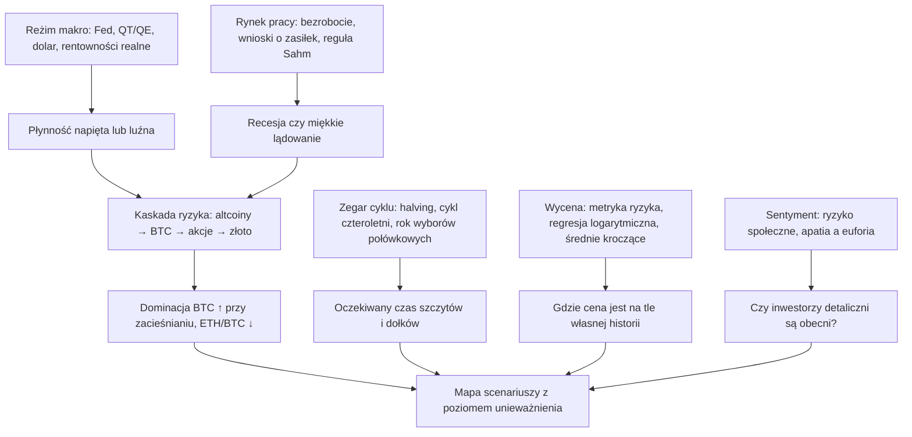

# 14. Ramy Cowena i dekoder filmów

**Dlaczego ten rozdział jest ważny.** Benjamin Cowen (YouTube @benjaminjcowen, „Into The Cryptoverse”, ITC) opublikował znacznie ponad 2000 filmów (od 2019 roku do 11 czerwca 2026 zindeksowano ich 2385). W każdym posługuje się niewielkim słownikiem wykresów i zwrotów, których rzadko objaśnia od nowa. Ten rozdział jest właśnie takim słownikiem. Wymienia jego powracające tezy wraz z datami i ich stanem na październik 2026, przekłada każdy powracający zwrot i każdą rodzinę wykresów na prosty język z odnośnikiem do rozdziału, który je wyjaśnia, ocenia jego publiczny dorobek prognostyczny od 2021 do października 2026 (trafienia i pudła), opisuje ograniczenia każdej z jego metod i pokazuje, jak jego poglądy zmieniały się w 2026 roku. **Ten kurs jest niezależny od Benjamina Cowena i Into The Cryptoverse. Nie jest z nim powiązany ani przez niego rekomendowany.** Jego autorskie (zastrzeżone) metryki (metryka ryzyka, ryzyko społeczne, metryka cyklu koniunkturalnego) opisujemy wyłącznie jako koncepcje.

**Czego się nauczysz**
- 23 powracające tezy, na których opiera się większość jego filmów: kiedy je sformułował i jak się sprawdziły;
- co oznacza każdy z jego powracających zwrotów i każda rodzina wykresów oraz gdzie w tym kursie są wyjaśnione;
- uczciwą tabelę wyników jego sprawdzalnych prognoz od 2021 do października 2026;
- mocne strony i ograniczenia każdej z jego metod;
- jak jego spojrzenie na 2026 rok zmieniało się miesiąc po miesiącu;
- pięciokrokową procedurę rozkodowywania dowolnego jego filmu.

**Źródła i ich jakość.** Materiał pochodzi z [zestawienia badawczego](../../research-notes/A-cowen-inventory.md) przygotowanego na potrzeby tego kursu 30 października 2026. Korzysta z jego publicznych memorandów na stronie [benjamincowen.com/reports](https://benjamincowen.com/reports) (źródło pierwotne), z publicznego katalogu wykresów aplikacji ITC (źródło pierwotne), z pełnego indeksu tytułów jego filmów wraz z maszynowo generowanymi streszczeniami w serwisie [rosetta.to](https://rosetta.to/u/intothecryptoverse) (tytuły i daty wiarygodne; streszczenia w większości trafne, ale nie bezbłędne), z [wywiadu dla Bankless z 23 grudnia 2025](https://www.bankless.com/podcast/where-is-crypto-going-in-2026-ben-cowen) oraz z omówień prasowych. Cytaty wzięte ze streszczeń filmów lub z artykułów prasowych są wtórne i oznaczamy je źródłem. Każde „Cowen uważa X” poniżej ma datę, ponieważ w 2026 roku jego poglądy zmieniały się szybko.

---

## 1. Jak ewoluował jego zestaw narzędzi

Sądząc po liczbie wystąpień słów kluczowych w 2385 tytułach i streszczeniach filmów (od 2019 do 11 czerwca 2026), jego twórczość przeszła trzy fazy.

| Okres | Główne narzędzia | Typowe tematy |
|---|---|---|
| 2019–2021 | techniczne i ilościowe | regresja logarytmiczna, pas wsparcia rynku byka, metryka ryzyka, porównania ROI, wydłużające się cykle, indeks dolara, DCA (uśrednianie kosztu zakupu); prawie bez makro |
| 2022–2024 | makro wchodzi wraz z cyklem podwyżek stóp przez Fed | CPI, Fed, krzywa rentowności, ryzyko recesji, bezrobocie, bessy na S&P 500; od 2023 roku dominacja bitcoina, analogia do 2019 roku, QT i ryzyko społeczne |
| 2025–2026 | późna faza cyklu | rynek pracy, koniec QT, „dlaczego nie ma sezonu altcoinów”, szczyt w apatii, szablon roku wyborów połówkowych, złoto, późna faza cyklu koniunkturalnego, ropa i „szach-mat” dla Fed, narzędzia on-chain do wyznaczania dna (cena zrealizowana, podaż w zysku lub stracie, MVRV) |

Najczęstsze tematy ogółem to rodzina średnich kroczących 20-/21-tygodniowych (około 500 filmów), pas wsparcia rynku byka (307), dominacja bitcoina (281), regresja logarytmiczna i wartość godziwa (277), Fed (270), sezonowość (267) oraz halving (243). Szeregi makroekonomiczne, wokół których prawie nigdy nie buduje filmu: spready kredytowe, nastroje konsumentów i stopy realne. Te liczby są przybliżone.

### 1.1 Jego raporty pisemne

Oprócz filmów publikuje raporty pisemne na stronie [benjamincowen.com/reports](https://benjamincowen.com/reports). Indeks wymienia 11 raportów w dwóch seriach i na 30 października 2026 nie ma innych (mapa strony i archiwa internetowe pokazują te same 11). Dziewięć raportów z 2026 roku ma pełne pliki PDF osadzone na publicznej stronie (łącznie 193 strony); dwa raporty z 2020 roku udostępniają PDF tylko przez formularz e-mailowy, dlatego wykorzystaliśmy jedynie streszczenia z ich stron. Raporty są jego dziełem: ten kurs je parafrazuje.

| Data | Raport (tytuł strony; tytuł PDF, jeśli inny) | Główne tematy |
|---|---|---|
| 5.01.2020 | [Bitcoin Letters (2020)](https://benjamincowen.com/reports/bitcoin-letters-2020) | malejące zwroty, kompresja zmienności, **reżimy ryzyka** (okresy, w których stopy zwrotu skorygowane o ryzyko przemawiają za ekspozycją, w odróżnieniu od okresów, gdy przeważa ryzyko spadków); „deliberately omits price targets” („celowo pomija cele cenowe”) |
| 20.02.2020 | [Ethereum Letters (2020)](https://benjamincowen.com/reports/ethereum-letters-2020) | ETH jako „fundamentally different from Bitcoin” („zasadniczo różny od bitcoina”); ETH/BTC „often more actionable” („często bardziej użyteczny przy podejmowaniu decyzji”) niż ceny w USD; niepewność modeli |
| 15.01.2026 | [Crypto Macro Risk Memo – Q1 2026](https://benjamincowen.com/reports/crypto-macro-risk-memo-q1-2026) („Crypto Risk Memo (Q1 2026)”) | szczyt w apatii, analogia do 2019 roku, bilans Fed jako zarządzanie rezerwami, zmienność 180-dniowa („low volatility at cycle highs is not stability, but rather fragility” – „niska zmienność na szczytach cyklu to nie stabilność, lecz kruchość”), mapa cieplna korelacji, cząstkowe ryzyka recesji |
| 15.02.2026 | [Macro Risk Memo February 2026](https://benjamincowen.com/reports/macro-risk-memo-feb-2026) („Macro Risk Memo (Q1 2026)”) | poziom płynności a jej kierunek, odporność akcji → rynek pracy, globalne M2 r/r, krzywa rentowności, warunki finansowe, rynek mieszkaniowy, ryzyko umocnienia dolara „similar to 2018” („podobne do 2018 roku”) |
| 15.03.2026 | [How Risk Cascades Through Markets](https://benjamincowen.com/reports/how-risk-cascades-through-markets-march-2026) (podtytuł „From Speculative Assets to the Real Economy”) | pięcioetapowa kaskada ryzyka; ryzyko płynności, modele cyklu koniunkturalnego i recesji |
| 15.04.2026 | [Crypto Risk Memo (Q2 2026)](https://benjamincowen.com/reports/crypto-risk-memo-q2-2026) | niepełny reset, kapitulacja rozłożona w czasie, dominacja ze stablecoinami i bez nich, zasoby ETF i spółek |
| 18.05.2026 | [Macro Risk Memo (May 2026)](https://benjamincowen.com/reports/macro-risk-memo-may-2026) („The Fed's Late Business Cycle Trap”) | inflacja wywołana podażą, „szach-mat” dla Fed, praca tymczasowa i zatrudnienie r/r, siedmiokrokowa pętla recesyjna |
| 29.05.2026 | [Asymmetric Tail Curvature in Bitcoin Price Quantiles](https://benjamincowen.com/reports/asymmetric-tail-curvature-in-bitcoin-price-quantiles) (working paper) | regresja kwantylowa; strukturalna podłoga wynikająca z prawa potęgowego a wygasający składnik spekulacyjny; błędy poza próbą modeli prawa potęgowego, S2F i S2FX |
| 15.07.2026 | [Bitcoin Cycle Memo – July 2026](https://benjamincowen.com/reports/bitcoin-cycle-memo-july-2026) („The Analog Enters Its Timing Test”) | wyczucie czasu analogii do 2019 roku, tabela wyników ryzyka z 22 metrykami, liczenie dni, reguły 200W i 50W, cena zrealizowana, „The Bull Case in Its Strongest Form” („Scenariusz byczy w najmocniejszej postaci”) |
| 15.08.2026 | [The Balance of Risks](https://benjamincowen.com/reports/the-balance-of-risks-august-2026) („Weighing a Maturing Cycle Into Q4”) | stany scenariuszy 65/20/15, NFCI, składowe złożonego wskaźnika recesji, szerokość rynku, opóźnienie energetyczne, analogia dolarowa, samodzielna ocena własnych wyników |
| 30.09.2026 | [The Triple Squeeze](https://benjamincowen.com/reports/the-triple-squeeze-september-2026) („Rising Yields, Rising Oil and a Firming Dollar Into Q4”) | sześciokrokowa pętla ściskania, ryzyko sekwencji, szczyty rentowności w latach wyborów połówkowych, małe spółki, BTC po podwyżkach, „Bitcoin: Where We Were Wrong” („Bitcoin: gdzie się myliliśmy”) |

**Jak zbudowane jest memorandum z 2026 roku.** Każde memorandum z 2026 roku korzysta z tego samego szablonu, który warto znać, bo nagłówek w czterech linijkach mówi ci, jakie jest jego stanowisko:
- **Poziomy odniesienia** (Reference levels; ceny w dniu publikacji).
- **Stan cyklu / ocena cyklu** (Cycle status / cycle assessment; np. „Risk-Off” w styczniu; „Late-cycle restrictive digestion with emerging supply-driven pressures” – „restrykcyjne trawienie w późnej fazie cyklu z narastającą presją podażową” – w marcu; „Late-stage crypto markdown, bottom-watch window open” – „przecena kryptowalut w późnym stadium, otwarte okno wypatrywania dna” – w lipcu).
- **Cechy reżimu** (Regime characteristics).
- **Zalecana postawa** (Recommended posture), czyli raczej hasło niż transakcja: „Capital preservation and tactical positioning” („ochrona kapitału i taktyczne pozycjonowanie”; styczeń), „Defensive positioning with tactical deployment during periods of weakness” („defensywne pozycjonowanie z taktycznym angażowaniem kapitału w okresach słabości”; maj) oraz warianty z „selective deployment” („selektywne angażowanie”) lub „patience over aggressive deployment” („cierpliwość zamiast agresywnego angażowania”).
- **Główne czynniki ryzyka** (Primary risk drivers; w lutym: restrykcyjność polityki pieniężnej względem stopy neutralnej, odporność akcji, dolar, stabilizacja płynności a jej impuls oraz szerokość osłabienia rynku pracy a nieliniowe załamanie).
- Zakres i ograniczenia, streszczenie dla kierownictwa, numerowane sekcje, następnie **„What would change this view”** („Co zmieniłoby to spojrzenie”, czyli warunki falsyfikujące) i podsumowanie. Memoranda z sierpnia i września dodają ramkę „co się zmieniło od ostatniego wydania” oraz tabelę porównawczą różnych klas aktywów.

**Warunki falsyfikujące.** Każde memorandum wymienia obserwowalne warunki, które by je obaliły. Styczeń: szerszy udział rynku, reset wskaźników on-chain, konstruktywny ponowny wzrost zmienności albo zdecydowana zmiana płynności (załamanie rentowności realnych, rozszerzanie bilansu, awaryjne luzowanie). Luty: nieliniowe załamanie rynku pracy, trwała słabość akcji, ograniczający dolar albo zdecydowany zwrot (pivot) Fed. Lipiec: dwa kolejne tygodniowe zamknięcia powyżej 50-tygodniowej średniej (wówczas około 86 500 USD). Sierpień: zestaw warunków obalających wymieniony w [rozdziale 13 §8](13-JAK-TO-SIE-LACZY.md#81-jego-ramy-jego-słowami).

**Samoocena i budowanie najmocniejszej wersji kontrargumentu (steel-manning).** Memorandum sierpniowe zawiera „Framework's 2026 Record” („Bilans ram w 2026 roku”), w którym ocenia własne prognozy jako *confirmed* (potwierdzone), *confirmed to date* (potwierdzone do tej pory), *open* (otwarte) lub *mixed* (mieszane): szczyt w IV kwartale 2025 – potwierdzony; styczniowe stanowisko ochrony kapitału – „confirmed (crypto), mixed (equities)” („potwierdzone (kryptowaluty), mieszane (akcje)”), bo S&P od początku roku zyskał +13,7%; słabość akcji w lutym i marcu jako zjawisko późnej fazy cyklu, a nie recesji – potwierdzona do tej pory; jastrzębi Fed w pułapce – potwierdzony do tej pory; przenoszenie się impulsu z akcji na złoto – otwarte. Memorandum lipcowe ma sekcję zatytułowaną „The Bull Case in Its Strongest Form” („Scenariusz byczy w najmocniejszej postaci”), a wrześniowe – sekcję „Bitcoin: Where We Were Wrong” („Bitcoin: gdzie się myliliśmy”; „We did not think BTC would take out its May high, and it has” – „Nie sądziliśmy, że BTC przebije majowy szczyt, a jednak to zrobił”). W lipcu napisał też, że seria „has been better on direction than on level” („lepiej trafiała w kierunek niż w poziom”).

**Drobne niespójności między memorandami.** Szczyt z 2025 roku to w jednym memorandum „near $126k” („w okolicach 126 tys. USD”), a w innym „$124,700 (daily close)” („124 700 USD (zamknięcie dzienne)”); dołek z 2026 roku pojawia się jako „near $57,000” („w okolicach 57 000 USD”), „near $58,500” („w okolicach 58 500 USD”; zamknięcie dzienne z 30 czerwca) oraz „near $57.7K” („w okolicach 57,7 tys. USD”). Składniki jego wskaźnika ryzyka płynności są opisane nieco inaczej w tekście pomocy aplikacji i w memorandach (memoranda dodają „funding stress proxies” – „przybliżone miary napięć w finansowaniu”). Nic z tego nie zmienia argumentacji, ale cytując liczbę, podawaj konkretne memorandum.

---

## 2. Ramy w jednym obrazku

Łączy cztery niezależne „zegary”: reżim makro i płynności, cykl czteroletni, wycenę na tle historii cen oraz sentyment inwestorów detalicznych. Gdy się zgadzają, formułuje pogląd; gdy są sprzeczne, zwykle to mówi i podaje prawdopodobieństwa oraz poziom unieważnienia (invalidation level). Od 2023 roku rynek pracy jest zmienną, którą traktuje jako najważniejszą dla oceny sytuacji makro.

---

## 3. Jego powracające tezy, z datami i stanem

Stan na 30 października 2026. Kolumna „Gdzie wyjaśnione” wskazuje rozdział, który testuje dany wskaźnik.

| # | Teza (w jego ujęciu, z datą) | Stan, październik 2026 | Gdzie wyjaśnione |
|---|---|---|---|
| T1 | **Cykl czteroletni.** BTC osiąga szczyt w IV kwartale roku po halvingu, a dołek w okolicach IV kwartału roku wyborów połówkowych. „The most likely low for BTC is October 2026… it could happen as early as May” („Najbardziej prawdopodobny dołek BTC to październik 2026… może nastąpić już w maju”; X, 6 lutego 2026, według fragmentu z wyszukiwarki). „The cycle is primarily about the timing of lows, not exact prices” („Cykl dotyczy przede wszystkim czasu wystąpienia dołków, a nie dokładnych cen”; 26 maja 2026). | Szczyty z 4 grudnia 2013, 17 grudnia 2017, 10 listopada 2021 i 6 października 2025 przypadły na IV kwartał roku po halvingu. Dotychczasowy dołek 2026 roku wypadł 30 czerwca, wcześniej niż w jego scenariuszu bazowym (październik); do 30 października nie było niższego dołka. Próba trzech–czterech cykli. | [10](10-CYKLE-I-MODELE-WYCENY-BITCOINA.md), [09](09-SEZONOWOSC-I-CYKLE-POLITYCZNE.md) |
| T2 | **Malejące zwroty (utrzymane) i wydłużające się cykle (porzucone).** 2019–21: cykle się wydłużają, więc w 2021 roku nie będzie szczytu („Market Cycle Has Now *Unofficially* Lengthened”, 19 listopada 2021). | Teza o wydłużaniu się cykli zawiodła: BTC osiągnął szczyt 10 listopada 2021. Malejące zwroty się utrzymały: mnożniki od dołka do szczytu cyklu wynosiły około ×539, ×112, ×21 i ×7,9. | [10](10-CYKLE-I-MODELE-WYCENY-BITCOINA.md) |
| T3 | **Dominacja BTC rośnie w okresach QT, podwyżek stóp i w latach przed halvingiem, a szczyt osiąga przy przejściu z QT do QE** (Cointelegraph Magazine, 19 listopada 2024). Cel 60% od połowy 2023 roku, potem 66% (25 lutego 2025). | 60% osiągnięte 30 października 2024; powyżej 65% 6 maja 2025. QT zakończyło się 1 grudnia 2025 i nie nastąpiło po nim QE, więc reguła „szczyt przy QT→QE” nie została w tym cyklu sprawdzona. Dominacja nagłówkowa w 2026 roku około 58–61%; bez stablecoinów około 67% (luty i sierpień 2026). | [12](12-DOMINACJA-ALTCOINY-I-ROTACJA.md), [07](07-PLYNNOSC-PIENIADZ-I-DOLAR.md) |
| T4 | **Altcoiny krwawią względem BTC; nie ma sezonu altcoinów bez (1) luźniejszej polityki, (2) dużego zainteresowania inwestorów detalicznych, (3) euforycznego szczytu BTC** (22 grudnia 2025). Następny sezon altcoinów „potentially in 2027–2029” („potencjalnie w latach 2027–2029”; 20 lutego 2026). | Trafne dla lat 2024–26: stosunek altcoinów do BTC 0,29 w październiku 2025; w lutym 2026 altcoiny wróciły do dołków z 2022 roku. | [12](12-DOMINACJA-ALTCOINY-I-ROTACJA.md) |
| T5 | **ETH/BTC: krwawienie, „going home” („powrót do domu”), potem dno.** „Welcome Home, Ethereum” (7 kwietnia 2025), ETH do 1500–1600 USD. | Dołek ETH około 1386 USD 9 kwietnia 2025, potem rekord wszech czasów (ATH) w okolicach 4950 USD 24 sierpnia 2025. ETH/BTC około 0,029 30 października 2026. | [12](12-DOMINACJA-ALTCOINY-I-ROTACJA.md) |
| T6 | **Obniżki stóp na początku nie są bycze; prawdziwa hossa zaczyna się po ostatniej obniżce**, zwłaszcza gdy Fed dokonuje zwrotu z powodu szkód w gospodarce ([„Bitcoin and Interest Rates”](https://rosetta.to/u/intothecryptoverse/bitcoin-and-interest-rates), 24 stycznia 2023). Bez recesji długie rentowności i dolar rosną po pierwszej obniżce (23 października 2024). | Prognoza dla rentowności i dolara z 2024 roku była trafna (10Y z około 3,6% do 4,8%, DXY z około 100 do 110 do stycznia 2025). Kontrprzykłady: obniżki z 1995 i 1998 roku były bycze dla akcji. | [02](02-FED-I-STOPY-PROCENTOWE.md), [13](13-JAK-TO-SIE-LACZY.md#4-kanoniczne-sekwencje-z-opóźnieniami-i-datami) |
| T7 | **Scenariusz recesji prowadzonej przez bezrobocie.** Bezrobocie osiąga dołek, rośnie nieliniowo, uruchamia się reguła Sahm, krzywa wraca do dodatniego nachylenia, gdy Fed tnie stopy, recesję datuje się z opóźnieniem, a rynki osiągają dno w jej trakcie (filmy z 14 czerwca 2022, 29 września 2022, 3 sierpnia 2024; „once unemployment begins its nonlinear uptrend, recession typically follows” – „gdy bezrobocie zaczyna nieliniowy trend wzrostowy, zwykle następuje recesja”, 27 marca 2026). | Reguła Sahm uruchomiła się w sierpniu 2024 (na danych za lipiec) bez recesji; bezrobocie osiągnęło szczyt 4,5% (listopad 2025, w pierwszym odczycie 4,6%) i spadło do 4,2%. Jego prognoza recesji z 2023 roku na „late 2023 or early 2024” („koniec 2023 lub początek 2024”) się nie sprawdziła. | [05](05-RYNEK-PRACY.md), [13](13-JAK-TO-SIE-LACZY.md) |
| T8 | **Analogia do 2019 roku.** Szczyt w apatii na krótko przed końcem QT (około 5 tygodni przed w 2019 i około 8 tygodni przed w 2025 według jego memorandum z lipca 2026; „about two months” – „około dwóch miesięcy” – dla obu w wywiadach), brak trwałej rotacji, niższe szczyty. Pierwszy spadek o ~50% w 2019 roku wynikał z płynności; głębsze wypłukanie wymagało szoku zewnętrznego (COVID), więc bez niego spodziewał się „time-based capitulation” („kapitulacji rozłożonej w czasie”; memorandum z kwietnia 2026). | Dobrze pasowała do szczytu z 2025 roku. Jako szablon dna wymaga ostatecznego wypłukania; jego memorandum z lipca 2026 odnotowało, że ścieżka z 2019 roku minęła swój dołek z dnia 261 „without the flush” („bez wypłukania”). | [10](10-CYKLE-I-MODELE-WYCENY-BITCOINA.md), [13](13-JAK-TO-SIE-LACZY.md) |
| T9 | **Szablon roku wyborów połówkowych i „okno słabości” (window of weakness).** Dołek w lutym, odbicie na początku marca, słabość w kwietniu–czerwcu, rajd w lipcu, słaby sierpień–wrzesień, dołek w IV kwartale. „Fade Bitcoin in the first half of midterm years and look for deals in the second half” („Graj przeciw bitcoinowi w pierwszej połowie roku wyborów połówkowych i szukaj okazji w drugiej”; 29 maja 2026). | Pierwsza połowa roku pasowała bardzo dokładnie. Rajd od lipca do października był silniejszy niż w 2018 i 2022 roku (około 50% wobec około 40%, wyższy szczyt), co przyznał we wrześniu 2026. | [09](09-SEZONOWOSC-I-CYKLE-POLITYCZNE.md) |
| T10 | **Analogie do lat 90.: 1996–2000, 1997 i 1998 (nie 1995).** S&P/M2 „resembles 1996–2000” („przypomina lata 1996–2000”; grudzień 2025); spadek o 20% w stylu 1998 roku, a potem nowe szczyty (kwiecień 2025); w odniesieniu do podwyżki z września 2026 omówienie CMC Academy przywołało pojedynczą podwyżkę z marca 1997, ale jego własne memorandum z 30 września 2026 nazywa ją „resumption” („wznowieniem”) jak w 1999 roku po ubezpieczających obniżkach z 1998 (wierz memorandum). | Analogia do 1998 roku pasowała do 2025. Analogia miękkiego lądowania z 1995 roku należy do innych analityków, nie do niego. | [08](08-AKCJE-ZLOTO-I-INNE-AKTYWA.md), [13](13-JAK-TO-SIE-LACZY.md#42-miękkie-lądowania-i-cykle-ubezpieczeniowe) |
| T11 | **Fale inflacji z lat 70. → szok energetyczny → „szach-mat” dla Fed.** Druga fala to ryzyko, a nie scenariusz bazowy (2022–25); w 2026 roku inflacja wywołana podażą w połączeniu ze słabnącym rynkiem pracy oznacza, że Fed „can't cut, can't hike aggressively” („nie może ciąć, nie może agresywnie podnosić”; 10 kwietnia 2026). | Fed nie obniżył stóp w 2026 roku i podniósł je raz (16 września). Długoterminowe oczekiwania inflacyjne pozostały zakotwiczone (5y5y 2,23%). | [04](04-INFLACJA.md) |
| T12 | **Późna faza cyklu koniunkturalnego i kaskada ryzyka.** Pięć etapów: spada udział spekulacyjny, spadają aktywa spekulacyjne, akcje tracą względem złota, dolar i ropa zacieśniają warunki finansowe, a na końcu pętla sprzężenia zwrotnego z rynkiem pracy; marzec 2026 umieścił „between Stage 3 and Stage 4” („między etapem 3 a etapem 4”; memorandum z 15 marca 2026). Memorandum majowe dodaje siedmiokrokową pętlę recesyjną, wrześniowe – sześciokrokową pętlę ściskania. Prawdopodobieństwa z sierpnia 2026: 65% ekspansja w późnej fazie cyklu z korektą w roku wyborów połówkowych, 20% korekta wywołana błędem polityki pieniężnej, 15% przejście w recesję. | Kryptowaluty osłabły pierwsze; akcje i rynek pracy do 30 października 2026 się nie załamały. | [13 §8](13-JAK-TO-SIE-LACZY.md#8-ramy-cowena-dotyczące-późnej-fazy-cyklu-i-kaskady-ryzyka) |
| T13 | **Wartość godziwa z regresji logarytmicznej i pasma.** Cena oscyluje wokół wartości godziwej wyznaczonej w czasie logarytmicznym, a górne pasma się zwężają (seria „Beauty of Mathematics”, 2020–26). | ITC oznacza teraz klasyczne wykresy regresji jako „(Legacy)” („(archiwalne)”) i promuje wachlarz kwantylowy (raport z maja 2026). Własne dopasowanie laboratorium kursu daje cenę na poziomie 0,53 wartości godziwej (29 października 2026). | [10](10-CYKLE-I-MODELE-WYCENY-BITCOINA.md) |
| T14 | **Pas wsparcia rynku byka (BMSB) jako przełącznik hossa/bessa.** „A bear market for Bitcoin is weekly closes below the 20-week SMA” („Bessa na bitcoinie to tygodniowe zamknięcia poniżej 20-tygodniowej SMA”; 22 czerwca 2021). Rajdy w bessie kończą się na tym pasie lub na 50W. | Opór w okolicach 82–83 tys. USD w kwietniu–maju 2026; ponownie utracony 28 maja / 1 czerwca; odzyskany w sierpniu–wrześniu 2026. | [10](10-CYKLE-I-MODELE-WYCENY-BITCOINA.md) |
| T15 | **200-tygodniowa SMA jako strefa akumulacji w roku wyborów połówkowych („a date with destiny” – „randka z przeznaczeniem”).** Szacowana na 60–70 tys. USD (grudzień 2025). | Dotknięta 5 czerwca 2026; jedno tygodniowe zamknięcie poniżej niej pod koniec czerwca (plus dwa marginalne zamknięcia w sierpniu, według [notatek badawczych D](../../research-notes/D-crypto-cycles-onchain-alts.md)), potem odzyskana. Laboratorium: cena 15% powyżej 200W (67 497 USD) 29 października 2026. | [10](10-CYKLE-I-MODELE-WYCENY-BITCOINA.md) |
| T16 | **Metryka ryzyka i dynamiczne DCA.** Jego podejście od 2019 roku: akumulacja w pasmach niskiego ryzyka, stopniowa sprzedaż w pasmach wysokiego. | W lipcu 2026 napisał, że ryzyko znajduje się „in the low zone historically associated with accumulation” („w niskiej strefie historycznie kojarzonej z akumulacją”). Formuła jest zastrzeżona. | [10](10-CYKLE-I-MODELE-WYCENY-BITCOINA.md), sekcja 8 poniżej |
| T17 | **Ryzyko społeczne, apatia i „inwestorzy detaliczni nigdy nie wrócili”.** „Why Retail Never Returned” (24 kwietnia 2025); „Crypto Ghost Town” (13 stycznia 2026), zainteresowanie społeczne na poziomie około 16% wartości z 2021 roku. | Zgodne z tym, że Fear & Greed na szczycie z października 2025 sięgnął tylko 74, a Coinbase we wrześniu 2025 zajmował około 260. miejsca w App Store. | [11](11-ON-CHAIN-I-SENTYMENT.md) |
| T18 | **Sezonowość: wrzesień, letni zastój, potem szczyt w IV kwartale w latach po halvingu** („The Pattern That Historically Ended The Bull Market”, 12 sierpnia 2025). | Trafne w 2025 roku: spadek pod koniec września, ATH 6 października, krach od 10 października. | [09](09-SEZONOWOSC-I-CYKLE-POLITYCZNE.md) |
| T19 | **Dolar.** Reżimy silnego dolara szkodzą altcoinom; analiza kanału DXY. | W 2026 roku twardniejący dolar zasilał jego „potrójne ściskanie” (triple squeeze; memorandum wrześniowe). We wrześniu 2026 BTC rósł *razem* z dolarem, a on powiedział „something clearly changed” („coś się wyraźnie zmieniło”). | [07](07-PLYNNOSC-PIENIADZ-I-DOLAR.md) |
| T20 | **„Unfortunate pattern” („niefortunny układ”) dominacji stablecoinów.** Dominacja USDT+USDC wybiła się z bazy podobnie jak wcześniejsze wybicia BTC.D, palladu i Hang Seng; cel 14–15% w dalszej części 2026 roku (7 stycznia, 18 marca, 20 maja 2026). | Niepotwierdzone; 30 października 2026 USDT.D wynosiła około 6,8%, a USDC.D około 2,7% (CoinGecko). | [12](12-DOMINACJA-ALTCOINY-I-ROTACJA.md) |
| T21 | **Złoto i relacja S&P/złoto; „pułapka rotacji” (rotation trap).** S&P/złoto w pobliżu linii 1,4, która poprzedziła spadki z 1973 i 2008 roku; „don't sell winners to buy losers” („nie sprzedawaj zwycięzców, żeby kupić przegranych”; 20–22 stycznia 2026). | Złoto osiągnęło szczyt pod koniec stycznia 2026 (około 5560 USD) i wiosną mocno spadło (jego film z 23 marca nosił tytuł „Gold Drops Nearly 30%”; poziomu z końca marca nie zweryfikowano niezależnie), do dołka pod koniec czerwca w okolicach 3970 USD (około −29% od szczytu) i około 4024 USD 30 października; S&P bił rekordy. | [08](08-AKCJE-ZLOTO-I-INNE-AKTYWA.md) |
| T22 | **Narracje podążają za ceną; „Bitcoin is not the economy” („bitcoin to nie gospodarka”).** „Market narratives follow price action, not the other way around” („Narracje rynkowe podążają za zachowaniem ceny, a nie odwrotnie”; 4 listopada 2025); krótkoterminowe prognozowanie jest „comparable to random walk physics” („porównywalne z fizyką błądzenia losowego”; 8 stycznia 2026). | Raczej zasada postępowania niż prognoza. Jego uwaga o ISM sprawdziła się w 2026 roku. | [06](06-WZROST-I-CYKL-KONIUNKTURALNY.md) |
| T23 | **Podwyżki stóp nie są od razu niedźwiedzie** (luty 2022); przeczyła temu jego własna prognoza z września 2026, a potem tezę potwierdził na nowo: „None of the data suggests that a rate hike has ever been immediately bearish for Bitcoin” („Żadne dane nie wskazują, by podwyżka stóp kiedykolwiek była od razu niedźwiedzia dla bitcoina”; wrzesień 2026, według Benzinga). | BTC wzrósł po podwyżce z 16 września 2026: z około 76 tys. USD w dniu podwyżki do około 86 tys. USD 21 września (Coinbase przez FRED), przedłużając rajd, który zaczął się w okolicach 63 tys. USD w połowie sierpnia. | [02](02-FED-I-STOPY-PROCENTOWE.md) |

Trzy uwagi o autorstwie. „ISM powyżej 50 oznacza sezon altcoinów” to głównie teza Raoula Pala; odpowiedź Cowena z 2026 roku brzmiała „Bitcoin is not the economy” („bitcoin to nie gospodarka”; [rozdział 06](06-WZROST-I-CYKL-KONIUNKTURALNY.md)). Analogia miękkiego lądowania z 1995 roku nie jest jego. „Wydłużające się cykle” były jego tezą do 2021 roku, potem ją porzucił.

---

## 4. Dekoder filmów

Jak korzystać z tych tabel: gdy w filmie pojawi się zwrot lub wykres, znajdź go tutaj, przeczytaj jednolinijkowe wyjaśnienie, a potem przejdź pod odnośnik, gdzie znajdziesz pełne objaśnienie, źródło danych i historię wskaźnika. Pierwsza kolumna podaje zwroty dokładnie tak, jak słyszysz je w filmach, czyli po angielsku.

### 4.1 Ryzyko, wycena i modele cenowe

| Zwrot lub wykres | Co oznacza | Rozdział |
|---|---|---|
| Risk metric | Metryka ryzyka: jego znormalizowany do przedziału 0–1 oscylator ceny danego aktywa, oczyszczony z trendu, dostępny w różnych denominacjach (USD, BTC, ETH). 0 = historycznie tanio względem własnej ścieżki, 1 = historycznie przeciągnięte. Pozycja na historycznej drabinie samego aktywa, a nie prawdopodobieństwo. Formuła zastrzeżona. | [10](10-CYKLE-I-MODELE-WYCENY-BITCOINA.md) |
| Risk bands, "time in risk bands" | Pasma ryzyka: przedziały metryki ryzyka o szerokości 0,1; wykresy pokazują, jak długo cena historycznie przebywała w każdym paśmie. | [10](10-CYKLE-I-MODELE-WYCENY-BITCOINA.md) |
| Price color-coded by risk; historical / current risk levels | Wykres ceny pokolorowany według pasm ryzyka (niebieski – niskie, czerwony – wysokie). | [10](10-CYKLE-I-MODELE-WYCENY-BITCOINA.md) |
| Total (composite) indicator risk | Łączne (złożone) ryzyko wskaźników: średnia z równymi wagami z ryzyka cenowego, on-chain i społecznego, każde w skali 0–1. Zbudowana tak, by unikać fałszywych den sygnalizowanych przez pojedynczy wskaźnik. | [10](10-CYKLE-I-MODELE-WYCENY-BITCOINA.md), [11](11-ON-CHAIN-I-SENTYMENT.md) |
| On-chain risk | Ryzyko on-chain: złożony wskaźnik 0–1 z metryk wyceny on-chain (MVRV, podaż w zysku itd.). W sierpniu 2026 wynosił 0,181. | [11](11-ON-CHAIN-I-SENTYMENT.md) |
| Social risk; "improved social risk metric" | Ryzyko społeczne: złożony wskaźnik 0–1 uwagi inwestorów detalicznych: subskrybenci i wyświetlenia na YouTube, obserwujący na X analityków, giełd i sieci warstwy 1; wersja z 2026 roku dodaje Google Trends i pozycję aplikacji Coinbase w rankingu. | [11](11-ON-CHAIN-I-SENTYMENT.md) |
| Logarithmic regression (bands), regression rainbow | Regresja logarytmiczna (pasma), „tęcza” regresji: linia najlepszego dopasowania logarytmu ceny do logarytmu czasu z pasmami wokół niej; górne pasma wyznaczają dawne strefy bańki. ITC oznacza je jako „(Legacy)”. | [10](10-CYKLE-I-MODELE-WYCENY-BITCOINA.md) |
| Fair value logarithmic regression | Regresja logarytmiczna wartości godziwej: regresja logarytmiczna dopasowana wyłącznie do danych „spoza baniek”, odczytywana jako długoterminowa wartość godziwa. | [10](10-CYKLE-I-MODELE-WYCENY-BITCOINA.md) |
| "The Beauty of Mathematics" | Jego comiesięczna seria (do czerwca 2026 część 71) o wykresach regresji logarytmicznej i wartości godziwej, głównie dla całkowitej kapitalizacji rynku kryptowalut. | [10](10-CYKLE-I-MODELE-WYCENY-BITCOINA.md) |
| Total crypto market cap and trendline | Całkowita kapitalizacja rynku kryptowalut i linia trendu: o ile cały rynek jest powyżej lub poniżej swojego trendu regresji. | [10](10-CYKLE-I-MODELE-WYCENY-BITCOINA.md) |
| Asymmetric quantile regression (fan) | Asymetryczna regresja kwantylowa (wachlarz): jego model z 2026 roku z odrębną krzywizną dla górnych i dolnych kwantyli ceny: górny ogon się spłaszcza, a dolne wsparcie pozostaje blisko prawa potęgowego. Sam nazywa go opisowym, a nie prognozą. | [10](10-CYKLE-I-MODELE-WYCENY-BITCOINA.md) |
| Diminishing returns | Malejące zwroty: mnożnik szczytowy każdego cyklu jest mniejszy niż w poprzednim. | [10](10-CYKLE-I-MODELE-WYCENY-BITCOINA.md) |
| Lengthening cycles (LCT) | Wydłużające się cykle: jego teoria z lat 2019–21, że każdy cykl trwa dłużej. Porzucona po szczycie z listopada 2021. | [10](10-CYKLE-I-MODELE-WYCENY-BITCOINA.md) |
| Running ROI; ROI after bottom / halving / peak; ROI bands | Bieżące ROI; ROI od dołka / halvingu / szczytu; pasma ROI: stopy zwrotu porównywane między cyklami od stałych punktów zaczepienia (dołek cyklu, dzień halvingu, szczyt cyklu). | [10](10-CYKLE-I-MODELE-WYCENY-BITCOINA.md) |
| Drawdown from ATH | Obsunięcie od rekordu wszech czasów: o ile procent cena jest poniżej ATH. Przed 2026 rokiem bessy BTC kończyły się w okolicach −77% do −84%, z każdym cyklem płycej. | [10](10-CYKLE-I-MODELE-WYCENY-BITCOINA.md) |
| Short-term bubble risk | Krótkoterminowe ryzyko bańki: jak bardzo cena oderwała się w górę od 20-tygodniowej SMA. | [10](10-CYKLE-I-MODELE-WYCENY-BITCOINA.md) |
| Cowen Corridor | „Korytarz Cowena”: pasmo zbudowane ze stosunku dwóch średnich kroczących i jego nachylenia (na wykresie tygodniowym). Odtworzenia społeczności są przybliżone. | [10](10-CYKLE-I-MODELE-WYCENY-BITCOINA.md) |
| Stock-to-flow (S2F), S2FX | Modele niedoboru, które omawiał jako jedną z kilku teorii; jego badanie z 2026 roku oszacowało ich błędy poza próbą na około +295% i +1699%. | [10](10-CYKLE-I-MODELE-WYCENY-BITCOINA.md) |
| Satoshi value | Wartość w satoshi: wartość mierzona w BTC, a nie w USD. | [12](12-DOMINACJA-ALTCOINY-I-ROTACJA.md) |

### 4.2 Cykle, sezonowość i wyczucie czasu

| Zwrot lub wykres | Co oznacza | Rozdział |
|---|---|---|
| Four-year cycle | Cykl czteroletni: cykl związany z halvingiem: rok przed halvingiem, rok halvingu, rok po halvingu (szczyt w IV kwartale), rok wyborów połówkowych (bessa). | [10](10-CYKLE-I-MODELE-WYCENY-BITCOINA.md) |
| Post-halving / pre-halving / halving / midterm year | Rok po halvingu / przed halvingiem / rok halvingu / rok wyborów połówkowych: jego etykiety czterech lat cyklu, np. 2025 / 2023 / 2024 / 2026. | [10](10-CYKLE-I-MODELE-WYCENY-BITCOINA.md), [09](09-SEZONOWOSC-I-CYKLE-POLITYCZNE.md) |
| Midterm year | Rok wyborów połówkowych w USA (midterm); historycznie najsłabszy dla BTC (i dla S&P), z dołkiem cyklu w okolicach IV kwartału. | [09](09-SEZONOWOSC-I-CYKLE-POLITYCZNE.md) |
| Window of weakness | Okno słabości: sezonowe okna, w których zwykle wypadały dołki w latach wyborów połówkowych (luty, koniec marca/kwiecień, czerwiec, wrzesień–październik). | [09](09-SEZONOWOSC-I-CYKLE-POLITYCZNE.md) |
| "We live in a simulation", "Simulation confirmed" | „Żyjemy w symulacji”, „symulacja potwierdzona”: ironiczny skrót oznaczający, że cena podąża za historyczną średnią ścieżką roku wyborów połówkowych ([„Bitcoin: Simulation Confirmed”](https://rosetta.to/u/intothecryptoverse/bitcoin-simulation-confirmed), 9 marca 2026). | [09](09-SEZONOWOSC-I-CYKLE-POLITYCZNE.md) |
| Yearly open | Otwarcie roku: cena z 1 stycznia, używana do porównywania ścieżek lat wyborów połówkowych (np. średnio −15% do początku marca). | [09](09-SEZONOWOSC-I-CYKLE-POLITYCZNE.md) |
| Summer lull; "Wake me up when September ends" | Letni zastój; „obudź mnie, gdy skończy się wrzesień”: sezonowa słabość latem i we wrześniu; coroczny wrześniowy film od 2021 roku. | [09](09-SEZONOWOSC-I-CYKLE-POLITYCZNE.md) |
| Monthly / quarterly returns; historical monthly average ROI | Stopy zwrotu miesięczne / kwartalne; historyczne średnie ROI miesięczne: mapy cieplne stóp zwrotu dla miesięcy i kwartałów kalendarzowych. | [09](09-SEZONOWOSC-I-CYKLE-POLITYCZNE.md) |
| Left-translated / right-translated cycle | Cykl przesunięty w lewo / w prawo: szczyt, który przychodzi wcześnie (w lewo) lub późno (w prawo) względem połowy cyklu. | [10](10-CYKLE-I-MODELE-WYCENY-BITCOINA.md) |
| Day counts ("day 1,363 of the cycle") | Liczenie dni („dzień 1363 cyklu”): liczba dni od ostatniego dołka cyklu, służąca do porównywania, w którym miejscu jest każdy cykl. Jego memorandum z lipca 2026 ustala punkt zaczepienia na dołku z 21 listopada 2022 (wcześniejsza wersja używała dołka po upadku FTX z 9 listopada): dzień 1332 przypadł 15 lipca 2026, a wcześniejsze dna wypadły w dniach 1424 i 1432, co wskazywało na październik 2026. Liczby w omówieniach prasowych się różnią. | [10](10-CYKLE-I-MODELE-WYCENY-BITCOINA.md) |
| Three stages of a bear market | Trzy etapy bessy: niedowierzanie, częściowa akceptacja, powszechna akceptacja; datowane odpowiednio na październik 2025 – luty 2026, luty–czerwiec 2026 i czerwiec–październik 2026 (7 czerwca 2026). | [11](11-ON-CHAIN-I-SENTYMENT.md) |
| Time-based capitulation | Kapitulacja rozłożona w czasie: bessa, która resetuje się przez miesiące dryfowania w bok, a nie przez jeden krach. | [10](10-CYKLE-I-MODELE-WYCENY-BITCOINA.md) |
| Bottom-watch mode | Tryb wypatrywania dna: zwrot z memorandów z 2026 roku: ramy przechodzą od potwierdzania spadku do wypatrywania dołka. | [13](13-JAK-TO-SIE-LACZY.md#11-gdzie-jesteśmy-30-października-2026) |
| The 2019 analog | Analogia do 2019 roku: rok 2019 jako szablon szczytu w apatii na krótko przed końcem QT, bez sezonu altcoinów, a potem z niższymi szczytami. | [13](13-JAK-TO-SIE-LACZY.md#42-miękkie-lądowania-i-cykle-ubezpieczeniowe) |
| Midterm hike-year behavior | Zachowanie w roku wyborów połówkowych z podwyżkami stóp: w dwóch wcześniejszych takich latach BTC utrzymywał się w pobliżu poziomu z dnia podwyżki przez około 7 tygodni, zanim przebił się w dół (memorandum z września 2026); „flat about 50 days, then drops” („płasko przez około 50 dni, potem spadek”; październik 2026). | [09](09-SEZONOWOSC-I-CYKLE-POLITYCZNE.md) |

### 4.3 Średnie kroczące, zamknięcia i struktura wykresu

| Zwrot lub wykres | Co oznacza | Rozdział |
|---|---|---|
| Bull market support band (BMSB) | Pas wsparcia rynku byka: 20-tygodniowa SMA plus 21-tygodniowa EMA. Tygodniowe zamknięcia powyżej = hossa; poniżej = bessa. | [10](10-CYKLE-I-MODELE-WYCENY-BITCOINA.md) |
| Bear market resistance band | Pas oporu rynku niedźwiedzia: ten sam pas działający jako opór od dołu w czasie bessy. | [10](10-CYKLE-I-MODELE-WYCENY-BITCOINA.md) |
| 20W / 21W / 50W / 100W / 200W / 300W | Tygodniowe średnie kroczące. W bessie 50W, 100W i 200W są tracone w tej kolejności; rajd do 50W „potwierdza” bessę. | [10](10-CYKLE-I-MODELE-WYCENY-BITCOINA.md) |
| "A date with destiny" | „Randka z przeznaczeniem”: cena dochodzi do 200-tygodniowej SMA (dla BTC lub S&P 500). | [10](10-CYKLE-I-MODELE-WYCENY-BITCOINA.md) |
| 200D (200-day SMA); 50D; 8W | 200-dniowa SMA; 50-dniowa; 8-tygodniowa: dzienne i krótkie tygodniowe linie trendu. 200D była oporem w bessach 2018, 2022 i 2026 roku. | [10](10-CYKLE-I-MODELE-WYCENY-BITCOINA.md) |
| Golden cross / death cross | Złoty krzyż / krzyż śmierci: 50D przecina 200D od dołu / od góry. U niego często krótkoterminowy sygnał przeciwny („the golden cross dump” – „zrzut po złotym krzyżu”, „the death cross rally” – „rajd po krzyżu śmierci”). | [10](10-CYKLE-I-MODELE-WYCENY-BITCOINA.md) |
| Pi Cycle top / bottom | Szczyt / dno według Pi Cycle: 111-dniowa SMA przecina podwojoną 350-dniową SMA; historyczny znacznik szczytu. W cyklu 2024–25 do przecięcia nie doszło. | [10](10-CYKLE-I-MODELE-WYCENY-BITCOINA.md) |
| RSI, MACD, Bollinger Bands, Supertrend, Heikin-Ashi | Standardowe narzędzia momentum i zmienności (RSI, MACD, wstęgi Bollingera, Supertrend, świece Heikin-Ashi); RSI wykorzystuje głównie do osadzania korekt w kontekście. | [10](10-CYKLE-I-MODELE-WYCENY-BITCOINA.md), [01](01-JAK-CZYTAC-WYKRESY-MAKRO.md) |
| Fibonacci retracements (0.382, 0.5) | Zniesienia Fibonacciego (0,382, 0,5): poziomy zniesienia; np. ETH/BTC 0,053 jako zniesienie 0,5 (grudzień 2025). | [10](10-CYKLE-I-MODELE-WYCENY-BITCOINA.md) |
| Weekly / monthly / 3-day close | Zamknięcie tygodniowe / miesięczne / 3-dniowe: zamknięcie świecy, które potwierdza przebicie: „wicks don't matter, closes do” („knoty się nie liczą, liczą się zamknięcia”). | [10](10-CYKLE-I-MODELE-WYCENY-BITCOINA.md), [01](01-JAK-CZYTAC-WYKRESY-MAKRO.md) |
| Counter-trend rally | Rajd przeciw trendowi: rajd w bessie, który załamuje się na oporze (BMSB, 200D, 50W). | [10](10-CYKLE-I-MODELE-WYCENY-BITCOINA.md) |
| Macro lower high / lower low | Niższy szczyt / niższy dołek w skali makro: struktura bessy na wykresach tygodniowych lub miesięcznych. | [10](10-CYKLE-I-MODELE-WYCENY-BITCOINA.md) |
| Fakeout | Fałszywe wybicie: przebicie poziomu w górę lub w dół, które szybko się odwraca („fakeout confirmed” – „fałszywe wybicie potwierdzone”, 25 października 2026). | [10](10-CYKLE-I-MODELE-WYCENY-BITCOINA.md) |
| "Hold the line" (conjecture) | „Utrzymać linię” (hipoteza): utrzymanie poziomu wsparcia, zwykle 20W, w czasie hossy; jego hipoteza ze stycznia 2022, że BTC po utrzymaniu 20W już do niej nie wróci, upadła przy 40 tys. USD. | [10](10-CYKLE-I-MODELE-WYCENY-BITCOINA.md) |
| Breadth: advance-decline, coins above/below MA | Szerokość rynku: wskaźnik wzrostów do spadków, monety powyżej/poniżej średniej kroczącej: odsetek monet (lub spółek z S&P) w trendach wzrostowych. Wąska szerokość = późna faza cyklu. | [08](08-AKCJE-ZLOTO-I-INNE-AKTYWA.md), [12](12-DOMINACJA-ALTCOINY-I-ROTACJA.md) |
| Roadmap ("void above X") | Mapa drogowa („nieważna powyżej X”): uporządkowana lista oczekiwanych wydarzeń z wyraźnym poziomem unieważnienia, np. mapa na IV kwartał z października 2026 „void above $83k” („nieważna powyżej 83 tys. USD”). | sekcja 6 poniżej |

### 4.4 On-chain i sentyment

| Zwrot lub wykres | Co oznacza | Rozdział |
|---|---|---|
| Realized price, "cost basis of the network" | Cena zrealizowana, „koszt nabycia sieci”: kapitalizacja zrealizowana podzielona przez podaż; każda wcześniejsza bessa kończyła się poniżej niej. W czerwcu–październiku 2026 około 53–54 tys. USD i nieprzetestowana. | [11](11-ON-CHAIN-I-SENTYMENT.md) |
| MVRV, MVRV Z-score | Wartość rynkowa względem wartości zrealizowanej, w wersji surowej i standaryzowanej; Z poniżej 0 = historyczna strefa kształtowania dna. | [11](11-ON-CHAIN-I-SENTYMENT.md) |
| Supply in profit / loss (crossing) | Podaż w zysku / w stracie (przecięcie): odsetek monet w zysku względem monet w stracie; przecięcie się tych linii poprzedzało dołki cyklu o około 1–4 miesiące. | [11](11-ON-CHAIN-I-SENTYMENT.md) |
| Balanced price / terminal price | Cena zrównoważona / cena terminalna: pasma cenowe on-chain: podłoga głębokiej wartości / historyczny sufit szczytów. | [11](11-ON-CHAIN-I-SENTYMENT.md) |
| Puell multiple, hash ribbons, thermocap ratios, SOPR, NUPL, HODL waves, RHODL, coin days destroyed, dormancy | Metryki górników, posiadaczy i wydatkowania monet (mnożnik Puella, wstęgi hashrate, wskaźniki thermocap, SOPR, NUPL, fale HODL, RHODL, zniszczone monetodni, uśpienie), używane głównie w edukacyjnych seriach z lat 2020–23, a od tamtej pory jako dodatkowe sprawdzenie tła. | [11](11-ON-CHAIN-I-SENTYMENT.md) |
| Stablecoin supply ratio (SSR) and oscillator | Wskaźnik podaży stablecoinów (SSR) i jego oscylator: „suchy proch” w stablecoinach względem kapitalizacji BTC. | [11](11-ON-CHAIN-I-SENTYMENT.md) |
| ETF flows, crypto treasuries | Przepływy do ETF, kryptowalutowe skarbce spółek: zasoby i przepływy spotowych ETF; zasoby korporacyjne. „ETF holdings absorbed supply on the way up but have rolled over” („Zasoby ETF wchłaniały podaż w drodze w górę, ale zawróciły”; lipiec 2026). | [11](11-ON-CHAIN-I-SENTYMENT.md) |
| Fear & Greed Index | Indeks strachu i chciwości: indeks sentymentu w skali 0–100; „extreme fear is not by itself a bottom” („skrajny strach sam w sobie nie oznacza dna”). | [11](11-ON-CHAIN-I-SENTYMENT.md) |
| Apathy vs euphoria top | Szczyt w apatii a szczyt w euforii: czy szczyt cyklu przyszedł z manią inwestorów detalicznych (2017, 2021), czy bez niej (2019, 2025). „Topping on apathy doesn't mean you don't have a bear market” („To, że szczyt przyszedł w apatii, nie znaczy, że nie będzie bessy”). | [11](11-ON-CHAIN-I-SENTYMENT.md) |
| Crypto ghost town | „Kryptowalutowe miasto widmo”: jego opis ze stycznia 2026 załamanego udziału inwestorów detalicznych. | [11](11-ON-CHAIN-I-SENTYMENT.md) |
| Memecoins, "misallocation of capital" | Memecoiny, „błędna alokacja kapitału”: oszustwa na memecoinach i pompowanie przez influencerów wydrenowały inwestorów detalicznych (luty 2025). | [11](11-ON-CHAIN-I-SENTYMENT.md) |

### 4.5 Dominacja i altcoiny

| Zwrot lub wykres | Co oznacza | Rozdział |
|---|---|---|
| Bitcoin dominance (BTC.D), with and without stablecoins | Dominacja bitcoina (BTC.D), ze stablecoinami i bez nich: kapitalizacja BTC ÷ całkowita kapitalizacja rynku kryptowalut. Stablecoiny w mianowniku mogą ukrywać rosnący udział BTC. | [12](12-DOMINACJA-ALTCOINY-I-ROTACJA.md) |
| USDT.D, stablecoin dominance | Dominacja stablecoinów: udział stablecoinów w całkowitej kapitalizacji rynku kryptowalut; wzrost = ucieczka od ryzyka wewnątrz rynku kryptowalut. | [12](12-DOMINACJA-ALTCOINY-I-ROTACJA.md) |
| "An unfortunate pattern" | „Niefortunny układ”: jego odczytanie z 2026 roku wybicia dominacji stablecoinów i ruchu powrotnego jako niedźwiedziego sygnału dla kryptowalut. | [12](12-DOMINACJA-ALTCOINY-I-ROTACJA.md) |
| ETH/BTC, "the altcoin index" | ETH/BTC, „indeks altcoinów”: ether wyceniany w bitcoinie; jego przybliżenie całego rynku altcoinów. | [12](12-DOMINACJA-ALTCOINY-I-ROTACJA.md) |
| TOTAL / TOTAL2 / TOTAL3 / OTHERS(.D) | Całkowita kapitalizacja kryptowalut / bez BTC / bez BTC i ETH / poza pierwszą dziesiątką (tickery TradingView). | [12](12-DOMINACJA-ALTCOINY-I-ROTACJA.md) |
| "All bitcoin pairs to range lows", "alts to 0.25" | „Wszystkie pary z bitcoinem do dołków zakresu”, „altcoiny do 0,25”: altcoiny muszą skapitulować względem BTC (łączna kapitalizacja altcoinów około 25% kapitalizacji BTC), zanim przyjdzie sezon altcoinów. | [12](12-DOMINACJA-ALTCOINY-I-ROTACJA.md) |
| Alt season; Altcoin Season Index; "Bitcoin season vs altcoin season" | Sezon altcoinów (altseason); Altcoin Season Index; „sezon bitcoina a sezon altcoinów”: dominacja BTC spada, a altcoiny rosną w USD; indeks to odsetek czołowych monet, które przez 90 dni radziły sobie lepiej niż BTC (75+ = sezon altcoinów). | [12](12-DOMINACJA-ALTCOINY-I-ROTACJA.md) |
| Final rotation | Ostateczna rotacja: powrót kapitału z altcoinów do BTC w późnej fazie cyklu (skok dominacji), np. wrzesień–październik 2025. | [12](12-DOMINACJA-ALTCOINY-I-ROTACJA.md) |
| "Oscillators at best, bleeders at worst" | „W najlepszym razie oscylatory, w najgorszym – krwawiące”: jego opis zachowania altcoinów względem BTC w pełnych cyklach. | [12](12-DOMINACJA-ALTCOINY-I-ROTACJA.md) |
| "Going home" (ETH) | „Powrót do domu” (ETH): powrót ETH do wcześniejszej bazy (1500–1600 USD w 2025 roku). | [12](12-DOMINACJA-ALTCOINY-I-ROTACJA.md) |
| Does It Bleed | „Czy krwawi”: rodzina wykresów ITC pokazująca, czy aktywo z czasem traci wartość względem BTC. | [12](12-DOMINACJA-ALTCOINY-I-ROTACJA.md) |
| Flippening index; market cap hypotheticals | Indeks flippeningu; hipotetyczne kapitalizacje: narzędzia platformy do porównywania wielkości ETH i BTC oraz scenariuszy „co by było, gdyby” dla kapitalizacji. | [12](12-DOMINACJA-ALTCOINY-I-ROTACJA.md) |

### 4.6 Zwroty makro

| Zwrot | Co oznacza | Rozdział |
|---|---|---|
| The pivot | Zwrot (pivot): przejście Fed od podwyżek lub wstrzymania do obniżek albo od QT do QE. | [02](02-FED-I-STOPY-PROCENTOWE.md) |
| QT / QE / QT taper / end of QT | Kurczenie bilansu / rozszerzanie bilansu / spowalnianie wygaszania / jego zatrzymanie (1 grudnia 2025). „The end of QT is not the same as a growing balance sheet” („Koniec QT to nie to samo co rosnący bilans”). | [07](07-PLYNNOSC-PIENIADZ-I-DOLAR.md) |
| Terminal rate | Stopa docelowa cyklu (terminal rate): szczytowa stopa polityki pieniężnej w cyklu podwyżek; BTC historycznie osiągał dno w jej pobliżu. | [02](02-FED-I-STOPY-PROCENTOWE.md) |
| Neutral (rate) | Stopa neutralna: jego skrót myślowy, w którym stopa funduszy federalnych ≈ rentowność 2-letnia; stopa funduszy powyżej rentowności 2-letniej = polityka restrykcyjna. | [02](02-FED-I-STOPY-PROCENTOWE.md) |
| "The Fed chases the 2-year" | „Fed goni dwulatkę”: rentowność 2-letnia wyprzedza stopę polityki pieniężnej; gdy spada poniżej stopy funduszy federalnych, Fed w końcu tnie stopy. | [02](02-FED-I-STOPY-PROCENTOWE.md) |
| Liquidity, net liquidity | Płynność, płynność netto: bilanse banków centralnych minus TGA i RRP; szerzej – łatwość pozyskania finansowania w dolarach. | [07](07-PLYNNOSC-PIENIADZ-I-DOLAR.md) |
| Global liquidity, "global M2" | Globalna płynność, „globalne M2”: zsumowana podaż pieniądza głównych gospodarek w USD. W maju 2025 zastanawiał się, czy BTC *wyprzedza* płynność, zamiast za nią podążać. | [07](07-PLYNNOSC-PIENIADZ-I-DOLAR.md) |
| Accounting for the money supply | Uwzględnianie podaży pieniądza: dzielenie aktywa przez M2 (lub M1), by usunąć inflację monetarną, np. S&P/M2, BTC/M2. | [07](07-PLYNNOSC-PIENIADZ-I-DOLAR.md) |
| Macro recession risk; liquidity risk | Makro ryzyko recesji; ryzyko płynności: wskaźniki ITC w skali 0–1: na ile dane z USA przypominają recesję; jak napięta jest płynność dolarowa (stopa funduszy federalnych, rentowność 2-letnia, DXY, aktywa Fed, M2). | [06](06-WZROST-I-CYKL-KONIUNKTURALNY.md), [07](07-PLYNNOSC-PIENIADZ-I-DOLAR.md) |
| Soft / hard / no landing | Miękkie / twarde lądowanie / brak lądowania: spowolnienie bez recesji / z recesją / brak spowolnienia. W 2022 roku definiował je przez obsunięcie S&P (miękkie: około −30% do szczytu sprzed pandemii; twarde: około −50%). | [13 §10](13-JAK-TO-SIE-LACZY.md#10-miękkie-czy-twarde-lądowanie-lista-kontrolna-w-czasie-rzeczywistym) |
| Late business cycle | Późna faza cyklu koniunkturalnego: napięty rynek pracy zaczyna się odwracać, wyceny są wysokie, niepewność rośnie; ryzyko spływa kaskadą w dół krzywej ryzyka. | [13 §8](13-JAK-TO-SIE-LACZY.md#8-ramy-cowena-dotyczące-późnej-fazy-cyklu-i-kaskady-ryzyka) |
| ITC business cycle (metric) | Metryka cyklu koniunkturalnego ITC: jego złożony wskaźnik tego, jak bardzo akcje są przeciągnięte względem bezrobocia, inflacji, stóp procentowych i podaży pieniądza (konstrukcja zastrzeżona). | [06](06-WZROST-I-CYKL-KONIUNKTURALNY.md) |
| Risk cascade, risk curve | Kaskada ryzyka, krzywa ryzyka: ryzyko odpływa w kolejności altcoiny → BTC → akcje → złoto (energia na końcu) i wraca w odwrotnej kolejności. | [13 §8](13-JAK-TO-SIE-LACZY.md#8-ramy-cowena-dotyczące-późnej-fazy-cyklu-i-kaskady-ryzyka) |
| Checkmate (for the Fed) | Szach-mat (dla Fed): inflacja wywołana podażą plus słabnący rynek pracy: Fed nie może ciąć stóp i nie może ich agresywnie podnosić. | [04](04-INFLACJA.md) |
| Triple squeeze | Potrójne ściskanie: tytuł jego memorandum z września 2026: rosnące długie rentowności, umacniający się dolar i ropa jednocześnie zacieśniają warunki finansowe. | [13](13-JAK-TO-SIE-LACZY.md#81-jego-ramy-jego-słowami) |
| Sahm rule | Reguła Sahm: sygnał recesji: 3-miesięczna średnia stopy bezrobocia ≥ 0,5 pkt proc. powyżej jej minimum z poprzednich 12 miesięcy. | [05](05-RYNEK-PRACY.md) |
| "300K claims" | „300 tys. wniosków”: jego teza z 2026 roku: w USA nie będzie recesji, dopóki pierwszorazowe wnioski o zasiłek dla bezrobotnych nie dojdą do około 300 tys. | [05](05-RYNEK-PRACY.md) |
| Uninversion, bull steepener, bear steepener | Powrót krzywej do dodatniego nachylenia (un-inversion), byczy wzrost nachylenia, niedźwiedzi wzrost nachylenia: krzywa wraca powyżej zera / stromieje, bo spadają krótkie rentowności / stromieje, bo rosną długie rentowności. | [03](03-OBLIGACJE-I-KRZYWA-RENTOWNOSCI.md) |
| "Good news is bad news" | „Dobre wieści to złe wieści”: mocne dane podnoszą rentowności i opóźniają obniżki, co szkodzi aktywom ryzykownym. | [02](02-FED-I-STOPY-PROCENTOWE.md), [05](05-RYNEK-PRACY.md) |
| Main Street vs Wall Street | „Main Street” kontra „Wall Street”: ISM i realna gospodarka kontra ceny aktywów; detaliczny rynek kryptowalut potrzebuje Main Street. | [06](06-WZROST-I-CYKL-KONIUNKTURALNY.md) |
| Rotation trap | Pułapka rotacji: sprzedawanie aktywów, które radzą sobie lepiej (złoto), żeby kupić maruderów (akcje lub kryptowaluty) w imię opowieści o rotacji. | [08](08-AKCJE-ZLOTO-I-INNE-AKTYWA.md) |
| Bear goggles; realist vs doomer | „Niedźwiedzie gogle”; realista kontra katastrofista: jego określenia na niedźwiedzie uprzedzenie oraz na poglądy wyważone w odróżnieniu od katastroficznych. | sekcja 7 poniżej |
| "Not financial advice", "NFA Live" | „To nie jest porada finansowa”, „NFA Live”: jego zastrzeżenie oraz nazwa jego transmisji na żywo z innymi kryptowalutowymi youtuberami. | — |
| Dubious Speculation | „Wątpliwe spekulacje”: jego otwarcie spekulacyjna seria filmów ze scenariuszami (około 106 filmów, 2021–26). | sekcja 8 poniżej |

### 4.7 Rodziny wykresów ITC

Katalog aplikacji ITC (pobrany 30 października 2026) zawiera 380 wykresów. Poziomy subskrypcji: Lite (bezpłatny), Basic, Standard, Pro (wszystkie wykresy makro i pulpity). W filmach używa wymienionych niżej rodzin; prawa kolumna mówi, gdzie wyjaśniono dany wskaźnik.

| Rodzina ITC (kategoria katalogu) | Co zawiera | Rozdział |
|---|---|---|
| Price Metric / Risk | historyczne i bieżące poziomy ryzyka, cena pokolorowana według ryzyka, czas spędzony w pasmach ryzyka | [10](10-CYKLE-I-MODELE-WYCENY-BITCOINA.md) |
| Price Metric / Logarithmic Regression | wachlarz asymetrycznej regresji kwantylowej; (Legacy) regresja logarytmiczna, regresja logarytmiczna wartości godziwej, „tęcza” | [10](10-CYKLE-I-MODELE-WYCENY-BITCOINA.md) |
| Price Metric / Moving Averages | średnie kroczące, BMSB, krótkoterminowe ryzyko bańki, siła średnich kroczących oznaczona kolorami, dno/szczyt Pi Cycle, monety powyżej/poniżej średniej kroczącej, wybicie SMA sygnalizujące szczyt cyklu | [10](10-CYKLE-I-MODELE-WYCENY-BITCOINA.md) |
| Price Metric / Technical Analysis and Momentum | RSI, MACD, złote krzyże / krzyże śmierci, wstęgi Bollingera, Supertrend | [10](10-CYKLE-I-MODELE-WYCENY-BITCOINA.md) |
| Price Metric / Return On Investment | stopy zwrotu miesięczne, kwartalne i średnie; ROI od początku roku; pasma ROI; ROI od dołka cyklu, szczytu, halvingu i dołka podcyklu; Altcoin Season Index; „QT Ending Bear Markets” („Bessy kończące się wraz z QT”); Best Day to DCA („najlepszy dzień na DCA”); dni od spadku/wzrostu o określony procent | [10](10-CYKLE-I-MODELE-WYCENY-BITCOINA.md), [09](09-SEZONOWOSC-I-CYKLE-POLITYCZNE.md), [07](07-PLYNNOSC-PIENIADZ-I-DOLAR.md) |
| Price Metric / Market Capitalization | całkowita wycena kryptowalut względem linii trendu, dominacja, SSR, kapitalizacje altcoinów, portfele ważone kapitalizacją, mapa cieplna kryptowalut, hipotetyczne kapitalizacje | [10](10-CYKLE-I-MODELE-WYCENY-BITCOINA.md), [12](12-DOMINACJA-ALTCOINY-I-ROTACJA.md) |
| Price Metric / Other | Does It Bleed, BTC względem DXY, obsunięcie od ATH, współczynniki korelacji, zmienność, prawo Benforda, przekroczenia progów cenowych, odchylenie cykli; a także bieżące ROI, Cowen Corridor, Fear & Greed | [08](08-AKCJE-ZLOTO-I-INNE-AKTYWA.md), [10](10-CYKLE-I-MODELE-WYCENY-BITCOINA.md), [12](12-DOMINACJA-ALTCOINY-I-ROTACJA.md) |
| Price Metric / Advances & Declines | wskaźniki i indeks wzrostów do spadków, bezwzględny indeks szerokości rynku (kryptowaluty) | [12](12-DOMINACJA-ALTCOINY-I-ROTACJA.md) |
| On-Chain (valuation, supply, mining, exchanges, transactions, addresses) | On-chain (wycena, podaż, wydobycie, giełdy, transakcje, adresy): MVRV, MVRV-Z, podaż w zysku/stracie, RHODL, Puell, cena terminalna, wskaźniki thermocap, SOPR, NUPL, NVT, fale HODL, S2F, wstęgi hashrate, przepływy na giełdy, CDD, uśpienie | [11](11-ON-CHAIN-I-SENTYMENT.md) |
| Social Media | Media społecznościowe: Google Trends, wyświetlenia stron Wikipedii, pozycja aplikacji Coinbase w rankingu, wolumen i dominacja w mediach społecznościowych, sentyment, obserwujący na X, subskrybenci i wyświetlenia na YouTube | [11](11-ON-CHAIN-I-SENTYMENT.md) |
| Derivatives | Instrumenty pochodne: stosunki pozycji długich do krótkich, otwarte pozycje (open interest) w kontraktach terminowych i opcjach | [11](11-ON-CHAIN-I-SENTYMENT.md) |
| Money, Banking & Finance / Interest Rates | przedział docelowy stopy funduszy federalnych, stopa efektywna, globalna mapa stóp, rentowności obligacji skarbowych USA, spready i krzywa, dni od odwrócenia / od powrotu do dodatniego nachylenia, realne stopy procentowe, spready i krzywa | [02](02-FED-I-STOPY-PROCENTOWE.md), [03](03-OBLIGACJE-I-KRZYWA-RENTOWNOSCI.md) |
| Money, Banking & Finance / Monetary Data and Exchange Rates | M1, M2, gotówka w obiegu, detaliczne fundusze rynku pieniężnego, aktywa ogółem Fed, ON RRP, TGA; DXY | [07](07-PLYNNOSC-PIENIADZ-I-DOLAR.md) |
| Money, Banking & Finance / Recessions | statystyki minionych recesji, cykle koniunkturalne ITC, wygładzone prawdopodobieństwa recesji, reguła Sahm (krajowa i dla poszczególnych stanów), wskaźnik recesji oparty na realnym PKB, CLI, NFCI, indeks napięć finansowych Fed z St. Louis, indeksy niepewności | [06](06-WZROST-I-CYKL-KONIUNKTURALNY.md), [05](05-RYNEK-PRACY.md) |
| Money, Banking & Finance / Banking | depozyty, kredyt konsumpcyjny, wskaźniki zaległości w spłacie, standardy kredytowe (SLOOS) | [06](06-WZROST-I-CYKL-KONIUNKTURALNY.md) |
| People, Employment & Labor | Ludzie, zatrudnienie i praca: bezrobocie (stopa, w poszczególnych stanach, według przyczyn, U-1 do U-6, czas trwania), wnioski o zasiłek (w poszczególnych stanach, mapy), JOLTS, KC Fed LMCI, współczynnik aktywności zawodowej, nastroje konsumentów Uniwersytetu Michigan, zaufanie w przetwórstwie przemysłowym według OECD | [05](05-RYNEK-PRACY.md), [06](06-WZROST-I-CYKL-KONIUNKTURALNY.md) |
| Prices | Ceny: CPI, bazowy CPI, wkłady poszczególnych kategorii, PCE i bazowy PCE, PPI, globalna mapa inflacji, ropa naftowa (WTI) | [04](04-INFLACJA.md) |
| National Income & Product; Production & Business; Real Estate | Dochód i produkt narodowy; produkcja i biznes; nieruchomości: PKB, GDI, dochody, oszczędności, zyski, dług i deficyty; produkcja przemysłowa, nowe zamówienia, sprzedaż detaliczna; ceny domów, rozpoczęte budowy, oprocentowanie kredytów hipotecznych | [06](06-WZROST-I-CYKL-KONIUNKTURALNY.md) |
| S&P Statistics | Statystyki S&P: wskaźnik C/Z z ostatnich 12 miesięcy, CAPE Shillera, nadwyżkowa rentowność CAPE, wartości realne, ryzyko S&P 500, ROI w bessach i hossach, ROI po odwróceniu krzywej rentowności | [08](08-AKCJE-ZLOTO-I-INNE-AKTYWA.md), [03](03-OBLIGACJE-I-KRZYWA-RENTOWNOSCI.md) |
| Politics | Polityka: cykle prezydenckie, reżimy polityczne, kontrola nad Kongresem, początki recesji według kadencji prezydenckiej | [09](09-SEZONOWOSC-I-CYKLE-POLITYCZNE.md) |
| AI-capex block | Blok nakładów inwestycyjnych na AI: nakłady inwestycyjne dużych spółek technologicznych, inwestycje w centra danych, produkcja półprzewodników | [06](06-WZROST-I-CYKL-KONIUNKTURALNY.md) |
| Dashboards | Pulpity: Crypto Indicator Risk (cena + on-chain + społeczne), TradFi Indicator Risk (Google Trends dla metali), Whale Watching („obserwacja wielorybów”), Macro Recession Risk (17 szeregów FRED; spready kredytowe pokazane, ale niewliczane do wyniku), Macro Liquidity Risk (pięć miesięcznych danych wejściowych, percentyl od 2003 roku) | [10](10-CYKLE-I-MODELE-WYCENY-BITCOINA.md), [06](06-WZROST-I-CYKL-KONIUNKTURALNY.md), [07](07-PLYNNOSC-PIENIADZ-I-DOLAR.md) |
| Tools | Narzędzia: symulator DCA, strategie wyjścia, symulacja MPT (nowoczesnej teorii portfela), ryzyko ważone portfelem, analizator metryk, warsztat (workbench), test historyczny inwestycji, polityczne reżimy rynkowe, przepływy do ETF, kalendarz makro | sekcja 8 poniżej |

W katalogu nie ma jako nazwanych wykresów: indeksów ISM PMI, LEI Conference Board, VIX i MOVE, inflacji implikowanej (breakeven), modeli premii za termin, GDPNow, globalnego M2 ani stóp finansowania (funding). Gdy pokazuje ISM lub VIX, dane pochodzą z innych źródeł, np. TradingView lub FRED ([rozdział 15](15-TWOJ-PULPIT-I-RUTYNA.md) wymienia bezpłatne źródła).

### 4.8 Pojęcia z jego memorandów pisemnych (2026)

| Pojęcie | Co oznacza | Rozdział |
|---|---|---|
| ROI as a normalized price ratio | ROI jako znormalizowany stosunek cen: na jego wykresach „ROI” to bieżąca cena ÷ cena odniesienia, a nie stopa zwrotu w %: 0,52 od szczytu = −48%; ROI od początku roku równe 0,731 = −26,9%. Potrzebne do odczytania każdej nakładki ITC. | [01](01-JAK-CZYTAC-WYKRESY-MAKRO.md) |
| Restrictive digestion (post-cycle digestion phase) | Restrykcyjne trawienie (faza trawienia po cyklu): jego etykieta reżimu z 2026 roku: zacieśnianie się zatrzymało, warunki wciąż są restrykcyjne, nadmiary są powoli wchłaniane. | [13 §8](13-JAK-TO-SIE-LACZY.md#81-jego-ramy-jego-słowami) |
| Quality ladder; flight-to-quality bull market | Drabina jakości; hossa ucieczki do jakości: przy zacieśnianiu kapitał przesuwa się w górę drabiny jakości wewnątrz każdej klasy aktywów (altcoiny → BTC, małe → duże spółki, spekulacyjny wzrost → przepływy pieniężne); rajdy przy napiętej płynności mają wąskie przywództwo (2006–07, 2023–25). | [13 §3.6](13-JAK-TO-SIE-LACZY.md#36-kaskada-ryzyka-pięć-etapów-cowena), [08](08-AKCJE-ZLOTO-I-INNE-AKTYWA.md) |
| Liquidity level vs direction; stabilization vs impulse; speculative liquidity | Poziom płynności a jej kierunek; stabilizacja a impuls; płynność spekulacyjna: mniej zacieśniania to jeszcze nie luzowanie; trwała ekspansja ryzyka wymaga *impulsu*; kryptowaluty potrzebują kapitału, który jest „both abundant and willing to take risk” („zarazem obfity i gotowy podejmować ryzyko”), a wzrost bilansu w ramach zarządzania rezerwami taki nie jest. | [07](07-PLYNNOSC-PIENIADZ-I-DOLAR.md) |
| Equity durability | Odporność akcji: to, jak *długo* akcje pozostają nisko, decyduje, czy firmy tną etaty: „the magnitude of a correction matters less than its duration” („wielkość korekty ma mniejsze znaczenie niż czas jej trwania”). | [13 §3.7](13-JAK-TO-SIE-LACZY.md#37-recesyjna-pętla-sprzężenia-zwrotnego-siedem-kroków), [05](05-RYNEK-PRACY.md) |
| Nonlinear break; layoffs-first; low-hiring, low-firing | Nieliniowe załamanie; najpierw zwolnienia; mało zatrudniania, mało zwalniania: recesje zaczynają się, gdy przyspieszają zwolnienia, a nie gdy zwalnia zatrudnianie; bezrobocie może dryfować, a nawet spadać, podczas gdy zatrudnienie stoi w miejscu. | [05](05-RYNEK-PRACY.md) |
| Recession feedback loop (7 steps) | Pętla sprzężenia zwrotnego recesji (7 kroków): ceny aktywów → warunki finansowe → zaufanie → zatrudnianie i zwolnienia → konsumpcja → aktywność gospodarcza → kolejne zwolnienia (maj 2026). | [13 §3.7](13-JAK-TO-SIE-LACZY.md#37-recesyjna-pętla-sprzężenia-zwrotnego-siedem-kroków) |
| Recession cluster | Skupisko sygnałów recesji: kilka sygnałów jednocześnie: ujemne zatrudnienie r/r, rosnące wnioski o zasiłek, rosnące bezrobocie, rosnący złożony wskaźnik recesji, NFCI zbliżający się do zera. | [13 §8](13-JAK-TO-SIE-LACZY.md#81-jego-ramy-jego-słowami) |
| Restrictive policy + loose financial conditions | Restrykcyjna polityka + luźne warunki finansowe: „hallmark of a mature expansion” („znak rozpoznawczy dojrzałej ekspansji”); sprawia, że ostateczny zwrot jest gwałtowny. | [07](07-PLYNNOSC-PIENIADZ-I-DOLAR.md) |
| ITC risk cascade (5 stages) | Kaskada ryzyka ITC (5 etapów): udział ↓ → aktywa spekulacyjne ↓ → akcje ↓ względem złota → dolar i ropa zacieśniają warunki → pętla sprzężenia zwrotnego z rynkiem pracy. | [13 §3.6](13-JAK-TO-SIE-LACZY.md#36-kaskada-ryzyka-pięć-etapów-cowena) |
| Squeeze loop (6 steps); triple squeeze | Pętla ściskania (6 kroków); potrójne ściskanie: ropa → inflacja implikowana i rentowności → dolar → aktywa nieprzynoszące dochodu tracą na wycenie → koszty zaczynają doskwierać → popyt słabnie; rentowności, ropa i dolar rosną jednocześnie. | [13 §3.8](13-JAK-TO-SIE-LACZY.md#38-pętla-ściskania-sześć-kroków), [03](03-OBLIGACJE-I-KRZYWA-RENTOWNOSCI.md) |
| Sequence risk; dollar-yield divergence | Ryzyko sekwencji; rozbieżność dolara i rentowności: kolejność punktów zwrotnych: najpierw dołek złota (w pobliżu szczytu dolara), potem szczyt długiego końca krzywej, a napięcia w jego okolicy lub po nim; sygnałem dla złota jest to, że dolar przestaje robić nowe szczyty, podczas gdy 10Y wciąż je robi. | [13 §3.8](13-JAK-TO-SIE-LACZY.md#38-pętla-ściskania-sześć-kroków), [03](03-OBLIGACJE-I-KRZYWA-RENTOWNOSCI.md) |
| Growth scare inside an intact cycle | Strach o wzrost w nienaruszonym cyklu: korekta, która odrabia straty bez recesji (szablon z 2018 roku); jego stan z prawdopodobieństwem 65% w sierpniu 2026. | [13 §8](13-JAK-TO-SIE-LACZY.md#81-jego-ramy-jego-słowami) |
| Policy-error correction | Korekta wywołana błędem polityki: jego stan z prawdopodobieństwem 20%: energia ponownie przyspiesza, a Fed podnosi stopy mimo zastoju na rynku pracy. | [13 §8](13-JAK-TO-SIE-LACZY.md#81-jego-ramy-jego-słowami) |
| Resumption hike vs liftoff; insurance cuts | Podwyżka wznawiająca a start z zera (liftoff); obniżki ubezpieczające: wrzesień 2026 odwrócił część obniżek o 175 pb z lat 2024–25 w ramach tego samego cyklu, jak w 1999 roku po ubezpieczających obniżkach z 1998, a nie start z zera (2015, 2022). | [02](02-FED-I-STOPY-PROCENTOWE.md) |
| Durable rotation | Trwała rotacja: „a sustained decline in Bitcoin dominance excluding stablecoins, persisting over months rather than weeks” („utrzymujący się spadek dominacji bitcoina bez stablecoinów, trwający miesiące, a nie tygodnie”); jednorazowe rajdy altcoinów się nie liczą. | [12](12-DOMINACJA-ALTCOINY-I-ROTACJA.md) |
| Demand exhaustion top | Szczyt z wyczerpania popytu: szczyt, który przychodzi, gdy kończą się kupujący na marginesie, a nie wraz z euforią on-chain (jego odczytanie 2025 roku). | [10](10-CYKLE-I-MODELE-WYCENY-BITCOINA.md) |
| Risk asymmetry; tactical vs structural rally | Asymetria ryzyka; rajd taktyczny a strukturalny: czy rozkład przyszłych wyników jest skośny; rajdy wynikające z pozycjonowania a rajdy wynikające z poprawy płynności i udziału rynku. | sekcja 1.1 |
| Cycle status / regime characteristics / recommended posture / primary risk drivers | Stan cyklu / cechy reżimu / zalecana postawa / główne czynniki ryzyka: stały nagłówek każdego memorandum z 2026 roku. | sekcja 1.1 |
| "What would change this view"; refutation cluster; falsifier | „Co zmieniłoby to spojrzenie”; zestaw warunków obalających; warunek falsyfikujący: obserwowalne warunki wymienione w każdym memorandum, które by je unieważniły. | sekcja 1.1 |
| Scenario distribution with observable states | Rozkład scenariuszy z obserwowalnymi stanami: wagi (65/20/15 w sierpniu 2026) powiązane z mierzalnymi warunkami. | [13 §8](13-JAK-TO-SIE-LACZY.md#81-jego-ramy-jego-słowami) |
| Framework scorecard; "The Bull Case in Its Strongest Form"; "Where We Were Wrong" | Tabela wyników ram; „Scenariusz byczy w najmocniejszej postaci”; „Gdzie się myliliśmy”: sekcje samooceny i budowania najmocniejszej wersji kontrargumentu (lipiec, sierpień, wrzesień 2026). | sekcja 1.1 |
| Structural vs speculative component; quantile-regression terms | Składnik strukturalny a spekulacyjny; pojęcia regresji kwantylowej: w pracy z maja 2026 – podłoga ceny wyznaczona prawem potęgowym (strukturalna) plus mnożnik spekulacyjny, który wygasa w miarę wzrostu rynku (formalna wersja malejących zwrotów); pojęcia takie jak kwantyl warunkowy, funkcja straty check (pinball), bootstrap blokowy, test poza próbą z rozszerzającym się oknem. | [10](10-CYKLE-I-MODELE-WYCENY-BITCOINA.md) |
| Risk regimes (2020 letters) | Reżimy ryzyka (listy z 2020 roku): okresy, w których stopy zwrotu skorygowane o ryzyko przemawiają za ekspozycją, w odróżnieniu od okresów, gdy przeważa ryzyko spadków; listy z 2020 roku nie podawały celów cenowych. | sekcja 1.1 |

---

## 5. Bilans prognoz od 2021 do października 2026

Werdykty: **Trafienie**, **Częściowo**, **Pudło**, **Otwarte**. Lista obejmuje jego najszerzej opisywane, sprawdzalne prognozy; nie jest wyczerpująca. Wyniki oparto na danych rynkowych tam, gdzie były dostępne. Kolumna „Źródło” mówi, skąd pochodzi jego ujęcie: maszynowo generowane streszczenia filmów (rosetta.to) i omówienia prasowe są wtórne, jego memoranda – pierwotne.

| # | Data | Prognoza (w jego ujęciu) | Co się stało | Werdykt | Źródło |
|---|---|---|---|---|---|
| 1 | 02.2021 | Całkowita kapitalizacja kryptowalut „not close to a cycle peak” („daleko od szczytu cyklu”; regresja logarytmiczna) | rynek rósł dalej; BTC osiągnął szczyt 69 tys. USD 10.11.2021 | Trafienie | streszczenie filmu (rosetta.to) |
| 2 | 07–12.2021 | Wydłużające się cykle: szczyt po 2021 roku, „re-accumulation” („ponowna akumulacja”), brak parabolicznego IV kwartału | BTC osiągnął szczyt 10.11.2021 i spadł o 77% | Pudło | film „Market Cycle Has Now *Unofficially* Lengthened”, 19.11.2021 (rosetta.to) |
| 3 | 12.2021–01.2022 | Poniżej BMSB = bessa; „hold the line” („utrzymać linię”) w okolicach 40 tys. USD | 40 tys. USD utracone w styczniu 2022; bessa potwierdzona | Trafienie co do sygnału bessy; Pudło co do „utrzymania linii” | filmy (rosetta.to) |
| 4 | 03–06.2022 | Spadek do 200-tygodniowej SMA, około 20 tys. USD | 17,6 tys. USD (czerwiec 2022), 15,5 tys. USD (listopad 2022) | Trafienie (spadek był nieco głębszy) | filmy (rosetta.to) |
| 5 | 2022–2023 | Dominacja BTC osiągnie dno i wejdzie w trend wzrostowy | około 39–40% (koniec 2022) → 60% (październik 2024) | Trafienie | filmy (rosetta.to) |
| 6 | 01.2023 | 2023 jako chwiejny „recovery year” („rok odbudowy”); ATH dopiero w latach 2024–25 | BTC +156% w 2023 roku; ATH w marcu 2024 | Częściowo | streszczenie filmu (rosetta.to) |
| 7 | 04 / 12.2023 | Recesja w USA „late 2023 or early 2024, likely mild” („pod koniec 2023 lub na początku 2024, prawdopodobnie łagodna”) | brak recesji według NBER do października 2026 | Pudło | film, 13.04.2023 (rosetta.to); [Coin Edition](https://coinedition.com/yield-curve-inversion-raises-serious-recession-fears-analyst/) |
| 8 | 09.2023 | Cofnięcie w roku przed halvingiem w kierunku około 23 tys. USD | dołek z września 2023 około 24,9 tys. USD, potem rajd | Częściowo | omówienia prasowe ([notatki badawcze A](../../research-notes/A-cowen-inventory.md)) |
| 9 | IV kw. 2023 (wg doniesień) | BTC utknie poniżej około 35 tys. USD w IV kwartale 2023 | nie nastąpiło (według [notatek badawczych D](../../research-notes/D-crypto-cycles-onchain-alts.md), niezweryfikowane niezależnie) | Pudło | [notatki badawcze D](../../research-notes/D-crypto-cycles-onchain-alts.md); niezweryfikowane niezależnie |
| 10 | 2023–08.2024 | BTC.D do 60%, „end of summer/Sept” („koniec lata/wrzesień”) lub „Sept or Dec” („wrzesień lub grudzień”) | 60% 30.10.2024 | Trafienie (poziom dokładny, czas bliski) | [Benzinga, sierpień 2024](https://benzinga.com/markets/cryptocurrency/24/08/40402971/bitcoin-market-dominance-in-final-stretch-will-peak-at-60-until-december-analyst-says) |
| 11 | 09–10.2024 | Po pierwszej obniżce, jeśli nie ma recesji, rosną 10Y i dolar | 10Y z około 3,6% do 4,8%, DXY z około 100 do 110 (wrzesień 2024 – styczeń 2025) | Trafienie | [„The Yield Curve & Bitcoin”, 23.10.2024](https://rosetta.to/u/intothecryptoverse/the-yield-curve-bitcoin) |
| 12 | 11.2024 | BTC.D „go down in 2025” („spadnie w 2025”); przejście z QT do QE w 2025 roku | BTC.D wzrosła do około 65–66%; QT zakończyło się w grudniu 2025 bez QE | Pudło (w lutym 2025 skorygował cel do 66%) | [Cointelegraph Magazine, 19.11.2024](https://cointelegraph.com/magazine/bitcoin-dominance-crypto-predictions-bull-run-benjamin-cowen-hall-of-flame/) |
| 13 | 11.2024 | „For the 1st time in 3 years… ETH/BTC has bottomed” („Po raz pierwszy od 3 lat… ETH/BTC osiągnął dno”) na 0,0347 | stosunek spadł o kolejne około 48%, do 0,0181 (kwiecień 2025) | Pudło (przedwczesne) | [notatki badawcze D](../../research-notes/D-crypto-cycles-onchain-alts.md) (omówienia prasowe) |
| 14 | 02–04.2025 | BTC.D do 66%; ETH „going home” („wraca do domu”) do 1500–1600 USD | BTC.D przebiła 65% (6.05.2025); dołek ETH około 1386 USD (9.04.2025) | Trafienie | filmy z 25.02 i 7.04.2025 (rosetta.to) |
| 15 | 2024–2025 | Brak sezonu altcoinów, dopóki trwa QT i ryzyko społeczne jest niskie; altcoiny/BTC w kierunku 0,25 | brak szerokiego sezonu altcoinów; altcoiny/BTC 0,29 (październik 2025) | Trafienie | [Benzinga, lipiec 2025](https://www.benzinga.com/crypto/cryptocurrency/25/07/46217148/heres-why-altcoin-season-for-xrp-eth-sol-has-not-happened-yet) |
| 16 | 04–07.2025 | ETH/BTC osiągnął dno; kupił ETH | ETH około ×3,5 do ATH w okolicach 4950 USD (24.08.2025); ETH/BTC do około 0,04 | Trafienie | [Bankless, 23.12.2025](https://www.bankless.com/podcast/where-is-crypto-going-in-2026-ben-cowen) |
| 17 | 01–08.2025 | Szczyt cyklu w IV kwartale 2025 po wrześniowym spadku do BMSB | ATH około 126,1 tys. USD 6.10.2025; likwidacje powyżej 19 mld USD 10 października; bessa od listopada | Trafienie | film, 12.08.2025 (rosetta.to) |
| 18 | 08–10.2025 | „Final rotation” („ostateczna rotacja”): BTC.D w górę, altcoiny słabsze | altcoiny spadły najmocniej podczas krachu 10 października; altcoiny/BTC 0,29 14 października | Trafienie | filmy (rosetta.to) |
| 19 | 11–12.2025 | Bessa; rajd do 50W (około 100–102 tys. USD) na początku 2026 roku; dołki „60–70K by May/June 2026” („60–70 tys. do maja/czerwca 2026”); dno w październiku 2026 | brak rajdu do 100 tys. USD; ~60 tys. USD 5–6 lutego i ~57,7–58,6 tys. USD 30.06.2026 | Częściowo (bessa i poziom trafione; brak rajdu; dołek przyszedł wcześniej) | [Bankless, 23.12.2025](https://www.bankless.com/podcast/where-is-crypto-going-in-2026-ben-cowen); filmy |
| 20 | 12.2025 | Powell nie będzie agresywnie ciąć stóp przed odejściem; wiatr w oczy do lata 2026 | brak obniżek w 2026 roku; podwyżka we wrześniu 2026 | Trafienie | [Bankless, 23.12.2025](https://www.bankless.com/podcast/where-is-crypto-going-in-2026-ben-cowen) |
| 21 | 01–02.2026 | Szablon roku wyborów połówkowych: dołek w lutym, rajd na początku marca odrzucony („simulation confirmed”, 9 marca) | dołek 5–6 lutego; marcowe odbicie wygasło; niższe ceny do czerwca | Trafienie | [„Bitcoin: Simulation Confirmed”, 9.03.2026](https://rosetta.to/u/intothecryptoverse/bitcoin-simulation-confirmed) |
| 22 | 02.2026 | Korekta S&P o około 10% („Stocks to 10% Drop Soon?”, 3 lutego) | S&P −9,1% do 30 marca, potem rekordy | Trafienie co do korekty; większego spadku do października nie było | film, 3.02.2026 (rosetta.to) |
| 23 | 01.2026 | Nie rotuj ze złota; ryzyko załamania relacji S&P/złoto | złoto osiągnęło szczyt pod koniec stycznia (około 5560 USD), spadło do około 3970 USD pod koniec czerwca (około −29%), a 30 października było około −28%; rekordy S&P | Pudło (w krótkim terminie) | [„Gold and the Rotation Trap”](https://rosetta.to/u/intothecryptoverse/gold-and-the-rotation-trap) |
| 24 | 03–05.2026 | Dominacja stablecoinów do 14–15% w dalszej części 2026 roku | niepotwierdzone; BTC rósł od lipca do października | Otwarte | filmy z 7.01, 18.03 i 20.05.2026 (rosetta.to) |
| 25 | 05–07.2026 | Ostateczny dołek BTC w IV kwartale 2026, być może przy cenie zrealizowanej około 53 tys. USD | dołek z 30 czerwca utrzymał się do 30 października; BTC ~85 tys. USD (6 października), potem ~78 tys. USD (30 października) | Otwarte | [memorandum lipcowe](https://benjamincowen.com/reports/bitcoin-cycle-memo-july-2026); filmy |
| 26 | 08.2026 (memorandum) | 65% ekspansja w późnej fazie cyklu z korektą w roku wyborów połówkowych; dołek BTC *w trakcie* korekty akcji; „bottom-watch” („wypatrywanie dna”) w okolicach 63 tys. USD | do końca października brak wyraźnej korekty akcji; BTC rósł bez niej | Otwarte | [memorandum sierpniowe](https://benjamincowen.com/reports/the-balance-of-risks-august-2026) |
| 27 | 09.2026 | Fed „really should” („naprawdę powinien”) podnieść stopy; podwyżka → silniejszy dolar → niższy BTC | podwyżka 16 września; dolar wzrósł, BTC wzrósł z ~76 tys. USD w dniu podwyżki do ~86 tys. USD 21 września (część ruchu z ~63 tys. do ~83 tys. USD od połowy sierpnia do końca września); przyznał, że teza była „not rooted in the data” („nieoparta na danych”) | Pudło (przyznane publicznie) | [Benzinga](https://www.benzinga.com/crypto/cryptocurrency/26/09/61640748/bitcoin-falls-as-analyst-says-the-fed-really-should-raise-rates-this-month); [Benzinga przez TradingView](https://www.tradingview.com/news/benzinga:45b48150d094b:0-bitcoin-analyst-admits-his-rate-hike-thesis-was-not-rooted-in-the-data/) |
| 28 | 09.2026 | 65% szans, że dołek jest jeszcze przed nami; „if no lower low through October, odds shift to bulls” („jeśli do końca października nie będzie niższego dołka, szanse przechylą się na korzyść byków”) | brak niższego dołka na 30 października | Otwarte; według jego własnego testu przechyla się na korzyść byków | [CMC Academy](https://coinmarketcap.com/academy/article/benjamin-cowen-puts-65percent-odds-on-lower-bitcoin-price-still-ahead) |
| 29 | 24–26.10.2026 | Niedźwiedzia mapa drogowa na IV kwartał: tygodniowe zamknięcie < 83 tys. USD, fałszywe wybicie, brak podwyżki Fed 28 października, gorący odczyt PCE, ropa ~120 USD, 10Y z powrotem na 5,3%, potem spadek akcji i BTC; nieważna powyżej 83 tys. USD | Fed utrzymał stopy 28 października; BTC poniżej 80 tys. USD, około 78 tys. USD 30 października; Brent 123,10 USD 27 października (FRED) | Otwarte | [BeInCrypto przez Yahoo, 26.10.2026](https://finance.yahoo.com/markets/crypto/articles/bitcoin-falls-below-80-000-032051576.html) |

### 5.1 Prognozy w memorandach pisemnych (2026)

Jego memoranda podają ceny odniesienia i warunki z datami, więc można je sprawdzić dokładniej niż uwagi z filmów. Wyniki do 30 października 2026; ceny z danego dnia nieznacznie różnią się w zależności od źródła.

| Memorandum (data, cena odniesienia BTC) | Prognoza | Co się stało | Werdykt |
|---|---|---|---|
| Memorandum Q1 (15.01; około 97 153 USD) | rajdy „tactical rather than structural” („raczej taktyczne niż strukturalne”); ochrona kapitału; trawienie w stylu 2019 roku | BTC do około 60 tys. USD (5–6 lutego) i około 57,7–58,5 tys. USD (koniec czerwca / początek lipca); S&P +13,7% od początku roku do połowy sierpnia | Trafienie dla kryptowalut; jego własna ocena dla akcji – „mixed” (mieszane; utracony potencjał wzrostu) |
| Memorandum lutowe (15.02; około 69 799 USD) | ryzyko umocnienia dolara „similar to 2018” („podobne do 2018 roku”); preferowane energia i przemysł; kryptowaluty w „cyclical contraction” („cyklicznym kurczeniu się”); rynki zagraniczne mogą radzić sobie lepiej | DXY robił wyższe dołki, od około 96,5 do około 101,35 (30 września); akcje energetyczne na rekordach; BTC niżej; rynki zagraniczne a USA – niezweryfikowane | Trafienie (dolar, energia, kryptowaluty); rynki zagraniczne niezweryfikowane |
| Memorandum marcowe (15.03; około 71 214 USD) | kaskada „between Stage 3 and Stage 4” („między etapem 3 a etapem 4”); bez daty | siły etapu 4 się pojawiły (ropa, dolar, 10Y około 5,3%); etap 3 się odwrócił (S&P/złoto z około 1,32 do około 1,9); brak załamania rynku pracy | Częściowo; w sierpniu sam ocenił to jako „open” (otwarte) |
| Memorandum Q2 (15.04; około 74 822 USD) | niepełny reset; „further downside remains possible” („dalsze spadki pozostają możliwe”); kapitulacja rozłożona w czasie | niższy dołek pod koniec czerwca / na początku lipca, potem rajd do około 83 tys. USD (30 września) i około 85–86 tys. USD (początek października) | Trafienie co do dalszych spadków; Częściowo co do „rajdów taktycznych” (wrześniowy rajd przebił 50W) |
| Memorandum majowe (18.05; około 76 433 USD) | rynki zaczną wyceniać podwyżki, a nie obniżki; „szach-mat” dla Fed; koniec cyklu „one to two years away” („za rok do dwóch lat”) | wstrzymania z głosami odrębnymi za podwyżką (lipiec), podwyżka 16 września, wstrzymanie 28 października; brak sygnału recesji | Trafienie co do jastrzębiej ścieżki; czas końca cyklu otwarty |
| Praca o kwantylach (29.05) | wyłącznie opisowa, „not a forecast” („to nie prognoza”) | — | brak prognozy |
| Memorandum lipcowe (15.07; około 65 300 USD) | główne okno dna w IV kwartale 2026, według długości cyklu październik; sierpień i wrzesień na minusie, jak we wszystkich trzech wcześniejszych latach wyborów połówkowych; poglądowa ścieżka na koniec roku około 43,8 tys. USD; ramy bessy pozostają aktualne, chyba że nastąpią dwa tygodniowe zamknięcia powyżej 50W (około 86,5 tys. USD); MVRV Z ma przed dołkiem zresetować się poniżej zera | brak niższego dołka do 30 października (około 78 tys. USD); sierpień mniej więcej zgodnie z oczekiwaniami, wrzesień mocno na plusie (z około 63 tys. do 83 tys. USD); memorandum wrześniowe mówi, że BTC „reclaimed its 50-week moving average” („odzyskał 50-tygodniową średnią kroczącą”); cena pozostała powyżej ceny zrealizowanej | okno październikowe: na razie Pudło, IV kwartał otwarty; sierpień Częściowo, wrzesień Pudło; 43,8 tys. USD otwarte; warunek 50W przynajmniej częściowo spełniony; reset MVRV otwarty |
| Memorandum sierpniowe (15.08; około 63 000 USD) | 65% korekta zaczynająca się pod koniec III kwartału, z dnem we wrześniu–IV kwartale; 20% stan błędu polityki; dolar się umacnia; złoto może ponownie przetestować czerwcowy dołek (około 3970 USD); energia konstruktywnie; dołek BTC w trakcie korekty akcji | rekord S&P 7818,93 6 października, największe cofnięcie około 2–3%; ropa i podwyżka się pojawiły, ale bez obsunięcia; DXY do około 101,35 (30 września) i „new 2026 highs” („nowe szczyty 2026 roku”; 1 października); złoto około 3990 USD w trakcie sesji 23 października; rekordy w energii | korekta: otwarte, na razie nie następuje; błąd polityki: Częściowo (warunki spełnione, wynik nie); dolar Trafienie; ponowny test złota Trafienie; energia na razie Trafienie; kolejność dla BTC otwarta |
| Memorandum wrześniowe (30.09; około 83 000 USD) | długi koniec krzywej „can still grind higher” („może jeszcze mozolnie piąć się w górę”); złoto „closer to a low than a high” („bliżej dołka niż szczytu”); tygodniowe zamknięcie z powrotem poniżej około 83 tys. USD „would materially weaken the breakout case” („istotnie osłabiłoby scenariusz wybicia”); analogia do lat wyborów połówkowych z podwyżką: przełamanie w okolicach 50. dnia (początek listopada) | 10Y zamknięcie na 5,31% (5 października), najwyżej od 2002 roku, potem około 5,0% (23 października); złoto około 3990–4054 USD pod koniec października; tygodniowe zamknięcia BTC poniżej 83 tys. USD, około 78 tys. USD 30 października | długi koniec Trafienie; złoto otwarte; scenariusz wybicia osłabiony (wskazany przez niego warunek wystąpił); okno 50. dnia jeszcze nie nadeszło |

**Uczciwe podsumowanie.**
- *Najmocniejsze strony:* prognozy względne wewnątrz rynku kryptowalut. Dominacja bitcoina (wiersze 5, 10, 14), krwawienie altcoinów względem BTC (15, 18), dno ETH/BTC i „powrót do domu” (14, 16) oraz wyczucie czasu szczytu z 2025 roku (17). Dobrze wypadło też rozpoznawanie potwierdzonej bessy (3, 4).
- *Najsłabsze strony:* prognozy makroekonomiczne (recesja 2023–24, wiersz 7; teza o podwyżce z 2026 roku, wiersz 27) oraz dokładne wyczucie czasu den (wiersz 19; dołek 2026 roku przyszedł około czterech miesięcy przed jego bazowym październikiem). Wydłużające się cykle (wiersz 2) to największe pojedyncze pudło, a on porzucił tę teorię.
- *Memoranda pisemne (2026):* trafne co do kierunku dla kryptowalut do połowy roku, jastrzębiej ścieżki Fed, dolara, przywództwa energii, rosnącego długiego końca krzywej i jesiennej słabości złota; błędne lub niepotwierdzone co do przenoszenia napięć przez akcje (składowa akcje kontra złoto się odwróciła; brak korekty w IV kwartale do 30 października) i co do październikowego dołka bitcoina.
- *Proces:* publicznie rewiduje poglądy i przyznaje się do pomyłek, podaje prawdopodobieństwa i zapisuje wyraźne poziomy unieważnienia. Dzięki temu jego prognozy da się sprawdzić, co jest więcej, niż oferuje wielu komentatorów. Kilka jego najlepszych prognoz było wbrew tłumowi (brak sezonu altcoinów w latach 2024–25).

---

## 6. Jak zmieniały się jego poglądy w 2026 roku

| Data | Pogląd lub prognoza | Źródło |
|---|---|---|
| 7.01 | „Unfortunate pattern” („niefortunny układ”) dominacji stablecoinów: niedźwiedzi dla kryptowalut | [„Bitcoin: An Unfortunate Pattern”](https://rosetta.to/u/intothecryptoverse/bitcoin-an-unfortunate-pattern) |
| 12.01 | Ryzyko instytucjonalne po doniesieniach o śledztwie DOJ (Departamentu Sprawiedliwości) wobec Powella: „A Line Has Been Crossed” („Przekroczono granicę”) | [film](https://rosetta.to/u/intothecryptoverse/a-line-has-been-crossed) |
| 13.01 | „Crypto Ghost Town”: zainteresowanie społeczne na poziomie około 16% wartości z 2021 roku | [film](https://rosetta.to/u/intothecryptoverse/crypto-ghost-town) |
| 15.01 | Nagłówek memorandum „Risk-Off” (ucieczka od ryzyka); postawa „capital preservation and tactical positioning” („ochrona kapitału i taktyczne pozycjonowanie”); szczyt wynikał z „demand exhaustion” („wyczerpania popytu”), a nie z przegrzania | [memorandum Q1](https://benjamincowen.com/reports/crypto-macro-risk-memo-q1-2026) |
| 20–22.01 | S&P/złoto w pobliżu linii 1,4; „pułapka rotacji”: zostań przy złocie | [„Gold and the Rotation Trap”](https://rosetta.to/u/intothecryptoverse/gold-and-the-rotation-trap) |
| 6.02 | Najbardziej prawdopodobny dołek BTC w październiku 2026, być może już w maju | wpis na X (fragment z wyszukiwarki) |
| 15.02 | Płynność „tight to very tight” („napięta do bardzo napiętej”), ale liczy się kierunek; ryzyko umocnienia dolara jak w 2018 roku; o tym, czy rynek pracy się załamie, decyduje *odporność* akcji | [memorandum lutowe](https://benjamincowen.com/reports/macro-risk-memo-feb-2026) |
| 02 | „Bitcoin is not the economy” („bitcoin to nie gospodarka”; w odpowiedzi na argument o ISM powyżej 50) | [Cointelegraph przez TradingView](https://www.tradingview.com/news/cointelegraph:a453199ce094b:0-ism-manufacturing-pmi-at-highest-since-2022-as-analysts-debate-bitcoin-impact/) |
| 20.02 | Brak sezonu altcoinów, dopóki polityka nie będzie znacznie luźniejsza, być może w latach 2027–2029 | [„Why Alt Season Never Happened”](https://rosetta.to/u/intothecryptoverse/why-alt-season-never-happened) |
| 22–28.02 | Późna faza cyklu koniunkturalnego jak w 2007 i 2019 roku; scenariusz bazowy to twarde lądowanie w ciągu 2–3 lat; skoki cen ropy poprzedzają recesje | filmy o cyklu koniunkturalnym ([13 §8](13-JAK-TO-SIE-LACZY.md#8-ramy-cowena-dotyczące-późnej-fazy-cyklu-i-kaskady-ryzyka)) |
| 9–12.03 | „Simulation confirmed” („symulacja potwierdzona”); „The Four Year Cycle Did Not Die” („Cykl czteroletni nie umarł”) | [film](https://rosetta.to/u/intothecryptoverse/bitcoin-the-four-year-cycle-did-not-die) |
| 15.03 | Memorandum o kaskadzie ryzyka | [memorandum](https://benjamincowen.com/reports/how-risk-cascades-through-markets-march-2026) |
| 27.03 | „Bitcoin in a Late Business Cycle Environment”; nieliniowy wzrost bezrobocia → recesja | [film](https://rosetta.to/u/intothecryptoverse/bitcoin-in-a-late-business-cycle-environment) |
| 3.04 | BTC może spaść o kolejne 30–40% względem złota (prognoza względna) | [film](https://rosetta.to/u/intothecryptoverse/bitcoin-to-drop-another-30-against-gold) |
| 10.04 | „Szach-mat” dla Fed: inflacja wywołana podażą plus słabnący rynek pracy | [film](https://rosetta.to/u/intothecryptoverse/inflation-soars-to-3-3) |
| 15.04 | Reset niepełny; dalsze spadki możliwe, w przeciwnym razie kapitulacja rozłożona w czasie; „multiple crypto cycles can occur within a single broader business cycle” („w ramach jednego szerszego cyklu koniunkturalnego może wystąpić kilka cykli kryptowalutowych”) | [memorandum Q2](https://benjamincowen.com/reports/crypto-risk-memo-q2-2026) |
| 05 | Koniec cyklu „plausibly one to two years away” („prawdopodobnie za rok do dwóch lat”); „the cycle is primarily about the timing of lows” („cykl dotyczy przede wszystkim czasu wystąpienia dołków”; 26 maja); „fade the first half, look for deals in the second half” („graj przeciw rynkowi w pierwszej połowie, szukaj okazji w drugiej”; 29 maja) | [memorandum majowe](https://benjamincowen.com/reports/macro-risk-memo-may-2026); [film](https://rosetta.to/u/intothecryptoverse/bitcoin-the-window-of-weakness) |
| 7–11.06 | „Third stage of the bear market” („trzeci etap bessy”); cena zrealizowana jako „the cost basis of the network” („koszt nabycia sieci”) | [film](https://rosetta.to/u/intothecryptoverse/bitcoin-enters-the-3rd-stage-of-the-bear-market) |
| 15.07 | Nagłówek „Late-stage crypto markdown, bottom-watch window open” („przecena kryptowalut w późnym stadium, otwarte okno wypatrywania dna”); ostateczny dołek oczekiwany w IV kwartale (według liczenia dni – w październiku); ścieżka z 2019 roku minęła swój dołek „without the flush” („bez wypłukania”); scenariusz bazowy „a reset completed through time” („reset dokonany przez upływ czasu”); metryka ryzyka w strefie akumulacji; odzyskanie 200W to „not a bottom signal” („nie sygnał dna”), ale dwa tygodniowe zamknięcia powyżej 50W już by nim były | [memorandum lipcowe](https://benjamincowen.com/reports/bitcoin-cycle-memo-july-2026) |
| 15.08 | Wagi scenariuszy 65% / 20% / 15% powiązane z obserwowalnymi stanami; złożony wskaźnik recesji 0,024; „restrictive policy alongside loose financial conditions” („restrykcyjna polityka obok luźnych warunków finansowych”) = dojrzała ekspansja; „bottom-watch” („wypatrywanie dna”) w okolicach 63 tys. USD; samoocena bilansu 2026 roku | [Balance of Risks](https://benjamincowen.com/reports/the-balance-of-risks-august-2026) |
| 09 (przed 16.09) | Fed „really should” („naprawdę powinien”) podnieść stopy; podwyżka podniosłaby dolara i pogrążyła BTC | [Benzinga](https://www.benzinga.com/crypto/cryptocurrency/26/09/61640748/bitcoin-falls-as-analyst-says-the-fed-really-should-raise-rates-this-month) |
| 09 (po podwyżce) | Przyznaje, że teza była „not rooted in the data” („nieoparta na danych”); „burden of proof has shifted to the bears” („ciężar dowodu przeszedł na niedźwiedzie”); 65% szans, że dołek jest jeszcze przed nami; spodziewa się, że „be a bull again going into 2027” („znów będzie bykiem, wchodząc w 2027 rok”) | [Benzinga przez TradingView](https://www.tradingview.com/news/benzinga:45b48150d094b:0-bitcoin-analyst-admits-his-rate-hike-thesis-was-not-rooted-in-the-data/); [CMC Academy](https://coinmarketcap.com/academy/article/benjamin-cowen-puts-65percent-odds-on-lower-bitcoin-price-still-ahead) |
| 30.09 | „The Triple Squeeze” („potrójne ściskanie”): długie rentowności, dolar, ropa; „gold bottoms first, then the long end tops, then stress” („najpierw dno złota, potem szczyt długiego końca krzywej, potem napięcia”) | [memorandum](https://benjamincowen.com/reports/the-triple-squeeze-september-2026) |
| 6.10 | Spodziewa się szczytu rentowności 10-letniej przed połową listopada, jak w latach wyborów połówkowych 2018 i 2022 | [BeInCrypto przez Yahoo](https://finance.yahoo.com/markets/crypto/articles/benjamin-cowen-says-yields-could-050200041.html) |
| 24–26.10 | Niedźwiedzia mapa drogowa na IV kwartał, „void above $83k” („nieważna powyżej 83 tys. USD”) | [BeInCrypto przez Yahoo](https://finance.yahoo.com/markets/crypto/articles/bitcoin-falls-below-80-000-032051576.html) |
| 29–30.10 | „Bitcoin: Post-FOMC”; „Bitcoin Q4 Dump (Live Show!)” | RSS kanału YouTube |

Łuk narracji: niedźwiedzie nastawienie od stycznia do czerwca, z ramą makro późnej fazy cyklu i dołkiem w IV kwartale jako scenariuszem bazowym; ustępstwo we wrześniu, gdy bitcoin wzrósł mimo podwyżki i przebił majowy szczyt; oraz powrót do niedźwiedziej mapy drogowej na IV kwartał pod koniec października, z wyraźnym poziomem, który by ją unieważnił.

---

## 7. Ograniczenia każdej metody i ich krytyka

| Metoda | Do czego się nadaje | Ograniczenia |
|---|---|---|
| Metryka ryzyka | spójny, oparty na regułach sposób ujęcia „tanio czy przeciągnięte” względem własnej historii aktywa | zastrzeżona i z czasem ponownie normalizowana, więc dawne odczyty mogą się przesuwać; opisuje położenie, a nie prawdopodobieństwo; korekta o malejące zwroty sama w sobie jest wyborem modelowym |
| Regresja logarytmiczna i wartość godziwa | długoterminowy trend i zwężanie się szczytów | dopasowanie zależy od daty początkowej (dopasowanie laboratorium od grudnia 2014 daje inne nachylenie i wartość godziwą niż dopasowania obejmujące lata 2010–14); wybór danych „spoza baniek” jest kwestią oceny; samo ITC oznacza teraz te wykresy jako archiwalne (legacy) |
| BMSB i tygodniowe średnie kroczące | czytelny, sprawdzalny przełącznik trendu; dobry w potwierdzaniu bessy | z założenia opóźniony; w konsolidacjach daje fałszywe sygnały w obie strony (w 2026 roku pas był kilkakrotnie tracony i odzyskiwany); „hold the line” zawiodło |
| Cykl czteroletni i liczenie dni | jak dotąd najsolidniejsza prawidłowość czasowa na BTC (szczyty około 1060 dni po dołkach) | trzy–cztery obserwacje; cykle halvingu, wyborów w USA i płynności są ze sobą splecione; podawane liczby dni różnią się między źródłami |
| Szablon roku wyborów połówkowych | przydatne założenie wstępne co do kształtu roku bessy | trzy cykle kryptowalutowe; dołek 2026 roku przyszedł wcześnie, a letni rajd był silniejszy niż w szablonie |
| Sezonowość miesięczna | kontekst dla „normalnych” ruchów | 11–12 obserwacji na miesiąc; ogromne błędy standardowe |
| Dominacja i związek z QT | dobrze wyjaśniała lata 2018–19 i 2022–25 | rok 2017 jej przeczy; zwrot QT→QE w tym cyklu niesprawdzony; poziomy dominacji różnią się między dostawcami danych o 1–2 punkty; stablecoiny zniekształcają wartość nagłówkową |
| Ryzyko społeczne i apatia | uchwyciło brak inwestorów detalicznych w latach 2025–26 | jego własny kanał jest w próbie (błąd selekcji); ETF przeniosły ekspozycję detaliczną do aplikacji maklerskich, których metryka nie widzi |
| Narzędzia on-chain do wyznaczania dna | historycznie mocne przy dnach (cena zrealizowana, MVRV) | w 2026 roku klasyczne odczyty (MVRV < 1) nigdy się nie pojawiły; sztywne progi przestały działać na szczytach |
| Makroprognozy recesji (bezrobocie, reguła Sahm, krzywa) | podręcznikowa sekwencja była realna w latach 1970–2020 | lata 2022–26 zepsuły sygnały krzywej i reguły Sahm; szoki podaży pracy zniekształcają bezrobocie; jego prognoza recesji na lata 2023–24 okazała się pudłem |
| Metryka cyklu koniunkturalnego i kaskada ryzyka | porządkuje kostki domina; pasowała do odwrotu zaczynającego się od kryptowalut w latach 2025–26 | opisowa; mało cykli; nie pozwala wyczuć czasu; etap akcje kontra złoto poszedł w 2026 roku w przeciwną stronę |
| Wagi scenariuszy i samoocena (memoranda z 2026 roku) | wagi powiązane z obserwowalnymi stanami czynią pogląd testowalnym; samoocena obejmuje pudła i utracony potencjał wzrostu | wagi to „subjective base rates” („subiektywne częstości bazowe”); samoocena posługuje się jego własnymi kategoriami („confirmed to date”) i nie jest niezależna |
| Analogie historyczne (2019, 1999, 1998) | przekazują ścieżkę jednym słowem | analogię wybiera się po zobaczeniu teraźniejszości; każda analogia ma inne zakończenie |
| Mapy drogowe z poziomami unieważnienia | czynią prognozy falsyfikowalnymi; wymuszają dyscyplinę | wieloetapowe mapy mogą tygodniami wyglądać na „zgodne z planem” dzięki łatwym krokom, podczas gdy kroki rozstrzygające pozostają niesprawdzone |
| Wykresy aktywo ÷ M2 i korelacji | usuwają inflację monetarną; pokazują zmieniające się zależności | ilorazy ukrywają, która strona się poruszyła; korelacje na nakładających się oknach wyglądają na silniejsze, niż są (laboratorium: uczciwą wersją są korelacje tygodniowe) |

Sam opisuje swoje podejście jako probabilistyczne („No model is perfect” – „żaden model nie jest doskonały”; „Sometimes I am wrong, sometimes right” – „czasem się mylę, czasem mam rację”). Powyższa krytyka dotyczy metody, a nie intencji. Jego zwyczaj publikowania poziomów unieważnienia i przyznawania się do pomyłek jest tym, co w ogóle umożliwia stworzenie tabeli wyników takiej jak w sekcji 5.

---

## 8. Proces i narzędzia portfelowe

Te elementy powracają w ujęciu niemal każdego filmu. Opisujemy je tutaj po to, żebyś mógł śledzić filmy, a nie jako rekomendacje.

- **DCA i dynamiczne DCA.** Uśrednianie kosztu zakupu (dollar-cost averaging, DCA) polega na kupowaniu stałej kwoty w regularnych odstępach. Jego *dynamiczna* wersja uzależnia kwotę od pasma ryzyka: większe zakupy w niskich pasmach, brak zakupów lub sprzedaż części pozycji w wysokich. Lata wyborów połówkowych przedstawiał jako okres akumulacji „in the second half” („w drugiej połowie”), zamiast prób trafienia w dokładny dołek (Bankless, grudzień 2025; 29 maja 2026). ITC ma symulator DCA i wykres „Best Day to DCA” („najlepszy dzień na DCA”). Omawiał też DCA w porównaniu z **jednorazową wpłatą** (lump sum, czyli zainwestowaniem całej kwoty od razu), na przykład w filmie „Investing $1,000 Into Crypto?” (22 lipca 2025). Ogólny kompromis: jednorazowa wpłata zwykle wypada lepiej, gdy po starcie ceny rosną, a DCA ogranicza szkody, jeśli start wypada blisko szczytu.
- **Strategie wyjścia.** Sprzedawanie w transzach w miarę wzrostu ryzyka (na przykład od 0,4 … do 1,0), z gotowymi profilami na platformie, zamiast prób trafienia w dokładny szczyt.
- **Budowa portfela.** Symulacje nowoczesnej teorii portfela, ryzyko ważone portfelem i portfele ważone kapitalizacją. Jego powracająca teza: portfel kryptowalut z przewagą bitcoina miał lepsze stopy zwrotu skorygowane o ryzyko w okresach rosnącej dominacji („Cryptocurrency Portfolio Weighting Strategies”, 3 stycznia 2025).
- **„Dubious Speculation” („Wątpliwe spekulacje”).** Nazwana seria (około 106 filmów), w której wyraźnie oznacza scenariusz jako spekulacyjny. Wszystko z tej serii traktuj jako scenariusz, a nie scenariusz bazowy.
- **Dywersyfikacja poza kryptowaluty.** „Don't marry one asset class” („nie żeń się z jedną klasą aktywów”); „wealth preservation is the name of the game in a midterm bear” („w bessie roku wyborów połówkowych chodzi przede wszystkim o ochronę majątku”; 2025–26). Mówił, że posiada metale i uran.
- **Mapy drogowe i unieważnienie.** Uporządkowane oczekiwane kroki wraz z ceną lub wydarzeniem, które unieważnia scenariusz.

Uwaga, jeśli chcesz sam korzystać z tych pomysłów: reguła w rodzaju „kupuj więcej, gdy wskaźnik jest nisko” zależy całkowicie od konstrukcji wskaźnika, jego ponownej normalizacji oraz od twojego horyzontu czasowego i sytuacji finansowej. Ten kurs objaśnia koncepcje; nie rekomenduje żadnej strategii.

---

## 9. Jak w pięciu krokach rozkodować dowolny jego film

1. **Rozpoznaj zegar.** Czy film dotyczy reżimu makro (Fed, rynek pracy, płynność), zegara cyklu (halving, rok wyborów połówkowych), wyceny (metryka ryzyka, regresja, średnie kroczące) czy sentymentu (ryzyko społeczne, apatia)? Zwykle mówi ci to tytuł.
2. **Przetłumacz wykres.** Znajdź go w sekcji 4, a potem otwórz podlinkowany rozdział, żeby poznać źródło danych i historię wskaźnika.
3. **Oddziel fakt, tezę i scenariusz.** Odczyt wykresu to fakt; „dołek cyklu prawdopodobnie przypadnie w IV kwartale” to teza (sekcja 3); ścieżka z serii „Dubious Speculation” albo mapa drogowa to scenariusz.
4. **Znajdź warunek unieważnienia.** Zwykle go podaje (tygodniowe zamknięcie, poziom, wydarzenie). Zapisz go wraz z datą.
5. **Sprawdź to niezależnie.** Skorzystaj z pulpitu z [rozdziału 15](15-TWOJ-PULPIT-I-RUTYNA.md) i z [laboratorium makro](../../tools/macro-lab/README.md), żeby sprawdzić, czy dane mówią to samo, i wróć do prognozy, gdy minie data jej unieważnienia.

---

## Składamy to w całość

1. **Reżim zacieśniania w jego ramach.** QT trwa, a dolar jest mocny → ryzyko płynności w swoim „napiętym” paśmie → dominacja BTC rośnie, a ETH/BTC spada → „brak sezonu altcoinów” → tak było w latach 2018–19 i 2022–25 (BTC.D z 39–40% do około 65%). Wyjątek: 2017 rok, gdy globalne QE przeważyło nad podwyżkami stóp przez Fed.
2. **Zegar cyklu plus makro.** Szczyt w IV kwartale roku po halvingu (6 października 2025, zgodnie z harmonogramem) → bessa w roku wyborów połówkowych (2026) → spodziewał się dołka w IV kwartale 2026 → zamiast tego dołek przyszedł 30 czerwca 2026, a rajd od lipca do października był silniejszy niż w szablonie → we wrześniu przyznał, że ciężar dowodu się przesunął, a pod koniec października przedstawił niedźwiedzią mapę drogową.
3. **Rynek pracy jako ostatnia kostka domina.** Bezrobocie zaczyna nieliniowo rosnąć → recesja i bessa na akcjach → luzowanie przez Fed → kolejna rotacja do altcoinów (jego okno 2027–29) → w październiku 2026 bezrobocie wynosiło 4,2% (wrzesień), poniżej szczytu 4,5% z listopada 2025, więc ten łańcuch się nie rozpoczął.
4. **Podwyżki stóp a BTC.** Jego pogląd z lutego 2022 (podwyżki nie są od razu niedźwiedzie) → jego prognoza z września 2026 (podwyżka pogrąży BTC przez dolara) → BTC wzrósł o około 13% w tygodniu po podwyżce (i o około 30% od poziomu z połowy sierpnia) → wrócił do poglądu z 2022 roku. Jego własna analiza podwyżek z grudnia 2015, września 2018, marca 2022 i września 2022 nie wykazała ani jednej, która byłaby od razu niedźwiedzia dla bitcoina.

---

## Sprawdź się

1. Które dwie popularne tezy często przypisuje się Cowenowi, choć nie są jego?
2. W jakiej kategorii prognoz jego wyniki były najlepsze, a w jakiej najsłabsze?
3. Co oznacza „void above $83k” w jego mapie drogowej z października 2026?
4. Czym różni się jego metryka ryzyka od prawdopodobieństwa?
5. Dlaczego reguła „przejście z QT do QE wyznacza szczyt dominacji” nie została sprawdzona w latach 2025–26?
6. Co zmieniło się w jego poglądach między początkiem a końcem września 2026 i dlaczego?
7. Wymień dwa ograniczenia metody cyklu czteroletniego.

Odpowiedzi

1. „ISM powyżej 50 oznacza sezon altcoinów” (głównie teza Raoula Pala) oraz analogia „miękkiego lądowania z 1995 roku”. (Poza tym „wydłużające się cykle” były jego tezą, ale porzucił ją po 2021 roku).
2. Najlepsze: prognozy względne wewnątrz rynku kryptowalut (dominacja, altcoiny względem BTC, dno ETH/BTC) i wyczucie czasu szczytu z 2025 roku. Najsłabsze: prognozy makroekonomiczne (recesja 2023–24, teza o podwyżce z 2026 roku) i dokładne wyczucie czasu den.
3. Jeśli bitcoin wróci powyżej 83 tys. USD (w praktyce: odzyska ten poziom i utrzyma go na zamknięciach), niedźwiedzia mapa drogowa zostaje unieważniona.
4. Metryka ryzyka umieszcza cenę w jej własnym historycznym zakresie (0 = historycznie tanio, 1 = historycznie przeciągnięte). Nie mówi, jak prawdopodobny jest wzrost lub spadek.
5. QT zakończyło się 1 grudnia 2025, ale nie nastąpiło po nim QE; Fed w 2026 roku utrzymywał stopy, a we wrześniu je podniósł. Nie było przejścia z QT do QE, które można by sprawdzić.
6. Przed podwyżką z 16 września przekonywał, że Fed powinien podnieść stopy i że podniesie to dolara i pogrąży BTC. Gdy zamiast tego BTC wzrósł (z około 76 tys. USD w dniu podwyżki do około 86 tys. USD w ciągu tygodnia), powiedział, że teza „was not rooted in the data” („nie była oparta na danych”), i zauważył, że ciężar dowodu przeszedł na niedźwiedzie.
7. Bardzo mała próba (trzy–cztery cykle); cykle halvingu, wyborów w USA i płynności poruszają się razem, więc nie da się wyodrębnić przyczyny; w 2026 roku dołek przyszedł wcześniej niż w szablonie, a obsunięcie było znacznie mniejsze.

---

> Materiał edukacyjny, nie doradztwo finansowe. Historyczne zależności między wskaźnikami mogą przestać działać.

[← 13. Jak to wszystko się łączy](13-JAK-TO-SIE-LACZY.md) | [Indeks](00-INDEKS.md) | [15. Twój pulpit i rutyna →](15-TWOJ-PULPIT-I-RUTYNA.md)
