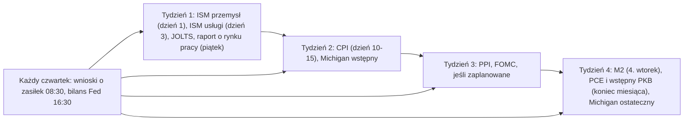

# 15. Twój pulpit i rutyna

**Dlaczego ten rozdział jest ważny.** Wiedza o tym, co oznacza każdy wskaźnik, to połowa pracy. Druga połowa to patrzenie na właściwe wskaźniki, we właściwym dniu i za każdym razem w ten sam sposób, tak aby zauważyć zmianę reżimu, zamiast reagować na nagłówki. Ten rozdział zamienia kurs w działającą rutynę: pulpit (dashboard) z około 40 bezpłatnymi szeregami danych z dokładnymi identyfikatorami FRED i tickerami TradingView, kalendarz publikacji danych z USA, rutynę tygodniową i miesięczną, instrukcję obsługi skryptu laboratorium makro dołączonego do kursu, jednostronicową listę kontrolną oraz ćwiczenia na prawdziwych danych z października 2026 roku.

**Czego się nauczysz**
- jakich bezpłatnych źródeł i dokładnych tickerów używać dla każdego wskaźnika z kursu;
- kiedy ukazuje się każda ważna publikacja danych z USA (dzień miesiąca, dzień tygodnia, godzina);
- jak wygląda 30-minutowa rutyna tygodniowa i 60-minutowa rutyna miesięczna;
- jak uruchomić `tools/macro-lab/macro_lab.py` i czytać jego raport;
- jak korzystać z jednostronicowej listy kontrolnej reżimu;
- jak unikać najczęstszych pułapek w danych (jednostki, rewizje, efekty bazy, różnice między dostawcami).

---

## 1. Pulpit

### 1.1 Stopy, inflacja, rynek pracy, wzrost, płynność i inne aktywa

Wszystkie szeregi FRED są bezpłatne pod adresem `https://fred.stlouisfed.org/series/<ID>` i można je pobrać jako CSV z `https://fred.stlouisfed.org/graph/fredgraph.csv?id=<ID>` (bez klucza API). Tickery TradingView działają w darmowym planie. Kolumna „Na co patrzeć” mówi, na co zwracać uwagę, a nie co robić.

| Wskaźnik | Id FRED | TradingView / inne | Częstotliwość | Na co patrzeć | Rozdział |
|---|---|---|---|---|---|
| Przedział docelowy stopy funduszy federalnych | DFEDTARU, DFEDTARL | ECONOMICS:USINTR | na posiedzeniach FOMC | kierunek i *powód* zmiany | [02](02-FED-I-STOPY-PROCENTOWE.md) |
| Efektywna stopa funduszy federalnych | DFF, EFFR (dzienne), FEDFUNDS (miesięczne) | FRED:FEDFUNDS | dziennie | różnica względem rentowności 2-letniej | [02](02-FED-I-STOPY-PROCENTOWE.md) |
| Ścieżka stóp Fed wyceniana przez rynek | — | CME FedWatch (cmegroup.com) | w ciągu dnia | *zmiany* prawdopodobieństw | [02](02-FED-I-STOPY-PROCENTOWE.md) |
| Bon 3-miesięczny | DGS3MO, TB3MS | TVC:US03MO | dziennie | punkt odniesienia dla 10Y–3M | [03](03-OBLIGACJE-I-KRZYWA-RENTOWNOSCI.md) |
| 2-letnie obligacje skarbowe | DGS2 | TVC:US02Y | dziennie | powyżej czy poniżej stopy funduszy federalnych | [03](03-OBLIGACJE-I-KRZYWA-RENTOWNOSCI.md) |
| 10-letnie obligacje skarbowe | DGS10 | TVC:US10Y | dziennie | poziom względem 5%; kierunek | [03](03-OBLIGACJE-I-KRZYWA-RENTOWNOSCI.md) |
| 30-letnie obligacje skarbowe | DGS30 | TVC:US30Y | dziennie | napięcia fiskalne i związane z premią za termin | [03](03-OBLIGACJE-I-KRZYWA-RENTOWNOSCI.md) |
| Krzywa 10Y–2Y, 10Y–3M | T10Y2Y, T10Y3M | TVC:US10Y-TVC:US02Y (wyrażenie spreadu) | dziennie | byczy czy niedźwiedzi wzrost nachylenia lub wypłaszczenie | [03](03-OBLIGACJE-I-KRZYWA-RENTOWNOSCI.md) |
| 10-letnia rentowność realna (TIPS) | DFII10 | — | dziennie | koszt pieniądza dla złota i BTC | [03](03-OBLIGACJE-I-KRZYWA-RENTOWNOSCI.md) |
| Inflacja implikowana (breakeven), 5y5y | T10YIE, T5YIFR | — | dziennie | 5y5y powyżej ok. 2,6–2,7% = oczekiwania się rozjeżdżają | [04](04-INFLACJA.md) |
| Premia za termin (Kim-Wright) | THREEFYTP10 | NY Fed ACM (newyorkfed.org) | dziennie / miesięcznie | dlaczego długie rentowności rosną po obniżkach | [03](03-OBLIGACJE-I-KRZYWA-RENTOWNOSCI.md) |
| Spready high-yield i IG | BAMLH0A0HYM2, BAMLC0A0CM | — | dziennie | ok. 5 = średnia, 8+ = recesja; FRED przechowuje tylko ok. 3 lata | [03](03-OBLIGACJE-I-KRZYWA-RENTOWNOSCI.md) |
| Zmienność obligacji (MOVE) | brak w FRED | TVC:MOVE | dziennie | powyżej 100 = napięcia na stopach | [03](03-OBLIGACJE-I-KRZYWA-RENTOWNOSCI.md) |
| VIX | VIXCLS | TVC:VIX | dziennie | poniżej 15 spokój, powyżej 30 napięcie | [08](08-AKCJE-ZLOTO-I-INNE-AKTYWA.md) |
| CPI ogólny / bazowy | CPIAUCSL, CPILFESL (SA); CPIAUCNS (ogólny NSA) | ECONOMICS:USIRYY, ECONOMICS:USCIR | miesięcznie | bazowy 3-miesięczny w ujęciu rocznym vs r/r | [04](04-INFLACJA.md) |
| Koszty mieszkaniowe (shelter), OER | CUSR0000SAH1, CUSR0000SEHC | — | miesięcznie | opóźnienie ok. 12 miesięcy względem czynszów rynkowych | [04](04-INFLACJA.md) |
| PCE / bazowy PCE | PCEPI, PCEPILFE | — | miesięcznie | miara preferowana przez Fed | [04](04-INFLACJA.md) |
| PPI popytu końcowego | PPIFIS | — | miesięcznie | presja w łańcuchu dostaw | [04](04-INFLACJA.md) |
| Oczekiwania inflacyjne Michigan na 1 rok | MICH | — | miesięcznie | dużo szumu; porównuj z 5y5y | [04](04-INFLACJA.md) |
| Bezrobocie U-3 / U-6 | UNRATE, U6RATE | ECONOMICS:USUR | miesięcznie | zmiana od cyklicznego minimum | [05](05-RYNEK-PRACY.md) |
| Reguła Sahm | SAHMREALTIME, SAHMCURRENT | — | miesięcznie | próg 0,50 (potwierdzenie, nie prognoza) | [05](05-RYNEK-PRACY.md) |
| Wnioski o zasiłek: pierwszorazowe / kontynuowane | ICSA, CCSA, IC4WSA | ECONOMICS:USIJC | tygodniowo | wzrost o 20–30% od minimum; linia 300 tys. Cowena | [05](05-RYNEK-PRACY.md) |
| Zatrudnienie poza rolnictwem | PAYEMS (licz różnice) | — | miesięcznie | średnia 3-miesięczna i rewizje | [05](05-RYNEK-PRACY.md) |
| JOLTS: wakaty, odejścia z pracy | JTSJOL, JTSQUR | — | miesięcznie | wczesny zwrot na rynku pracy | [05](05-RYNEK-PRACY.md) |
| Współczynnik aktywności zawodowej | CIVPART | — | miesięcznie | zmiany bezrobocia wywołane podażą pracy | [05](05-RYNEK-PRACY.md) |
| Realny PKB | A191RL1Q225SBEA, GDPC1 | — | kwartalnie | tylko potwierdzenie | [06](06-WZROST-I-CYKL-KONIUNKTURALNY.md) |
| GDPNow | GDPNOW | atlantafed.org | 6–7 razy w miesiącu | bieżąca prognoza (nowcast) dla trwającego kwartału | [06](06-WZROST-I-CYKL-KONIUNKTURALNY.md) |
| ISM przemysł / usługi | brak w FRED | ismworld.org; ISM:MAN_PMI u niektórych dostawców | miesięcznie | nowe zamówienia i ceny, nie tylko wskaźnik główny | [06](06-WZROST-I-CYKL-KONIUNKTURALNY.md) |
| Flaga recesji NBER; wygładzone prawdopodobieństwo | USREC; RECPROUSM156N | — | miesięcznie | datowane po fakcie | [06](06-WZROST-I-CYKL-KONIUNKTURALNY.md) |
| M2 | M2SL | ECONOMICS:USM2 | miesięcznie | dynamika r/r, nie poziom | [07](07-PLYNNOSC-PIENIADZ-I-DOLAR.md) |
| Bilans Fed | WALCL (mln USD) | — | tygodniowo | kierunek QT/QE | [07](07-PLYNNOSC-PIENIADZ-I-DOLAR.md) |
| TGA | WTREGEN (mln USD) | fiscaldata.treasury.gov (dziennie) | tygodniowo | odbudowa drenuje rezerwy | [07](07-PLYNNOSC-PIENIADZ-I-DOLAR.md) |
| Odwrotne repo | RRPONTSYD (mld USD) | — | dziennie | bufor; blisko zera od końca 2025 roku | [07](07-PLYNNOSC-PIENIADZ-I-DOLAR.md) |
| Rezerwy banków, SOFR, IORB | WRESBAL, SOFR, IORB | — | tygodniowo / dziennie | SOFR powyżej IORB = niedobór rezerw | [07](07-PLYNNOSC-PIENIADZ-I-DOLAR.md) |
| Dolar | DTWEXBGS (szeroki) | TVC:DXY, ICEUS:DX1! | dziennie | składnik warunków finansowych | [07](07-PLYNNOSC-PIENIADZ-I-DOLAR.md) |
| Jen, euro | DEXJPUS, DEXUSEU | FX:USDJPY | dziennie | tempo ruchów jena (carry trade) | [07](07-PLYNNOSC-PIENIADZ-I-DOLAR.md) |
| Ropa | DCOILWTICO, DCOILBRENTEU, WTISPLC | TVC:USOIL, TVC:UKOIL | dziennie | tempo ruchu | [08](08-AKCJE-ZLOTO-I-INNE-AKTYWA.md) |
| Złoto, srebro, miedź/złoto | brak w FRED | TVC:GOLD, OANDA:XAUUSD, TVC:SILVER, COMEX:HG1!/COMEX:GC1! | dziennie | względem rentowności realnych | [08](08-AKCJE-ZLOTO-I-INNE-AKTYWA.md) |
| Akcje | SP500 (ostatnie 10 lat), NASDAQCOM, NASDAQ100 | SP:SPX, NASDAQ:NDX, TVC:RUT, SP:SPXEW, INDEX:S5TH | dziennie | szerokość rynku (RSP/SPY, % spółek powyżej średniej 200-dniowej) | [08](08-AKCJE-ZLOTO-I-INNE-AKTYWA.md) |

### 1.2 Kryptowaluty

| Wskaźnik | Ticker / źródło | Na co patrzeć | Rozdział |
|---|---|---|---|
| Cena BTC i ETH | FRED CBBTCUSD, CBETHUSD; TradingView INDEX:BTCUSD, BITSTAMP:BTCUSD | zamknięcie tygodnia względem 20W SMA / 21W EMA (BMSB), 50W, 200W | [10](10-CYKLE-I-MODELE-WYCENY-BITCOINA.md) |
| Dominacja bitcoina | CRYPTOCAP:BTC.D (z uwzględnieniem stablecoinów); CoinGecko, CoinMarketCap | trend; dostawcy różnią się o 1–2 punkty | [12](12-DOMINACJA-ALTCOINY-I-ROTACJA.md) |
| Dominacja ETH | CRYPTOCAP:ETH.D | — | [12](12-DOMINACJA-ALTCOINY-I-ROTACJA.md) |
| ETH/BTC | BINANCE:ETHBTC | trend względem minimum z 2025 roku (0,0181) | [12](12-DOMINACJA-ALTCOINY-I-ROTACJA.md) |
| Całkowita kapitalizacja kryptowalut i jej części | CRYPTOCAP:TOTAL, TOTAL2 (bez BTC), TOTAL3 (bez BTC i ETH), OTHERS (spoza pierwszej dziesiątki) | szerokość rynku altcoinów | [12](12-DOMINACJA-ALTCOINY-I-ROTACJA.md) |
| Udział „długiego ogona” altcoinów | CRYPTOCAP:OTHERS.D | coraz niższe szczyty w każdym cyklu od 2021 roku | [12](12-DOMINACJA-ALTCOINY-I-ROTACJA.md) |
| Dominacja stablecoinów | CRYPTOCAP:USDT.D, USDC.D, STABLE.C.D | wzrost = ucieczka od ryzyka (risk-off) wewnątrz rynku krypto | [12](12-DOMINACJA-ALTCOINY-I-ROTACJA.md) |
| Pary altcoin/BTC | np. BINANCE:SOLBTC | dołki zakresu względem BTC | [12](12-DOMINACJA-ALTCOINY-I-ROTACJA.md) |
| Altcoin Season Index | blockchaincenter.net/en/altcoin-season-index; wersja CoinMarketCap | 75+ = sezon altcoinów (altseason), 25 lub mniej = sezon bitcoina | [12](12-DOMINACJA-ALTCOINY-I-ROTACJA.md) |
| Podaż stablecoinów | DefiLlama (defillama.com/stablecoins); TradingView CRYPTOCAP:USDT | tempo wzrostu w ciągu 90 dni | [11](11-ON-CHAIN-I-SENTYMENT.md) |
| Fear & Greed | alternative.me (API api.alternative.me/fng/) | skrajności utrzymują się tygodniami | [11](11-ON-CHAIN-I-SENTYMENT.md) |
| Przepływy do spotowych ETF-ów | farside.co.uk, SoSoValue | procykliczne | [11](11-ON-CHAIN-I-SENTYMENT.md) |
| Stopa finansowania (funding), otwarte pozycje (open interest), likwidacje | CoinGlass, Coinalyze, Velo; TradingView BTCUSDT.P | przeładowana dźwignia | [11](11-ON-CHAIN-I-SENTYMENT.md) |
| Cena zrealizowana, MVRV, NUPL, SOPR, podaż w zysku | Glassnode Studio, checkonchain.com, Bitcoin Magazine Pro, CryptoQuant, Coin Metrics community API | strefy dna | [11](11-ON-CHAIN-I-SENTYMENT.md) |
| Puell, hash rate, hash ribbons | Bitcoin Magazine Pro, Glassnode, mempool.space | napięcia u górników | [11](11-ON-CHAIN-I-SENTYMENT.md) |
| Google Trends | trends.google.com („bitcoin”, cały świat) | porównuj tylko w obrębie jednego pobrania | [11](11-ON-CHAIN-I-SENTYMENT.md) |
| Daty halvingów, wysokość bloku | mempool.space, blockchain.com | następny halving ok. kwietnia 2028 roku | [10](10-CYKLE-I-MODELE-WYCENY-BITCOINA.md) |

Platforma samego Cowena (intothecryptoverse.com) ma wiele z tych wykresów w płatnych planach subskrypcyjnych; jego bezpłatne notatki są dostępne na [benjamincowen.com/reports](https://benjamincowen.com/reports). Kurs nie zależy od żadnego z tych źródeł.

---

## 2. Kalendarz publikacji danych z USA

Godziny podano w czasie wschodnioamerykańskim (ET; zwykle 6 godzin wcześniej niż w Polsce). „Dzień roboczy” nie obejmuje weekendów ani świąt federalnych. Dokładne daty zmieniają się co roku; sprawdzaj kalendarz wydawcy (bls.gov/schedule, bea.gov, federalreserve.gov, ismworld.org).

| Publikacja | Wydawca | Kiedy | Godzina (ET) | Rewizje i osobliwości |
|---|---|---|---|---|
| ISM Manufacturing PMI | ISM | 1. dzień roboczy miesiąca (za poprzedni miesiąc) | 10:00 | czynniki sezonowe rewidowane co styczeń |
| ISM Services PMI | ISM | 3. dzień roboczy | 10:00 | — |
| Employment Situation (bezrobocie, zatrudnienie) | BLS | zwykle 1. piątek miesiąca (za poprzedni miesiąc) | 08:30 | przy każdej publikacji rewidowane dwa poprzednie miesiące; roczny benchmark: wstępny w sierpniu/wrześniu, ostateczny z raportem styczniowym w lutym; czynniki sezonowe badania gospodarstw domowych rewidowane co styczeń |
| JOLTS | BLS | ok. 5 tygodni po miesiącu, którego dotyczy, na początku miesiąca | 10:00 | rewidowany |
| Pierwszorazowe wnioski o zasiłek dla bezrobotnych | Departament Pracy | w każdy czwartek | 08:30 | wnioski kontynuowane są opóźnione o kolejny tydzień; sezonowe osobliwości latem i w styczniu |
| CPI | BLS | ok. 10–15 dni po końcu miesiąca | 08:30 | nierewidowany, poza czynnikami sezonowymi (5 lat wstecz, co luty) |
| PPI | BLS | ok. połowy miesiąca, zwykle po CPI | 08:30 | rewidowany |
| Nastroje i oczekiwania Uniwersytetu Michigan | Univ. of Michigan | wstępne w połowie miesiąca, ostateczne na koniec miesiąca | 10:00 | — |
| PCE i bazowy PCE (Personal Income and Outlays) | BEA | ok. 4 tygodnie po końcu miesiąca | 08:30 | rewidowany |
| PKB | BEA | wstępny (advance) ok. 4 tygodnie po końcu kwartału, potem drugi i trzeci szacunek | 08:30 | średnia bezwzględna rewizja z szacunku wstępnego do drugiego ok. 0,5 pkt proc. (1996–2024) |
| GDPNow | Atlanta Fed | po ważnych publikacjach, 6–7 razy w miesiącu | — | zbliża się do szacunku wstępnego |
| M2 (H.6) | Fed | 4. wtorek miesiąca, opóźnienie ok. 4 tygodni | 13:00 | dane tygodniowe wycofano w 2021 roku |
| Bilans Fed (H.4.1) | Fed | w każdy czwartek (wartości ze środy) | 16:30 | — |
| Rentowności obligacji skarbowych | Departament Skarbu USA / FRED | dziennie | ok. 15:30 | — |
| Efektywna stopa funduszy federalnych | NY Fed | dziennie, za poprzedni dzień | ok. 09:00 | — |
| TGA | Departament Skarbu (Daily Treasury Statement) | dziennie | po południu | w FRED tygodniowo (WTREGEN) |
| Komunikat FOMC i konferencja prasowa | Fed | 8 zaplanowanych posiedzeń w roku | 14:00 komunikat, 14:30 konferencja prasowa | protokół (minutes) 3 tygodnie później; Warsh zapowiedział 28 października 2026 roku, że w 2027 roku jedno z ośmiu posiedzeń będzie posiedzeniem „strategicznym” bez głosowania nad stopami |
| Summary of Economic Projections (kropki) | Fed | posiedzenia w marcu, czerwcu, wrześniu i grudniu | 14:00 | za kadencji Warsha przewodniczący nie zgłasza swojej kropki |
| Kwartalny plan emisji (quarterly refunding) | Departament Skarbu | początek lutego, maja, sierpnia, listopada | — | ustala wielkość emisji obligacji kuponowych |
| Datowanie recesji przez NBER | NBER | od kilku miesięcy do roku po punkcie zwrotnym | — | szczyt z grudnia 2007 roku ogłoszono w grudniu 2008 roku |

**Daty do zapamiętania na 30 października 2026 roku:** październikowy raport ISM Manufacturing 2 listopada 2026 roku; wybory połówkowe (midterm) w USA 3 listopada 2026 roku; następne posiedzenie FOMC 8–9 grudnia 2026 roku, przy czym po październikowym posiedzeniu FedWatch dawał ok. 83% szans na podwyżkę (według CNBC, 28 października 2026 roku). Paraliż (shutdown) administracji federalnej od 1 października do 12 listopada 2025 roku zostawił trwałą lukę: październikowe badanie gospodarstw domowych z 2025 roku (bezrobocie) i październikowy CPI z 2025 roku nigdy nie zostały opublikowane.

Typowy miesiąc:



---

## 3. Rutyna tygodniowa (ok. 30 minut)

Rób to o tej samej porze każdego tygodnia, na przykład po piątkowym zamknięciu sesji albo w weekend po tygodniowym zamknięciu bitcoina w niedzielę (UTC).

1. **Odśwież liczby.** Uruchom laboratorium makro (sekcja 5) albo otwórz zapisane wykresy FRED. Zanotuj datę każdej wartości.
2. **Polityka pieniężna i krótki koniec krzywej.** Czy rentowność 2-letnia jest powyżej czy poniżej efektywnej stopy funduszy federalnych i o ile? Czy prawdopodobieństwa FedWatch dla najbliższego posiedzenia zmieniły się o więcej niż ok. 20 punktów? Czy były wystąpienia członków Fed albo zdania odrębne?
3. **Długi koniec i krzywa.** Poziomy rentowności 10- i 30-letniej; 10Y–2Y i 10Y–3M. Nazwij ruch: byczy czy niedźwiedzi, wzrost nachylenia czy wypłaszczenie.
4. **Rynek pracy (szybki przegląd).** Pierwszorazowe wnioski o zasiłek i ich średnia 4-tygodniowa względem cyklicznego minimum; wnioski kontynuowane.
5. **Wskaźniki napięć.** Spread HY, VIX, MOVE. Czy któryś gwałtownie się poszerzył?
6. **Płynność i dolar.** WALCL, TGA, RRP, rezerwy (policz płynność netto = WALCL − TGA − RRP); szeroki indeks dolara albo DXY; USDJPY, jeśli jen szybko się porusza.
7. **Ropa.** Brent i WTI: poziom i skala ruchu w tygodniu.
8. **Kryptowaluty.** Tygodniowe zamknięcie BTC względem BMSB, 50W i 200W; BTC.D, ETH/BTC, USDT.D, OTHERS.D; Fear & Greed; przepływy do ETF-ów; podaż stablecoinów.
9. **Zapisz to.** Jedna linijka na obszar: co się zmieniło i do której kolumny tabeli reżimów z [rozdziału 13](13-JAK-TO-SIE-LACZY.md#5-tabela-reżimów-co-wskaźniki-i-aktywa-zwykle-robią-w-każdej-fazie) teraz pasuje. Jeśli śledzisz filmy Cowena, dopisz najnowszy podany przez niego poziom unieważnienia (invalidation) wraz z datą ([rozdział 14](14-RAMY-COWENA-I-DEKODER-FILMOW.md)).

## 4. Rutyna miesięczna (ok. 60 minut, po raporcie o rynku pracy i CPI)

1. **Rynek pracy.** Zmiana bezrobocia od cyklicznego minimum; reguła Sahm; średnia 3-miesięczna zatrudnienia poza rolnictwem i rewizje; współczynnik aktywności zawodowej (czy bezrobocie zmienia się z powodu zwolnień, czy podaży pracy?); wakaty i odejścia z pracy w JOLTS.
2. **Inflacja.** CPI ogólny i bazowy r/r *oraz* 3-miesięczny w ujęciu rocznym; koszty mieszkaniowe; PCE i bazowy PCE, gdy zostaną opublikowane; PPI; inflacja implikowana 5y5y. Sprawdź, co efekty bazy zrobią z dynamiką r/r w ciągu najbliższych trzech miesięcy.
3. **Wzrost.** Nowe zamówienia, ceny i zatrudnienie w ISM; GDPNow; sezon wyników spółek, gdy trwa.
4. **Pieniądz.** M2 r/r; trend płynności netto w ciągu trzech miesięcy.
5. **Oceń reżim na nowo.** Wypełnij listę kontrolną z sekcji 6. Policz, ile odczytów wypada w każdej kolumnie.
6. **Test: miękkie czy twarde lądowanie.** Przejdź przez tabelę z [rozdziału 13 §10](13-JAK-TO-SIE-LACZY.md#10-miękkie-czy-twarde-lądowanie-lista-kontrolna-w-czasie-rzeczywistym).
7. **Przegląd.** Przeczytaj ponownie zapiski z zeszłego miesiąca. Czego się spodziewałeś, co się stało, co źle odczytałeś?

**Dodatki kwartalne:** przeczytaj nowy wykres kropkowy (dot plot) i porównaj go z FedWatch; przeczytaj wstępny szacunek PKB (i GDI); zanotuj wielkości emisji z kwartalnego planu Departamentu Skarbu; uruchom całe laboratorium ponownie i porównaj tabele z migawką, z której korzysta kurs.

---

## 5. Laboratorium makro: jak je uruchomić i czytać

[Laboratorium makro](../../tools/macro-lab/README.md) to jeden skrypt w Pythonie, `tools/macro-lab/macro_lab.py`, który pobiera bezpłatne dane z FRED i na nowo przelicza każdą tabelę statystyczną cytowaną w tym kursie.

**Wymagania.** Python 3.9 lub nowszy, wyłącznie biblioteka standardowa (bez pandas, bez klucza API, bez konta) oraz dostęp do internetu i serwisu fred.stlouisfed.org.

**Uruchomienie.**

```bash
cd tools/macro-lab
python3 macro_lab.py                     # writes REPORT.md
python3 macro_lab.py --out my-report.md  # choose the output file
python3 macro_lab.py --offline           # recompute from the cache only
python3 macro_lab.py --cache .fred-cache # choose the cache folder (default)
```

Pierwsze uruchomienie pobiera ok. 25 plików CSV (kilka MB) do katalogu `.fred-cache/`. Kolejne uruchomienia w ciągu 24 godzin korzystają z nich ponownie. Jeśli pobieranie się nie powiedzie, skrypt używa kopii z pamięci podręcznej i wypisuje ostrzeżenie (polecenia powyżej: domyślnie zapis do `REPORT.md`; `--out` wybiera plik wynikowy; `--offline` liczy wyłącznie z pamięci podręcznej; `--cache` wskazuje jej katalog). Wynikiem jest pojedynczy plik Markdown, który otworzysz w dowolnym edytorze lub na GitHubie.

**Co mówi każda sekcja raportu.**

| Sekcja | Co oblicza | Jak to czytać |
|---|---|---|
| Pulpit: najnowsze wartości | 19 szeregów: najnowsza wartość, wartość sprzed 3 miesięcy, sprzed roku (CPI, bazowy PCE i M2 jako % r/r) | najpierw sprawdź kolumnę „as of” (stan na dzień); szeregi miesięczne są opóźnione o 4–6 tygodni |
| Recesje NBER | miesiące początku i końca od 1960 roku na podstawie USREC | punkt odniesienia dla każdego opóźnienia w pozostałych tabelach |
| Krzywa rentowności 10Y–3M i 10Y–2Y | epizody odwrócenia (2+ miesiące, średnie miesięczne), liczba miesięcy do następnej recesji od pierwszego odwrócenia i od powrotu krzywej do dodatniego nachylenia (un-inversion) | ujemne opóźnienia oznaczają, że recesja zaczęła się przed powrotem do dodatniego nachylenia; „none within 36 m” (brak w ciągu 36 miesięcy) oznacza nieudany sygnał; „none yet” (jeszcze brak) oznacza, że 36-miesięczne okno jest wciąż otwarte |
| Uruchomienia reguły Sahm | pierwszy miesiąc z odczytem 0,50 lub wyższym (ponowne „uzbrojenie” poniżej 0,30) względem początku recesji | dodatnie „months after start” (miesiące po początku) = reguła potwierdziła recesję z opóźnieniem |
| Minimum bezrobocia vs recesja | cykliczne minimum w ciągu 36 miesięcy przed każdą recesją i wzrost do jej początku | minimum przypada 1–33 miesiące wcześniej |
| Cykle Fed | ostatnia podwyżka → pierwsza obniżka; Nasdaq po +3/+6/+12 miesiącach; najgorsze zamknięcie w ciągu 18 miesięcy; szczyt bezrobocia; BTC po +12 miesiącach | zanim wyciągniesz wnioski, podziel wiersze według „recession within 24 m” (recesja w ciągu 24 miesięcy) |
| Cykl prezydencki | roczne stopy zwrotu Nasdaqa według roku kadencji; obsunięcia (drawdown) w latach wyborów połówkowych i odbicie od dołka | odbicie liczone jest od dołka znanego dopiero po fakcie |
| Stan bitcoina | 200-tygodniowa SMA, BMSB (20W SMA / 21W EMA), wartość godziwa z regresji logarytmicznej i z-score | regresja zaczyna się w grudniu 2014 roku (zakres danych FRED), więc jej nachylenie i wartość godziwa różnią się od dopasowań obejmujących lata 2010–14 |
| Kroczące korelacje (tygodniowe) | BTC względem Nasdaqa, szerokiego indeksu dolara, 10-letniej rentowności realnej, według lat | tygodniowe stopy zwrotu to uczciwa wersja; dzienne znaczniki czasu nie są zsynchronizowane |
| Wyprzedzenie płynności netto i M2 | korelacje przy różnych wyprzedzeniach | niskie wartości (ok. 0,1–0,25) oznaczają słabe zależności |
| ETH/BTC vs zmiana stopy docelowej Fed | roczna zmiana ETH/BTC obok zmiany stopy docelowej Fed | sprawdzian tezy „altcoiny potrzebują obniżek stóp” |

**Przykład: migawka z 30 października 2026 roku** ([REPORT-2026-10-30.md](../../tools/macro-lab/REPORT-2026-10-30.md)).
- Pulpit: górna granica stopy funduszy federalnych 4,00% (wzrost z 3,75% trzy miesiące wcześniej), rentowność 2-letnia 4,67%, 10-letnia 5,05%, 10Y–2Y +0,37, bezrobocie 4,2%, reguła Sahm 0,00, wnioski o zasiłek 194 000, CPI 3,72% r/r (wrzesień), bazowy PCE 3,12%, spread HY 3,14, VIX 16,91, bitcoin 77 939 USD. Odczytanie: Fed i długie rentowności zacieśniają warunki, podczas gdy rynek pracy, kredyt i zmienność są spokojne.
- Krzywa rentowności: odwrócenie 10Y–2Y z lat 2022–24 (minimum −0,93 w średnich miesięcznych) i epizod 10Y–3M z lat 2022–24 pokazują „none within 36 m”; krótki epizod 10Y–3M z 2025 roku pokazuje „none yet (window open to 2028-03)” (jeszcze brak, okno otwarte do marca 2028). Odczytanie: sygnał z lat 2022–24 zawiódł; sygnał z 2025 roku jest wciąż nierozstrzygnięty.
- Cykle Fed: cykl 2023–24 pokazuje Nasdaq +25,6% po 12 miesiącach, bezrobocie 4,1% → 4,5%, brak recesji w ciągu 24 miesięcy, BTC +83%. Odczytanie: cykl „ubezpieczeniowy”.
- Bitcoin: 37,5% poniżej historycznego maksimum zamknięcia tygodniowego (ATH) na poziomie 124 720 USD; 15% powyżej 200-tygodniowej SMA (67 497 USD); powyżej 20W SMA (72 965 USD) i 21W EMA (76 677 USD); cena na poziomie 0,53 wartości godziwej z regresji laboratorium (z = −1,17).
- Testy płynności: płynność netto wyprzedzająca BTC o 0–8 tygodni daje r ≈ 0,18–0,19; M2 wyprzedzające BTC daje najwyżej 0,25. Odczytanie: czynniki tła, a nie narzędzia do wyczucia momentu (timingu).

**Ograniczenia, które warto znać** (z README laboratorium): szereg bitcoina w FRED zaczyna się w grudniu 2014 roku, więc brakuje historii z lat 2010–14; Nasdaq Composite zastępuje „akcje”, bo S&P 500 w FRED obejmuje tylko dziesięć lat; osiem recesji i trzy cykle bitcoina to bardzo małe próby; korelacje na nakładających się oknach r/r wyglądają na silniejsze, niż są. Luki w danych wymagają ostrożności: w FRED nie ma odczytu CPI za październik 2025 roku (paraliż administracji), więc skrypt, który cofa się o „12 wierszy” zamiast o 12 miesięcy kalendarzowych, po cichu liczy zmianę 13-miesięczną dla każdego miesiąca po luce. Laboratorium dopasowuje dane po dacie, dlatego jego dynamika CPI r/r za wrzesień 2026 roku (3,72%, wyrównana sezonowo) zgadza się z oficjalnym odczytem BLS na poziomie 3,7%. Gdy liczba ma znaczenie, sprawdzaj zarówno metodę, jak i wartość.

---

## 6. Jednostronicowa lista kontrolna

Co miesiąc kopiuj tę tabelę do swoich notatek. Przy każdym wierszu zaznacz, do której kolumny dzisiejszy odczyt pasuje najlepiej. Liczy się *liczba* odczytów w kolumnach i *zmiana* względem poprzedniego miesiąca, a nie pojedynczy wiersz.

| Pytanie | Wskaźnik | Ekspansja | Późna faza cyklu / zacieśnianie | Rosnące ryzyko recesji | Dziś (data) |
|---|---|---|---|---|---|
| W którą stronę idzie polityka pieniężna? | stopa funduszy federalnych, rentowność 2-letnia vs stopa funduszy federalnych, FedWatch | 2-letnia ≈ stopa funduszy federalnych | 2-letnia powyżej stopy funduszy federalnych; podwyżki w cenach | 2-letnia wyraźnie poniżej stopy funduszy federalnych; obniżki w cenach | |
| Co robi krzywa? | T10Y2Y, T10Y3M | stroma, stabilna | niedźwiedzie wypłaszczenie lub odwrócona | byczy wzrost nachylenia, powrót do dodatniego nachylenia | |
| Czy długie rentowności dociskają? | DGS10, DFII10, THREEFYTP10 | stabilne | rosną; rentowność realna powyżej 2% | szybko spadają (ucieczka do bezpiecznych aktywów) | |
| Czy inflacja jest ograniczeniem? | bazowy CPI 3-miesięczny w ujęciu rocznym, bazowy PCE, 5y5y | blisko 2% | powyżej 3%; szok podażowy | spada | |
| Czy zaczynają się zwolnienia? | ICSA, CCSA | na minimach | na minimach | wzrost o 20–30% od minimum | |
| Czy bezrobocie zawraca? | UNRATE, SAHMREALTIME, CIVPART | spada lub stabilne | na minimum | +0,5 pkt proc. od minimum, napędzane zwolnieniami | |
| Czy kredyt pęka? | BAMLH0A0HYM2 | poniżej ok. 4 | ok. 2,4–3,5 (samozadowolenie) | poszerza się w stronę 5–8 | |
| Czy aktywność gospodarcza słabnie? | nowe zamówienia ISM, GDPNow | powyżej 50 | powyżej 50 przy wysokich cenach płaconych | poniżej 50 i spada | |
| Czy płynność rośnie? | M2 r/r, płynność netto, RRP, rezerwy | rośnie | płaska; bufory wyczerpane | QT lub wypadek w finansowaniu | |
| Czy dolar zacieśnia warunki? | DTWEXBGS, DXY | płaski lub spada | rośnie | gwałtowny skok (bezpieczna przystań), potem spadek | |
| Czy są napięcia? | VIX, MOVE | VIX poniżej 15 | VIX 15–20 | VIX powyżej 30, MOVE powyżej 100 | |
| Co robi ropa? | Brent, WTI | stabilna | +50% lub więcej w ciągu roku | gwałtowny skok lub załamanie | |
| Trend na rynku krypto | tygodniowe zamknięcie BTC względem BMSB, 50W, 200W | powyżej BMSB | poniżej BMSB | blisko lub poniżej 200W | |
| Szerokość rynku krypto | BTC.D, ETH/BTC, OTHERS.D, USDT.D | BTC.D spada, a altcoiny rosną w USD | BTC.D rośnie; ETH/BTC spada | USDT.D rośnie; wszystko spada | |
| Sentyment | Fear & Greed, wskaźniki społecznościowe | chciwość | apatia | skrajny strach przez wiele tygodni | |

Praktyczne zasady wynikające z kursu: żaden pojedynczy wiersz nie przesądza o reżimie; zgodność rynku pracy, kredytu i krzywej to najsilniejsze połączenie; w latach 2024–26 każda prognoza recesji oparta na jednym wierszu okazała się błędna ([rozdział 13](13-JAK-TO-SIE-LACZY.md#9-kontrprzykłady-kiedy-łańcuch-się-zerwał)).

---

## 7. Pułapki w danych

| Pułapka | Przykład | Rozwiązanie |
|---|---|---|
| Jednostki | WALCL i WTREGEN są w mln USD, RRPONTSYD w mld USD | przed odejmowaniem pomnóż RRP przez 1000 |
| Rewizje | benchmark zatrudnienia za rok do marca 2025 roku zrewidowano o −911 tys. (wstępnie) i −898 tys. (ostatecznie) | używaj średnich 3-miesięcznych; sprawdzaj kolejną publikację |
| Efekty bazy | skoki CPI z marca–maja 2026 roku (+0,87%, +0,64%, +0,47% m/m) wypadną z okna w marcu–maju 2027 roku i obniżą dynamikę r/r, nawet jeśli ceny pozostaną wysokie | patrz na dynamikę m/m i 3-miesięczną w ujęciu rocznym |
| Brakujące dane | brak danych o bezrobociu i CPI za październik 2025 roku (paraliż administracji) | nie interpoluj po cichu; oznacz lukę |
| Skrócona historia | FRED przechowuje tylko ok. 3 lata danych ICE o spreadach kredytowych | do historii używaj opublikowanych benchmarków (rozdział 03) |
| Różnice między dostawcami | dominacja BTC różni się o 1–2 punkty między TradingView, CoinGecko i CoinMarketCap; Fear & Greed ma kilka wersji | zawsze używaj tego samego źródła i je zapisuj |
| Śróddzienne vs zamknięcie | ATH BTC ok. 126,1 tys. USD śróddziennie vs 124 824 USD na zamknięciu dnia vs 124 720 USD na zamknięciu tygodnia | mów, o którą wartość ci chodzi |
| Szoki podaży pracy | 2024: reguła Sahm uruchomiła się z powodu wzrostu siły roboczej | sprawdzaj łącznie współczynnik aktywności zawodowej i wnioski o zasiłek |
| Nakładające się okna | korelacje M2 r/r z BTC r/r | wybieraj tygodniowe lub miesięczne *zmiany* |
| Wiedza po fakcie | „dołek roku wyborów połówkowych” albo „dołek cyklu” są znane dopiero po fakcie | zapisuj, co wiedziałeś w danym dniu |

---

## 8. Składamy to w całość

1. **Czwartek, 08:30, wnioski o zasiłek skaczą.** Pierwszorazowe wnioski rosną o 20–30% od minimum w ciągu kilku tygodni → tego samego dnia sprawdź wnioski kontynuowane i spread HY → jeśli oba rosną, kluczową publikacją staje się następny raport o rynku pracy; wzrost bezrobocia o 0,5 pkt proc. uruchomiłby regułę Sahm → historycznie Fed wtedy obniża stopy, a krzywa przechodzi w byczy wzrost nachylenia (bull steepening), z recesją w ciągu kilku miesięcy (2001, 2008). Wyjątek: 2024 rok, gdy bezrobocie wzrosło z powodu podaży pracy, a wnioski o zasiłek pozostały niskie.
2. **Dzień CPI, gorąca inflacja bazowa.** Bazowy CPI 3-miesięczny w ujęciu rocznym skacze → rentowność 2-letnia i prawdopodobieństwa FedWatch reagują w ciągu minut → dolar rośnie, a altcoiny tego dnia tracą najwięcej → sprawdź, czy ruszyła inflacja implikowana 5y5y (w 2026 roku nie ruszyła, więc długoterminowe oczekiwania pozostały zakotwiczone).
3. **Tydzień FOMC.** Przeczytaj komunikat pod kątem zmian w sformułowaniach, a wynik głosowania pod kątem zdań odrębnych → w 2026 roku trzy zdania odrębne przeciwko nastawieniu na luzowanie w kwietniu i trzy zdania odrębne za podwyżką w lipcu (na posiedzeniu poprzedzającym) zapowiedziały wrześniową podwyżkę → następnie porównaj kropki z FedWatch.
4. **Niedzielne zamknięcie tygodnia.** BTC zamyka się poniżej BMSB → sprawdź BTC.D i ETH/BTC (czy altcoiny spadają szybciej?) oraz USDT.D (czy pieniądze parkują w stablecoinach?) → w ramach Cowena utrata pasa po szczycie oznacza rynek niedźwiedzia (grudzień 2021, listopad 2025); w 2026 roku pas był kilkakrotnie tracony i odzyskiwany, więc liczyło się potwierdzenie na więcej niż jednym zamknięciu.

---

## 9. Ćwiczenia

Korzystaj z podanych liczb. Odpowiedzi znajdziesz w rozwijanych blokach.

**Ćwiczenie 1.** 28 października 2026 roku rentowność 2-letnia wynosiła 4,67%, a efektywna stopa funduszy federalnych 3,88%. Co wycenia rynek i jak Cowen opisuje tę zależność?

<details>
<summary>Odpowiedź</summary>

Rentowność 2-letnia jest ok. 80 pb powyżej efektywnej stopy funduszy federalnych, więc rynek oczekuje wzrostu stopy referencyjnej (kolejnych podwyżek). FedWatch dawał ok. 83% szans na podwyżkę w grudniu 2026 roku. Skrót myślowy Cowena: „Fed goni rentowność 2-letnią” („the Fed chases the 2-year”); stopa funduszy federalnych poniżej rentowności 2-letniej oznacza, że polityka nie jest restrykcyjna w stosunku do oczekiwań rynku ([rozdział 02](02-FED-I-STOPY-PROCENTOWE.md)).
</details>

**Ćwiczenie 2.** Oblicz realną stopę funduszy federalnych przy efektywnej stopie 3,88% i inflacji bazowej PCE 3,12% (wrzesień 2026). Następnie oblicz ją względem ogólnego PCE (3,65%). Co mówią ci te dwa wyniki?

<details>
<summary>Odpowiedź</summary>

3,88 − 3,12 = +0,76 pkt proc.; 3,88 − 3,65 = +0,23 pkt proc. Polityka jest w ujęciu realnym tylko umiarkowanie restrykcyjna, a względem inflacji ogólnej ledwie dodatnia. Dlatego „jastrzębi” członkowie FOMC opowiadali się w 2026 roku za kolejnymi podwyżkami. Dla porównania: w połowie 2024 roku stopa realna wynosiła ok. +2,6.
</details>

**Ćwiczenie 3.** Liczby ćwiczeniowe (wymyślone na potrzeby zadania): 3-miesięczna średnia stopy bezrobocia w ciągu ostatnich 12 miesięcy miała minimum 3,9%. Ostatnie trzy miesięczne odczyty to 4,3%, 4,4% i 4,5%. Czy reguła Sahm się uruchamia? Jakie dwa sprawdziany przeprowadzisz, zanim nazwiesz to sygnałem recesji?

<details>
<summary>Odpowiedź</summary>

Średnia 3-miesięczna to (4,3 + 4,4 + 4,5) / 3 = 4,4%. 4,4 − 3,9 = 0,5 pkt proc., więc tak, reguła się uruchamia. Sprawdziany: (1) czy napędzają to zwolnienia (rosną wnioski pierwszorazowe i kontynuowane, przybywa osób trwale tracących pracę), czy podaż pracy (rośnie współczynnik aktywności zawodowej, jak w 2024 roku)? (2) czy poszerzają się spready high-yield? Reguła zwykle uruchamia się 1–4 miesiące po tym, jak recesja już się zaczęła, i dała fałszywe sygnały w 1976 i 2024 roku.
</details>

**Ćwiczenie 4.** Od dołków z 27 lutego 2026 roku (3,38% i 3,97%) do 28 października 2026 roku rentowność 2-letnia wzrosła o ok. 130 pb, a 10-letnia o ok. 108 pb; 10Y–2Y spadło z +0,74 (30 stycznia) do +0,37 (29 października). Nazwij ten ruch krzywej i jego typową przyczynę.

<details>
<summary>Odpowiedź</summary>

Niedźwiedzie wypłaszczenie (bear flattening): obie rentowności wzrosły, krótki koniec bardziej. Zwykle dzieje się tak, gdy Fed podnosi stopy lub oczekuje się, że będzie je podnosił. To przeciwieństwo byczego wzrostu nachylenia, który zwykle towarzyszy pierwszym obniżkom w słabnącej gospodarce.
</details>

**Ćwiczenie 5.** Oblicz płynność netto w USA na podstawie pulpitu laboratorium: bilans Fed 6 745,64 mld USD (28 października), RRP 0,35 mld USD (29 października) i TGA ok. 1000 mld USD ([notatki badawcze C](../../research-notes/C-growth-liquidity-crossasset.md), 28 października). Jaką pułapkę kryją dane z FRED i dlaczego RRP blisko zera ma znaczenie?

<details>
<summary>Odpowiedź</summary>

6 745,64 − 1000 − 0,35 ≈ 5745 mld USD, czyli ok. 5,75 bln USD. Pułapka: w FRED WALCL i WTREGEN są w mln USD, a RRPONTSYD w mld USD; przelicz przed odejmowaniem. RRP blisko zera oznacza, że zniknął bufor, który w latach 2023–24 równoważył QT: każde dalsze kurczenie bilansu lub odbudowa TGA idzie teraz bezpośrednio z rezerw banków.
</details>

**Ćwiczenie 6.** Korzystając z tabeli cykli Fed z laboratorium, podziel pierwsze obniżki na „recesja w ciągu 24 miesięcy” i „brak recesji” i porównaj 12-miesięczne stopy zwrotu Nasdaqa.

<details>
<summary>Odpowiedź</summary>

Brak recesji: 1984 (+12,3%), 1987 (+19,6%), 1995 (+21,6%), 1998 (+57,5%), 2024 (+25,6%). Recesja w ciągu 24 miesięcy: 1989 (+3,8%), 2001 (−21,9%), 2007 (−20,8%), 2019 (+32,5%, recesja wywołana przez COVID). Bez recesji każdy przypadek był dodatni; z recesją wyniki wahały się od głębokich strat do dużego zysku w latach 2019–20, gdy Fed zalał system pieniądzem po krachu. Sama pierwsza obniżka nie mówi, jaki będzie wynik.
</details>

**Ćwiczenie 7.** Laboratorium pokazuje BTC na poziomie 77 939 USD, 200-tygodniową SMA na 67 497 USD, 20-tygodniową SMA na 72 965 USD i 21-tygodniową EMA na 76 677 USD. Gdzie jest cena względem każdej z nich i jak nazwałyby to ramy Cowena?

<details>
<summary>Odpowiedź</summary>

Ok. 15% powyżej 200W SMA i powyżej obu linii pasa wsparcia rynku byka (bull market support band), choć tylko ok. 1,6% powyżej 21W EMA. W jego ramach tygodniowe zamknięcia powyżej pasa oznaczają trend byczy, a poniżej niego niedźwiedzi; zamknięcie z powrotem poniżej pasa przeniosłoby uwagę ponownie na 200W („randka z przeznaczeniem”, „date with destiny”). Zauważ, że jego mapa drogowa z końca października 2026 roku i tak była niedźwiedzia, a poziomem, który by ją unieważnił, było 83 tys. USD.
</details>

**Ćwiczenie 8.** Ogólny CPI wzrósł o +0,87%, +0,64% i +0,47% m/m w marcu, kwietniu i maju 2026 roku. Jeśli w marcu–maju 2027 roku ceny będą stały w miejscu, co stanie się z dynamiką rok do roku i dlaczego ma to znaczenie przy odczytywaniu Fed?

<details>
<summary>Odpowiedź</summary>

Te duże miesiące wypadną z 12-miesięcznego okna, więc dynamika r/r spadnie mechanicznie mniej więcej o ich wielkość (łącznie ok. 2 pkt proc. w ciągu trzech miesięcy), nawet bez żadnej realnej poprawy. Nagłówek „inflacja spada” wiosną 2027 roku może w dużej mierze wynikać z efektów bazy. Zamiast tego obserwuj dynamikę m/m i bazową 3-miesięczną w ujęciu rocznym; Fed obserwuje bazowy PCE.
</details>

**Ćwiczenie 9.** Laboratorium wykazuje, że M2 r/r w USA wyprzedzające BTC r/r o 6 miesięcy ma korelację 0,25. Podaj dwa powody, dla których nie jest to użyteczny sygnał do wyczucia momentu.

<details>
<summary>Odpowiedź</summary>

(1) r = 0,25 oznacza R² ≈ 6%: M2 wyjaśnia niewielką część ruchów BTC. (2) Nakładające się okna rok do roku zawyżają korelacje, bo każdy miesięczny punkt dzieli 11 miesięcy danych z następnym. Ponadto: w 2023 roku M2 skurczyło się po raz pierwszy w historii danych od 1959 roku, a BTC wzrósł o 156%, natomiast w latach 2025–26 M2 rosło, a BTC spadł o połowę.
</details>

**Ćwiczenie 10.** Jest czwartek, 08:30 ET. Jaka publikacja danych z USA właśnie się ukazała? Jaka ukaże się o 16:30 tego samego dnia?

<details>
<summary>Odpowiedź</summary>

O 08:30 tygodniowe pierwszorazowe wnioski o zasiłek dla bezrobotnych (Departament Pracy); o 16:30 publikacja bilansu Fed H.4.1 (WALCL, wartości ze środy).
</details>

**Ćwiczenie 11.** Sklasyfikuj każde stwierdzenie z mapy drogowej Cowena z 24–26 października 2026 roku jako fakt (na 30 października), prognozę lub poziom unieważnienia: (a) „weekly close below $83k” (tygodniowe zamknięcie poniżej 83 tys. USD); (b) „the Fed does not hike on 28 Oct” (Fed nie podnosi stóp 28 października); (c) „oil around $120” (ropa w okolicach 120 USD); (d) „stocks and BTC drop in Q4” (akcje i BTC spadają w IV kwartale); (e) „void above $83k” (unieważnienie powyżej 83 tys. USD).

<details>
<summary>Odpowiedź</summary>

(a) fakt: BTC zamknął się poniżej 83 tys. USD (tydzień z 25 października). (b) fakt: Fed utrzymał stopy 28 października. (c) mniej więcej fakt: Brent kosztował 123,10 USD 27 października (FRED). (d) prognoza, nierozstrzygnięta na 30 października. (e) poziom unieważnienia. Zauważ, że potwierdzone kroki były tymi łatwiejszymi, krótkoterminowymi; kluczowy krok (d) pozostawał otwarty.
</details>

**Ćwiczenie 12.** 30 października 2026 roku widzisz BTC.D na poziomie ok. 59–60%, ETH/BTC ok. 0,029, Altcoin Season Index w okolicach 45–53 i USDT.D ok. 6,8%. ISM Manufacturing wynosi 54,5. Do jakiego reżimu pasują dane z rynku krypto i co to mówi o tezie „ISM powyżej 50 → sezon altcoinów”?

<details>
<summary>Odpowiedź</summary>

Reżim prowadzony przez bitcoina, typowy dla zacieśniania: wysoka dominacja, ETH/BTC blisko minimów, brak sezonu altcoinów (potrzebne 75+). Wzrost ISM nastąpił bez sezonu altcoinów, więc teza (kojarzona z Raoulem Palem, nie z Cowenem) nie zdała testu w 2026 roku. Wzrostowi ISM towarzyszyły wysokie ceny płacone i podwyżki stóp przez Fed, a nie luzowanie i rosnąca płynność ([rozdział 06](06-WZROST-I-CYKL-KONIUNKTURALNY.md)).
</details>

---

## Sprawdź się

1. Których trzech publikacji nie przegapiłbyś w żadnym miesiącu i dlaczego?
2. Dlaczego przy każdej wartości na pulpicie warto zapisywać datę, na którą jest aktualna („as of”)?
3. Co oznacza sytuacja, w której SOFR jest notowany powyżej IORB?
4. Które dwie sekcje laboratorium przeczytałbyś najpierw, aby ocenić, czy pierwsza obniżka stóp przez Fed prawdopodobnie skończy się dobrze?
5. Dlaczego lista kontrolna każe liczyć odczyty we wszystkich wierszach, zamiast ufać jednemu?

<details>
<summary>Odpowiedzi</summary>

1. Raport o rynku pracy (bezrobocie i zatrudnienie), CPI i decyzja FOMC. Razem obejmują wyzwalacz z rynku pracy, ograniczenie ze strony inflacji i reakcję polityki pieniężnej. Tygodniowe wnioski o zasiłek są szybkim sprawdzianem pomiędzy nimi.
2. Szeregi miesięczne są opóźnione o 4–6 tygodni, a niektóre są rewidowane; zestawienie świeżej wartości dziennej z nieaktualną miesięczną może sprawić, że obraz wyda się bardziej (albo mniej) spójny, niż jest naprawdę.
3. Rezerwy banków stają się niedoborowe; finansowanie jest napięte. Zdarzyło się to we wrześniu 2019 roku i pod koniec 2025 roku, a Fed zareagował dodaniem rezerw.
4. Tabelę cykli Fed (wyniki podzielone według tego, czy nastąpiła recesja) oraz tabele bezrobocia / reguły Sahm (czy rynek pracy zawraca). Następnie sprawdź spready kredytowe na pulpicie.
5. Każda prognoza recesji oparta na jednym wskaźniku zawiodła w latach 2024–26 (krzywa, reguła Sahm, M2, ISM). Zgodność rynku pracy, kredytu i krzywej okazywała się bardziej wiarygodna niż jakikolwiek pojedynczy szereg.
</details>

---

> Materiał edukacyjny, nie doradztwo finansowe. Historyczne zależności między wskaźnikami mogą przestać działać.

[← 14. Ramy Cowena i dekoder filmów](14-RAMY-COWENA-I-DEKODER-FILMOW.md) | [Indeks](00-INDEKS.md) | [16. Słowniczek →](16-SLOWNICZEK.md)
